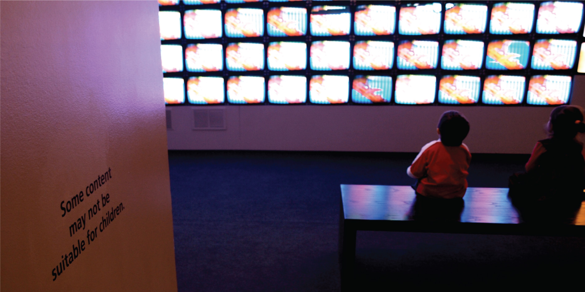

# Introduction

**Figure 2.1** How does television content impact children’s behavior? (credit: modification of work by “antisocialtory”/Flickr)

## Chapter Outline

- [2.1 Why Is Research Important?](01-2-1-why-is-research-important.md)
- [2.2 Approaches to Research](02-2-2-approaches-to-research.md)
- [2.3 Analyzing Findings](03-2-3-analyzing-findings.md)
- [2.4 Ethics](04-2-4-ethics.md)

Have you ever wondered whether the violence you see on television affects your behavior? Are you more likely to behave aggressively in real life after watching people behave violently in dramatic situations on the screen? Or, could seeing fictional violence actually get aggression out of your system, causing you to be more peaceful? How are children influenced by the media they are exposed to? A psychologist interested in the relationship between behavior and exposure to violent images might ask these very questions.

Since ancient times, humans have been concerned about the effects of new technologies on our behaviors and thinking processes. The Greek philosopher Socrates, for example, worried that writing—a new technology at that time—would diminish people’s ability to remember because they could rely on written records rather than committing information to memory. In our world of rapidly changing technologies, questions about their effects on our daily lives and their resulting long-term impacts continue to emerge. In addition to the impact of screen time (on smartphones, tablets, computers, and gaming), technology is emerging in our vehicles (such as GPS and smart cars) and residences (with devices like Alexa or Google Home and doorbell cameras). As these technologies become integrated into our lives, we are faced with questions about their positive and negative impacts. Many of us find ourselves with a strong opinion on these issues, only to find the person next to us bristling with the opposite view.

How can we go about finding answers that are supported not by mere opinion, but by evidence that we can all agree on? The findings of psychological research can help us navigate issues like this.
