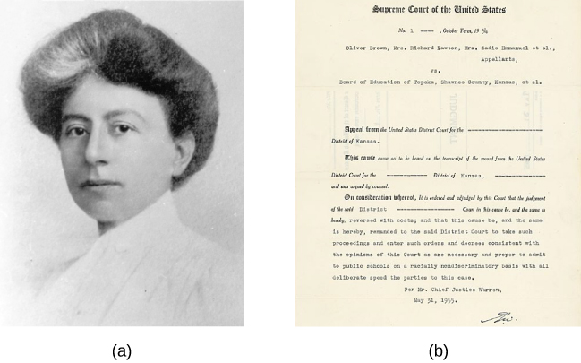

# 2.1 Why Is Research Important?

> [!info]
>
> ### Learning Objectives
>
> By the end of this section, you will be able to:
>
> - Explain how scientific research addresses questions about behavior
> - Discuss how scientific research guides public policy
> - Appreciate how scientific research can be important in making personal decisions

Scientific research is a critical tool for successfully navigating our complex world. Without it, we would be forced to rely solely on intuition, other people’s authority, and blind luck. While many of us feel confident in our abilities to decipher and interact with the world around us, history is filled with examples of how very wrong we can be when we fail to recognize the need for evidence in supporting claims. At various times in history, we would have been certain that the sun revolved around a flat earth, that the earth’s continents did not move, and that mental illness was caused by possession ([Figure 2.2](#CNX_Psych_02_01_trephining)). It is through systematic scientific research that we divest ourselves of our preconceived notions and superstitions and gain an objective understanding of ourselves and our world.

**Figure 2.2** Some of our ancestors, across the world and over the centuries, believed that trephination—the practice of making a hole in the skull, as shown here—allowed evil spirits to leave the body, thus curing mental illness and other disorders. (credit: “taiproject”/Flickr)

The goal of all scientists is to better understand the world around them. Psychologists focus their attention on understanding behavior, as well as the cognitive (mental) and physiological (body) processes that underlie behavior. In contrast to other methods that people use to understand the behavior of others, such as intuition and personal experience, the hallmark of scientific research is that there is evidence to support a claim. Scientific knowledge is **empirical**: It is grounded in objective, tangible evidence that can be observed time and time again, regardless of who is observing.

While behavior is observable, the mind is not. If someone is crying, we can see behavior. However, the reason for the behavior is more difficult to determine. Is the person crying due to being sad, in pain, or happy? Sometimes we can learn the reason for someone’s behavior by simply asking a question, like “Why are you crying?” However, there are situations in which an individual is either uncomfortable or unwilling to answer the question honestly, or is incapable of answering. For example, infants would not be able to explain why they are crying. In such circumstances, the psychologist must be creative in finding ways to better understand behavior. This chapter explores how scientific knowledge is generated, and how important that knowledge is in forming decisions in our personal lives and in the public domain.

## Use of Research Information

Trying to determine which theories are and are not accepted by the scientific community can be difficult, especially in an area of research as broad as psychology. More than ever before, we have an incredible amount of information at our fingertips, and a simple internet search on any given research topic might result in a number of contradictory studies. In these cases, we are witnessing the scientific community going through the process of reaching a consensus, and it could be quite some time before a consensus emerges. For example, the explosion in our use of technology has led researchers to question whether this ultimately helps or hinders us. The use and implementation of technology in educational settings has become widespread over the last few decades. Researchers are coming to different conclusions regarding the use of technology. To illustrate this point, a study investigating a smartphone app targeting surgery residents (graduate students in surgery training) found that the use of this app can increase student engagement and raise test scores (Shaw & Tan, 2015). Conversely, another study found that the use of technology in undergraduate student populations had negative impacts on sleep, communication, and time management skills (Massimini & Peterson, 2009). Until sufficient amounts of research have been conducted, there will be no clear consensus on the effects that technology has on a student's acquisition of knowledge, study skills, and mental health.

In the meantime, we should strive to think critically about the information we encounter by exercising a degree of healthy skepticism. When someone makes a claim, we should examine the claim from a number of different perspectives: what is the expertise of the person making the claim, what might they gain if the claim is valid, does the claim seem justified given the evidence, and what do other researchers think of the claim? This is especially important when we consider how much information in advertising campaigns and on the internet claims to be based on “scientific evidence” when in actuality it is a belief or perspective of just a few individuals trying to sell a product or draw attention to their perspectives.

We should be informed consumers of the information made available to us because decisions based on this information have significant consequences. One such consequence can be seen in politics and public policy. Imagine that you have been elected as the governor of your state. One of your responsibilities is to manage the state budget and determine how to best spend your constituents’ tax dollars. As the new governor, you need to decide whether to continue funding early intervention programs. These programs are designed to help children who come from low-income backgrounds, have special needs, or face other disadvantages. These programs may involve providing a wide variety of services to maximize the children's development and position them for optimal levels of success in school and later in life (Blann, 2005). While such programs sound appealing, you would want to be sure that they also proved effective before investing additional money in these programs. Fortunately, psychologists and other scientists have conducted vast amounts of research on such programs and, in general, the programs are found to be effective (Neil & Christensen, 2009; Peters-Scheffer, Didden, Korzilius, & Sturmey, 2011). While not all programs are equally effective, and the short-term effects of many such programs are more pronounced, there is reason to believe that many of these programs produce long-term benefits for participants (Barnett, 2011). If you are committed to being a good steward of taxpayer money, you would want to look at research. Which programs are most effective? What characteristics of these programs make them effective? Which programs promote the best outcomes? After examining the research, you would be best equipped to make decisions about which programs to fund.

> [!tip]
>
> ### Link to Learning
>
> Watch this [video about early childhood program effectiveness](https://openstax.org/l/programeffect) to learn how scientists evaluate effectiveness and how best to invest money into programs that are most effective.

Ultimately, it is not just politicians who can benefit from using research in guiding their decisions. We all might look to research from time to time when making decisions in our lives. Imagine that your sister, Maria, expresses concern about her two-year-old child, Umberto. Umberto does not speak as much or as clearly as the other children in his daycare or others in the family. Umberto's pediatrician undertakes some screening and recommends an evaluation by a speech pathologist, but does not refer Maria to any other specialists. Maria is concerned that Umberto's speech delays are signs of a developmental disorder, but Umberto's pediatrician does not; she sees indications of differences in Umberto's jaw and facial muscles. Hearing this, you do some internet searches, but you are overwhelmed by the breadth of information and the wide array of sources. You see blog posts, top-ten lists, advertisements from healthcare providers, and recommendations from several advocacy organizations. Why are there so many sites? Which are based in research, and which are not?

In the end, research is what makes the difference between facts and opinions. **Facts** are observable realities, and **opinions** are personal judgments, conclusions, or attitudes that may or may not be accurate. In the scientific community, facts can be established only using evidence collected through empirical research.

## NOTABLE RESEARCHERS

Psychological research has a long history involving important figures from diverse backgrounds. While the introductory chapter discussed several researchers who made significant contributions to the discipline, there are many more individuals who deserve attention in considering how psychology has advanced as a science through their work ([Figure 2.3](#CNX_Psych_02_05_BrownBoard)). For instance, Margaret Floy Washburn (1871–1939) was the first woman to earn a PhD in psychology. Her research focused on animal behavior and cognition (Margaret Floy Washburn, PhD, n.d.). Mary Whiton Calkins (1863–1930) was a preeminent first-generation American psychologist who opposed the behaviorist movement, conducted significant research into memory, and established one of the earliest experimental psychology labs in the United States (Mary Whiton Calkins, n.d.).

Francis Sumner (1895–1954) was the first African American to receive a PhD in psychology in 1920. His dissertation focused on issues related to psychoanalysis. Sumner also had research interests in racial bias and educational justice. Sumner was one of the founders of Howard University’s department of psychology, and because of his accomplishments, he is sometimes referred to as the “Father of Black Psychology.” Thirteen years later, Inez Beverly Prosser (1895–1934) became the first African American woman to receive a PhD in psychology. Prosser’s research highlighted issues related to education in segregated versus integrated schools, and ultimately, her work was very influential in the hallmark *Brown v. Board of Education* Supreme Court ruling that segregation of public schools was unconstitutional (Ethnicity and Health in America Series: Featured Psychologists, n.d.).

**Figure 2.3** (a) Margaret Floy Washburn was the first woman to earn a doctorate degree in psychology. (b) The outcome of *Brown v. Board of Education* was influenced by the research of psychologist Inez Beverly Prosser, who was the first African American woman to earn a PhD in psychology.

Although the establishment of psychology’s scientific roots occurred first in Europe and the United States, it did not take much time until researchers from around the world began to establish their own laboratories and research programs. For example, some of the first experimental psychology laboratories in South America were founded by Horatio Piñero (1869–1919) at two institutions in Buenos Aires, Argentina (Godoy & Brussino, 2010). In India, Gunamudian David Boaz (1908–1965) and Narendra Nath Sen Gupta (1889–1944) established the first independent departments of psychology at the University of Madras and the University of Calcutta, respectively. These developments provided an opportunity for Indian researchers to make important contributions to the field (Gunamudian David Boaz, n.d.; Narendra Nath Sen Gupta, n.d.).

When the American Psychological Association (APA) was first founded in 1892, all of the members were White males (Women and Minorities in Psychology, n.d.). However, by 1905, Mary Whiton Calkins was elected as the first female president of the APA, and by 1946, nearly one-quarter of American psychologists were female. Psychology became a popular degree option for students enrolled in the nation’s historically Black higher education institutions, increasing the number of Black Americans who went on to become psychologists. Given demographic shifts occurring in the United States and increased access to higher educational opportunities among historically underrepresented populations, there is reason to hope that the diversity of the field will increasingly match the larger population, and that the research contributions made by the psychologists of the future will better serve people of all backgrounds (Women and Minorities in Psychology, n.d.).

## The Process of Scientific Research

Scientific knowledge is advanced through a process known as the **scientific method**. Basically, ideas (in the form of theories and hypotheses) are tested against the real world (in the form of empirical observations), and those empirical observations lead to more ideas that are tested against the real world, and so on. In this sense, the scientific process is circular. The types of reasoning within the circle are called deductive and inductive. In **deductive reasoning**, ideas are tested in the real world; in **inductive reasoning**, real-world observations lead to new ideas ([Figure 2.4](#CNX_Psych_02_01_Reasoning)). These processes are inseparable, like inhaling and exhaling, but different research approaches place different emphasis on the deductive and inductive aspects.

**Figure 2.4** Psychological research relies on both inductive and deductive reasoning.

In the scientific context, deductive reasoning begins with a generalization—one hypothesis—that is then used to reach logical conclusions about the real world. If the hypothesis is correct, then the logical conclusions reached through deductive reasoning should also be correct. A deductive reasoning argument might go something like this: All living things require energy to survive (this would be your hypothesis). Ducks are living things. Therefore, ducks require energy to survive (logical conclusion). In this example, the hypothesis is correct; therefore, the conclusion is correct as well. Sometimes, however, an incorrect hypothesis may lead to a logical but incorrect conclusion. Consider this argument: all ducks are born with the ability to see. Quackers is a duck. Therefore, Quackers was born with the ability to see. Scientists use deductive reasoning to empirically test their hypotheses. Returning to the example of the ducks, researchers might design a study to test the hypothesis that if all living things require energy to survive, then ducks will be found to require energy to survive.

Deductive reasoning starts with a generalization that is tested against real-world observations; however, inductive reasoning moves in the opposite direction. Inductive reasoning uses empirical observations to construct broad generalizations. Unlike deductive reasoning, conclusions drawn from inductive reasoning may or may not be correct, regardless of the observations on which they are based. For instance, you may notice that your favorite fruits—apples, bananas, and oranges—all grow on trees; therefore, you assume that all fruit must grow on trees. This would be an example of inductive reasoning, and, clearly, the existence of strawberries, blueberries, and kiwi demonstrate that this generalization is not correct despite it being based on a number of direct observations. Scientists use inductive reasoning to formulate theories, which in turn generate hypotheses that are tested with deductive reasoning. In the end, science involves both deductive and inductive processes.

For example, case studies, which you will read about in the next section, are heavily weighted on the side of empirical observations. Thus, case studies are closely associated with inductive processes as researchers gather massive amounts of observations and seek interesting patterns (new ideas) in the data. Experimental research, on the other hand, puts great emphasis on deductive reasoning.

We’ve stated that theories and hypotheses are ideas, but what sort of ideas are they, exactly? A **theory** is a well-developed set of ideas that propose an explanation for observed phenomena. Theories are repeatedly checked against the world, but they tend to be too complex to be tested all at once; instead, researchers create hypotheses to test specific aspects of a theory.

A **hypothesis** is a testable prediction about how the world will behave if our idea is correct, and it is often worded as an if-then statement (e.g., if I study all night, I will get a passing grade on the test). The hypothesis is extremely important because it bridges the gap between the realm of ideas and the real world. As specific hypotheses are tested, theories are modified and refined to reflect and incorporate the result of these tests [Figure 2.5](#CNX_Psych_02_01_Method).

**Figure 2.5** The scientific method involves deriving hypotheses from theories and then testing those hypotheses. If the results are consistent with the theory, then the theory is supported. If the results are not consistent, then the theory should be modified and new hypotheses will be generated.

To see how this process works, let’s consider a specific theory and a hypothesis that might be generated from that theory. As you’ll learn in a later chapter, the James-Lange theory of emotion asserts that emotional experience relies on the physiological arousal associated with the emotional state. If you walked out of your home and discovered a very aggressive snake waiting on your doorstep, your heart would begin to race and your stomach churn. According to the James-Lange theory, these physiological changes would result in your feeling of fear. A hypothesis that could be derived from this theory might be that a person who is unaware of the physiological arousal that the sight of the snake elicits will not feel fear.

A scientific hypothesis is also **falsifiable**, or capable of being shown to be incorrect. Recall from the introductory chapter that Sigmund **Freud** had lots of interesting ideas to explain various human behaviors ([Figure 2.6](#CNX_Psych_02_01_freud)). However, a major criticism of Freud’s theories is that many of his ideas are not falsifiable; for example, it is impossible to imagine empirical observations that would disprove the existence of the id, the ego, and the superego—the three elements of personality described in Freud’s theories. Despite this, Freud’s theories are widely taught in introductory psychology texts because of their historical significance for personality psychology and psychotherapy, and these remain the root of all modern forms of therapy.

**Figure 2.6** Many of the specifics of (a) Freud's theories, such as (b) his division of the mind into id, ego, and superego, have fallen out of favor in recent decades because they are not falsifiable. In broader strokes, his views set the stage for much of psychological thinking today, such as the unconscious nature of the majority of psychological processes.

In contrast, the James-Lange theory does generate falsifiable hypotheses, such as the one described above. Some individuals who suffer significant injuries to their spinal columns are unable to feel the bodily changes that often accompany emotional experiences. Therefore, we could test the hypothesis by determining how emotional experiences differ between individuals who have the ability to detect these changes in their physiological arousal and those who do not. In fact, this research has been conducted and while the emotional experiences of people deprived of an awareness of their physiological arousal may be less intense, they still experience emotion (Chwalisz, Diener, & Gallagher, 1988).

Scientific research’s dependence on falsifiability allows for great confidence in the information that it produces. Typically, by the time information is accepted by the scientific community, it has been tested repeatedly.
