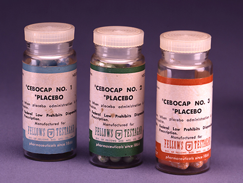
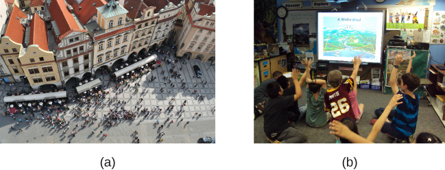
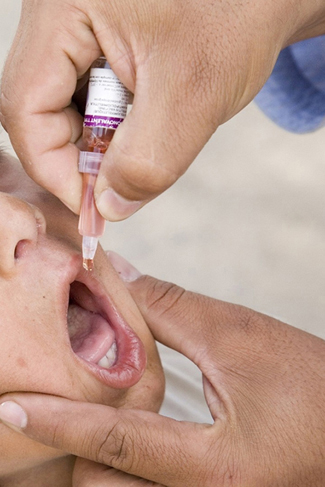

# 2.3 Analyzing Findings

> [!info]
>
> ### Learning Objectives
>
> By the end of this section, you will be able to:
>
> - Explain what a correlation coefficient tells us about the relationship between variables
> - Recognize that correlation does not indicate a cause-and-effect relationship between variables
> - Discuss our tendency to look for relationships between variables that do not really exist
> - Explain random sampling and assignment of participants into experimental and control groups
> - Discuss how experimenter or participant bias could affect the results of an experiment
> - Identify independent and dependent variables

Did you know that as sales in ice cream increase, so does the overall rate of crime? Is it possible that indulging in your favorite flavor of ice cream could send you on a crime spree? Or, after committing crime do you think you might decide to treat yourself to a cone? There is no question that a relationship exists between ice cream and crime (e.g., Harper, 2013), but it would be pretty foolish to decide that one thing actually caused the other to occur.

It is much more likely that both ice cream sales and crime rates are related to the temperature outside. When the temperature is warm, there are lots of people out of their houses, interacting with each other, getting annoyed with one another, and sometimes committing crimes. Also, when it is warm outside, we are more likely to seek a cool treat like ice cream. How do we determine if there is indeed a relationship between two things? And when there is a relationship, how can we discern whether it is attributable to coincidence or causation?

## Correlational Research

**Correlation** means that there is a relationship between two or more variables (such as ice cream consumption and crime), but this relationship does not necessarily imply cause and effect. When two variables are correlated, it simply means that as one variable changes, so does the other. We can measure correlation by calculating a statistic known as a correlation coefficient. A **correlation coefficient** is a number from -1 to +1 that indicates the strength and direction of the relationship between variables. The correlation coefficient is usually represented by the letter *r*.

The number portion of the correlation coefficient indicates the strength of the relationship. The closer the number is to 1 (be it negative or positive), the more strongly related the variables are, and the more predictable changes in one variable will be as the other variable changes. The closer the number is to zero, the weaker the relationship, and the less predictable the relationship between the variables becomes. For instance, a correlation coefficient of 0.9 indicates a far stronger relationship than a correlation coefficient of 0.3. If the variables are not related to one another at all, the correlation coefficient is 0. The example above about ice cream and crime is an example of two variables that we might expect to have no relationship to each other.

The sign—positive or negative—of the correlation coefficient indicates the direction of the relationship ([Figure 2.12](#CNX_Psych_02_04_scatter)). A **positive correlation** means that the variables move in the same direction. Put another way, it means that as one variable increases so does the other, and conversely, when one variable decreases so does the other. A **negative correlation** means that the variables move in opposite directions. If two variables are negatively correlated, a decrease in one variable is associated with an increase in the other and vice versa.

The example of ice cream and crime rates is a positive correlation because both variables increase when temperatures are warmer. Other examples of positive correlations are the relationship between an individual’s height and weight or the relationship between a person’s age and number of wrinkles. One might expect a negative correlation to exist between someone’s tiredness during the day and the number of hours they slept the previous night: the amount of sleep decreases as the feelings of tiredness increase. In a real-world example of negative correlation, student researchers at the University of Minnesota found a weak negative correlation (*r* = -0.29) between the average number of days per week that students got fewer than 5 hours of sleep and their GPA (Lowry, Dean, & Manders, 2010). Keep in mind that a negative correlation is not the same as no correlation. For example, we would probably find no correlation between hours of sleep and shoe size.

As mentioned earlier, correlations have predictive value. Imagine that you are on the admissions committee of a major university. You are faced with a huge number of applications, but you are able to accommodate only a small percentage of the applicant pool. How might you decide who should be admitted? You might try to correlate your current students’ college GPA with their scores on standardized tests like the SAT or ACT. By observing which correlations were strongest for your current students, you could use this information to predict relative success of those students who have applied for admission into the university.

![Three scatterplots are shown. Scatterplot (a) is labeled “positive correlation” and shows scattered dots forming a rough line from the bottom left to the top right; the x-axis is labeled “weight” and the y-axis is labeled “height.” Scatterplot (b) is labeled “negative correlation” and shows scattered dots forming a rough line from the top left to the bottom right; the x-axis is labeled “tiredness” and the y-axis is labeled “hours of sleep.” Scatterplot (c) is labeled “no correlation” and shows scattered dots having no pattern; the x-axis is labeled “shoe size” and the y-axis is labeled “hours of sleep.”](../../images/img_9fae0680e419.jpg)

**Figure 2.12** Scatterplots are a graphical view of the strength and direction of correlations. The stronger the correlation, the closer the data points are to a straight line. In these examples, we see that there is (a) a positive correlation between weight and height, (b) a negative correlation between tiredness and hours of sleep, and (c) no correlation between shoe size and hours of sleep.

> [!tip]
>
> ### Link to Learning
>
> Manipulate this [interactive scatterplot](https://openstax.org/l/scatplot) to practice your understanding of positive and negative correlation.

### Correlation Does Not Indicate Causation

Correlational research is useful because it allows us to discover the strength and direction of relationships that exist between two variables. However, correlation is limited because establishing the existence of a relationship tells us little about **cause and effect**. While variables are sometimes correlated because one does cause the other, it could also be that some other factor, a **confounding variable**, is actually causing the systematic movement in our variables of interest. In the ice cream/crime rate example mentioned earlier, temperature is a confounding variable that could account for the relationship between the two variables.

Even when we cannot point to clear confounding variables, we should not assume that a correlation between two variables implies that one variable causes changes in another. This can be frustrating when a cause-and-effect relationship seems clear and intuitive. Think back to our discussion of the research done by the American Cancer Society and how their research projects were some of the first demonstrations of the link between smoking and cancer. It seems reasonable to assume that smoking causes cancer, but if we were limited to **correlational research**, we would be overstepping our bounds by making this assumption.

Unfortunately, people mistakenly make claims of causation as a function of correlations all the time. Such claims are especially common in advertisements and news stories. For example, research found that people who eat certain breakfast cereal may have a reduced risk of heart disease (Anderson, Hanna, Peng, & Kryscio, 2000). Cereal companies are likely to share this information in a way that maximizes and perhaps overstates the positive aspects of eating cereal. But does cereal really cause better health, or are there other possible explanations for the health of those who eat cereal? While correlational research is invaluable in identifying relationships among variables, a major limitation is the inability to establish causality. Psychologists want to make statements about cause and effect, but the only way to do that is to conduct an experiment to answer a research question. The next section describes how scientific experiments incorporate methods that eliminate, or control for, alternative explanations, which allow researchers to explore how changes in one variable cause changes in another variable.

**Figure 2.13** Does eating cereal really cause someone to be healthier? (credit: Tim Skillern)

### Illusory Correlations

The temptation to make erroneous cause-and-effect statements based on correlational research is not the only way we tend to misinterpret data. We also tend to make the mistake of illusory correlations, especially with unsystematic observations. **Illusory correlations**, or false correlations, occur when people believe that relationships exist between two things when no such relationship exists. One well-known illusory correlation is the supposed effect that the moon’s phases have on human behavior. Many people passionately assert that human behavior is affected by the phase of the moon, and specifically, that people act strangely when the moon is full ([Figure 2.14](#CNX_Psych_02_04_moon)).

**Figure 2.14** Many people believe that a full moon makes people behave oddly. (credit: Cory Zanker)

There is no denying that the moon exerts a powerful influence on our planet. The ebb and flow of the ocean’s tides are tightly tied to the gravitational forces of the moon. Many people believe, therefore, that it is logical that we are affected by the moon as well. After all, our bodies are largely made up of water. A meta-analysis of nearly 40 studies consistently demonstrated, however, that the relationship between the moon and our behavior does not exist (Rotton & Kelly, 1985). While we may pay more attention to odd behavior during the full phase of the moon, the rates of odd behavior remain constant throughout the lunar cycle.

Why are we so apt to believe in illusory correlations like this? Often we read or hear about them and simply accept the information as valid. Or, we have a hunch about how something works and then look for evidence to support that hunch, ignoring evidence that would tell us our hunch is false; this is known as **confirmation bias**. Other times, we find illusory correlations based on the information that comes most easily to mind, even if that information is severely limited. And while we may feel confident that we can use these relationships to better understand and predict the world around us, illusory correlations can have significant drawbacks. For example, research suggests that illusory correlations—in which certain behaviors are inaccurately attributed to certain groups—are involved in the formation of prejudicial attitudes that can ultimately lead to discriminatory behavior (Fiedler, 2004).

## Causality: Conducting Experiments and Using the Data

As you’ve learned, the only way to establish that there is a cause-and-effect relationship between two variables is to conduct a scientific **experiment**. Experiment has a different meaning in the scientific context than in everyday life. In everyday conversation, we often use it to describe trying something for the first time, such as experimenting with a new hair style or a new food. However, in the scientific context, an experiment has precise requirements for design and implementation.

### The Experimental Hypothesis

In order to conduct an experiment, a researcher must have a specific **hypothesis** to be tested. As you’ve learned, hypotheses can be formulated either through direct observation of the real world or after careful review of previous research. For example, if you think that the use of technology in the classroom has negative impacts on learning, then you have basically formulated a hypothesis—namely, that the use of technology in the classroom should be limited because it decreases learning. How might you have arrived at this particular hypothesis? You may have noticed that your classmates who take notes on their laptops perform at lower levels on class exams than those who take notes by hand, or those who receive a lesson via a computer program versus via an in-person teacher have different levels of performance when tested ([Figure 2.15](#CNX_Psych_02_05_toygun)).

**Figure 2.15** How might the use of technology in the classroom impact learning? (credit: modification of work by Nikolay Georgiev/Pixabay)

These sorts of personal observations are what often lead us to formulate a specific hypothesis, but we cannot use limited personal observations and anecdotal evidence to rigorously test our hypothesis. Instead, to find out if real-world data supports our hypothesis, we have to conduct an experiment.

### Designing an Experiment

The most basic experimental design involves two groups: the experimental group and the control group. The two groups are designed to be the same except for one difference— experimental manipulation. The **experimental group** gets the experimental manipulation—that is, the treatment or variable being tested (in this case, the use of technology)—and the **control group** does not. Since experimental manipulation is the only difference between the experimental and control groups, we can be sure that any differences between the two are due to experimental manipulation rather than chance.

In our example of how the use of technology should be limited in the classroom, we have the experimental group learn algebra using a computer program and then test their learning. We measure the learning in our control group after they are taught algebra by a teacher in a traditional classroom. It is important for the control group to be treated similarly to the experimental group, with the exception that the control group does not receive the experimental manipulation.

We also need to precisely define, or operationalize, how we measure learning of algebra. An **operational definition** is a precise description of our variables, and it is important in allowing others to understand exactly how and what a researcher measures in a particular experiment. In operationalizing learning, we might choose to look at performance on a test covering the material on which the individuals were taught by the teacher or the computer program. We might also ask our participants to summarize the information that was just presented in some way. Whatever we determine, it is important that we operationalize learning in such a way that anyone who hears about our study for the first time knows exactly what we mean by learning. This aids peoples’ ability to interpret our data as well as their capacity to repeat our experiment should they choose to do so.

Once we have operationalized what is considered use of technology and what is considered learning in our experiment participants, we need to establish how we will run our experiment. In this case, we might have participants spend 45 minutes learning algebra (either through a computer program or with an in-person math teacher) and then give them a test on the material covered during the 45 minutes.

Ideally, the people who score the tests are unaware of who was assigned to the experimental or control group, in order to control for experimenter bias. **Experimenter bias** refers to the possibility that a researcher’s expectations might skew the results of the study. Remember, conducting an experiment requires a lot of planning, and the people involved in the research project have a vested interest in supporting their hypotheses. If the observers knew which child was in which group, it might influence how they interpret ambiguous responses, such as sloppy handwriting or minor computational mistakes. By being blind to which child is in which group, we protect against those biases. This situation is a **single-blind study**, meaning that one of the groups (participants) are unaware as to which group they are in (experiment or control group) while the researcher who developed the experiment knows which participants are in each group.

In a **double-blind study**, both the researchers and the participants are blind to group assignments. Why would a researcher want to run a study where no one knows who is in which group? Because by doing so, we can control for both experimenter and participant expectations. If you are familiar with the phrase **placebo effect**, you already have some idea as to why this is an important consideration. The placebo effect occurs when people's expectations or beliefs influence or determine their experience in a given situation. In other words, simply expecting something to happen can actually make it happen.

The placebo effect is commonly described in terms of testing the effectiveness of a new medication. Imagine that you work in a pharmaceutical company, and you think you have a new drug that is effective in treating depression. To demonstrate that your medication is effective, you run an experiment with two groups: The experimental group receives the medication, and the control group does not. But you don’t want participants to know whether they received the drug or not.

Why is that? Imagine that you are a participant in this study, and you have just taken a pill that you think will improve your mood. Because you expect the pill to have an effect, you might feel better simply because you took the pill and not because of any drug actually contained in the pill—this is the placebo effect.

To make sure that any effects on mood are due to the drug and not due to expectations, the control group receives a placebo (in this case a sugar pill). Now everyone gets a pill, and once again neither the researcher nor the experimental participants know who got the drug and who got the sugar pill. Any differences in mood between the experimental and control groups can now be attributed to the drug itself rather than to experimenter bias or participant expectations ([Figure 2.16](#CNX_Psych_02_05_placebo)).

**Figure 2.16** Providing the control group with a placebo treatment protects against bias caused by expectancy. (credit: Elaine and Arthur Shapiro)

### Independent and Dependent Variables

In a research experiment, we strive to study whether changes in one thing cause changes in another. To achieve this, we must pay attention to two important variables, or things that can be changed, in any experimental study: the independent variable and the dependent variable. An **independent variable** is manipulated or controlled by the experimenter. In a well-designed experimental study, the independent variable is the only important difference between the experimental and control groups. In our example of how technology use in the classroom affects learning, the independent variable is the type of learning by participants in the study ([Figure 2.17](#CNX_Psych_02_05_variables)). A **dependent variable** is what the researcher measures to see how much effect the independent variable had. In our example, the dependent variable is the learning exhibited by our participants.

**Figure 2.17** In an experiment, manipulations of the independent variable are expected to result in changes in the dependent variable. (credit: “classroom” modification of work by Nikolay Georgiev/Pixabay; credit “note taking”: modification of work by KF/Wikimedia)

We expect that the dependent variable will change as a function of the independent variable. In other words, the dependent variable *depends* on the independent variable. A good way to think about the relationship between the independent and dependent variables is with this question: What effect does the independent variable have on the dependent variable? Returning to our example, what is the effect of being taught a lesson through a computer program versus through an in-person instructor?

### Selecting and Assigning Experimental Participants

Now that our study is designed, we need to obtain a sample of individuals to include in our experiment. Our study involves human participants so we need to determine whom to include. **Participants** are the subjects of psychological research, and as the name implies, individuals who are involved in psychological research actively participate in the process. Often, psychological research projects rely on college students to serve as participants. In fact, the vast majority of research in psychology subfields has historically involved students as research participants (Sears, 1986; Arnett, 2008). But are college students truly representative of the general population? College students tend to be younger, more educated, more liberal, and less diverse than the general population. Although using students as test subjects is an accepted practice, relying on such a limited pool of research participants can be problematic because it is difficult to generalize findings to the larger population.

Our hypothetical experiment involves high school students, and we must first generate a sample of students. Samples are used because populations are usually too large to reasonably involve every member in our particular experiment ([Figure 2.18](#CNX_Psych_02_05_sample)). If possible, we should use a random sample (there are other types of samples, but for the purposes of this chapter, we will focus on random samples). A **random sample** is a subset of a larger population in which every member of the population has an equal chance of being selected. Random samples are preferred because if the sample is large enough we can be reasonably sure that the participating individuals are representative of the larger population. This means that the percentages of characteristics in the sample—sex, ethnicity, socioeconomic level, and any other characteristics that might affect the results—are close to those percentages in the larger population.

In our example, let’s say we decide our population of interest is algebra students. But all algebra students is a very large population, so we need to be more specific; instead we might say our population of interest is all algebra students in a particular city. We should include students from various income brackets, family situations, races, ethnicities, religions, and geographic areas of town. With this more manageable population, we can work with the local schools in selecting a random sample of around 200 algebra students who we want to participate in our experiment.

In summary, because we cannot test all of the algebra students in a city, we want to find a group of about 200 that reflects the composition of that city. With a representative group, we can generalize our findings to the larger population without fear of our sample being biased in some way.

**Figure 2.18** Researchers may work with (a) a large population or (b) a sample group that is a subset of the larger population. (credit “crowd”: modification of work by James Cridland; credit “students”: modification of work by Laurie Sullivan)

Now that we have a sample, the next step of the experimental process is to split the participants into experimental and control groups through random assignment. With **random assignment**, all participants have an equal chance of being assigned to either group. There is statistical software that will randomly assign each of the algebra students in the sample to either the experimental or the control group.

Random assignment is critical for sound **experimental design**. With sufficiently large samples, random assignment makes it unlikely that there are systematic differences between the groups. So, for instance, it would be very unlikely that we would get one group composed entirely of males, a given ethnic identity, or a given religious ideology. This is important because if the groups were systematically different before the experiment began, we would not know the origin of any differences we find between the groups: Were the differences preexisting, or were they caused by manipulation of the independent variable? Random assignment allows us to assume that any differences observed between experimental and control groups result from the manipulation of the independent variable.

> [!tip]
>
> ### Link to Learning
>
> Use this [online random number generator](https://openstax.org/l/rannumbers) to learn more about random sampling and assignments.

### Issues to Consider

While experiments allow scientists to make cause-and-effect claims, they are not without problems. True experiments require the experimenter to manipulate an independent variable, and that can complicate many questions that psychologists might want to address. For instance, imagine that you want to know what effect sex (the independent variable) has on spatial memory (the dependent variable). Although you can certainly look for differences between males and females on a task that taps into spatial memory, you cannot directly control a person’s sex. We categorize this type of research approach as quasi-experimental and recognize that we cannot make cause-and-effect claims in these circumstances.

Experimenters are also limited by ethical constraints. For instance, you would not be able to conduct an experiment designed to determine if experiencing abuse as a child leads to lower levels of self-esteem among adults. To conduct such an experiment, you would need to randomly assign some experimental participants to a group that receives abuse, and that experiment would be unethical.

### Interpreting Experimental Findings

Once data is collected from both the experimental and the control groups, a **statistical analysis** is conducted to find out if there are meaningful differences between the two groups. A statistical analysis determines how likely it is that any difference found is due to chance (and thus not meaningful). For example, if an experiment is done on the effectiveness of a nutritional supplement, and those taking a placebo pill (and not the supplement) have the same result as those taking the supplement, then the experiment has shown that the nutritional supplement is not effective. Generally, psychologists consider differences to be statistically significant if there is less than a five percent chance of observing them if the groups did not actually differ from one another. Stated another way, psychologists want to limit the chances of making “false positive” claims to five percent or less.

The greatest strength of experiments is the ability to assert that any significant differences in the findings are caused by the independent variable. This occurs because random selection, random assignment, and a design that limits the effects of both experimenter bias and participant expectancy should create groups that are similar in composition and treatment. Therefore, any difference between the groups is attributable to the independent variable, and now we can finally make a causal statement. If we find that watching a violent television program results in more violent behavior than watching a nonviolent program, we can safely say that watching violent television programs causes an increase in the display of violent behavior.

### Reporting Research

When psychologists complete a research project, they generally want to share their findings with other scientists. The American Psychological Association (APA) publishes a manual detailing how to write a paper for submission to scientific journals. Unlike an article that might be published in a magazine like *Psychology Today,* which targets a general audience with an interest in psychology, scientific journals generally publish **peer-reviewed journal articles** aimed at an audience of professionals and scholars who are actively involved in research themselves.

> [!tip]
>
> ### Link to Learning
>
> The [Online Writing Lab (OWL)](https://openstax.org/l/owl) at Purdue University can walk you through the APA writing guidelines.

A peer-reviewed journal article is read by several other scientists (generally anonymously) with expertise in the subject matter. These peer reviewers provide feedback—to both the author and the journal editor—regarding the quality of the draft. Peer reviewers look for a strong rationale for the research being described, a clear description of how the research was conducted, and evidence that the research was conducted in an ethical manner. They also look for flaws in the study's design, methods, and statistical analyses. They check that the conclusions drawn by the authors seem reasonable given the observations made during the research. Peer reviewers also comment on how valuable the research is in advancing the discipline’s knowledge. This helps prevent unnecessary duplication of research findings in the scientific literature and, to some extent, ensures that each research article provides new information. Ultimately, the journal editor will compile all of the peer reviewer feedback and determine whether the article will be published in its current state (a rare occurrence), published with revisions, or not accepted for publication.

Peer review provides some degree of quality control for psychological research. Poorly conceived or executed studies can be weeded out, and even well-designed research can be improved by the revisions suggested. Peer review also ensures that the research is described clearly enough to allow other scientists to **replicate** it, meaning they can repeat the experiment using different samples to determine reliability. Sometimes replications involve additional measures that expand on the original finding. In any case, each replication serves to provide more evidence to support the original research findings. Successful replications of published research make scientists more apt to adopt those findings, while repeated failures tend to cast doubt on the legitimacy of the original article and lead scientists to look elsewhere. For example, it would be a major advancement in the medical field if a published study indicated that taking a new drug helped individuals achieve better health without changing their behavior. But if other scientists could not replicate the results, the original study’s claims would be questioned.

In recent years, there has been increasing concern about a “replication crisis” that has affected a number of scientific fields, including psychology. Some of the most well-known studies and scientists have produced research that has failed to be replicated by others (as discussed in Shrout & Rodgers, 2018). In fact, even a famous Nobel Prize-winning scientist has recently retracted a published paper because she had difficulty replicating her results (Nobel Prize-winning scientist Frances Arnold retracts paper, 2020 January 3). These kinds of outcomes have prompted some scientists to begin to work together and more openly, and some would argue that the current “crisis” is actually improving the ways in which science is conducted and in how its results are shared with others (Aschwanden, 2018).

> [!note]
>
> ### Dig Deeper
>
> #### The Vaccine-Autism Myth and Retraction of Published Studies
>
> Some scientists have claimed that routine childhood vaccines cause some children to develop autism, and, in fact, several peer-reviewed publications published research making these claims. Since the initial reports, large-scale epidemiological research has indicated that vaccinations are not responsible for causing autism and that it is much safer to have your child vaccinated than not. Furthermore, several of the original studies making this claim have since been retracted.
>
> A published piece of work can be rescinded when data is called into question because of falsification, fabrication, or serious research design problems. Once rescinded, the scientific community is informed that there are serious problems with the original publication. Retractions can be initiated by the researcher who led the study, by research collaborators, by the institution that employed the researcher, or by the editorial board of the journal in which the article was originally published. In the vaccine-autism case, the retraction was made because of a significant conflict of interest in which the leading researcher had a financial interest in establishing a link between childhood vaccines and autism (Offit, 2008). Unfortunately, the initial studies received so much media attention that many parents around the world became hesitant to have their children vaccinated ([Figure 2.19](#CNX_Psych_02_05_vaccine)). Continued reliance on such debunked studies has significant consequences. For instance, between January and October of 2019, there were 22 measles outbreaks across the United States and more than a thousand cases of individuals contracting measles (Patel et al., 2019). This is likely due to the anti-vaccination movements that have risen from the debunked research. For more information about how the vaccine/autism story unfolded, as well as the repercussions of this story, take a look at Paul Offit’s book, *Autism’s False Prophets: Bad Science, Risky Medicine, and the Search for a Cure.*
>
> 
>
> 
>
> **Figure 2.19** Some people still think vaccinations cause autism. (credit: modification of work by UNICEF Sverige)

## Reliability and Validity

Reliability and validity are two important considerations that must be made with any type of data collection. **Reliability** refers to the ability to consistently produce a given result. In the context of psychological research, this would mean that any instruments or tools used to collect data do so in consistent, reproducible ways. There are a number of different types of reliability. Some of these include inter-rater reliability (the degree to which two or more different observers agree on what has been observed), internal consistency (the degree to which different items on a survey that measure the same thing correlate with one another), and test-retest reliability (the degree to which the outcomes of a particular measure remain consistent over multiple administrations).

Unfortunately, being consistent in measurement does not necessarily mean that you have measured something correctly. To illustrate this concept, consider a kitchen scale that would be used to measure the weight of cereal that you eat in the morning. If the scale is not properly calibrated, it may consistently under- or overestimate the amount of cereal that’s being measured. While the scale is highly reliable in producing consistent results (e.g., the same amount of cereal poured onto the scale produces the same reading each time), those results are incorrect. This is where validity comes into play. **Validity** refers to the extent to which a given instrument or tool accurately measures what it’s supposed to measure, and once again, there are a number of ways in which validity can be expressed. Ecological validity (the degree to which research results generalize to real-world applications), construct validity (the degree to which a given variable actually captures or measures what it is intended to measure), and face validity (the degree to which a given variable seems valid on the surface) are just a few types that researchers consider. While any valid measure is by necessity reliable, the reverse is not necessarily true. Researchers strive to use instruments that are both highly reliable and valid.

> [!abstract]
>
> ### Everyday Connection
>
> #### How Valid Are the SAT and ACT?
>
> Standardized tests like the SAT and ACT are supposed to measure an individual’s aptitude for a college education, but how reliable and valid are such tests? Research conducted by the College Board suggests that scores on the SAT have high predictive validity for first-year college students’ GPA (Kobrin, Patterson, Shaw, Mattern, & Barbuti, 2008). In this context, predictive validity refers to the test’s ability to effectively predict the GPA of college freshmen. Given that many institutions of higher education require the SAT or ACT for admission, this high degree of predictive validity might be comforting.
>
> However, the emphasis placed on SAT or ACT scores in college admissions is changing based on a number of factors. For one, some researchers assert that these tests are biased, and students from historically marginalized populations are at a disadvantage that unfairly reduces the likelihood of being admitted into a college (Santelices & Wilson, 2010). Additionally, some research has suggested that the predictive validity of these tests is grossly exaggerated in how well they are able to predict the GPA of first-year college students. In fact, it has been suggested that the SAT’s predictive validity may be overestimated by as much as 150% (Rothstein, 2004). Many institutions of higher education are beginning to consider de-emphasizing the significance of SAT scores in making admission decisions (Rimer, 2008).
>
> Recent examples of high profile cheating scandals both domestically and abroad have only increased the scrutiny being placed on these types of tests, and as of March 2019, more than 1000 institutions of higher education have either relaxed or eliminated the requirements for SAT or ACT testing for admissions (Strauss, 2019, March 19).
