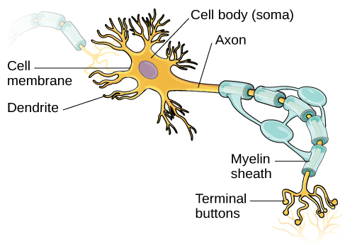
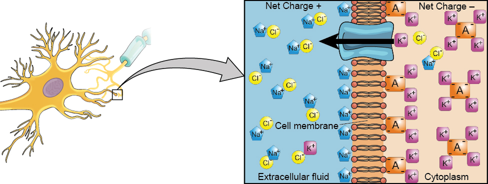
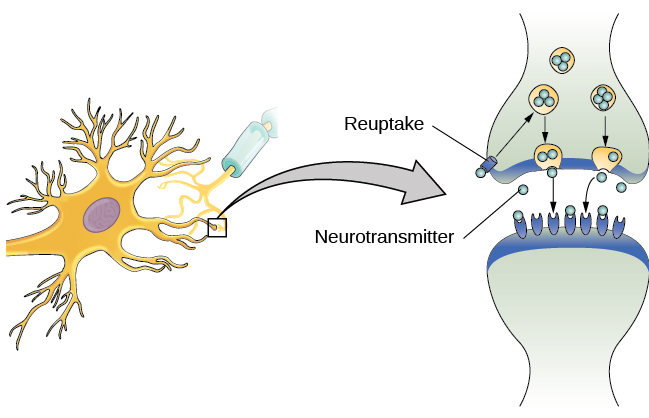

# 3.2 Cells of the Nervous System

> [!info]
>
> ### Learning Objectives
>
> By the end of this section, you will be able to:
>
> - Identify the basic parts of a neuron
> - Describe how neurons communicate with each other
> - Explain how drugs act as agonists or antagonists for a given neurotransmitter system

Psychologists striving to understand the human mind may study the nervous system. Learning how the body's cells and organs function can help us understand the biological basis of human psychology. The **nervous system** is composed of two basic cell types: glial cells (also known as glia) and neurons. Glial cells are traditionally thought to play a supportive role to neurons, both physically and metabolically. **Glial cells** provide scaffolding on which the nervous system is built, help neurons line up closely with each other to allow neuronal communication, provide insulation to neurons, transport nutrients and waste products, and mediate immune responses. For years, researchers believed that there were many more glial cells than neurons; however, more recent work from Suzanna Herculano-Houzel's laboratory has called this long-standing assumption into question and has provided important evidence that there may be a nearly 1:1 ratio of glia cells to neurons. This is important because it suggests that human brains are more similar to other primate brains than previously thought (Azevedo et al, 2009; Herculano-Houzel, 2012; Herculano-Houzel, 2009). **Neurons**, on the other hand, serve as interconnected information processors that are essential for all of the tasks of the nervous system. This section briefly describes the structure and function of neurons.

## Neuron Structure

**Neurons** are the central building blocks of the nervous system, approximately 100 billion strong at birth. Like all cells, neurons consist of several different parts, each serving a specialized function ([Figure 3.8](#CNX_Psych_03_02_Neuron)). A neuron’s outer surface is made up of a **semipermeable membrane**. This membrane allows smaller molecules and molecules without an electrical charge to pass through it, while stopping larger or highly charged molecules.

**Figure 3.8** This illustration shows a prototypical neuron, which is being myelinated by a glial cell.

The nucleus of the neuron is located in the **soma**, or cell body. The soma has branching extensions known as **dendrites**. The neuron is a small information processor, and dendrites serve as input sites where signals are received from other neurons. These signals are transmitted electrically across the soma and down a major extension from the soma known as the **axon**, which ends at multiple **terminal buttons**. The terminal buttons contain **synaptic vesicles** that house **neurotransmitters**, the chemical messengers of the nervous system.

Axons range in length from a fraction of an inch to several feet. In some axons, glial cells form a fatty substance known as the **myelin sheath**, which coats the axon and acts as an insulator, increasing the speed at which the signal travels. The myelin sheath is not continuous and there are small gaps that occur down the length of the axon. These gaps in the myelin sheath are known as the **Nodes of Ranvier**. The myelin sheath is crucial for the normal operation of the neurons within the nervous system: the loss of the insulation it provides can be detrimental to normal function. To understand how this works, let’s consider an example. PKU, a genetic disorder discussed earlier, causes a reduction in myelin and abnormalities in white matter cortical and subcortical structures. The disorder is associated with a variety of issues including severe cognitive deficits, exaggerated reflexes, and seizures (Anderson & Leuzzi, 2010; Huttenlocher, 2000). Another disorder, multiple sclerosis (MS), an autoimmune disorder, involves a large-scale loss of the myelin sheath on axons throughout the nervous system. The resulting interference in the electrical signal prevents the quick transmittal of information by neurons and can lead to a number of symptoms, such as dizziness, fatigue, loss of motor control, and sexual dysfunction. While some treatments may help to modify the course of the disease and manage certain symptoms, there is currently no known cure for multiple sclerosis.

In healthy individuals, the neuronal signal moves rapidly down the axon to the terminal buttons, where synaptic vesicles release neurotransmitters into the synaptic cleft ([Figure 3.9](#CNX_Psych_03_02_Synapse)). The **synaptic cleft** is a very small space between two neurons and is an important site where communication between neurons occurs. Once neurotransmitters are released into the synaptic cleft, they travel across it and bind with corresponding receptors on the dendrite of an adjacent neuron. **Receptors**, proteins on the cell surface where neurotransmitters attach, vary in shape, with different shapes “matching” different neurotransmitters.

How does a neurotransmitter “know” which receptor to bind to? The neurotransmitter and the receptor have what is referred to as a lock-and-key relationship—specific neurotransmitters fit specific receptors similar to how a key fits a lock. The neurotransmitter binds to any receptor that it fits.

**Figure 3.9** (a) The synaptic cleft is the space between the terminal button of one neuron and the dendrite of another neuron. (b) In this pseudo-colored image from a scanning electron microscope, a terminal button (green) has been opened to reveal the synaptic vesicles (orange and blue) inside. Each vesicle contains about 10,000 neurotransmitter molecules. (credit b: modification of work by Tina Carvalho, NIH-NIGMS; scale-bar data from Matt Russell)

## Neuronal Communication

Now that we have learned about the basic structures of the neuron and the role that these structures play in neuronal communication, let’s take a closer look at the signal itself—how it moves through the neuron and then jumps to the next neuron, where the process is repeated.

We begin at the neuronal membrane. The **neuron** exists in a fluid environment—it is surrounded by extracellular fluid and contains intracellular fluid (i.e., cytoplasm). The neuronal membrane keeps these two fluids separate—a critical role because the electrical signal that passes through the neuron depends on the intra- and extracellular fluids being electrically different. This difference in charge across the membrane, called the **membrane potential**, provides energy for the signal.

The electrical charge of the fluids is caused by charged molecules (ions) dissolved in the fluid. The semipermeable nature of the neuronal membrane somewhat restricts the movement of these charged molecules, and, as a result, some of the charged particles tend to become more concentrated either inside or outside the cell.

Between signals, the neuron membrane’s potential is held in a state of readiness, called the **resting potential**. Like a rubber band stretched out and waiting to spring into action, ions line up on either side of the cell membrane, ready to rush across the membrane when the neuron goes active and the membrane opens its gates. Ions in high-concentration areas are ready to move to low-concentration areas, and positive ions are ready to move to areas with a negative charge.

In the resting state, sodium (Na+) is at higher concentrations outside the cell, so it will tend to move into the cell. Potassium (K+), on the other hand, is more concentrated inside the cell, and will tend to move out of the cell ([Figure 3.10](#CNX_Psych_03_02_NaKConc)). In addition, the inside of the cell is slightly negatively charged compared to the outside, due to the activity of the sodium-potassium pump. This pump actively transports three sodium ions out of the cell for every two potassium ions in, creating a net negative charge inside the cell. This provides an additional force on sodium, causing it to move into the cell.

**Figure 3.10** At resting potential, Na+ (blue pentagons) is more highly concentrated outside the cell in the extracellular fluid (shown in blue), whereas K+ (purple squares) is more highly concentrated near the membrane in the cytoplasm or intracellular fluid. Other molecules, such as chloride ions (yellow circles) and negatively charged proteins (brown squares), help contribute to a positive net charge in the extracellular fluid and a negative net charge in the intracellular fluid.

From this resting potential state, the neuron receives a signal and its state changes abruptly ([Figure 3.11](#CNX_Psych_03_02_ActionP)). When a neuron receives signals at the dendrites—due to neurotransmitters from an adjacent neuron binding to its receptors—small pores, or gates, open on the neuronal membrane, allowing Na+ ions, propelled by both charge and concentration differences, to move into the cell. With this influx of positive ions, the internal charge of the cell becomes more positive. If that charge reaches a certain level, called the **threshold of excitation**, the neuron becomes active and the action potential begins.

Many additional pores open, causing a massive influx of Na+ ions and a huge positive spike in the membrane potential, the peak action potential. At the peak of the spike, the sodium gates close and the potassium gates open. As positively charged potassium ions leave, the cell quickly begins repolarization. At first, it hyperpolarizes, becoming slightly more negative than the resting potential, and then it levels off, returning to the resting potential.

**Figure 3.11** During the action potential, the electrical charge across the membrane changes dramatically.

This positive spike constitutes the **action potential**: the electrical signal that typically moves from the cell body down the axon to the axon terminals. The electrical signal moves down the axon with the impulses jumping in a leapfrog fashion between the Nodes of Ranvier. The Nodes of Ranvier are natural gaps in the myelin sheath. At each point, some of the sodium ions that enter the cell diffuse to the next section of the axon, raising the charge past the threshold of excitation and triggering a new influx of sodium ions. The action potential moves all the way down the axon in this fashion until reaching the terminal buttons.

The action potential is an **all-or-none** phenomenon. In simple terms, this means that an incoming signal from another neuron is either sufficient or insufficient to reach the threshold of excitation. There is no in-between, and there is no turning off an action potential once it starts. Think of it like sending an email or a text message. You can think about sending it all you want, but the message is not sent until you hit the send button. Furthermore, once you send the message, there is no stopping it.

Because it is all or none, the **action potential** is recreated, or propagated, at its full strength at every point along the axon. Much like the lit fuse of a firecracker, it does not fade away as it travels down the axon. It is this all-or-none property that explains the fact that your brain perceives an injury to a distant body part like your toe as equally painful as one to your nose.

As noted earlier, when the action potential arrives at the terminal button, the synaptic vesicles release their neurotransmitters into the synaptic cleft. The neurotransmitters travel across the synapse and bind to receptors on the dendrites of the adjacent neuron, and the process repeats itself in the new neuron (assuming the signal is sufficiently strong to trigger an action potential). Once the signal is delivered, excess neurotransmitters in the synaptic cleft drift away, are broken down into inactive fragments, or are reabsorbed in a process known as **reuptake**. Reuptake involves the neurotransmitter being pumped back into the neuron that released it, in order to clear the synapse ([Figure 3.12](#CNX_Psych_03_02_Reuptake)). Clearing the synapse serves both to provide a clear “on” and “off” state between signals and to regulate the production of neurotransmitter (full synaptic vesicles provide signals that no additional neurotransmitters need to be produced).

**Figure 3.12** Reuptake involves moving a neurotransmitter from the synapse back into the axon terminal from which it was released.

Neuronal communication is often referred to as an electrochemical event. The movement of the action potential down the length of the axon is an electrical event, and movement of the neurotransmitter across the synaptic space represents the chemical portion of the process. However, there are some specialized connections between neurons that are entirely electrical. In such cases, the neurons are said to communicate via an electrical synapse. In these cases, two neurons physically connect to one another via gap junctions, which allows the current from one cell to pass into the next. There are far fewer electrical synapses in the brain, but those that do exist are much faster than the chemical synapses that have been described above (Connors & Long, 2004).

> [!tip]
>
> ### Link to Learning
>
> Watch this [video about neuronal communication](https://openstax.org/l/neuroncom) to learn more.

## Neurotransmitters and Drugs

There are several different types of **neurotransmitters** released by different neurons, and we can speak in broad terms about the kinds of functions associated with different neurotransmitters ([Table 3.1](#fs-id1346979)). Much of what psychologists know about the functions of neurotransmitters comes from research on the effects of drugs in psychological disorders. Psychologists who take a **biological perspective** and focus on the physiological causes of behavior assert that psychological disorders like depression and schizophrenia are associated with imbalances in one or more neurotransmitter systems. In this perspective, psychotropic medications can help improve the symptoms associated with these disorders. **Psychotropic medications** are drugs that treat psychiatric symptoms by restoring neurotransmitter balance.

**Major Neurotransmitters and How They Affect Behavior**

| Neurotransmitter | Involved in | Potential Effect on Behavior |
| --- | --- | --- |
| Acetylcholine | Muscle action, memory | Increased arousal, enhanced cognition |
| Beta-endorphin | Pain, pleasure | Decreased anxiety, decreased tension |
| Dopamine | Mood, sleep, learning | Increased pleasure, suppressed appetite |
| Gamma-aminobutyric acid (GABA) | Brain function, sleep | Decreased anxiety, decreased tension |
| Glutamate | Memory, learning | Increased learning, enhanced memory |
| Norepinephrine | Heart, intestines, alertness | Increased arousal, suppressed appetite |
| Serotonin | Mood, sleep | Modulated mood, suppressed appetite |

**Table 3.1**

Psychoactive drugs can act as agonists or antagonists for a given neurotransmitter system. **Agonists** are chemicals that mimic a neurotransmitter at the receptor site. An **antagonist**, on the other hand, blocks or impedes the normal activity of a neurotransmitter at the receptor. Agonists and antagonists represent drugs that are prescribed to correct the specific neurotransmitter imbalances underlying a person’s condition. For example, Parkinson's disease, a progressive nervous system disorder, is associated with low levels of dopamine. Therefore, a common treatment strategy for Parkinson's disease involves using dopamine agonists, which mimic the effects of dopamine by binding to dopamine receptors.

Certain symptoms of schizophrenia are associated with overactive dopamine neurotransmission. The antipsychotics used to treat these symptoms are antagonists for dopamine—they block dopamine’s effects by binding its receptors without activating them. Thus, they prevent dopamine released by one neuron from signaling information to adjacent neurons.

In contrast to agonists and antagonists, which both operate by binding to receptor sites, reuptake inhibitors prevent unused neurotransmitters from being transported back to the neuron. This allows neurotransmitters to remain active in the synaptic cleft for longer durations, increasing their effectiveness. Depression, which has been consistently linked with reduced serotonin levels, is commonly treated with selective serotonin reuptake inhibitors (SSRIs). By preventing reuptake, SSRIs strengthen the effect of serotonin, giving it more time to interact with serotonin receptors on dendrites. Common SSRIs on the market today include Prozac, Paxil, and Zoloft. The drug LSD is structurally very similar to serotonin, and it affects the same neurons and receptors as serotonin. Psychotropic drugs are not instant solutions for people suffering from psychological disorders. Often, an individual must take a drug for several weeks before seeing improvement, and many psychoactive drugs have significant negative side effects. Furthermore, individuals vary dramatically in how they respond to the drugs. To improve chances for success, it is not uncommon for people receiving pharmacotherapy to undergo psychological and/or behavioral therapies as well. Some research suggests that combining drug therapy with other forms of therapy tends to be more effective than any one treatment alone (for one such example, see March et al., 2007).
