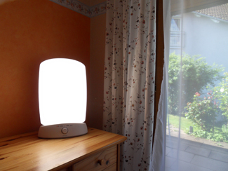

# 4.1 What Is Consciousness?

> [!info]
>
> ### Learning Objectives
>
> By the end of this section, you will be able to:
>
> - Understand what is meant by consciousness
> - Explain how circadian rhythms are involved in regulating the sleep-wake cycle, and how circadian cycles can be disrupted
> - Discuss the concept of sleep debt

**Consciousness** describes our awareness of internal and external stimuli. Awareness of internal stimuli includes feeling pain, hunger, thirst, sleepiness, and being aware of our thoughts and emotions. Awareness of external stimuli includes experiences such as seeing the light from the sun, feeling the warmth of a room, and hearing the voice of a friend.

We experience different states of consciousness and different levels of awareness on a regular basis. We might even describe consciousness as a continuum that ranges from full awareness to a deep sleep. **Sleep** is a state marked by relatively low levels of physical activity and reduced sensory awareness that is distinct from periods of rest that occur during wakefulness. **Wakefulness** is characterized by high levels of sensory awareness, thought, and behavior. Beyond being awake or asleep, there are many other states of consciousness people experience. These include daydreaming, intoxication, and unconsciousness due to anesthesia. Often, we are not completely aware of our surroundings, even when we are fully awake. For instance, have you ever daydreamed while driving home from work or school without really thinking about the drive itself? You were capable of engaging in all of the complex tasks involved with operating a motor vehicle even though you were not aware of doing so. Many of these processes, like much of psychological behavior, are rooted in our biology.

## Biological Rhythms

**Biological rhythms** are internal rhythms of biological activity. A woman’s menstrual cycle is an example of a biological rhythm—a recurring, cyclical pattern of bodily changes. One complete menstrual cycle takes about 28 days—a lunar month—but many biological cycles are much shorter. For example, body temperature fluctuates cyclically over a 24-hour period ([Figure 4.2](#Figure_04_01_Rhythms)). Alertness is associated with higher body temperatures, and sleepiness with lower body temperatures.

![A line graph is titled “Circadian Change in Body Temperature (Source: Waterhouse et al., 2012).” The y-axis, is labeled “temperature (degrees Fahrenheit),” ranges from 97.2 to 99.3. The x-axis, which is labeled “time,” begins at 12:00 A.M. and ends at 4:00 A.M. the following day. The subjects slept from 12:00 A.M. until 8:00 A.M. during which time their average body temperatures dropped from around 98.8 degrees at midnight to 97.6 degrees at 4:00 A.M. and then gradually rose back to nearly the same starting temperature by 8:00 A.M. The average body temperature fluctuated slightly throughout the day with an upward tilt, until the next sleep cycle where the temperature again dropped.](../../images/img_784a72f4fe8b.jpg)

**Figure 4.2** This chart illustrates the circadian change in body temperature over 28 hours in a group of eight young men. Body temperature rises throughout the waking day, peaking in the afternoon, and falls during sleep with the lowest point occurring during the very early morning hours.

This pattern of temperature fluctuation, which repeats every day, is one example of a circadian rhythm. A **circadian rhythm** is a biological rhythm that takes place over a period of about 24 hours. Our sleep-wake cycle, which is linked to our environment’s natural light-dark cycle, is perhaps the most obvious example of a circadian rhythm, but we also have daily fluctuations in heart rate, blood pressure, blood sugar, and body temperature. Some circadian rhythms play a role in changes in our state of consciousness.

If we have biological rhythms, then is there some sort of **biological clock**? In the brain, the hypothalamus, which lies above the pituitary gland, is a main center of homeostasis. **Homeostasis** is the tendency to maintain a balance, or optimal level, within a biological system.

The brain’s clock mechanism is located in an area of the hypothalamus known as the **suprachiasmatic nucleus (SCN)**. The axons of light-sensitive neurons in the retina provide information to the SCN based on the amount of light present, allowing this internal clock to be synchronized with the outside world (Klein, Moore, & Reppert, 1991; Welsh, Takahashi, & Kay, 2010) ([Figure 4.3](#Figure_04_01_SCN)).

**Figure 4.3** The suprachiasmatic nucleus (SCN) serves as the brain’s clock mechanism. The clock sets itself with light information received through projections from the retina.

## Problems With Circadian Rhythms

Generally, and for most people, our circadian cycles are aligned with the outside world. For example, most people sleep during the night and are awake during the day. One important regulator of sleep-wake cycles is the hormone **melatonin**. The **pineal gland**, an endocrine structure located inside the brain that releases melatonin, is thought to be involved in the regulation of various biological rhythms and of the immune system during sleep (Hardeland, Pandi-Perumal, & Cardinali, 2006). Melatonin release is stimulated by darkness and inhibited by light.

There are individual differences in regard to our sleep-wake cycle. For instance, some people would say they are morning people, while others would consider themselves to be night owls. These individual differences in circadian patterns of activity are known as a person’s chronotype, and research demonstrates that morning larks and night owls differ with regard to sleep regulation (Taillard, Philip, Coste, Sagaspe, & Bioulac, 2003). **Sleep regulation** refers to the brain’s control of switching between sleep and wakefulness as well as coordinating this cycle with the outside world.

> [!tip]
>
> ### Link to Learning
>
> Watch this brief [video about circadian rhythms and how they affect sleep](https://openstax.org/l/circadian) to learn more.

### Disruptions of Normal Sleep

Whether lark, owl, or somewhere in between, there are situations in which a person’s circadian clock gets out of synchrony with the external environment. One way that this happens involves traveling across multiple time zones. When we do this, we often experience jet lag. **Jet lag** is a collection of symptoms that results from the mismatch between our internal circadian cycles and our environment. These symptoms include fatigue, sluggishness, irritability, and **insomnia** (i.e., a consistent difficulty in falling or staying asleep for at least three nights a week over a month’s time) (Roth, 2007).

Individuals who do rotating shift work are also likely to experience disruptions in circadian cycles. **Rotating shift work** refers to a work schedule that changes from early to late on a daily or weekly basis. For example, a person may work from 7:00 a.m. to 3:00 p.m. on Monday, 3:00 a.m. to 11:00 a.m. on Tuesday, and 11:00 a.m. to 7:00 p.m. on Wednesday. In such instances, the individual’s schedule changes so frequently that it becomes difficult for a normal circadian rhythm to be maintained. This often results in sleeping problems, and it can lead to signs of depression and anxiety. These kinds of schedules are common for individuals working in health care professions and service industries, and they are associated with persistent feelings of exhaustion and agitation that can make someone more prone to making mistakes on the job (Gold et al., 1992; Presser, 1995).

Rotating shift work has pervasive effects on the lives and experiences of individuals engaged in that kind of work, which is clearly illustrated in stories reported in a qualitative study that researched the experiences of middle-aged nurses who worked rotating shifts (West, Boughton & Byrnes, 2009). Several of the nurses interviewed commented that their work schedules affected their relationships with their family. One of the nurses said,

If you’ve had a partner who does work regular job 9 to 5 office hours... the ability to spend time, good time with them when you’re not feeling absolutely exhausted... that would be one of the problems that I’ve encountered. (West et al., 2009, p. 114)

While disruptions in circadian rhythms can have negative consequences, there are things we can do to help us realign our biological clocks with the external environment. Some of these approaches, such as using a bright light as shown in [Figure 4.4](#Figure_04_01_BrightLight), have been shown to alleviate some of the problems experienced by individuals suffering from jet lag or from the consequences of rotating shift work. Because the biological clock is driven by light, exposure to bright light during working shifts and dark exposure when not working can help combat insomnia and symptoms of anxiety and depression (Huang, Tsai, Chen, & Hsu, 2013).

**Figure 4.4** Devices like this are designed to provide exposure to bright light to help people maintain a regular circadian cycle. They can be helpful for people working night shifts or for people affected by seasonal variations in light.

> [!tip]
>
> ### Link to Learning
>
> Watch this [video about overcoming jet lag](https://openstax.org/l/jetlag) to learn some tips.

### Insufficient Sleep

When people have difficulty getting sleep due to their work or the demands of day-to-day life, they accumulate a sleep debt. A person with a **sleep debt** does not get sufficient sleep on a chronic basis. The consequences of sleep debt include decreased levels of alertness and mental efficiency. Interestingly, since the advent of electric light, the amount of sleep that people get has declined. While we certainly welcome the convenience of having the darkness lit up, we also suffer the consequences of reduced amounts of sleep because we are more active during the nighttime hours than our ancestors were. As a result, many of us sleep less than 7–8 hours a night and accrue a sleep debt. While there is tremendous variation in any given individual’s sleep needs, the National Sleep Foundation (n.d.) cites research to estimate that newborns require the most sleep (between 12 and 18 hours a night) and that this amount declines to just 7–9 hours by the time we are adults.

If you lie down to take a nap and fall asleep very easily, chances are you may have sleep debt. Given that college students are notorious for suffering from significant sleep debt (Hicks, Fernandez, & Pellegrini, 2001; Hicks, Johnson, & Pellegrini, 1992; Miller, Shattuck, & Matsangas, 2010), chances are you and your classmates deal with sleep debt-related issues on a regular basis. In 2015, the National Sleep Foundation updated their sleep duration hours, to better accommodate individual differences. [Table 4.1](#Table_04_01_01) shows the new recommendations, which describe sleep durations that are “recommended”, “may be appropriate”, and “not recommended”.

**Sleep Needs at Different Ages**

| Age | Recommended | May be appropriate | Not recommended |
| --- | --- | --- | --- |
| 0–3 months | 14–17 hours | 11–13 hours 18–19 hours | Fewer than 11 hours More than 19 hours |
| 4–11 months | 12–15 hours | 10–11 hours 16–18 hours | Fewer than 10 hours More than 18 hours |
| 1–2 years | 11–14 hours | 9–10 hours 15–16 hours | Fewer than 9 hours More than 16 hours |
| 3–5 years | 10–13 hours | 8–9 hours 14 hours | Fewer than 8 hours More than 14 hours |
| 6–13 years | 9–11 hours | 7–8 hours 12 hours | Fewer than 7 hours More than 12 hours |
| 14–17 years | 8–10 hours | 7 hours 11 hours | Fewer than 7 hours More than 11 hours |
| 18–25 years | 7–9 hours | 6 hours 10–11 hours | Fewer than 6 hours More than 11 hours |
| 26–64 years | 7–9 hours | 6 hours 10 hours | Fewer than 6 hours More than 10 hours |
| ≥65 years | 7–8 hours | 5–6 hours 9 hours | Fewer than 5 hours More than 9 hours |

**Table 4.1**

Sleep debt and sleep deprivation have significant negative psychological and physiological consequences [Figure 4.5](#Figure_04_01_Sleepless). As mentioned earlier, lack of sleep can result in decreased mental alertness and cognitive function. In addition, sleep deprivation often results in depression-like symptoms. These effects can occur as a function of accumulated sleep debt or in response to more acute periods of sleep deprivation. It may surprise you to know that sleep deprivation is associated with obesity, increased blood pressure, increased levels of stress hormones, and reduced immune functioning (Banks & Dinges, 2007). A sleep deprived individual generally will fall asleep more quickly than if they were not sleep deprived. Some sleep-deprived individuals have difficulty staying awake when they stop moving (example sitting and watching television or driving a car). That is why individuals suffering from sleep deprivation can also put themselves and others at risk when they put themselves behind the wheel of a car or work with dangerous machinery. Some research suggests that sleep deprivation affects cognitive and motor function as much as, if not more than, alcohol intoxication (Williamson & Feyer, 2000). Research shows that the most severe effects of sleep deprivation occur when a person stays awake for more than 24 hours (Killgore & Weber, 2014; Killgore et al., 2007), or following repeated nights with fewer than four hours in bed (Wickens, Hutchins, Lauk, Seebook, 2015). For example, irritability, distractibility, and impairments in cognitive and moral judgment can occur with fewer than four hours of sleep. If someone stays awake for 48 consecutive hours, they could start to hallucinate.

![An illustration of the top half of a human body identifies the locations in the body that correspond with various adverse affects of sleep deprivation. The brain is labeled with “Irritability,” “Cognitive impairment,” “Memory lapses or loss,” “Impaired moral judgment,” “Severe yawning,” “Hallucinations,” and “Symptoms similar to ADHD.” The heart is labeled with “Risk of heart disease.” The muscles are labeled with “Increased reaction time,” “Decreased accuracy,” “Tremors,” and “Aches.” There is an organ near the stomach labeled “Risk of diabetes Type 2.” Various parts of the neck, arm, and underarm are labeled “Impaired immune system.” Other risks include “Growth suppression,” “Risk of obesity,” “Decreased temperature.”](../../images/img_b0fda8178162.jpg)

**Figure 4.5** This figure illustrates some of the negative consequences of sleep deprivation. While cognitive deficits may be the most obvious, many body systems are negatively impacted by lack of sleep. (credit: modification of work by Mikael Häggström)

> [!tip]
>
> ### Link to Learning
>
> Read this [article about sleep needs](https://openstax.org/l/sleephabits) to assess your own sleeping habits.

The amount of sleep we get varies across the lifespan. When we are very young, we spend up to 16 hours a day sleeping. As we grow older, we sleep less. In fact, a **meta-analysis**, which is a study that combines the results of many related studies, conducted within the last decade indicates that by the time we are 65 years old, we average fewer than 7 hours of sleep per day (Ohayon, Carskadon, Guilleminault, & Vitiello, 2004).
