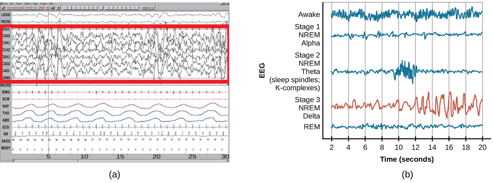
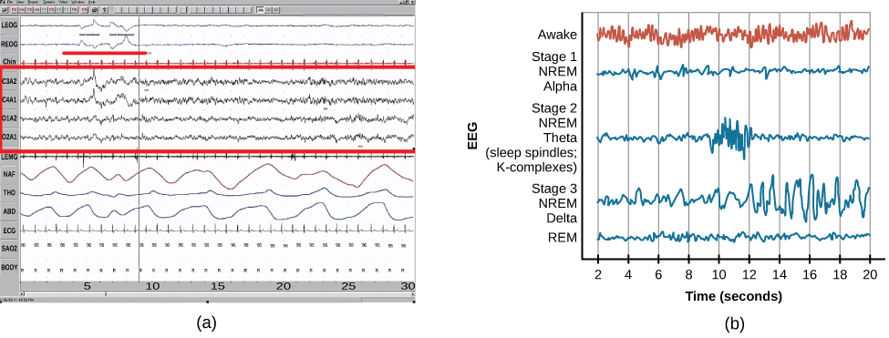

# 4.3 Stages of Sleep

> [!info]
>
> ### Learning Objectives
>
> By the end of this section, you will be able to:
>
> - Differentiate between REM and non-REM sleep
> - Describe the differences between the three stages of non-REM sleep
> - Understand the role that REM and non-REM sleep play in learning and memory

Sleep is not a uniform state of being. Instead, sleep is composed of several different stages that can be differentiated from one another by the patterns of brain wave activity that occur during each stage. While awake, our brain wave activity is dominated by **beta waves**. As compared to the brain wave patterns while asleep, beta waves have the highest frequency (13–30 Hz) and lowest amplitude, and they tend to show more variability. As we begin to fall asleep, our brain wave activity changes. These changes can be visualized using an EEG and are distinguished from one another by both the frequency and amplitude of the brain wave. The frequency of a brain wave is how many brain waves occur in a second, and frequency is measured in Hertz (Hz). Amplitude is the height of the brain wave ([Figure 4.7](#Figure_04_03_SleepCycle)). Sleep can be divided into two different general phases: REM sleep and non-REM (NREM) sleep. **Rapid eye movement (REM)** sleep is characterized by darting movements of the eyes under closed eyelids. Brain waves during REM sleep appear very similar to brain waves during wakefulness. In contrast, **non-REM (NREM)** sleep is subdivided into three stages distinguished from each other and from wakefulness by characteristic patterns of brain waves. The first three stages of sleep are NREM sleep, typically followed by REM sleep. In this section, we will discuss each of these stages of sleep and their associated patterns of brain wave activity.

**Figure 4.7** Brainwave activity changes dramatically across the different stages of sleep. (credit "sleeping": modification of work by Ryan Vaarsi)

## NREM Stages of Sleep

As we begin to fall asleep, we enter NREM sleep, and brain wave patterns decrease in frequency and increase in amplitude. The first stage of NREM sleep is known as stage 1 sleep. **Stage 1 sleep** is a transitional phase that occurs between wakefulness and sleep, the period during which we drift off to sleep. During this time, there is a slowdown in both the rates of respiration and heartbeat. In addition, stage 1 sleep involves a marked decrease in both overall muscle tension and core body temperature.

In terms of brain wave activity, stage 1 sleep is associated with both alpha and theta waves. The early portion of stage 1 sleep produces **alpha waves**. These patterns of electrical activity (waves) resemble that of someone who is very relaxed, yet awake, but they have less variability (are more synchronized) and are relatively lower in frequency (8–12 Hz) and higher in amplitude than beta waves ([Figure 4.8](#Figure_04_03_Stages)). As an individual continues through stage 1 sleep, there is an increase in theta wave activity. **Theta waves** are even lower frequency (4–7 Hz), and higher in amplitude, than the alpha wave patterns. It is relatively easy to wake someone from stage 1 sleep; in fact, people often report that they have not been asleep if they are awoken during stage 1 sleep.

![A graph has a y-axis labeled “EEG” and an x-axis labeled “time (seconds.) Plotted along the y-axis and moving upward are the stages of sleep. First is REM, followed by Stage 3 NREM Delta, Stage 2 NREM Theta (sleep spindles; K-complexes), Stage 1 NREM Alpha, and Awake. Charted on the x axis is Time in seconds from 2–20 in 2 second intervals. Each sleep stage has associated wavelengths of varying amplitude and frequency. Relative to the others, “awake” has a very close wavelength and a medium amplitude. Stage 1 is characterized by a generally uniform wavelength and a relatively low amplitude which doubles and quickly reverts to normal every 2 seconds. Stage 2 is comprised of a similar wavelength as stage 1. It introduces the K-complex from seconds 10 through 12 which is a short burst of doubled or tripled amplitude and decreased wavelength. Stage 3 has a more uniform wave with gradually increasing amplitude. Finally, REM sleep looks much like stage 2 without the K-complex.](../../images/img_446528b23c21.jpg)

**Figure 4.8** Brainwave activity changes dramatically across the different stages of sleep.

As we move into **stage 2 sleep**, the body goes into a state of deep relaxation. Theta waves still dominate the activity of the brain, but they are interrupted by brief bursts of activity known as sleep spindles ([Figure 4.9](#Figure_04_03_Stage2)). A **sleep spindle** is a rapid burst of higher frequency brain waves that may be important for learning and memory (Fogel & Smith, 2011; Poe, Walsh, & Bjorness, 2010). In addition, the appearance of K-complexes is often associated with stage 2 sleep. A **K-complex** is a very high amplitude pattern of brain activity that may in some cases occur in response to environmental stimuli. Thus, K-complexes might serve as a bridge to higher levels of arousal in response to what is going on in our environments (Halász, 1993; Steriade & Amzica, 1998).

**Figure 4.9** Stage 2 sleep is characterized by the appearance of both sleep spindles and K-complexes.

**NREM stage 3 sleep** is often referred to as deep sleep or slow-wave sleep because this stage is characterized by low frequency (less than 3 Hz), high amplitude **delta waves** ([Figure 4.10](#Figure_04_03_Deltawaves)). These delta waves have the lowest frequency and highest amplitude of our sleeping brain wave patterns. During this time, an individual’s heart rate and respiration slow dramatically, and it is much more difficult to awaken someone from sleep during stage 3 than during earlier stages. Interestingly, individuals who have increased levels of alpha brain wave activity (more often associated with wakefulness and transition into stage 1 sleep) during stage 3 often report that they do not feel refreshed upon waking, regardless of how long they slept (Stone, Taylor, McCrae, Kalsekar, & Lichstein, 2008).

**Figure 4.10** (a) Delta waves, which are low frequency and high amplitude, characterize (b) slow-wave stage 3 and REM sleep.

## REM Sleep

As mentioned earlier, REM sleep is marked by rapid movements of the eyes. The brain waves associated with this stage of sleep are very similar to those observed when a person is awake, as shown in [Figure 4.11](#Figure_04_03_REM), and this is the period of sleep in which dreaming occurs. It is also associated with paralysis of muscle systems in the body with the exception of those that make circulation and respiration possible. Therefore, no movement of voluntary muscles occurs during REM sleep in a normal individual; REM sleep is often referred to as paradoxical sleep because of this combination of high brain activity and lack of muscle tone. Like NREM sleep, REM has been implicated in various aspects of learning and memory (Wagner, Gais, & Born, 2001; Siegel, 2001).

**Figure 4.11** (a) A period of rapid eye movement is marked by the short red line segment. The brain waves associated with REM sleep, outlined in the red box in (a), look very similar to those seen (b) during wakefulness.

If people are deprived of REM sleep and then allowed to sleep without disturbance, they will spend more time in REM sleep in what would appear to be an effort to recoup the lost time in REM. This is known as the REM rebound, and it suggests that REM sleep is also homeostatically regulated. Aside from the role that REM sleep may play in processes related to learning and memory, REM sleep may also be involved in emotional processing and regulation. In such instances, REM rebound may actually represent an adaptive response to stress in nondepressed individuals by suppressing the emotional salience of aversive events that occurred in wakefulness (Suchecki, Tiba, & Machado, 2012). Sleep deprivation in general is associated with a number of negative consequences (Brown, 2012).

The hypnogram below ([Figure 4.12](#Figure_04_03_Hypnogram)) shows a person’s passage through the stages of sleep.

![This is a hypnogram showing the transitions of the sleep cycle during a typical eight hour period of sleep. During the first hour, the person goes through stages 1 and 2 and ends at 3. In the second hour, sleep oscillates in stage 3 before attaining a 30-minute period of REM sleep. The third hour follows the same pattern as the second, but ends with a brief awake period. The fourth hour follows a similar pattern as the third, with a slightly longer REM stage. In the fifth hour, stage 3 is no longer reached. The sleep stages are fluctuating from 2, to 1, to REM, to awake, and then they repeat with shortening intervals until the end of the eighth hour when the person awakens.](../../images/img_ab3e30085759.jpg)

**Figure 4.12** A hypnogram is a diagram of the stages of sleep as they occur during a period of sleep. This hypnogram illustrates how an individual moves through the various stages of sleep.

> [!tip]
>
> ### Link to Learning
>
> View this [video about sleep stages](https://openstax.org/l/sleepstages) to learn more.

### Dreams

Dreams and their associated meanings vary across different cultures and periods of time. By the late 19th century, Austrian psychiatrist Sigmund **Freud** had become convinced that dreams represented an opportunity to gain access to the unconscious. By analyzing dreams, Freud thought people could increase self-awareness and gain valuable insight to help them deal with the problems they faced in their lives. Freud made distinctions between the manifest content and the latent content of dreams. **Manifest content** is the actual content, or storyline, of a dream. **Latent content**, on the other hand, refers to the hidden meaning of a dream. For instance, if a woman dreams about being chased by a snake, Freud might have argued that this represents the woman’s fear of sexual intimacy, with the snake serving as a symbol of a man’s penis.

Freud was not the only theorist to focus on the content of dreams. The 20th century Swiss psychiatrist Carl Jung believed that dreams allowed us to tap into the collective unconscious. The **collective unconscious**, as described by **Jung**, is a theoretical repository of information he believed to be shared by everyone. According to Jung, certain symbols in dreams reflected universal archetypes with meanings that are similar for all people regardless of culture or location.

The sleep and dreaming researcher Rosalind Cartwright, however, believes that dreams simply reflect life events that are important to the dreamer. Unlike Freud and Jung, Cartwright’s ideas about dreaming have found empirical support. For example, she and her colleagues published a study in which women going through divorce were asked several times over a five month period to report the degree to which their former spouses were on their minds. These same women were awakened during REM sleep in order to provide a detailed account of their dream content. There was a significant positive correlation between the degree to which women thought about their former spouses during waking hours and the number of times their former spouses appeared as characters in their dreams (Cartwright, Agargun, Kirkby, & Friedman, 2006). Recent research (Horikawa, Tamaki, Miyawaki, & Kamitani, 2013) has uncovered new techniques by which researchers may effectively detect and classify the visual images that occur during dreaming by using fMRI for neural measurement of brain activity patterns, opening the way for additional research in this area.

Alan Hobson, a neuroscientist, is credited for developing activation-synthesis theory of dreaming. Early versions of this theory proposed that dreams were not the meaning-filled representations of angst proposed by Freud and others, but were rather the result of our brain attempting to make sense of ("synthesize") the neural activity ("activation") that was happening during REM sleep. Recent adaptations (e.g., Hobson, 2002) continue to update the theory based on accumulating evidence. For example, Hobson (2009) suggests that dreaming may represent a state of protoconsciousness. In other words, dreaming involves constructing a virtual reality in our heads that we might use to help us during wakefulness. Among a variety of neurobiological evidence, John Hobson cites research on lucid dreams as an opportunity to better understand dreaming in general. **Lucid dreams** are dreams in which certain aspects of wakefulness are maintained during a dream state. In a lucid dream, a person becomes aware of the fact that they are dreaming, and as such, they can control the dream’s content (LaBerge, 1990).
