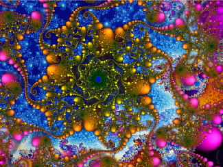
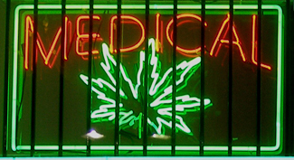

# 4.5 Substance Use and Abuse

> [!info]
>
> ### Learning Objectives
>
> By the end of this section, you will be able to:
>
> - Describe the diagnostic criteria for substance use disorders
> - Identify the neurotransmitter systems impacted by various categories of drugs
> - Describe how different categories of drugs affect behavior and experience

While we all experience altered states of consciousness in the form of sleep on a regular basis, some people use drugs and other substances that result in altered states of consciousness as well. This section will present information relating to the use of various psychoactive drugs and problems associated with such use. This will be followed by brief descriptions of the effects of some of the more well-known drugs commonly used today.

## Substance Use Disorders

The fifth edition of the ***Diagnostic and Statistical Manual of Mental Disorders***, *Fifth Edition* (DSM-5) is used by clinicians to diagnose individuals suffering from various psychological disorders. Drug use disorders are addictive disorders, and the criteria for specific substance (drug) use disorders are described in DSM-5. A person who has a substance use disorder often uses more of the substance than they originally intended to and continues to use that substance despite experiencing significant adverse consequences. In individuals diagnosed with a substance use disorder, there is a compulsive pattern of drug use that is often associated with both physical and psychological dependence.

**Physical dependence** involves changes in normal bodily functions—the user will experience withdrawal from the drug upon cessation of use. In contrast, a person who has **psychological dependence** has an emotional, rather than physical, need for the drug and may use the drug to relieve psychological distress. **Tolerance** is linked to physiological dependence, and it occurs when a person requires more and more drug to achieve effects previously experienced at lower doses. Tolerance can cause the user to increase the amount of drug used to a dangerous level—even to the point of overdose and death.

Drug **withdrawal** includes a variety of negative symptoms experienced when drug use is discontinued. These symptoms usually are opposite of the effects of the drug. For example, withdrawal from sedative drugs often produces unpleasant arousal and agitation. In addition to withdrawal, many individuals who are diagnosed with substance use disorders will also develop tolerance to these substances. Psychological dependence, or drug craving, is a recent addition to the diagnostic criteria for substance use disorder in DSM-5. This is an important factor because we can develop tolerance and experience withdrawal from any number of drugs that we do not abuse. In other words, physical dependence in and of itself is of limited utility in determining whether or not someone has a substance use disorder.

## Drug Categories

The effects of all psychoactive drugs occur through their interactions with our endogenous neurotransmitter systems. Many of these drugs, and their relationships, are shown in [Table 4.2](#Table_04_02_02). As you have learned, drugs can act as agonists or antagonists of a given neurotransmitter system. An agonist facilitates the activity of a neurotransmitter system, and antagonists impede neurotransmitter activity.

**Drugs and Their Effects**

| Class of Drug | Examples | Effects on the Body | Effects When Used | Psychologically Addicting? |
| --- | --- | --- | --- | --- |
| Stimulants | Cocaine, amphetamines (including some ADHD medications such as Adderall), methamphetamines, MDMA (“Ecstasy” or “Molly”) | Increased heart rate, blood pressure, body temperature | Increased alertness, mild euphoria, decreased appetite in low doses. High doses increase agitation, paranoia, can cause hallucinations. Some can cause heightened sensitivity to physical stimuli. High doses of MDMA can cause brain toxicity and death. | Yes |
| Sedative-Hypnotics (“Depressants”) | Alcohol, barbiturates (e.g., secobarbital, pentobarbital), Benzodiazepines (e.g., Xanax) | Decreased heart rate, blood pressure | Low doses increase relaxation, decrease inhibitions. High doses can induce sleep, cause motor disturbance, memory loss, decreased respiratory function, and death. | Yes |
| Opiates | Opium, Heroin, Fentanyl, Morphine, Oxycodone, Vicodin, methadone, and other prescription pain relievers | Decreased pain, pupil constriction, decreased gut motility, decreased respiratory function | Pain relief, euphoria, sleepiness. High doses can cause death due to respiratory depression. | Yes |
| Hallucinogens | Marijuana, LSD, Peyote, mescaline, DMT, dissociative anesthetics including ketamine and PCP | Increased heart rate and blood pressure that may dissipate over time | Mild to intense perceptual changes with high variability in effects based on strain, method of ingestion, and individual differences | Yes |

**Table 4.2**

### Alcohol and Other Depressants

Ethanol, which we commonly refer to as alcohol, is in a class of psychoactive drugs known as depressants ([Figure 4.15](#Figure_04_05_Drugtypes)). A **depressant** is a drug that tends to suppress central nervous system activity. Other depressants include barbiturates and benzodiazepines. These drugs share in common their ability to serve as agonists of the gamma-Aminobutyric acid (GABA) neurotransmitter system. Because GABA has a quieting effect on the brain, GABA agonists also have a quieting effect; these types of drugs are often prescribed to treat both anxiety and insomnia.

**Figure 4.15** The GABA-gated chloride (Cl–) channel is embedded in the cell membrane of certain neurons. The channel has multiple receptor sites where alcohol, barbiturates, and benzodiazepines bind to exert their effects. The binding of these molecules opens the chloride channel, allowing negatively-charged chloride ions (Cl–) into the neuron's cell body. Changing its charge in a negative direction pushes the neuron *away* from firing; thus, activating a GABA neuron has a quieting effect on the brain.

Acute alcohol administration results in a variety of changes to consciousness. At rather low doses, alcohol use is associated with feelings of euphoria. As the dose increases, people report feeling sedated. Generally, alcohol is associated with decreases in reaction time and visual acuity, lowered levels of alertness, and reduction in behavioral control. With excessive alcohol use, a person might experience a complete loss of consciousness and/or difficulty remembering events that occurred during a period of intoxication (McKim & Hancock, 2013). In addition, if a pregnant person consumes alcohol, their infant may be born with a cluster of birth defects and symptoms collectively called fetal alcohol spectrum disorder (FASD) or fetal alcohol syndrome (FAS).

With repeated use of many central nervous system depressants, such as alcohol, a person becomes physically dependent upon the substance and will exhibit signs of both tolerance and withdrawal. Psychological dependence on these drugs is also possible. Therefore, the abuse potential of central nervous system depressants is relatively high.

Drug withdrawal is usually an aversive experience, and it can be a life-threatening process in individuals who have a long history of very high doses of alcohol and/or barbiturates. This is of such concern that people who are trying to overcome addiction to these substances should only do so under medical supervision.

### Stimulants

**Stimulants** are drugs that tend to increase overall levels of neural activity. Many of these drugs act as agonists of the dopamine neurotransmitter system. Dopamine activity is often associated with reward and craving; therefore, drugs that affect dopamine neurotransmission often have abuse liability. Drugs in this category include cocaine, amphetamines (including methamphetamine), cathinones (i.e., bath salts), MDMA (ecstasy), nicotine, and caffeine.

Cocaine can be taken in multiple ways. While many users snort cocaine, intravenous injection and inhalation (smoking) are also common. The freebase version of cocaine, known as crack, is a potent, smokable version of the drug. Like many other stimulants, cocaine agonizes the dopamine neurotransmitter system by blocking the reuptake of dopamine in the neuronal synapse.

> [!note]
>
> ### Dig Deeper
>
> #### Methamphetamine
>
> Methamphetamine in its smokable form, often called “crystal meth” due to its resemblance to rock crystal formations, is highly addictive. The smokable form reaches the brain very quickly to produce an intense euphoria that dissipates almost as fast as it arrives, prompting users to continuing taking the drug. Users often consume the drug every few hours across days-long binges called "runs," in which the user forgoes food and sleep. The availability of potent and inexpensive forms of methamphetamine, coupled with a lower risk of overdose than with opiate drugs, is making crystal meth a popular choice among drug users today (NIDA, 2019). Using crystal meth poses a number of serious long-term health issues, including dental problems (often called "meth mouth"), skin abrasions caused by excessive scratching, memory loss, sleep problems, violent behavior, paranoia, and hallucinations. Methamphetamine addiction produces an intense craving that is difficult to treat.

Amphetamines have a mechanism of action quite similar to cocaine in that they block the reuptake of dopamine in addition to stimulating its release ([Figure 4.16](#Figure_04_05_Stimulants)). While amphetamines are often abused, they are also commonly prescribed to people diagnosed with attention deficit hyperactivity disorder (ADHD). It may seem counterintuitive that stimulant medications are prescribed to treat a disorder that involves hyperactivity, but the therapeutic effect comes from increases in neurotransmitter activity within certain areas of the brain associated with impulse control. These brain areas include the prefrontal cortex and basal ganglia.

![An illustration of a presynaptic cell and a postsynaptic cell shows these cells’ interactions with cocaine and dopamine molecules. The presynaptic cell contains two cylinder-shaped channels, one on each side near where it faces the postsynaptic cell. The postsynaptic cell contains several receptors, side-by-side across the area that faces the presynaptic cell. In the space between the two cells, there are both cocaine and dopamine molecules. One of the cocaine molecules attaches to one of the presynaptic cell’s channels. This cocaine molecule is labeled “bound cocaine.” An X-shape is shown over the top of the bound cocaine and the channel to indicate that the cocaine does not enter the presynaptic cell. A dopamine molecule is shown inside of the presynaptic cell’s other channel. Arrows connect this dopamine molecule to several others inside of the presynaptic cell. More arrows connect to more dopamine molecules, tracing their paths from the channel into the presynaptic cell, and out into the space between the presynaptic cell and the postsynaptic cell. Arrows extend from two of the dopamine molecules in this in-between space to the postsynaptic cell’s receptors. Only the dopamine molecules are shown binding to the postsynaptic cell’s receptors.](../../images/img_da5904a0e2f8.jpg)

**Figure 4.16** As one of their mechanisms of action, cocaine and amphetamines block the reuptake of dopamine from the synapse into the presynaptic cell.

In recent years, methamphetamine (meth) use has become increasingly widespread. **Methamphetamine** is a type of amphetamine that can be made from ingredients that are readily available (e.g., medications containing pseudoephedrine, a compound found in many over-the-counter cold and flu remedies). Despite recent changes in laws designed to make obtaining pseudoephedrine more difficult, methamphetamine continues to be an easily accessible and relatively inexpensive drug option (Shukla, Crump, & Chrisco, 2012).

Stimulant users seek a **euphoric high**, feelings of intense elation and pleasure, especially in those users who take the drug via intravenous injection or smoking. MDMA (3.4-methelynedioxy-methamphetamine, commonly known as "ecstasy" or "Molly") is a mild stimulant with perception-altering effects. It is typically consumed in pill form. Users experience increased energy, feelings of pleasure, and emotional warmth. Repeated use of these stimulants can have significant adverse consequences. Users can experience physical symptoms that include nausea, elevated blood pressure, and increased heart rate. In addition, these drugs can cause feelings of anxiety, hallucinations, and paranoia (Fiorentini et al., 2011). Normal brain functioning is altered after repeated use of these drugs. For example, repeated use can lead to overall depletion among the monoamine neurotransmitters (dopamine, norepinephrine, and serotonin). Depletion of certain neurotransmitters can lead to mood dysphoria, cognitive problems, and other factors. This can lead to people compulsively using stimulants such as cocaine and amphetamines, in part to try to reestablish the person's physical and psychological pre-use baseline. (Jayanthi & Ramamoorthy, 2005; Rothman, Blough, & Baumann, 2007).

Caffeine is another stimulant drug. While it is probably the most commonly used drug in the world, the potency of this particular drug pales in comparison to the other stimulant drugs described in this section. Generally, people use caffeine to maintain increased levels of alertness and arousal. Caffeine is found in many common medicines (such as weight loss drugs), beverages, foods, and even cosmetics (Herman & Herman, 2013). While caffeine may have some indirect effects on dopamine neurotransmission, its primary mechanism of action involves antagonizing adenosine activity (Porkka-Heiskanen, 2011). Adenosine is a neurotransmitter that promotes sleep. Caffeine is an adenosine antagonist, so caffeine inhibits the adenosine receptors, thus decreasing sleepiness and promoting wakefulness.

While **caffeine** is generally considered a relatively safe drug, high blood levels of caffeine can result in insomnia, agitation, muscle twitching, nausea, irregular heartbeat, and even death (Reissig, Strain, & Griffiths, 2009; Wolt, Ganetsky, & Babu, 2012). In 2012, Kromann and Nielson reported on a case study of a 40-year-old woman who suffered significant ill effects from her use of caffeine. The woman used caffeine in the past to boost her mood and to provide energy, but over the course of several years, she increased her caffeine consumption to the point that she was consuming three liters of soda each day. Although she had been taking a prescription antidepressant, her symptoms of depression continued to worsen and she began to suffer physically, displaying significant warning signs of cardiovascular disease and diabetes. Upon admission to an outpatient clinic for treatment of mood disorders, she met all of the diagnostic criteria for substance dependence and was advised to dramatically limit her caffeine intake. Once she was able to limit her use to less than 12 ounces of soda a day, both her mental and physical health gradually improved. Despite the prevalence of caffeine use and the large number of people who confess to suffering from caffeine addiction, this was the first published description of soda dependence appearing in scientific literature.

Nicotine is highly addictive, and the use of tobacco products is associated with increased risks of heart disease, stroke, and a variety of cancers. Nicotine exerts its effects through its interaction with acetylcholine receptors. Acetylcholine functions as a neurotransmitter in motor neurons. In the central nervous system, it plays a role in arousal and reward mechanisms. Nicotine is most commonly used in the form of tobacco products like cigarettes or chewing tobacco; therefore, there is a tremendous interest in developing effective smoking cessation techniques. To date, people have used a variety of **nicotine** replacement therapies in addition to various psychotherapeutic options in an attempt to discontinue their use of tobacco products. In general, smoking cessation programs may be effective in the short term, but it is unclear whether these effects persist (Cropley, Theadom, Pravettoni, & Webb, 2008; Levitt, Shaw, Wong, & Kaczorowski, 2007; Smedslund, Fisher, Boles, & Lichtenstein, 2004). Vaping as a means to deliver nicotine is becoming increasingly popular, especially among teens and young adults. Vaping uses battery-powered devices, sometimes called e-cigarettes, that deliver liquid nicotine and flavorings as a vapor. Originally reported as a safe alternative to the known cancer-causing agents found in cigarettes, vaping is now known to be very dangerous and has led to serious lung disease and death in users (Shmerling, 2019).

### Opioids

An **opioid** is one of a category of drugs that includes heroin, morphine, methadone, and codeine. Opioids have analgesic properties; that is, they decrease pain. Humans have an endogenous opioid neurotransmitter system—the body makes small quantities of opioid compounds that bind to opioid receptors reducing pain and producing euphoria. Thus, opioid drugs, which mimic this endogenous painkilling mechanism, have an extremely high potential for abuse. Natural opioids, called **opiates**, are derivatives of opium, which is a naturally occurring compound found in the poppy plant. There are now several synthetic versions of opiate drugs (correctly called opioids) that have very potent painkilling effects, and they are often abused. For example, the National Institutes of Drug Abuse has sponsored research that suggests the misuse and abuse of the prescription pain killers hydrocodone and oxycodone are significant public health concerns (Maxwell, 2006). In 2013, the U.S. Food and Drug Administration recommended tighter controls on their medical use.

Historically, heroin has been a major opioid drug of abuse ([Figure 4.17](#Figure_04_05_Heroin)). Heroin can be snorted, smoked, or injected intravenously. Heroin produces intense feelings of euphoria and pleasure, which are amplified when the heroin is injected intravenously. Following the initial "rush," users experience 4–6 hours of "going on the nod," alternating between conscious and semiconscious states. Heroin users often shoot the drug directly into their veins. Some people who have injected many times into their arms will show "track marks," while other users will inject into areas between their fingers or between their toes, so as not to show obvious track marks and, like all abusers of intravenous drugs, have an increased risk for contraction of both tuberculosis and HIV.

**Figure 4.17** (a) Common paraphernalia for heroin preparation and use are shown here in a needle exchange kit. (b) Heroin is cooked on a spoon over a candle. (credit a: modification of work by Todd Huffman)

Aside from their utility as analgesic drugs, opioid-like compounds are often found in cough suppressants, anti-nausea, and anti-diarrhea medications. Given that withdrawal from a drug often involves an experience opposite to the effect of the drug, it should be no surprise that opioid withdrawal resembles a severe case of the flu. While opioid withdrawal can be extremely unpleasant, it is not life-threatening (Julien, 2005). Still, people experiencing opioid withdrawal may be given methadone to make withdrawal from the drug less difficult. **Methadone** is a synthetic opioid that is less euphorigenic than heroin and similar drugs. **Methadone clinics** help people who previously struggled with opioid addiction manage withdrawal symptoms through the use of methadone. Other drugs, including the opioid buprenorphine, have also been used to alleviate symptoms of opiate withdrawal.

**Codeine** is an opioid with relatively low potency. It is often prescribed for minor pain, and it is available over-the-counter in some other countries. Like all opioids, codeine does have abuse potential. In fact, abuse of prescription opioid medications is becoming a major concern worldwide (Aquina, Marques-Baptista, Bridgeman, & Merlin, 2009; Casati, Sedefov, & Pfeiffer-Gerschel, 2012).

> [!abstract]
>
> ### Everyday Connection
>
> #### The Opioid Crisis
>
> Few people in the United States remain untouched by the recent opioid epidemic. It seems like everyone knows a friend, family member, or neighbor who has died of an overdose. Opioid addiction reached crisis levels in the United States such that by 2019, an average of 130 people died *each day* of an opioid overdose (NIDA, 2019).
>
> The crisis actually began in the 1990s, when pharmaceutical companies began mass-marketing pain-relieving opioid drugs like OxyContin with the promise (now known to be false) that they were non-addictive. Increased prescriptions led to greater rates of misuse, along with greater incidence of addiction, even among patients who used these drugs as prescribed. Physiologically, the body can become addicted to opiate drugs in less than a week, including when taken as prescribed. Withdrawal from opioids includes pain, which patients often misinterpret as pain caused by the problem that led to the original prescription, and which motivates patients to continue using the drugs.
>
> The FDA's 2013 recommendation for tighter controls on opiate prescriptions left many patients addicted to prescription drugs like OxyContin unable to obtain legitimate prescriptions. This created a black market for the drug, where prices soared to $80 or more for a single pill. To prevent withdrawal, many people turned to cheaper heroin, which could be bought for $5 a dose or less. To keep heroin affordable, many dealers began adding more potent synthetic opioids including fentanyl and carfentanyl to increase the effects of heroin. These synthetic drugs are so potent that even small doses can cause overdose and death.
>
> Large-scale public health campaigns by the National Institutes of Health and the National Institute of Drug Abuse have led to recent declines in the opioid crisis. These initiatives include increasing access to treatment and recovery services, increasing access to overdose-reversal drugs like Naloxone, and implementing better public health monitoring systems (NIDA, 2019).

### Hallucinogens

A **hallucinogen** is one of a class of drugs that results in profound alterations in sensory and perceptual experiences ([Figure 4.18](#Figure_04_05_Psychedelic)). In some cases, users experience vivid visual hallucinations. It is also common for these types of drugs to cause hallucinations of body sensations (e.g., feeling as if you are a giant) and a skewed perception of the passage of time.

**Figure 4.18** Psychedelic images like this are often associated with hallucinogenic compounds. (credit: modification of work by "new 1lluminati"/Flickr)

As a group, hallucinogens are incredibly varied in terms of the neurotransmitter systems they affect. Mescaline and LSD are serotonin agonists, and PCP (angel dust) and ketamine (an animal anesthetic) act as antagonists of the NMDA glutamate receptor. In general, these drugs are not thought to possess the same sort of abuse potential as other classes of drugs discussed in this section.

> [!tip]
>
> ### Link to Learning
>
> To learn more about some of the most commonly abused prescription and street drugs, check out the [Commonly Abused Drugs Chart](https://openstax.org/l/drugabuse) and the [Commonly Abused Prescription Drugs Chart](https://openstax.org/l/Rxabuse) from the National Institute on Drug Abuse.

> [!note]
>
> ### Dig Deeper
>
> #### Medical Marijuana
>
> The decade from 2010–2019 brought many changes in laws regarding marijuana. While the possession and use of marijuana remains illegal in many states, it is now legal to possess limited quantities of marijuana for recreational use in eleven states: Alaska, California, Colorado, Illinois, Maine, Massachusetts, Michigan, Nevada, Oregon, Vermont, and Washington. Medical marijuana is legal in over half of the United States and in the District of Columbia ([Figure 4.19](#Figure_04_05_Marijuana)). Medical marijuana is marijuana that is prescribed by a doctor for the treatment of a health condition. For example, people who undergo chemotherapy will often be prescribed marijuana to stimulate their appetites and prevent excessive weight loss resulting from the side effects of chemotherapy treatment. Marijuana may also have some promise in the treatment of a variety of medical conditions (Mather, Rauwendaal, Moxham-Hall, & Wodak, 2013; Robson, 2014; Schicho & Storr, 2014).
>
> 
>
> 
>
> **Figure 4.19** Medical marijuana shops are becoming more and more common in the United States. (credit: Laurie Avocado)
>
> While medical marijuana laws have been passed on a state-by-state basis, federal laws still classify this as an illicit substance, making conducting research on the potentially beneficial medicinal uses of marijuana problematic. There is quite a bit of controversy within the scientific community as to the extent to which marijuana might have medicinal benefits due to a lack of large-scale, controlled research (Bostwick, 2012). As a result, many scientists have urged the federal government to allow for relaxation of current marijuana laws and classifications in order to facilitate a more widespread study of the drug’s effects (Aggarwal et al., 2009; Bostwick, 2012; Kogan & Mechoulam, 2007).
>
> Until recently, the United States Department of Justice routinely arrested people involved and seized marijuana used in medicinal settings. In the latter part of 2013, however, the United States Department of Justice issued statements indicating that they would not continue to challenge state medical marijuana laws. This shift in policy may be in response to the scientific community’s recommendations and/or reflect changing public opinion regarding marijuana.
