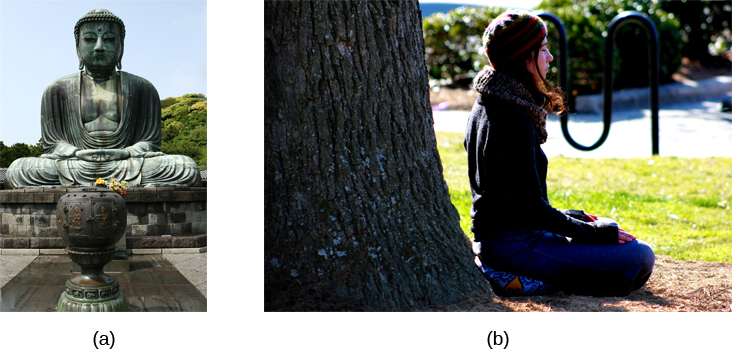

# 4.6 Other States of Consciousness

> [!info]
>
> ### Learning Objectives
>
> By the end of this section, you will be able to:
>
> - Define hypnosis and meditation
> - Understand the similarities and differences of hypnosis and meditation

Our states of consciousness change as we move from wakefulness to sleep. We also alter our consciousness through the use of various psychoactive drugs. This final section will consider hypnotic and meditative states as additional examples of altered states of consciousness experienced by some individuals.

## Hypnosis

**Hypnosis** is a state of extreme self-focus and attention in which minimal attention is given to external stimuli. In the therapeutic setting, a clinician may use relaxation and suggestion in an attempt to alter the thoughts and perceptions of a patient. For individuals who are especially open to the power of suggestion, hypnosis can prove to be a very effective technique, and brain imaging studies have demonstrated that hypnotic states are associated with global changes in brain functioning (Del Casale et al., 2012; Guldenmund, Vanhaudenhuyse, Boly, Laureys, & Soddu, 2012).

Historically, hypnosis has been viewed with some suspicion because of its portrayal in popular media and entertainment ([Figure 4.20](#Figure_04_06_Hypnotist)). Therefore, it is important to make a distinction between hypnosis as an empirically based therapeutic approach versus as a form of entertainment. Hypnosis is conducted by trained professionals, with consenting clients, often in the context of ongoing therapy. While hypnosis may be useful in enhancing memory or a skill, such enhancements are very modest in nature (Raz, 2011).

**Figure 4.20** Popular portrayals of hypnosis have led to some widely-held misconceptions.

How exactly does a hypnotist bring a participant to a state of hypnosis? While there are variations, there are four parts that appear consistent in bringing people into the state of suggestibility associated with hypnosis (National Research Council, 1994). These components include:

- The participant is guided to focus on one thing, such as the hypnotist’s words or a ticking watch.
- The participant is made comfortable and is directed to be relaxed and sleepy.
- The participant is told to be open to the process of hypnosis, trust the hypnotist and let go.
- The participant is encouraged to use their imagination.

These steps are conducive to being open to the heightened suggestibility of hypnosis.

People vary in terms of their ability to be hypnotized, but a review of available research suggests that most people are at least moderately hypnotizable (Kihlstrom, 2013). Hypnosis in conjunction with other techniques is used for a variety of therapeutic purposes and has shown to be at least somewhat effective for pain management, treatment of depression and anxiety, smoking cessation, and weight loss (Alladin, 2012; Elkins, Johnson, & Fisher, 2012; Golden, 2012; Montgomery, Schnur, & Kravits, 2012).

How does hypnosis work? Two theories attempt to answer this question: One theory views hypnosis as dissociation and the other theory views it as the performance of a social role. According to the dissociation view, hypnosis is effectively a dissociated state of consciousness, much like our earlier example where you may drive to work, but you are only minimally aware of the process of driving because your attention is focused elsewhere. This theory is supported by Ernest Hilgard’s research into hypnosis and pain. In Hilgard’s experiments, he induced participants into a state of hypnosis, and placed their arms into ice water. Participants were told they would not feel pain, but they could press a button if they did; while they reported not feeling pain, they did, in fact, press the button, suggesting a dissociation of consciousness while in the hypnotic state (Hilgard & Hilgard, 1994).

Taking a different approach to explain hypnosis, the social-cognitive theory of hypnosis sees people in hypnotic states as performing the social role of a hypnotized person. As you will learn when you study social roles, people’s behavior can be shaped by their expectations of how they should act in a given situation. Some view a hypnotized person’s behavior not as an altered or dissociated state of consciousness, but as their fulfillment of the social expectations for that role (Coe, 2009; Coe & Sarbin, 1966).

## Meditation

**Meditation** is the act of focusing on a single target (such as the breath or a repeated sound) to increase awareness of the moment. While hypnosis is generally achieved through the interaction of a therapist and the person being treated, an individual can perform meditation alone. Often, however, people wishing to learn to meditate receive some training in techniques to achieve a meditative state.

Although there are a number of different techniques in use, the central feature of all meditation is clearing the mind in order to achieve a state of relaxed awareness and focus (Chen et al., 2013; Lang et al., 2012). Mindfulness meditation has recently become popular. In the variation of mindful meditation, the meditator’s attention is focused on some internal process or an external object (Zeidan, Grant, Brown, McHaffie, & Coghill, 2012).

Meditative techniques have their roots in religious practices ([Figure 4.21](#Figure_04_06_Buddha)), but their use has grown in popularity among practitioners of alternative medicine. Research indicates that meditation may help reduce blood pressure, and the American Heart Association suggests that meditation might be used in conjunction with more traditional treatments as a way to manage hypertension, although there is not sufficient data for a recommendation to be made (Brook et al., 2013). Like hypnosis, meditation also shows promise in stress management, sleep quality (Caldwell, Harrison, Adams, Quin, & Greeson, 2010), treatment of mood and anxiety disorders (Chen et al., 2013; Freeman et al., 2010; Vøllestad, Nielsen, & Nielsen, 2012), and pain management (Reiner, Tibi, & Lipsitz, 2013).

**Figure 4.21** (a) This is a statue of a meditating Buddha, representing one of the many religious traditions of which meditation plays a part. (b) People practicing meditation may experience an alternate state of consciousness. (credit a: modification of work by Jim Epler; credit b: modification of work by Caleb Roenigk)

> [!tip]
>
> ### Link to Learning
>
> Feeling stressed? Think meditation might help? Watch this [instructional video about using Buddhist meditation techniques to alleviate stress](https://openstax.org/l/meditate) to learn more.

> [!tip]
>
> ### Link to Learning
>
> Watch this [video about the results of a brain imaging study in individuals who underwent specific mindfulness meditative techniques](https://openstax.org/l/brainimaging) to learn more.
