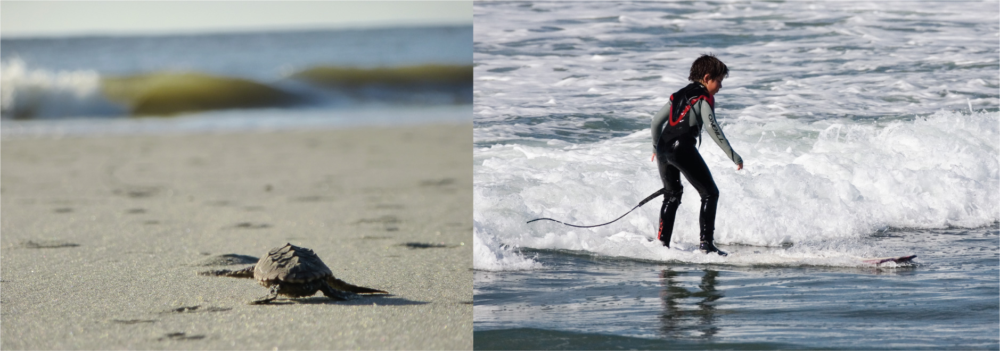

# Introduction

**Figure 6.1** Loggerhead sea turtle hatchlings are born knowing how to find the ocean and how to swim. Unlike the sea turtle, humans must learn how to swim (and surf). (credit “turtle”: modification of work by Becky Skiba, USFWS; credit “surfer”: modification of work by Mike Baird)

## Chapter Outline

- [6.1 What Is Learning?](01-6-1-what-is-learning.md)
- [6.2 Classical Conditioning](02-6-2-classical-conditioning.md)
- [6.3 Operant Conditioning](03-6-3-operant-conditioning.md)
- [6.4 Observational Learning (Modeling)](04-6-4-observational-learning-modeling.md)

The summer sun shines brightly on a deserted stretch of beach. Suddenly, a tiny grey head emerges from the sand, then another and another. Soon the beach is teeming with loggerhead sea turtle hatchlings ([Figure 6.1](#fs-idp78123968)). Although only minutes old, the hatchlings know exactly what to do. Their flippers are not very efficient for moving across the hot sand, yet they continue onward, instinctively. Some are quickly snapped up by gulls circling overhead and others become lunch for hungry ghost crabs that dart out of their holes. Despite these dangers, the hatchlings are driven to leave the safety of their nest and find the ocean.

Not far down this same beach, Ben and his son, Julian, paddle out into the ocean on surfboards. A wave approaches. Julian crouches on his board, then jumps up and rides the wave for a few seconds before losing his balance. He emerges from the water in time to watch his father ride the face of the wave.

Unlike baby sea turtles, which know how to find the ocean and swim with no help from their parents, we are not born knowing how to swim (or surf). Yet we humans pride ourselves on our ability to learn. In fact, over thousands of years and across cultures, we have created institutions devoted entirely to learning. But have you ever asked yourself how exactly it is that we learn? What processes are at work as we come to know what we know? This chapter focuses on the primary ways in which learning occurs.
