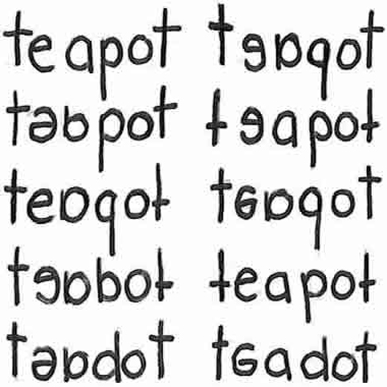

# 7.6 The Source of Intelligence

> [!info]
>
> ### Learning Objectives
>
> By the end of this section, you will be able to:
>
> - Describe how genetics and environment affect intelligence
> - Explain the relationship between IQ scores and socioeconomic status
> - Describe the difference between a learning disability and a developmental disorder

A young girl, born of teenage parents, lives with her grandmother in rural Mississippi. They have a very low income, but they do their best to get by with what they have. She learns to read when she is just 3 years old. As she grows older, she longs to live with her mother, who now resides in Wisconsin. She moves there at the age of 6 years. At 9 years of age, she is raped. During the next several years, several different male relatives repeatedly molest her. Her life unravels. She turns to drugs and sex to fill the deep, lonely void inside her. Her mother then sends her to Nashville to live with her father, who imposes strict behavioral expectations upon her, and over time, her wild life settles once again. She begins to experience success in school, and at 19 years old, becomes the youngest and first African-American female news anchor (“Dates and Events,” n.d.). The woman—Oprah Winfrey—goes on to become a media giant known for both her intelligence and her empathy.

## High Intelligence: Nature or Nurture?

Where does high intelligence come from? Some researchers believe that intelligence is a trait inherited from a person’s parents. Scientists who research this topic typically use twin studies to determine the **heritability** of intelligence. The Minnesota Study of Twins Reared Apart is one of the most well-known twin studies. In this investigation, researchers found that identical twins raised together and identical twins raised apart exhibit a higher correlation between their IQ scores than siblings or fraternal twins raised together (Bouchard, Lykken, McGue, Segal, & Tellegen, 1990). The findings from this study reveal a genetic component to intelligence ([Figure 7.16](#Figure_07_06_Correlations)). At the same time, other psychologists believe that intelligence is shaped by a child’s developmental environment. If parents were to provide their children with intellectual stimuli from before they are born, it is likely that they would absorb the benefits of that stimulation, and it would be reflected in intelligence levels.

![A chart shows correlations of IQs for people of varying relationships. The bottom is labeled “Percent IQ Correlation” and the left side is labeled “Relationship.” The percent IQ Correlation for relationships where no genes are shared, including adoptive parent-child pairs, similarly aged unrelated children raised together, and adoptive siblings are around 21 percent, 30 percent, and 32 percent, respectively. The percent IQ Correlation for relationships where 25 percent of genes are shared, as in half-siblings, is around 33 percent. The percent IQ Correlation for relationships where 50 percent of genes are shared, including parent-children pairs, and fraternal twins raised together, are roughly 44 percent and 62 percent, respectively. A relationship where 100 percent of genes are shared, as in identical twins raised apart, results in a nearly 80 percent IQ correlation.](../../images/img_f9fed3ff9f29.jpg)

**Figure 7.16** The **correlations** of IQs of unrelated versus related persons reared apart or together suggest a genetic component to intelligence.

The reality is that aspects of each idea are probably correct. In fact, one study suggests that although genetics seem to be in control of the level of intelligence, the environmental influences provide both stability and change to trigger manifestation of cognitive abilities (Bartels, Rietveld, Van Baal, & Boomsma, 2002). Certainly, there are behaviors that support the development of intelligence, but the genetic component of high intelligence should not be ignored. As with all heritable traits, however, it is not always possible to isolate how and when high intelligence is passed on to the next generation.

**Range of Reaction** is the theory that each person responds to the environment in a unique way based on their genetic makeup. According to this idea, your genetic potential is a fixed quantity, but whether you reach your full intellectual potential is dependent upon the environmental stimulation you experience, especially in childhood. Think about this scenario: A couple adopts a child who has average genetic intellectual potential. They raise her in an extremely stimulating environment. What will happen to the couple’s new daughter? It is likely that the stimulating environment will improve her intellectual outcomes over the course of her life. But what happens if this experiment is reversed? If a child with an extremely strong genetic background is placed in an environment that does not stimulate him: What happens? Interestingly, according to a longitudinal study of highly gifted individuals, it was found that “the two extremes of optimal and pathological experience are both represented disproportionately in the backgrounds of creative individuals”; however, those who experienced supportive family environments were more likely to report being happy (Csikszentmihalyi & Csikszentmihalyi, 1993, p. 187).

Another challenge to determining origins of high intelligence is the confounding nature of our human social structures. It is troubling to note that some ethnic groups perform better on IQ tests than others—and it is likely that the results do not have much to do with the quality of each ethnic group’s intellect. The same is true for socioeconomic status. Children who live in poverty experience more pervasive, daily stress than children who do not worry about the basic needs of safety, shelter, and food. These worries can negatively affect how the brain functions and develops, causing a dip in IQ scores. Mark Kishiyama and his colleagues determined that children living in poverty demonstrated reduced prefrontal brain functioning comparable to children with damage to the lateral prefrontal cortex (Kishiyama, Boyce, Jimenez, Perry, & Knight, 2009).

The debate around the foundations and influences on intelligence exploded in 1969, when Arthur Jensen published the article “How Much Can We Boost I.Q. and Achievement” in the *Harvard Educational Review*. While Jensen undertook research, he and his work are not viewed as being objective; his conclusions and later statements revealed racist views. Jensen had administered IQ tests to diverse groups of students, and his results led him to the conclusion that IQ is determined by genetics. He also posited that intelligence was made up of two types of abilities: Level I and Level II. In his theory, Level I is responsible for rote memorization, whereas Level II is responsible for conceptual and analytical abilities. According to his findings, Level I remained consistent among the human race. Level II, however, exhibited differences among ethnic groups (Modgil & Routledge, 1987). Jensen’s most controversial conclusion was that Level II intelligence is most prevalent among Asian people, then White people, then Black people. Robert Williams was among those who called out racial bias in Jensen’s results (Williams, 1970).

Obviously, Jensen’s interpretation of his own data caused an intense response in a nation that continued to grapple with the effects of racism (Fox, 2012). While some who took issue with Jensen's findings indicated that they did not detect overt racism in his work, Jensen himself made a number of racist statements during an interview with a White nationalist publication, *American Renaissance*. He indicated his belief that many Black people were not "educable up to a level for which there’s any economic demand," while also having a higher birth rate than other groups, which would lead to a shift in population and a deterioration of the nation (Taylor, 1992). However, Jensen’s ideas were not solitary or unique; rather, they represented one of many examples of psychologists asserting racial differences in IQ and cognitive ability. In fact, Rushton and Jensen (2005) reviewed three decades worth of research on the relationship between race and cognitive ability. Jensen’s belief in the inherited nature of intelligence and the validity of the IQ test to be the truest measure of intelligence are at the core of his conclusions.

In a related story, parents of African American students filed a case against the State of California in 1979, because they believed that the testing method used to identify students with learning disabilities was culturally unfair as the tests were normed and standardized using White children (*Larry P. v. Riles*). The testing method used by the state disproportionately identified African American children as “mentally retarded," which resulted in many students being incorrectly classified. According to a summary of the case, *Larry P. v. Riles*:

In violation of Title VI of the Civil Rights Act of 1964, the Rehabilitation Act of 1973, and the Education for All Handicapped Children Act of 1975, defendants have utilized standardized intelligence tests that are racially and culturally biased, have a discriminatory impact against Black children, and have not been validated for the purpose of essentially permanent placements of Black children into educationally dead-end, isolated, and stigmatizing classes for the so-called educable mentally retarded. Further, these federal laws have been violated by defendants' general use of placement mechanisms that, taken together, have not been validated and result in a large over-representation of Black children in the special E.M.R. classes. (*Larry P. v. Riles*, par. 6)

Once again, the limitations of intelligence testing were revealed.

## What are Learning Disabilities?

Learning disabilities are cognitive disorders that affect different areas of cognition, particularly language or reading. It should be pointed out that learning disabilities are not the same thing as intellectual disabilities. Learning disabilities are considered specific neurological impairments rather than global intellectual or developmental disabilities. A person with a language disability has difficulty understanding or using spoken language, whereas someone with a reading disability, such as dyslexia, has difficulty processing what they are reading.

Often, learning disabilities are not recognized until a child reaches school age. One confounding aspect of learning disabilities is that they most often affect children with average to above-average intelligence. In other words, the disability is specific to a particular area and not a measure of overall intellectual ability. At the same time, learning disabilities tend to exhibit comorbidity with other disorders, like attention-deficit hyperactivity disorder (ADHD). Anywhere between 30–70% of individuals with diagnosed cases of ADHD also have some sort of learning disability (Riccio, Gonzales, & Hynd, 1994). Let’s take a look at three examples of common learning disabilities: dysgraphia, dyslexia, and dyscalculia.

### Dysgraphia

Children with **dysgraphia** have a learning disability that results in a struggle to write legibly. The physical task of writing with a pen and paper is extremely challenging for the person. These children often have extreme difficulty putting their thoughts down on paper (Smits-Engelsman & Van Galen, 1997). This difficulty is inconsistent with a person’s IQ. That is, based on the child’s IQ and/or abilities in other areas, a child with dysgraphia should be able to write, but can’t. Children with dysgraphia may also have problems with spatial abilities.

Students with dysgraphia need academic accommodations to help them succeed in school. These accommodations can provide students with alternative assessment opportunities to demonstrate what they know (Barton, 2003). For example, a student with dysgraphia might be permitted to take an oral exam rather than a traditional paper-and-pencil test. Treatment is usually provided by an occupational therapist, although there is some question as to how effective such treatment is (Zwicker, 2005).

### Dyslexia

Dyslexia is the most common learning disability in children. An individual with **dyslexia** exhibits an inability to correctly process letters. The neurological mechanism for sound processing does not work properly in someone with dyslexia. As a result, dyslexic children may not understand sound-letter correspondence. A child with dyslexia may mix up letters within words and sentences—letter reversals, such as those shown in [Figure 7.17](#Figure_07_06_Dyslexia), are a hallmark of this learning disability—or skip whole words while reading. A dyslexic child may have difficulty spelling words correctly while writing. Because of the disordered way that the brain processes letters and sound, learning to read is a frustrating experience. Some dyslexic individuals cope by memorizing the shapes of most words, but they never actually learn to read (Berninger, 2008).

**Figure 7.17** These written words show variations of the word “teapot” as written by individuals with dyslexia.

### Dyscalculia

**Dyscalculia** is difficulty in learning or comprehending arithmetic. This learning disability is often first evident when children exhibit difficulty discerning how many objects are in a small group without counting them. Other symptoms may include struggling to memorize math facts, organize numbers, or fully differentiate between numerals, math symbols, and written numbers (such as “3” and “three”).
