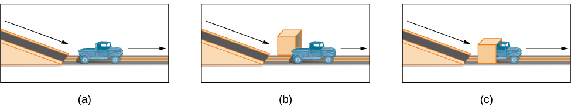

# 9.3 Stages of Development

> [!info]
>
> ### Learning Objectives
>
> By the end of this section, you will be able to:
>
> - Describe the stages of prenatal development and recognize the importance of prenatal care
> - Appraise physical, cognitive, and emotional development that occurs from infancy through childhood
> - Compare and contrast physical, cognitive, and emotional development that occurs during adolescence
> - Examine physical, cognitive, and emotional development that occurs in adulthood

From the moment we are born until the moment we die, we continue to develop.

As discussed at the beginning of this chapter, developmental psychologists often divide our development into three areas: physical development, cognitive development, and psychosocial development. Mirroring Erikson’s stages, lifespan development is divided into different stages that are based on age. We will discuss prenatal, infant, child, adolescent, and adult development.

## Prenatal Development

How did you come to be who you are? From beginning as a one-cell structure to your birth, your **prenatal development** occurred in an orderly and delicate sequence.

There are three stages of prenatal development: germinal, embryonic, and fetal. Let’s take a look at what happens to the developing baby in each of these stages.

### Germinal Stage (Weeks 1–2)

In the discussion of biopsychology earlier in the book, you learned about genetics and DNA. DNA is passed on to the child at the moment of conception. **Conception** occurs when sperm fertilizes an egg and forms a zygote ([Figure 9.7](#Figure_09_02_Conception)). A **zygote** begins as a one-cell structure that is created when a sperm and egg merge. The genetic makeup and sex of the zygote are set at this point. During the first week after conception, the zygote divides and multiplies, going from a one-cell structure to two cells, then four cells, then eight cells, and so on. This process of cell division is called **mitosis**. Mitosis is a fragile process, and fewer than one-half of all zygotes survive beyond the first two weeks (Hall, 2004). After 5 days of mitosis there are 100 cells, and after 9 months there are billions of cells. As the cells divide, they become more specialized, forming different organs and body parts. In the germinal stage, the mass of cells has yet to attach itself to the lining of the uterus. Once it does, the next stage begins.

**Figure 9.7** Sperm and ovum fuse at the point of conception.

### Embryonic Stage (Weeks 3–8)

After the zygote divides for about 7–10 days and has 150 cells, it travels down the fallopian tubes and implants itself in the lining of the uterus. Upon implantation, this multi-cellular organism is called an **embryo**. Now blood vessels grow, forming the placenta. The **placenta** is a structure connected to the uterus that provides nourishment and oxygen to the developing embryo via the umbilical cord. Basic structures of the embryo start to develop into areas that will become the head, chest, and abdomen. During the embryonic stage, the heart begins to beat and organs form and begin to function. The neural tube forms along the back of the embryo, developing into the spinal cord and brain.

### Fetal Stage (Weeks 9–40)

When the organism is about nine weeks old, the embryo is called a fetus. At this stage, the fetus is about the size of a kidney bean and begins to take on the recognizable form of a human being as the “tail” begins to disappear.

From 9–12 weeks, the sex organs begin to differentiate. At about 16 weeks, the fetus is approximately 4.5 inches long. Fingers and toes are fully developed, and fingerprints are visible. By the time the fetus reaches the sixth month of development (24 weeks), it weighs up to 1.4 pounds. Hearing has developed, so the fetus can respond to sounds. The internal organs, such as the lungs, heart, stomach, and intestines, have formed enough that a fetus born prematurely at this point has a chance to survive outside of the womb. Throughout the fetal stage the brain continues to grow and develop, nearly doubling in size from weeks 16 to 28. Around 36 weeks, the fetus is almost ready for birth. It weighs about 6 pounds and is about 18.5 inches long, and by week 37 all of the fetus’s organ systems are developed enough that it could survive outside the uterus without many of the risks associated with premature birth. The fetus continues to gain weight and grow in length until approximately 40 weeks. By then, the fetus has very little room to move around and birth becomes imminent. The progression through the stages is shown in [Figure 9.8](#Figure_09_02_Stages).

![The growth of a fetus is shown using nine pictures in different stages of development. For each stage, there is a picture of a fetus which gets progressively larger and more mature. The first stage is labeled “9 weeks; fetal stage begins.” The second stage is labeled “12 weeks; sex organs differentiate.” The third stage is labeled “16 weeks; fingers and toes develop.” The fourth stage is labeled “20 weeks; hearing begins.” The fifth stage is labeled “24 weeks; lungs begin to develop.” The sixth stage is labeled “28 weeks; brain grows rapidly.” The seventh stage is labeled “32 weeks; bones fully develop.” The eighth stage is labeled “36 weeks; muscles fully develop.” The ninth stage is labeled “40 weeks; full-term development.”](../../images/img_dbfdcaef0419.jpg)

**Figure 9.8** During the fetal stage, the baby's brain develops and the body adds size and weight, until the fetus reaches full-term development.

> [!tip]
>
> ### Link to Learning
>
> For an amazing look at prenatal development and the process of birth, view the video [*Life’s Greatest Miracle*](https://openstax.org/l/miracle) from Nova and PBS.

### Prenatal Influences

During each prenatal stage, genetic and environmental factors can affect development. The developing fetus is completely dependent on the person carrying it. Routine **prenatal care**, which is medical care during pregnancy that monitors the health of both the pregnant person and the fetus ([Figure 9.9](#Figure_09_02_Prenatal)), is important because it can reduce the risk of complications during pregnancy (NIH, 2013). In fact, people who are trying to become pregnant or who may become pregnant should discuss pregnancy planning with their doctor. They may be advised, for example, to take a vitamin containing folic acid, which helps prevent certain birth defects, or to monitor aspects of their diet or exercise routines. People can face health risks without prenatal care, which is not provided equitably across populations or locations (Backes and Scrimshaw, 2020).

**Figure 9.9** A pregnant person receives an ultrasound as part of their prenatal care. (credit: "MIKI Yoshihito_Flickr"/Flickr)

Recall that when the zygote attaches to the wall of the uterus, the placenta is formed. The placenta provides nourishment and oxygen to the fetus. Most everything a pregnant person ingests, including food, liquid, and even medication, travels through the placenta to the fetus, hence the common phrase “eating for two.” Everything in the environment affects the fetus; if they are exposed to something harmful, the child can show life-long effects.

A **teratogen** is any environmental agent—biological, chemical, or physical—that causes damage to the developing embryo or fetus. There are different types of teratogens. Alcohol and most drugs cross the placenta and affect the fetus. Alcohol is not safe to drink in any amount during pregnancy. Alcohol use during pregnancy has been found to be the leading preventable cause of intellectual disabilities in children in the United States (Maier & West, 2001). Excessive drinking while pregnant can cause fetal alcohol spectrum disorders with life-long consequences for the child ranging in severity from minor to major ([Table 9.3](#Table_09_03_01)). Fetal alcohol spectrum disorders (FASD) are a collection of birth defects associated with heavy consumption of alcohol during pregnancy. Physically, children with FASD may have a small head size and abnormal facial features. Cognitively, these children may have poor judgment, poor impulse control, higher rates of ADHD, learning issues, and lower IQ scores. These developmental problems and delays persist into adulthood (Streissguth et al., 2004). Based on studies conducted on animals, it also has been suggested that alcohol consumption during pregnancy may predispose offspring to like alcohol (Youngentob et al., 2007).

**Fetal Alcohol Syndrome Facial Features**

| Facial Feature | Potential Effect of Fetal Alcohol Syndrome |
| --- | --- |
| Head size | Below-average head circumference |
| Eyes | Smaller than average eye opening, skin folds at corners of eyes |
| Nose | Low nasal bridge, short nose |
| Midface | Smaller than average midface size |
| Lip and philtrum | Thin upper lip, indistinct philtrum |

**Table 9.3**

Smoking is also considered a teratogen because nicotine travels through the placenta to the fetus. When the pregnant person smokes, the developing baby experiences a reduction in blood oxygen levels. According to the Centers for Disease Control and Prevention (2013), smoking while pregnant can result in premature birth, low-birth-weight infants, stillbirth, and sudden infant death syndrome (SIDS).

Heroin, cocaine, methamphetamine, almost all prescription medicines, and most over-the counter medications are also considered teratogens. Babies born with a heroin addiction need heroin just like an adult with a heroin addiction. The child will need to be gradually weaned from the heroin under medical supervision; otherwise, the child could have seizures and die. Other teratogens include radiation, viruses such as HIV and herpes, and rubella (German measles). People who were raised in the United States are much less likely to be afflicted with rubella because most received childhood immunizations or vaccinations that protect the body from disease.

Each organ of the fetus develops during a specific period in the pregnancy, called the **critical or sensitive period** ([Figure 9.8](#Figure_09_02_Stages)). For example, research with primate models of FASD has demonstrated that the time during which a developing fetus is exposed to alcohol can dramatically affect the appearance of facial characteristics associated with fetal alcohol syndrome. Specifically, this research suggests that alcohol exposure that is limited to day 19 or 20 of gestation can lead to significant facial abnormalities in the offspring (Ashley, Magnuson, Omnell, & Clarren, 1999). Given regions of the brain also show sensitive periods during which they are most susceptible to the teratogenic effects of alcohol (Tran & Kelly, 2003).

> [!question]
>
> ### What Do You Think?
>
> #### Should People Who Use Drugs During Pregnancy Be Arrested and Jailed?
>
> As you now know, people who use drugs or alcohol during pregnancy can cause serious lifelong harm to their child. Some have advocated mandatory screenings for pregnant people who have a history of problematic drug use, and if they continue using, to arrest, prosecute, and incarcerate them (Murphy, 2014). For example, in the 1990s South Carolina implemented such a "fetal protection law" called the Interagency Policy on Management of Substance Abuse During Pregnancy, which had disastrous results.
>
> The Interagency Policy applied to patients attending the obstetrics clinic at MUSC, which primarily serves patients who are indigent or on Medicaid. It did not apply to private obstetrical patients. The policy required patient education about the harmful effects of substance abuse during pregnancy.... [A] statement also warned patients that protection of unborn and newborn children from the harms of illegal drug abuse could involve the Charleston police, the Solicitor of the Ninth Judicial Court, and the Protective Services Division of the Department of Social Services (DSS). (Jos, Marshall, & Perlmutter, 1995, pp. 120–121)
>
> As with similar laws, this policy seemed to deter pregnant people from seeking prenatal care, deterred them from seeking other social services, and was applied solely to people with low incomes, resulting in lawsuits. The program was canceled after 5 years, during which 42 women were arrested. A federal agency later determined that the program involved human experimentation without the approval and oversight of an institutional review board (IRB). Many states, including Massachussetts, Florida, California, Illinois, and Utah have "mandatory reporting" laws that require healthcare providers to inform child protective services when they suspect that a fetus or infant is exposed to drugs of abuse. Even though prosecutions are rarely pursued in these states, pregnant people still report reluctance to seek care for either their pregnancy or their substance abuse, and make efforts to hide both from providers (Work, 2023). What were the flaws in these programs, and how could states and healthcare providers improve them? What are the ethical implications of charging pregnant people with child abuse?

## Infancy Through Childhood

The average newborn weighs approximately 7.5 pounds. Although small, newborns are not completely helpless because their reflexes and sensory capacities help them interact with the environment from the moment of birth. All healthy babies are born with **newborn reflexes**: inborn automatic responses to particular forms of stimulation. Reflexes help the newborn survive until it is capable of more complex behaviors—these reflexes are crucial to survival. They are present in babies whose brains are developing normally and usually disappear around 4–5 months old. Let’s take a look at some of these newborn reflexes. The rooting reflex is the newborn’s response to anything that touches their cheek: When you stroke a baby’s cheek, the baby naturally turns the head in that direction and begins to suck. The sucking reflex is the automatic, unlearned, sucking motions that infants do with their mouths. Several other interesting newborn reflexes can be observed. For instance, if you put your finger into a newborn’s hand, you will witness the grasping reflex, in which a baby automatically grasps anything that touches the palms. The Moro reflex is the newborn’s response to the sensation of falling. The baby spreads the arms, pulls them back in, and then (usually) cries. How do you think these reflexes promote survival in the first months of life?

> [!tip]
>
> ### Link to Learning
>
> Take a few minutes to view this brief [video clip about newborn reflexes](https://openstax.org/l/newflexes) to learn more.

What can young infants see, hear, and smell? Newborn infants’ sensory abilities are significant, but their senses are not yet fully developed. Many of a newborn’s innate preferences facilitate interaction with caregivers and other humans. Although vision is their least developed sense, newborns already show a preference for faces. Babies who are just a few days old also prefer human voices, they will listen to voices longer than sounds that do not involve speech (Vouloumanos & Werker, 2004), and they seem to prefer their mother’s voice over a stranger’s voice (Mills & Melhuish, 1974). In an interesting experiment, 3-week-old babies were given pacifiers that played a recording of the infant’s mother’s voice and of a stranger’s voice. When the infants heard their mother’s voice, they sucked more strongly at the pacifier (Mills & Melhuish, 1974). Newborns also have a strong sense of smell. For instance, newborn babies can distinguish the smell of their own mother from that of others. In a study by MacFarlane (1978), 1-week-old babies who were being breastfed were placed between two gauze pads. One gauze pad was from the bra of a nursing mother who was a stranger, and the other gauze pad was from the bra of the infant’s own mother. More than two-thirds of the week-old babies turned toward the gauze pad with their mother’s scent.

### Physical Development

In infancy, toddlerhood, and early childhood, the body’s physical development is rapid ([Figure 9.10](#Figure_09_04_Growth)). On average, newborns weigh between 5 and 10 pounds, and a newborn’s weight typically doubles in six months and triples in one year. By 2 years old the weight will have quadrupled, so we can expect that a 2 year old should weigh between 20 and 40 pounds. The average length of a newborn is 19.5 inches, increasing to 29.5 inches by 12 months and 34.4 inches by 2 years old (WHO Multicentre Growth Reference Study Group, 2006).

**Figure 9.10** Children experience rapid physical changes through infancy and early childhood. (credit "left": modification of work by Kerry Ceszyk; credit "middle-left": modification of work by Kristi Fausel; credit "middle-right": modification of work by "devinf"/Flickr; credit "right": modification of work by Rose Spielman)

During infancy and childhood, growth does not occur at a steady rate (Carel, Lahlou, Roger, & Chaussain, 2004). Growth slows between 4 and 6 years old: During this time children gain 5–7 pounds and grow about 2–3 inches per year. Once females reach 8–9 years old, their growth rate outpaces that of males due to a pubertal growth spurt. This growth spurt continues until around 12 years old, coinciding with the start of the menstrual cycle. By 10 years old, the average female weighs 88 pounds, and the average male weighs 85 pounds.

It was previously believed that we are born with all of the brain cells we will ever have. More recent research suggests that neurogenesis (the formation of neurons) can continue through adulthood. However, the vast majority of neural connections and pathways occur during the first few years of a child’s life (National Institute of Neurological Disorders and Stroke, 2019). This period of rapid neural growth is called blooming. Neural pathways continue to develop through puberty. The blooming period of neural growth is then followed by a period of pruning, where neural connections are reduced. It is thought that pruning causes the brain to function more efficiently, allowing for mastery of more complex skills (Hutchinson, 2011). Blooming occurs during the first few years of life, and pruning continues through childhood and into adolescence in various areas of the brain.

The size of our brains increases rapidly. For example, the brain of a 2-year-old is 55% of its adult size, and by 6 years old the brain is about 90% of its adult size (Tanner, 1978). During early childhood (ages 3–6), the frontal lobes grow rapidly. Recalling our discussion of the 4 lobes of the brain earlier in this book, the frontal lobes are associated with planning, reasoning, memory, and impulse control. Therefore, by the time children reach school age, they are developmentally capable of controlling their attention and behavior. Through the elementary school years, the frontal, temporal, occipital, and parietal lobes all grow in size. The brain growth spurts experienced in childhood tend to follow Piaget’s sequence of cognitive development, so that significant changes in neural functioning account for cognitive advances (Kolb & Whishaw, 2009; Overman, Bachevalier, Turner, & Peuster, 1992).

Motor development occurs in an orderly sequence as infants move from reflexive reactions (e.g., sucking and rooting) to more advanced motor functioning. For instance, babies first learn to hold their heads up, then to sit with assistance, and then to sit unassisted, followed later by crawling and then walking.

**Motor skills** refer to our ability to move our bodies and manipulate objects. **Fine motor skills** focus on the muscles in our fingers, toes, and eyes, and enable coordination of small actions (e.g., grasping a toy, writing with a pencil, and using a spoon). **Gross motor skills** focus on large muscle groups that control our arms and legs and involve larger movements (e.g., balancing, running, and jumping).

As motor skills develop, there are certain developmental milestones that young children should achieve ([Table 9.4](#Table_09_03_02)). For each milestone there is an average age, as well as a range of ages in which the milestone should be reached. An example of a developmental milestone is sitting. On average, most babies sit alone at 7 months old. Sitting involves both coordination and muscle strength, and 90% of babies achieve this milestone between 5 and 9 months old. In another example, babies on average are able to hold up their head at 6 weeks old, and 90% of babies achieve this between 3 weeks and 4 months old. If a baby is not holding up their head by 4 months old, they are showing a delay. If the child is displaying delays on several milestones, that is reason for concern, and the parent or caregiver should discuss this with the child’s pediatrician. Some developmental delays can be identified and addressed through early intervention.

**Developmental Milestones, Ages 2–5 Years**

| Age (years) | Physical | Personal/Social | Language | Cognitive |
| --- | --- | --- | --- | --- |
| 2 | Kicks a ball; walks up and down stairs | Plays alongside other children; copies adults | Points to objects when named; puts 2–4 words together in a sentence | Sorts shapes and colors; follows 2-step instructions |
| 3 | Climbs and runs; pedals tricycle | Takes turns; expresses many emotions; dresses self | Names familiar things; uses pronouns | Plays make believe; works toys with parts (levers, handles) |
| 4 | Catches balls; uses scissors | Prefers social play to solo play; knows likes and interests | Knows songs and rhymes by memory | Names colors and numbers; begins writing letters |
| 5 | Hops and swings; uses fork and spoon | Distinguishes real from pretend; likes to please friends | Speaks clearly; uses full sentences | Counts to 10 or higher; prints some letters and copies basic shapes |

**Table 9.4**

### Cognitive Development

In addition to rapid physical growth, young children also exhibit significant development of their cognitive abilities. Piaget thought that children’s ability to understand objects—such as learning that a rattle makes a noise when shaken—was a cognitive skill that develops slowly as a child matures and interacts with the environment. Today, developmental psychologists think Piaget was incorrect. Researchers have found that even very young children understand objects and how they work long before they have experience with those objects (Baillargeon, 1987; Baillargeon, Li, Gertner, & Wu, 2011). For example, children as young as 3 months old demonstrated knowledge of the properties of objects that they had only viewed and did not have prior experience with them. In one study, 3-month-old infants were shown a truck rolling down a track and behind a screen. The box, which appeared solid but was actually hollow, was placed next to the track. The truck rolled past the box as would be expected. Then the box was placed on the track to block the path of the truck. When the truck was rolled down the track this time, it continued unimpeded. The infants spent significantly more time looking at this impossible event ([Figure 9.11](#Figure_09_04_TruckBox)). Baillargeon (1987) concluded that they knew solid objects cannot pass through each other. Baillargeon’s findings suggest that very young children have an understanding of objects and how they work, which Piaget (1954) would have said is beyond their cognitive abilities due to their limited experiences in the world.

**Figure 9.11** In Baillargeon’s study, infants observed a truck (a) roll down an unobstructed track, (b) roll down an unobstructed track with an obstruction (box) beside it, and (c) roll down and pass through what appeared to be an obstruction.

Just as there are physical milestones that we expect children to reach, there are also cognitive milestones. It is helpful to be aware of these milestones as children gain new abilities to think, problem solve, and communicate. For example, infants shake their head “no” around 6–9 months, and they respond to verbal requests to do things like “wave bye-bye” or “blow a kiss” around 9–12 months. Remember Piaget’s ideas about object permanence? We can expect children to grasp the concept that objects continue to exist even when they are not in sight by around 8 months old. Because toddlers (i.e., 12–24 months old) have mastered object permanence, they enjoy games like hide and seek, and they realize that when someone leaves the room they will come back (Loop, 2013). Toddlers also point to pictures in books and look in appropriate places when you ask them to find objects.

Preschool-age children (i.e., 3–5 years old) also make steady progress in cognitive development. Not only can they count, name colors, and tell you their name and age, but they can also make some decisions on their own, such as choosing an outfit to wear. Preschool-age children understand basic time concepts and sequencing (e.g., before and after), and they can predict what will happen next in a story. They also begin to enjoy the use of humor in stories. Because they can think symbolically, they enjoy pretend play and inventing elaborate characters and scenarios. One of the most common examples of their cognitive growth is their blossoming curiosity. Preschool-age children love to ask “Why?”

An important cognitive change occurs in children this age. Recall that Piaget described 2–3 year olds as egocentric, meaning that they do not have an awareness of others’ points of view. Between 3 and 5 years old, children come to understand that people have thoughts, feelings, and beliefs that are different from their own. This is known as theory-of-mind (TOM). Children can use this skill to tease others, persuade their parents to purchase a candy bar, or understand why a sibling might be angry. When children develop TOM, they can recognize that others have false beliefs (Dennett, 1987; Callaghan et al., 2005).

> [!tip]
>
> ### Link to Learning
>
> False-belief tasks are useful in determining a child’s acquisition of theory-of-mind (TOM). Take a look at this [video clip that shows a false belief task involving a box of crayons](https://openstax.org/l/crayons) to learn more.

Cognitive skills continue to expand in middle and late childhood (6–11 years old). Thought processes become more logical and organized when dealing with concrete information ([Figure 9.12](#Figure_09_04_Game)). Children at this age understand concepts such as the past, present, and future, giving them the ability to plan and work toward goals. Additionally, they can process complex ideas such as addition and subtraction and cause-and-effect relationships. However, children’s attention spans tend to be very limited until they are around 11 years old. After that point, it begins to improve through adulthood.

**Figure 9.12** Because they understand luck and fairness, children in middle and late childhood (6–11 years old) are able to follow rules for games. (credit: Edwin Martinez)

One well-researched aspect of cognitive development is language acquisition. As mentioned earlier, the order in which children learn language structures is consistent across children and cultures (Hatch, 1983). You’ve also learned that some psychological researchers have proposed that children possess a biological predisposition for language acquisition.

Starting before birth, babies begin to develop language and communication skills. At birth, babies apparently recognize their mother’s voice and can discriminate between the language(s) spoken by their mothers and foreign languages, and they show preferences for faces that are moving in synchrony with audible language (Blossom & Morgan, 2006; Pickens, 1994; Spelke & Cortelyou, 1981).

Children communicate information through gesturing long before they speak, and there is some evidence that gesture usage predicts subsequent language development (Iverson & Goldin-Meadow, 2005). In terms of producing spoken language, babies begin to coo almost immediately. Cooing is a one-syllable combination of a consonant and a vowel sound (e.g., coo or ba). Interestingly, babies replicate sounds from their own languages. A baby whose parents speak French will coo in a different tone than a baby whose parents speak Spanish or Urdu. After cooing, the baby starts to babble. Babbling begins with repeating a syllable, such as ma-ma, da-da, or ba-ba. When babies are about 12 months old, we expect them to say their first word for meaning, and to start combining words for meaning at about 18 months.

At about 2 years old, a toddler uses between 50 and 200 words; by 3 years old they have a vocabulary of up to 1,000 words and can speak in sentences. During the early childhood years, children's vocabulary increases at a rapid pace. This is sometimes referred to as the “vocabulary spurt” and has been claimed to involve an expansion in vocabulary at a rate of 10–20 new words per week. Recent research may indicate that while some children experience these spurts, it is far from universal (as discussed in Ganger & Brent, 2004). It has been estimated that 5 year olds understand about 6,000 words, speak 2,000 words, and can define words and question their meanings. They can rhyme and name the days of the week. Seven year olds speak fluently and use slang and clichés (Stork & Widdowson, 1974).

What accounts for such dramatic language learning by children? Behaviorist B. F. Skinner thought that we learn language in response to reinforcement or feedback, such as through parental approval or through being understood. For example, when a two-year-old child asks for juice, he might say, “me juice,” to which his mother might respond by giving him a cup of apple juice. Noam Chomsky (1957) criticized Skinner’s theory and proposed that we are all born with an innate capacity to learn language. Chomsky called this mechanism a language acquisition device (LAD). Who is correct? Both Chomsky and Skinner are right. Remember that we are a product of both nature and nurture. Researchers now believe that language acquisition is partially inborn and partially learned through our interactions with our linguistic environment (Gleitman & Newport, 1995; Stork & Widdowson, 1974).

### Attachment

Psychosocial development occurs as children form relationships, interact with others, and understand and manage their feelings. In social and emotional development, forming healthy attachments is very important and is the major social milestone of infancy. **Attachment** is a long-standing connection or bond with others. Developmental psychologists are interested in how infants reach this milestone. They ask such questions as: How do parent and infant attachment bonds form? How does neglect affect these bonds? What accounts for children’s attachment differences?

Researchers Harry Harlow, John Bowlby, and Mary Ainsworth conducted studies designed to answer these questions. In the 1950s, Harlow conducted a series of experiments on monkeys. He separated newborn monkeys from their mothers. Each monkey was presented with two surrogate mothers. One surrogate monkey was made out of wire mesh, and she could dispense milk. The other monkey was softer and made from cloth: This monkey did not dispense milk. Research shows that the monkeys preferred the soft, cuddly cloth monkey, even though she did not provide any nourishment. The baby monkeys spent their time clinging to the cloth monkey and only went to the wire monkey when they needed to be fed. Prior to this study, the medical and scientific communities generally thought that babies become attached to the people who provide their nourishment. However, Harlow (1958) concluded that there was more to the mother-child bond than nourishment. Feelings of comfort and security are the critical components to maternal-infant bonding, which leads to healthy psychosocial development.

> [!tip]
>
> ### Link to Learning
>
> Harlow’s studies of monkeys were performed before modern ethics guidelines were in place, and today his experiments are widely considered to be unethical and even cruel. Watch this [video of actual footage of Harlow's monkey studies](https://openstax.org/l/monkeystudy) to learn more.

Building on the work of Harlow and others, John Bowlby developed the concept of attachment theory. He defined attachment as the affectional bond or tie that an infant forms with the mother (Bowlby, 1969). An infant must form this bond with a primary caregiver in order to have normal social and emotional development. In addition, Bowlby proposed that this attachment bond is very powerful and continues throughout life. He used the concept of secure base to define a healthy attachment between parent and child (1988). A **secure base** is a parental presence that gives the child a sense of safety as he explores his surroundings. Bowlby said that two things are needed for a healthy attachment: The caregiver must be responsive to the child’s physical, social, and emotional needs; and the caregiver and child must engage in mutually enjoyable interactions (Bowlby, 1969) ([Figure 9.13](#Figure_09_04_BabySmile)).

**Figure 9.13** Mutually enjoyable interactions promote the parent-infant bond. (credit: "balouriarajesh_Pixabay"/Pixabay)

While Bowlby thought attachment was an all-or-nothing process, Mary Ainsworth’s (1970) research showed otherwise. Ainsworth wanted to know if children differ in the ways they bond, and if so, why. To find the answers, she used the Strange Situation procedure to study attachment between mothers and their infants (1970). In the Strange Situation, the mother (or primary caregiver) and the infant (age 12-18 months) are placed in a room together. There are toys in the room, and the caregiver and child spend some time alone in the room. After the child has had time to explore her surroundings, a stranger enters the room. The mother then leaves her baby with the stranger. After a few minutes, she returns to comfort her child.

Based on how the infants/toddlers responded to the separation and reunion, Ainsworth identified three types of parent-child attachments: secure, avoidant, and resistant (Ainsworth & Bell, 1970). A fourth style, known as disorganized attachment, was later described (Main & Solomon, 1990). The most common type of attachment—also considered the healthiest—is called **secure attachment** ([Figure 9.14](#Figure_09_04_Secure)). In this type of attachment, the toddler prefers his parent over a stranger. The attachment figure is used as a secure base to explore the environment and is sought out in times of stress. Securely attached children were distressed when their caregivers left the room in the Strange Situation experiment, but when their caregivers returned, the securely attached children were happy to see them. Securely attached children have caregivers who are sensitive and responsive to their needs.

**Figure 9.14** In secure attachment, the parent provides a secure base for the toddler, allowing him to securely explore his environment. (credit: Kerry Ceszyk)

With **avoidant attachment**, the child is unresponsive to the parent, does not use the parent as a secure base, and does not care if the parent leaves. The toddler reacts to the parent the same way she reacts to a stranger. When the parent does return, the child is slow to show a positive reaction. Ainsworth theorized that these children were most likely to have a caregiver who was insensitive and inattentive to their needs (Ainsworth, Blehar, Waters, & Wall, 1978).

In cases of **resistant attachment**, children tend to show clingy behavior, but then they reject the attachment figure’s attempts to interact with them (Ainsworth & Bell, 1970). These children do not explore the toys in the room, as they are too fearful. During separation in the Strange Situation, they became extremely disturbed and angry with the parent. When the parent returns, the children are difficult to comfort. Resistant attachment is the result of the caregivers’ inconsistent level of response to their child.

Finally, children with **disorganized attachment** behaved oddly in the Strange Situation. They freeze, run around the room in an erratic manner, or try to run away when the caregiver returns (Main & Solomon, 1990). This type of attachment is seen most often in kids who have been abused. Research has shown that abuse disrupts a child’s ability to regulate their emotions.

While Ainsworth’s research has found support in subsequent studies, it has also met criticism. Some researchers have pointed out that a child’s temperament may have a strong influence on attachment (Gervai, 2009; Harris, 2009), and others have noted that attachment varies from culture to culture, a factor not accounted for in Ainsworth’s research (Rothbaum, Weisz, Pott, Miyake, & Morelli, 2000; van Ijzendoorn & Sagi-Schwartz, 2008).

> [!tip]
>
> ### Link to Learning
>
> Watch this [video clip of the Strange Situation](https://openstax.org/l/strangesitu) and try to identify which type of attachment baby Lisa exhibits.

### Self-Concept

Just as attachment is the main psychosocial milestone of infancy, the primary psychosocial milestone of childhood is the development of a positive sense of self. How does self-awareness develop? Infants don’t have a self-concept, which is an understanding of who they are. If you place a baby in front of a mirror, they will reach out to touch their image, thinking it is another baby. However, by about 18 months a toddler will recognize that the person in the mirror is themself. How do we know this? In a well-known experiment, a researcher placed a red dot of paint on children’s noses before putting them in front of a mirror (Amsterdam, 1972). Commonly known as the mirror test, this behavior is demonstrated by humans and a few other species and is considered evidence of self-recognition (Archer, 1992). At 18 months old they would touch their own noses when they saw the paint, surprised to see a spot on their faces. By 24–36 months old children can name and/or point to themselves in pictures, clearly indicating self-recognition.

Children from 2–4 years old display a great increase in social behavior once they have established a self-concept. They enjoy playing with other children, but they have difficulty sharing their possessions. Also, through play children explore and come to understand their gender roles and can label themselves as a girl or boy (Chick, Heilman-Houser, & Hunter, 2002). By 4 years old, children can cooperate with other children, share when asked, and separate from parents with little anxiety. Children at this age also exhibit autonomy, initiate tasks, and carry out plans. Success in these areas contributes to a positive sense of self. Once children reach 6 years old, they can identify themselves in terms of group memberships: “I’m a first grader!” School-age children compare themselves to their peers and discover that they are competent in some areas and less so in others (recall Erikson’s task of industry versus inferiority). At this age, children recognize their own personality traits as well as some other traits they would like to have. For example, 10-year-old Layla says, “I’m kind of shy. I wish I could be more talkative like my friend Alexa.”

Development of a positive self-concept is important to healthy development. Children with a positive self-concept tend to be more confident, do better in school, act more independently, and are more willing to try new activities (Maccoby, 1980; Ferrer & Fugate, 2003). Formation of a positive self-concept begins in Erikson’s toddlerhood stage, when children establish autonomy and become confident in their abilities. Development of self-concept continues in elementary school, when children compare themselves to others. When the comparison is favorable, children feel a sense of competence and are motivated to work harder and accomplish more. Self-concept is re-evaluated in Erikson’s adolescence stage, as teens form an identity. They internalize the messages they have received regarding their strengths and weaknesses, keeping some messages and rejecting others. Adolescents who have achieved identity formation are capable of contributing positively to society (Erikson, 1968).

> [!note]
>
> ### Dig Deeper
>
> #### Phenomenological Variant of Ecological Systems Theory (PVEST)
>
> Kenneth and Mamie Clark were pioneering psychologists responsible for the first psychological study used in a Supreme Court case. Their research with African American children and doll choices was used to highlight the harmful effects of segregation and provided support for the Browns and the NAACP in their lawsuit against the Board of Education. The finding that African American children were more likely to choose a White doll over a Black doll, in both northern and southern states, led them to theorize that the children did not have a healthy concept of themselves (Clark & Clark, 1950).
>
> The Clarks’ research differed from that of Inez Beverly Prosser, who also studied African American children in segregated and integrated schools in Cincinnati. Parents could choose either environment for their children during the 1930s. She found, among other factors, that the self-concept of children at segregated schools was more positive versus those in integrated schools, partly due to teachers’ low expectations. Prosser also noted that the child’s personality should be considered when choosing a segregated school or an integrated school (Benjamin, Henry, & McMahon, 2005).
>
> Later researchers suggested that African American children choosing a doll that did not look like them was not an indication of their self-esteem or their self-image. For instance, Rogers and Meltzoff (2017) found that gender identity was more important than race in their study of diverse children whose average age was about 10 years old. Thus, for children that young, the meaning of race is an evolving process, as opposed to adolescents’ search for identity. The ethnic minority children in the study did view racial identity as important, compared to their White counterparts.
>
> For teenagers who are members of ethnic minority groups, racial/ethnic/cultural identity can be paramount, depending on the family’s processes. Racial socialization involves teaching them the positive aspects of their in-group, usually by caregivers. Most of the students in a study by Neblett, Smalls, Ford, Nguyen, and Sellers (2009) reported having received such messages but a few received no racial socialization messages. They found that these messages played a role in how they felt about their in-group.
>
> Some theories have been developed to explain the behaviors of ethnic minority youth. One such theory is the Phenomenological Variant of Ecological Systems Theory (PVEST), put forth by Margaret Beale Spencer. It is a merging of phenomenology and Bronfenbrenner’s ecological systems theory. A phenomenological approach is based on how a person makes meaning of their experiences. For example, young African American boys have different experiences in educational settings compared to African American girls. Consequently, the meaning they assign to those experiences differs. Bronfenbrenner’s ecological systems theory suggests that development occurs based on interactions among environments such as school, family, and community (Bronfenbrenner, 1977).
>
> The research that Spencer, Dupree, and Hartmann (1997) conducted with African American adolescent boys and girls was explained by PVEST. They found that negative learning attitudes were predicted by unpopularity with peers for girls and boys. Additionally, for boys, more stress predicted a less negative attitude toward learning, possibly due to focus on the school environment instead of on personal issues. This occurred along with perceiving that teachers had positive expectations of African American boys. The researchers surmised that PVEST accounted for how others’ perceptions and their subsequent attitudes were related and worked both ways.

What can parents do to nurture a healthy self-concept? Diana Baumrind (1971, 1991) proposed that parenting style may be a factor. The way we parent is an important factor in a child’s socioemotional growth. Baumrind developed and refined a theory describing four parenting styles: authoritative, authoritarian, permissive, and uninvolved. With the **authoritative style**, the parent gives reasonable demands and consistent limits, expresses warmth and affection, and listens to the child’s point of view. Parents set rules and explain the reasons behind them. They are also flexible and willing to make exceptions to the rules in certain cases—for example, temporarily relaxing bedtime rules to allow for a nighttime swim during a family vacation. Of the four parenting styles, the authoritative style is the one that is most encouraged in modern American society. American children raised by authoritative parents tend to have high self-esteem and social skills. However, effective parenting styles vary as a function of culture and, as Small (1999) points out, the authoritative style is not necessarily preferred or appropriate in all cultures.

In **authoritarian style**, the parent places high value on conformity and obedience. The parents are often strict, tightly monitor their children, and express little warmth. In contrast to the authoritative style, authoritarian parents probably would not relax bedtime rules during a vacation because they consider the rules to be set, and they expect obedience. This style can create anxious, withdrawn, and unhappy kids. However, it is important to point out that authoritarian parenting is as beneficial as the authoritative style in some ethnic groups (Russell, Crockett, & Chao, 2010). For instance, first-generation Chinese American children raised by authoritarian parents did just as well in school as their peers who were raised by authoritative parents (Russell et al., 2010).

For parents who employ the **permissive style** of parenting, the kids run the show and anything goes. Permissive parents make few demands and rarely use punishment. They tend to be very nurturing and loving, and may play the role of friend rather than parent. In terms of our example of vacation bedtimes, permissive parents might not have bedtime rules at all—instead they allow the child to choose their bedtime whether on vacation or not. Not surprisingly, children raised by permissive parents tend to lack self-discipline, and the permissive parenting style is negatively associated with grades (Dornbusch, Ritter, Leiderman, Roberts, & Fraleigh, 1987). The permissive style may also contribute to other risky behaviors such as alcohol abuse (Bahr & Hoffman, 2010), risky sexual behavior especially among female children (Donenberg, Wilson, Emerson, & Bryant, 2002), and increased display of disruptive behaviors by male children (Parent et al., 2011). However, there are some positive outcomes associated with children raised by permissive parents. They tend to have higher self-esteem, better social skills, and report lower levels of depression (Darling, 1999).

With the **uninvolved style** of parenting, the parents are indifferent, uninvolved, and sometimes referred to as neglectful. They don’t respond to the child’s needs and make relatively few demands. This could be because of severe depression or substance abuse, or other factors such as the parents’ extreme focus on work. These parents may provide for the child’s basic needs, but little else. The children raised in this parenting style are usually emotionally withdrawn, fearful, anxious, perform poorly in school, and are at an increased risk of substance abuse (Darling, 1999).

As you can see, parenting styles influence childhood adjustment, but could a child’s temperament likewise influence parenting? **Temperament** refers to innate traits that influence how one thinks, behaves, and reacts with the environment. Children with easy temperaments demonstrate positive emotions, adapt well to change, and are capable of regulating their emotions. Conversely, children with difficult temperaments demonstrate negative emotions and have difficulty adapting to change and regulating their emotions. Difficult children are much more likely to challenge parents, teachers, and other caregivers (Thomas, 1984). Therefore, it’s possible that easy children (i.e., social, adaptable, and easy to soothe) tend to elicit warm and responsive parenting, while demanding, irritable, withdrawn children evoke irritation in their parents or cause their parents to withdraw (Sanson & Rothbart, 1995).

> [!abstract]
>
> ### Everyday Connection
>
> #### The Importance of Play and Recess
>
> According to the American Academy of Pediatrics (2007), unstructured play is an integral part of a child’s development. It builds creativity, problem solving skills, and social relationships. Play also allows children to develop a theory-of-mind as they imaginatively take on the perspective of others.
>
> Outdoor play allows children the opportunity to directly experience and sense the world around them. While doing so, they may collect objects that they come across and develop lifelong interests and hobbies. They also benefit from increased exercise, and engaging in outdoor play can actually increase how much they enjoy physical activity. This helps support the development of a healthy heart and brain. Unfortunately, research suggests that today’s children are engaging in less and less outdoor play (Clements, 2004). Perhaps, it is no surprise to learn that lowered levels of physical activity in conjunction with easy access to calorie-dense foods with little nutritional value are contributing to alarming levels of childhood obesity (Karnik & Kanekar, 2012).
>
> Despite the adverse consequences associated with reduced play, some children are over scheduled and have little free time to engage in unstructured play. In addition, some schools have taken away recess time for children in a push for students to do better on standardized tests, and many schools commonly use loss of recess as a form of punishment. Do you agree with these practices? Why or why not?

## Adolescence

Adolescence is a socially constructed concept. In pre-industrial society, children were considered adults when they reached physical maturity, but today we have an extended time between childhood and adulthood called adolescence. **Adolescence** is the period of development that begins at puberty and ends at emerging adulthood, which is discussed later. In the United States, adolescence is seen as a time to develop independence from parents while remaining connected to them ([Figure 9.15](#Figure_09_04_Adolescent)). The typical age range of adolescence is from 12 to 18 years, and this stage of development also has some predictable physical, cognitive, and psychosocial milestones.

**Figure 9.15** Peers are a primary influence on our development in adolescence. (credit: "manseok_Pixabay"/ Pixabay)

### Physical Development

As noted above, adolescence begins with puberty. While the sequence of physical changes in puberty is predictable, the onset and pace of puberty vary widely. Several physical changes occur during puberty, such as **adrenarche** and **gonadarche**, the maturing of the adrenal glands and sex glands, respectively. Also during this time, primary and secondary sexual characteristics develop and mature. **Primary sexual characteristics** are organs specifically needed for reproduction, like the uterus and ovaries and testes. **Secondary sexual characteristics** are physical signs of sexual maturation that do not directly involve sex organs, such as development of breasts and hips, and development of facial hair and a deepened voice. **Menarche**, the beginning of menstrual periods, usually occurs around 12–13 years old, and **spermarche**, the first ejaculation, around 13–14 years old.

During puberty, people experience a rapid increase in height (i.e., growth spurt). For females this begins between 8 and 13 years old, with adult height reached between 10 and 16 years old. Males begin their growth spurt slightly later, usually between 10 and 16 years old, and reach their adult height between 13 and 17 years old. Both nature (i.e., genes) and nurture (e.g., nutrition, medications, and medical conditions) can influence height.

Because rates of physical development vary so widely among teenagers, puberty can be a source of pride or embarrassment. Early maturing boys tend to be stronger, taller, and more athletic than their later maturing peers. They are usually more popular, confident, and independent, but they are also at a greater risk for substance abuse and early sexual activity (Flannery, Rowe, & Gulley, 1993; Kaltiala-Heino, Rimpela, Rissanen, & Rantanen, 2001). Early maturing girls may be teased or overtly admired, which can cause them to feel self-conscious about their developing bodies. These girls are at a higher risk for depression, substance abuse, and eating disorders (Ge, Conger, & Elder, 2001; Graber, Lewinsohn, Seeley, & Brooks-Gunn, 1997; Striegel-Moore & Cachelin, 1999). Late blooming boys and girls (i.e., they develop more slowly than their peers) may feel self-conscious about their lack of physical development. Negative feelings are particularly a problem for late maturing boys, who are at a higher risk for depression and conflict with parents (Graber et al., 1997) and more likely to be bullied (Pollack & Shuster, 2000).

Psychologists and clinicians also study the impact of gender identity and the impacts of puberty on transgender and gender-nonconforming youth. This is a relatively recent area of study, and the impacts should not be over-generalized. However, the research seems to indicate that transgender and gender-nonconforming youth who are supported in their identity do not have significantly higher incidences of depression or anxiety symptoms when compared to control groups, while those who are not supported exhibit more symptoms and risk factors (Olson, Durwood, & McLaughlin, 2016). Expression and exploration of gender identity can take many forms and manifest at different times depending on a wide array of factors.

The adolescent brain also remains under development. Up until puberty, brain cells continue to bloom in the frontal region. Adolescents engage in increased risk-taking behaviors and emotional outbursts possibly because the frontal lobes of their brains are still developing ([Figure 9.16](#Figure_09_04_TeenBrain)). Recall that this area is responsible for judgment, impulse control, and planning, and it is still maturing into early adulthood (Casey, Tottenham, Liston, & Durston, 2005).

**Figure 9.16** Brain growth continues into the early 20s. The development of the frontal lobe, in particular, is important during this stage.

> [!tip]
>
> ### Link to Learning
>
> According to neuroscientist Jay Giedd in the Frontline video “Inside the Teenage Brain” (2013), “It’s sort of unfair to expect [teens] to have adult levels of organizational skills or decision-making before their brains are finished being built.” Watch this segment on [“The Wiring of the Adolescent Brain”](https://openstax.org/l/wiringbrain) to find out more about the developing brain during adolescence.

### Cognitive Development

More complex thinking abilities emerge during adolescence. Some researchers suggest this is due to increases in processing speed and efficiency rather than as the result of an increase in mental capacity—in other words, due to improvements in existing skills rather than development of new ones (Bjorkland, 1987; Case, 1985). During adolescence, teenagers move beyond concrete thinking and become capable of abstract thought. Recall that Piaget refers to this stage as formal operational thought. Teen thinking is also characterized by the ability to consider multiple points of view, imagine hypothetical situations, debate ideas and opinions (e.g., politics, religion, and justice), and form new ideas ([Figure 9.17](#Figure_09_04_Reasoning)). In addition, it’s not uncommon for adolescents to question authority or challenge established societal norms.

**Cognitive empathy**, also known as theory-of-mind (which we discussed earlier with regard to egocentrism), relates to the ability to take the perspective of others and feel concern for others (Shamay-Tsoory, Tomer, & Aharon-Peretz, 2005). Cognitive empathy begins to increase in adolescence and is an important component of social problem solving and conflict avoidance. According to one longitudinal study, levels of cognitive empathy begin rising in girls around 13 years old, and around 15 years old in boys (Van der Graaff et al., 2013). Teens who reported having supportive fathers with whom they could discuss their worries were found to be better able to take the perspective of others (Miklikowska, Duriez, & Soenens, 2011).

**Figure 9.17** Teenage thinking is characterized by the ability to reason logically and solve hypothetical problems such as how to design, plan, and build a structure. (credit: U.S. Army RDECOM)

### Psychosocial Development

Adolescents continue to refine their sense of self as they relate to others. Erikson referred to the task of the adolescent as one of identity versus role confusion. Thus, in Erikson’s view, an adolescent’s main questions are “Who am I?” and “Who do I want to be?” Some adolescents adopt the values and roles that their parents expect for them. Other teens develop identities that are in opposition to their parents but align with a peer group. This is common as peer relationships become a central focus in adolescents’ lives.

As adolescents work to form their identities, they pull away from their parents, and the peer group becomes very important (Shanahan, McHale, Osgood, & Crouter, 2007). Despite spending less time with their parents, most teens report positive feelings toward them (Moore, Guzman, Hair, Lippman, & Garrett, 2004). Warm and healthy parent-child relationships have been associated with positive child outcomes, such as better grades and fewer school behavior problems, in the United States as well as in other countries (Hair et al., 2005).

It appears that most teens don’t experience adolescent storm and stress to the degree once famously suggested by G. Stanley Hall, a pioneer in the study of adolescent development. Only small numbers of teens have major conflicts with their parents (Steinberg & Morris, 2001), and most disagreements are minor. For example, in a study of over 1,800 parents of adolescents from various cultural and ethnic groups, Barber (1994) found that conflicts occurred over day-to-day issues such as homework, money, curfews, clothing, chores, and friends. These types of arguments tend to decrease as teens develop (Galambos & Almeida, 1992). There is emerging research on the adolescent brain. Galvan, Hare, Voss, Glover and Casey (2007) examined its role in risk-taking behavior. They used fMRI to assess the readings’ relationship to risk-taking, risk perception, and impulsivity. The researchers found that there was no correlation between brain activity in the neural reward center and impulsivity and risk perception. However, activity in that part of the brain was correlated to risk taking. In other words, risk-taking adolescents experienced brain activity in the reward center. The idea that adolescents, however, are more impulsive than other demographics was challenged in their research, which included children and adults.

### Emerging Adulthood

The next stage of development is **emerging adulthood**. This is a relatively newly defined period of lifespan development spanning from 18 years old to the mid-20s, characterized as an in-between time where identity exploration is focused on work and love.

When does a person become an adult? There are many ways to answer this question. In the United States, you are legally considered an adult at 18 years old. But other definitions of adulthood vary widely; in sociology, for example, a person may be considered an adult when they become self-supporting, choose a career, get married, or start a family. The ages at which we achieve these milestones vary from person to person as well as from culture to culture. For example, in the African country of Malawi, 15-year-old Njemile was married at 14 years old and had her first child at 15 years old. In her culture she is considered an adult. Children in Malawi take on adult responsibilities such as marriage and work (e.g., carrying water, tending babies, and working fields) as early as 10 years old. In stark contrast, independence in Western cultures is taking longer and longer, effectively delaying the onset of adult life.

What factors are leading to these changes regarding financial and familial independence? It seems that emerging adulthood is a product of both Western culture and our current times (Arnett, 2000). People in higher income and more industrialized countries are living longer, allowing the freedom to take an extra decade to start a career and family. Changes in the workforce also play a role. For example, 50 years ago, a young adult with a high school diploma could immediately enter the work force and climb the economic ladder. That is no longer the case. Bachelor’s and even graduate degrees are required more and more often—even for entry-level jobs (Arnett, 2000). In addition, many students are taking longer (five or six years) to complete a college degree as a result of working and going to school at the same time. After graduation, many young adults return to the family home because they have difficulty finding a job. The term Boomerang Generation describes recent college graduates for whom lack of adequate employment upon college graduation often leads to a return to the parental home (Davidson, 2014). Changing cultural expectations may be the most important reason for the delay in entering adult roles. Young people are spending more time exploring their options, so they are delaying marriage and work as they change majors and jobs multiple times, putting them on a much later timetable than their parents (Arnett, 2000).

## Adulthood

Adulthood begins around 20 years old and has three distinct stages: early, middle, and late. Each stage brings its own set of rewards and challenges.

### Physical Development

By the time we reach early adulthood (20 to early 40s), our physical maturation is complete, although our height and weight may increase slightly. In young adulthood, our physical abilities are at their peak, including muscle strength, reaction time, sensory abilities, and cardiac functioning. Most professional athletes are at the top of their game during this stage. People often carry and give birth to children in the young adulthood years, so they may see additional weight gain and breast changes.

Middle adulthood extends from the 40s to the 60s ([Figure 9.18](#Figure_09_04_Exercise)). Physical decline is gradual. The skin loses some elasticity, and wrinkles are among the first signs of aging. Visual acuity decreases during this time. Fertility gradually declines with the approach to the onset of menopause, the end of the menstrual cycle, around 50 years old. Middle adulthood tends toward weight gain: in the abdominal area for men and in the hips and thighs for women. Hair begins to thin and turn gray.

**Figure 9.18** Physical declines of middle and late adulthood can be minimized with proper exercise, nutrition, and an active lifestyle. (credit: modification of work by Peter Stevens)

Late adulthood is considered to extend from the 60s on. This is the last stage of physical change. The skin continues to lose elasticity, reaction time slows further, and muscle strength diminishes. Smell, taste, hearing, and vision, so sharp in our twenties, decline significantly. The brain may also no longer function at optimal levels, leading to problems like memory loss, dementia, and Alzheimer’s disease in later years.

> [!tip]
>
> ### Link to Learning
>
> Aging doesn’t mean a person can’t explore new pursuits, learn new skills, and continue to grow. Watch this inspiring [story about Neil Unger who is a newbie to the world of skateboarding at 60 years old](https://openstax.org/l/Unger) to learn more.

### Cognitive Development

Because we spend so many years in adulthood (more than any other stage), cognitive changes are numerous. In fact, research suggests that adult cognitive development is a complex, ever changing process that may be even more active than cognitive development in infancy and early childhood (Fischer, Yan, & Stewart, 2003).

> [!tip]
>
> ### Link to Learning
>
> There is good news for the middle age brain. View this [brief video about the middle age brain](https://openstax.org/l/oldbrain) to find out what it is.

Unlike our physical abilities, which peak in our mid-20s and then begin a slow decline, our cognitive abilities remain steady throughout early and middle adulthood. Our crystallized intelligence (information, skills, and strategies we have gathered through a lifetime of experience) tends to hold steady as we age—it may even improve. For example, adults show relatively stable to increasing scores on intelligence tests until their mid-30s to mid-50s (Bayley & Oden, 1955). However, in late adulthood we begin to experience a decline in another area of our cognitive abilities—fluid intelligence (information processing abilities, reasoning, and memory). These processes become slower. How can we delay the onset of cognitive decline? Mental and physical activity seems to play a part ([Figure 9.19](#Figure_09_04_Cognitive)). Research has found adults who engage in mentally and physically stimulating activities experience less cognitive decline and have a reduced incidence of mild cognitive impairment and dementia (Hertzog, Kramer, Wilson, & Lindenberger, 2009; Larson et al., 2006; Podewils et al., 2005).

**Figure 9.19** Cognitive activities such as playing mahjong, chess, or other games, can keep you mentally fit. The same is true for solo pastimes like reading and completing crossword puzzles. (credit: Philippe Put)

Researchers have examined the aging brain by comparing it to brain functioning in younger people. Forstmann and colleagues (2011) compared elderly participants to younger participants, who in the study were asked to report the direction of movement of a set of dots. They were given feedback regarding speed and accuracy. The researchers found that older participants made more errors and were slower due to degeneration of corticostriatal connections. In other words, the decreased ability typically assigned to elderly people may be due to circumstances in the brain beyond their control. Interestingly, other researchers have found similarities in spatial representations when comparing children aged 6–7 to those over the age of 80. Ruggiero, D’Errico, and Iachini (2016) reported that this is due to neurodegeneration in older adults and immature neurology in young children.

Many elderly people experience dementia, changes in the brain that negatively affect cognition. Alzheimer’s disease is one type of dementia, initially studied by medical researcher Solomon Carter Fuller. Alzheimer’s disease has a genetic basis. Plaques in the brain are due to cell death, which then causes those affected with the disease severe forgetfulness. A person can forget how to walk, talk, and eventually eat. The disease can be mitigated by assessing environmental factors (exposure to lead, iron, and zinc increase risk) and nutritional factors (the Mediterranean diet lowers risk) (Arora, Mittal, & Kakkar, 2015). Although there is no cure, there is hope. Cognitive rehabilitation can offset mild cognitive impairment, as it can evolve into dementia. Garcia-Betances, Jimenez-Mixco, Arredondo, and Cabrera-Umpierrez (2015) examined the use of virtual reality as a possible cognitive rehabilitative method. They suggested that virtual reality technology should involve daily living activities, memory, and language, among other considerations.

### Psychosocial Development

There are many theories about the social and emotional aspects of aging. Some aspects of healthy aging include activities, social connectedness, and the role of a person’s culture. According to many theorists, including George Vaillant (2002), who studied and analyzed over 50 years of data, we need to have and continue to find meaning throughout our lives. For those in early and middle adulthood, meaning is found through work (Sterns & Huyck, 2001) and family life (Markus, Ryff, Curan, & Palmersheim, 2004). These areas relate to the tasks that Erikson referred to as generativity and intimacy. As mentioned previously, adults tend to define themselves by what they do—their careers. Earnings peak during this time, yet job satisfaction is more closely tied to work that involves contact with other people, is interesting, provides opportunities for advancement, and allows some independence (Mohr & Zoghi, 2006) than it is to salary (Iyengar, Wells, & Schwartz, 2006). How might being unemployed or being in a dead-end job challenge adult well-being?

Positive relationships with significant others in our adult years have been found to contribute to a state of well-being (Ryff & Singer, 2009). Most adults in the United States identify themselves through their relationships with family—particularly with spouses, children, and parents (Markus et al., 2004). While raising children can be stressful, especially when they are young, research suggests that parents reap the rewards down the road, as adult children tend to have a positive effect on parental well-being (Umberson, Pudrovska, & Reczek, 2010). Having a stable marriage has also been found to contribute to well-being throughout adulthood (Vaillant, 2002).

Another aspect of positive aging is believed to be social connectedness and social support. As we get older, **socioemotional selectivity theory** suggests that our social support and friendships dwindle in number, but remain as close, if not more close than in our earlier years (Carstensen, 1992) ([Figure 9.20](#Figure_09_04_Support)).

**Figure 9.20** Social support is important as we age. (credit: Gabriel Rocha)

> [!tip]
>
> ### Link to Learning
>
> Read the [poem “When I Am Old” by Jenny Joseph](https://openstax.org/l/wheniamold) to see a humorous and heartfelt approach to aging.

> [!tip]
>
> ### Link to Learning
>
> View this [video about aging in America](https://openstax.org/l/aginginusa) to learn more.
