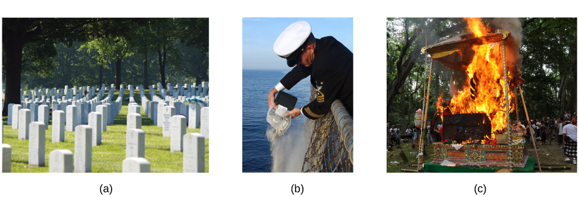

# 9.4 Death and Dying

> [!info]
>
> ### Learning Objectives
>
> By the end of this section, you will be able to:
>
> - Discuss hospice care
> - Describe the five stages of grief
> - Critique issues regarding living wills, Do Not Resuscitate (DNR) orders, and hospice care

Every story has an ending. Death marks the end of your life story ([Figure 9.21](#Figure_09_05_Cemetery)). Our culture and individual backgrounds influence how we view death. In some cultures, death is accepted as a natural part of life and is embraced. In contrast, until about 50 years ago in the United States, a doctor might not inform someone that they were dying, and the majority of deaths occurred in hospitals. In 1967 that reality began to change with Cicely Saunders, who created the first modern **hospice** in England. The aim of hospice is to help provide a death with dignity and pain management in a humane and comfortable environment, which is usually outside of a hospital setting. In 1974, Florence Wald founded the first hospice in the United States. Today, hospice provides care for 1.65 million Americans and their families. Because of hospice care, many terminally ill people are able to spend their last days at home.

**Figure 9.21** Different cultures, societies, and religions have varying practices surrounding death. For example, people’s bodies may be (a) buried in a cemetery, (b) cremated and buried at sea as in this U.S. Navy ceremony, or (c) cremated such as in this Hindu ceremony in Bali. (credit a: modification of work by Christina Rutz; credit b: modification of work by Chief Journalist Alan J. Baribeau/Wikimedia; credit c: modification of work by "CazzJj_Flickr"/Flickr)

Research has indicated that hospice care is beneficial for the patient (Brumley, Enquidanos, & Cherin, 2003; Brumley et al., 2007; Godkin, Krant, & Doster, 1984) and for the patient’s family (Rhodes, Mitchell, Miller, Connor, & Teno, 2008; Godkin et al., 1984). Hospice patients report high levels of satisfaction with hospice care because they are able to remain at home and are not completely dependent on strangers for care (Brumley et al., 2007). In addition, hospice patients tend to live longer than non-hospice patients (Connor, Pyenson, Fitch, Spence, & Iwasaki, 2007; Temel et al., 2010). Family members receive emotional support and are regularly informed of their loved one’s treatment and condition. The family member’s burden of care is also reduced (McMillan et al., 2006). Both the patient and the patient’s family members report increased family support, increased social support, and improved coping while receiving hospice services (Godkin et al., 1984).

How do you think you might react if you were diagnosed with a terminal illness like cancer? Elizabeth Kübler-Ross (1969), who worked with the founders of hospice care, described the process of an individual accepting his own death. She proposed five stages of grief: denial, anger, bargaining, depression, and acceptance. Most individuals experience these stages, but the stages may occur in different orders, depending on the individual. In addition, not all people experience all of the stages. It is also important to note that some psychologists believe that the more a dying person fights death, the more likely they are to remain stuck in the denial phase. This could make it difficult for the dying person to face death with dignity. However, other psychologists believe that not facing death until the very end is an adaptive coping mechanism for some people.

Whether due to illness or old age, not everyone facing death or the loss of a loved one experiences the negative emotions outlined in the Kübler-Ross model (Nolen-Hoeksema & Larson, 1999). For example, research suggests that people with religious or spiritual beliefs are better able to cope with death because of their hope in an afterlife and because of social support from religious or spiritual associations (Hood, Spilka, Hunsberger, & Corsuch, 1996; McIntosh, Silver, & Wortman, 1993; Paloutzian, 1996; Samarel, 1991; Wortman & Park, 2008).

A prominent example of a person creating meaning through death is Randy Pausch, who was a well-loved and respected professor at Carnegie Mellon University. Diagnosed with terminal pancreatic cancer in his mid-40s and given only 3–6 months to live, Pausch focused on living in a fulfilling way in the time he had left. Instead of becoming angry and depressed, he presented his now famous last lecture called “Really Achieving Your Childhood Dreams.” In his moving, yet humorous talk, he shares his insights on seeing the good in others, overcoming obstacles, and experiencing zero gravity, among many other things. Despite his terminal diagnosis, Pausch lived the final year of his life with joy and hope, showing us that our plans for the future still matter, even if we know that we are dying.

> [!tip]
>
> ### Link to Learning
>
> Listen to [Randy Pausch's last lecture titled Really Achieving Your Childhood Dreams](https://openstax.org/l/lastlecture) to learn more.

As individuals become more knowledgeable about medical procedures and practices, some people want to ensure that their wishes and desires are known in advance. This ensures that if the person ever becomes incapacitated or can no longer express themselves, their loved ones will know what they want. For this reason, a person might write a **living will** or **advance directive**, which is a written legal document that details specific interventions a person wants. For example, a person in the last stages of a terminal illness may not want to receive life-extending treatments. A person may also include a **Do Not Resuscitate (DNR)** Order, which they would share with family and close friends. A DNR Order states that if a person stops breathing or their heart stops beating, medical personnel such as doctors and nurses are *not* to take steps to revive or resuscitate the patient. A living will can also include a **health care proxy**, which appoints a specific person to make medical decisions for you if you are unable to speak for yourself. People’s desire for living wills and DNRs are often influenced by their religion, culture, and upbringing.
