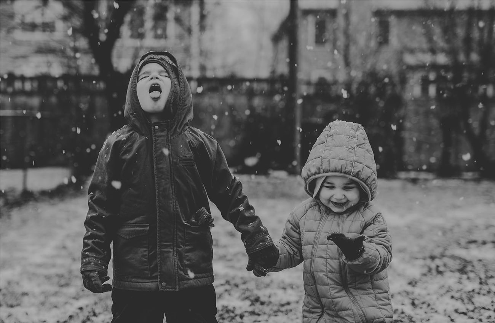

# Introduction

**Figure 11.1** What makes two individuals have different personalities? (credit: Peter Gubernat)

## Chapter Outline

- [11.1 What Is Personality?](01-11-1-what-is-personality.md)
- [11.2 Freud and the Psychodynamic Perspective](02-11-2-freud-and-the-psychodynamic-perspective.md)
- [11.3 Neo-Freudians: Adler, Erikson, Jung, and Horney](03-11-3-neo-freudians-adler-erikson-jung-and-horney.md)
- [11.4 Learning Approaches](04-11-4-learning-approaches.md)
- [11.5 Humanistic Approaches](05-11-5-humanistic-approaches.md)
- [11.6 Biological Approaches](06-11-6-biological-approaches.md)
- [11.7 Trait Theorists](07-11-7-trait-theorists.md)
- [11.8 Cultural Understandings of Personality](08-11-8-cultural-understandings-of-personality.md)
- [11.9 Personality Assessment](09-11-9-personality-assessment.md)

Three months before William Jefferson Blythe III was born, his father died in a car accident. He was raised by his mother, Virginia Dell, and grandparents, in Hope, Arkansas. When he turned 4, his mother married Roger Clinton, Jr., an alcoholic who was physically abusive to William’s mother. Six years later, Virginia gave birth to another son, Roger. William, who later took the last name Clinton from his stepfather, became the 42nd president of the United States. While Bill Clinton was making his political ascendance, his half-brother, Roger Clinton, was arrested numerous times for drug charges, including possession, conspiracy to distribute cocaine, and driving under the influence, serving time in jail. Two brothers, raised by the same people, took radically different paths in their lives. Why did they make the choices they did? What internal forces shaped their decisions? Personality psychology can help us answer these questions and more.
