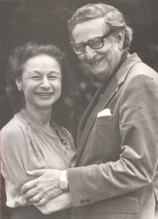

# 11.7 Trait Theorists

> [!info]
>
> ### Learning Objectives
>
> By the end of this section, you will be able to:
>
> - Discuss early trait theories of Cattell and Eysenck
> - Discuss the Big Five factors and describe someone who is high and low on each of the five factors

Trait theorists believe personality can be understood via the approach that all people have certain **traits**, or characteristic ways of behaving. Do you tend to be sociable or shy? Passive or aggressive? Optimistic or pessimistic? Moody or even-tempered? Early trait theorists tried to describe all human personality traits. For example, one trait theorist, Gordon Allport (Allport & Odbert, 1936), found 4,500 words in the English language that could describe people. He organized these personality traits into three categories: cardinal traits, central traits, and secondary traits. A cardinal trait is one that dominates your entire personality, and hence your life—such as Ebenezer Scrooge’s greed and Mother Theresa’s altruism. Cardinal traits are not very common: Few people have personalities dominated by a single trait. Instead, our personalities typically are composed of multiple traits. Central traits are those that make up our personalities (such as loyal, kind, agreeable, friendly, sneaky, wild, and grouchy). Secondary traits are those that are not quite as obvious or as consistent as central traits. They are present under specific circumstances and include preferences and attitudes. For example, one person gets angry when people try to tickle him; another can only sleep on the left side of the bed; and yet another always orders her salad dressing on the side. And you—although not normally an anxious person—feel nervous before making a speech in front of your English class.

In an effort to make the list of traits more manageable, Raymond Cattell (1946, 1957) narrowed down the list to about 171 traits. However, saying that a trait is either present or absent does not accurately reflect a person’s uniqueness, because all of our personalities are actually made up of the same traits; we differ only in the degree to which each trait is expressed. Cattell (1957) identified 16 factors or dimensions of personality: warmth, reasoning, emotional stability, dominance, liveliness, rule-consciousness, social boldness, sensitivity, vigilance, abstractedness, privateness, apprehension, openness to change, self-reliance, perfectionism, and tension ([Table 11.5](#Table_11_07_01)). He developed a personality assessment based on these 16 factors, called the 16PF. Instead of a trait being present or absent, each dimension is scored over a continuum, from high to low. For example, your level of warmth describes how warm, caring, and nice to others you are. If you score low on this index, you tend to be more distant and cold. A high score on this index signifies you are supportive and comforting.

**Personality Factors Measured by the 16PF Questionnaire**

| Factor | Low Score | High Score |
| --- | --- | --- |
| Warmth | Reserved, detached | Outgoing, supportive |
| Intellect | Concrete thinker | Analytical |
| Emotional stability | Moody, irritable | Stable, calm |
| Aggressiveness | Docile, submissive | Controlling, dominant |
| Liveliness | Somber, prudent | Adventurous, spontaneous |
| Dutifulness | Unreliable | Conscientious |
| Social assertiveness | Shy, restrained | Uninhibited, bold |
| Sensitivity | Tough-minded | Sensitive, caring |
| Paranoia | Trusting | Suspicious |
| Abstractness | Conventional | Imaginative |
| Introversion | Open, straightforward | Private, shrewd |
| Anxiety | Confident | Apprehensive |
| Openmindedness | Closeminded, traditional | Curious, experimental |
| Independence | Outgoing, social | Self-sufficient |
| Perfectionism | Disorganized, casual | Organized, precise |
| Tension | Relaxed | Stressed |

**Table 11.5**

> [!tip]
>
> ### Link to Learning
>
> Take this [assessment based on Cattell's 16PF questionnaire](https://openstax.org/l/cattell) to see which personality traits dominate your personality.

Psychologists Hans and Sybil **Eysenck** were personality theorists ([Figure 11.12](#Figure_11_07_Eysenck)) who focused on **temperament**, the inborn, genetically based personality differences that you studied earlier in the chapter. They believed personality is largely governed by biology. The Eysencks (Eysenck, 1990, 1992; Eysenck & Eysenck, 1963) viewed people as having two specific personality dimensions: extroversion/introversion and neuroticism/stability.

**Figure 11.12** Hans and Sybil Eysenck believed that our personality traits are influenced by our genetic inheritance. (credit: "Sirswindon"/Wikimedia Commons)

According to their theory, people high on the trait of extroversion are sociable and outgoing, and readily connect with others, whereas people high on the trait of introversion have a higher need to be alone, engage in solitary behaviors, and limit their interactions with others. In the neuroticism/stability dimension, people high on neuroticism tend to be anxious; they tend to have an overactive sympathetic nervous system and, even with low stress, their bodies and emotional state tend to go into a flight-or-fight reaction. In contrast, people high on stability tend to need more stimulation to activate their flight-or-fight reaction and are considered more emotionally stable. Based on these two dimensions, the Eysencks’ theory divides people into four quadrants. These quadrants are sometimes compared with the four temperaments described by the Greeks: melancholic, choleric, phlegmatic, and sanguine ([Figure 11.13](#Figure_11_04_Quadrants)).

![A circle is divided vertically and horizontally into four sections by lines with arrows at the ends. Clockwise from the top, the arrows are labeled “Unstable Emotions (Neurotic),” “Extroverted Personality,” “Stable Emotions,” and “Introverted Personality.” The arcs around the perimeter of the circle, clockwise beginning with the top right segment are labeled “Choleric,” “Sanguine,” “Phlegmatic,” and “Melancholic.” The sections inside each arc contain descriptive words. Inside the Choleric arc are the words “touchy, restless, aggressive, excitable, impulsive, and active.” Inside the Sanguine arc are the words “sociable, talkative, responsive, easygoing, lively, and carefree.” Inside the Phlegmatic arc are the words “passive, thoughtful, peaceful, controlled, reliable, and calm.” Inside the Melancholic arc are the words “moody, anxious, rigid, pessimistic, unsociable, and quiet.”](../../images/img_ef3d58dc3782.jpg)

**Figure 11.13** The Eysencks described two factors to account for variations in our personalities: extroversion/introversion and emotional stability/instability.

Later, the Eysencks added a third dimension: psychoticism versus superego control (Eysenck, Eysenck & Barrett, 1985). In this dimension, people who are high on psychoticism tend to be independent thinkers, cold, nonconformists, impulsive, antisocial, and hostile, whereas people who are high on superego control tend to have high impulse control—they are more altruistic, empathetic, cooperative, and conventional (Eysenck, Eysenck & Barrett, 1985).

While Cattell’s 16 factors may be too broad, the Eysenck’s two-factor system has been criticized for being too narrow. Another personality theory, called the **Five Factor Model**, effectively hits a middle ground, with its five factors referred to as the Big Five personality factors. It is the most popular theory in personality psychology today and the most accurate approximation of the basic personality dimensions (Funder, 2001). The five factors are openness to experience, conscientiousness, extroversion, agreeableness, and neuroticism ([Figure 11.14](#Figure_11_07_BigFive)). A helpful way to remember the factors is by using the mnemonic OCEAN.

In the Five Factor Model, each person has each factor, but they occur along a spectrum. Openness to experience is characterized by imagination, feelings, actions, and ideas. People who score high on this factor tend to be curious and have a wide range of interests. Conscientiousness is characterized by competence, self-discipline, thoughtfulness, and achievement-striving (goal-directed behavior). People who score high on this factor are hardworking and dependable. Numerous studies have found a positive correlation between conscientiousness and academic success (Akomolafe, 2013; Chamorro-Premuzic & Furnham, 2008; Conrad & Patry, 2012; Noftle & Robins, 2007; Wagerman & Funder, 2007). Extroversion is characterized by sociability, assertiveness, excitement-seeking, and emotional expression. People who score high on this factor are usually described as outgoing and warm. Not surprisingly, people who score high on both extroversion and openness are more likely to participate in adventure and risky sports due to their curious and excitement-seeking nature (Tok, 2011). The fourth factor is agreeableness, which is the tendency to be pleasant, cooperative, trustworthy, and good-natured. People who score low on agreeableness tend to be described as rude and uncooperative, yet one recent study reported that men who scored low on this factor actually earned more money than men who were considered more agreeable (Judge, Livingston, & Hurst, 2012). The last of the Big Five factors is neuroticism, which is the tendency to experience negative emotions. People high on neuroticism tend to experience emotional instability and are characterized as angry, impulsive, and hostile. Watson and Clark (1984) found that people reporting high levels of neuroticism also tend to report feeling anxious and unhappy. In contrast, people who score low in neuroticism tend to be calm and even-tempered.

![A diagram includes five vertically stacked arrows, which point to the left and right. A dimension's first letter, name, and description are included inside of each arrow. A box to the left of each arrow includes factors associated with a low score for that arrow's dimension. A box to the right of each arrow includes factors associated with a high score for that arrow's dimension. The top arrow includes the factor “openness,” which is described with the words, “imagination,” “feelings,” “actions,” and “ideas.” The box to the left of that arrow includes the words, “practical,” “conventional,” and “prefers routine,” while the box to the right of that arrow includes the words, “curious,” “wide range of interests,” and “independent.” The next arrow includes the factor “conscientiousness,” which is described with the words, “competence,” “self-discipline,” “thoughtfulness,” and “goal-driven.” The box to the left of that arrow includes the words, “impulsive,” “careless,” and “disorganized,” while the box to the right of that arrow includes the words, “hardworking,” “dependable,” and “organized.” The next arrow includes the factor “extroversion,” which is described with the words, “sociability,” “assertiveness,” and “emotional expression.” The box to the left of that arrow includes the words, “quiet,” “reserved,” and “withdrawn,” while the box to the right of that arrow includes the words, “outgoing,” “warm,” and “seeks adventure.” The next arrow includes the factor “agreeableness,” which is described with the words, “cooperative,” “trustworthy,” and “good-natured.” The box to the left of that arrow includes the words, “critical,” “uncooperative,” and “suspicious,” while the box to the right of that arrow includes the words, “helpful,” “trusting,” and “empathetic.” The next arrow includes the factor “neuroticism,” which is described as “tendency toward unstable emotions.” The box to the left of that arrow includes the words, “calm,” “even-tempered,” and “secure,” while the box to the right of that arrow includes the words, “anxious,” “unhappy,” and “prone to negative emotions.”](../../images/img_83b1b9d150d1.jpg)

**Figure 11.14** In the Five Factor Model, each person has five factors, each scored on a continuum from high to low. In the center column, notice that the first letter of each factor spells the mnemonic OCEAN.

The Big Five personality factors each represent a range between two extremes. In reality, most of us tend to lie somewhere midway along the continuum of each factor, rather than at polar ends. It’s important to note that the Big Five factors are relatively stable over our lifespan, with some tendency for the factors to increase or decrease slightly. Researchers have found that conscientiousness increases through young adulthood into middle age, as we become better able to manage our personal relationships and careers (Donnellan & Lucas, 2008). Agreeableness also increases with age, peaking between 50 to 70 years (Terracciano, McCrae, Brant, & Costa, 2005). Neuroticism and extroversion tend to decline slightly with age (Donnellan & Lucas; Terracciano et al.). Additionally, The Big Five factors have been shown to exist across ethnicities, cultures, and ages, and may have substantial biological and genetic components (Jang, Livesley, & Vernon, 1996; Jang et al., 2006; McCrae & Costa, 1997; Schmitt et al., 2007).

Another model of personality traits is the HEXACO model. HEXACO is an acronym for six broad traits: honesty-humility, emotionality, extraversion, agreeableness, conscientiousness, and openness to experience (Anglim & O’Connor, 2018). [Table 11.6](#Table_11_07_02) provides a brief overview of each trait.

**The HEXACO Traits**

| Trait | Example Aspects of Trait |
| --- | --- |
| (H) Honesty-humility | Sincerity, modesty, faithfulness |
| (E) Emotionality | Sentimentality, anxiety, sensitivity |
| (X) Extraversion | Sociability, talkativeness, boldness |
| (A) Agreeableness | Patience, tolerance, gentleness |
| (C) Conscientiousness | Organization, thoroughness, precision |
| (O) Openness | Creativity, inquisitiveness, innovativeness |

**Table 11.6**

> [!tip]
>
> ### Link to Learning
>
> Take the [Big Five Personality test](https://openstax.org/l/big5) to find out about your personality and where you fall on the Big Five factors.
