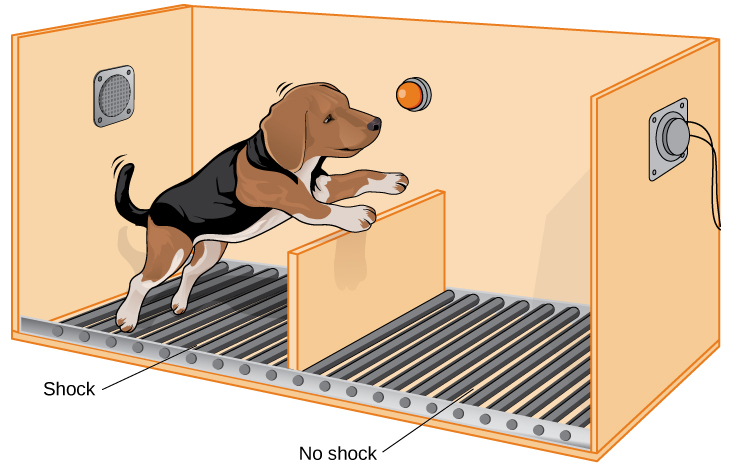
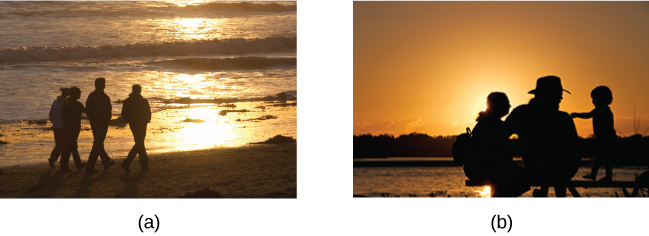

# 14.4 Regulation of Stress

> [!info]
>
> ### Learning Objectives
>
> By the end of this section, you will be able to:
>
> - Define coping and differentiate between problem-focused and emotion-focused coping
> - Describe the importance of perceived control in our reactions to stress
> - Explain how social support is vital in health and longevity

As we learned in the previous section, **stress**—especially if it is chronic—takes a toll on our bodies and can have enormously negative health implications. When we experience events in our lives that we appraise as stressful, it is essential that we use effective coping strategies to manage our stress. **Coping** refers to mental and behavioral efforts that we use to deal with problems relating to stress.

## Coping Styles

Lazarus and Folkman (1984) distinguished two fundamental kinds of coping: problem-focused coping and emotion-focused coping. In problem-focused coping, one attempts to manage or alter the problem that is causing one to experience stress (i.e., the stressor). Problem-focused coping strategies are similar to strategies used in everyday problem-solving: they typically involve identifying the problem, considering possible solutions, weighing the costs and benefits of these solutions, and then selecting an alternative (Lazarus & Folkman, 1984). As an example, suppose Bradford receives a midterm notice that he is failing statistics class. If Bradford adopts a **problem-focused coping** approach to managing his stress, he would be proactive in trying to alleviate the source of the stress. He might contact his professor to discuss what must be done to raise his grade, he might also decide to set aside two hours daily to study statistics assignments, and he may seek tutoring assistance. A problem-focused approach to managing stress means we actively try to do things to address the problem.

Emotion-focused coping, in contrast, consists of efforts to change or reduce the negative emotions associated with stress. These efforts may include avoiding, minimizing, or distancing oneself from the problem, or positive comparisons with others (“I’m not as bad off as she is”), or seeking something positive in a negative event (“Now that I’ve been fired, I can sleep in for a few days”). In some cases, **emotion-focused coping** strategies involve reappraisal, whereby the stressor is construed differently (and somewhat self-deceptively) without changing its objective level of threat (Lazarus & Folkman, 1984). For example, a person sentenced to federal prison who thinks, “This will give me a great chance to network with others,” is using reappraisal. If Bradford adopted an emotion-focused approach to managing his midterm deficiency stress, he might watch a comedy movie, play video games, or spend hours on social media to take his mind off the situation. In a certain sense, emotion-focused coping can be thought of as treating the symptoms rather than the actual cause.

While many stressors elicit both kinds of coping strategies, problem-focused coping is more likely to occur when encountering stressors we perceive as controllable, while emotion-focused coping is more likely to predominate when faced with stressors that we believe we are powerless to change (Folkman & Lazarus, 1980). Clearly, emotion-focused coping is more effective in dealing with uncontrollable stressors. For example, the stress you experience when a loved one dies can be overwhelming. You are simply powerless to change the situation as there is nothing you can do to bring this person back. The most helpful coping response is emotion-focused coping aimed at minimizing the pain of the grieving period.

Fortunately, most stressors we encounter can be modified and are, to varying degrees, controllable. A person who cannot stand her job can quit and look for work elsewhere; a middle-aged divorcee can find another potential partner; the freshman who fails an exam can study harder next time, and a breast lump does not necessarily mean that one is fated to die of breast cancer.

## Control and Stress

The desire and ability to predict events, make decisions, and affect outcomes—that is, to enact control in our lives—is a basic tenet of human behavior (Everly & Lating, 2002). Albert Bandura (1997) stated that “the intensity and chronicity of human stress is governed largely by perceived control over the demands of one’s life” (p. 262). As cogently described in his statement, our reaction to potential stressors depends to a large extent on how much control we feel we have over such things. **Perceived control** is our beliefs about our personal capacity to exert influence over and shape outcomes, and it has major implications for our health and happiness (Infurna & Gerstorf, 2014). Extensive research has demonstrated that perceptions of personal control are associated with a variety of favorable outcomes, such as better physical and mental health and greater psychological well-being (Diehl & Hay, 2010). Greater personal control is also associated with lower reactivity to stressors in daily life. For example, researchers in one investigation found that higher levels of perceived control at one point in time were later associated with lower emotional and physical reactivity to interpersonal stressors (Neupert, Almeida, & Charles, 2007). Further, a daily diary study with 34 older widows found that their stress and anxiety levels were significantly reduced on days during which the widows felt greater perceived control (Ong, Bergeman, & Bisconti, 2005).

> [!note]
>
> ### Dig Deeper
>
> #### Learned Helplessness
>
> When we lack a sense of control over the events in our lives, particularly when those events are threatening, harmful, or noxious, the psychological consequences can be profound. In one of the better illustrations of this concept, psychologist Martin Seligman conducted a series of classic experiments in the 1960s (Seligman & Maier, 1967) in which dogs were placed in a chamber where they received electric shocks from which they could not escape. Later, when these dogs were given the opportunity to escape the shocks by jumping across a partition, most failed to even try; they seemed to just give up and passively accept any shocks the experimenters chose to administer. In comparison, dogs who were previously allowed to escape the shocks tended to jump the partition and escape the pain ([Figure 14.22](#CNX_Psych_14_04_Helpless)).
>
> 
>
> 
>
> **Figure 14.22** Seligman’s learned helplessness experiments with dogs used an apparatus that measured when the animals would move from a floor delivering shocks to one without.
>
> Seligman believed that the dogs who failed to try to escape the later shocks were demonstrating **learned helplessness**: They had acquired a belief that they were powerless to do anything about the stimulation they were receiving. Seligman also believed that the passivity and lack of initiative these dogs demonstrated was similar to that observed in human depression. Therefore, Seligman speculated that learned helplessness might be an important cause of depression in humans: Humans who experience negative life events that they believe they are unable to control may become helpless. As a result, they give up trying to change the situation and some may become depressed and show lack of initiative in future situations in which they can control the outcomes (Seligman, Maier, & Geer, 1968). In an application Seligman never proposed, learned helplessness was later used as a methodology in the torture of prisoners by U.S. military and intelligence personnel following the 2001 attacks on the World Trade Center. The psychologists who designed the torture program, James E. Mitchell and Bruce Jesson, theorized that detainees who were subjected to uncontrollable afflictions would eventually become passive and compliant, making them more likely to reveal information to their interrogators. There is little evidence that the program achieved worthwhile results. It is now widely regarded as unethical and unjustified. This example emphasizes the need to consistently consider the ethics of research studies and their applications (Konnikova, 2015).
>
> Seligman and colleagues later reformulated the original learned helplessness model of depression (Abramson, Seligman, & Teasdale, 1978). In their reformulation, they emphasized attributions (i.e., a mental explanation for why something occurred) that fostered a sense of learned helplessness. For example, suppose a coworker shows up late to work; your belief as to what caused the coworker’s tardiness would be an attribution (e.g., too much traffic, slept too late, or just doesn’t care about being on time).
>
> The reformulated version of Seligman’s study holds that the attributions made for negative life events contribute to depression. Consider the example of a student who performs poorly on a midterm exam. This model suggests that the student will make three kinds of attributions for this outcome: internal vs. external (believing the outcome was caused by his own personal inadequacies or by environmental factors), stable vs. unstable (believing the cause can be changed or is permanent), and global vs. specific (believing the outcome is a sign of inadequacy in most everything versus just this area). Assume that the student makes an internal (“I’m just not smart”), stable (“Nothing can be done to change the fact that I’m not smart”) and global (“This is another example of how lousy I am at everything”) attribution for the poor performance. The reformulated theory predicts that the student would perceive a lack of control over this stressful event and thus be especially prone to developing depression. Indeed, research has demonstrated that people who have a tendency to make internal, global, and stable attributions for bad outcomes tend to develop symptoms of depression when faced with negative life experiences (Peterson & Seligman, 1984). Fortunately, attribution habits can be changed through practice. Training in healthy attribution habits has been shown to make people less vulnerable to depression (Konnikova, 2015).
>
> Seligman’s learned helplessness model has emerged over the years as a leading theoretical explanation for the onset of major depressive disorder. When you study psychological disorders, you will learn more about the latest reformulation of this model—now called hopelessness theory.

People who report higher levels of perceived control view their health as controllable, thereby making it more likely that they will better manage their health and engage in behaviors conducive to good health (Bandura, 2004). Not surprisingly, greater perceived control has been linked to lower risk of physical health problems, including declines in physical functioning (Infurna, Gerstorf, Ram, Schupp, & Wagner, 2011), heart attacks (Rosengren et al., 2004), and both cardiovascular disease incidence (Stürmer, Hasselbach, & Amelang, 2006) and mortality from cardiac disease (Surtees et al., 2010). In addition, longitudinal studies of British civil servants have found that those in low-status jobs (e.g., clerical and office support staff) in which the degree of control over the job is minimal are considerably more likely to develop heart disease than those with high-status jobs or considerable control over their jobs (Marmot, Bosma, Hemingway, & Stansfeld, 1997).

The link between perceived control and health may provide an explanation for the frequently observed relationship between social class and health outcomes (Kraus, Piff, Mendoza-Denton, Rheinschmidt, & Keltner, 2012). In general, research has found that more affluent individuals experience better health partly because they tend to believe that they can personally control and manage their reactions to life’s stressors (Johnson & Krueger, 2006). Perhaps buoyed by the perceived level of control, individuals of higher social class may be prone to overestimating the degree of influence they have over particular outcomes. For example, those of higher social class tend to believe that their votes have greater sway on election outcomes than do those of lower social class, which may explain higher rates of voting in more affluent communities (Krosnick, 1990). Other research has found that a sense of perceived control can protect less affluent individuals from poorer health, depression, and reduced life-satisfaction—all of which tend to accompany lower social standing (Lachman & Weaver, 1998).

Taken together, findings from these and many other studies clearly suggest that perceptions of control and coping abilities are important in managing and coping with the stressors we encounter throughout life.

## Social Support

The need to form and maintain strong, stable relationships with others is a powerful, pervasive, and fundamental human motive (Baumeister & Leary, 1995). Building strong interpersonal relationships with others helps us establish a network of close, caring individuals who can provide social support in times of distress, sorrow, and fear. **Social support** can be thought of as the soothing impact of friends, family, and acquaintances (Baron & Kerr, 2003). Social support can take many forms, including advice, guidance, encouragement, acceptance, emotional comfort, and tangible assistance (such as financial help). Thus, other people can be very comforting to us when we are faced with a wide range of life stressors, and they can be extremely helpful in our efforts to manage these challenges. Even in nonhuman animals, species mates can offer social support during times of stress. For example, elephants seem to be able to sense when other elephants are stressed and will often comfort them with physical contact—such as a trunk touch—or an empathetic vocal response (Krumboltz, 2014).

Scientific interest in the importance of social support first emerged in the 1970s when health researchers developed an interest in the health consequences of being socially integrated (Stroebe & Stroebe, 1996). Interest was further fueled by longitudinal studies showing that social connectedness reduced mortality. In one classic study, nearly 7,000 Alameda County, California, residents were followed over 9 years. Those who had previously indicated that they lacked social and community ties were more likely to die during the follow-up period than those with more extensive social networks. Compared to those with the most social contacts, isolated men and women were, respectively, 2.3 and 2.8 times more likely to die. These trends persisted even after controlling for a variety of health-related variables, such as smoking, alcohol consumption, self-reported health at the beginning of the study, and physical activity (Berkman & Syme, 1979).

Since the time of that study, social support has emerged as one of the well-documented psychosocial factors affecting health outcomes (Uchino, 2009). A statistical review of 148 studies conducted between 1982 and 2007 involving over 300,000 participants concluded that individuals with stronger social relationships have a 50% greater likelihood of survival compared to those with weak or insufficient social relationships (Holt-Lunstad, Smith, & Layton, 2010). According to the researchers, the magnitude of the effect of social support observed in this study is comparable with quitting smoking and exceeded many well-known risk factors for mortality, such as obesity and physical inactivity ([Figure 14.23](#CNX_Psych_14_04_SocialSupport)).

**Figure 14.23** Close relationships with others, whether (a) a group of friends or (b) a family circle, provide more than happiness and fulfillment—they can help foster good health. (credit a: modification of work by "Damian Gadal_Flickr"/Flickr; credit b: modification of work by Christian Haugen)

A number of large-scale studies have found that individuals with low levels of social support are at greater risk of mortality, especially from cardiovascular disorders (Brummett et al., 2001). Further, higher levels of social support have been linked to better survival rates following breast cancer (Falagas et al., 2007) and infectious diseases, especially HIV infection (Lee & Rotheram-Borus, 2001). In fact, a person with high levels of social support is less likely to contract a common cold. In one study, 334 participants completed questionnaires assessing their sociability; these individuals were subsequently exposed to a virus that causes a common cold and monitored for several weeks to see who became ill. Results showed that increased sociability was linearly associated with a decreased probability of developing a cold (Cohen, Doyle, Turner, Alper, & Skoner, 2003).

For many of us, friends are a vital source of social support. But what if you find yourself in a situation in which you have few friends and companions? Many students who leave home to attend and live at college experience drastic reductions in their social support, which makes them vulnerable to anxiety, depression, and loneliness. Social media can sometimes be useful in navigating these transitions (Raney & Troop Gordon, 2012) but might also cause increases in loneliness (Hunt, Marx, Lipson, & Young, 2018). For this reason, many colleges have designed first-year programs, such as peer mentoring (Raymond & Shepard, 2018), that can help students build new social networks. For some people, our families—especially our parents—are a major source of social support.

Social support appears to work by boosting the immune system, especially among people who are experiencing stress (Uchino, Vaughn, Carlisle, & Birmingham, 2012). In a pioneering study, spouses of cancer patients who reported high levels of social support showed indications of better immune functioning on two out of three immune functioning measures, compared to spouses who were below the median on reported social support (Baron, Cutrona, Hicklin, Russell, & Lubaroff, 1990). Studies of other populations have produced similar results, including those of spousal caregivers of dementia sufferers, medical students, elderly adults, and cancer patients (Cohen & Herbert, 1996; Kiecolt-Glaser, McGuire, Robles, & Glaser, 2002).

In addition, social support has been shown to reduce blood pressure for people performing stressful tasks, such as giving a speech or performing mental arithmetic (Lepore, 1998). In these kinds of studies, participants are usually asked to perform a stressful task either alone, with a stranger present (who may be either supportive or unsupportive), or with a friend present. Those tested with a friend present generally exhibit lower blood pressure than those tested alone or with a stranger (Fontana, Diegnan, Villeneuve, & Lepore, 1999). In one study, 112 female participants who performed stressful mental arithmetic exhibited lower blood pressure when they received support from a friend rather than a stranger, but only if the friend was a male (Phillips, Gallagher, & Carroll, 2009). Although these findings are somewhat difficult to interpret, the authors mention that it is possible that females feel less supported and more evaluated by other females, particularly females whose opinions they value.

Taken together, the findings above suggest one of the reasons social support is connected to favorable health outcomes is because it has several beneficial physiological effects in stressful situations. However, it is also important to consider the possibility that social support may lead to better health behaviors, such as a healthy diet, exercising, smoking cessation, and cooperation with medical regimens (Uchino, 2009).

> [!note]
>
> ### Dig Deeper
>
> #### Stress and Discrimination
>
> Being the recipient of prejudice and discrimination is associated with a number of negative outcomes. Many studies have shown how discrimination is a significant stressor for marginalized groups (Pascoe & Smart Richman, 2009). Discrimination negatively impacts both physical and mental health for individuals in stigmatized groups. As you’ll learn when you study social psychology, various social identities (such as gender, age, religion, sexuality, ethnicity) often lead people to simultaneously be exposed to multiple forms of discrimination, which can have even stronger negative effects on mental and physical health (Vines, Ward, Cordoba, & Black, 2017). For example, the amplified levels of discrimination faced by Latinx transgender women may have related effects, leading to high stress levels and poor mental and physical health outcomes.
>
> Perceived control and the general adaptation syndrome help explain the process by which discrimination affects mental and physical health. Discrimination can be conceptualized as an uncontrollable, persistent, and unpredictable stressor. When a discriminatory event occurs, the target of the event initially experiences an acute stress response (alarm stage). This acute reaction alone does not typically have a great impact on health. However, discrimination tends to be a chronic stressor. As people in marginalized groups experience repeated discrimination, they develop a heightened reactivity as their bodies prepare to act quickly (resistance stage). This long-term accumulation of stress responses can eventually lead to increases in negative emotion and wear on physical health (exhaustion stage). This explains why a history of perceived discrimination is associated with a host of mental and physical health problems including depression, cardiovascular disease, and cancer (Pascoe & Smart Richman, 2009).
>
> Protecting stigmatized groups from the negative impact of discrimination-induced stress may involve reducing the incidence of discriminatory behaviors in conjunction with protective strategies that reduce the impact of discriminatory events when they occur. Civil rights legislation has protected some stigmatized groups by making discrimination a prosecutable offense in many social contexts. However, some groups (e.g., transgender people) often lack important legal recourse when discrimination occurs. Moreover, most modern discrimination comes in subtle forms that fall below the radar of the law. For example, discrimination may be experienced as selective inhospitality toward people of specific races or ethnicities, but little is done in response since it would be easy to attribute the behavior to other causes. Although some cultural changes are increasingly helping people to recognize and control subtle discrimination, such shifts may take a long time.
>
> Similar to other stressors, buffers like social support and healthy coping strategies appear to be effective in lowering the impact of perceived discrimination. For example, one study (Ajrouch, Reisine, Lim, Sohn, & Ismail, 2010) showed that discrimination predicted high psychological distress among African American mothers living in Detroit. However, the women who had readily available emotional support from friends and family experienced less distress than those with fewer social resources. While coping strategies and social support may buffer the effects of discrimination, they fail to erase all of the negative impacts. Vigilant antidiscrimination efforts, including the development of legal protections for vulnerable groups, are needed to reduce discrimination, stress, and the resulting physical and mental health effects.

## Stress Reduction Techniques

Beyond having a sense of control and establishing social support networks, there are numerous other means by which we can manage stress ([Figure 14.24](#CNX_Psych_14_04_StressRed)). A common technique people use to combat stress is **exercise** (Salmon, 2001). It is well-established that exercise, both of long (aerobic) and short (anaerobic) duration, is beneficial for both physical and mental health (Everly & Lating, 2002). There is considerable evidence that physically fit individuals are more resistant to the adverse effects of stress and recover more quickly from stress than less physically fit individuals (Cotton, 1990). In a study of more than 500 Swiss police officers and emergency service personnel, increased physical fitness was associated with reduced stress, and regular exercise was reported to protect against stress-related health problems (Gerber, Kellman, Hartman, & Pühse, 2010).

**Figure 14.24** Stress reduction techniques may include (a) exercise, (b) meditation and relaxation, or (c) biofeedback. (credit a: modification of work by “UNE Photos”/Flickr; credit b: modification of work by Caleb Roenigk; credit c: modification of work by Dr. Carmen Russoniello)

One reason exercise may be beneficial is because it might buffer some of the deleterious physiological mechanisms of stress. One study found rats that exercised for six weeks showed a decrease in hypothalamic-pituitary-adrenal responsiveness to mild stressors (Campeau et al., 2010). In high-stress humans, exercise has been shown to prevent telomere shortening, which may explain the common observation of a youthful appearance among those who exercise regularly (Puterman et al., 2010). Further, exercise in later adulthood appears to minimize the detrimental effects of stress on the hippocampus and memory (Head, Singh, & Bugg, 2012). Among cancer survivors, exercise has been shown to reduce anxiety (Speck, Courneya, Masse, Duval, & Schmitz, 2010) and depressive symptoms (Craft, VanIterson, Helenowski, Rademaker, & Courneya, 2012). Clearly, exercise is a highly effective tool for regulating stress.

In the 1970s, Herbert Benson, a cardiologist, developed a stress reduction method called the **relaxation response technique** (Greenberg, 2006). The relaxation response technique combines relaxation with transcendental **meditation**, and consists of four components (Stein, 2001):

1. sitting upright on a comfortable chair with feet on the ground and body in a relaxed position,
2. being in a quiet environment with eyes closed,
3. repeating a word or a phrase—a mantra—to oneself, such as “alert mind, calm body,”
4. passively allowing the mind to focus on pleasant thoughts, such as nature or the warmth of your blood nourishing your body.

The relaxation response approach is conceptualized as a general approach to stress reduction that reduces sympathetic arousal, and it has been used effectively to treat people with high blood pressure (Benson & Proctor, 1994).

Another technique to combat stress, **biofeedback**, was developed by Gary Schwartz at Harvard University in the early 1970s. Biofeedback is a technique that uses electronic equipment to accurately measure a person’s neuromuscular and autonomic activity—feedback is provided in the form of visual or auditory signals. The main assumption of this approach is that providing somebody biofeedback will enable the individual to develop strategies that help gain some level of voluntary control over what are normally involuntary bodily processes (Schwartz & Schwartz, 1995). A number of different bodily measures have been used in biofeedback research, including facial muscle movement, brain activity, and skin temperature, and it has been applied successfully with individuals experiencing tension headaches, high blood pressure, asthma, and phobias (Stein, 2001).

### Stress Management for Students

#### Prevalence and Impact of Stress in College

The college years bring unprecedented independence, opportunity, and growth — but also a surge in responsibilities and, often, stress that many students are unprepared to handle. Research consistently shows that stress is nearly universal in the college population. A Penn State McNair Scholar study found that in 2019 alone, more than half of college students reported feeling "overwhelming anxiety and tremendous stress," a figure that climbed even higher the following year (Fall, 2021). This is not simply a matter of feeling overwhelmed before a midterm. Chronic stress in students has been linked to impaired concentration, weakened memory, difficulty with problem-solving, and reduced academic performance. It also carries serious health consequences, as discussed earlier in the chapter. Stress in academic environments can also impact student' relationships, increasing conflict and social withdrawal at a time when building a support network is especially important. Student stress can be significantly compounded by other factors and life experiences. For example, about one in five U.S. undergraduates is a parent (ACE, 2023). In one study, over 43% student parents report feeling stressed nearly all of the time, with their stress associated with burnout, difficulty balancing school work and child care, financial insecurity, and guilt related to self-perception of reduced focus on their children (Aspen Institute, 2021).

#### Emotional and Lifestyle-Based Coping Strategies

Effective stress management is a learnable skill, not an innate trait. Making intentional, consistent efforts to manage stress allows students to protect both their mental health and their academic trajectory. Managing stress effectively begins with tending to the body and building emotional awareness. As described earlier, regular physical activity is one of the most well-supported interventions available. Adequate, consistent sleep is equally critical, as sleep deprivation dramatically amplifies the stress response and undermines cognitive performance the next day. A balanced diet, while easy to neglect during busy academic periods, also plays a measurable role in how the body and mind regulate stress. Beyond physical health, social connection is a powerful buffer against chronic stress. Talking with friends, family, or a campus counselor provides emotional release and perspective. Many colleges offer free or low-cost counseling services; seeking this support is a sign of self-awareness and dedication to success (Pérez-Jorge et al, 2025).

#### Academic and Organizational Strategies

In addition to emotional and physical self-care, developing strong organizational habits is one of the most direct ways students can reduce the stress that comes specifically from academic demands (Florida Atlantic University, 2025).

- Break up projects, assignments, and test preparation into manageable components, each with their own timeline, so that you are continually progressing toward completion.
- Manage time effectively: Use a planner or digital calendar to map out deadlines and activities, in order to transform an overwhelming semester into a manageable sequence of tasks.
- Set realistic daily goals, rather than trying to do everything at once, which will help you develop a sense of progress and control.
- Use your resources: Attending office hours, forming study groups, and using campus academic support services builds good habits and gives you the best opportunity for success.
- Recognize personal limits and say no to overcommitment; preserve the time and mental energy needed to succeed in both academic and personal arenas.
