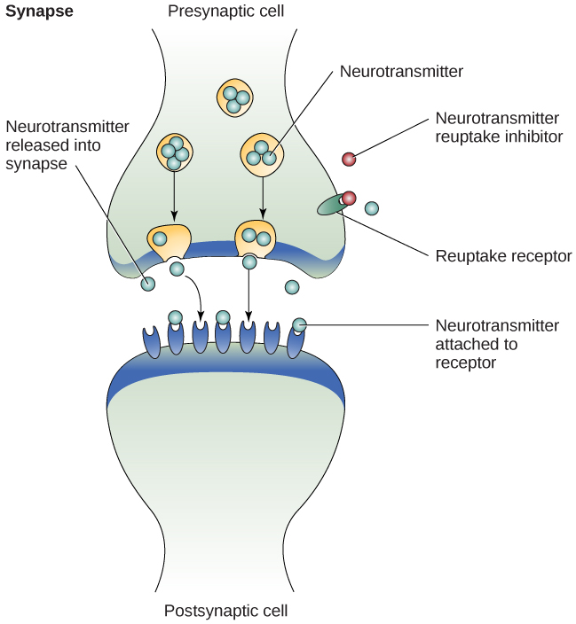

# 15.7 Depressive, Bipolar, and Related Disorders

> [!info]
>
> ### Learning Objectives
>
> By the end of this section, you will be able to:
>
> - Distinguish normal states of sadness and euphoria from states of depression and mania
> - Describe the symptoms of major depressive disorder and bipolar disorder
> - Understand the differences between major depressive disorder and persistent depressive disorder, and identify two subtypes of depression
> - Define the criteria for a manic episode
> - Understand genetic, biological, and psychological explanations of major depressive disorder
> - Discuss the relationship between mood disorders and suicidal ideation, as well as factors associated with suicide

Blake cries all day and, feeling that he is worthless and his life is hopeless, he cannot get out of bed. Crystal stays up all night, talks very rapidly, and went on a shopping spree in which she spent $3,000 on furniture, although she cannot afford it. Maria recently had a baby, and she feels overwhelmed, teary, anxious, and panicked, and believes she is a terrible mother—practically every day since the baby was born. All these individuals demonstrate symptoms of a potential mood disorder.

**Mood disorders** ([Figure 15.15](#Figure_15_07_Moods)) are characterized by severe disturbances in mood and emotions—most often depression, but also mania and elation (Rothschild, 1999). All of us experience fluctuations in our moods and emotional states, and often these fluctuations are caused by events in our lives. We become elated if our favorite team wins the World Series and dejected if a romantic relationship ends or if we lose our job. At times, we feel fantastic or miserable for no clear reason. People with mood disorders also experience mood fluctuations, but their fluctuations are extreme, distort their outlook on life, and impair their ability to function.

**Figure 15.15** Mood disorders are characterized by massive disruptions in mood. Symptoms can range from the extreme sadness and hopelessness of depression to the extreme elation and irritability of mania. (credit: Kiran Foster)

The DSM-5 lists two general categories of mood disorders. **Depressive disorders** are a group of disorders in which **depression** is the main feature. Depression is a vague term that, in everyday language, refers to an intense and persistent sadness. Depression is a heterogeneous mood state—it consists of a broad spectrum of symptoms that range in severity. Depressed people feel sad, discouraged, and hopeless. These individuals lose interest in activities once enjoyed, often experience a decrease in drives such as hunger and sex, and frequently doubt personal worth. Depressive disorders vary by degree, but this chapter highlights the most well-known: major depressive disorder (sometimes called unipolar depression).

**Bipolar and related disorders** are a group of disorders in which mania is the defining feature. **Mania** is a state of extreme elation and agitation. When people experience mania, they may become extremely talkative, behave recklessly, or attempt to take on many tasks simultaneously. The most recognized of these disorders is bipolar disorder.

## Major Depressive Disorder

According to the DSM-5, the defining symptoms of **major depressive disorder** include “depressed mood most of the day, nearly every day” (feeling sad, empty, hopeless, or appearing tearful to others), and loss of interest and pleasure in usual activities (APA, 2013). In addition to feeling overwhelmingly sad most of each day, people with depression will no longer show interest or enjoyment in activities that previously were gratifying, such as hobbies, sports, sex, social events, time spent with family, and so on. Friends and family members may notice that the person has completely abandoned previously enjoyed hobbies; for example, an avid tennis player who develops major depressive disorder no longer plays tennis (Rothschild, 1999).

To receive a diagnosis of major depressive disorder, a person must, for at least two weeks, have a depressed mood and/or a loss of interest or pleasure in most activities. In addition, the person will show signs and symptoms of several of the following: significant change in weight (loss or gain), insomnia or hypersomnia, psychomotor agitation (such as fidgeting, inability to sit, pacing, hand-wringing) or psychomotor retardation (such as talking and moving slowly), fatigue, feelings of worthlessness or guilt, difficulty concentrating or indecisiveness, and **suicidal ideation**.

Major depressive disorder is considered episodic: its symptoms are typically present at their full magnitude for a certain period of time and then gradually abate. Approximately 50%–60% of people who experience an episode of major depressive disorder will have a second episode at some point in the future; those who have had two episodes have a 70% chance of having a third episode, and those who have had three episodes have a 90% chance of having a fourth episode (Rothschild, 1999). Although the episodes can last for months, a majority of people diagnosed with this condition (around 70%) recover within a year. However, a substantial number do not recover; around 12% show serious signs of impairment associated with major depressive disorder after 5 years (Boland & Keller, 2009). In the long term, many who do recover will still show minor symptoms that fluctuate in their severity (Judd, 2012).

### Results of Major Depressive Disorder

Major depressive disorder is a serious and incapacitating condition that can have a devastating effect on the quality of one’s life. The person suffering from this disorder lives a profoundly miserable existence that often results in unavailability for work or education, abandonment of promising careers, and lost wages; occasionally, the condition requires hospitalization. The majority of those with major depressive disorder report having faced some kind of discrimination, and many report that having received such treatment has stopped them from initiating close relationships, applying for jobs for which they are qualified, and applying for education or training (Lasalvia et al., 2013). Major depressive disorder also takes a toll on health. Depression is a risk factor for the development of heart disease in healthy patients, as well as adverse cardiovascular outcomes in patients with preexisting heart disease (Whooley, 2006).

### Risk Factors for Major Depressive Disorder

Major depressive disorder is often referred to as the common cold of psychiatric disorders. Around 6.6% of the U.S. population experiences major depressive disorder each year; 16.9% will experience the disorder during their lifetime (Kessler & Wang, 2009). It is more common among women than among men, affecting approximately 20% of women and 13% of men at some point in their life (National Comorbidity Survey, 2007). The greater risk among women is not accounted for by a tendency to report symptoms or to seek help more readily, suggesting that gender differences in the rates of major depressive disorder may reflect biological and gender-related environmental experiences (Kessler, 2003).

Lifetime rates of major depressive disorder tend to be highest in North and South America, Europe, and Australia; they are considerably lower in Asian countries (Hasin, Fenton, & Weissman, 2011). The rates of major depressive disorder are higher among younger age cohorts than among older cohorts, perhaps because people in younger age cohorts are more willing to admit depression (Kessler & Wang, 2009).

A number of risk factors are associated with major depressive disorder: unemployment (including homemakers); earning less than $20,000 per year; living in urban areas; or being separated, divorced, or widowed (Hasin et al., 2011). Comorbid disorders include anxiety disorders and substance abuse disorders (Kessler & Wang, 2009).

## Subtypes of Depression

The DSM-5 lists several different subtypes of depression. These subtypes—what the DSM-5 refers to as specifiers—are not specific disorders; rather, they are labels used to indicate specific patterns of symptoms or to specify certain periods of time in which the symptoms may be present. One subtype, **seasonal pattern**, applies to situations in which a person experiences the symptoms of major depressive disorder only during a particular time of year (e.g., fall or winter). In everyday language, people often refer to this subtype as the winter blues.

Another subtype, **peripartum onset** (commonly referred to as **postpartum depression**), applies to childbearers who experience major depression during pregnancy or in the four weeks following the birth of their child (APA, 2013). These people often feel very anxious and may even have panic attacks. They may feel guilty, agitated, and be weepy. They may not want to hold or care for their newborn, even in cases in which the pregnancy was desired and intended. In extreme cases, one may have feelings of wanting to harm the child or oneself. In a horrific illustration, a woman named Andrea Yates, who suffered from extreme peripartum-onset depression (as well as other mental illnesses), drowned her five children in a bathtub (Roche, 2002). Most people with peripartum-onset depression do not physically harm their children, but most do have difficulty being adequate caregivers (Fields, 2010). A surprisingly high number of people experience symptoms of peripartum-onset depression. A study of 10,000 women who had recently given birth found that 14% screened positive for peripartum-onset depression, and that nearly 20% reported having thoughts of wanting to harm themselves (Wisner et al., 2013).

People with **persistent depressive disorder** (previously known as dysthymia) experience depressed moods most of the day nearly every day for at least two years, as well as at least two of the other symptoms of major depressive disorder. People with persistent depressive disorder are chronically sad and melancholy, but do not meet all the criteria for major depression. However, episodes of full-blown major depressive disorder can occur during persistent depressive disorder (APA, 2013).

## Bipolar Disorder

A person with **bipolar disorder** (commonly known as **manic depression**) often experiences mood states that vacillate between depression and mania; that is, the person’s mood is said to alternate from one emotional extreme to the other (in contrast to unipolar, which indicates a persistently sad mood).

To be diagnosed with bipolar disorder, a person must have experienced a manic episode at least once in their life; although major depressive episodes are common in bipolar disorder, they are not required for a diagnosis (APA, 2013). According to the DSM-5, a **manic episode** is characterized as a “distinct period of abnormally and persistently elevated, expansive, or irritable mood and abnormally and persistently increased activity or energy lasting at least one week,” that lasts most of the time each day (APA, 2013, p. 124). During a manic episode, some experience a mood that is almost euphoric and become excessively talkative, sometimes spontaneously starting conversations with strangers; others become excessively irritable and complain or make hostile comments. The person may talk loudly and rapidly, exhibiting **flight of ideas**, abruptly switching from one topic to another. These individuals are easily distracted, which can make a conversation very difficult. They may exhibit grandiosity, in which they experience inflated but unjustified self-esteem and self-confidence. For example, they might quit a job in order to “strike it rich” in the stock market, despite lacking the knowledge, experience, and capital for such an endeavor. They may take on several tasks at the same time (e.g., several time-consuming projects at work) and yet show little, if any, need for sleep; some may go for days without sleep. Patients may also recklessly engage in pleasurable activities that could have harmful consequences, including spending sprees, reckless driving, making foolish investments, excessive gambling, or engaging in sexual encounters with strangers (APA, 2013).

During a manic episode, individuals usually feel as though they are not ill and do not need treatment. However, the reckless behaviors that often accompany these episodes—which can be antisocial, illegal, or physically threatening to others—may require involuntary hospitalization (APA, 2013). Some patients with bipolar disorder will experience a rapid-cycling subtype, which is characterized by at least four manic episodes (or some combination of at least four manic and major depressive episodes) within one year.

> [!tip]
>
> ### Link to Learning
>
> In the 1997 independent film *Sweetheart*, actress Janeane Garofalo plays the part of Jasmine, a young woman with bipolar disorder. Watch this [firsthand account from a person living with bipolar disorder](https://openstax.org/l/sweetheart) to learn more.

### Risk Factors for Bipolar Disorder

Bipolar disorder is considerably less frequent than major depressive disorder. In the United States, 1 out of every 167 people meets the criteria for bipolar disorder each year, and 1 out of 100 meet the criteria within their lifetime (Merikangas et al., 2011). The rates are higher in men than in women, and about half of those with this disorder report onset before the age of 25 (Merikangas et al., 2011). Around 90% of those with bipolar disorder have a comorbid disorder, most often an anxiety disorder or a substance abuse problem. Unfortunately, close to half of the people suffering from bipolar disorder do not receive treatment (Merikangas & Tohen, 2011). Suicide rates are extremely high among those with bipolar disorder: around 36% of individuals with this disorder attempt suicide at least once in their lifetime (Novick, Swartz, & Frank, 2010), and between 15%–19% die by suicide (Newman, 2004).

## Unspecified Mood Disorder

Some people experience mood disorder symptoms that cause them significant difficulty and impair their functions, but which do not meet the specific criteria for bipolar, depressive, or other mood disorders. These patients are often diagnosed with unspecified mood disorder. Symptoms may include frequent and persistent sadness and emptiness, and/or frequent mood changes or mood instability. Clinicians may also consider other factors, such as patient history and stressors. Unspecified mood disorder may cause significant distress or difficulty in many aspects of life, including social interactions, the ability to work or study, and relationships.

Unspecified mood disorder may not be the final diagnosis for an individual. Clinicians may diagnose someone with unspecified mood disorder while they continue to examine the patient and seek more information. To make this progressive diagnosis clearer, the DSM-5-TR provides an example: First, when an emergency room mental health professional recognizes symptoms but has very limited information and limited time, the mental health professional may issue an unspecified mood disorder diagnosis. Later, with more time, the patient may be re-diagnosed with a more specific disorder (APA, 2022).

## The Biological Basis of Mood and Bipolar Disorders

Mood disorders have been shown to have a strong genetic and biological basis. Relatives of those with major depressive disorder have double the risk of developing major depressive disorder, whereas relatives of patients with bipolar disorder have over nine times the risk (Merikangas et al., 2011). The rate of concordance for major depressive disorder is higher among identical twins than fraternal twins (50% vs. 38%, respectively), as is that of bipolar disorder (67% vs. 16%, respectively), suggesting that genetic factors play a stronger role in bipolar disorder than in major depressive disorder (Merikangas et al. 2011).

People with mood disorders often have imbalances in certain neurotransmitters, particularly norepinephrine and serotonin (Thase, 2009). These neurotransmitters are important regulators of the bodily functions that are disrupted in mood disorders, including appetite, sex drive, sleep, arousal, and mood. Medications that are used to treat major depressive disorder typically boost serotonin and norepinephrine activity, whereas lithium—used in the treatment of bipolar disorder—blocks norepinephrine activity at the synapses ([Figure 15.16](#Figure_15_07_Neurons)).

**Figure 15.16** Many medications designed to treat mood disorders work by altering neurotransmitter activity in the neural synapse.

Depression is linked to abnormal activity in several regions of the brain (Fitzgerald, Laird, Maller, & Daskalakis, 2008) including those important in assessing the emotional significance of stimuli and experiencing emotions (amygdala), and in regulating and controlling emotions (like the prefrontal cortex, or PFC) (LeMoult, Castonguay, Joormann, & McAleavey, 2013). People with depression show elevated amygdala activity (Drevets, Bogers, & Raichle, 2002), especially when presented with negative emotional stimuli, such as photos of sad faces ([Figure 15.17](#Figure_15_07_SadFace)) (Surguladze et al., 2005). Interestingly, heightened amygdala activation to negative emotional stimuli among depressed persons occurs even when stimuli are presented outside of conscious awareness (Victor, Furey, Fromm, Öhman, & Drevets, 2010), and it persists even after the negative emotional stimuli are no longer present (Siegle, Thompson, Carter, Steinhauer, & Thase, 2007). Additionally, depressed individuals exhibit less activation in the prefrontal, particularly on the left side (Davidson, Pizzagalli, & Nitschke, 2009). Because the PFC can dampen amygdala activation, thereby enabling one to suppress negative emotions (Phan et al., 2005), decreased activation in certain regions of the PFC may inhibit its ability to override negative emotions that might then lead to more negative mood states (Davidson et al., 2009). These findings suggest that people with depression are more prone to react to emotionally negative stimuli, yet have greater difficulty controlling these reactions.

**Figure 15.17** People with depression react to negative emotional stimuli, such as sad faces, with greater amygdala activation than do non-depressed individuals. (credit: Ian Munroe)

Since the 1950s, researchers have noted that depressed individuals have abnormal levels of cortisol, a stress hormone released into the blood by the neuroendocrine system during times of stress (Mackin & Young, 2004). When cortisol is released, the body initiates a fight-or-flight response in reaction to a threat or danger. Many people with depression show elevated cortisol levels (Holsboer & Ising, 2010), especially those reporting a history of early life trauma such as the loss of a parent or abuse during childhood (Baes, Tofoli, Martins, & Juruena, 2012). Such findings raise the question of whether high cortisol levels are a cause or a consequence of depression. High levels of cortisol are a risk factor for future depression (Halligan, Herbert, Goodyer, & Murray, 2007), and cortisol activates activity in the amygdala while deactivating activity in the PFC (McEwen, 2005)—both brain disturbances are connected to depression. Thus, high cortisol levels may have a causal effect on depression, as well as on its brain function abnormalities (van Praag, 2005). Also, because stress results in increased cortisol release (Michaud, Matheson, Kelly, Anisman, 2008), it is equally reasonable to assume that stress may precipitate depression.

### A Diathesis-Stress Model and Major Depressive Disorders

Indeed, it has long been believed that stressful life events can trigger depression, and research has consistently supported this conclusion (Mazure, 1998). Stressful life events include significant losses, such as death of a loved one, divorce or separation, and serious health and money problems; life events such as these often precede the onset of depressive episodes (Brown & Harris, 1989). In particular, exit events—instances in which an important person departs (e.g., a death, divorce or separation, or a family member leaving home)—often occur prior to an episode (Paykel, 2003). Exit events are especially likely to trigger depression if these happenings occur in a way that humiliates or devalues the individual. For example, people who experience the breakup of a relationship initiated by the other person develop major depressive disorder at a rate more than 2 times that of people who experience the death of a loved one (Kendler, Hettema, Butera, Gardner, & Prescott, 2003).

Likewise, individuals who are exposed to traumatic stress during childhood—such as separation from a parent, family turmoil, and maltreatment (physical or sexual abuse)—are at a heightened risk of developing depression at any point in their lives (Kessler, 1997). A recent review of 16 studies involving over 23,000 subjects concluded that those who experience childhood maltreatment are more than 2 times as likely to develop recurring and persistent depression (Nanni, Uher, & Danese, 2012).

Of course, not everyone who experiences stressful life events or childhood adversities succumbs to depression—indeed, most do not. Clearly, a diathesis-stress interpretation of major depressive disorder, in which certain predispositions or vulnerability factors influence one’s reaction to stress, would seem logical. If so, what might such predispositions be? A study by Caspi and others (2003) suggests that an alteration in a specific gene that regulates **serotonin** (the 5-HTTLPR gene) might be one culprit. These investigators found that people who experienced several stressful life events were significantly more likely to experience episodes of major depression if they carried one or two short versions of this gene than if they carried two long versions. Those who carried one or two short versions of the 5-HTTLPR gene were unlikely to experience an episode, however, if they had experienced few or no stressful life events. Numerous studies have replicated these findings, including studies of people who experienced maltreatment during childhood (Goodman & Brand, 2009). In a recent investigation conducted in the United Kingdom (Brown & Harris, 2013), researchers found that childhood maltreatment before age 9 elevated the risk of chronic adult depression (a depression episode lasting for at least 12 months) among those individuals having one (LS) or two (SS) short versions of the 5-HTTLPR gene ([Figure 15.18](#Figure_15_07_GxE_Interaction)). Childhood maltreatment did not increase the risk for chronic depression for those who have two long (LL) versions of this gene. Thus, genetic vulnerability may be one mechanism through which stress potentially leads to depression.

![A bar graph has an x-axis labeled “version of 5-HTTLPR gene” and a y-axis labeled “percent of chronic depression in adulthood.” Data compares the type of gene combination and whether childhood maltreatment occurred prior to age 9. People with no childhood maltreatment prior to age 9 have a percentage of chronic depression of approximately 23% with the long-long gene, 19% with the long-short gene, and 20% with the short-short gene. People with childhood maltreatment prior to age 9 have a percentage of chronic depression of approximately 22% with the long-long gene, 53% with the long-short gene, and 71% with the short-short gene.](../../images/img_e6baead11f34.jpg)

**Figure 15.18** A study on gene-environment interaction in people experiencing chronic depression in adulthood suggests a much higher incidence in individuals with a short version of the gene in combination with childhood maltreatment (Brown & Harris, 2013).

### Cognitive Theories of Depression

Cognitive theories of depression take the view that depression is triggered by negative thoughts, interpretations, self-evaluations, and expectations (Joormann, 2009). These **diathesis-stress models** propose that depression is triggered by a “cognitive vulnerability” (negative and maladaptive thinking) and by precipitating stressful life events (Gotlib & Joormann, 2010). Perhaps the most well-known cognitive theory of depression was developed in the 1960s by psychiatrist Aaron Beck, based on clinical observations and supported by research (Beck, 2008). Beck theorized that depression-prone people possess depressive schemas, or mental predispositions to think about most things in a negative way (Beck, 1976). Depressive schemas contain themes of loss, failure, rejection, worthlessness, and inadequacy, and may develop early in childhood in response to adverse experiences, then remain dormant until they are activated by stressful or negative life events. Depressive schemas prompt dysfunctional and pessimistic thoughts about the self, the world, and the future. Beck believed that this dysfunctional style of thinking is maintained by cognitive biases, or errors in how we process information about ourselves, which lead us to focus on negative aspects of experiences, interpret things negatively, and block positive memories (Beck, 2008). A person whose depressive schema consists of a theme of rejection might be overly attentive to social cues of rejection (more likely to notice another’s frown), and they might interpret this cue as a sign of rejection and automatically remember past incidents of rejection. Longitudinal studies have supported Beck’s theory, in showing that a preexisting tendency to engage in this negative, self-defeating style of thinking—when combined with life stress—over time predicts the onset of depression (Dozois & Beck, 2008). Cognitive therapies for depression, aimed at changing a depressed person’s negative thinking, were developed as an expansion of this theory (Beck, 1976).

Another cognitive theory of depression, **hopelessness theory**, postulates that a particular style of negative thinking leads to a sense of hopelessness, which then leads to depression (Abramson, Metalsky, & Alloy, 1989). According to this theory, hopelessness is an expectation that unpleasant outcomes will occur or that desired outcomes will not occur, and there is nothing one can do to prevent such outcomes. A key assumption of this theory is that hopelessness stems from a tendency to perceive negative life events as having stable (“It’s never going to change”) and global (“It’s going to affect my whole life”) causes, in contrast to unstable (“It’s fixable”) and specific (“It applies only to this particular situation”) causes, especially if these negative life events occur in important life realms, such as relationships, academic achievement, and the like. Suppose a student who wishes to go to law school does poorly on an admissions test. If the student infers negative life events as having stable and global causes, they may believe that their poor performance has a stable and global cause (“I lack intelligence, and it’s going to prevent me from ever finding a meaningful career”), as opposed to an unstable and specific cause (“I was sick the day of the exam, so my low score was a fluke”). Hopelessness theory predicts that people who exhibit this cognitive style in response to undesirable life events will view such events as having negative implications for their future and self-worth, thereby increasing the likelihood of hopelessness—the primary cause of depression (Abramson et al., 1989). One study testing hopelessness theory measured the tendency to make negative inferences for bad life effects in participants who were experiencing uncontrollable stressors. Over the ensuing six months, those with scores reflecting high cognitive vulnerability were 7 times more likely to develop depression compared to those with lower scores (Kleim, Gonzalo, & Ehlers, 2011).

A third cognitive theory of depression focuses on how people’s thoughts about their distressed moods—depressed symptoms in particular—can increase the risk and duration of depression. This theory, which focuses on rumination in the development of depression, was first described in the late 1980s to explain the higher rates of depression in women than in men (Nolen-Hoeksema, 1987). **Rumination** is the repetitive and passive focus on the fact that one is depressed and dwelling on depressed symptoms, rather that distracting oneself from the symptoms or attempting to address them in an active, problem-solving manner (Nolen-Hoeksema, 1991). When people ruminate, they have thoughts such as “Why am I so unmotivated? I just can’t get going. I’m never going to get my work done feeling this way” (Nolen-Hoeksema & Hilt, 2009, p. 393). Women are more likely than men to ruminate when they are sad or depressed (Butler & Nolen-Hoeksema, 1994), and the tendency to ruminate is associated with increases in depression symptoms (Nolen-Hoeksema, Larson, & Grayson, 1999), heightened risk of major depressive episodes (Abela & Hankin, 2011), and chronicity of such episodes (Robinson & Alloy, 2003)

## Suicide

For some people with mood disorders, the extreme emotional pain they experience becomes unendurable. Overwhelmed by hopelessness, devastated by incapacitating feelings of worthlessness, and burdened with the inability to adequately cope with such feelings, they may consider suicide to be a reasonable way out. **Suicide**, defined by the CDC as “death caused by self-directed injurious behavior with any intent to die as the result of the behavior” (CDC, 2013a), in a sense represents an outcome of several things going wrong all at the same time (Crosby, Ortega, & Melanson, 2011). Not only must the person be biologically or psychologically vulnerable, but they must also have the means to perform the suicidal act, and they must lack the necessary protective factors (e.g., social support from friends and family, religion, coping skills, and problem-solving skills) that provide comfort and enable one to cope during times of crisis or great psychological pain (Berman, 2009).

Suicide is not listed as a disorder in the DSM-5; however, people with a mental disorder—especially a mood disorder—have the greatest risk for suicide. Around 90% of those who die by suicide have a diagnosis of at least one mental disorder, with mood disorders being the most frequent (Fleischman, Bertolote, Belfer, & Beautrais, 2005). In fact, the association between major depressive disorder and suicide is so strong that one of the criteria for the disorder is thoughts of suicide, as discussed above (APA, 2013).

Suicide rates can be difficult to interpret because some deaths that appear to be accidental may in fact be acts of suicide (e.g., automobile crash). Nevertheless, investigations into U.S. suicide rates have uncovered these facts:

- Suicide was the 10th leading cause of death for all ages in 2010 (Centers for Disease Control and Prevention [CDC], 2012).
- There were 38,364 suicides in 2010 in the United States—an average of 105 each day (CDC, 2012).
- Suicide among males is 4 times higher than among females and accounts for 79% of all suicides; firearms are the most commonly used method of suicide for males, whereas poisoning is the most commonly used method for females (CDC, 2012).
- From 1991 to 2003, suicide rates were consistently higher among those 65 years and older. Since 2001, however, suicide rates among those ages 25–64 have risen consistently, and, since 2006, suicide rates have been greater for those ages 65 and older (CDC, 2013b). This increase in suicide rates among middle-aged Americans has prompted concern in some quarters that baby boomers (individuals born between 1946–1964) who face economic worry and easy access to prescription medication may be particularly vulnerable to suicide (Parker-Pope, 2013).
- The highest rates of suicide within the United States are among American Indians/Alaskan natives and Non-Hispanic White people (CDC, 2013b).
- Suicide rates vary across the United States, with the highest rates consistently found in the mountain states of the west (Alaska, Montana, Nevada, Wyoming, Colorado, and Idaho) (Berman, 2009).

Contrary to popular belief, suicide rates peak during the springtime (April and May), not during the holiday season or winter. In fact, suicide rates are generally lowest during the winter months (Postolache et al., 2010).

## Self Harm

Clinically diagnosed as nonsuicidal self-injury, **self-harm** is a behavior that involves deliberately causing harm to one’s own body as a way to cope with emotional distress or regain a sense of control (Klonsky et al., 2014). Self-harm does not necessarily indicate a desire to end one’s life; instead, it often serves as a coping mechanism for overwhelming feelings or situations (Elena-Rodica et al., 2023). It is, however, a significant risk factor for suicide, particularly when associated with mental disorders (Harris et al., 2019). Many mental health conditions can be associated with self-harm, including, but not limited to, borderline personality disorder, depression, anxiety disorders, and eating disorders (American Psychiatric Association, 2022). In many instances, individuals who self-harm may be attempting to manage intolerable emotional pain or regulate their emotions, express self-directed anger, distract themselves from emotional distress, or communicate their emotional state to others (Elena-Rodica et al., 2023).

Identifying signs and symptoms of self-harm is vital because it enables timely intervention and treatment planning. Physical signs often include visible cuts, burns, or bruises, frequently observed on wrists, arms, thighs, or other less noticeable body parts (Elena-Rodica et al., 2023). Behavioral indicators may include social isolation, wearing long sleeves or pants even in warm weather to conceal injuries, and the unexplained possession of sharp objects like knives or razors (Clarke et al., 2019). Emotional symptoms can involve increased emotional instability, impulsivity, and verbal expressions of hopelessness or overwhelming stress (Klonsky et al., 2014). Further, clinicians and healthcare professionals may notice evasiveness or dishonesty when questioned about the source of injuries, along with frequent episodes of “minor accidents” that could serve as a facade for self-harm activities (Klonsky et al., 2014). Early recognition of these signs is crucial for initiating comprehensive care, which may include risk assessments, psychotherapy, and medication management for underlying mental health conditions (Klonsky et al., 2014).

Self-harm can result in significant stigmatization—the process of devaluing, labeling, and potentially discriminating against individuals due to a health problem. People who have experienced nonsuicidal self-injury may feel significant shame and embarrassment regarding scars or other signs even years after performing the acts leading to the scarring. These physical signs of self-harm (or believed to be an outcome of self-harm) can lead to extensive assumptions and different treatment towards individuals who bear them. Evidence points to a high level of negative bias toward those people from others (Burke, 2019). Studies also show hiring, workplace, and housing discrimination against people with evidence of self harm (Corrigan et al., 2014). Family members, educators, health care workers, and others with a relationship or providing care to individuals undergoing self-harm must be aware of and sensitive to this potential for bias and stigma. Studies have shown that education programs regarding mental health, which include information about suicide and self-harm, may reduce stigma.

## Risk Factors For Suicide and Self Harm

Suicidal risk is especially high among people with substance use problems. Individuals with alcohol dependence are at 10 times greater risk for suicide than the general population (Wilcox, Conner, & Caine, 2004). The risk of suicidal behavior is especially high among those who have made a prior suicide attempt. Among those who attempt suicide, 16% make another attempt within a year and over 21% make another attempt within four years (Owens, Horrocks, & House, 2002). Suicidal individuals may be at high risk for terminating their life if they have a lethal means in which to act, such as a firearm in the home (Brent & Bridge, 2003). Withdrawal from social relationships, feeling as though one is a burden to others, and engaging in reckless and risk-taking behaviors may be precursors to suicidal behavior (Berman, 2009). A sense of entrapment or feeling unable to escape one’s miserable feelings or external circumstances (e.g., an abusive relationship with no perceived way out) predicts suicidal behavior (O’Connor, Smyth, Ferguson, Ryan, & Williams, 2013). Tragically, reports of suicides among adolescents following instances of cyberbullying have emerged in recent years. In one widely-publicized case a few years ago, Phoebe Prince, a 15-year-old Massachusetts high school student, died by suicide following incessant harassment and taunting from her classmates via texting and Facebook (McCabe, 2010).

Suicides can have a contagious effect on people. For example, another’s suicide, especially that of a family member, heightens one’s risk of suicide (Agerbo, Nordentoft, & Mortensen, 2002). Additionally, widely-publicized suicides tend to trigger additional suicides in some individuals. One study examining suicide statistics in the United States from 1947–1967 found that the rates of suicide increased significantly for the first month after a report about suicide was printed on the front page of the *New York Times* (Phillips, 1974). Austrian researchers found a significant increase in the number of suicides by firearms in the three weeks following extensive reports in Austria’s largest newspaper of a celebrity suicide by gun (Etzersdorfer, Voracek, & Sonneck, 2004). A review of 42 studies concluded that media coverage of celebrity suicides is more than 14 times more likely to trigger copycat suicides than is coverage of non-celebrity suicides (Stack, 2000). This review also demonstrated that the medium of coverage is important: televised stories are considerably less likely to prompt a surge in suicides than are newspaper stories. Research suggests that a trend appears to be emerging whereby people use online social media to leave suicide notes, although it is not clear to what extent suicide notes on such media might induce subsequent suicides (Ruder, Hatch, Ampanozi, Thali, & Fischer, 2011). Nevertheless, it is reasonable to conjecture that suicide notes left by individuals on social media may influence the decisions of other vulnerable people who encounter them (Luxton, June, & Fairall, 2012).

One possible contributing factor in suicide is brain chemistry. Contemporary neurological research shows that disturbances in the functioning of **serotonin** are linked to suicidal behavior (Pompili et al., 2010). Low levels of serotonin predict future suicide attempts and death by suicide, and low levels have been observed post-mortem among suicide victims (Mann, 2003). Serotonin dysfunction, as noted earlier, is also known to play an important role in depression; low levels of serotonin have also been linked to aggression and impulsivity (Stanley et al., 2000). The combination of these three characteristics constitutes a potential formula for suicide—especially violent suicide. A classic study conducted during the 1970s found that patients with major depressive disorder who had very low levels of serotonin attempted suicide more frequently and more violently than did patients with higher levels (Asberg, Thorén, Träskman, Bertilsson, & Ringberger, 1976; Mann, 2003).

Any indications of self harm, as well as suicidal thoughts, plans, and even off-hand remarks (“I might kill myself this afternoon”) should always be taken extremely seriously. People who hurt themselves or contemplate terminating their life need immediate help. Below is a link to an excellent website that contains resources (including hotlines) for people who are struggling with suicidal ideation or self harm, have loved ones who may be suicidal, or who have lost loved ones to suicide: <http://www.afsp.org>. In the United States, you can also contact the 24-hour **[National Suicide Prevention Hotline](https://988lifeline.org)** by calling **988** or texting **HOME** to **741741** to access their Crisis Text Line. The Crisis Text line also has help for other issues and problems that people may encounter. Other nations may have similar services; if you do not know about them, you could visit the [International Association for Suicide Prevention](https://www.iasp.info/suicidalthoughts/) site, which includes support information and also has a search tool for finding support in other countries.
