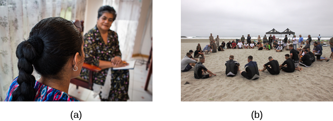

# 16.3 Treatment Modalities

> [!info]
>
> ### Learning Objectives
>
> By the end of this section, you will be able to:
>
> - Distinguish between the various modalities of treatment
> - Discuss benefits of group therapy

Once a person seeks treatment, whether voluntarily or involuntarily, they have an **intake** done to assess their clinical needs. An intake is the therapist’s first meeting with the client. The therapist gathers specific information to address the client’s immediate needs, such as the presenting problem, the client’s support system, and insurance status. The therapist informs the client about confidentiality, fees, and what to expect in treatment. **Confidentiality** means the therapist cannot disclose confidential communications to any third party unless mandated or permitted by law to do so. During the intake, the therapist and client will work together to discuss treatment goals. Then a treatment plan will be formulated, usually with specific measurable objectives. Also, the therapist and client will discuss how treatment success will be measured and the estimated length of treatment. There are several different modalities of treatment ([Figure 16.14](#CNX_Psych_16_03_OneonOne)): Individual therapy, family therapy, couples therapy, and group therapy are the most common.

**Figure 16.14** Therapy may occur (a) one-on-one between a therapist and client, or (b) in a group setting. (credit a: modification of work by Connor Ashleigh, AusAID/Department of Foreign Affairs and Trade)

## Individual Therapy

In **individual therapy**, also known as individual psychotherapy or individual counseling, the client and clinician meet one-on-one (usually from 45 minutes to 1 hour). These meetings typically occur weekly or every other week, and sessions are conducted in a confidential and caring environment ([Figure 16.15](#CNX_Psych_16_03_HandHead)). The clinician will work with clients to help them explore their feelings, work through life challenges, identify aspects of themselves and their lives that they wish to change, and set goals to help them work towards these changes. A client might see a clinician for only a few sessions, or the client may attend individual therapy sessions for a year or longer. The amount of time spent in therapy depends on the needs of the client as well as her personal goals.

**Figure 16.15** In an individual therapy session, a client works one-on-one with a trained therapist. (credit: Alan Cleaver)

## Group Therapy

In **group therapy**, a clinician meets together with several clients with similar problems ([Figure 16.16](#CNX_Psych_16_03_Group)). When children are placed in group therapy, it is particularly important to match clients for age and problems. One benefit of group therapy is that it can help decrease a client’s shame and isolation about a problem while offering needed support, both from the therapist and other members of the group (American Psychological Association, 2014). A nine-year-old sexual abuse victim, for example, may feel very embarrassed and ashamed. If he is placed in a group with other sexually abused boys, he will realize that he is not alone. A child struggling with poor social skills would likely benefit from a group with a specific curriculum to foster social skills. A woman suffering from post-partum depression could feel less guilty and more supported by being in a group with similar women.

Group therapy also has some specific limitations. Members of the group may be afraid to speak in front of other people because sharing secrets and problems with complete strangers can be stressful and overwhelming. There may be personality clashes and arguments among group members. There could also be concerns about confidentiality: Someone from the group might share what another participant said to people outside of the group.

**Figure 16.16** In group therapy, usually 5–10 people meet with a trained therapist to discuss a common issue such as divorce, grief, an eating disorder, substance abuse, or anger management. (credit: Cory Zanker)

Another benefit of group therapy is that members can confront each other about their patterns. For those with some types of problems, such as sexual abusers, group therapy is the recommended treatment. Group treatment for this population is considered to have several benefits:

Group treatment is more economical than individual, couples, or family therapy. Sexual abusers often feel more comfortable admitting and discussing their offenses in a treatment group where others are modeling openness. Clients often accept feedback about their behavior more willingly from other group members than from therapists. Finally, clients can practice social skills in group treatment settings. (McGrath, Cumming, Burchard, Zeoli, & Ellerby, 2009)

Groups that have a strong educational component are called psycho-educational groups. For example, a group for children whose parents have cancer might discuss in depth what cancer is, types of treatment for cancer, and the side effects of treatments, such as hair loss. Often, group therapy sessions with children take place in school. They are led by a school counselor, a school psychologist, or a school social worker. Groups might focus on test anxiety, social isolation, self-esteem, bullying, or school failure (Shechtman, 2002). Whether the group is held in school or in a clinician’s office, group therapy has been found to be effective with children facing numerous kinds of challenges (Shechtman, 2002).

During a group session, the entire group could reflect on an individual’s problem or difficulties, and others might disclose what they have done in that situation. When a clinician is facilitating a group, the focus is always on making sure that everyone benefits and participates in the group and that no one person is the focus of the entire session. Groups can be organized in various ways: some have an overarching theme or purpose, some are time-limited, some have open membership that allows people to come and go, and some are closed. Some groups are structured with planned activities and goals, while others are unstructured: There is no specific plan, and group members themselves decide how the group will spend its time and on what goals it will focus. This can become a complex and emotionally charged process, but it is also an opportunity for personal growth (Page & Berkow, 1994).

## Couples Therapy

**Couples therapy** involves two people in an intimate relationship who are having difficulties and are trying to resolve them ([Figure 16.17](#CNX_Psych_16_02_Cognitive)). The couple may be dating, partnered, engaged, or married. The primary therapeutic orientation used in couples counseling is cognitive-behavioral therapy (Rathus & Sanderson, 1999). Couples meet with a therapist to discuss conflicts and/or aspects of their relationship that they want to change. The therapist helps them see how their individual backgrounds, beliefs, and actions are affecting their relationship. Often, a therapist tries to help the couple resolve these problems, as well as implement strategies that will lead to a healthier and happier relationship, such as how to listen, how to argue, and how to express feelings. However, sometimes, after working with a therapist, a couple will realize that they are too incompatible and will decide to separate. Some couples seek therapy to work out their problems, while others attend therapy to determine whether staying together is the best solution. Counseling couples in a high-conflict and volatile relationship can be difficult. In fact, psychologists Peter Pearson and Ellyn Bader, who founded the Couples Institute in Palo Alto, California, have compared the experience of the clinician in couples’ therapy to “piloting a helicopter in a hurricane” (Weil, 2012, para. 7).

**Figure 16.17** In couples counseling, a therapist helps people work on their relationship. (credit: Cory Zanker)

## Family Therapy

**Family therapy** is a special form of group therapy, consisting of one or more families. Although there are many theoretical orientations in family therapy, one of the most predominant is the systems approach. The family is viewed as an organized system, and each individual within the family is a contributing member who creates and maintains processes within the system that shape behavior (Minuchin, 1985). Each member of the family influences and is influenced by the others. The goal of this approach is to enhance the growth of each family member as well as that of the family as a whole.

Often, dysfunctional patterns of communication that develop between family members can lead to conflict. A family with this dynamic might wish to attend therapy together rather than individually. In many cases, one member of the family has problems that detrimentally affect everyone. For example, a mother’s depression, teen daughter’s eating disorder, or father’s alcohol dependence could affect all members of the family. The therapist would work with all members of the family to help them cope with the issue, and to encourage resolution and growth in the case of the individual family member with the problem.

With family therapy, the nuclear family (i.e., parents and children) or the nuclear family plus whoever lives in the household (e.g., grandparent) come into treatment. Family therapists work with the whole family unit to heal the family. There are several different types of family therapy. In **structural family therapy**, the therapist examines and discusses the boundaries and structure of the family: who makes the rules, who sleeps in the bed with whom, how decisions are made, and what are the boundaries within the family. In some families, the parents do not work together to make rules, or one parent may undermine the other, leading the children to act out. The therapist helps them resolve these issues and learn to communicate more effectively.

> [!tip]
>
> ### Link to Learning
>
> Watch this [video of a structural family session](https://openstax.org/l/Sfamily) to learn more.

In **strategic family therapy**, the goal is to address specific problems within the family that can be dealt with in a relatively short amount of time. Typically, the therapist would guide what happens in the therapy session and design a detailed approach to resolving each member’s problem (Madanes, 1991).
