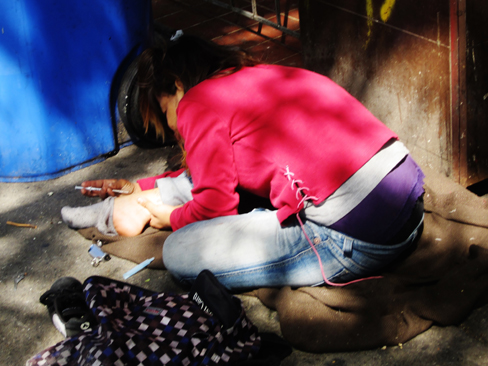

# 16.4 Substance-Related and Addictive Disorders: A Special Case

> [!info]
>
> ### Learning Objectives
>
> By the end of this section, you will be able to:
>
> - Recognize the goal of substance-related and addictive disorders treatment
> - Discuss what makes for effective treatment
> - Describe how comorbid disorders are treated

Addiction is often viewed as a chronic disease ([Figure 16.18](#CNX_Psych_16_04_DrugSurvey)). The choice to use a substance is initially voluntary; however, because chronic substance use can permanently alter the neural structure in the prefrontal cortex, an area of the brain associated with decision-making and judgment, a person becomes driven to use drugs and/or alcohol (Muñoz-Cuevas, Athilingam, Piscopo, & Wilbrecht, 2013). This helps explain why relapse rates tend to be high. About 40%–60% of individuals **relapse**, which means they return to abusing drugs and/or alcohol after a period of improvement (National Institute on Drug Abuse [NIDA], 2008).

![A chart labeled “Prevalence of Drug Use by Age Group” graphs “Age (years)” on the x axis and “Percentage of use” on the y axis. Note that the following percentages are estimates. According to this chart, 10 percent of people in the age range of 12–17 use illicit drugs, compared to 22 percent usage in the age range of 18–25, and 7 percent usage in the age range of 26 and older. 7.5 percent of people in the age range of 12–17 use marijuana, compared to 18 percent usage in the age range of 18–25, and 5 percent usage in the age range of 26 and older. 3 percent of people in the age range of 12–17 use psychotherapeutics, compared to 6 percent usage in the age range of 18–25, and 2.5 percent usage in the age range of 26 and older. 1 percent of people in the age range of 12–17 use inhalants. This number steadily drops off to 0 percent in the 26 and older age group. 1 percent of people in the age range of 12–17 use hallucinogens, compared to 2.5 percent usage in the age range of 18–25, and almost 0 percent usage in the age range of 26 and older. Cocaine use in the age range of 18–25 is around 2 percent, and it drops off to nearly 0 percent by the age range of 26 and older.](../../images/img_a524cb0b9944.jpg)

**Figure 16.18** The National Survey on Drug Use and Health shows trends in prevalence of various drugs for ages 12–17, 18–25, and 26 or older.

The goal of substance-related treatment is to help a person with an addiction stop compulsive drug-seeking behaviors (NIDA, 2012). This means a person with addiction will need long-term treatment, similar to a person battling a chronic physical disease such as hypertension or diabetes. Treatment usually includes behavioral therapy and/or medication, depending on the individual (NIDA, 2012). Specialized therapies have also been developed for specific types of substance-related disorders, including alcohol, cocaine, and opioids (McGovern & Carroll, 2003). Substance-related treatment is considered much more cost-effective than incarceration or not treating those with addictions (NIDA, 2012) ([Figure 16.19](#CNX_Psych_16_04_Crack)).

**Figure 16.19** Substance use and abuse costs the United States over $600 billion a year (NIDA, 2012). This person with addiction is using heroin. (credit: "jellymc - urbansnaps"/Flickr)

## What Makes Treatment Effective?

Specific factors make substance-related treatment much more effective. One factor is duration of treatment. Generally, a person with addiction needs to be in treatment for at least three months to achieve a positive outcome (Simpson, 1981; Simpson, Joe, & Bracy, 1982; NIDA, 2012). This is due to the psychological, physiological, behavioral, and social aspects of abuse (Simpson, 1981; Simpson et al., 1982; NIDA, 2012). While in treatment, a person with addiction might receive behavior therapy, which can help motivate the person with addiction to participate in the treatment program and teach strategies for dealing with cravings and how to prevent relapse. Also, treatment needs to be holistic and address multiple needs, not just the drug addiction. This means that treatment will address factors such as communication, stress management, relationship issues, parenting, vocational concerns, and legal concerns (McGovern & Carroll, 2003; NIDA, 2012).

While individual therapy is used in the treatment of substance-related disorders, group therapy is the most widespread treatment modality (Weiss, Jaffee, de Menil, & Cogley, 2004). The rationale behind using group therapy for addiction treatment is that people with addiction are much more likely to maintain sobriety in a group format. It has been suggested that this is due to the rewarding and therapeutic benefits of the group, such as support, affiliation, identification, and even confrontation (Center for Substance Abuse Treatment, 2005). For teenagers, the whole family often needs to participate in treatment to address issues such as family dynamics, communication, and relapse prevention. Family involvement in teen drug addiction is vital. Research suggests that greater parental involvement is correlated with a greater reduction in use by teen substance abusers. Also, mothers who participated in treatment displayed better mental health and greater warmth toward their children (Bertrand et al., 2013). However, neither individual nor group therapy has been found to be more effective (Weiss et al., 2004). Regardless of the type of treatment service, the primary focus is on abstinence or at the very least a significant reduction in use (McGovern & Carroll, 2003).

Treatment also usually involves medications to detox a person with addiction safely after an overdose, to prevent seizures and agitation that often occur in detox, to prevent reuse of the drug, and to manage withdrawal symptoms. Getting off drugs often involves the use of drugs—some of which can be just as addictive. Detox can be difficult and dangerous.

> [!tip]
>
> ### Link to Learning
>
> Watch this [video about treating substance-related disorders using the biological, behavioral, and psychodynamic approaches](https://openstax.org/l/subdisorder) to learn more.

## Comorbid Disorders

Frequently, a person with an addiction to drugs and/or alcohol has an additional psychological disorder. Saying a person has **comorbid disorders** means the individual has two or more diagnoses. This can often be a substance-related diagnosis and another psychiatric diagnosis, such as depression, bipolar disorder, or schizophrenia. These individuals fall into the category of mentally ill and chemically addicted (MICA)—their problems are often chronic and expensive to treat, with limited success. Compared with the overall population, people who use illicit drugs or misuse prescription drugs are twice as likely to have a mood or anxiety disorder. Drug use can cause symptoms of mood and anxiety disorders and the reverse is also true—people with debilitating symptoms of a psychiatric disorder may self-medicate and misuse substances.

In cases of **comorbidity**, the best treatment is thought to address both (or multiple) disorders simultaneously (NIDA, 2012). Behavior therapies are used to treat comorbid conditions, and in many cases, psychotropic medications are used along with psychotherapy. For example, evidence suggests that bupropion (trade names: Wellbutrin and Zyban), approved for treating depression and nicotine dependence, might also help reduce craving and use of the drug methamphetamine (NIDA, 2011). However, more research is needed to better understand how these medications work—particularly when combined in patients with comorbidities.
