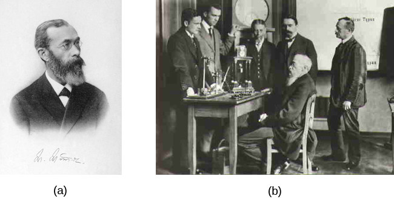
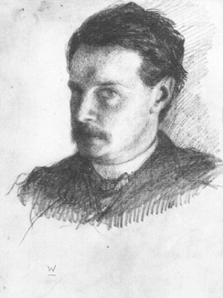
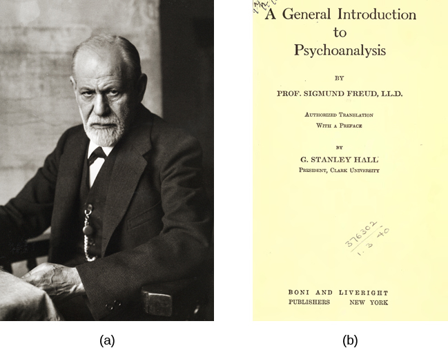
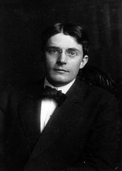
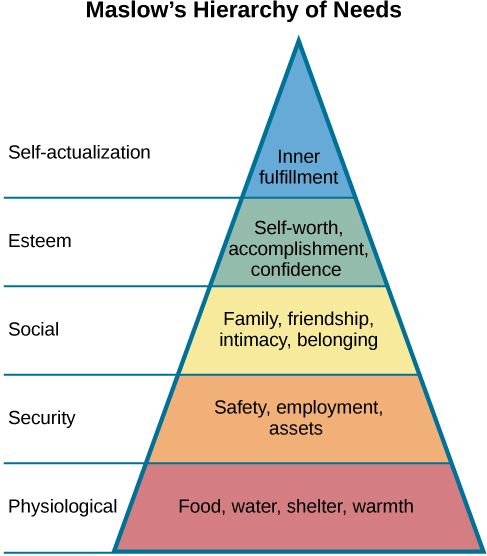
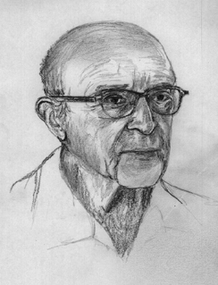

# 1.2 Lịch Sử Tâm Lý Học (History of Psychology)

> [!info]
>
> ### Mục Tiêu Học Tập
>
> Khi kết thúc phần này, bạn sẽ có thể:
>
> - Hiểu được tầm quan trọng của Wundt và James trong sự phát triển của tâm lý học
> - Đánh giá cao ảnh hưởng sâu rộng của Freud đối với tâm lý học
> - Nắm vững các nguyên lý cơ bản của tâm lý học Gestalt
> - Nhận thức được vai trò quan trọng của thuyết hành vi trong lịch sử tâm lý học
> - Hiểu các nguyên lý cơ bản của thuyết nhân văn
> - Nắm bắt cách thức cuộc cách mạng nhận thức chuyển hướng trọng tâm của tâm lý học quay trở lại với tâm trí

Tâm lý học là một ngành khoa học tương đối non trẻ với cội nguồn thực nghiệm bắt đầu từ thế kỷ 19, khi so sánh với sinh lý học con người vốn có niên đại sớm hơn rất nhiều.
Như đã đề cập, trước thế kỷ 19, bất kỳ ai quan tâm đến việc tìm hiểu các vấn đề liên quan đến tâm trí thường chỉ thực hiện trong bối cảnh triết học.
Hai học giả của thế kỷ 19, Wilhelm Wundt và William James, thường được vinh danh là những người sáng lập ra tâm lý học với tư cách là một ngành khoa học và chuyên ngành học thuật độc lập tách biệt khỏi triết học.
Phần này sẽ cung cấp một cái nhìn tổng quan về các bước chuyển dịch hệ hình đã định hình và ảnh hưởng đến tâm lý học từ thời Wundt và James cho đến tận ngày nay.

## Wundt và Thuyết Cấu Trúc

Wilhelm **Wundt** (1832–1920) là một nhà khoa học người Đức, người đầu tiên trong lịch sử được gọi là nhà tâm lý học.
Cuốn sách nổi tiếng của ông mang tên *Các Nguyên Lý của Tâm Lý Học Sinh Lý (Principles of Physiological Psychology)* được xuất bản vào năm 1873.
Wundt xem tâm lý học là ngành nghiên cứu khoa học về trải nghiệm ý thức, và ông tin rằng mục tiêu của tâm lý học là nhận diện các thành phần cấu tạo của ý thức và cách thức những thành phần đó kết hợp lại để tạo nên trải nghiệm ý thức của chúng ta.
Wundt sử dụng **phương pháp nội quan (introspection)** (ông gọi là "tri giác nội tại"), một quá trình mà trong đó một người tự khảo sát trải nghiệm ý thức của chính mình một cách khách quan nhất có thể, xem tâm trí con người tương tự như bất kỳ khía cạnh tự nhiên nào khác mà một nhà khoa học quan sát.
Ông tin vào khái niệm ý chí luận (voluntarism)—rằng con người có tự do ý chí và cần được biết rõ mục đích của một thí nghiệm tâm lý nếu họ tham gia (Danziger, 1980).
Wundt xem phiên bản của mình là phương pháp nội quan thực nghiệm; ông sử dụng các dụng cụ đo lường chính xác như thiết bị đo thời gian phản ứng.
Ông cũng viết cuốn *Tâm lý học Dân tộc (Volkerpsychologie)* vào năm 1904, trong đó ông gợi ý rằng tâm lý học cần bao hàm cả việc nghiên cứu văn hóa, bởi vì nó liên quan trực tiếp đến con người.
Edward Titchener, một trong những học trò xuất sắc của ông, đã tiếp tục phát triển trường phái **thuyết cấu trúc (structuralism)**.
Trọng tâm của thuyết cấu trúc là nội dung của các quá trình tinh thần thay vì chức năng của chúng (Pickren & Rutherford, 2010).
Wundt đã thành lập phòng thí nghiệm tâm lý học đầu tiên trên thế giới tại Đại học Leipzig vào năm 1879 ([Hình 1.2](#CNX_Psych_01_02_Wundt)).
Trong phòng thí nghiệm này, Wundt và các học trò đã tiến hành các thí nghiệm về thời gian phản ứng.
Một người tham gia, đôi khi ngồi trong một căn phòng cách ly khỏi nhà khoa học, sẽ tiếp nhận một kích thích như ánh sáng, hình ảnh hoặc âm thanh.
Phản ứng của đối tượng trước kích thích là nhấn nút, và một thiết bị sẽ tự động ghi lại thời gian phản ứng chính xác.
Wundt có thể đo lường thời gian phản ứng chính xác đến một phần nghìn giây (Nicolas & Ferrand, 1999).

**Hình 1.2** (a) Wilhelm Wundt được vinh danh là một trong những người sáng lập ra ngành tâm lý học. Ông đã xây dựng phòng thí nghiệm nghiên cứu tâm lý học đầu tiên trên thế giới. (b) Bức ảnh này chụp cảnh ông đang ngồi giữa các đồng nghiệp nghiên cứu và các thiết bị khoa học trong phòng thí nghiệm của mình tại Đức.

Tuy nhiên, bất chấp những nỗ lực rèn luyện người tham gia trong quy trình nội quan, phương pháp này vẫn mang tính chủ quan cao và có rất ít sự đồng thuận nhất quán giữa các cá nhân khác nhau.

## Thuyết Chức Năng

William James, John Dewey và Charles Sanders Peirce là những người có công đặt nền móng xây dựng nên tâm lý học chức năng ([Hình 1.3](#CNX_Psych_01_02_James)).
Họ chấp nhận thuyết tiến hóa thông qua chọn lọc tự nhiên của Charles Darwin và coi lý thuyết này là lời giải thích xác đáng cho các đặc điểm của sinh vật.
Điểm cốt lõi của học thuyết này là ý tưởng cho rằng chọn lọc tự nhiên tạo ra những sinh vật thích nghi tốt với môi trường sống của chúng, bao gồm cả hành vi.
Sự thích nghi có nghĩa là một đặc điểm của sinh vật đảm nhận một chức năng phục vụ cho sự sinh tồn và sinh sản của cá thể, bởi vì nó đã được chọn lọc tự nhiên giữ lại.
Theo quan điểm của James, mục đích của tâm lý học là nghiên cứu chức năng của hành vi trong thế giới thực, và do đó, quan điểm của ông được biết đến với tên gọi **thuyết chức năng (functionalism)**.
Thuyết chức năng tập trung vào cách các hoạt động tâm trí giúp sinh vật hòa nhập và thích nghi với môi trường sống.
Thuyết chức năng còn mang một tầng nghĩa tinh tế thứ hai: các nhà chức năng luận quan tâm nhiều hơn đến sự vận hành của toàn bộ tâm trí như một tổng thể thay vì các bộ phận cấu thành riêng lẻ của nó (vốn là trọng tâm của thuyết cấu trúc).
Giống như Wundt, James tin rằng phương pháp nội quan có thể đóng vai trò là một phương tiện để nghiên cứu các hoạt động tâm trí, nhưng James đồng thời dựa vào các phép đo khách quan hơn, bao gồm việc sử dụng các thiết bị ghi nhận đa dạng, khảo sát các sản phẩm cụ thể của hoạt động tinh thần cũng như giải phẫu học và sinh lý học (Gordon, 1995).

**Hình 1.3** William James, được thể hiện qua bức tranh tự họa này, là nhà tâm lý học đầu tiên của Hoa Kỳ.

## Freud và Lý Thuyết Phân Tâm Học

Có lẽ một trong những nhân vật có ảnh hưởng sâu rộng và nổi tiếng nhất trong lịch sử tâm lý học là Sigmund **Freud** ([Hình 1.4](#CNX_Psych_01_02_Freud)).
Freud (1856–1939) là một bác sĩ thần kinh học người Áo, người bị cuốn hút bởi những bệnh nhân mắc chứng "hysteria" và chứng nhiễu tâm (neurosis).
Hysteria là một chẩn đoán cổ xưa dành cho các rối loạn, chủ yếu ở phụ nữ, với hàng loạt triệu chứng đa dạng bao gồm cả triệu chứng thể xác lẫn các xáo trộn cảm xúc, mà không có bất kỳ nguyên nhân thực thể rõ ràng nào.
Freud đưa ra lý thuyết cho rằng nhiều vấn đề của bệnh nhân bắt nguồn từ tâm trí vô thức.
Theo góc nhìn của Freud, tâm trí vô thức là kho chứa những cảm xúc, ham muốn và xung năng mà chúng ta không hề hay biết bằng ý thức tỉnh táo.
Do đó, việc tiếp cận được cõi vô thức là chìa khóa then chốt để giải quyết thành công các vấn đề của người bệnh.
Theo Freud, cõi vô thức có thể được tiếp cận thông qua phương pháp phân tích giấc mơ, khảo sát những từ ngữ đầu tiên xuất hiện trong đầu bệnh nhân (liên tưởng tự do), và thông qua những câu nói nhịu vô tình (lỡ lời kiểu Freud).
**Lý thuyết phân tâm học (Psychoanalytic theory)** tập trung vào vai trò của cõi vô thức cá nhân cũng như các trải nghiệm thời thơ ấu, và quan điểm đặc thù này đã thống trị tâm lý học lâm sàng trong suốt nhiều thập kỷ (Thorne & Henley, 2005).

**Hình 1.4** (a) Sigmund Freud là một nhân vật có tầm ảnh hưởng to lớn trong lịch sử tâm lý học. (b) Một trong nhiều cuốn sách của ông, *Một Nhập Môn Tổng Quan về Phân Tâm Học (A General Introduction to Psychoanalysis)*, đã chia sẻ những ý tưởng của ông về liệu pháp phân tâm học; sách được xuất bản vào năm 1922.

Các ý tưởng của Freud có sức ảnh hưởng sâu rộng, và bạn sẽ được tìm hiểu kỹ hơn về chúng khi học các chương về tâm lý học phát triển, nhân cách và trị liệu.
Chẳng hạn, nhiều nhà trị liệu ngày nay vẫn tin tưởng mạnh mẽ vào vai trò của vô thức và tác động của những trải nghiệm tuổi thơ đối với phần đời còn lại của một con người.
Phương pháp phân tâm học—cho phép bệnh nhân giãi bày về bản thân và những trải nghiệm của mình—dù không phải do Freud phát minh hoàn toàn, nhưng chắc chắn đã được ông phổ biến rộng rãi và vẫn tiếp tục được áp dụng ngày nay.
Tuy nhiên, nhiều luận điểm khác của Freud vẫn gây ra nhiều tranh cãi.
Drew Westen (1998) lập luận rằng nhiều lời chỉ trích nhắm vào Freud là chưa thỏa đáng, bởi vì họ chỉ công kích các ý tưởng ban đầu của ông mà không xét đến những tác phẩm viết về sau.
Westen cũng cho rằng những người chỉ trích đã không nhận ra sự thành công của những ý niệm khái quát mà Freud đề xướng hoặc phát triển, chẳng hạn như tầm quan trọng của trải nghiệm tuổi thơ đối với động lực của người trưởng thành, vai trò của động cơ vô thức so với ý thức trong việc thúc đẩy hành vi, thực tế rằng các xung năng có thể gây ra xung đột nội tâm ảnh hưởng đến hành vi, tác động của những biểu tượng tinh thần về bản thân và người khác trong việc định hướng tương tác xã hội, và sự phát triển của nhân cách qua thời gian.
Westen đã chỉ ra nhiều nghiên cứu thực nghiệm sau này ủng hộ cho tất cả các ý tưởng này.

Những biến thể hiện đại hơn từ phương pháp tiếp cận lâm sàng của Freud đã được chứng minh bằng thực nghiệm là mang lại hiệu quả rõ rệt (Knekt et al., 2008; Shedler, 2010).
Một số phương pháp thực hành trị liệu tâm lý hiện nay vẫn tiến hành khảo sát các khía cạnh vô thức của bản ngã và các mối quan hệ, thường thông qua mối liên kết tương tác giữa nhà trị liệu và thân chủ.
Tầm vóc lịch sử và những đóng góp to lớn của Freud cho thực hành lâm sàng hoàn toàn xứng đáng để ông chiếm một vị trí trang trọng trong các cuộc thảo luận về các phong trào lịch sử của tâm lý học.

## Wertheimer, Koffka, Köhler và Tâm Lý Học Gestalt

Max Wertheimer (1880–1943), Kurt Koffka (1886–1941) và Wolfgang Köhler (1887–1967) là ba nhà tâm lý học người Đức đã di cư sang Hoa Kỳ vào đầu thế kỷ 20 để lánh nạn phát xít Đức.
Những học giả này có công giới thiệu các nguyên lý Gestalt đa dạng đến giới tâm lý học Hoa Kỳ.
Từ **Gestalt** có thể dịch đại ý là "hình thái trọn vẹn" hoặc "tổng thể"; trọng tâm lớn của tâm lý học Gestalt khẳng định rằng mặc dù một trải nghiệm cảm giác có thể được phân tách thành từng bộ phận riêng lẻ, nhưng chính cách các bộ phận đó liên hệ với nhau thành một tổng thể mới là điều mà cá nhân phản hồi trong quá trình tri giác.
Ví dụ, một bài hát có thể được tạo nên từ các nốt nhạc riêng lẻ do nhiều nhạc cụ khác nhau diễn tấu, nhưng bản chất thực sự của bài hát chỉ được tri giác khi các nốt nhạc đó hòa quyện lại tạo thành giai điệu, tiết tấu và hòa âm.
Theo nhiều cách, quan điểm đặc thù này đối lập trực tiếp với ý tưởng của thuyết cấu trúc do Wundt khởi xướng (Thorne & Henley, 2005).

Đáng tiếc là khi di cư sang Hoa Kỳ, các nhà khoa học này đã buộc phải từ bỏ phần lớn các công trình nghiên cứu dở dang và không thể tiếp tục thực hiện nghiên cứu trên quy mô lớn.
Những yếu tố này, cùng với sự trỗi dậy mạnh mẽ của thuyết hành vi tại Hoa Kỳ, đã khiến các nguyên lý của tâm lý học Gestalt không đạt được mức độ ảnh hưởng sâu rộng ở Mỹ như tại quê hương Đức của họ (Thorne & Henley, 2005).
Bất chấp những trở ngại đó, một số nguyên lý Gestalt vẫn giữ sức ảnh hưởng rất lớn cho đến ngày nay.
Việc nhìn nhận con người như một tổng thể hoàn chỉnh thay vì phép cộng đơn thuần của các bộ phận đo lường riêng rẽ đã trở thành nền tảng quan trọng cho thuyết nhân văn vào cuối thế kỷ.
Các ý tưởng của Gestalt vẫn tiếp tục dẫn dắt các nghiên cứu hiện đại về cảm giác và tri giác.

Thuyết cấu trúc, Freud và các nhà tâm lý học Gestalt đều quan tâm theo cách này hay cách khác đến việc mô tả và thấu hiểu trải nghiệm nội tâm.
Tuy nhiên, các nhà nghiên cứu khác lại hoài nghi liệu trải nghiệm nội tâm có thể trở thành đối tượng nghiên cứu khoa học đích thực hay không, và họ đã chọn con đường chỉ nghiên cứu duy nhất hành vi—kết quả khách quan có thể quan sát được của các quá trình tinh thần.

## Pavlov, Watson, Skinner và Thuyết Hành Vi

Những công trình nghiên cứu tiên phong trong lĩnh vực hành vi được thực hiện bởi nhà sinh lý học người Nga Ivan **Pavlov** (1849–1936).
Pavlov đã nghiên cứu một hình thức hành vi học tập được gọi là phản xạ có điều kiện, trong đó một động vật hoặc con người tạo ra một phản ứng phản xạ tự nhiên (vô thức) trước một kích thích, và qua thời gian, được điều kiện hóa để tạo ra phản ứng tương tự trước một kích thích mới hoàn toàn khác mà nhà thực nghiệm đã ghép đôi với kích thích ban đầu.
Phản xạ mà Pavlov nghiên cứu là phản xạ tiết nước bọt của loài chó khi có sự xuất hiện của thức ăn.
Phản xạ tiết nước bọt này có thể được gợi ra bằng cách sử dụng một kích thích thứ hai, chẳng hạn như một âm thanh cụ thể, được phát ra lặp đi lặp lại nhiều lần cùng lúc với kích thích thức ăn ban đầu.
Một khi phản ứng với kích thích thứ hai đã được "học", kích thích thức ăn có thể được lược bỏ mà con vật vẫn tiết nước bọt.
"Điều kiện hóa cổ điển" của Pavlov chỉ là một dạng hành vi học tập được các nhà hành vi học nghiên cứu.

John B. **Watson** (1878–1958) là một nhà tâm lý học người Mỹ có tầm ảnh hưởng lớn, người có những công trình nghiên cứu nổi tiếng nhất diễn ra vào đầu thế kỷ 20 tại Đại học Johns Hopkins ([Hình 1.5](#CNX_Psych_01_02_Watson)).
Trong khi Wundt và James nỗ lực tìm hiểu trải nghiệm ý thức, Watson lại cho rằng việc nghiên cứu ý thức là có sai lầm cố hữu.
Bởi vì ông tin rằng việc phân tích khách quan tâm trí là điều bất khả thi, Watson muốn tập trung trực tiếp vào hành vi có thể quan sát được và tìm cách kiểm soát hành vi đó.
Watson là người đề xướng mạnh mẽ việc chuyển dịch trọng tâm của tâm lý học từ tâm trí sang hành vi, và phương pháp tiếp cận quan sát và kiểm soát hành vi này được biết đến với tên gọi **thuyết hành vi (behaviorism)**.
Đối tượng nghiên cứu chính của các nhà hành vi học là hành vi học tập được và mối tương tác của nó với các phẩm chất bẩm sinh của sinh vật.
Thuyết hành vi thường sử dụng động vật trong các thí nghiệm dựa trên giả định rằng những gì học được từ mô hình động vật, ở một mức độ nào đó, có thể áp dụng cho hành vi của con người.
Thực vậy, Tolman (1938) từng khẳng định: "Tôi tin rằng mọi thứ quan trọng trong tâm lý học (ngoại trừ... những vấn đề liên quan đến xã hội và từ ngữ) về bản chất đều có thể được khám phá thông qua việc tiếp tục phân tích thực nghiệm và lý thuyết về các yếu tố quyết định hành vi của chuột tại điểm lựa chọn trong mê cung."

**Hình 1.5** John B. Watson được biết đến là cha đẻ của thuyết hành vi trong tâm lý học.

Thuyết hành vi đã thống trị tâm lý học thực nghiệm suốt nhiều thập kỷ, và tầm ảnh hưởng của nó vẫn còn hiện diện rõ nét ngày nay (Thorne & Henley, 2005).
Thuyết hành vi đóng góp công lao lớn trong việc xác lập tâm lý học như một ngành khoa học thực thụ nhờ vào các phương pháp khách quan và đặc biệt là phương pháp thực nghiệm.
Ngoài ra, nó được ứng dụng sâu rộng trong liệu pháp hành vi và liệu pháp nhận thức - hành vi.
Kỹ thuật điều chỉnh hành vi được sử dụng phổ biến trong môi trường học đường.
Thuyết hành vi cũng mở đường cho các nghiên cứu về ảnh hưởng của môi trường sống đối với hành vi con người.

B. F. **Skinner** (1904–1990) là một nhà tâm lý học lỗi lạc người Mỹ ([Hình 1.6](#CNX_Psych_01_02_Skinner)).
Giống như Watson, Skinner là một nhà hành vi học kiên định, và ông tập trung nghiên cứu cách hành vi bị ảnh hưởng bởi những hệ quả kéo theo sau nó.
Vì vậy, Skinner nhấn mạnh củng cố (reinforcement) và trừng phạt (punishment) là những nhân tố then chốt định hình và thúc đẩy hành vi.
Như một phần trong nghiên cứu của mình, Skinner đã phát minh ra một buồng thí nghiệm cho phép nghiên cứu cẩn trọng các nguyên lý biến đổi hành vi thông qua củng cố và trừng phạt.
Thiết bị này, được gọi là buồng điều kiện hóa tạo tác (hay quen thuộc hơn với tên gọi chiếc hộp Skinner), vẫn là một công cụ nghiên cứu thiết yếu cho các nhà khoa học hành vi (Thorne & Henley, 2005).

**Hình 1.6** (a) B. F. Skinner nổi tiếng với các nghiên cứu về điều kiện hóa tạo tác. (b) Các phiên bản cải tiến của buồng điều kiện hóa tạo tác, hay hộp Skinner, vẫn được sử dụng rộng rãi trong các cơ sở nghiên cứu ngày nay. (Nguồn ảnh a: chỉnh sửa từ tác phẩm của "Silly rabbit"/Wikimedia Commons)

Chiếc **hộp Skinner (Skinner box)** là một buồng thí nghiệm cách ly đối tượng khỏi môi trường bên ngoài và trang bị một bộ chỉ báo hành vi như cần gạt hoặc nút bấm.
Khi con vật nhấn nút hoặc gạt cần, chiếc hộp có thể cung cấp một sự củng cố tích cực cho hành vi (chẳng hạn như thức ăn) hoặc áp dụng một hình phạt (chẳng hạn như phát ra tiếng ồn khó chịu).

Trọng tâm nghiên cứu của Skinner về sự củng cố tích cực và tiêu cực đối với các hành vi học tập đã tạo nên ảnh hưởng lâu dài trong tâm lý học, dù sức ảnh hưởng này có phần giảm nhẹ đôi chút trước sự phát triển mạnh mẽ của tâm lý học nhận thức sau này.
Dẫu vậy, việc học tập thông qua điều kiện hóa vẫn là công cụ quan trọng trong việc điều chỉnh hành vi con người hiện nay (Greengrass, 2004).

## Maslow, Rogers và Thuyết Nhân Văn

Trong suốt nửa đầu thế kỷ 20, tâm lý học Hoa Kỳ chịu sự chi phối áp đảo bởi thuyết hành vi và phân tâm học.
Tuy nhiên, một số nhà tâm lý học cảm thấy không thỏa đáng trước những gì họ xem là những góc nhìn hạn hẹp đang áp đặt lên ngành.
Họ phản đối quan điểm bi quan và tính tất định (mọi hành động đều bị điều khiển bởi vô thức) của Freud.
Họ cũng không tán thành tính giản lược (reductionism) của thuyết hành vi.
Bản chất của thuyết hành vi cũng mang tính tất định, bởi vì nó xem hành vi con người hoàn toàn bị định đoạt bởi sự kết hợp giữa di truyền và môi trường bên ngoài.
Một số nhà tâm lý học bắt đầu xây dựng những ý tưởng riêng nhấn mạnh vào quyền tự chủ cá nhân, tính có chủ đích và khuynh hướng bẩm sinh hướng tới "điều thiện" như những yếu tố sống còn cho khái niệm bản thân và hành vi của chúng ta.
Từ đó, thuyết nhân văn ra đời.
**Thuyết nhân văn (Humanism)** là quan điểm trong tâm lý học nhấn mạnh tiềm năng hướng thiện bẩm sinh của tất cả con người.
Hai đại diện nổi tiếng nhất của tâm lý học nhân văn là Abraham Maslow và Carl Rogers (O’Hara, n.d.).

Abraham **Maslow** (1908–1970) là một nhà tâm lý học người Mỹ nổi tiếng nhất với việc đề xuất thang bậc nhu cầu của con người trong việc thúc đẩy hành vi ([Hình 1.7](#CNX_Psych_01_02_Maslow)).
Mặc dù khái niệm này sẽ được phân tích chi tiết hơn ở một chương sau, một cái nhìn tổng quan ngắn gọn sẽ được trình bày ở đây.
Maslow khẳng định rằng chừng nào các nhu cầu cơ bản cần thiết cho sự sinh tồn được đáp ứng (ví dụ: thức ăn, nước uống, nơi trú ẩn), các nhu cầu ở mức độ cao hơn (ví dụ: nhu cầu xã hội, tình cảm) mới bắt đầu thôi thúc hành vi.
Theo Maslow, nhu cầu ở tầng bậc cao nhất liên quan đến sự tự hiện thực hóa bản thân (self-actualization)—tiến trình mà qua đó chúng ta đạt được trọn vẹn tiềm năng tối đa của mình.
Rõ ràng, việc tập trung vào các khía cạnh tích cực của bản tính con người chính là nét đặc trưng nổi bật của quan điểm nhân văn (Thorne & Henley, 2005).
Các nhà tâm lý học nhân văn về mặt nguyên tắc đã bác bỏ phương pháp tiếp cận nghiên cứu dựa trên các thực nghiệm mang tính giản lược theo truyền thống của khoa học vật lý và sinh học, bởi vì nó làm mất đi tính "toàn vẹn" của con người.
Bắt đầu từ Maslow và Rogers, đã có sự kiên định xây dựng một chương trình nghiên cứu nhân văn riêng.
Chương trình này phần lớn mang tính định tính (không dựa trên các phép đo số lượng cứng nhắc), nhưng cũng tồn tại một số nhánh nghiên cứu định lượng bên trong tâm lý học nhân văn, bao gồm các nghiên cứu về hạnh phúc, quan niệm bản thân, thiền định và kết quả của các liệu pháp tâm lý nhân văn (Friedman, 2008).

**Hình 1.7** Thang bậc nhu cầu của Maslow được minh họa theo dạng kim tự tháp.

Carl **Rogers** (1902–1987) cũng là một nhà tâm lý học người Mỹ, người giống như Maslow, luôn đề cao tiềm năng hướng thiện hiện hữu bên trong mỗi con người ([Hình 1.8](#CNX_Psych_01_02_Rogers)).
Rogers đã sáng tạo ra một kỹ thuật trị liệu được gọi là liệu pháp thân chủ trọng tâm (client-centered therapy) để giúp các thân chủ giải quyết những vấn đề khó khăn khiến họ tìm đến tâm lý trị liệu.
Khác với phương pháp phân tâm học—nơi nhà trị liệu đóng vai trò quan trọng giải thích những hành vi có ý thức bộc lộ điều gì về tâm trí vô thức—liệu pháp thân chủ trọng tâm trao vai trò chủ động dẫn dắt tiến trình trị liệu cho chính thân chủ.
Rogers tin rằng một nhà trị liệu cần phải thể hiện ba phẩm chất cốt lõi để tối đa hóa hiệu quả của phương pháp này: sự quan tâm tích cực vô điều kiện, tính chân thật và sự thấu cảm sâu sắc.
Sự quan tâm tích cực vô điều kiện đề cập đến việc nhà trị liệu chấp nhận thân chủ đúng như con người thật của họ, bất kể họ nói ra điều gì.
Khi có được những yếu tố này, Rogers tin rằng con người hoàn toàn có thừa năng lực tự đối mặt và tự giải quyết các vấn đề khúc mắc của chính mình (Thorne & Henley, 2005).

**Hình 1.8** Carl Rogers, được thể hiện qua bức chân dung này, đã phát triển phương pháp trị liệu thân chủ trọng tâm có tầm ảnh hưởng sâu sắc trong các môi trường lâm sàng. (Nguồn ảnh: "Didius"/Wikimedia Commons)

Thuyết nhân văn đã tạo nên một dấu ấn đậm nét cho toàn bộ nền tâm lý học.
Cả Maslow và Rogers đều là những tên tuổi quen thuộc đối với sinh viên tâm lý học (bạn sẽ được đọc thêm về cả hai nhân vật này ở phần sau của cuốn sách), và tư tưởng của họ đã truyền cảm hứng cho rất nhiều thế hệ học giả.
Hơn nữa, liệu pháp thân chủ trọng tâm của Rogers ngày nay vẫn là phương pháp tiếp cận phổ biến trong các cơ sở tâm lý trị liệu trên toàn thế giới (O’Hara, n.d.).

> [!tip]
>
> ### Kết Nối Học Tập (Link to Learning)
>
> Hãy xem một [video ngắn ghi lại cảnh Carl Rogers tự mô tả về phương pháp tiếp cận trị liệu của mình](https://openstax.org/l/crogers1) để tìm hiểu sâu hơn.

## Cuộc Cách Mạng Nhận Thức

Sự nhấn mạnh vào tính khách quan và tập trung duy nhất vào hành vi bên ngoài của thuyết hành vi đã kéo sự chú ý của các nhà tâm lý học rời xa khỏi tâm trí trong một khoảng thời gian dài.
Những công trình ban đầu của các nhà tâm lý học nhân văn đã hướng sự chú ý trở lại với cá nhân con người như một tổng thể có ý thức và có khả năng tự nhận thức.
Đến thập niên 1950, những góc nhìn liên ngành mới trong ngôn ngữ học, khoa học thần kinh và khoa học máy tính bắt đầu xuất hiện, và những lĩnh vực này đã làm sống dậy sự quan tâm đến tâm trí như một đối tượng khảo sát khoa học đích thực.
Quan điểm đặc thù này được lịch sử gọi là cuộc cách mạng nhận thức (cognitive revolution) (Miller, 2003).
Đến năm 1967, Ulric Neisser xuất bản cuốn giáo trình đầu tiên mang tên *Tâm Lý Học Nhận Thức (Cognitive Psychology)*, đóng vai trò là tài liệu giảng dạy cốt lõi cho các khóa học tâm lý học nhận thức trên khắp đất nước (Thorne & Henley, 2005).

Mặc dù không có cá nhân đơn lẻ nào đứng ra khởi xướng toàn bộ cuộc cách mạng nhận thức, Noam Chomsky là người có tầm ảnh hưởng cực kỳ lớn trong những ngày đầu của phong trào này ([Hình 1.9](#CNX_Psych_01_02_Chomsky)).
Chomsky (1928–), một nhà ngôn ngữ học người Mỹ, đã tỏ ra không hài lòng với sự thống trị mà thuyết hành vi áp đặt lên tâm lý học.
Ông cho rằng việc tâm lý học chỉ chăm chăm chú trọng vào hành vi bên ngoài là thiển cận, và ngành này buộc phải tái kết hợp các chức năng tâm thần vào phạm vi nghiên cứu nếu muốn mang lại những đóng góp có ý nghĩa thực sự trong việc thấu hiểu hành vi con người (Miller, 2003).

**Hình 1.9** Noam Chomsky có tầm ảnh hưởng rất lớn trong việc khởi xướng cuộc cách mạng nhận thức. Năm 2010, bức tranh tường này nhằm vinh danh ông đã được vẽ tại Philadelphia, Pennsylvania. (Nguồn ảnh: Robert Moran)

Tâm lý học châu Âu trước đây chưa bao giờ bị thuyết hành vi chi phối nặng nề như tâm lý học Hoa Kỳ; do đó, cuộc cách mạng nhận thức đã giúp tái lập lại các kênh liên lạc học thuật giữa các nhà tâm lý học châu Âu và các đồng nghiệp Mỹ.
Hơn nữa, các nhà tâm lý học bắt đầu hợp tác chặt chẽ với các nhà khoa học thuộc nhiều lĩnh vực khác như nhân học, ngôn ngữ học, khoa học máy tính và khoa học thần kinh.
Phương pháp tiếp cận liên ngành này thường được gọi chung là các ngành khoa học nhận thức (cognitive sciences), và ảnh hưởng cùng vị thế nổi bật của góc nhìn này vẫn tiếp tục vang vọng mạnh mẽ trong nền tâm lý học hiện đại ngày nay (Miller, 2003).

> [!note]
>
> ### Đào Sâu Nghiên Cứu (Dig Deeper)
>
> #### Tâm Lý Học Nữ Quyền
>
> Khoa học tâm lý đã tạo ra cả những tác động tích cực lẫn tiêu cực đối với sự an sinh của con người.
> Sự thống trị của các học giả phương Tây, người da trắng và nam giới trong lịch sử sơ khai của tâm lý học đồng nghĩa với việc ngành này phát triển kèm theo những định kiến cố hữu của những cá nhân đó, gây ra những hệ lụy bất lợi cho những thành viên xã hội không phải là người da trắng hoặc nam giới.
> Phụ nữ, các thành viên thuộc các nhóm dân tộc thiểu số và những người có xu hướng tính dục phi dị tính từng gặp muôn vàn khó khăn khi muốn bước chân vào ngành tâm lý học, do đó tiếng nói của họ trong việc định hình sự phát triển của ngành là rất hạn chế.
> Họ cũng phải chịu đựng thái độ thiên kiến từ các nhà tâm lý học nam giới da trắng—những người vốn không tránh khỏi các định kiến phi khoa học thịnh hành trong xã hội thời bấy giờ.
> Cho đến tận những năm 1960, khoa học tâm lý phần lớn vẫn là một nền tâm lý học "vắng bóng phụ nữ" (Crawford & Marecek, 1989), nghĩa là có rất ít phụ nữ được hành nghề tâm lý học, khiến họ hầu như không có tiếng nói trong việc quyết định những gì sẽ được nghiên cứu.
> Thêm vào đó, các đối tượng thực nghiệm của tâm lý học chủ yếu là nam giới, bắt nguồn từ giả định ngầm định cho rằng giới tính không có ảnh hưởng gì đến tâm lý và phụ nữ không đủ hấp dẫn để nghiên cứu.
>
> Một bài báo của Naomi Weisstein xuất bản lần đầu năm 1968 (Weisstein, 1993) đã châm ngòi cho cuộc cách mạng nữ quyền trong tâm lý học bằng cách đưa ra một bản phê bình sâu sắc về tâm lý học với tư cách là một ngành khoa học.
> Bà đặc biệt chỉ trích các nhà tâm lý học nam giới vì đã dựng nên tâm lý học về phụ nữ hoàn toàn dựa trên những định kiến văn hóa chủ quan của chính họ mà không hề thông qua các thử nghiệm thực nghiệm cẩn trọng để kiểm chứng.
> Weisstein đã trích dẫn những phát ngôn của các nhà tâm lý học nổi tiếng thập niên 1960 làm bằng chứng, chẳng hạn như câu nói của Bruno Bettelheim: "Chúng ta phải bắt đầu với việc nhận thức rằng, cho dù phụ nữ có muốn trở thành những nhà khoa học hay kỹ sư giỏi đến đâu, điều đầu tiên và quan trọng nhất họ muốn là trở thành người bạn đồng hành nữ tính của đàn ông và trở thành những người mẹ."
> Phê bình của Weisstein đã đặt nền tảng cho sự phát triển sau đó của tâm lý học nữ quyền nhằm nỗ lực giải phóng tri thức tâm lý học về phụ nữ khỏi sự chi phối của các định kiến văn hóa nam quyền.
>
> Crawford và Marecek (1989) đã chỉ ra một số cách tiếp cận tạo nên tâm lý học nữ quyền: bao gồm việc đánh giá lại và khám phá những đóng góp của phụ nữ cho lịch sử tâm lý học, nghiên cứu sự khác biệt tâm lý theo giới tính, và đặt câu hỏi chất vấn các thiên kiến nam quyền hiện diện xuyên suốt trong quá trình thực hành phương pháp tiếp cận khoa học đối với tri thức.

## Tâm Lý Học Đa Văn Hóa và Xuyên Văn Hóa

Văn hóa có tác động sâu sắc đến các cá nhân, hội nhóm và toàn xã hội.
Một vấn đề dai dẳng mà các nhà nghiên cứu ngày nay đang nỗ lực điều chỉnh là việc một số quần thể đối tượng nhất định đã bị nghiên cứu quá mức và kết quả từ những nghiên cứu này lại bị quy chụp, áp đặt bừa bãi cho các quần thể khác.
Chẳng hạn, Henrich, Heine và Norenzayan (2010) đã chỉ ra cách thức các xã hội WEIRD bị lạm dụng nghiên cứu và kết quả bị áp dụng sai lệch cho các xã hội phi-WEIRD.
WEIRD là từ viết tắt của Western (phương Tây), Educated (có học thức), Industrialized (công nghiệp hóa), Rich (giàu có) và Democratic (dân chủ).
Các tác giả phát hiện ra rằng có rất nhiều sự khác biệt sâu sắc giữa những người thuộc nhóm WEIRD với những người sống trong các xã hội ít công nghiệp hóa hơn, ít đô thị hóa hơn và ngoài phương Tây.
Những khác biệt này xuất hiện trên nhiều lĩnh vực đa dạng, bao gồm tri giác, sự hợp tác và suy luận đạo đức.
Điều đó có nghĩa là con người luôn biến đổi tùy thuộc vào môi trường và nền văn hóa của họ.
Các nhà tâm lý học đa văn hóa phát triển các lý thuyết và tiến hành nghiên cứu với các quần thể đa dạng, thường là bên trong một quốc gia.
Các nhà tâm lý học xuyên văn hóa lại so sánh các quần thể giữa các quốc gia khác nhau, chẳng hạn như so sánh những người tham gia đến từ Hoa Kỳ với những người tham gia đến từ Trung Quốc.

Năm 1920, Francis Cecil Sumner là người Mỹ gốc Phi đầu tiên nhận bằng tiến sĩ tâm lý học tại Hoa Kỳ.
Sumner đã thành lập chương trình đào tạo cử nhân tâm lý học tại Đại học Howard, mở đường cho việc giáo dục một thế hệ các nhà tâm lý học người Mỹ gốc Phi mới (Black, Spence, & Omari, 2004).
Phần lớn các công trình của những nhà tâm lý học sơ kỳ xuất thân từ các nhóm thiểu số đều dành tâm huyết để thách thức các bài kiểm tra trí thông minh bất công và thúc đẩy các phương pháp giáo dục đổi mới cho trẻ em.
George I. Sanchez đã công kích mạnh mẽ các bài kiểm tra trí tuệ áp dụng cho trẻ em người Mỹ gốc Mexico.
Với tư cách là một nhà tâm lý học gốc Mexico, ông chỉ ra rằng các rào cản về ngôn ngữ và văn hóa trong các bài kiểm tra đã tước đoạt cơ hội bình đẳng của trẻ em (Guthrie, 1998).
Đến năm 1940, với học vị tiến sĩ, ông giảng dạy tại Đại học Texas tại Austin và không ngừng đấu tranh chống lại các tập tục giáo dục phân biệt đối xử (Romo, 1986).

Hai nhà nghiên cứu và tâm lý học người Mỹ gốc Phi lỗi lạc khác là Mamie Phipps Clark và chồng bà, Kenneth Clark.
Họ nổi tiếng nhất với các nghiên cứu kinh điển tiến hành trên trẻ em người Mỹ gốc Phi và sự lựa chọn búp bê—công trình nghiên cứu đóng vai trò là bằng chứng khoa học then chốt trong phán quyết lịch sử chống phân biệt chủng tộc học đường *Brown v. Board of Education* của Tòa án Tối cao Hoa Kỳ.
Gia đình Clark đã đưa nghiên cứu của mình vào thực tiễn dịch vụ xã hội và mở trung tâm hướng dẫn trẻ em đầu tiên tại khu Harlem (Hiệp hội Tâm lý học Hoa Kỳ, 2019).

> [!tip]
>
> ### Kết Nối Học Tập (Link to Learning)
>
> Hãy nghe một [podcast kể về tầm ảnh hưởng của công trình nghiên cứu tâm lý học của cặp vợ chồng người Mỹ gốc Phi đối với vụ kiện dân quyền lịch sử *Brown v. Board of Education* trước Tòa án Tối cao](https://openstax.org/l/crogers2) để tìm hiểu sâu hơn.

Hiệp hội Tâm lý học Hoa Kỳ hiện có nhiều tổ chức chuyên môn dựa trên sắc tộc dành cho các nhà tâm lý học nhằm tạo điều kiện kết nối giữa các hội viên.
Nhiều nhà tâm lý học thuộc các nhóm dân tộc hoặc nền văn hóa cụ thể rất quan tâm đến việc nghiên cứu chính cộng đồng của họ, và các tổ chức này mang lại cơ hội to lớn cho sự phát triển của các nghiên cứu về mối tương tác đa chiều giữa văn hóa và tâm lý con người.

## PHỤ NỮ TRONG TÂM LÝ HỌC

Mặc dù hiếm khi được ghi nhận công lao xứng đáng trong quá khứ, phụ nữ đã luôn đóng góp tích cực cho tâm lý học ngay từ những ngày đầu hình thành lĩnh vực này.
Năm 1894, Margaret Floy Washburn là người phụ nữ đầu tiên được trao bằng tiến sĩ tâm lý học.
Bà là tác giả cuốn sách *Tâm Trí Động Vật: Giáo Trình Tâm Lý Học So Sánh (The Animal Mind: A Textbook of Comparative Psychology)*, tác phẩm đã trở thành chuẩn mực học thuật trong ngành suốt hơn 20 năm.
Vào giữa thập niên 1890, Mary Whiton Calkins đã hoàn thành xuất sắc tất cả các yêu cầu để nhận bằng tiến sĩ tâm lý học, nhưng Đại học Harvard đã từ chối cấp bằng cho bà chỉ vì lý do bà là phụ nữ.
Bà từng được giảng dạy và hướng dẫn bởi William James, người đã hết lòng đấu tranh nhưng không thể thuyết phục được Harvard trao bằng tiến sĩ cho bà.
Các nghiên cứu về trí nhớ của bà đã phát hiện ra hiệu ứng ưu tiên (primacy) và hiệu ứng mới gần (recency) (Madigan & O’Hara, 1992), đồng thời bà cũng viết nhiều công trình về cách thức thuyết cấu trúc và thuyết chức năng giải thích tâm lý học về bản ngã (Calkins, 1906).

Một người phụ nữ có tầm ảnh hưởng lớn khác là Mary Cover Jones, người đã tiến hành một công trình nghiên cứu được coi là phần tiếp nối cho thí nghiệm bé Albert của John B. Watson (bạn sẽ được học chi tiết về thí nghiệm này trong chương Học tập).
Jones đã thực hiện khử điều kiện hóa nỗi sợ hãi ở cậu bé Peter, người từng rất sợ loài thỏ (Jones, 1924).

Những phụ nữ thuộc các nhóm dân tộc thiểu số đóng góp to lớn cho ngành tâm lý học bao gồm Martha Bernal và Inez Beverly Prosser; các công trình của họ gắn liền với giáo dục.
Bernal, người phụ nữ gốc Latin đầu tiên nhận bằng tiến sĩ tâm lý học (1962), đã thực hiện nhiều nghiên cứu tiên phong với trẻ em người Mỹ gốc Mexico.
Prosser là người phụ nữ Mỹ gốc Phi đầu tiên được trao bằng tiến sĩ tâm lý học vào năm 1933 tại Đại học Cincinnati (Benjamin, Henry, & McMahon, 2005).
