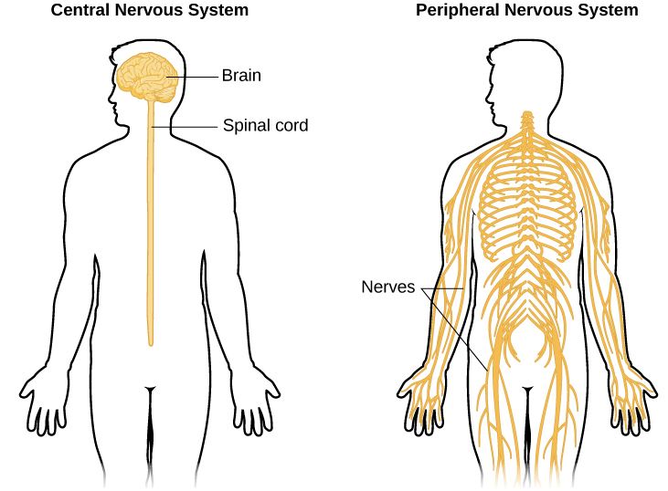
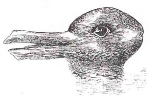
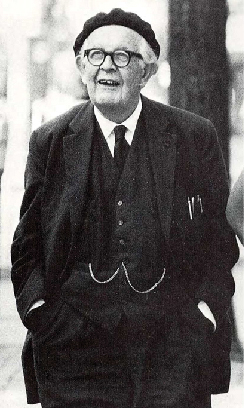
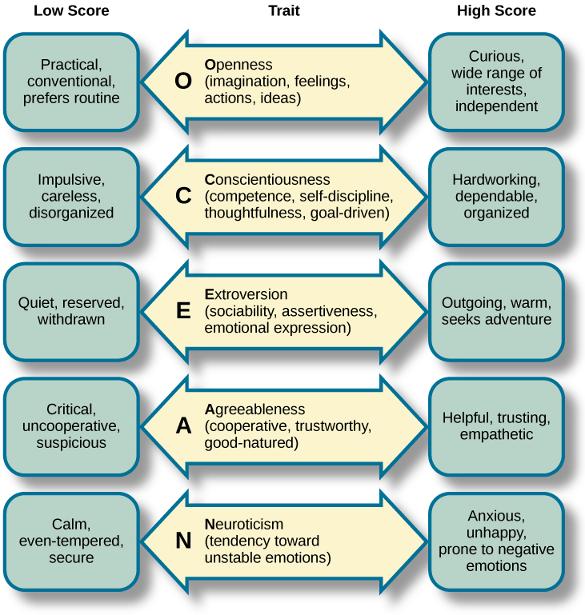
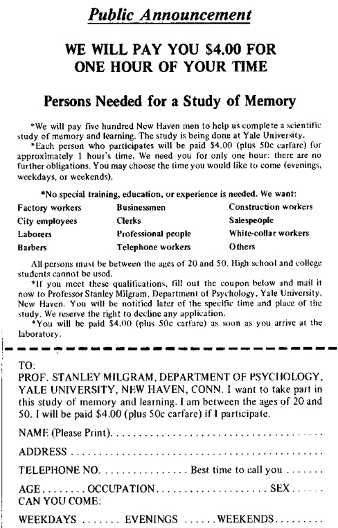
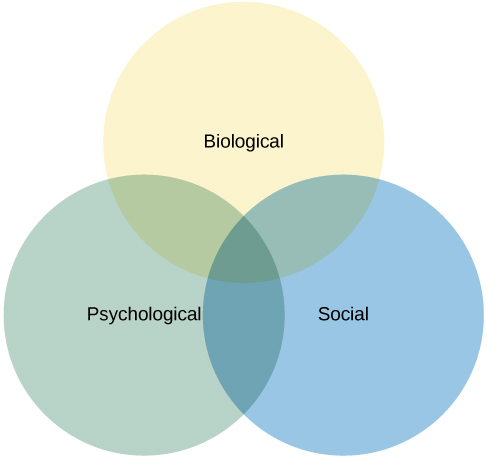
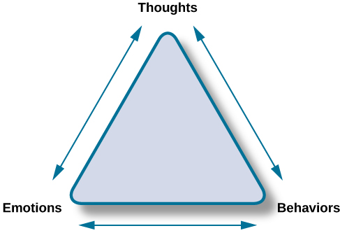

# 1.3 Tâm Lý Học Đương Đại (Contemporary Psychology)

> [!info]
>
> ### Mục Tiêu Học Tập
>
> Khi kết thúc phần này, bạn sẽ có thể:
>
> - Đánh giá cao tính đa dạng về mối quan tâm và trọng tâm nghiên cứu bên trong ngành tâm lý học
> - Hiểu được các mối quan tâm và ứng dụng cơ bản trong từng phân ngành tâm lý học được mô tả
> - Thể hiện sự quen thuộc với một số khái niệm chính hoặc các nhân vật quan trọng trong từng phân ngành tâm lý học

Tâm lý học đương đại là một lĩnh vực đa dạng chịu ảnh hưởng từ tất cả các góc nhìn lịch sử đã được mô tả ở phần trước.
Minh chứng rõ nét cho tính đa dạng của ngành chính là sự phong phú hiện diện bên trong **Hiệp hội Tâm lý học Hoa Kỳ (APA - American Psychological Association)**.
APA là tổ chức nghề nghiệp đại diện cho các nhà tâm lý học tại Hoa Kỳ.
Đây là tổ chức của các nhà tâm lý học lớn nhất trên thế giới, với sứ mệnh thúc đẩy và phổ biến tri thức tâm lý học vì sự tiến bộ của con người.
Có tới 54 phân ban (divisions) chuyên môn bên trong APA, đại diện cho hàng loạt chuyên ngành đa dạng trải dài từ Phân ban Tâm lý học Tôn giáo và Tâm linh, Tâm lý học Thể thao và Vận động, cho đến Khoa học Thần kinh Hành vi và Tâm lý học So sánh.
Phản ánh tính đa dạng của chính ngành tâm lý học, các hội viên chính thức, hội viên liên kết và hội viên cộng tác bao gồm từ sinh viên cho đến các nhà tâm lý học có học vị tiến sĩ, đến từ nhiều môi trường làm việc khác nhau như giáo dục, tư pháp hình sự, bệnh viện, lực lượng vũ trang và các doanh nghiệp công nghiệp (Hiệp hội Tâm lý học Hoa Kỳ, 2014).
G. Stanley Hall là chủ tịch đầu tiên của APA.
Trước khi nhận bằng tiến sĩ, ông từng là giảng viên trợ giảng tại Đại học Wilberforce—một trường đại học truyền thống dành cho người da đen (HBCU)—đồng thời giảng dạy tại Cao đẳng Antioch.
Hall sau đó theo học và làm việc dưới sự hướng dẫn của William James, nhận bằng tiến sĩ và cuối cùng trở thành chủ tịch đầu tiên của Đại học Clark tại Massachusetts khi trường mới thành lập (Pickren & Rutherford, 2010).

Hiệp hội Khoa học Tâm lý (APS - Association for Psychological Science) được thành lập vào năm 1988 nhằm thúc đẩy định hướng nghiên cứu khoa học hàn lâm của ngành tâm lý học.
Sự ra đời của APS bắt nguồn từ những bất đồng quan điểm giữa các thành viên thuộc nhánh nghiên cứu khoa học thực nghiệm và nhánh tâm lý học lâm sàng bên trong APA.
APS xuất bản năm tạp chí nghiên cứu khoa học uy tín, đồng thời tham gia vào công tác giáo dục và vận động tài trợ với các cơ quan cấp ngân sách.
Một tỷ lệ đáng kể thành viên của APS là các nhà khoa học quốc tế, dù phần lớn vẫn làm việc tại Hoa Kỳ.
Nhiều tổ chức chuyên môn khác cũng cung cấp mạng lưới kết nối và cơ hội hợp tác cho các chuyên gia thuộc các nhóm dân tộc hoặc chủng tộc làm việc trong ngành tâm lý học, chẳng hạn như Hiệp hội Tâm lý học Người Mỹ gốc Latinh (NLPA), Hiệp hội Tâm lý học Người Mỹ gốc Á (AAPA), Hiệp hội các Nhà tâm lý học Da đen (ABPsi), và Hội các Nhà tâm lý học Bản địa châu Mỹ (SIP).
Hầu hết các tổ chức này cũng cống hiến cho việc nghiên cứu các vấn đề tâm lý và xã hội đặc thù bên trong chính cộng đồng của họ.

Phần này sẽ cung cấp một cái nhìn tổng quan về các phân ngành chính trong tâm lý học ngày nay theo đúng trình tự mà chúng sẽ được giới thiệu xuyên suốt phần còn lại của cuốn giáo trình.
Đây không phải là danh sách toàn bộ mọi chuyên ngành, nhưng nó sẽ giúp bạn hiểu sâu sắc về các lĩnh vực nghiên cứu và thực hành chính của các nhà tâm lý học thời hiện đại.

> [!tip]
>
> ### Kết Nối Học Tập (Link to Learning)
>
> Vui lòng truy cập [trang web về các phân ban chuyên môn bên trong APA](https://openstax.org/l/biopsychology) để tìm hiểu thêm.
>
> Xem thêm các [tài nguyên dành cho sinh viên](https://openstax.org/l/studentresource) do APA cung cấp.

## Tâm Lý Học Sinh Học và Tâm Lý Học Tiến Hóa

Đúng như tên gọi của nó, **tâm lý học sinh học (biopsychology)** khám phá cách thức nền tảng sinh học ảnh hưởng đến hành vi của chúng ta.
Mặc dù tâm lý học sinh học là một lĩnh vực rộng lớn, nhiều nhà tâm lý học sinh học đặc biệt muốn tìm hiểu cấu trúc và chức năng của hệ thần kinh có mối liên hệ như thế nào với hành vi ([Hình 1.10](#CNX_Psych_01_03_NervSystem)).
Do đó, họ thường kết hợp các chiến lược nghiên cứu của cả nhà tâm lý học lẫn nhà sinh lý học để đạt được mục tiêu này (Carlson, 2013).

**Hình 1.10** Các nhà tâm lý học sinh học nghiên cứu cách thức cấu trúc và chức năng của hệ thần kinh tạo ra hành vi.

Mối quan tâm nghiên cứu của các nhà tâm lý học sinh học trải rộng trên nhiều lĩnh vực, bao gồm nhưng không giới hạn ở: hệ cảm giác và vận động, giấc ngủ, sử dụng và lạm dụng chất, hành vi ăn uống, hành vi sinh sản, sự phát triển thần kinh, tính mềm dẻo của hệ thần kinh, và các mối tương quan sinh học của các rối loạn tâm lý.
Xét đến phạm vi rộng lớn của tâm lý học sinh học, không có gì đáng ngạc nhiên khi các nhà khoa học thuộc nhiều chuyên môn khác nhau cùng tham gia vào lĩnh vực này, bao gồm các nhà sinh học, chuyên gia y tế, nhà sinh lý học và nhà hóa học.
Phương pháp tiếp cận liên ngành này thường được gọi chung là khoa học thần kinh (neuroscience), trong đó tâm lý học sinh học là một thành phần trọng yếu (Carlson, 2013).

Trong khi tâm lý học sinh học thường tập trung vào các nguyên nhân trực tiếp của hành vi dựa trên sinh lý học của con người hoặc động vật, thì tâm lý học tiến hóa lại tìm kiếm các nguyên nhân sinh học tối hậu của hành vi.
Trong chừng mực một hành vi chịu sự tác động của di truyền, hành vi đó—cũng giống như bất kỳ đặc điểm giải phẫu nào của cơ thể sinh vật—sẽ bộc lộ sự thích nghi với môi trường sống xung quanh.
Môi trường xung quanh này bao gồm cả môi trường vật lý tự nhiên và môi trường xã hội (bởi vì các tương tác giữa các sinh vật có ý nghĩa sống còn đối với sự sinh tồn và sinh sản).
Việc nghiên cứu hành vi trong bối cảnh tiến hóa bắt nguồn từ Charles Darwin, người đồng phát hiện ra thuyết tiến hóa nhờ chọn lọc tự nhiên.
Darwin nhận thức rất rõ rằng các hành vi phải mang tính thích nghi, và ông đã viết các cuốn sách kinh điển mang tên *Nguồn gốc Loài người (The Descent of Man, 1871)* và *Sự Biểu Lộ Cảm Xúc ở Con Người và Động Vật (The Expression of the Emotions in Man and Animals, 1872)* để khai phá lĩnh vực này.

Tâm lý học tiến hóa, và cụ thể là **tâm lý học tiến hóa (evolutionary psychology)** ở con người, đã chứng kiến sự trỗi dậy mạnh mẽ trong những thập kỷ gần đây.
Để chịu sự chi phối của tiến hóa qua chọn lọc tự nhiên, một hành vi nhất thiết phải có nguyên nhân di truyền đáng kể.
Nhìn chung, chúng ta kỳ vọng tất cả các nền văn hóa của loài người đều biểu hiện một hành vi tương tự nếu hành vi đó do di truyền quy định, bởi vì sự khác biệt về mặt di truyền giữa các nhóm người trên thế giới là rất nhỏ.
Cách tiếp cận của hầu hết các nhà tâm lý học tiến hóa là dự đoán kết quả của một hành vi trong một tình huống cụ thể dựa trên lý thuyết tiến hóa, sau đó tiến hành quan sát hoặc làm thí nghiệm để xác định xem kết quả thực tế có khớp với lý thuyết hay không.
Điều quan trọng cần nhận biết là những dạng nghiên cứu này không phải lúc nào cũng là bằng chứng đanh thép chứng minh một hành vi là do thích nghi tiến hóa, bởi vì chúng thường thiếu thông tin để chứng minh hành vi đó thực sự bắt nguồn một phần từ gen chứ không phải hoàn toàn do học hỏi văn hóa (Endler, 1986).
Việc chứng minh một đặc điểm, đặc biệt là ở con người, được chọn lọc tự nhiên lưu giữ là điều cực kỳ khó khăn; có lẽ vì lý do này, một số nhà tâm lý học tiến hóa chấp nhận giả định rằng các hành vi mà họ nghiên cứu có các yếu tố quyết định về mặt di truyền (Confer et al., 2010).

Một hạn chế khác của tâm lý học tiến hóa là những đặc điểm mà chúng ta sở hữu ngày nay đã tiến hóa trong những điều kiện môi trường và xã hội cách đây hàng trăm nghìn năm trong lịch sử nhân loại sơ khai, và chúng ta hiểu biết rất hạn chế về những điều kiện cổ xưa đó.
Điều này khiến việc đưa ra các dự đoán về tính thích nghi của một hành vi trở nên phức tạp.
Các đặc điểm hành vi không nhất thiết phải mang tính thích nghi trong điều kiện sống hiện đại ngày nay, mà chỉ cần mang tính thích nghi trong các điều kiện của quá khứ khi chúng tiến hóa—những điều kiện mà chúng ta ngày nay chỉ có thể suy đoán dựa trên giả thuyết.

Tuy nhiên, có rất nhiều lĩnh vực hành vi của con người mà lý thuyết tiến hóa có thể đưa ra những dự đoán chính xác.
Các ví dụ tiêu biểu bao gồm trí nhớ, sự lựa chọn bạn đời, mối quan hệ thân tộc, tình bạn và sự hợp tác, việc nuôi dạy con cái, cấu trúc tổ chức xã hội và địa vị (Confer et al., 2010).

Các nhà tâm lý học tiến hóa đã đạt được nhiều thành công trong việc tìm ra sự tương ứng thực nghiệm giữa quan sát thực tế và kỳ vọng lý thuyết.
Chẳng hạn, trong một nghiên cứu về sự khác biệt trong ưu tiên lựa chọn bạn đời giữa nam và nữ trải dài trên 37 nền văn hóa khác nhau, Buss (1989) phát hiện ra rằng phụ nữ coi trọng các yếu tố liên quan đến tiềm năng thu nhập kinh tế cao hơn nam giới, trong khi nam giới lại coi trọng các yếu tố tiềm năng sinh sản (sự trẻ trung và vẻ ngoài hấp dẫn) ở người bạn đời tương lai hơn phụ nữ.
Nhìn chung, những phát hiện này hoàn toàn phù hợp với các dự đoán của thuyết tiến hóa, mặc dù vẫn tồn tại một số biến thiên nhất định ở một vài nền văn hóa.

## Cảm Giác và Tri Giác

Các nhà khoa học quan tâm đến cả khía cạnh sinh lý của hệ thống giác quan lẫn trải nghiệm tâm lý của thông tin cảm giác làm việc trong lĩnh vực **cảm giác (sensation)** và **tri giác (perception)** ([Hình 1.11](#CNX_Psych_01_03_DuckRabbit)).
Do đó, nghiên cứu về cảm giác và tri giác cũng mang tính liên ngành rất cao.
Hãy tưởng tượng bạn đang đi bộ giữa các tòa nhà trong khuôn viên trường đại học để chuyển từ lớp học này sang lớp học khác.
Bạn bị ngập tràn bởi hình ảnh, âm thanh, cảm giác xúc giác và mùi hương.
Bạn cũng cảm nhận được nhiệt độ không khí xung quanh và duy trì sự thăng bằng khi bước đi.
Tất cả những điều này đều là những đối tượng nghiên cứu hấp dẫn đối với các nhà nghiên cứu trong lĩnh vực cảm giác và tri giác.

**Hình 1.11** Khi nhìn vào hình ảnh này, bạn có thể nhìn thấy một con vịt hoặc một con thỏ. Thông tin cảm giác đầu vào hoàn toàn không đổi, nhưng tri giác chủ quan của bạn có thể biến đổi rất linh hoạt.

Như sẽ được trình bày chi tiết trong chương chuyên khảo về cảm giác và tri giác, trải nghiệm của chúng ta về thế giới không đơn giản chỉ là tổng số của tất cả các thông tin cảm giác đầu vào cộng lại.
Thay vào đó, trải nghiệm (hay tri giác) của chúng ta vô cùng phức tạp và chịu sự chi phối bởi nơi chúng ta tập trung chú ý, những trải nghiệm trong quá khứ của chúng ta, và thậm chí cả nền tảng văn hóa của chúng ta.

## Tâm Lý Học Nhận Thức

Như đã đề cập ở phần trước, cuộc cách mạng nhận thức đã tạo ra động lực to lớn thúc đẩy các nhà tâm lý học tập trung sự chú ý vào việc thấu hiểu sâu sắc hơn về tâm trí và các quá trình tinh thần làm nền tảng cho hành vi.
Do đó, **tâm lý học nhận thức (cognitive psychology)** là lĩnh vực tâm lý học chuyên nghiên cứu về nhận thức, tư duy và mối quan hệ của chúng với các trải nghiệm cũng như hành động của chúng ta.
Giống như tâm lý học sinh học, tâm lý học nhận thức có phạm vi nghiên cứu rất rộng và thường đòi hỏi sự hợp tác giữa các nhà khoa học thuộc nhiều chuyên ngành khác nhau.
Điều này đã thúc đẩy sự ra đời của thuật ngữ khoa học nhận thức (cognitive science) nhằm mô tả bản chất liên ngành của lĩnh vực nghiên cứu này (Miller, 2003).

Các nhà tâm lý học nhận thức có mối quan tâm nghiên cứu bao quát một dải rộng các chủ đề, từ sự chú ý, giải quyết vấn đề, ngôn ngữ cho đến trí nhớ.
Các phương pháp tiếp cận được sử dụng trong việc nghiên cứu những chủ đề này cũng đa dạng không kém.
Chính vì tính bao quát rộng lớn như vậy, tâm lý học nhận thức không chỉ gói gọn trong một chương duy nhất của cuốn sách này; mà các khái niệm then chốt của nó sẽ được trình bày xuyên suốt trong các chương về cảm giác và tri giác, tư duy và trí thông minh, trí nhớ, tâm lý học phát triển, tâm lý học xã hội và trị liệu.

## Tâm Lý Học Phát Triển

**Tâm lý học phát triển (Developmental psychology)** là ngành nghiên cứu khoa học về sự phát triển của con người trong suốt vòng đời.
Các nhà tâm lý học phát triển quan tâm đến các tiến trình gắn liền với sự trưởng thành thể chất.
Tuy nhiên, trọng tâm của họ không chỉ giới hạn ở những biến đổi thể chất liên quan đến quá trình lão hóa, mà còn nghiên cứu sâu sắc về sự biến đổi của các kỹ năng nhận thức, suy luận đạo đức, hành vi xã hội và các thuộc tính tâm lý khác.

Các nhà tâm lý học phát triển thời kỳ đầu tập trung chủ yếu vào những thay đổi diễn ra từ lúc sinh ra cho đến khi trưởng thành, mang lại những hiểu biết sâu sắc về sự khác biệt trong năng lực thể chất, nhận thức và xã hội giữa trẻ nhỏ và người lớn.
Chẳng hạn, công trình nghiên cứu của Jean **Piaget** ([Hình 1.12](#CNX_Psych_01_03_Piaget)) đã chứng minh rằng trẻ em ở lứa tuổi sơ sinh chưa hình thành khái niệm về tính hằng định của đối tượng (object permanence).
Tính hằng định của đối tượng đề cập đến sự hiểu biết rằng các vật thể vật lý vẫn tiếp tục tồn tại ngay cả khi chúng bị che khuất khỏi tầm mắt của chúng ta.
Nếu bạn đưa cho một người lớn xem một món đồ chơi rồi giấu nó sau một tấm rèm, người lớn biết chắc chắn rằng món đồ chơi đó vẫn còn ở đó.
Tuy nhiên, trẻ sơ sinh lại hành xử như thể vật thể bị giấu đi đã hoàn toàn biến mất khỏi thế giới.
Độ tuổi chính xác mà trẻ đạt được tính hằng định của đối tượng hiện vẫn còn là chủ đề thảo luận khoa học (Munakata, McClelland, Johnson, & Siegler, 1997).

**Hình 1.12** Jean Piaget nổi tiếng với các học thuyết về sự biến đổi năng lực nhận thức diễn ra trong suốt quá trình con người phát triển từ thời thơ ấu đến tuổi trưởng thành.

Trong khi Piaget tập trung vào những biến đổi nhận thức trong thời kỳ ấu thơ và niên thiếu, thì ngày nay ngày càng có nhiều sự quan tâm mở rộng nghiên cứu sang những thay đổi diễn ra ở giai đoạn muộn hơn trong cuộc đời.
Điều này phản ánh sự biến đổi nhân khẩu học của các quốc gia phát triển nói chung.
Khi ngày càng có nhiều người sống thọ hơn, số lượng người cao tuổi sẽ tiếp tục gia tăng nhanh chóng.
Thực vậy, người ta ước tính rằng có hơn 40 triệu người từ 65 tuổi trở lên sống tại Hoa Kỳ vào năm 2010.
Đến năm 2020, con số này đã tăng lên khoảng 55 triệu người, và đến năm 2050, dự kiến sẽ có gần 90 triệu người tại quốc gia này đạt độ tuổi từ 65 trở lên (Bộ Y tế và Dịch vụ Nhân sinh Hoa Kỳ).

## Tâm Lý Học Nhân Cách

**Tâm lý học nhân cách (Personality psychology)** tập trung vào các khuôn mẫu suy nghĩ và hành vi tạo nên nét độc đáo riêng biệt của mỗi cá nhân.
Nhiều nhân vật (chẳng hạn như Freud và Maslow) mà chúng ta đã thảo luận trong phần lịch sử, cùng nhà tâm lý học người Mỹ Gordon Allport, đã đóng góp to lớn cho các lý thuyết nhân cách sơ kỳ.
Những nhà lý thuyết ban đầu này đã cố gắng giải thích cách nhân cách của một người phát triển dựa trên góc nhìn học thuyết riêng của họ.
Ví dụ, Freud đề xuất rằng nhân cách nảy sinh từ các cuộc xung đột liên tục giữa phần ý thức và vô thức của tâm trí diễn ra trong suốt cuộc đời.
Cụ thể, Freud đưa ra giả thuyết rằng mỗi cá nhân trải qua các giai đoạn phát triển tâm lý tính dục khác nhau.
Theo Freud, nhân cách của người trưởng thành là kết quả của việc giải quyết các xung đột xoay quanh sự dịch chuyển của các vùng kích thích khoái cảm (erogenous zones) từ miệng sang hậu môn, sang dương vật và cuối cùng là cơ quan sinh dục.
Giống như nhiều lý thuyết khác của Freud, ý tưởng này gây ra nhiều tranh cãi và rất khó kiểm chứng bằng thực nghiệm khoa học (Person, 1980).

Gần đây hơn, việc nghiên cứu nhân cách đã chuyển sang phương pháp tiếp cận mang tính định lượng rõ rệt.
Thay vì cố gắng giải thích nhân cách hình thành như thế nào, nghiên cứu hiện đại tập trung vào việc xác định các **nét tính cách (personality traits)**, đo lường các nét tính cách này và xác định cách thức chúng tương tác trong một bối cảnh cụ thể để chi phối hành vi của một người trong tình huống nhất định.
Các nét tính cách là những khuôn mẫu suy nghĩ và hành vi tương đối ổn định và nhất quán, và nhiều nhà nghiên cứu đã khẳng định rằng năm chiều kích tính cách là đủ để khái quát sự khác biệt về nhân cách giữa các cá nhân.
Năm chiều kích này được gọi là "Big Five" hay **mô hình năm nhân tố (Five Factor model)**, bao gồm: Tận tâm (Conscientiousness), Dễ chịu (Agreeableness), Tâm lý bất ổn (Neuroticism), Cởi mở (Openness), và Hướng ngoại (Extraversion) ([Hình 1.13](#CNX_Psych_01_03_BigFive)).
Mỗi nét tính cách này đã được chứng minh là tương đối ổn định trong suốt vòng đời (Rantanen et al., 2007; Soldz & Vaillant, 1999; McCrae & Costa, 2008) và chịu sự ảnh hưởng đáng kể từ yếu tố di truyền (Jang, Livesly, & Vernon, 1996).

**Hình 1.13** Mỗi chiều kích trong mô hình năm nhân tố (Big Five) được minh họa trong sơ đồ này. Các mô tả thể hiện đặc điểm của một người đạt điểm cao trên chiều kích đó. Một người có điểm số thấp sẽ mang những đặc điểm ngược lại.

## Tâm Lý Học Xã Hội

**Tâm lý học xã hội (Social psychology)** tập trung vào cách chúng ta tương tác, liên hệ và tác động lẫn nhau.
Các nhà tâm lý học xã hội tiến hành nghiên cứu trên nhiều chủ đề đa dạng bao gồm: sự khác biệt trong cách chúng ta giải thích hành vi của chính mình so với hành vi của người khác, định kiến, sự hấp dẫn liên cá nhân, và cách chúng ta giải quyết các xung đột giữa người với người.
Họ cũng nỗ lực xác định xem việc hiện diện giữa những người khác làm biến đổi hành vi và khuôn mẫu tư duy của chúng ta ra sao.

Có rất nhiều ví dụ nghiên cứu hấp dẫn trong tâm lý học xã hội, và bạn sẽ được tìm hiểu sâu hơn trong các chương tiếp theo.
Trước mắt, bạn sẽ được giới thiệu về một trong những thí nghiệm tâm lý học gây tranh cãi và nổi tiếng nhất từng được tiến hành.
Stanley **Milgram** là một nhà tâm lý học xã hội người Mỹ nổi tiếng nhất với công trình nghiên cứu kinh điển về sự vâng phục (obedience).
Sau thảm họa diệt chủng Holocaust, vào năm 1961, tội phạm chiến tranh Đức Quốc xã Adolf Eichmann bị đưa ra xét xử vì các tội ác tàn sát hàng loạt.
Nhiều người tự hỏi làm thế nào những người lính Đức lại có thể tra tấn dã man các tù nhân trong trại tập trung, và công chúng không thỏa mãn với lời bào chữa của những người lính rằng họ chỉ đơn giản là đang "tuân theo mệnh lệnh".
Vào thời điểm đó, hầu hết các nhà tâm lý học đều đồng tình rằng có rất ít người bình thường sẵn sàng gây ra nỗi đau đớn và thống khổ cùng cực cho người khác chỉ vì họ tuân lệnh cấp trên.
Milgram quyết định thực hiện một thí nghiệm khoa học để kiểm chứng xem nhận định này có đúng hay không ([Hình 1.14](#CNX_Psych_01_03_Milgram)).
Kết quả nghiên cứu chấn động của Milgram cho thấy gần hai phần ba (65%) số người tham gia sẵn sàng bấm nút phát ra mức xung điện cực mạnh (mà họ tin là có thể gây chết người) cho một người khác, chỉ vì họ được chỉ thị làm như vậy bởi một nhân vật có thẩm quyền (trong trường hợp này là một nhà khoa học mặc áo blu trắng).
Điều này diễn ra bất chấp việc người tham gia đã nhận đủ tiền thù lao ngay khi vừa bước vào phòng thí nghiệm và hoàn toàn có quyền từ chối tiếp tục làm tổn thương người khác bằng cách rút khỏi nghiên cứu.
Trên thực tế, không có ai bị điện giật hay bị thương tích; thí nghiệm của Milgram là một sự dàn dựng khéo léo với sự tham gia của các cộng sự ngầm (confederates)—những diễn viên giả dạng làm người tham gia nhưng thực chất làm việc cho nhà nghiên cứu và được hướng dẫn cụ thể cách ứng xử (Hock, 2009).
Nghiên cứu của Milgram cùng các thí nghiệm khác có sử dụng biện pháp đánh lạc hướng và tiềm ẩn nguy cơ gây tổn thương cảm xúc cho người tham gia đã đóng vai trò là chất xúc tác mạnh mẽ thúc đẩy sự ra đời của các nguyên tắc đạo đức nghiêm ngặt trong nghiên cứu tâm lý học ngày nay, yêu cầu hạn chế tối đa việc lừa dối đối tượng và bắt buộc phải có sự đồng thuận dựa trên thông tin đầy đủ (informed consent).

**Hình 1.14** Nghiên cứu của Stanley Milgram đã chứng minh con người có thể đi xa đến mức nào trong việc vâng phục mệnh lệnh từ một nhân vật quyền uy. Tờ thông báo này từng được dùng để tuyển mộ người tham gia cho nghiên cứu của ông.

## Tâm Lý Học Công Nghiệp - Tổ Chức

**Tâm lý học công nghiệp - tổ chức (I-O psychology)** là một phân ngành ứng dụng các lý thuyết, nguyên lý và phát hiện nghiên cứu tâm lý học vào môi trường công nghiệp và tổ chức doanh nghiệp.
Các nhà tâm lý học I-O thường tham gia vào các vấn đề liên quan đến quản trị nhân sự, cơ cấu tổ chức và môi trường làm việc.
Các doanh nghiệp thường tìm kiếm sự tư vấn của các nhà tâm lý học I-O để đưa ra các quyết định tuyển dụng tối ưu nhất cũng như kiến tạo một môi trường văn hóa giúp nhân viên đạt năng suất và hiệu quả làm việc cao nhất.
Bên cạnh tính ứng dụng thực tiễn, tâm lý học I-O cũng tiến hành các nghiên cứu khoa học cơ bản về hành vi con người bên trong các bối cảnh tổ chức (Riggio, 2013).

## Tâm Lý Học Sức Khỏe

**Tâm lý học sức khỏe (Health psychology)** tập trung vào cách thức sức khỏe con người bị tác động bởi sự tương tác phức tạp giữa các yếu tố sinh học, tâm lý và văn hóa xã hội.
Cách tiếp cận đặc thù này được gọi là **mô hình sinh - tâm - xã hội (biopsychosocial model)** ([Hình 1.15](#CNX_Psych_01_03_BioPsych)).
Các nhà tâm lý học sức khỏe quan tâm đến việc giúp các cá nhân đạt được tình trạng sức khỏe tốt hơn thông qua các chính sách công, giáo dục cộng đồng, các biện pháp can thiệp hành vi và nghiên cứu khoa học.
Họ tiến hành nghiên cứu khám phá mối quan hệ giữa cấu trúc di truyền, khuôn mẫu hành vi, các mối quan hệ xã hội, căng thẳng tâm lý và bệnh tật thể chất, từ đó tìm ra những phương thức hiệu quả nhất để khuyến khích con người từ bỏ những thói quen có hại cho sức khỏe (MacDonald, 2013).

**Hình 1.15** Mô hình sinh - tâm - xã hội cho rằng sức khỏe và bệnh tật được định đoạt bởi sự tương tác qua lại của cả ba nhóm yếu tố này.

## Tâm Lý Học Thể Thao và Vận Động

Các nhà nghiên cứu trong lĩnh vực **tâm lý học thể thao và vận động (sport and exercise psychology)** nghiên cứu các khía cạnh tâm lý của thành tích thể thao, bao gồm động lực thi đấu, sự lo âu khi thi đấu, và tác động của hoạt động thể thao đối với sức khỏe tinh thần và cảm xúc.
Các nghiên cứu cũng được tiến hành trên những chủ đề tương tự gắn liền với việc rèn luyện thể chất nói chung.
Chuyên ngành này cũng bao quát các chủ đề rộng lớn hơn thể thao, liên quan đến mối tương tác giữa hiệu suất tinh thần và thể chất trong những điều kiện khắt khe, căng thẳng tột độ như lính cứu hỏa, hoạt động quân sự, biểu diễn nghệ thuật đỉnh cao và phẫu thuật y khoa.

## Tâm Lý Học Lâm Sàng

**Tâm lý học lâm sàng (Clinical psychology)** là lĩnh vực tâm lý học tập trung vào việc chẩn đoán và điều trị các rối loạn tâm lý cũng như các khuôn mẫu hành vi có vấn đề khác.
Do đó, đây được coi là lĩnh vực mang tính ứng dụng thực tiễn cao nhất trong tâm lý học; tuy nhiên, nhiều nhà lâm sàng cũng tích cực tham gia vào các nghiên cứu khoa học hàn lâm.
**Tâm lý học tham vấn (Counseling psychology)** là một chuyên ngành tương đồng, nhưng tập trung nhiều hơn vào việc cải thiện các kết quả cảm xúc, xã hội, nghề nghiệp và đời sống ở những cá nhân được xem là có sức khỏe tâm thần bình thường.

Như đã đề cập trước đó, cả Freud và Rogers đều mang lại những góc nhìn có ảnh hưởng sâu sắc đến cách các nhà lâm sàng tương tác với những người tìm kiếm sự trợ giúp tâm lý.
Trong khi các khía cạnh của lý thuyết phân tâm học vẫn được duy trì ở một số nhà trị liệu theo định hướng tâm động học ngày nay, thì các ý tưởng của Rogers về **liệu pháp (therapy)** thân chủ trọng tâm đã định hình sâu sắc phong cách thực hành của rất nhiều nhà lâm sàng hiện đại.
Hơn nữa, cả thuyết hành vi và cuộc cách mạng nhận thức đã định hình mạnh mẽ thực hành lâm sàng dưới các hình thức: liệu pháp hành vi, liệu pháp nhận thức và liệu pháp nhận thức - hành vi ([Hình 1.16](#CNX_Psych_01_03_CogBehav)).
Các vấn đề liên quan đến việc chẩn đoán và điều trị các rối loạn tâm lý sẽ được phân tích chi tiết trong các chương sau của cuốn giáo trình.

**Hình 1.16** Các nhà trị liệu nhận thức - hành vi luôn tính đến cả các quá trình nhận thức và hành vi khi cung cấp tâm lý trị liệu. Đây là một trong những chiến lược phổ biến nhất được các nhà tâm lý học lâm sàng áp dụng ngày nay.

Đây là lĩnh vực tâm lý học nhận được nhiều sự chú ý nhất trên các phương tiện truyền thông đại chúng, khiến nhiều người lầm tưởng rằng toàn bộ ngành tâm lý học chỉ bao gồm tâm lý học lâm sàng.

## Tâm Lý Học Pháp Chứng

**Tâm lý học pháp chứng (Forensic psychology)** là một phân ngành của tâm lý học giải quyết các câu hỏi và vấn đề tâm lý nảy sinh trong bối cảnh của hệ thống tư pháp và pháp luật.
Chẳng hạn, các nhà tâm lý học pháp chứng (và bác sĩ tâm thần pháp chứng) sẽ đánh giá năng lực hầu tòa của bị cáo, giám định trạng thái tâm thần của tội phạm tại thời điểm gây án, làm cố vấn trong các vụ tranh chấp quyền nuôi con, tư vấn về các khuyến nghị tuyên án và điều trị bắt buộc, đồng thời đưa ra ý kiến chuyên môn về độ tin cậy của lời khai nhân chứng hoặc lời khai của trẻ em (Hội đồng Tâm lý học Pháp chứng Hoa Kỳ, 2014).
Trong những vai trò này, họ thường đóng vai trò là nhân chứng chuyên gia (expert witnesses) được một trong hai bên mời ra tòa để cung cấp các nhận định khoa học dựa trên nghiên cứu và kinh nghiệm chuyên môn.
Với tư cách là nhân chứng chuyên gia, các nhà tâm lý học pháp chứng buộc phải nắm vững luật pháp và cung cấp thông tin phù hợp với ngôn ngữ của hệ thống pháp lý chứ không chỉ thuần túy trong phạm vi tâm lý học.
Họ cũng tham gia vào quy trình lựa chọn bồi thẩm đoàn và chuẩn bị tâm lý cho nhân chứng trước phiên tòa.
Họ cũng có thể tham gia cung cấp các dịch vụ trị liệu tâm lý bên trong các cơ sở giam giữ của hệ thống tư pháp hình sự.
Việc lập hồ sơ tâm lý tội phạm (criminal profiling) chỉ là một phần rất nhỏ trong công việc của các nhà tâm lý học đóng vai trò tư vấn cho cơ quan thực thi pháp luật.
