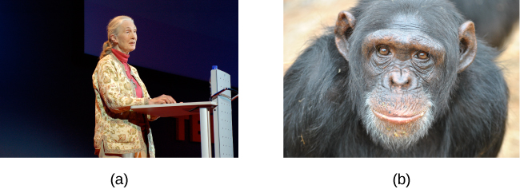
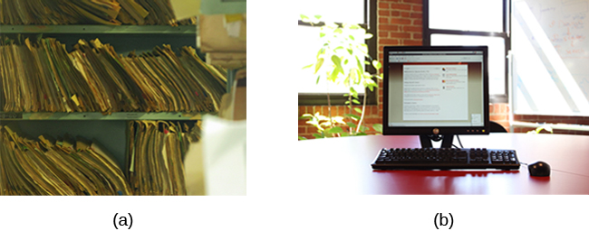

# 2.2 Các Phương Pháp Tiếp Cận Nghiên Cứu (Approaches to Research)

> [!info]
>
> ### Mục tiêu học tập
>
> Sau khi học xong mục này, bạn sẽ có khả năng:
>
> - Mô tả các phương pháp nghiên cứu khác nhau được các nhà tâm lý học sử dụng.
> - Thảo luận về điểm mạnh và điểm yếu của nghiên cứu trường hợp, quan sát tự nhiên, khảo sát và nghiên cứu lưu trữ.
> - So sánh phương pháp tiếp cận nghiên cứu dọc (longitudinal) và nghiên cứu cắt ngang (cross-sectional).
> - Phân biệt và so sánh giữa mối quan hệ tương quan (correlation) và quan hệ nhân quả (causation).

Có rất nhiều phương pháp nghiên cứu sẵn có giúp các nhà tâm lý học thực hiện nỗ lực tìm hiểu, mô tả và giải thích hành vi cũng như các tiến trình nhận thức và sinh học làm nền tảng cho hành vi đó.
Một số phương pháp dựa trên kỹ thuật quan sát.
Các phương pháp tiếp cận khác lại liên quan đến sự tương tác giữa nhà nghiên cứu và các cá nhân được nghiên cứu—từ một loạt câu hỏi đơn giản cho đến các cuộc phỏng vấn sâu, mở rộng—cho tới các thí nghiệm được kiểm soát chặt chẽ.

Mỗi phương pháp nghiên cứu này đều có những điểm mạnh và điểm yếu riêng biệt, và mỗi phương pháp có thể chỉ phù hợp với một số dạng câu hỏi nghiên cứu nhất định.
Ví dụ, các nghiên cứu chủ yếu dựa vào quan sát tạo ra một lượng thông tin vô cùng phong phú và chi tiết, nhưng khả năng áp dụng thông tin này cho toàn thể quần thể lớn hơn lại bị hạn chế phần nào do quy mô mẫu nhỏ.
Mặt khác, nghiên cứu khảo sát cho phép các nhà nghiên cứu dễ dàng thu thập dữ liệu từ các mẫu tương đối lớn.
Mặc dù điều này giúp kết quả dễ dàng được khái quát hóa cho quần thể lớn hơn, nhưng lượng thông tin có thể thu thập được trên bất kỳ bảng khảo sát nào lại tương đối nông và dễ gặp phải các vấn đề gắn liền với dữ liệu tự báo cáo (self-reported data).
Một số nhà nghiên cứu tiến hành nghiên cứu lưu trữ bằng cách sử dụng các hồ sơ dữ liệu có sẵn.
Dù đây có thể là một cách thu thập dữ liệu khá tiết kiệm chi phí để giải đáp nhiều câu hỏi nghiên cứu, nhưng các nhà nghiên cứu sử dụng phương pháp này lại hoàn toàn không kiểm soát được cách thức hoặc loại dữ liệu ban đầu đã được thu thập như thế nào.
Tất cả các phương pháp được mô tả cho đến nay về bản chất đều mang tính tương quan.
Điều này có nghĩa là các nhà nghiên cứu có thể chỉ ra các mối quan hệ quan trọng có thể tồn tại giữa hai hoặc nhiều biến số được quan tâm.
Tuy nhiên, dữ liệu tương quan không bao giờ có thể được sử dụng để đưa ra các tuyên bố về mối quan hệ nhân quả (cause-and-effect relationships).

Nghiên cứu tương quan có thể tìm ra mối quan hệ giữa hai biến số, nhưng cách duy nhất để một nhà nghiên cứu có thể khẳng định chắc chắn rằng mối quan hệ giữa các biến số là quan hệ nhân quả chính là thực hiện một thí nghiệm thực nghiệm.
Trong nghiên cứu thực nghiệm, vốn sẽ được thảo luận kỹ hơn ở phần sau của chương này, có một mức độ kiểm soát rất lớn đối với các biến số quan tâm.
Mặc dù đây là một phương pháp tiếp cận đầy quyền năng, các thí nghiệm thường được tiến hành trong môi trường nhân tạo (phòng thí nghiệm).
Điều này đặt ra dấu hỏi về độ giá trị thực tế của các phát hiện thực nghiệm khi chúng được áp dụng vào các bối cảnh đời thực.
Ngoài ra, nhiều câu hỏi mà các nhà tâm lý học muốn trả lời lại không thể theo đuổi bằng nghiên cứu thực nghiệm vì những rào cản về đạo đức.

## Nghiên Cứu Lâm Sàng Hoặc Nghiên Cứu Trường Hợp (Clinical or Case Studies)

Năm 2011, tờ *New York Times* đã đăng tải một câu chuyện đặc biệt về Krista và Tatiana Hogan, cặp song sinh người Canada.
Hai bé gái này hết sức đặc biệt vì Krista và Tatiana là cặp song sinh dính liền đầu.
Có bằng chứng cho thấy hai bé gái dính liền với nhau tại một phần của não bộ gọi là đồi thị (thalamus)—trung tâm chuyển tiếp cảm giác chính của não.
Hầu hết các thông tin cảm giác đi vào đều phải truyền qua đồi thị trước khi đến các vùng cao hơn của vỏ não để xử lý.

> [!tip]
>
> ### Kết nối học tập (Link to Learning)
>
> Hãy xem [video của CBC về cuộc sống của Krista và Tatiana](https://openstax.org/l/hogans) để tìm hiểu thêm.

Ý nghĩa của sự kết nối tiềm tàng này là một bé có thể trải nghiệm cảm giác của bé kia.
Chẳng hạn, nếu Krista đang xem một chương trình truyền hình rất hài hước, Tatiana có thể mỉm cười hoặc cười khúc khích ngay cả khi bé không hề nhìn vào màn hình.
Khả năng đặc biệt này đã thu hút sự quan tâm sâu sắc của nhiều nhà khoa học thần kinh đang tìm cách hiểu cách thức não bộ sử dụng và xử lý thông tin cảm giác.

Cặp song sinh này đại diện cho một nguồn tư liệu quý giá khổng lồ trong việc nghiên cứu não bộ, và vì tình trạng của hai bé là vô cùng hiếm gặp, nên chừng nào gia đình còn đồng ý, các nhà khoa học sẽ tiếp tục theo dõi sát sao hai bé gái trong suốt cuộc đời của họ để thu thập càng nhiều thông tin khoa học càng tốt (Dominus, 2011).

Theo thời gian, người ta thấy rõ rằng mặc dù Krista và Tatiana có chung một số trải nghiệm cảm giác và khả năng điều khiển vận động, nhưng hai em vẫn là hai cá nhân riêng biệt, đem lại những hiểu biết vô giá cho các nhà nghiên cứu quan tâm đến tâm trí và bộ não (Egnor, 2017).

Trong nghiên cứu quan sát, các nhà khoa học đang tiến hành một **nghiên cứu lâm sàng** hoặc **nghiên cứu trường hợp (clinical or case study)** khi họ tập trung sâu vào một cá nhân duy nhất hoặc một nhóm rất ít người.
Thậm chí, một số nhà khoa học đã dành trọn cả sự nghiệp của mình chỉ để nghiên cứu từ 10 đến 20 cá nhân.
Tại sao họ lại làm như vậy?
Rõ ràng, khi dồn toàn bộ sự chú ý vào một số lượng người rất nhỏ, họ có thể thu được những hiểu biết sâu sắc vô cùng quý giá về các trường hợp đó.
Sự phong phú và bề sâu của thông tin được thu thập trong các nghiên cứu lâm sàng hoặc nghiên cứu trường hợp là điều mà không một phương pháp nghiên cứu đơn lẻ nào khác có thể sánh kịp.
Điều này cho phép nhà nghiên cứu có được sự thấu hiểu rất sâu sắc về các cá nhân cũng như hiện tượng đặc thù đang được nghiên cứu.

Nếu các nghiên cứu lâm sàng hoặc nghiên cứu trường hợp cung cấp nhiều thông tin đến vậy, tại sao chúng không được sử dụng thường xuyên hơn giữa các nhà nghiên cứu?
Hóa ra, ưu điểm lớn nhất của phương pháp tiếp cận đặc thù này cũng chính là nhược điểm của nó.
Như đã đề cập ở trên, phương pháp này thường được áp dụng khi nghiên cứu những cá nhân thu hút sự quan tâm của giới khoa học vì họ có một đặc điểm rất hiếm hoi.
Do đó, các cá nhân là tâm điểm của các nghiên cứu trường hợp hoàn toàn không giống với đa số mọi người khác.
Nếu mục tiêu cuối cùng của các nhà khoa học là giải thích toàn bộ hành vi của con người, thì việc dồn sự chú ý vào một nhóm người quá đặc biệt như vậy có thể khiến việc khái quát hóa các quan sát cho toàn bộ quần thể nói chung trở nên rất khó khăn.
**Khái quát hóa (Generalizing)** đề cập đến khả năng áp dụng các kết quả phát hiện của một dự án nghiên cứu cụ thể cho các bộ phận rộng lớn hơn của xã hội.
Một lần nữa, các nghiên cứu trường hợp cung cấp lượng thông tin khổng lồ, nhưng vì các trường hợp quá đặc thù, tiềm năng áp dụng những gì học được cho một người bình thường bình thường có thể rất hạn chế.

## Quan Sát Tự Nhiên (Naturalistic Observation)

Nếu bạn muốn hiểu hành vi diễn ra như thế nào, một trong những cách tốt nhất để thu thập thông tin là đơn giản quan sát hành vi đó trong bối cảnh tự nhiên của nó.
Tuy nhiên, con người có thể thay đổi hành vi của mình theo những cách không ngờ tới nếu họ biết mình đang bị theo dõi.
Làm thế nào các nhà nghiên cứu có thể thu được thông tin chính xác khi con người có xu hướng che giấu hành vi tự nhiên của họ?
Để lấy ví dụ, hãy tưởng tượng giáo sư của bạn yêu cầu tất cả mọi người trong lớp giơ tay nếu họ luôn rửa tay sau khi đi vệ sinh.
Rất có thể hầu như tất cả mọi người trong lớp học sẽ đều giơ tay, nhưng bạn có nghĩ rằng việc rửa tay sau mỗi lần đi vệ sinh thực sự phổ biến đến mức tuyệt đối như vậy không?

Điều này rất giống với hiện tượng đã đề cập ở phần trước của chương: nhiều cá nhân cảm thấy không thoải mái khi trả lời thật lòng một câu hỏi.
Nhưng nếu chúng ta quyết tâm tìm ra sự thật khách quan về hành vi rửa tay, chúng ta vẫn có những lựa chọn khác.

Giả sử chúng ta cử một bạn cùng lớp vào nhà vệ sinh để bí mật quan sát xem liệu mọi người có thực sự rửa tay sau khi đi vệ sinh hay không.
Liệu người quan sát của chúng ta có thể hòa lẫn vào môi trường nhà vệ sinh nếu mặc một chiếc áo blouse trắng, ngồi cầm một bảng kẹp hồ sơ và nhìn chằm chằm vào bồn rửa tay không?
Chúng ta cần người nghiên cứu phải thật kín đáo—chẳng hạn như đứng ở một trong các bồn rửa, giả vờ đang đeo kính áp tròng trong khi bí mật ghi lại các thông tin liên quan.
Dạng nghiên cứu quan sát này được gọi là **quan sát tự nhiên (naturalistic observation)**: quan sát hành vi trong bối cảnh môi trường tự nhiên của nó.
Để hiểu rõ hơn về hiện tượng trẻ bị bạn bè cô lập, Suzanne Fanger đã hợp tác với các đồng nghiệp tại Đại học Texas để quan sát hành vi của trẻ mẫu giáo trên sân chơi.
Làm thế nào các quan sát viên có thể giữ được sự kín đáo trong suốt thời gian nghiên cứu?
Họ đã trang bị cho một vài đứa trẻ những chiếc micro không dây cài áo (mà bọn trẻ nhanh chóng quên bẵng đi) và đứng quan sát ghi chép từ một khoảng cách xa.
Hơn nữa, những đứa trẻ tại trường mầm non đặc thù đó (một "trường mầm non phòng thí nghiệm") vốn đã quen với việc có các nhà nghiên cứu quan sát trên sân chơi (Fanger, Frankel, & Hazen, 2012).

Điều tối quan trọng là người quan sát phải càng kín đáo và không gây chú ý càng tốt: khi mọi người biết mình đang bị theo dõi, họ ít khi hành xử một cách tự nhiên.
Nếu bạn có bất kỳ nghi ngờ nào về điều này, hãy tự hỏi bản thân xem hành vi lái xe của bạn sẽ khác biệt ra sao trong hai tình huống: Trong tình huống thứ nhất, bạn đang lái xe trên một xa lộ vắng vẻ vào giữa ban ngày; trong tình huống thứ hai, bạn đang bị một chiếc xe cảnh sát bám sát ngay phía sau trên cùng xa lộ vắng vẻ đó ([Hình 2.7](#CNX_Psych_02_02_policecar)).

**Hình 2.7** Nhìn thấy một chiếc xe cảnh sát phía sau rất có thể sẽ làm thay đổi hành vi lái xe của bạn. (nguồn: Michael Gil)

Cần chỉ ra rằng quan sát tự nhiên không chỉ giới hạn trong các nghiên cứu liên quan đến con người.
Trên thực tế, một số ví dụ nổi tiếng nhất về quan sát tự nhiên liên quan đến việc các nhà nghiên cứu đi thực địa để quan sát các loài động vật khác nhau ngay trong môi trường sống tự nhiên của chúng.
Tương tự như các nghiên cứu trên người, các nhà nghiên cứu giữ khoảng cách và tránh can thiệp vào các đối tượng động vật để không làm ảnh hưởng đến các hành vi tự nhiên của chúng.
Các nhà khoa học đã sử dụng kỹ thuật này để nghiên cứu thứ bậc xã hội và các tương tác giữa các loài động vật từ sóc đất cho đến khỉ đột.
Thông tin được cung cấp bởi các nghiên cứu này là vô giá trong việc tìm hiểu cách các loài động vật tổ chức xã hội và giao tiếp với nhau.
Ví dụ, nhà nhân chủng học Jane **Goodall** đã dành gần 5 thập kỷ để quan sát hành vi của loài tinh tinh ở châu Phi ([Hình 2.8](#CNX_Psych_02_02_goodall)).
Như một minh họa cho các mối băn khoăn mà một nhà nghiên cứu có thể gặp phải trong quan sát tự nhiên, một số nhà khoa học từng chỉ trích Goodall vì đã đặt tên cho các con tinh tinh thay vì gọi chúng bằng số hiệu—việc dùng tên gọi bị coi là làm suy giảm sự tách bạch cảm xúc cần thiết cho tính khách quan của nghiên cứu (McKie, 2010).

**Hình 2.8** (a) Jane Goodall đã cống hiến trọn sự nghiệp để tiến hành các quan sát tự nhiên về (b) hành vi của loài tinh tinh. (nguồn “Jane Goodall”: chỉnh sửa từ tác phẩm của Erik Hersman; “tinh tinh”: chỉnh sửa từ tác phẩm của “Afrika Force”/Flickr.com)

Lợi ích lớn nhất của quan sát tự nhiên là **độ giá trị / tính hiệu lực (validity)**, hay độ chuẩn xác của thông tin được thu thập một cách kín đáo trong môi trường tự nhiên.
Việc các cá nhân hành xử theo cách họ vẫn làm trong một tình huống cụ thể đồng nghĩa với việc chúng ta đạt được mức độ giá trị sinh thái (ecological validity), hay tính chân thực, cao hơn nhiều so với những gì có thể đạt được qua các phương pháp nghiên cứu khác.
Nhờ đó, khả năng khái quát hóa các kết quả nghiên cứu vào các tình huống thực tế đời sống được tăng cường đáng kể.
Nếu được thực hiện chuẩn xác, chúng ta không cần phải bận tâm về việc con người hay động vật sửa đổi hành vi chỉ vì họ biết mình đang bị theo dõi.
Đôi khi, mọi người có thể lầm tưởng rằng các chương trình truyền hình thực tế cho chúng ta thấy hành vi chân thật của con người.
Tuy nhiên, nguyên tắc quan sát kín đáo đã bị vi phạm nghiêm trọng khi các ngôi sao truyền hình thực tế luôn bị đội ngũ quay phim bám sát và phải trả lời phỏng vấn trước máy quay trong các phòng thú tội cá nhân.
Trong môi trường như vậy, chúng ta hoàn toàn có quyền hoài nghi về mức độ tự nhiên và thực tế của các hành vi đó.

Nhược điểm lớn nhất của quan sát tự nhiên là chúng thường rất khó thiết lập và kiểm soát.
Trong nghiên cứu nhà vệ sinh của chúng ta, điều gì sẽ xảy ra nếu bạn đứng cả ngày trong nhà vệ sinh chuẩn bị sẵn sàng để ghi chép hành vi rửa tay của mọi người nhưng lại không có ai bước vào?
Hoặc, chuyện gì xảy ra nếu bạn đã theo dõi sát sao một đàn khỉ đột trong nhiều tuần chỉ để rồi phát hiện ra rằng chúng đã di cư đến một nơi ở mới trong lúc bạn đang ngủ trong lều?
Lợi ích của dữ liệu thực tế luôn đi kèm với một cái giá.
Với tư cách là một nhà nghiên cứu, bạn không có quyền kiểm soát thời điểm (hoặc liệu có hay không) hành vi xuất hiện để quan sát.
Ngoài ra, dạng nghiên cứu quan sát này thường đòi hỏi sự đầu tư đáng kể về thời gian, tiền bạc và cả một chút may mắn.

Đôi khi các nghiên cứu sử dụng quan sát có cấu trúc (structured observation).
Trong các trường hợp này, mọi người được quan sát trong khi tham gia vào các nhiệm vụ cụ thể được định sẵn.
Một ví dụ tuyệt vời về quan sát có cấu trúc là thử nghiệm "Tình huống Lạ" (Strange Situation) của Mary Ainsworth (bạn sẽ đọc thêm về điều này trong chương về sự phát triển suốt vòng đời).
Tình huống Lạ là một quy trình được sử dụng để đánh giá các kiểu gắn bó (attachment styles) giữa trẻ sơ sinh và người chăm sóc.
Trong kịch bản này, người chăm sóc đưa con vào một căn phòng đầy đồ chơi.
Tình huống Lạ bao gồm nhiều giai đoạn, trong đó có việc một người lạ bước vào phòng, người chăm sóc rời khỏi phòng, và sau đó người chăm sóc quay trở lại phòng.
Hành vi của đứa trẻ được theo dõi sát sao ở từng giai đoạn, nhưng chính hành vi của đứa trẻ tại thời điểm đoàn tụ với người chăm sóc mới là biểu hiện rõ nét nhất để xác định kiểu gắn bó của đứa trẻ với người chăm sóc đó.

Một vấn đề tiềm ẩn khác trong nghiên cứu quan sát là **thiên kiến của người quan sát (observer bias)**.
Nhìn chung, những người đóng vai trò là quan sát viên thường gắn bó mật thiết với dự án nghiên cứu và có thể vô thức làm lệch lạc các quan sát của mình để phù hợp với mục tiêu nghiên cứu hoặc kỳ vọng cá nhân.
Để phòng ngừa loại thiên kiến này, các nhà nghiên cứu cần thiết lập các tiêu chí rõ ràng cho các loại hành vi được ghi lại và cách thức phân loại những hành vi đó.
Ngoài ra, các nhà nghiên cứu thường so sánh các quan sát về cùng một sự kiện được thực hiện bởi nhiều quan sát viên độc lập, nhằm kiểm tra **độ tin cậy giữa các người đánh giá (inter-rater reliability)**: một thước đo độ tin cậy nhằm đánh giá mức độ nhất quán của các quan sát được thực hiện bởi những người quan sát khác nhau.

## Khảo Sát (Surveys)

Thông thường, các nhà tâm lý học xây dựng các bảng khảo sát như một phương tiện để thu thập dữ liệu.
**Khảo sát (Surveys)** là các danh sách câu hỏi để người tham gia nghiên cứu trả lời, và có thể được phân phát dưới dạng bảng câu hỏi giấy bút, thực hiện trực tuyến qua mạng hoặc tiến hành thông qua phỏng vấn trực tiếp bằng lời ([Hình 2.9](#CNX_Psych_02_03_survey)).
Nhìn chung, bản thân một bài khảo sát có thể được hoàn thành trong thời gian ngắn, và sự thuận tiện trong việc tiến hành khảo sát giúp việc thu thập dữ liệu từ một số lượng lớn người trở nên dễ dàng.

Khảo sát cho phép các nhà nghiên cứu thu thập dữ liệu từ các mẫu lớn hơn so với các phương pháp nghiên cứu khác.
Một **mẫu (sample)** là một tập hợp con gồm các cá nhân được lựa chọn từ một **quần thể (population)**, vốn là toàn thể nhóm cá nhân mà các nhà nghiên cứu quan tâm nghiên cứu.
Các nhà nghiên cứu khảo sát trên mẫu và tìm cách khái quát hóa các phát hiện của họ cho toàn bộ quần thể.
Thông thường, các nhà nghiên cứu sẽ bắt đầu tiến trình này bằng cách tính toán các thước đo xu hướng tập trung (measures of central tendency) từ dữ liệu thu thập được.
Các thước đo này cung cấp một bản tóm tắt tổng thể về diện mạo của một phản hồi điển hình.
Có ba thước đo xu hướng tập trung chính: yếu vị (mode), trung vị (median) và số trung bình (mean).
Yếu vị (mode) là giá trị phản hồi xuất hiện thường xuyên nhất, trung vị (median) là giá trị nằm chính giữa tập dữ liệu được sắp xếp, và số trung bình (mean) là giá trị trung bình số học của tất cả các điểm dữ liệu.
Số trung bình thường hữu ích nhất trong việc tiến hành các phân tích bổ sung như mô tả dưới đây; tuy nhiên, số trung bình lại rất nhạy cảm với ảnh hưởng của các giá trị ngoại lai (outliers), và do đó người ta phải lưu ý đến những ảnh hưởng này khi đánh giá xem các thước đo xu hướng tập trung phản ánh điều gì về tập dữ liệu đang xét.

**Hình 2.9** Các cuộc khảo sát có thể được tiến hành theo nhiều cách khác nhau, bao gồm nghiên cứu trực tuyến qua mạng như mẫu khảo sát được hiển thị ở đây. (nguồn: Robert Nyman)

Khảo sát vừa có điểm mạnh vừa có điểm yếu khi so sánh với các nghiên cứu trường hợp.
Bằng cách sử dụng khảo sát, chúng ta có thể thu thập thông tin từ một mẫu người lớn hơn nhiều.
Một mẫu lớn hơn sẽ có khả năng phản ánh tốt hơn sự đa dạng thực tế của quần thể, từ đó cho phép khả năng khái quát hóa cao hơn.
Do đó, nếu mẫu của chúng ta đủ lớn và đủ đa dạng, chúng ta có thể giả định rằng dữ liệu thu thập từ khảo sát có thể được khái quát hóa cho quần thể lớn hơn với độ chắc chắn cao hơn so với thông tin thu thập qua một nghiên cứu trường hợp.
Tuy nhiên, do số lượng người tham gia đông hơn, chúng ta không thể thu thập được lượng thông tin sâu sắc ở từng cá nhân như mức độ có được trong một nghiên cứu trường hợp.

Một điểm yếu tiềm ẩn khác của khảo sát là điều chúng ta đã đề cập ở phần trước của chương: Con người không phải lúc nào cũng đưa ra câu trả lời chính xác.
Họ có thể nói dối, nhớ sai hoặc trả lời các câu hỏi theo cách mà họ nghĩ rằng sẽ khiến bản thân trông đẹp đẽ hơn trong mắt người khác (mong muốn được xã hội chấp nhận).
Chẳng hạn, mọi người có xu hướng báo cáo rằng mình uống ít rượu bia hơn so với thực tế.

Rất nhiều câu hỏi nghiên cứu có thể được giải đáp thông qua việc sử dụng khảo sát.
Một ví dụ đời thực là nghiên cứu được tiến hành bởi Jenkins, Ruppel, Kizer, Yehl, và Griffin (2012) về làn sóng phản ứng tiêu cực nhắm vào cộng đồng người Mỹ gốc Ả Rập sau các vụ tấn công khủng bố ngày 11 tháng 9 năm 2001.
Jenkins và các cộng sự muốn xác định xem thái độ tiêu cực đối với người Mỹ gốc Ả Rập còn tồn tại ở mức độ nào sau gần một thập kỷ kể từ khi các vụ tấn công xảy ra.
Trong một nghiên cứu, 140 người tham gia đã điền vào một bảng khảo sát gồm 10 câu hỏi, bao gồm các câu hỏi trực tiếp về thái độ định kiến công khai của người tham gia đối với người thuộc các sắc tộc khác nhau.
Bảng khảo sát cũng đặt các câu hỏi gián tiếp về khả năng người tham gia sẽ tương tác với một người thuộc sắc tộc nhất định trong nhiều bối cảnh khác nhau (chẳng hạn như: "Bạn nghĩ khả năng bạn sẽ chủ động tự giới thiệu bản thân với một người gốc Ả Rập là bao nhiêu?").
Kết quả nghiên cứu cho thấy những người tham gia không muốn thừa nhận thái độ định kiến đối với bất kỳ nhóm sắc tộc nào.
Tuy nhiên, có sự khác biệt đáng kể giữa khuôn mẫu câu trả lời của họ đối với các câu hỏi về tương tác xã hội với người Mỹ gốc Ả Rập so với các nhóm sắc tộc khác: họ thể hiện ít sự sẵn lòng tương tác xã hội với người Mỹ gốc Ả Rập hơn so với các nhóm khác.
Điều này cho thấy rằng những người tham gia vẫn nuôi dưỡng các hình thức định kiến tinh vi chống lại người Mỹ gốc Ả Rập, bất chấp việc họ luôn khẳng định rằng mình không hề có định kiến (Jenkins et al., 2012).

## Nghiên Cứu Lưu Trữ (Archival Research)

Một số nhà nghiên cứu có thể tiếp cận được một lượng dữ liệu khổng lồ mà không cần phải tương tác trực tiếp với bất kỳ một người tham gia nghiên cứu nào.
Thay vào đó, họ sử dụng các hồ sơ, tài liệu sẵn có để trả lời các câu hỏi nghiên cứu khác nhau.
Phương pháp tiếp cận nghiên cứu này được gọi là **nghiên cứu lưu trữ (archival research)**.
Nghiên cứu lưu trữ dựa vào việc xem xét các hồ sơ hoặc tập dữ liệu trong quá khứ để tìm kiếm các khuôn mẫu hoặc mối quan hệ thú vị.

Chẳng hạn, một nhà nghiên cứu có thể truy cập hồ sơ học tập của tất cả các sinh viên đã nhập học đại học trong vòng mười năm qua để tính toán xem họ mất bao lâu để hoàn thành chương trình học, cũng như khối lượng môn học, điểm số và mức độ tham gia hoạt động ngoại khóa.
Nghiên cứu lưu trữ có thể cung cấp thông tin quan trọng về việc nhóm đối tượng nào có nhiều khả năng hoàn thành chương trình học nhất, và nó có thể giúp xác định các yếu tố nguy cơ quan trọng đối với những sinh viên đang gặp khó khăn trong học tập ([Hình 2.10](#CNX_Psych_02_03_records)).

**Hình 2.10** Một nhà nghiên cứu thực hiện nghiên cứu lưu trữ sẽ khảo sát các hồ sơ tài liệu, dù được lưu trữ dưới dạng (a) bản cứng trên giấy hay (b) dữ liệu điện tử. (nguồn “hồ sơ giấy”: chỉnh sửa từ tác phẩm của “Newtown graffiti”/Flickr; “máy tính”: chỉnh sửa từ tác phẩm của INPIVIC Family/Flickr)

Khi so sánh nghiên cứu lưu trữ với các phương pháp nghiên cứu khác, có một số điểm khác biệt quan trọng.
Thứ nhất, nhà nghiên cứu sử dụng phương pháp lưu trữ không bao giờ tiếp xúc trực tiếp với người tham gia nghiên cứu.
Do đó, sự đầu tư về thời gian và tiền bạc để thu thập dữ liệu với nghiên cứu lưu trữ là ít hơn đáng kể.
Ngoài ra, các nhà nghiên cứu hoàn toàn không có quyền kiểm soát đối với loại thông tin ban đầu đã được thu thập.
Do đó, các câu hỏi nghiên cứu phải được điều chỉnh linh hoạt sao cho có thể được giải đáp trong khuôn khổ cấu trúc của các tập dữ liệu sẵn có.
Bên cạnh đó, cũng không có gì bảo đảm về tính nhất quán giữa các hồ sơ từ nguồn này sang nguồn khác, điều này có thể khiến việc so sánh và đối chiếu các tập dữ liệu khác nhau gặp nhiều trở ngại.

## Nghiên Cứu Dọc Và Nghiên Cứu Cắt Ngang (Longitudinal and Cross-Sectional Research)

Đôi khi chúng ta muốn theo dõi xem con người biến đổi như thế nào theo thời gian, chẳng hạn như trong các nghiên cứu về sự phát triển của con người và vòng đời.
Khi chúng ta kiểm tra lặp đi lặp lại cùng một nhóm cá nhân trong một khoảng thời gian kéo dài, chúng ta đang tiến hành nghiên cứu dọc.
**Nghiên cứu dọc (Longitudinal research)** là một thiết kế nghiên cứu trong đó việc thu thập dữ liệu được thực hiện lặp lại nhiều lần trong một khoảng thời gian dài.
Ví dụ, chúng ta có thể khảo sát một nhóm người về thói quen ăn uống của họ ở tuổi 20, kiểm tra lại họ một thập kỷ sau ở tuổi 30, và sau đó kiểm tra lại một lần nữa ở tuổi 40.

Một phương pháp tiếp cận khác là nghiên cứu cắt ngang.
Trong **nghiên cứu cắt ngang (cross-sectional research)**, nhà nghiên cứu so sánh nhiều phân khúc khác nhau của quần thể tại cùng một thời điểm.
Sử dụng ví dụ về thói quen ăn uống ở trên, nhà nghiên cứu có thể trực tiếp so sánh các nhóm người khác nhau theo độ tuổi.
Thay vì theo dõi một nhóm người trong suốt 20 năm để xem thói quen ăn uống của họ thay đổi ra sao qua từng thập kỷ, nhà nghiên cứu sẽ khảo sát một nhóm người 20 tuổi và so sánh họ với một nhóm người 30 tuổi cùng một nhóm người 40 tuổi tại cùng một thời điểm.
Dù nghiên cứu cắt ngang đòi hỏi sự đầu tư ngắn hạn hơn, nhưng nó cũng bị hạn chế bởi sự khác biệt tồn tại giữa các thế hệ khác nhau (các đoàn hệ - cohorts) vốn không liên quan đến bản thân độ tuổi, mà phản ánh những trải nghiệm văn hóa xã hội đặc thù của các thế hệ khác nhau tạo nên sự khác biệt giữa họ.

Để minh họa cho khái niệm này, hãy xem xét các phát hiện khảo sát sau đây.
Trong những năm gần đây, sự ủng hộ của công chúng đối với hôn nhân đồng giới đã gia tăng đáng kể.
Nhiều nghiên cứu về chủ đề này phân chia người tham gia khảo sát thành các nhóm tuổi khác nhau.
Nhìn chung, những người trẻ tuổi ủng hộ hôn nhân đồng giới nhiều hơn so với những người lớn tuổi (Jones, 2013).
Liệu điều này có nghĩa là khi già đi, chúng ta sẽ trở nên kém cởi mở hơn với ý tưởng hôn nhân đồng giới, hay điều này có nghĩa là những người lớn tuổi có quan điểm khác biệt vì bầu không khí xã hội nơi họ lớn lên trong quá khứ?
Nghiên cứu dọc là một phương pháp tiếp cận đầy sức mạnh vì cùng một nhóm cá nhân tham gia vào dự án nghiên cứu xuyên suốt thời gian, điều này có nghĩa là các nhà nghiên cứu ít phải lo ngại về sự khác biệt giữa các thế hệ đoàn hệ làm sai lệch kết quả nghiên cứu của họ.

Các nghiên cứu dọc thường được áp dụng khi nghiên cứu về các căn bệnh khác nhau nhằm tìm hiểu các yếu tố nguy cơ cụ thể.
Những nghiên cứu như vậy thường bao gồm hàng chục nghìn cá nhân được theo dõi trong nhiều thập kỷ.
Với số lượng người tham gia khổng lồ trong các nghiên cứu này, các nhà nghiên cứu có thể tự tin rằng các phát hiện của họ có thể được khái quát hóa cho toàn thể quần thể lớn hơn.
Nghiên cứu Phòng ngừa Ung thư 3 (Cancer Prevention Study-3 - CPS-3) là một trong chuỗi các nghiên cứu dọc do Hiệp hội Ung thư Hoa Kỳ tài trợ nhằm xác định các yếu tố nguy cơ dự đoán liên quan đến bệnh ung thư.
Khi người tham gia bắt đầu tham gia nghiên cứu, họ hoàn thành một bảng khảo sát về cuộc sống và tiền sử gia đình, cung cấp thông tin về các yếu tố có thể gây ra hoặc ngăn ngừa sự phát triển của ung thư.
Sau đó, cứ vài năm một lần, những người tham gia lại nhận được các bảng khảo sát bổ sung để hoàn thành.
Cuối cùng, hàng trăm nghìn người tham gia sẽ được theo dõi trong suốt 20 năm để xác định xem ai trong số họ mắc bệnh ung thư và ai thì không.

Rõ ràng, dạng nghiên cứu này vô cùng quan trọng và có thể mang lại lượng thông tin khổng lồ.
Chẳng hạn, các nghiên cứu dọc trước đây do Hiệp hội Ung thư Hoa Kỳ tài trợ đã cung cấp một số bằng chứng khoa học đầu tiên chứng minh mối liên hệ chặt chẽ giữa tỷ lệ mắc ung thư gia tăng và việc hút thuốc lá ([Hình 2.11](#CNX_Psych_02_03_cigarettes)).

**Hình 2.11** Các nghiên cứu dọc như CPS-3 giúp chúng ta hiểu rõ hơn về mối liên hệ giữa việc hút thuốc lá với bệnh ung thư và các căn bệnh khác. (nguồn: CDC/Debora Cartagena)

Như với bất kỳ chiến lược nghiên cứu nào, nghiên cứu dọc không phải là không có những hạn chế.
Thứ nhất, những nghiên cứu này đòi hỏi một sự đầu tư thời gian vô cùng lớn từ phía nhà nghiên cứu và người tham gia.
Do một số nghiên cứu dọc mất nhiều năm, thậm chí nhiều thập kỷ để hoàn thành, kết quả sẽ không thể được biết tới trong một khoảng thời gian rất dài.
Bên cạnh đòi hỏi về thời gian, những nghiên cứu này cũng đòi hỏi sự đầu tư tài chính đáng kể.
Nhiều nhà nghiên cứu không thể cam kết đủ nguồn lực cần thiết để theo đuổi một dự án nghiên cứu dọc cho đến khi kết thúc.

Những người tham gia nghiên cứu cũng phải sẵn lòng duy trì sự tham gia của họ trong một khoảng thời gian dài, và điều này có thể nảy sinh nhiều vấn đề.
Mọi người chuyển nhà, kết hôn và đổi họ tên, ốm đau và cuối cùng là qua đời.
Ngay cả khi không có những biến cố lớn trong cuộc đời, một số người có thể đơn giản quyết định ngừng tham gia dự án.
Do đó, tỷ lệ **hao hụt mẫu (attrition)**, tức là sự sụt giảm số lượng người tham gia nghiên cứu do bỏ cuộc giữa chừng, trong các nghiên cứu dọc là khá cao và có xu hướng tăng lên theo tiến trình của dự án.
Vì lý do này, các nhà nghiên cứu sử dụng phương pháp này thường tuyển mộ rất nhiều người tham gia ngay từ đầu với dự đoán trước rằng một số lượng đáng kể sẽ bỏ cuộc trước khi nghiên cứu kết thúc.
Trong quá trình nghiên cứu diễn ra, họ liên tục kiểm tra xem liệu mẫu nghiên cứu còn đại diện cho quần thể lớn hơn hay không, và tiến hành các điều chỉnh cần thiết.
