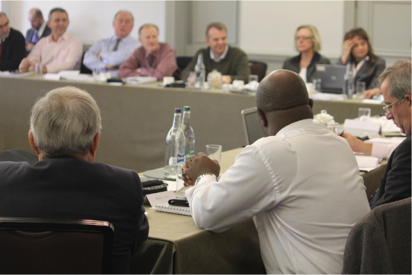
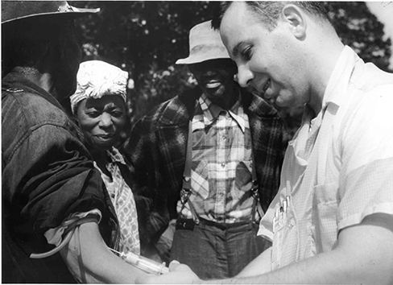
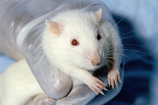

# 2.4 Đạo Đức Nghiên Cứu (Ethics)

> [!info]
>
> ### Mục tiêu học tập
>
> Sau khi học xong mục này, bạn sẽ có khả năng:
>
> - Thảo luận về cách thức các nghiên cứu liên quan đến đối tượng con người được quy định và quản lý.
> - Tóm tắt các quy trình đồng thuận dựa trên thông tin đầy đủ (informed consent) và giải thích sau nghiên cứu (debriefing).
> - Giải thích cách thức các nghiên cứu liên quan đến đối tượng động vật được quy định và quản lý.

Ngày nay, các nhà khoa học đều đồng thuận rằng một nghiên cứu tốt về bản chất phải là một nghiên cứu có đạo đức, được định hướng bởi sự tôn trọng cơ bản đối với nhân phẩm và sự an toàn của con người.
Tuy nhiên, như bạn sẽ đọc trong khung tiêu điểm dưới đây, điều này không phải lúc nào cũng diễn ra trong quá khứ.
Các nhà nghiên cứu hiện đại phải chứng minh rằng những nghiên cứu mà họ tiến hành là hoàn toàn chuẩn mực về mặt đạo đức.
Phần này trình bày cách thức các cân nhắc về đạo đức định hình việc thiết kế và triển khai nghiên cứu được tiến hành ngày nay.

## Nghiên Cứu Có Sự Tham Gia Của Con Người (Research Involving Human Participants)

Bất kỳ thí nghiệm nào có sự tham gia của các đối tượng con người đều phải chịu sự điều chỉnh của các hướng dẫn nghiêm ngặt và toàn diện, được thiết kế nhằm đảm bảo rằng thí nghiệm không gây ra bất kỳ tổn hại nào.
Mọi cơ sở nghiên cứu nhận được sự tài trợ của liên bang cho các nghiên cứu liên quan đến con người đều phải chịu sự giám sát của một **hội đồng thẩm định đạo đức nghiên cứu (institutional review board - IRB)**.
IRB là một ủy ban gồm các cá nhân thường bao gồm các thành viên ban giám hiệu của cơ sở nghiên cứu, các nhà khoa học và các đại diện cộng đồng ([Hình 2.20](#CNX_Psych_02_06_irb)).
Mục đích của IRB là thẩm định các đề cương nghiên cứu có sự tham gia của con người.
IRB xem xét các đề xuất này dựa trên các nguyên tắc đạo đức đã nêu, và nhìn chung, sự phê duyệt của IRB là điều kiện bắt buộc để thí nghiệm có thể được tiến hành.

**Hình 2.20** Hội đồng IRB của một viện nghiên cứu họp định kỳ để thẩm định các đề cương thí nghiệm có sự tham gia của con người. (nguồn: Hiệp hội Thủy điện Quốc tế/Flickr)

Hội đồng IRB của một viện nghiên cứu đòi hỏi một số thành phần bắt buộc trong bất kỳ thí nghiệm nào được phê duyệt.
Thứ nhất, mỗi người tham gia phải ký vào một bản đồng thuận dựa trên thông tin đầy đủ trước khi họ có thể tham gia vào thí nghiệm.
Một bản **đồng thuận dựa trên thông tin đầy đủ (informed consent)** cung cấp một bản mô tả bằng văn bản về những gì người tham gia có thể dự liệu trong suốt quá trình thí nghiệm, bao gồm các rủi ro tiềm ẩn và ý nghĩa của nghiên cứu.
Bản đồng thuận này cũng cho người tham gia biết rằng sự tham gia của họ là hoàn toàn tự nguyện và có thể dừng lại bất cứ lúc nào mà không phải chịu bất kỳ hình phạt nào.
Hơn nữa, bản cam kết đảm bảo rằng mọi dữ liệu thu thập được trong thí nghiệm sẽ được giữ bí mật tuyệt đối.
Trong trường hợp người tham gia nghiên cứu dưới 18 tuổi, cha mẹ hoặc người giám hộ hợp pháp bắt buộc phải ký vào bản đồng thuận này.

> [!tip]
>
> ### Kết nối học tập (Link to Learning)
>
> Hãy xem [mẫu bản đồng thuận tham gia nghiên cứu này](https://openstax.org/l/consentform) để tìm hiểu thêm chi tiết.

Mặc dù bản đồng thuận dựa trên thông tin đầy đủ cần phải trung thực nhất có thể trong việc mô tả chính xác những gì người tham gia sẽ thực hiện, nhưng đôi khi việc đánh lạc hướng có chủ đích lại là cần thiết để ngăn chặn việc người tham gia biết rõ câu hỏi nghiên cứu làm sai lệch kết quả nghiên cứu.
**Đánh lạc hướng có chủ đích (Deception)** bao hàm việc cố ý cung cấp thông tin sai lệch cho người tham gia thí nghiệm nhằm bảo toàn tính toàn vẹn và khách quan của thí nghiệm, nhưng không được vượt quá mức độ có thể bị coi là gây hại.
Chẳng hạn, nếu chúng ta quan tâm đến việc ý kiến của chúng ta về một người bị ảnh hưởng như thế nào bởi trang phục của họ, chúng ta có thể sử dụng biện pháp đánh lạc hướng khi mô tả mục đích thí nghiệm để tránh việc kiến thức đó làm thay đổi câu trả lời tự nhiên của người tham gia.
Trong những trường hợp có sử dụng biện pháp đánh lạc hướng, người tham gia bắt buộc phải nhận được một buổi **giải thích sau nghiên cứu (debriefing)** đầy đủ ngay khi nghiên cứu kết thúc—cung cấp thông tin hoàn chỉnh, trung thực về mục đích thực sự của thí nghiệm, cách thức dữ liệu thu thập được sẽ được sử dụng, lý do vì sao việc đánh lạc hướng là cần thiết, và thông tin về cách để có thêm tài liệu về nghiên cứu.

> [!note]
>
> ### Đào sâu tìm hiểu (Dig Deeper)
>
> #### Đạo Đức Và Nghiên Cứu Giang Mai Tuskegee
>
> Thật đáng tiếc, các hướng dẫn đạo đức hiện hành trong nghiên cứu không phải lúc nào cũng được áp dụng trong quá khứ.
> Vào năm 1932, những người đàn ông da đen ở vùng nông thôn thuộc Tuskegee, bang Alabama, đã được tuyển mộ để tham gia vào một thí nghiệm do Cơ quan Y tế Công cộng Hoa Kỳ tiến hành, với mục đích nghiên cứu bệnh giang mai ở nam giới da đen ([Hình 2.21](#CNX_Psych_02_06_tuskegee)).
> Để đổi lấy việc được chăm sóc y tế miễn phí, các bữa ăn và bảo hiểm mai táng, 600 người đàn ông đã đồng ý tham gia nghiên cứu.
> Hơn một nửa số người này có kết quả xét nghiệm dương tính với bệnh giang mai, và họ đóng vai trò là nhóm thực nghiệm (do các nhà nghiên cứu không thể phân bổ ngẫu nhiên người tham gia vào các nhóm, đây là một nghiên cứu bán thực nghiệm).
> Những người không mắc bệnh giang mai còn lại đóng vai trò là nhóm đối chứng.
> Tuy nhiên, những cá nhân có kết quả xét nghiệm dương tính với giang mai không bao giờ được thông báo rằng họ đã mắc căn bệnh này.
>
> Mặc dù khi nghiên cứu bắt đầu chưa có phương pháp điều trị giang mai, nhưng đến năm 1947, penicillin đã được công nhận là một phương pháp điều trị hiệu quả cho căn bệnh này.
> Bất chấp điều đó, không có liều penicillin nào được dùng cho những người tham gia nghiên cứu này, và họ cũng không được phép tìm kiếm điều trị tại bất kỳ cơ sở y tế nào khác nếu vẫn tiếp tục tham gia nghiên cứu.
> Trong suốt chiều dài 40 năm, nhiều người tham gia đã vô tình lây truyền bệnh giang mai cho vợ của họ (và sau đó là cho những đứa con do vợ họ sinh ra) và cuối cùng qua đời vì không bao giờ được điều trị căn bệnh này.
> Nghiên cứu này chỉ dừng lại vào năm 1972 khi thí nghiệm bị báo chí toàn quốc phát hiện và phanh phui (Đại học Tuskegee, n.d.).
> Làn sóng phẫn nộ dữ dội của công chúng sau thí nghiệm đã trực tiếp dẫn tới sự ra đời của Đạo luật Nghiên cứu Quốc gia năm 1974 và các hướng dẫn đạo đức nghiêm ngặt đối với nghiên cứu trên con người được mô tả trong chương này.
> Tại sao nghiên cứu này lại là vô đạo đức?
> Những người đàn ông tham gia và gia đình của họ đã bị tổn hại nghiêm trọng như thế nào từ nghiên cứu này?
>
> 
>
> 
>
> **Hình 2.21** Một người tham gia trong **Nghiên cứu Giang mai Tuskegee (Tuskegee Syphilis Study)** đang tiếp nhận một mũi tiêm.

> [!tip]
>
> ### Kết nối học tập (Link to Learning)
>
> Hãy truy cập [trang web về Nghiên cứu Giang mai Tuskegee](https://openstax.org/l/tuskegee) để tìm hiểu thêm.

## Nghiên Cứu Có Sự Tham Gia Của Đối Tượng Động Vật (Research Involving Animal Subjects)

Nhiều nhà tâm lý học tiến hành nghiên cứu trên các đối tượng động vật.
Thông thường, các nhà nghiên cứu sử dụng loài gặm nhấm ([Hình 2.22](#CNX_Psych_02_06_rat)) hoặc chim làm đối tượng cho các thí nghiệm của họ—APA ước tính rằng 90% các **nghiên cứu trên động vật (animal research)** trong tâm lý học sử dụng các loài này (Hiệp hội Tâm lý học Hoa Kỳ, n.d.).
Bởi vì nhiều tiến trình cơ bản ở động vật có sự tương đồng đáng kể với con người, những loài động vật này là đối tượng thay thế được chấp nhận cho các nghiên cứu vốn bị coi là vô đạo đức nếu thực hiện trên người tham gia.

**Hình 2.22** Chuột cống, giống như con được hiển thị ở đây, thường đóng vai trò là đối tượng trong các nghiên cứu trên động vật.

Điều này không có nghĩa là các nhà nghiên cứu động vật được miễn trừ khỏi các mối quan tâm về đạo đức.
Thật vậy, việc đối xử nhân đạo và có đạo đức với các đối tượng động vật thí nghiệm là một khía cạnh tối quan trọng của dạng nghiên cứu này.
Các nhà nghiên cứu phải thiết kế các thí nghiệm của mình sao cho giảm thiểu tối đa mọi nỗi đau đớn hoặc sự đau khổ mà các con vật phải gánh chịu.

Trong khi hội đồng IRB thẩm định các đề cương nghiên cứu liên quan đến con người, thì các đề xuất thí nghiệm trên động vật lại được thẩm định bởi một **Ủy ban Chăm sóc và Sử dụng Động vật Thực nghiệm (Institutional Animal Care and Use Committee - IACUC)**.
Một IACUC bao gồm các nhà quản lý cơ sở, các nhà khoa học, các bác sĩ thú y và các đại diện cộng đồng.
Ủy ban này có nhiệm vụ đảm bảo rằng tất cả các đề xuất thí nghiệm đều yêu cầu sự đối xử nhân đạo đối với động vật thí nghiệm.
Ủy ban cũng tiến hành các đợt thanh tra định kỳ 6 tháng một lần đối với tất cả các cơ sở nuôi giữ động vật để đảm bảo các quy trình nghiên cứu được tuân thủ nghiêm ngặt.
Không có một dự án nghiên cứu trên động vật nào có thể được tiến hành nếu không có sự phê duyệt chính thức của ủy ban này.
