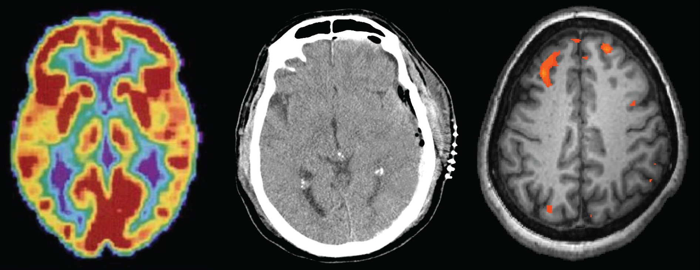

# Giới Thiệu (Introduction)

**Hình 3.1** Các kỹ thuật chẩn đoán hình ảnh não bộ khác nhau mang lại cho các nhà khoa học cái nhìn sâu sắc về những khía cạnh khác nhau trong cách thức bộ não con người vận hành. Từ trái sang phải: chụp PET (ghi hình cắt lớp phát xạ positron), chụp CT (chụp cắt lớp vi tính), và fMRI (chụp cộng hưởng từ chức năng) là ba dạng quét não bộ phổ biến. (nguồn ảnh “trái”: chỉnh sửa từ tư liệu của Bộ Y tế và Dịch vụ Nhân sinh, Viện Y tế Quốc gia Hoa Kỳ; ảnh “giữa”: chỉnh sửa từ tác phẩm của "Aceofhearts1968"/Wikimedia Commons; ảnh “phải”: chỉnh sửa từ công trình của Kim J, Matthews NL, Park S.)

## Đề Cương Chương Học (Chapter Outline)

- [3.1 Di Truyền Học Ở Người](01-3-1-human-genetics.md)
- [3.2 Các Tế Bào Của Hệ Thần Kinh](02-3-2-cells-of-the-nervous-system.md)
- [3.3 Các Bộ Phận Của Hệ Thần Kinh](03-3-3-parts-of-the-nervous-system.md)
- [3.4 Não Bộ Và Tủy Sống](04-3-4-the-brain-and-spinal-cord.md)
- [3.5 Hệ Nội Tiết](05-3-5-the-endocrine-system.md)

Bạn đã bao giờ tháo rời một thiết bị điện tử để tìm hiểu xem nó hoạt động như thế nào chưa?
Rất nhiều người trong chúng ta từng làm điều đó, dù là để thử sửa chữa hay chỉ đơn giản là để thỏa mãn trí tò mò.
Cơ chế vận hành bên trong của một thiết bị thường hoàn toàn tách biệt với giao diện người dùng bên ngoài của nó.
Chẳng hạn, chúng ta không hề nghĩ về các vi mạch và vi xử lý khi tăng âm lượng trên điện thoại di động; thay vào đó, chúng ta chỉ nghĩ đến việc điều chỉnh âm lượng sao cho vừa vặn.
Tương tự như vậy, các hoạt động sinh học bên trong cơ thể con người thường khác biệt rất nhiều so với biểu hiện bên ngoài của các hoạt động đó.
Nhiệm vụ của các nhà tâm lý học là tìm ra mối liên hệ kết nối giữa chúng—ví dụ, làm thế nào để sự phát xung điện thế của hàng triệu tế bào thần kinh (nơ-ron) chuyển hóa thành một suy nghĩ hay ý niệm trong tâm trí.

Chương này nỗ lực giải thích các cơ chế sinh học làm nền tảng cho hành vi.
Những nền tảng giải phẫu học và sinh lý học này chính là cơ sở cho rất nhiều phân ngành tâm lý học khác nhau.
Trong chương này, bạn sẽ tìm hiểu cách thức di truyền học ảnh hưởng đến cả các đặc điểm sinh lý lẫn đặc điểm tâm lý.
Bạn sẽ làm quen với cấu trúc và chức năng của hệ thần kinh.
Và cuối cùng, bạn sẽ hiểu được cách hệ thần kinh tương tác và phối hợp chặt chẽ với hệ nội tiết.
