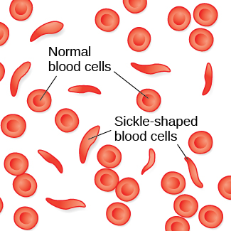
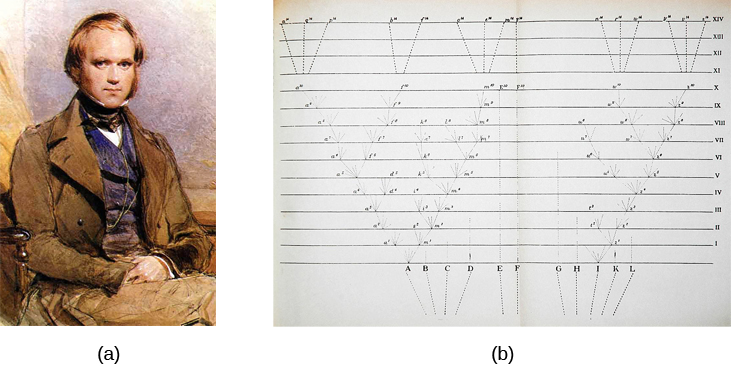
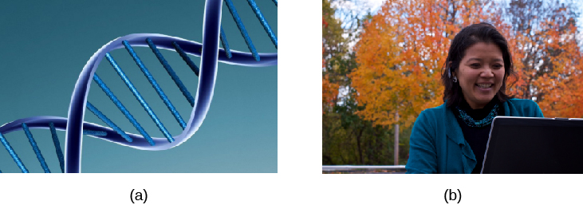
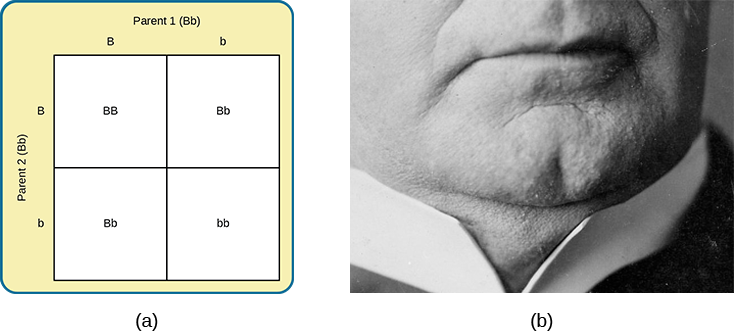
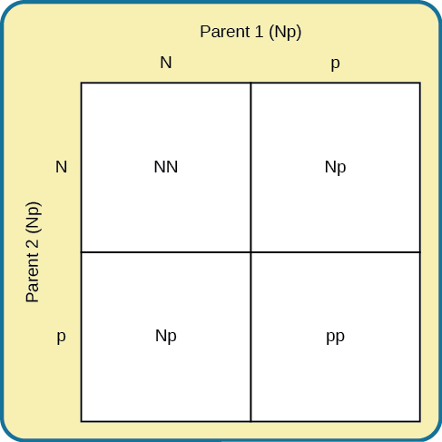
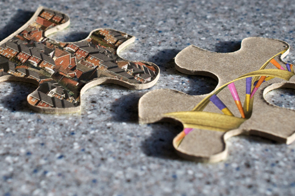

# 3.1 Di Truyền Học Ở Người (Human Genetics)

> [!info]
>
> ### Mục tiêu học tập
>
> Sau khi học xong mục này, bạn sẽ có khả năng:
>
> - Giải thích các nguyên lý cơ bản của thuyết tiến hóa thông qua chọn lọc tự nhiên.
> - Mô tả sự khác biệt giữa kiểu gen (genotype) và kiểu hình (phenotype).
> - Thảo luận về tầm quan trọng của các tương tác giữa gen và môi trường đối với sự biểu hiện của các đặc điểm thể chất và tâm lý.

Các nhà nghiên cứu tâm lý học nghiên cứu di truyền học nhằm tìm hiểu rõ hơn về các yếu tố sinh học góp phần định hình nên những hành vi nhất định.
Mặc dù tất cả con người đều chia sẻ những cơ chế sinh học tương đồng, mỗi chúng ta lại là một cá thể độc nhất vô nhị.
Và dù cơ thể chúng ta có nhiều bộ phận tương tự nhau—não bộ, hoóc-môn và các tế bào chứa mã di truyền—những yếu tố này lại được biểu hiện ra bên ngoài thành muôn vàn hành vi, suy nghĩ và phản ứng cảm xúc phong phú, đa dạng.

Tại sao hai người cùng nhiễm một căn bệnh lại có kết cục hoàn toàn khác nhau: một người sống sót còn một người lại không qua khỏi?
Các bệnh lý di truyền được truyền qua các thế hệ trong gia đình như thế nào?
Liệu có những thành phần di truyền dẫn đến các rối loạn tâm lý như trầm cảm hay tâm thần phân liệt hay không?
Và ở mức độ nào thì các tình trạng sức khỏe như béo phì ở trẻ em có một nền tảng tâm lý học làm căn nguyên?

Để khám phá những câu hỏi này, chúng ta hãy bắt đầu bằng việc tập trung vào một chứng rối loạn di truyền cụ thể: bệnh thiếu máu hồng cầu hình liềm (sickle-cell anemia), và cách thức nó biểu hiện ở hai chị em ruột cùng chịu ảnh hưởng.
Thiếu máu hồng cầu hình liềm là một bệnh lý di truyền trong đó các tế bào hồng cầu—vốn bình thường có hình đĩa tròn lõm hai mặt—lại biến dạng thành hình lưỡi liềm ([Hình 3.2](#CNX_Psych_03_01_SickleCell)).
Sự thay đổi hình dạng của các tế bào này làm ảnh hưởng nghiêm trọng đến chức năng của chúng: các tế bào hình liềm có thể vón cục gây tắc nghẽn mạch máu và cản trở dòng chảy của máu, dẫn đến sốt cao, đau đớn dữ dội, sưng phù và tổn thương mô tế bào.

**Hình 3.2** Các tế bào hồng cầu bình thường di chuyển tự do qua các mạch máu, trong khi các tế bào hình liềm tạo thành những khối tắc nghẽn ngăn cản dòng lưu thông của máu.

Nhiều người mắc bệnh thiếu máu hồng cầu hình liềm—và mang đột biến gen đặc thù gây ra căn bệnh này—thường qua đời ở độ tuổi còn rất trẻ.
Mặc dù khái niệm "sống sót của cá thể thích nghi nhất" (survival of the fittest) có thể gợi ý rằng những người mắc chứng rối loạn này có tỷ lệ sống sót thấp và do đó căn bệnh sẽ dần trở nên ít phổ biến hơn qua các thế hệ, nhưng thực tế lại không phải như vậy.
Bất chấp những tác động tiêu cực về mặt tiến hóa gắn liền với đột biến di truyền này, gen tế bào hình liềm vẫn tương đối phổ biến ở những người có nguồn gốc gốc Phi.
Vì sao lại có hiện tượng kỳ lạ này?
Lời giải thích được minh họa qua tình huống giả định sau.

Hãy tưởng tượng hai người phụ nữ trẻ—Luwi và Sena—là hai chị em ruột sống ở vùng nông thôn Zambia thuộc châu Phi.
Luwi mang gen thiếu máu hồng cầu hình liềm; Sena không mang gen này.
Những người mang gen hồng cầu hình liềm chỉ sở hữu một bản sao của gen bệnh nhưng không mắc bệnh thiếu máu hồng cầu hình liềm toàn phát.
Họ chỉ biểu hiện các triệu chứng khi cơ thể bị mất nước nghiêm trọng hoặc bị thiếu dưỡng khí (chẳng hạn như khi leo núi cao).
Những người mang gen này được phát hiện là có khả năng miễn nhiễm với bệnh sốt rét (một căn bệnh nhiệt đới nguy hiểm thường gây tử vong và rất phổ biến) bởi vì những thay đổi trong hóa học máu và chức năng miễn dịch của họ đã ngăn chặn ký sinh trùng sốt rét phát triển và gây bệnh (Gong, Parikh, Rosenthal, & Greenhouse, 2013).
Tuy nhiên, người mắc bệnh thiếu máu hồng cầu hình liềm toàn phát (sở hữu cả hai bản sao của gen bệnh) lại không có được khả năng miễn dịch này trước bệnh sốt rét.

Khi đang đi bộ từ trường về nhà, cả hai chị em đều bị muỗi mang ký sinh trùng sốt rét đốt.
Luwi được bảo vệ khỏi căn bệnh sốt rét vì cô mang đột biến hồng cầu hình liềm.
Ngược lại, Sena mắc bệnh sốt rét và qua đời chỉ hai tuần sau đó.
Luwi sống sót, trưởng thành và sinh con, truyền đột biến hồng cầu hình liềm lại cho thế hệ sau.

> [!tip]
>
> ### Kết nối học tập (Link to Learning)
>
> Hãy truy cập [trang web về cách đột biến trong DNA dẫn đến bệnh thiếu máu hồng cầu hình liềm](https://openstax.org/l/sickle1) để tìm hiểu thêm chi tiết.

Bệnh sốt rét rất hiếm gặp ở Hoa Kỳ, vì vậy gen hồng cầu hình liềm không mang lại lợi ích cho bất kỳ ai tại đây: gen này chủ yếu biểu hiện thành các vấn đề sức khỏe nhẹ đối với người mang một bản sao, hoặc thành căn bệnh hiểm nghèo toàn phát không hề có lợi ích sức khỏe nào đối với người mang hai bản sao.
Tuy nhiên, tình hình lại hoàn toàn khác biệt ở những nơi khác trên thế giới.
Tại các vùng châu Phi nơi bệnh sốt rét hoành hành, việc mang đột biến gen tế bào hình liềm lại thực sự mang lại lợi ích sinh tồn to lớn cho người mang gen (bảo vệ họ khỏi bệnh sốt rét tử thần).

Câu chuyện về bệnh sốt rét hoàn toàn phù hợp với **thuyết tiến hóa thông qua chọn lọc tự nhiên (theory of evolution by natural selection)** của Charles Darwin ([Hình 3.3](#CNX_Psych_03_01_Darwin)).
Nói một cách đơn giản, học thuyết khẳng định rằng các sinh vật thích nghi tốt hơn với môi trường sống của mình sẽ sống sót và sinh sản, trong khi những sinh vật kém thích nghi hơn sẽ bị đào thải và diệt vong.
Trong ví dụ của chúng ta, chúng ta có thể thấy rằng với tư cách là một người mang gen dị hợp tử, đột biến của Luwi có tính thích nghi rất cao tại quê hương châu Phi của cô; tuy nhiên, nếu cô sinh sống tại Hoa Kỳ (nơi bệnh sốt rét rất hiếm gặp), đột biến của cô có thể trở thành một gánh nặng—với nguy cơ mắc bệnh cao ở đời con cái và những phiền toái sức khỏe nhỏ cho chính bản thân cô.

**Hình 3.3** (a) Năm 1859, Charles Darwin đề xuất thuyết tiến hóa thông qua chọn lọc tự nhiên trong cuốn sách kinh điển của mình: *Nguồn gốc các loài* (On the Origin of Species). (b) Cuốn sách chỉ chứa duy nhất một hình minh họa: sơ đồ này thể hiện cách thức các loài tiến hóa theo thời gian thông qua chọn lọc tự nhiên.

> [!note]
>
> ### Đào sâu tìm hiểu (Dig Deeper)
>
> #### Hai Góc Nhìn Về Di Truyền Và Hành Vi
>
> Rất dễ bị nhầm lẫn giữa hai lĩnh vực cùng nghiên cứu về sự tương tác giữa gen và môi trường: **tâm lý học tiến hóa (evolutionary psychology)** và **di truyền học hành vi (behavioral genetics)**.
> Làm thế nào chúng ta có thể phân biệt được chúng?
>
> Ở cả hai lĩnh vực, người ta đều hiểu rằng gen không chỉ mã hóa cho các đặc điểm thể chất cụ thể, mà còn đóng góp vào các khuôn mẫu nhận thức và hành vi nhất định.
> Tâm lý học tiến hóa tập trung vào việc tìm hiểu cách thức các khuôn mẫu hành vi và tiến trình nhận thức mang tính phổ quát đã tiến hóa như thế nào qua hàng triệu năm.
> Do đó, những biến dị trong nhận thức và hành vi sẽ giúp các cá nhân thành công hơn hoặc kém thành công hơn trong việc sinh sản và truyền lại các gen đó cho con cháu.
> Các nhà tâm lý học tiến hóa nghiên cứu nhiều hiện tượng tâm lý có thể đã tiến hóa như những cơ chế thích nghi, bao gồm phản ứng sợ hãi, sở thích ăn uống, việc lựa chọn bạn đời và các hành vi hợp tác xã hội (Confer et al., 2010).
>
> Trong khi các nhà tâm lý học tiến hóa tập trung vào các khuôn mẫu phổ quát tiến hóa qua hàng triệu năm, thì các nhà di truyền học hành vi lại nghiên cứu cách thức những khác biệt giữa các cá thể nảy sinh ở hiện tại thông qua sự tương tác giữa gen và môi trường.
> Khi nghiên cứu hành vi con người, các nhà di truyền học hành vi thường sử dụng các nghiên cứu trên cặp song sinh và nghiên cứu con nuôi.
> Nghiên cứu song sinh so sánh khả năng mà một đặc điểm hành vi nhất định được chia sẻ giữa các cặp song sinh cùng trứng và song sinh khác trứng; nghiên cứu con nuôi so sánh tỷ lệ đó giữa những người thân có quan hệ huyết thống sinh học và những người thân nhận nuôi.
> Cả hai phương pháp tiếp cận đều đem lại những hiểu biết sâu sắc về tầm quan trọng tương đối của gen và môi trường đối với sự biểu hiện của một đặc điểm nhất định.

> [!tip]
>
> ### Kết nối học tập (Link to Learning)
>
> Hãy xem [cuộc phỏng vấn với nhà tâm lý học tiến hóa nổi tiếng David Buss](https://openstax.org/l/buss) để tìm hiểu thêm về cách một nhà tâm lý học tiếp cận sự tiến hóa và cách phương pháp tiếp cận này hòa hợp với các khoa học xã hội.

## Biến Dị Di Truyền (Genetic Variation)

Biến dị di truyền—sự khác biệt về gen giữa các cá thể—là yếu tố đóng góp vào khả năng thích nghi của một loài đối với môi trường sống của nó.
Ở con người, biến dị di truyền bắt đầu từ một tế bào trứng, khoảng 100 triệu tinh trùng và quá trình thụ tinh.
Khoảng mỗi tháng một lần, buồng trứng hoạt động sẽ phóng thích một quả trứng từ các nang trứng.
Trong hành trình của trứng từ buồng trứng qua ống dẫn trứng (vòi tử cung) tới tử cung, một tinh trùng có thể thụ tinh cho trứng.

Tế bào trứng và tinh trùng mỗi loại chứa 23 nhiễm sắc thể.
**Nhiễm sắc thể (Chromosomes)** là những chuỗi vật chất di truyền dài được gọi là **axit deoxyribonucleic (DNA)**.
DNA là một phân tử có cấu trúc xoắn kép được tạo thành từ các cặp bazơ nucleotide.
Trên mỗi nhiễm sắc thể, các chuỗi DNA cấu tạo nên các **gen (genes)** có chức năng kiểm soát toàn bộ hoặc một phần các đặc điểm nhìn thấy được, gọi là tính trạng, chẳng hạn như màu mắt, màu tóc, v.v. Một gen đơn lẻ có thể có nhiều biến thể khả dĩ khác nhau, gọi là các alen.
Một **alen (allele)** là một phiên bản cụ thể của một gen.
Như vậy, một gen nhất định có thể mã hóa cho tính trạng màu tóc, và các alen khác nhau của gen đó sẽ quyết định cá nhân đó sở hữu màu tóc nào.

Khi tinh trùng và trứng kết hợp với nhau, 23 nhiễm sắc thể của mỗi bên kết hợp lại để tạo thành một hợp tử với 46 nhiễm sắc thể (23 cặp).
Do đó, mỗi người cha người mẹ đóng góp một nửa thông tin di truyền cho thế hệ con cái; các đặc điểm thể chất biểu hiện ra bên ngoài của đứa trẻ (gọi là kiểu hình) được quyết định bởi sự tương tác của vật chất di truyền được cung cấp từ tinh trùng và trứng (gọi là kiểu gen).
**Kiểu gen (genotype)** của một người là toàn bộ thành phần cấu tạo di truyền của cá nhân đó.
Mặt khác, **kiểu hình (Phenotype)** đề cập đến các đặc điểm thể chất quan sát được của cá nhân, vốn là sự kết hợp giữa các ảnh hưởng di truyền và các tác động từ môi trường ([Hình 3.4](#CNX_Psych_03_01_GenoPheno)).

**Hình 3.4** (a) Kiểu gen đề cập đến thành phần di truyền của một cá nhân dựa trên vật chất di truyền (DNA) được thừa hưởng từ những người đóng góp di truyền. (b) Kiểu hình mô tả các đặc điểm quan sát được của một cá nhân, chẳng hạn như màu tóc, màu da, chiều cao và vóc dáng. (nguồn ảnh a: chỉnh sửa từ tác phẩm của Caroline Davis; ảnh b: chỉnh sửa từ tác phẩm của Cory Zanker)

Lưu ý rằng trong di truyền học và sinh sản, thuật ngữ "cha mẹ" (parent) thường được sử dụng để mô tả các cá thể sinh vật đóng góp vật chất di truyền cho thế hệ sau dưới dạng các tế bào giao tử (tinh trùng và trứng).
Khái niệm về cha mẹ di truyền học có sự tách biệt với các khái niệm xã hội và pháp lý về quan hệ cha mẹ, và có thể khác biệt so với những người mà một cá nhân coi là cha mẹ nuôi dưỡng của mình.

Hầu hết các tính trạng đều được kiểm soát bởi nhiều gen, nhưng cũng có những tính trạng chỉ do một gen duy nhất kiểm soát.
Một đặc điểm như **cằm chẻ (cleft chin)** là một ví dụ, được quy định bởi một gen đơn lẻ nhận từ mỗi bên cha mẹ.
Trong ví dụ này, chúng ta gọi gen cằm chẻ là "B", và gen cằm phẳng (cằm không chẻ) là "b".
Cằm chẻ là một tính trạng trội, có nghĩa là việc sở hữu **alen trội (dominant allele)** nhận từ một bên cha mẹ (Bb) hoặc cả hai bên cha mẹ (BB) sẽ luôn dẫn đến kiểu hình cằm chẻ gắn liền với alen trội đó.
Khi một người có hai bản sao của cùng một alen, họ được gọi là **đồng hợp tử (homozygous)** về alen đó.
Khi một người có sự kết hợp của các alen khác nhau cho một gen nhất định, họ được gọi là **dị hợp tử (heterozygous)**.
Ví dụ, cằm phẳng là một tính trạng lặn, nghĩa là một cá nhân sẽ chỉ biểu hiện kiểu hình cằm phẳng nếu họ đồng hợp tử về **alen lặn (recessive allele)** đó (bb).

Hãy tưởng tượng một người có cằm chẻ kết đôi với một người có cằm phẳng.
Con cái của họ sẽ có kiểu cằm nào?
Câu trả lời phụ thuộc vào việc mỗi bên cha mẹ mang những alen nào.
Nếu người có cằm chẻ là đồng hợp tử về cằm chẻ (BB), con cái của họ sẽ luôn luôn có cằm chẻ.
Tuy nhiên, mọi chuyện sẽ phức tạp hơn đôi chút nếu người đó là dị hợp tử về gen này (Bb).
Do người kia có cằm phẳng—tức là đồng hợp tử về alen lặn (bb)—chúng ta có thể dự đoán rằng con cái sẽ có 50% cơ hội có cằm chẻ và 50% cơ hội có cằm phẳng ([Hình 3.5](#CNX_Psych_03_01_Punnett1)).

**Hình 3.5** (a) Một **khung Punnett (Punnett square)** là một công cụ được sử dụng để dự đoán cách thức các gen sẽ tương tác với nhau trong việc sinh ra đời con. Chữ B in hoa đại diện cho alen trội, và chữ b in thường đại diện cho alen lặn. Trong ví dụ về cằm chẻ, trong đó B là cằm chẻ (alen trội), ở bất kỳ tổ hợp nào chứa alen trội B, bạn có thể dự đoán kiểu hình cằm chẻ xuất hiện. Bạn chỉ có thể thấy kiểu hình cằm phẳng khi có hai bản sao của alen lặn: bb. (b) Chiếc cằm chẻ được hiển thị ở đây là một tính trạng di truyền.

Trong bệnh thiếu máu hồng cầu hình liềm, những người mang gen dị hợp tử (như Luwi trong ví dụ trước) có thể phát triển khả năng đề kháng máu trước sự lây nhiễm của bệnh sốt rét, trong khi những người đồng hợp tử không mang đột biến (như Sena) có thể mắc bệnh sốt rét—một căn bệnh nhiễm trùng máu nguy hiểm tính mạng.
Những người đồng hợp tử khác (khi có hai bản sao của gen tế bào hình liềm) lại mắc bệnh thiếu máu hồng cầu hình liềm toàn phát.
Thiếu máu hồng cầu hình liềm chỉ là một trong rất nhiều chứng rối loạn di truyền gây ra bởi sự kết hợp của hai gen lặn.
Chẳng hạn, **phenylketonuria (PKU)** là một bệnh lý trong đó cá nhân bị thiếu hụt một loại enzyme vốn có chức năng chuyển hóa các axit amin có hại thành các sản phẩm phụ vô hại.
Nếu một người mắc tình trạng này không được phát hiện và điều trị kịp thời, họ sẽ phải chịu những khiếm khuyết nghiêm trọng về chức năng nhận thức, co giật và gia tăng nguy cơ mắc các rối loạn tâm thần khác nhau.
Vì PKU là một tính trạng lặn, mỗi bên cha mẹ bắt buộc phải có ít nhất một bản sao của alen lặn thì mới có thể sinh ra một đứa con mắc bệnh này ([Hình 3.6](#CNX_Psych_03_01_Punnett2)).

Cho đến nay, chúng ta đã thảo luận về các tính trạng chỉ liên quan đến một gen đơn lẻ, nhưng rất ít đặc điểm của con người chỉ do một gen duy nhất kiểm soát.
Hầu hết các tính trạng đều mang tính **đa gen (polygenic)**: được kiểm soát bởi nhiều hơn một gen.
Chiều cao là một ví dụ điển hình về tính trạng đa gen, cũng như màu da và cân nặng.

**Hình 3.6** Trong **khung Punnett (Punnett square)** này, chữ N đại diện cho alen bình thường, và chữ p đại diện cho alen lặn gắn liền với bệnh PKU. Nếu hai cá nhân kết đôi mà cả hai đều là dị hợp tử về alen liên quan đến PKU (Np), con cái của họ sẽ có 25% cơ hội biểu hiện kiểu hình bệnh PKU (pp).

Những gen có hại gây ra các căn bệnh như PKU bắt nguồn từ đâu?
Đột biến gen chính là một nguồn gốc sinh ra các gen có hại.
Một **đột biến (mutation)** là một biến đổi đột ngột và vĩnh viễn trong một gen.
Mặc dù nhiều đột biến có thể gây hại hoặc gây chết non, nhưng thỉnh thoảng, một đột biến lại mang lại lợi ích cho một cá nhân bằng cách tạo cho người đó một lợi thế sinh tồn so với những người không có đột biến đó.
Hãy nhớ lại rằng thuyết tiến hóa khẳng định rằng những cá thể thích nghi tốt nhất với môi trường sống cụ thể của mình có nhiều khả năng sinh sản và truyền lại các gen của mình cho các thế hệ tương lai.
Để tiến trình này diễn ra, bắt buộc phải có sự cạnh tranh—nói một cách kỹ thuật hơn, phải có tính biến dị trong các gen (và các tính trạng hình thành từ đó) cho phép sự biến thiên trong khả năng thích nghi với môi trường.
Nếu một quần thể chỉ bao gồm các cá thể hoàn toàn giống hệt nhau, thì bất kỳ sự thay đổi đột ngột nào của môi trường cũng sẽ ảnh hưởng đến tất cả mọi người theo cùng một cách, và sẽ không có sự khác biệt nào để chọn lọc tự nhiên hoạt động.
Ngược lại, sự đa dạng phong phú trong các gen và các tính trạng liên quan cho phép một số cá nhân thể hiện tốt hơn một chút so với những người khác khi đối mặt với sự thay đổi của môi trường.
Điều này tạo ra một lợi thế rõ rệt cho những cá nhân thích nghi tốt nhất với môi trường về mặt sinh sản thành công và duy trì dòng giống di truyền.

> [!note]
>
> ### Đào sâu tìm hiểu (Dig Deeper)
>
> #### Sự Đa Dạng Của Con Người
>
> Chương này tập trung vào sinh học.
> Sau này trong khóa học, bạn sẽ học về tâm lý học xã hội và các vấn đề về chủng tộc, định kiến và phân biệt đối xử.
> Khi chúng ta tập trung nghiêm ngặt vào sinh học thuần túy, khái niệm "chủng tộc" trở thành một cấu trúc rất yếu ớt.
> Sau khi bộ gen người được giải trình tự vào đầu thiên niên kỷ mới, nhiều nhà khoa học bắt đầu lập luận rằng chủng tộc không phải là một biến số hữu ích trong nghiên cứu di truyền học và việc tiếp tục sử dụng nó là một nguồn cơn tiềm ẩn gây hiểu lầm và tổn hại.
> Các phân loại chủng tộc mà một số người từng tin là hữu ích trong việc nghiên cứu sự đa dạng di truyền ở người phần lớn là không có cơ sở khoa học xác đáng.
> Màu da, màu mắt và kết cấu tóc của một người là kết quả của thành phần di truyền của họ, nhưng trên thực tế, sự biến dị di truyền bên trong cùng một nhóm chủng tộc lại lớn hơn nhiều so với sự biến dị di truyền giữa các nhóm chủng tộc khác nhau.
> Trong một số trường hợp, việc quá chú trọng vào chủng tộc đã dẫn đến những khó khăn trong việc chẩn đoán sai hoặc bỏ sót chẩn đoán đối với các căn bệnh từ thiếu máu hồng cầu hình liềm đến bệnh xơ nang.
> Một số học giả lập luận rằng chúng ta cần phân biệt rõ ràng giữa nguồn gốc tổ tiên (ancestry) và chủng tộc xã hội (race), và sau đó tập trung vào nguồn gốc tổ tiên.
> Cách tiếp cận này sẽ tạo điều kiện thuận lợi cho việc hiểu biết sâu sắc hơn về sự đa dạng di truyền đích thực của con người (Yudell, Roberts, DeSalle, & Tishkoff, 2016).

## Tương Tác Giữa Gen Và Môi Trường (Gene-Environment Interactions)

Các gen không hề tồn tại trong một môi trường chân không cô lập.
Mặc dù tất cả chúng ta đều là những sinh vật sinh học, chúng ta cũng tồn tại trong một môi trường sống vốn đóng vai trò vô cùng quan trọng trong việc quyết định không chỉ thời điểm và cách thức các gen biểu hiện ra bên ngoài, mà còn dưới những sự kết hợp nào.
Mỗi người trong chúng ta đại diện cho một sự tương tác độc nhất vô nhị giữa thành phần di truyền và môi trường sống của mình; khái niệm phạm vi phản ứng là một cách để mô tả sự tương tác này.
**Phạm vi phản ứng (Range of reaction)** khẳng định rằng các gen của chúng ta thiết lập nên những ranh giới tiềm năng mà trong đó chúng ta có thể hoạt động, và môi trường sống sẽ tương tác với các gen để quyết định xem chúng ta sẽ rơi vào vị trí nào trong phạm vi ranh giới đó.
Chẳng hạn, nếu cấu trúc di truyền của một cá nhân khiến họ có tiềm năng trí tuệ bẩm sinh rất cao và họ được nuôi dưỡng trong một môi trường phong phú, giàu kích thích giáo dục, thì họ sẽ có nhiều khả năng đạt được toàn bộ tiềm năng trí tuệ của mình hơn so với khi họ bị nuôi lớn trong điều kiện thiếu thốn nghiêm trọng.
Theo khái niệm phạm vi phản ứng, gen đặt ra các giới hạn nhất định đối với tiềm năng, và môi trường quyết định mức độ bao nhiêu của tiềm năng đó được hiện thực hóa.
Một số học giả không đồng tình với lý thuyết này và lập luận rằng gen không hề đặt ra một giới hạn cứng nhắc cho tiềm năng của con người mà các chuẩn mực phản ứng được quyết định linh hoạt bởi môi trường.
Chẳng hạn, khi các cá nhân trải qua sự bỏ bê hoặc bạo hành trong thời thơ ấu, họ có nhiều khả năng biểu hiện các vấn đề tâm lý hoặc thể chất bất lợi kéo dài suốt cuộc đời.
Những tình trạng này có thể phát triển như một hệ quả của các trải nghiệm tiêu cực từ môi trường ở các cá nhân có nền tảng di truyền hoàn toàn khác nhau (Miguel, Pereira, Silveira, & Meaney, 2019; Short & Baram, 2019).

Một góc nhìn khác về sự tương tác giữa gen và môi trường là khái niệm **tương quan di truyền - môi trường (genetic environmental correlation)**.
Nói một cách đơn giản, gen của chúng ta ảnh hưởng đến môi trường sống của chúng ta, và môi trường lại tác động ngược trở lại sự biểu hiện của các gen ([Hình 3.7](#CNX_Psych_03_01_GeneEnviro)).
Gen và môi trường không chỉ tương tác với nhau như trong phạm vi phản ứng, mà chúng còn tác động qua lại lẫn nhau theo hai chiều.
Chẳng hạn, con của một vận động viên bóng rổ NBA chuyên nghiệp rất có thể sẽ được tiếp xúc với quả bóng rổ ngay từ khi còn rất nhỏ.
Sự tiếp xúc sớm đó có thể giúp đứa trẻ nhận ra và phát huy tối đa tiềm năng thể thao bẩm sinh từ gen di truyền của mình.
Do đó, gen của cha mẹ (mà đứa trẻ thừa hưởng) ảnh hưởng đến môi trường sống của đứa trẻ, và môi trường đó đến lượt nó lại rất phù hợp để nâng đỡ và phát triển tiềm năng di truyền của đứa trẻ.

**Hình 3.7** Bản chất tự nhiên (bẩm sinh di truyền) và sự nuôi dưỡng (môi trường) phối hợp với nhau như những mảnh ghép phức tạp trong bức tranh ghép hình của con người. Sự tương tác giữa môi trường và gen tạo nên chính con người độc đáo của chúng ta. (nguồn “mảnh ghép”: chỉnh sửa từ tác phẩm của Cory Zanker)

Trong một phương pháp tiếp cận khác đối với các tương tác gen - môi trường, lĩnh vực **di truyền học biểu sinh (epigenetics)** nhìn vượt ra ngoài bản thân kiểu gen và nghiên cứu cách thức cùng một kiểu gen lại có thể được biểu hiện ra thành nhiều kiểu hình khác nhau.
Nói cách khác, các nhà nghiên cứu tìm hiểu cách thức cùng một kiểu gen có thể dẫn đến những kiểu hình rất khác biệt.
Như đã đề cập ở phần trước, sự biểu hiện của gen thường chịu ảnh hưởng của bối cảnh môi trường theo những cách không hoàn toàn hiển nhiên.
Chẳng hạn, các cặp song sinh cùng trứng chia sẻ cùng một thông tin di truyền giống hệt nhau (**sinh đôi cùng trứng (identical twins)** phát triển từ một tế bào trứng được thụ tinh duy nhất tự phân đôi, vì vậy vật chất di truyền là hoàn toàn giống nhau ở mỗi người; ngược lại, **sinh đôi khác trứng (fraternal twins)** thường hình thành từ hai quả trứng khác nhau được thụ tinh bởi hai tinh trùng khác nhau, vì vậy vật chất di truyền có sự khác biệt tương tự như các anh chị em ruột thông thường).
Nhưng ngay cả với các gen giống hệt nhau, vẫn tồn tại một mức độ biến thiên đáng kinh ngạc trong cách thức sự biểu hiện gen diễn ra trong suốt cuộc đời của mỗi người trong cặp song sinh.
Đôi khi, một người trong cặp song sinh mắc một căn bệnh hiểm nghèo trong khi người kia lại hoàn toàn khỏe mạnh.
Trong một ví dụ, Aliya—một người trong cặp song sinh cùng trứng—đã qua đời vì bệnh ung thư ở tuổi lên 7, nhưng người chị em sinh đôi của cô, nay đã 19 tuổi, chưa từng bao giờ mắc bệnh ung thư.
Mặc dù hai cá nhân này chia sẻ cùng một kiểu gen giống hệt nhau, kiểu hình của họ lại khác biệt do cách thức thông tin di truyền đó được kích hoạt biểu hiện theo thời gian và qua các tương tác môi trường độc nhất của từng người.
Góc nhìn biểu sinh rất khác biệt so với phạm vi phản ứng, bởi vì ở đây kiểu gen không hề bị cố định và giới hạn cứng nhắc.

> [!tip]
>
> ### Kết nối học tập (Link to Learning)
>
> Hãy xem [video về di truyền học biểu sinh trong các nghiên cứu song sinh](https://openstax.org/l/twinstudy) để tìm hiểu thêm.

**Gen (Genes)** tác động đến nhiều thứ hơn là chỉ các đặc điểm thể chất bên ngoài của chúng ta.
Thật vậy, các nhà khoa học đã tìm thấy các mối liên kết di truyền với nhiều đặc điểm hành vi, từ các nét tính cách cơ bản cho đến xu hướng tính dục và tâm linh (ví dụ, xem Mustanski et al., 2005; Comings, Gonzales, Saucier, Johnson, & MacMurray, 2000).
Các gen cũng gắn liền với khí chất và một loạt các rối loạn tâm lý, chẳng hạn như trầm cảm và tâm thần phân liệt.
Vì vậy, mặc dù đúng là gen cung cấp các bản thiết kế sinh học cho các tế bào, mô, cơ quan và toàn bộ cơ thể chúng ta, nhưng chúng cũng tạo ra ảnh hưởng sâu sắc đến những trải nghiệm và hành vi của chúng ta.

Chúng ta hãy xem xét các phát hiện sau đây liên quan đến bệnh tâm thần phân liệt dưới ánh sáng của ba góc nhìn về tương tác gen - môi trường.
Bạn nghĩ góc nhìn nào giải thích tốt nhất cho những bằng chứng này?

Trong một nghiên cứu năm 2004 của Tienari và các cộng sự, những người con nuôi có mẹ ruột mắc bệnh tâm thần phân liệt *và* được nuôi dưỡng trong môi trường gia đình có rối loạn, xáo trộn có nhiều khả năng phát triển bệnh **tâm thần phân liệt (schizophrenia)** hoặc một rối loạn loạn thần khác hơn rất nhiều so với bất kỳ nhóm đối tượng nào khác trong nghiên cứu:

- Trong số những người con nuôi có mẹ ruột mắc bệnh tâm thần phân liệt (nguy cơ di truyền cao) và được nuôi lớn trong môi trường gia đình có rối loạn, có tới 36,8% phát triển bệnh tâm thần phân liệt.
- Trong số những người con nuôi có mẹ ruột mắc bệnh tâm thần phân liệt (nguy cơ di truyền cao) và được nuôi lớn trong môi trường gia đình lành mạnh, chỉ có 5,8% phát triển bệnh tâm thần phân liệt.
- Trong số những người con nuôi có nguy cơ di truyền thấp (mẹ ruột không mắc bệnh tâm thần phân liệt) và được nuôi lớn trong môi trường gia đình có rối loạn, có 5,3% phát triển bệnh tâm thần phân liệt.
- Trong số những người con nuôi có nguy cơ di truyền thấp (mẹ ruột không mắc bệnh tâm thần phân liệt) và được nuôi lớn trong môi trường gia đình lành mạnh, chỉ có 4,8% phát triển bệnh tâm thần phân liệt.

Nghiên cứu này chỉ ra rằng những người con nuôi có nguy cơ di truyền cao có nhiều khả năng mắc bệnh tâm thần phân liệt nhất nếu họ phải lớn lên trong môi trường gia đình bất ổn, rối loạn.
Nghiên cứu này củng cố mạnh mẽ cho quan điểm rằng cả tính dễ bị tổn thương về mặt di truyền lẫn sự căng thẳng từ môi trường đều là những điều kiện cần thiết để bệnh tâm thần phân liệt phát tác, và bản thân các gen đơn độc không thể giải thích toàn bộ câu chuyện.
