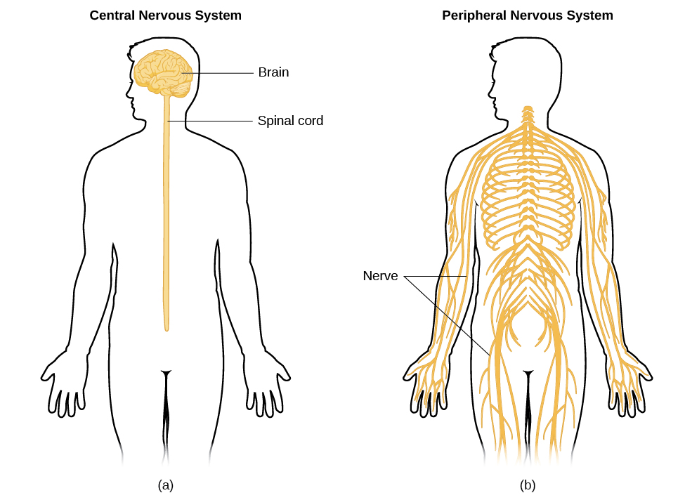

# 3.3 Các Bộ Phận Của Hệ Thần Kinh (Parts of the Nervous System)

> [!info]
>
> ### Mục tiêu học tập
>
> Sau khi học xong mục này, bạn sẽ có khả năng:
>
> - Mô tả sự khác biệt giữa hệ thần kinh trung ương và hệ thần kinh ngoại biên.
> - Giải thích sự khác biệt giữa hệ thần kinh thân thể và hệ thần kinh tự chủ.
> - Phân biệt giữa hai phân hệ giao cảm và đối giao cảm của hệ thần kinh tự chủ.

**Hệ thần kinh (nervous system)** có thể được chia thành hai phân hệ lớn: **hệ thần kinh trung ương (central nervous system - CNS)** và **hệ thần kinh ngoại biên (peripheral nervous system - PNS)**, như thể hiện trong [Hình 3.13](#CNX_Psych_03_03_NervSystem).
Hệ thần kinh trung ương bao gồm não bộ và tủy sống; hệ thần kinh ngoại biên kết nối hệ thần kinh trung ương với toàn bộ phần còn lại của cơ thể.
Trong mục này, chúng ta tập trung vào hệ thần kinh ngoại biên; ở mục tiếp theo, chúng ta sẽ khảo sát sâu về não bộ và tủy sống.

**Hình 3.13** Hệ thần kinh được chia thành hai phần chính: (a) Hệ Thần Kinh Trung Ương và (b) Hệ Thần Kinh Ngoại Biên.

## Hệ Thần Kinh Ngoại Biên (Peripheral Nervous System)

Hệ thần kinh ngoại biên được cấu tạo từ các bó sợi trục dày đặc, gọi là các dây thần kinh, có nhiệm vụ truyền tải thông điệp qua lại giữa hệ thần kinh trung ương và các cơ bắp, cơ quan nội tạng cùng các giác quan ở ngoại vi của cơ thể (tức là mọi thứ nằm ngoài CNS).
Hệ thần kinh ngoại biên có hai phân nhánh chính: hệ thần kinh thân thể và hệ thần kinh tự chủ.

**Hệ thần kinh thân thể (somatic nervous system)** gắn liền với các hoạt động theo truyền thống được coi là có ý thức hoặc tự nguyện (chủ động).
Nó tham gia vào việc chuyển tiếp thông tin cảm giác và vận động đến và đi từ hệ thần kinh trung ương; do đó, nó bao gồm các nơ-ron vận động và nơ-ron cảm giác.
Nơ-ron vận động, dẫn truyền các chỉ thị từ hệ thần kinh trung ương đến các cơ bắp, là các sợi ly tâm (efferent fibers - từ "efferent" có nghĩa là "đi ra xa khỏi").
Nơ-ron cảm giác, mang thông tin cảm giác từ các thụ cảm thể về hệ thần kinh trung ương, là các sợi hướng tâm (afferent fibers - từ "afferent" có nghĩa là "hướng về phía").
Một mẹo ghi nhớ hữu ích bằng tiếng Anh là **e**fferent = **e**xit (thoát ra) và **a**fferent = **a**rrive (đi tới).
Về bản chất, mỗi dây thần kinh là một bó nơ-ron tạo thành một xa lộ thông tin hai chiều, chứa hàng nghìn sợi trục, bao gồm cả sợi ly tâm và sợi hướng tâm.

**Hệ thần kinh tự chủ (autonomic nervous system)** kiểm soát các cơ quan nội tạng và các tuyến của cơ thể chúng ta, và nhìn chung được coi là nằm ngoài tầm kiểm soát tự nguyện có ý thức.
Nó có thể được chia nhỏ thành hai phân hệ: phân hệ giao cảm và phân hệ đối giao cảm ([Hình 3.14](#CNX_Psych_03_03_Autonomic)).
**Hệ thần kinh giao cảm (sympathetic nervous system)** tham gia vào việc chuẩn bị cho cơ thể sẵn sàng ứng phó với các hoạt động gắn liền với căng thẳng, khẩn cấp; **Hệ thần kinh đối giao cảm (parasympathetic nervous system)** gắn liền với việc đưa cơ thể trở về trạng thái vận hành thường nhật, nghỉ ngơi và hồi phục.
Hai hệ thống này có các chức năng bổ trợ lẫn nhau, phối hợp song hành để duy trì trạng thái cân bằng nội môi của cơ thể.
**Cân bằng nội môi (Homeostasis)** là một trạng thái thăng bằng, hay cân bằng động, trong đó các điều kiện sinh học nội tại (chẳng hạn như thân nhiệt, huyết áp, độ pH) được duy trì ở các mức độ tối ưu.

**Hình 3.14** Phân hệ giao cảm và đối giao cảm của hệ thần kinh tự chủ tạo ra các tác động đối nghịch nhau lên các cơ quan và hệ thống khác nhau trong cơ thể.

Hệ thần kinh giao cảm được kích hoạt khi chúng ta đối mặt với các tình huống căng thẳng hoặc có mức độ hưng phấn, kích thích cao độ.
Hoạt động của hệ thống này có tính thích nghi sinh tồn rất lớn đối với tổ tiên chúng ta, làm tăng khả năng sống sót của họ.
Hãy tưởng tượng, chẳng hạn một trong những tổ tiên đầu tiên của chúng ta, khi đang đi săn thú nhỏ, bất ngờ làm kinh động một con gấu mẹ to lớn cùng đàn con của nó.
Ngay tại khoảnh khắc đó, cơ thể của người thợ săn trải qua một loạt các biến đổi sinh học dữ dội—hệ quả trực tiếp của sự kích hoạt giao cảm—nhằm chuẩn bị cho họ đối mặt với mối hiểm họa.
Đồng tử giãn to, nhịp tim và huyết áp tăng vọt, bàng quang thả lỏng, gan phóng thích glucose vào máu; adrenaline tràn ngập trong dòng tuần hoàn.
Tập hợp các biến đổi sinh lý đồng bộ này, được gọi là **phản ứng chiến hay biến (fight or flight response)** (chiến đấu hoặc tháo chạy), cho phép cơ thể tiếp cận nguồn năng lượng dự trữ khổng lồ và nâng cao năng lực cảm giác tột độ để họ có thể chiến đấu đánh lại mối đe dọa hoặc chạy trốn thật nhanh đến nơi an toàn.

> [!tip]
>
> ### Kết nối học tập (Link to Learning)
>
> Hãy xem [video về phản ứng Chiến - Biến - Đóng băng (Fight Flight Freeze response)](https://openstax.org/l/response) để tìm hiểu thêm chi tiết.

Mặc dù rõ ràng là một phản ứng như vậy đóng vai trò sinh tử cho sự sống còn của tổ tiên chúng ta (những người sống trong một thế giới đầy rẫy những mối đe dọa thể chất trực tiếp), nhiều tình huống kích thích cao độ mà chúng ta đối mặt trong thế giới hiện đại ngày nay lại mang bản chất tâm lý nhiều hơn.
Chẳng hạn, hãy nghĩ về cảm giác của bạn khi phải đứng lên thuyết trình trước một hội trường đông nghẹt người, hoặc ngay trước khi bước vào một kỳ thi quan trọng mang tính bước ngoặt.
Bạn hoàn toàn không gặp bất kỳ nguy hiểm thể chất thực tế nào trong những tình huống đó, nhưng cơ thể bạn đã tiến hóa để phản ứng lại mối đe dọa được nhận thức đó bằng phản ứng **chiến hay biến (fight or flight)**.
Dạng phản ứng này không còn mang tính thích nghi cao trong thế giới hiện đại; trên thực tế, chúng ta phải gánh chịu những hệ quả tiêu cực đối với sức khỏe khi liên tục phải đối mặt với những mối đe dọa tâm lý mà chúng ta không thể chiến đấu bằng bạo lực cũng không thể bỏ chạy trốn.
Nghiên cứu gần đây chỉ ra rằng sự gia tăng nguy cơ mắc bệnh tim mạch (Chandola, Brunner, & Marmot, 2006) và suy giảm chức năng của hệ thống miễn dịch (Glaser & Kiecolt-Glaser, 2005) nằm trong số rất nhiều hậu quả tiêu cực của việc tiếp xúc liên tục và lặp đi lặp lại với các tình huống căng thẳng.
Một phần xu hướng phản ứng quá mức với căng thẳng này có thể bị lập trình sâu sắc bởi những trải nghiệm sang chấn tâm lý từ thời thơ ấu.

Một khi mối đe dọa đã được giải quyết xong xuôi, hệ thần kinh đối giao cảm sẽ tiếp quản và đưa các chức năng cơ thể trở lại trạng thái thư giãn, hồi phục.
Nhịp tim và huyết áp của người thợ săn trở lại bình thường, đồng tử co lại, khả năng kiểm soát bàng quang được phục hồi, và gan bắt đầu tích trữ glucose dưới dạng glycogen cho những nhu cầu sử dụng trong tương lai.
Những tiến trình phục hồi và tái tạo năng lượng này gắn liền mật thiết với sự kích hoạt của hệ thần kinh đối giao cảm.
