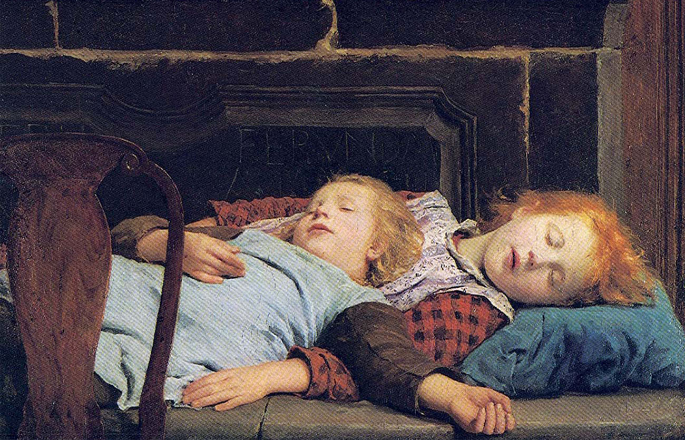

# Giới Thiệu (Introduction)

**Hình 4.1** Giấc ngủ, điều mà tất cả chúng ta đều trải nghiệm hàng ngày, là một khoảng lặng yên bình và đầy bí ẩn trong đời sống thường nhật. Hai đứa trẻ đang say ngủ được khắc họa trong bức tranh sơn dầu năm 1895 có tựa đề *Zwei schlafende Mädchen auf der Ofenbank* (dịch nghĩa: “Hai cô bé ngủ trên chiếc ghế dài cạnh bếp lò”) của họa sĩ người Thụy Sĩ Albert Anker.

## Đề Cương Chương Học (Chapter Outline)

- [4.1 Ý Thức Là Gì?](01-4-1-what-is-consciousness.md)
- [4.2 Giấc Ngủ Và Lý Do Chúng Ta Ngủ](02-4-2-sleep-and-why-we-sleep.md)
- [4.3 Các Giai Đoạn Của Giấc Ngủ](03-4-3-stages-of-sleep.md)
- [4.4 Các Vấn Đề Và Rối Loạn Giấc Ngủ](04-4-4-sleep-problems-and-disorders.md)
- [4.5 Sử Dụng Và Lạm Dụng Chất](05-4-5-substance-use-and-abuse.md)
- [4.6 Các Trạng Thái Ý Thức Khác](06-4-6-other-states-of-consciousness.md)

Cuộc sống của chúng ta diễn ra với những sự biến chuyển thường xuyên và sâu sắc về mức độ nhận biết đối với môi trường xung quanh cũng như các trạng thái nội tại bên trong cơ thể.
Khi tỉnh táo, chúng ta cảm thấy cảnh giác và nhận thức rõ về rất nhiều sự việc quan trọng đang diễn ra xung quanh mình.
Những trải nghiệm của chúng ta thay đổi một cách dữ dội khi chúng ta chìm vào giấc ngủ sâu và một lần nữa biến đổi khi chúng ta mơ mộng.
Một số người cũng trải nghiệm các trạng thái ý thức bị biến đổi thông qua thiền định, thôi miên, hoặc việc sử dụng rượu bia và các loại chất tác động tâm thần khác.

Chương này sẽ thảo luận về các trạng thái ý thức với sự chú trọng đặc biệt vào giấc ngủ.
Các giai đoạn khác nhau của giấc ngủ sẽ được nhận diện và các chứng rối loạn giấc ngủ phổ biến sẽ được mô tả chi tiết.
Chương này sẽ khép lại với những cuộc thảo luận về các trạng thái ý thức bị biến đổi được tạo ra bởi thuốc hướng thần, thôi miên và thiền định.
