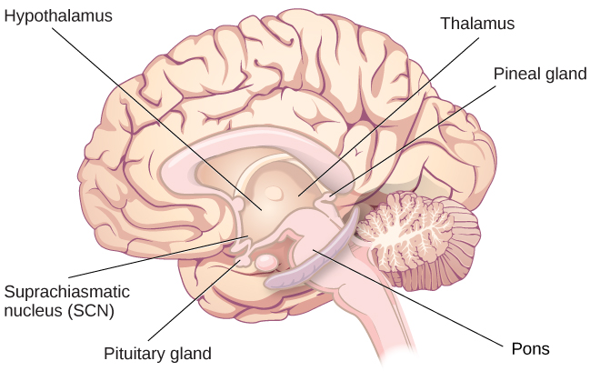

# 4.2 Giấc ngủ và lý do chúng ta ngủ

> [!info]
>
> ### Mục tiêu học tập
>
> Kết thúc phần này, bạn sẽ có thể:
>
> - Mô tả các vùng não tham gia vào giấc ngủ
> - Hiểu các chất tiết hormone gắn liền với giấc ngủ
> - Mô tả một số giả thuyết nhằm giải thích chức năng của giấc ngủ
> - Nêu tên và mô tả ba giả thuyết về lý do tại sao chúng ta mơ

Chúng ta dành khoảng một phần ba cuộc đời để ngủ.
Với tuổi thọ trung bình của công dân Hoa Kỳ dao động từ 73 đến 79 tuổi (Singh & Siahpush, 2006), chúng ta có thể dự tính sẽ dành khoảng 25 năm cuộc đời để ngủ.
Một số loài động vật dường như không bao giờ ngủ (ví dụ: một số loài cá và lưỡng cư); những loài khác ngủ rất ít mà không biểu hiện hậu quả tiêu cực rõ rệt nào (ví dụ: hươu cao cổ); tuy nhiên, một số loài động vật (ví dụ: chuột) lại chết sau hai tuần bị tước đoạt giấc ngủ (Siegel, 2008).
Tại sao chúng ta lại dành nhiều thời gian cho việc ngủ đến vậy?
Liệu việc ngủ có phải là điều tuyệt đối thiết yếu hay không?
Phần này sẽ xem xét những câu hỏi này và khám phá nhiều cách giải thích khác nhau về lý do tại sao chúng ta ngủ.

## Giấc ngủ là gì?

Bạn đã đọc rằng giấc ngủ được phân biệt bởi mức độ hoạt động thể chất thấp và sự suy giảm nhận thức cảm giác.
Như được thảo luận bởi Siegel (2008), một định nghĩa về giấc ngủ cũng phải đề cập đến sự tương tác lẫn nhau giữa các cơ chế ngày đêm và cơ chế cân bằng nội môi điều hòa giấc ngủ.
Sự điều hòa cân bằng nội môi của giấc ngủ được chứng minh bằng hiện tượng bù đắp giấc ngủ sau khi bị thiếu ngủ.
**Sự bù đắp giấc ngủ (sleep rebound)** đề cập đến việc một cá nhân bị thiếu ngủ sẽ đi vào giấc ngủ nhanh hơn trong những cơ hội ngủ tiếp theo.
Giấc ngủ được đặc trưng bởi các dạng hình thái hoạt động nhất định của não bộ có thể quan sát trực quan thông qua kỹ thuật điện não đồ (electroencephalography - EEG), và các giai đoạn khác nhau của giấc ngủ cũng có thể được phân biệt bằng EEG.

Chu kỳ thức - ngủ dường như được kiểm soát bởi nhiều vùng não hoạt động phối hợp nhịp nhàng với nhau.
Một số vùng này bao gồm đồi thị (thalamus), vùng dưới đồi (hypothalamus) và cầu não (pons).
Như đã đề cập trước đó, vùng dưới đồi chứa nhân trên chéo (SCN)—chiếc đồng hồ sinh học của cơ thể—bên cạnh các nhân khác cùng phối hợp với đồi thị để điều hòa giấc ngủ sóng chậm.
Cầu não đóng vai trò quan trọng trong việc điều hòa giấc ngủ cử động mắt nhanh (REM - rapid eye movement) (National Institutes of Health, không ghi năm).

Giấc ngủ cũng gắn liền với sự bài tiết và điều hòa một số hormone từ nhiều tuyến nội tiết, bao gồm: melatonin, hormone kích thích nang trứng (FSH), hormone tạo hoàng thể (LH) và hormone tăng trưởng (National Institutes of Health, không ghi năm).
Bạn đã đọc rằng tuyến tùng giải phóng melatonin trong khi ngủ ([Hình 4.6](#Figure_04_02_Pituitary)).
Melatonin được cho là tham gia vào việc điều hòa các nhịp sinh học khác nhau và hệ miễn dịch (Hardeland et al., 2006).
Trong khi ngủ, tuyến yên tiết ra cả FSH và LH, những hormone đóng vai trò quan trọng trong việc điều hòa hệ sinh sản (Christensen et al., 2012; Sofikitis et al., 2008).
Tuyến yên cũng tiết ra hormone tăng trưởng trong khi ngủ, vốn có vai trò thiết yếu đối với sự phát triển thể chất và trưởng thành cũng như các quá trình trao đổi chất khác (Bartke, Sun, & Longo, 2013).

**Hình 4.6** Tuyến tùng và tuyến yên tiết ra một số hormone trong khi ngủ.

## Tại sao chúng ta ngủ?

Với vai trò trung tâm mà giấc ngủ đảm nhận trong cuộc sống của chúng ta cùng hàng loạt hậu quả bất lợi liên quan đến tình trạng thiếu ngủ, người ta thường nghĩ rằng chúng ta ắt hẳn đã hiểu rất rõ lý do tại sao mình lại ngủ.
Đáng tiếc là điều này vẫn chưa hoàn toàn sáng tỏ; tuy nhiên, một số giả thuyết đã được đề xuất nhằm giải thích chức năng của giấc ngủ.

### Chức năng thích nghi của giấc ngủ

Một giả thuyết phổ biến về giấc ngủ kết hợp góc nhìn của tâm lý học tiến hóa.
**Tâm lý học tiến hóa** là một chuyên ngành nghiên cứu cách thức các mô hình hành vi và quá trình nhận thức mang tính phổ quát đã tiến hóa theo thời gian như một kết quả của **chọn lọc tự nhiên**.
Những biến dị và sự thích nghi trong nhận thức và hành vi giúp các cá nhân thành công hơn hoặc kém hơn trong việc sinh sản và truyền lại gen cho thế hệ sau.
Một giả thuyết từ góc nhìn này có thể lập luận rằng giấc ngủ là điều cần thiết để phục hồi các nguồn năng lượng đã tiêu hao trong ngày.
Giống như gấu ngủ đông khi các nguồn tài nguyên trở nên khan hiếm, có lẽ con người ngủ vào ban đêm để giảm thiểu sự tiêu hao năng lượng.
Mặc dù đây là một lời giải thích mang tính trực giác về giấc ngủ, nhưng có rất ít nghiên cứu ủng hộ cách giải thích này.
Trên thực tế, người ta cho rằng không có lý do gì để nghĩ rằng các nhu cầu năng lượng lại không thể được giải quyết chỉ bằng các giai đoạn nghỉ ngơi và không hoạt động (Frank, 2006; Rial et al., 2007), và một số nghiên cứu thậm chí đã phát hiện mối tương quan nghịch giữa nhu cầu năng lượng và lượng thời gian dành cho việc ngủ (Capellini, Barton, McNamara, Preston, & Nunn, 2008).

Một giả thuyết tiến hóa khác về giấc ngủ cho rằng các mô hình giấc ngủ của chúng ta đã tiến hóa như một phản ứng thích nghi trước những rủi ro từ kẻ săn mồi, vốn gia tăng trong bóng tối.
Do đó, chúng ta ngủ ở những nơi an toàn để giảm nguy cơ bị tổn hại.
Một lần nữa, đây lại là một lời giải thích trực quan và đầy lôi cuốn về lý do tại sao chúng ta ngủ.
Có lẽ tổ tiên của chúng ta đã dành nhiều thời gian ngủ để giảm sự chú ý của những kẻ săn mồi tiềm tàng đối với bản thân.
Tuy nhiên, các nghiên cứu so sánh chỉ ra rằng mối quan hệ tồn tại giữa rủi ro bị săn mồi và giấc ngủ là vô cùng phức tạp và còn nhiều mơ hồ.
Một số nghiên cứu cho thấy các loài đối mặt với rủi ro bị săn mồi cao hơn lại ngủ ít giờ hơn so với các loài khác (Capellini et al., 2008), trong khi các nhà nghiên cứu khác lại cho rằng không có mối quan hệ nào giữa lượng thời gian một loài cụ thể dành cho giấc ngủ sâu và nguy cơ bị săn mồi của loài đó (Lesku, Roth, Amlaner, & Lima, 2006).

Rất có thể giấc ngủ không phục vụ một chức năng thích nghi phổ quát duy nhất nào, và các loài khác nhau đã tiến hóa những mô hình giấc ngủ khác nhau để phản ứng với những áp lực tiến hóa độc nhất của riêng mình.
Mặc dù chúng ta đã thảo luận về những kết quả tiêu cực liên quan đến sự thiếu ngủ, nhưng cần chỉ ra rằng có rất nhiều lợi ích gắn liền với việc ngủ đủ giấc.
Một vài lợi ích như vậy được Quỹ Giấc ngủ Quốc gia (không ghi năm) liệt kê bao gồm: duy trì sức khỏe, giảm mức độ căng thẳng, cải thiện tâm trạng và tăng cường sự phối hợp vận động, cũng như một loạt lợi ích liên quan đến nhận thức và sự hình thành trí nhớ.

### Chức năng nhận thức của giấc ngủ

Một giả thuyết khác về lý do tại sao chúng ta ngủ liên quan đến tầm quan trọng của giấc ngủ đối với chức năng nhận thức và sự hình thành trí nhớ (Rattenborg, Lesku, Martinez-Gonzalez, & Lima, 2007).
Thật vậy, chúng ta biết rằng tình trạng thiếu ngủ dẫn đến những gián đoạn trong nhận thức và khiếm khuyết về trí nhớ (Brown, 2012), dẫn đến suy giảm khả năng duy trì sự chú ý, đưa ra quyết định và nhớ lại các ký ức dài hạn.
Hơn nữa, những suy giảm này càng trở nên nghiêm trọng hơn khi mức độ thiếu ngủ gia tăng (Alhola & Polo-Kantola, 2007).
Ngoài ra, giấc ngủ sóng chậm sau khi học một tác vụ mới có thể cải thiện hiệu suất thực hiện tác vụ đó sau này (Huber, Ghilardi, Massimini, & Tononi, 2004) và dường như là điều thiết yếu cho sự hình thành trí nhớ hiệu quả (Stickgold, 2005).
Hiểu được tác động của giấc ngủ đối với chức năng nhận thức sẽ giúp bạn nhận ra rằng việc thức thâu đêm để nhồi nhét ôn thi có thể không mang lại hiệu quả, thậm chí còn phản tác dụng.

> [!tip]
>
> ### Liên kết học tập
>
> Xem [video ngắn cung cấp các mẹo về giấc ngủ cho sinh viên đại học](https://openstax.org/l/sleeptips) để tìm hiểu thêm.

Việc ngủ đủ giấc tối ưu cũng gắn liền với các lợi ích nhận thức khác.
Nghiên cứu chỉ ra rằng những lợi ích tiềm năng này bao gồm việc gia tăng năng lực tư duy sáng tạo (Cai, Mednick, Harrison, Kanady, & Mednick, 2009; Wagner, Gais, Haider, Verleger, & Born, 2004), học ngôn ngữ (Fenn, Nusbaum, & Margoliash, 2003; Gómez, Bootzin, & Nadel, 2006) và các phán đoán mang tính suy luận (Ellenbogen, Hu, Payne, Titone, & Walker, 2007).
Thậm chí việc xử lý thông tin cảm xúc cũng có thể chịu ảnh hưởng bởi những khía cạnh nhất định của giấc ngủ (Walker, 2009).

> [!tip]
>
> ### Liên kết học tập
>
> Xem [video ngắn về mối quan hệ giữa giấc ngủ và trí nhớ](https://openstax.org/l/sleepmemory) để tìm hiểu thêm.
