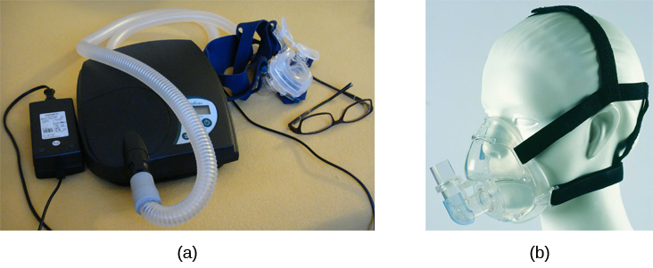
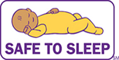

# 4.4 Các vấn đề và rối loạn giấc ngủ

> [!info]
>
> ### Mục tiêu học tập
>
> Kết thúc phần này, bạn sẽ có thể:
>
> - Mô tả các triệu chứng và phương pháp điều trị chứng mất ngủ
> - Nhận biết các triệu chứng của một số rối loạn cận giấc ngủ (parasomnias)
> - Mô tả các triệu chứng và phương pháp điều trị chứng ngưng thở khi ngủ
> - Nhận biết các yếu tố rủi ro liên quan đến hội chứng đột tử ở trẻ sơ sinh (SIDS) và các bước phòng ngừa
> - Mô tả các triệu chứng và phương pháp điều trị chứng ngủ rũ (narcolepsy)

Nhiều người từng trải qua những xáo trộn trong giấc ngủ vào một thời điểm nào đó trong đời.
Tùy thuộc vào quần thể dân số và rối loạn giấc ngủ được nghiên cứu, có từ 30% đến 50% dân số mắc phải một chứng rối loạn giấc ngủ vào một giai đoạn nào đó trong cuộc đời họ (Bixler, Kales, Soldatos, Kaels, & Healey, 1979; Hossain & Shapiro, 2002; Ohayon, 1997, 2002; Ohayon & Roth, 2002).
Phần này sẽ mô tả một số rối loạn giấc ngủ cũng như các lựa chọn điều trị tương ứng.

## Mất ngủ

Mất ngủ (insomnia), tình trạng liên tục gặp khó khăn trong việc đi vào giấc ngủ hoặc duy trì giấc ngủ, là chứng rối loạn giấc ngủ phổ biến nhất.
Những người mắc chứng mất ngủ thường mất rất nhiều thời gian từ khi lên giường cho đến khi thực sự ngủ được.
Ngoài ra, họ có thể thức giấc nhiều lần trong đêm và sau đó rất khó ngủ lại.
Như đã đề cập trước đó, một trong những tiêu chuẩn để chẩn đoán mất ngủ là trải qua những triệu chứng này ít nhất ba đêm một tuần trong thời gian tối thiểu một tháng (Roth, 2007).

Những người mắc chứng mất ngủ thường gia tăng mức độ lo âu về việc mình không thể ngủ được.
Điều này tạo thành một vòng xoáy luẩn quẩn tự duy trì, bởi vì sự lo âu gia tăng dẫn đến tăng mức độ kích thích tỉnh táo, và mức kích thích càng cao thì khả năng ngủ được lại càng xa vời.
Mất ngủ mãn tính hầu như luôn gắn liền với cảm giác kiệt sức quá độ và có thể liên quan đến các triệu chứng trầm cảm.

Có rất nhiều yếu tố góp phần gây ra chứng mất ngủ, bao gồm tuổi tác, việc sử dụng thuốc, mức độ tập luyện thể dục, trạng thái tâm thần và thói quen trước khi đi ngủ.
Không có gì đáng ngạc nhiên khi việc điều trị mất ngủ có thể tiếp cận theo một số cách khác nhau.
Những người bị mất ngủ có thể hạn chế sử dụng các chất kích thích (như caffeine) hoặc tăng cường vận động thể chất vào ban ngày.
Một số người tìm đến các loại thuốc ngủ không kê đơn (OTC) hoặc thuốc ngủ theo toa, nhưng điều này chỉ nên áp dụng một cách dè dặt vì nhiều loại thuốc ngủ gây ra sự phụ thuộc, làm thay đổi bản chất của chu kỳ giấc ngủ và có thể làm trầm trọng thêm chứng mất ngủ theo thời gian.
Những người tiếp tục bị mất ngủ dai dẳng, đặc biệt nếu nó ảnh hưởng đến chất lượng cuộc sống, nên tìm kiếm sự điều trị chuyên khoa.

Một số hình thức trị liệu tâm lý, chẳng hạn như liệu pháp nhận thức - hành vi, có thể giúp ích cho những người bị mất ngủ.
**Liệu pháp nhận thức - hành vi (CBT)** là một loại trị liệu tâm lý tập trung vào các quá trình nhận thức và các hành vi có vấn đề.
Việc điều trị mất ngủ thường bao gồm các kỹ thuật quản lý căng thẳng và thay đổi những hành vi bất lợi góp phần gây mất ngủ (ví dụ: dành quá nhiều thời gian nằm thức trên giường).
Liệu pháp nhận thức - hành vi đã được chứng minh là rất hiệu quả trong điều trị chứng mất ngủ (Savard, Simard, Ivers, & Morin, 2005; Williams, Roth, Vatthauer, & McCrae, 2013).

> [!abstract]
>
> ### Kết nối thực tiễn
>
> #### Các giải pháp hỗ trợ giấc ngủ lành mạnh
>
> Đã bao giờ bạn gặp phải chuyện như thế này chưa?
> Người bạn cùng phòng thời đại học năm thứ hai của tôi đã quá căng thẳng trong kỳ thi cuối kỳ đến mức uống gần hết cả một lọ siro ho cảm Nyquil để cố chìm vào giấc ngủ.
> Khi nghe kể lại, tôi đã khuyên anh ấy đến gặp chuyên viên tâm lý của trường ngay lập tức.
>
> Nhiều sinh viên đại học chật vật để có được 7–9 giờ ngủ được khuyến nghị mỗi đêm.
> Tuy nhiên, đối với một số người, đó không phải là vì những bữa tiệc thâu đêm hay những buổi học khuya.
> Đơn giản là họ cảm thấy quá tải và căng thẳng đến mức không thể ngủ được hoặc không thể ngủ yên giấc.
> Khó ngủ một hoặc hai đêm không phải là điều bất thường, nhưng nếu bạn trải qua tình trạng này thường xuyên hơn, bạn nên tìm kiếm lời khuyên từ bác sĩ.
>
> Dưới đây là một số mẹo để duy trì giấc ngủ lành mạnh:
>
> - Duy trì lịch trình ngủ đều đặn, kể cả vào cuối tuần. Cố gắng đi ngủ và thức dậy vào cùng một thời điểm mỗi ngày để giữ cho đồng hồ sinh học luôn đồng bộ, giúp cơ thể hình thành thói quen ngủ mỗi đêm.
> - Tránh bất cứ điều gì gây kích thích trong vòng một giờ trước khi ngủ. Điều này bao gồm tập thể dục nặng và ánh sáng chói từ các thiết bị điện tử.
> - Tập thể dục hàng ngày.
> - Tránh ngủ trưa quá nhiều hoặc quá muộn.
> - Giữ nhiệt độ phòng ngủ trong khoảng 60 đến 67 độ F (khoảng 15,5 đến 19,5 độ C). Con người ngủ ngon hơn trong môi trường nhiệt độ mát mẻ.
> - Tránh rượu bia, thuốc lá, caffeine và các bữa ăn nặng trước khi ngủ. Bạn có thể cảm thấy rượu giúp bạn dễ ngủ hơn, nhưng trên thực tế nó làm gián đoạn giấc ngủ REM và dẫn đến thức giấc thường xuyên. Các bữa ăn no có thể làm bạn buồn ngủ, nhưng chúng cũng gây thức giấc liên tục do khó chịu dạ dày.
> - Nếu không thể ngủ được, hãy rời khỏi giường và làm việc gì đó nhẹ nhàng cho đến khi bạn cảm thấy buồn ngủ trở lại. Hãy rèn luyện cho cơ thể liên kết chiếc giường với việc ngủ, thay vì các hoạt động khác như học tập, ăn uống hoặc xem phim truyền hình.

## Các rối loạn cận giấc ngủ (Parasomnias)

Một **rối loạn cận giấc ngủ (parasomnia)** là một trong nhóm các rối loạn giấc ngủ mà trong đó các hoạt động vận động và/hoặc trải nghiệm không mong muốn, gây gián đoạn đóng vai trò chủ đạo trong khi ngủ.
Các rối loạn cận giấc ngủ có thể xảy ra ở cả pha ngủ REM hoặc NREM.
Mộng du, hội chứng chân không yên và cơn hoảng loạn ban đêm đều là những ví dụ điển hình về rối loạn cận giấc ngủ (Mahowald & Schenck, 2000).

### Mộng du

Trong chứng **mộng du** (sleepwalking, hay somnambulism), người ngủ thực hiện các hành vi tương đối phức tạp, từ việc đi lang thang loanh quanh cho đến việc điều khiển ô tô.
Trong các đợt mộng du, mắt người ngủ thường mở, nhưng họ không phản hồi lại các nỗ lực giao tiếp với họ.
Mộng du thường xảy ra nhất trong giấc ngủ sóng chậm, nhưng nó có thể xảy ra ở bất kỳ thời điểm nào trong chu kỳ ngủ ở một số cá nhân mắc bệnh (Mahowald & Schenck, 2000).

Trong lịch sử, mộng du đã từng được điều trị bằng nhiều liệu pháp dược lý khác nhau, từ benzodiazepine cho đến thuốc chống trầm cảm.
Tuy nhiên, tỷ lệ thành công của các phương pháp điều trị này vẫn còn nhiều nghi vấn.
Guilleminault cùng các cộng sự (2005) phát hiện ra rằng việc sử dụng benzodiazepine không làm thuyên giảm chứng mộng du.
Tuy nhiên, tất cả các bệnh nhân mộng du đồng thời mắc các vấn đề hô hấp liên quan đến giấc ngủ đều cho thấy sự giảm rõ rệt tình trạng mộng du khi các vấn đề hô hấp của họ được điều trị hiệu quả.

> [!note]
>
> ### Đào sâu tìm hiểu
>
> #### Lời biện hộ bằng chứng mộng du?
>
> Vào ngày 16 tháng 1 năm 1997, Scott Falater cùng ăn tối với vợ và các con, chia sẻ với họ về những khó khăn mà ông đang gặp phải trong một dự án ở chỗ làm.
> Sau bữa tối, ông chuẩn bị một số tài liệu để dẫn dắt nhóm thanh niên nhà thờ vào sáng hôm sau, rồi cố gắng sửa chữa máy bơm hồ bơi của gia đình trước khi đi ngủ.
> Sáng hôm sau, ông thức dậy bởi tiếng chó sủa và những giọng nói lạ từ dưới lầu.
> Khi đi xuống kiểm tra chuyện gì đang xảy ra, ông chạm mặt một nhóm cảnh sát và bị bắt vì tội giết vợ (Cartwright, 2004; CNN, 1999).
>
> Thi thể của Yarmila Falater được tìm thấy trong hồ bơi của gia đình với 44 vết đâm.
> Một người hàng xóm đã gọi cảnh sát sau khi chứng kiến Falater đứng trên thi thể vợ trước khi kéo bà xuống hồ bơi.
> Khám xét hiện trường, cảnh sát tìm thấy quần áo dính máu và một con dao dính máu trong cốp xe của Falater, đồng thời trên cổ ông cũng có các vết máu.
>
> Kỳ lạ thay, Falater quả quyết rằng ông không hề nhớ bất cứ điều gì về việc làm hại vợ mình.
> Các con của ông và bố mẹ vợ đều đồng thanh xác nhận Falater có mối quan hệ vô cùng êm ấm với vợ và họ không thể nghĩ ra bất kỳ lý do nào để ông có động cơ sát hại bà (Cartwright, 2004).
>
> Scott Falater có tiền sử thường xuyên mộng du khi còn nhỏ, và ông thậm chí từng có hành vi bạo lực với em gái mình khi cô cố ngăn ông ra khỏi nhà trong bộ đồ ngủ trong một đợt mộng du.
> Ông không có bất kỳ dị tật giải phẫu não rõ ràng nào hay rối loạn tâm lý nào.
> Dường như Scott Falater đã giết vợ trong lúc ngủ, hoặc ít nhất, đó là lời biện hộ mà ông đã sử dụng khi bị xét xử vì tội giết vợ (Cartwright, 2004; CNN, 1999).
> Trong vụ án của Falater, bồi thẩm đoàn đã tuyên ông phạm tội giết người cấp độ một vào tháng 6 năm 1999 (CNN, 1999); tuy nhiên, cũng có những vụ án mạng khác mà lời biện hộ mộng du đã được áp dụng thành công.
> Dù nghe có vẻ đáng sợ, nhiều nhà nghiên cứu giấc ngủ tin rằng mộng du giết người hoàn toàn có thể xảy ra ở những cá nhân mắc phải các loại rối loạn giấc ngủ được mô tả dưới đây (Broughton et al., 1994; Cartwright, 2004; Mahowald, Schenck, & Cramer Bornemann, 2005; Pressman, 2007).

### Rối loạn hành vi giấc ngủ REM (RBD)

**Rối loạn hành vi giấc ngủ REM (RBD)** xảy ra khi hiện tượng liệt cơ vốn gắn liền với pha ngủ REM không diễn ra.
Những người mắc chứng RBD có mức độ hoạt động thể chất rất cao trong giấc ngủ REM, đặc biệt là trong những giấc mơ quấy nhiễu.
Những hành vi này vô cùng đa dạng, nhưng chúng có thể bao gồm đá, đấm, cào cấu, la hét và cư xử như một con vật đang bị hoảng sợ hoặc bị tấn công.
Những người mắc chứng rối loạn này có thể tự gây thương tích cho bản thân hoặc cho bạn cùng giường khi thực hiện những hành vi này.
Hơn nữa, những loại hành vi này cuối cùng gây gián đoạn giấc ngủ trầm trọng, mặc dù các cá nhân mắc bệnh không hề có ký ức gì về việc những hành vi đó đã diễn ra (Arnulf, 2012).

Chứng rối loạn này có mối liên hệ với một số bệnh thoái hóa thần kinh như bệnh Parkinson.
Trên thực tế, mối quan hệ này mạnh mẽ đến mức một số người coi sự hiện diện của RBD như một công cụ hỗ trợ tiềm năng trong việc chẩn đoán và điều trị một số bệnh thoái hóa thần kinh (Ferini-Strambi, 2011).
Clonazepam, một loại thuốc chống lo âu có đặc tính an thần, thường được sử dụng phổ biến nhất để điều trị RBD.
Thuốc được dùng đơn lẻ hoặc kết hợp với các liều melatonin (hormone do tuyến tùng tiết ra).
Như một phần của quá trình điều trị, môi trường ngủ thường được điều chỉnh để trở thành một nơi an toàn hơn cho những người mắc RBD (Zangini, Calandra-Buonaura, Grimaldi, & Cortelli, 2011).

### Các rối loạn cận giấc ngủ khác

Một người mắc **hội chứng chân không yên** có những cảm giác bứt rứt, khó chịu ở chân trong các khoảng thời gian không hoạt động hoặc khi đang cố chìm vào giấc ngủ.
Sự khó chịu này chỉ thuyên giảm khi họ chủ động cử động chân, điều này hiển nhiên góp phần gây khó khăn cho việc đi vào giấc ngủ hoặc duy trì giấc ngủ.
Hội chứng chân không yên khá phổ biến và có liên quan đến một số chẩn đoán y khoa khác, chẳng hạn như bệnh thận mãn tính và bệnh tiểu đường (Mahowald & Schenck, 2000).
Có nhiều loại thuốc khác nhau để điều trị hội chứng chân không yên: benzodiazepine, thuốc phiện (opiates) và thuốc chống co giật (Restless Legs Syndrome Foundation, không ghi năm).

**Cơn hoảng loạn ban đêm (night terrors)** tạo ra cảm giác kinh hoàng tột độ ở người mắc và thường đi kèm với tiếng la hét cùng những nỗ lực tháo chạy khỏi môi trường xung quanh (Mahowald & Schenck, 2000).
Mặc dù những người trải qua cơn hoảng loạn ban đêm có vẻ ngoài như đang thức, nhưng họ thường không nhớ gì về các sự kiện đã diễn ra, và mọi nỗ lực an ủi họ lúc đó đều không hiệu quả.
Thông thường, người mắc sẽ ngủ thiếp đi trở lại trong một khoảng thời gian ngắn.
Cơn hoảng loạn ban đêm dường như xảy ra trong pha ngủ NREM (Provini, Tinuper, Bisulli, & Lagaresi, 2011).
Nhìn chung, việc điều trị chứng hoảng loạn ban đêm là không cần thiết trừ khi có một tình trạng bệnh lý hoặc tâm lý tiềm ẩn nào đó gây ra hiện tượng này (Mayo Clinic, không ghi năm).

## Chứng ngưng thở khi ngủ

**Chứng ngưng thở khi ngủ (sleep apnea)** được xác định bởi các đợt mà người ngủ tạm ngừng thở hoàn toàn.
Những đợt này có thể kéo dài 10–20 giây hoặc lâu hơn và thường gắn liền với những khoảng thời gian kích thích tỉnh giấc ngắn ngủi.
Mặc dù những người mắc chứng ngưng thở khi ngủ có thể không nhận biết được sự gián đoạn lặp đi lặp lại này, nhưng họ thực sự trải qua sự mệt mỏi gia tăng rõ rệt.
Nhiều cá nhân được chẩn đoán mắc chứng ngưng thở khi ngủ lần đầu tìm đến điều trị là do bạn cùng giường phàn nàn rằng họ ngáy rất to và/hoặc ngừng thở trong những khoảng thời gian dài khi ngủ (Henry & Rosenthal, 2013).
Ngưng thở khi ngủ phổ biến hơn nhiều ở những người thừa cân và thường gắn liền với tiếng ngáy to.
Đáng ngạc nhiên là chứng ngưng thở khi ngủ có thể làm trầm trọng thêm bệnh tim mạch (Sánchez-de-la-Torre, Campos-Rodriguez, & Barbé, 2012).
Bất kỳ ai, bất kể cân nặng ra sao, nếu ngáy to hoặc thở hổn hển khi ngủ, đều nên đi khám để kiểm tra chứng ngưng thở khi ngủ.

Trong khi mọi người thường không biết về tình trạng ngưng thở khi ngủ của mình, họ lại nhận thức rất rõ về một số hậu quả bất lợi của việc thiếu ngủ.
Hãy xem xét một bệnh nhân tin rằng do hậu quả của chứng ngưng thở khi ngủ mà ông đã “gặp phải ba vụ tai nạn ô tô trong sáu tuần.
TẤT CẢ đều là lỗi của tôi.
Hai trong số đó tôi thậm chí còn không biết mình có liên quan cho đến mãi về sau” (Henry & Rosenthal, 2013, tr.
52).
Những người bị ngưng thở khi ngủ chưa được chẩn đoán hoặc chưa được điều trị thường lo sợ rằng sự nghiệp của họ sẽ bị ảnh hưởng do thiếu ngủ, điều này được minh họa qua lời chia sẻ của một bệnh nhân khác: “Tôi làm việc trong một ngành nghề đòi hỏi sự tỉnh táo cao độ về tinh thần.
Tôi đã thực sự buồn ngủ… và gặp khó khăn trong việc tập trung… Mọi chuyện bắt đầu đến mức đáng sợ” (Henry & Rosenthal, 2013, tr.
52).

Có hai loại ngưng thở khi ngủ: ngưng thở khi ngủ do tắc nghẽn và ngưng thở khi ngủ trung ương.
**Ngưng thở khi ngủ do tắc nghẽn (obstructive sleep apnea)** xảy ra khi đường thở của một cá nhân bị tắc nghẽn trong lúc ngủ, ngăn không cho không khí đi vào phổi.
Trong khi đó, ở **ngưng thở khi ngủ trung ương (central sleep apnea)**, sự gián đoạn trong các tín hiệu truyền từ não bộ điều hòa nhịp thở là nguyên nhân gây ra các giai đoạn gián đoạn hô hấp (White, 2005).

Một trong những phương pháp điều trị phổ biến nhất cho chứng ngưng thở khi ngủ liên quan đến việc sử dụng một thiết bị đặc biệt trong khi ngủ.
Thiết bị **thở áp lực dương liên tục (CPAP - continuous positive airway pressure)** bao gồm một mặt nạ vừa vặn trùm lên mũi và miệng của người ngủ, được kết nối với một máy bơm có chức năng bơm không khí vào đường thở của bệnh nhân, buộc đường thở phải duy trì trạng thái mở, như minh họa trong [Hình 4.13](#Figure_04_04_CPAP).
Một số loại mặt nạ CPAP mới hơn có kích thước nhỏ hơn và chỉ che mũi.
Lựa chọn điều trị này đã được chứng minh là có hiệu quả đối với những người mắc chứng ngưng thở khi ngủ từ nhẹ đến nặng (McDaid et al., 2009).
Tuy nhiên, các lựa chọn điều trị thay thế đang được khám phá vì sự tuân thủ điều trị nhất quán của người dùng thiết bị CPAP vẫn còn là một vấn đề trở ngại.
Gần đây, một thiết bị EPAP (áp lực dương đường thở thì thở ra) mới đã cho thấy triển vọng trong các thử nghiệm mù đôi như một giải pháp thay thế (Berry, Kryger, & Massie, 2011).

**Hình 4.13** (a) Một thiết bị CPAP điển hình được sử dụng trong điều trị chứng ngưng thở khi ngủ được (b) cố định vào đầu bằng các dây đai, với một mặt nạ che kín mũi và miệng.

### Hội chứng đột tử ở trẻ sơ sinh (SIDS)

Trong **hội chứng đột tử ở trẻ sơ sinh (SIDS)**, một đứa trẻ ngừng thở trong khi ngủ và tử vong.
Trẻ sơ sinh dưới 12 tháng tuổi dường như có nguy cơ mắc SIDS cao nhất, và bé trai có nguy cơ cao hơn bé gái.
Một số yếu tố rủi ro liên quan đến SIDS bao gồm sinh non, hút thuốc lá trong nhà và thân nhiệt quá cao.
Ngoài ra cũng có thể có sự khác biệt về cả cấu trúc lẫn chức năng não bộ ở những trẻ sơ sinh tử vong vì SIDS (Berkowitz, 2012; Mage & Donner, 2006; Thach, 2005).

Một lượng lớn các nghiên cứu về SIDS đã dẫn đến nhiều khuyến nghị dành cho các bậc cha mẹ nhằm bảo vệ con mình ([Hình 4.14](#Figure_04_04_SIDS)).
Thứ nhất, nghiên cứu gợi ý rằng trẻ sơ sinh nên được đặt nằm ngửa khi ngủ, và cũi của trẻ không nên chứa bất kỳ vật dụng nào có nguy cơ gây ngạt thở, chẳng hạn như chăn dày, gối hoặc đệm quây cũi (các miếng đệm che các thanh chắn của cũi).
Trẻ sơ sinh không nên đội mũ khi ngủ để tránh bị quá nóng, và những người trong gia đình cần tuyệt đối tránh hút thuốc trong nhà.
Những khuyến nghị như thế này đã giúp làm giảm đáng kể số ca tử vong ở trẻ sơ sinh do SIDS trong những năm gần đây (Mitchell, 2009; Task Force on Sudden Infant Death Syndrome, 2011).

**Hình 4.14** Chiến dịch "Safe to Sleep" nhằm giáo dục công chúng về cách giảm thiểu các yếu tố rủi ro liên quan đến SIDS. Chiến dịch này được đồng tài trợ bởi Viện Sức khỏe Trẻ em và Phát triển Con người Quốc gia.

## Chứng ngủ rũ (Narcolepsy)

Không giống như các chứng rối loạn giấc ngủ khác được mô tả trong phần này, một người mắc **chứng ngủ rũ (narcolepsy)** không thể cưỡng lại việc chìm vào giấc ngủ vào những thời điểm không thích hợp.
Những cơn buồn ngủ đột ngột này thường đi kèm với **chứng mất trương lực cơ đột ngột (cataplexy)**, tức là sự mất trương lực cơ hoặc yếu cơ, và trong một số trường hợp liên quan đến việc tê liệt hoàn toàn các cơ tự ý.
Tình trạng này tương tự như dạng tê liệt mà những người khỏe mạnh trải qua trong giấc ngủ REM (Burgess & Scammell, 2012; Hishikawa & Shimizu, 1995; Luppi et al., 2011).
Các cơn ngủ rũ cũng mang những đặc điểm khác của giấc ngủ REM.
Ví dụ, khoảng một phần ba số người được chẩn đoán mắc chứng ngủ rũ trải qua những ảo giác sống động như thật, giống như trong giấc mơ trong các đợt phát tác (Chokroverty, 2010).

Đáng ngạc nhiên là các cơn ngủ rũ thường bị kích hoạt bởi các trạng thái kích thích hoặc căng thẳng tăng cao.
Một cơn điển hình có thể kéo dài từ một hoặc hai phút đến nửa giờ.
Sau khi tỉnh dậy khỏi một đợt ngủ rũ, bệnh nhân cho biết họ cảm thấy tỉnh táo, sảng khoái (Chokroverty, 2010).
Rõ ràng, những cơn ngủ rũ thường xuyên có thể cản trở khả năng làm việc hoặc học tập, và trong một số tình huống, chứng ngủ rũ có thể gây ra thương tích và tổn hại nghiêm trọng (chẳng hạn khi đang lái xe hoặc vận hành máy móc cùng các thiết bị tiềm ẩn nguy hiểm).

Nhìn chung, chứng ngủ rũ được điều trị bằng các loại thuốc kích thích tâm thần vận động, chẳng hạn như amphetamine (Mignot, 2012).
Những loại thuốc này thúc đẩy sự gia tăng hoạt động thần kinh.
Chứng ngủ rũ có liên quan đến sự suy giảm nồng độ của phân tử truyền tín hiệu hypocretin ở một số vùng của não bộ (De la Herrán-Arita & Drucker-Colín, 2012; Han, 2012), và các loại thuốc kích thích truyền thống không có tác động trực tiếp lên hệ thống này.
Do đó, rất có thể những loại thuốc mới được phát triển để điều trị chứng ngủ rũ trong tương lai sẽ được thiết kế để nhắm vào hệ thống hypocretin.

Có sự khác biệt rất lớn giữa các bệnh nhân, cả về cách thức biểu hiện triệu chứng của chứng ngủ rũ lẫn hiệu quả của các lựa chọn điều trị hiện có.
Điều này được minh họa qua nghiên cứu trường hợp của McCarty (2010) về một người phụ nữ 50 tuổi tìm kiếm sự giúp đỡ vì tình trạng buồn ngủ quá mức trong giờ thức bình thường mà bà đã trải qua suốt nhiều năm.
Bà cho biết mình đã ngủ thiếp đi vào những thời điểm không thích hợp hoặc nguy hiểm, bao gồm cả khi đang ăn, khi đang giao lưu với bạn bè và khi đang lái xe ô tô.
Trong các giai đoạn hưng phấn cảm xúc, người phụ nữ này phàn nàn rằng bà cảm thấy yếu ở nửa người bên phải.
Mặc dù bà không trải qua bất kỳ ảo giác sống động nào như trong giấc mơ, nhưng bà vẫn được chẩn đoán mắc chứng ngủ rũ sau khi làm các xét nghiệm giấc ngủ.
Trong trường hợp của bà, việc triệu chứng mất trương lực cơ (cataplexy) chỉ giới hạn ở nửa người bên phải là một hiện tượng khá bất thường.
Những nỗ lực điều trị ban đầu chỉ bằng thuốc kích thích đơn thuần đã không mang lại kết quả.
Tuy nhiên, khi một loại thuốc kích thích được sử dụng kết hợp với một loại thuốc chống trầm cảm phổ biến, tình trạng của bà đã được cải thiện rõ rệt.
