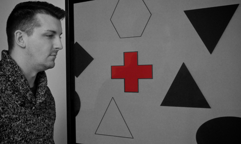

# 5.1 Cảm giác đối chiếu với Tri giác

> [!info]
>
> ### Mục tiêu học tập
>
> Kết thúc phần này, bạn sẽ có thể:
>
> - Phân biệt giữa cảm giác và tri giác
> - Mô tả các khái niệm về ngưỡng tuyệt đối và ngưỡng sai biệt
> - Thảo luận về vai trò của sự chú ý, động lực và sự thích nghi cảm giác trong tri giác

## Cảm giác

Cảm nhận một điều gì đó có nghĩa là gì?
Các tế bào thụ thể cảm giác là các nơ-ron chuyên biệt phản ứng với các loại kích thích cụ thể.
Khi thông tin cảm giác được phát hiện bởi một tế bào thụ thể cảm giác, **cảm giác (sensation)** đã xuất hiện.
Ví dụ, ánh sáng đi vào mắt gây ra những thay đổi hóa học trong các tế bào nằm ở đáy mắt.
Những tế bào này chuyển tiếp các thông điệp, dưới dạng các điện thế hoạt động (như bạn đã học khi tìm hiểu về tâm lý học sinh học), đến hệ thần kinh trung ương.
Quá trình chuyển đổi từ năng lượng kích thích cảm giác thành điện thế hoạt động được gọi là **sự chuyển mã tín hiệu (transduction)**.

Có lẽ bạn đã biết từ thời tiểu học rằng chúng ta có năm giác quan: thị giác (vision), thính giác (audition), khứu giác (olfaction), vị giác (gustation) và xúc giác (somatosensation).
Hóa ra quan niệm về năm giác quan này đã bị đơn giản hóa quá mức.
Chúng ta còn sở hữu các hệ thống cảm giác cung cấp thông tin về sự thăng bằng (cảm giác tiền đình), vị trí và chuyển động của cơ thể (cảm giác bản thể và cảm giác vận động), cảm giác đau (nociception) và cảm giác nhiệt (thermoception).

Độ nhạy của một hệ thống cảm giác nhất định đối với các kích thích liên quan có thể được biểu thị dưới dạng một ngưỡng tuyệt đối.
**Ngưỡng tuyệt đối (absolute threshold)** đề cập đến lượng năng lượng kích thích tối thiểu cần phải có để kích thích đó có thể được phát hiện 50% số lần thử nghiệm.
Một cách khác để hình dung về điều này là đặt câu hỏi: một ngọn đèn có thể mờ đến mức nào, hoặc một âm thanh có thể nhỏ đến mức nào mà vẫn được phát hiện trong một nửa số lần kiểm tra.
Độ nhạy của các thụ thể cảm giác của chúng ta có thể đạt đến mức đáng kinh ngạc.
Người ta ước tính rằng vào một đêm trời quang đãng, các tế bào cảm giác nhạy cảm nhất ở đáy mắt có thể phát hiện ngọn lửa của một cây nến cách xa 30 dặm (khoảng 48 km) (Okawa & Sampath, 2007).
Trong điều kiện yên tĩnh hoàn toàn, các tế bào lông (các tế bào thụ thể của tai trong) có thể phát hiện tiếng tích tắc của đồng hồ cách xa 20 feet (khoảng 6 mét) (Galanter, 1962).

Chúng ta cũng hoàn toàn có thể tiếp nhận những thông điệp được trình diện bên dưới ngưỡng nhận thức có ý thức—chúng được gọi là **thông điệp dưới ngưỡng (subliminal messages)**.
Một kích thích đạt đến ngưỡng sinh lý khi nó đủ mạnh để kích thích các thụ thể cảm giác và gửi các xung thần kinh lên não: Đây là ngưỡng tuyệt đối.
Một thông điệp nằm dưới ngưỡng đó được coi là dưới ngưỡng nhận thức: Chúng ta tiếp nhận nó, nhưng chúng ta không nhận biết có ý thức về nó.
Qua nhiều năm, đã có rất nhiều suy đoán về việc sử dụng các thông điệp dưới ngưỡng trong quảng cáo, nhạc rock và các chương trình âm thanh tự lực (self-help).
Bằng chứng nghiên cứu cho thấy rằng trong môi trường phòng thí nghiệm, con người có thể xử lý và phản hồi lại thông tin ngoài nhận thức có ý thức.
Nhưng điều này không có nghĩa là chúng ta tuân theo những thông điệp này như những thây ma; trên thực tế, các thông điệp ẩn giấu hầu như không có tác động đáng kể nào đến hành vi bên ngoài phòng thí nghiệm (Kunst-Wilson & Zajonc, 1980; Rensink, 2004; Nelson, 2008; Radel, Sarrazin, Legrain, & Gobancé, 2009; Loersch, Durso, & Petty, 2013).

Các ngưỡng tuyệt đối thường được đo lường trong những điều kiện kiểm soát vô cùng nghiêm ngặt, tại các tình huống tối ưu nhất cho độ nhạy cảm.
Đôi khi, chúng ta quan tâm nhiều hơn đến mức độ khác biệt cần thiết giữa các kích thích để có thể phát hiện ra sự khác biệt giữa chúng.
Điều này được gọi là **khác biệt vừa đủ nhận thấy (just noticeable difference - jnd)** hoặc **ngưỡng sai biệt (difference threshold)**.
Không giống như ngưỡng tuyệt đối, ngưỡng sai biệt thay đổi tùy thuộc vào cường độ ban đầu của kích thích.
Để làm ví dụ, hãy tưởng tượng bạn đang ở trong một rạp chiếu phim rất tối.
Nếu một khán giả nhận được tin nhắn làm màn hình điện thoại di động sáng lên, rất có thể nhiều người sẽ nhận thấy sự thay đổi ánh sáng trong rạp.
Tuy nhiên, nếu điều tương tự xảy ra trong một nhà thi đấu rực rỡ ánh đèn trong một trận đấu bóng rổ, rất ít người sẽ để ý thấy.
Độ sáng của màn hình điện thoại không hề thay đổi, nhưng khả năng nó được phát hiện như một sự thay đổi về độ chiếu sáng lại biến thiên đáng kể giữa hai bối cảnh.
Ernst Weber đã đề xuất lý thuyết này về sự thay đổi của ngưỡng sai biệt vào những năm 1830, và nó được biết đến với tên gọi định luật Weber: Ngưỡng sai biệt là một tỷ lệ phần trăm không đổi của kích thích ban đầu, như ví dụ trên đã minh họa.

## Tri giác

Trong khi các tế bào thụ thể cảm giác của chúng ta liên tục thu thập thông tin từ môi trường, thì cách chúng ta diễn giải thông tin đó mới là yếu tố quyết định cách chúng ta tương tác với thế giới xung quanh.
**Tri giác (perception)** đề cập đến cách thức thông tin cảm giác được tổ chức, diễn giải và trải nghiệm một cách có ý thức.
Tri giác bao gồm cả quá trình xử lý từ dưới lên và xử lý từ trên xuống.
**Xử lý từ dưới lên (bottom-up processing)** đề cập đến việc thông tin cảm giác thô từ một kích thích trong môi trường thúc đẩy quá trình nhận thức, trong khi **xử lý từ trên xuống (top-down processing)** đề cập đến việc kiến thức và kỳ vọng trước đó dẫn dắt quá trình nhận thức, như minh họa trong [Hình 5.2](#Figure_05_01_topbot) (Egeth & Yantis, 1997; Fine & Minnery, 2009; Yantis & Egeth, 1999).

**Hình 5.2** Từ trên xuống và từ dưới lên là những cách thức chúng ta xử lý tri giác của mình.

Hãy tưởng tượng bạn và vài người bạn đang ngồi ăn trưa và trò chuyện trong một nhà hàng đông đúc.
Không gian rất ồn ào, và bạn đang tập trung vào khuôn mặt của bạn mình để nghe những gì họ đang nói; đột nhiên, tiếng vỡ của ly thủy tinh và tiếng xoong chảo kim loại va đập vào sàn nhà vang lên chát chúa.
Người phục vụ vừa làm rơi một khay thức ăn lớn.
Mặc dù bạn đang chú tâm vào bữa ăn và cuộc trò chuyện của mình, âm thanh đổ vỡ đó rất có thể sẽ vượt qua các bộ lọc chú ý và thu hút ngay lập tức sự chú ý của bạn.
Bạn không có sự lựa chọn nào khác ngoài việc chú ý đến nó.
Sự thu hút chú ý cưỡng chế đó được gây ra bởi âm thanh từ môi trường: đó là quá trình từ dưới lên (bottom-up).

Ngược lại, các quá trình từ trên xuống (top-down) thường có mục tiêu định hướng rõ ràng, chậm rãi, thận trọng, tốn nhiều nỗ lực và nằm dưới sự kiểm soát có ý thức của bạn (Fine & Minnery, 2009; Miller & Cohen, 2001; Miller & D'Esposito, 2005).
Ví dụ, nếu bạn để quên chìa khóa ở đâu đó, bạn sẽ tìm chúng như thế nào?
Nếu móc khóa của bạn màu vàng, bạn có thể sẽ tìm kiếm một vật màu vàng có kích thước nhất định ở những vị trí cụ thể, chẳng hạn như trên mặt bàn bếp, bàn cà phê và những nơi tương tự.
Bạn sẽ không tìm kiếm màu vàng trên quạt trần, bởi vì bạn biết chìa khóa thường không nằm trên đỉnh quạt trần.
Hành động tìm kiếm một kích thước nhất định của màu vàng ở một số vị trí chứ không phải ở những vị trí khác là quá trình từ trên xuống—nằm dưới sự kiểm soát của bạn và dựa trên trải nghiệm hiểu biết sẵn có của bạn.

Một cách để suy ngẫm về khái niệm này là: cảm giác là một quá trình thể chất, sinh lý, trong khi tri giác mang tính tâm lý.
Ví dụ, khi bước vào một gian bếp và ngửi thấy mùi bánh quế đang nướng, *cảm giác* là các thụ thể khứu giác phát hiện ra mùi quế, nhưng *tri giác* có thể là “Chà, mùi này giống hệt món bánh mì bà ngoại thường nướng khi cả gia đình sum họp vào các dịp lễ”.

Mặc dù tri giác của chúng ta được xây dựng từ cảm giác, nhưng không phải mọi cảm giác đều dẫn đến tri giác.
Trên thực tế, chúng ta thường không tri giác những kích thích duy trì tương đối liên tục và không đổi qua những khoảng thời gian kéo dài.
Hiện tượng này được gọi là **sự thích nghi cảm giác (sensory adaptation)**.
Hãy tưởng tượng bạn đến một thành phố mà bạn chưa từng ghé thăm.
Bạn nhận phòng khách sạn, nhưng khi bước vào phòng, có một biển báo thi công đường bộ với ánh đèn chớp nháy sáng rực ngay bên ngoài cửa sổ của bạn.
Thật không may, không còn phòng trống nào khác, vì vậy bạn buộc phải chịu đựng ánh đèn chớp nháy đó.
Bạn quyết định bật ti vi để thư giãn.
Ánh đèn nhấp nháy cực kỳ khó chịu khi bạn mới bước vào phòng.
Cảm giác như thể ai đó liên tục bật và tắt một chiếc đèn rọi màu vàng chói lọi trong phòng bạn; nhưng sau khi xem ti vi một lúc, bạn không còn để ý đến ánh đèn chớp nháy đó nữa.
Ánh sáng vẫn đang nhấp nháy và chiếu đầy ánh sáng vàng vào phòng bạn sau mỗi vài giây, và các thụ cảm quang trong mắt bạn vẫn cảm nhận được ánh sáng đó, nhưng bạn không còn tri giác những thay đổi nhanh chóng trong điều kiện ánh sáng nữa.
Việc bạn không còn tri giác ánh đèn nhấp nháy minh chứng cho sự thích nghi cảm giác và cho thấy rằng dù gắn kết chặt chẽ với nhau, cảm giác và tri giác vẫn là hai quá trình khác biệt.

Còn một yếu tố khác ảnh hưởng sâu sắc đến cảm giác và tri giác: sự chú ý.
Sự chú ý đóng một vai trò quan trọng trong việc xác định điều gì được cảm nhận đối chiếu với điều gì được tri giác.
Hãy tưởng tượng bạn đang ở trong một bữa tiệc đầy ắp âm nhạc, tiếng cười nói rôm rả.
Bạn bị cuốn vào một cuộc trò chuyện thú vị với một người bạn, và bạn loại bỏ hoàn toàn mọi tiếng ồn xung quanh.
Nếu ai đó cắt ngang để hỏi bài hát nào vừa kết thúc, rất có thể bạn sẽ không thể trả lời câu hỏi đó.

> [!tip]
>
> ### Liên kết học tập
>
> Hãy tự mình kiểm chứng xem chứng mù do không chú ý hoạt động như thế nào bằng cách xem [bài kiểm tra sự chú ý có chọn lọc](https://openstax.org/l/blindness) từ Simons và Chabris (1999).

Một trong những minh chứng thú vị nhất về tầm quan trọng của sự chú ý trong việc định hình tri giác của chúng ta về môi trường diễn ra trong một nghiên cứu nổi tiếng của Daniel Simons và Christopher Chabris (1999).
Trong nghiên cứu này, những người tham gia xem một đoạn video quay cảnh những người mặc áo đen và áo trắng đang chuyền bóng rổ cho nhau.
Những người tham gia được yêu cầu đếm số lần đội mặc áo trắng chuyền bóng.
Trong đoạn video, một người mặc bộ trang phục khỉ đột đen đi ngang qua giữa hai đội.
Bạn sẽ nghĩ rằng chắc chắn ai đó sẽ nhận ra con khỉ đột, đúng không?
Gần một nửa số người xem video hoàn toàn không nhận thấy con khỉ đột, mặc dù nó xuất hiện rõ mồn một trong suốt chín giây.
Do những người tham gia quá tập trung vào việc đếm số lần đội áo trắng chuyền bóng, họ đã hoàn toàn ngó lơ các thông tin thị giác khác.
**Chứng mù do không chú ý (inattentional blindness)** là sự thất bại trong việc nhận thấy một thứ hoàn toàn hữu hình và rõ ràng chỉ vì người đó đang chủ động chú ý đến một điều gì khác và không để tâm đến những sự việc xung quanh (Mack & Rock, 1998; Simons & Chabris, 1999).

Trong một thí nghiệm tương tự, các nhà nghiên cứu đã kiểm tra chứng mù do không chú ý bằng cách yêu cầu người tham gia quan sát các hình ảnh di chuyển trên màn hình máy tính.
Họ được hướng dẫn chỉ tập trung vào các vật thể màu trắng hoặc màu đen, bỏ qua màu còn lại.
Khi một chữ thập màu đỏ di chuyển ngang qua màn hình, khoảng một phần ba số đối tượng đã không nhận ra nó ([Hình 5.3](#Figure_05_01_Cross)) (Most, Simons, Scholl, & Chabris, 2000).

**Hình 5.3** Gần một phần ba số người tham gia trong một nghiên cứu đã không nhận thấy rằng một chữ thập màu đỏ đi ngang qua màn hình vì sự chú ý của họ đã tập trung hoàn toàn vào các hình thù đen hoặc trắng. (ghi công: Cory Zanker)

Động lực cũng có thể ảnh hưởng đến tri giác.
Đã bao giờ bạn đang chờ đợi một cuộc điện thoại thực sự quan trọng và trong khi đang tắm, bạn ngỡ như mình nghe thấy tiếng chuông điện thoại reo, để rồi sau đó phát hiện ra rằng điện thoại không hề reo?
Nếu có, bạn đã trải nghiệm cách mà động lực phát hiện một kích thích có ý nghĩa có thể làm thay đổi khả năng của chúng ta trong việc phân biệt giữa một kích thích cảm giác thực sự và tiếng ồn nền.
Khả năng nhận diện một kích thích khi nó bị chìm lẫn trong một nền tảng gây xao nhãng được gọi là **thuyết phát hiện tín hiệu (signal detection theory)**.
Điều này cũng có thể giải thích tại sao một người mẹ thức giấc ngay khi nghe tiếng thở khẽ thì thầm của đứa con nhưng lại không hề tỉnh giấc trước những âm thanh khác diễn ra khi bà đang ngủ.
Thuyết phát hiện tín hiệu có nhiều ứng dụng thực tiễn, chẳng hạn như nâng cao độ chính xác của kiểm soát viên không lưu.
Các kiểm soát viên cần có khả năng phát hiện máy bay giữa vô số tín hiệu (đốm sáng) xuất hiện trên màn hình radar và theo dõi các máy bay đó khi chúng di chuyển trên bầu trời.
Trên thực tế, công trình ban đầu của nhà nghiên cứu đã phát triển thuyết phát hiện tín hiệu tập trung vào việc cải thiện độ nhạy của các kiểm soát viên không lưu đối với các đốm sáng máy bay (Swets, 1964).

Tri giác của chúng ta cũng có thể bị ảnh hưởng bởi niềm tin, giá trị, định kiến, kỳ vọng và kinh nghiệm sống của chúng ta.
Như bạn sẽ thấy ở phần sau của chương này, những cá nhân bị tước đoạt trải nghiệm thị giác hai mắt trong các giai đoạn phát triển then chốt sẽ gặp khó khăn trong việc tri giác chiều sâu (Fawcett, Wang, & Birch, 2005).
Những trải nghiệm chung của con người trong một bối cảnh văn hóa nhất định có thể mang lại những tác động rõ rệt lên tri giác.
Ví dụ, Marshall Segall, Donald Campbell và Melville Herskovits (1963) đã công bố kết quả của một nghiên cứu đa quốc gia, trong đó họ chứng minh rằng những cá nhân đến từ các nền **văn hóa** phương Tây dễ trải nghiệm một số loại ảo giác thị giác nhất định hơn so với những cá nhân đến từ các nền văn hóa phi phương Tây, và ngược lại.
Một ảo giác mà người phương Tây dễ trải nghiệm hơn là **ảo giác Müller-Lyer** ([Hình 5.4](#Figure_05_01_MullerLyer)): Các đường thẳng trông có vẻ có chiều dài khác nhau, nhưng trên thực tế chúng có chiều dài hoàn toàn bằng nhau.

![Hai đường thẳng đứng được thể hiện bên trái ở hình (a). Mỗi đường đều có các dấu ngoặc hình chữ V ở các đầu mút, nhưng một đường có các dấu ngoặc hướng vào tâm của nó, và đường kia có các dấu ngoặc hướng ra ngoài tâm của nó. Các đường có chiều dài bằng nhau, nhưng đường thứ hai trông dài hơn do hướng của các dấu ngoặc ở các điểm mút của nó. Bên phải các đường này là bản vẽ hai chiều của các bức tường gặp nhau ở các góc 90 độ. Trong bản vẽ này có 2 đường có chiều dài bằng nhau nhưng trông có vẻ khác nhau. Do một đường giáp với cửa sổ trên bức tường có vẻ ở xa hơn từ góc nhìn của người quan sát, nên nó có vẻ ngắn hơn đường kia vốn đánh dấu góc 90 độ nơi bức tường đối diện có vẻ ở gần điểm nhìn của người quan sát hơn.](../../images/img_3435659e562d.jpg)

**Hình 5.4** Trong ảo giác Müller-Lyer, các đường thẳng trông có độ dài khác nhau mặc dù chúng hoàn toàn giống hệt nhau. (a) Các mũi tên ở các đầu đường thẳng có thể làm cho đường bên phải trông dài hơn, mặc dù hai đường có cùng chiều dài. (b) Khi áp dụng vào hình ảnh ba chiều, đường bên phải một lần nữa có thể trông dài hơn mặc dù cả hai đường màu đen đều có cùng chiều dài.

Những khác biệt về tri giác này hoàn toàn nhất quán với sự khác biệt về các đặc điểm môi trường mà con người thường xuyên trải nghiệm trong một bối cảnh văn hóa nhất định.
Ví dụ, người dân ở các nền văn hóa phương Tây có một bối cảnh tri giác về các tòa nhà với những đường thẳng tắp, điều mà nghiên cứu của Segall gọi là thế giới góc cạnh của thợ mộc (carpentered world) (Segall et al., 1966).
Ngược lại, những người đến từ các nền văn hóa phi phương Tây với tầm nhìn không góc cạnh, chẳng hạn như người Zulu ở Nam Phi, nơi các ngôi làng được tạo nên từ những túp lều tròn xếp thành vòng tròn, lại ít bị ảnh hưởng bởi ảo giác này hơn (Segall et al., 1999).
Không chỉ có thị giác mới chịu ảnh hưởng bởi các yếu tố văn hóa.
Thật vậy, nghiên cứu đã chứng minh rằng khả năng nhận diện một mùi hương, đánh giá mức độ dễ chịu và cường độ của nó có sự biến thiên giữa các nền văn hóa khác nhau (Ayabe-Kanamura, Saito, Distel, Martínez-Gómez, & Hudson, 1998).

Trẻ em được mô tả là thích tìm kiếm cảm giác mạnh thường có xu hướng bộc lộ sở thích vị giác đối với các hương vị chua nồng (Liem, Westerbeek, Wolterink, Kok, & de Graaf, 2004), điều này gợi ý rằng các khía cạnh cơ bản của nhân cách có thể tác động đến tri giác.
Hơn nữa, những cá nhân có thái độ tích cực đối với thực phẩm giảm chất béo có nhiều khả năng đánh giá thực phẩm được dán nhãn là giảm chất béo có vị ngon hơn so với những người có thái độ kém tích cực hơn về các sản phẩm này (Aaron, Mela, & Evans, 1994).
