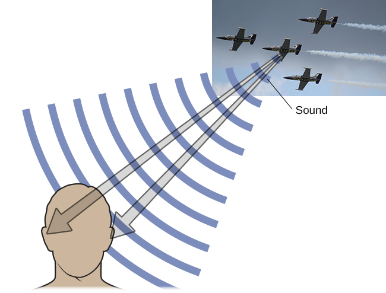
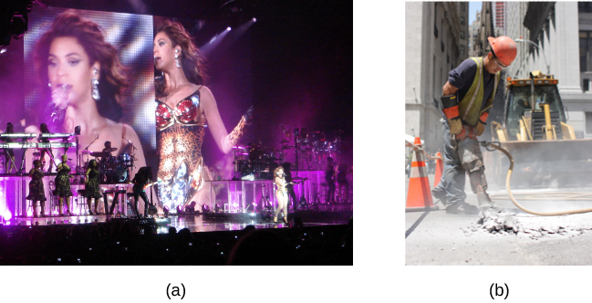

# 5.4 Thính giác

> [!info]
>
> ### Mục tiêu học tập
>
> Kết thúc phần này, bạn sẽ có thể:
>
> - Mô tả giải phẫu cơ bản và chức năng của hệ thính giác
> - Giải thích cách chúng ta mã hóa và tri giác cao độ
> - Thảo luận về cách chúng ta định vị âm thanh

Hệ thính giác của chúng ta chuyển đổi các sóng áp suất thành những âm thanh có ý nghĩa.
Điều này đem lại cho chúng ta khả năng lắng nghe những âm thanh của tự nhiên, thưởng thức vẻ đẹp của âm nhạc và giao tiếp với nhau thông qua ngôn ngữ nói.
Phần này sẽ cung cấp một cái nhìn tổng quan về giải phẫu cơ bản và chức năng của hệ thính giác.
Nội dung bao gồm phần thảo luận về cách thức kích thích cảm giác được chuyển đổi thành các xung thần kinh, nơi thông tin đó được xử lý trong não bộ, cách chúng ta tri giác cao độ, và cách chúng ta nhận biết âm thanh phát ra từ đâu.

## Giải phẫu hệ thính giác

Tai có thể được chia thành nhiều phần.
Tai ngoài bao gồm **vành tai (pinna)**, tức phần nhìn thấy được nhô ra từ đầu của chúng ta, ống tai, và **màng nhĩ (tympanic membrane)**.
Tai giữa chứa ba mẩu xương cực nhỏ được gọi chung là **chuỗi xương con (ossicles)**, lần lượt mang tên **xương búa (malleus)**, **xương đe (incus)** và **xương bàn đạp (stapes)**.
Tai trong chứa các ống bán khuyên, tham gia vào sự thăng bằng và chuyển động (cảm giác tiền đình), cùng với ốc tai.
**Ốc tai (cochlea)** là một cấu trúc hình vỏ ốc chứa đầy dịch, chứa các tế bào thụ thể cảm giác (tế bào lông) của hệ thính giác ([Hình 5.18](#Figure_05_04_Ear)).

**Hình 5.18** Tai được chia thành ba phần: tai ngoài (vành tai và màng nhĩ), tai giữa (ba xương con: xương búa, xương đe và xương bàn đạp) và tai trong (ốc tai và màng đáy).

Các sóng âm truyền dọc theo ống tai và đập vào màng nhĩ, làm cho nó rung động.
Sự rung động này dẫn đến chuyển động cơ học của ba xương con.
Khi chuỗi xương con chuyển động, xương bàn đạp sẽ ấn vào một lớp màng mỏng của ốc tai được gọi là cửa sổ bầu dục (oval window).
Khi xương bàn đạp ấn vào cửa sổ bầu dục, chất dịch bên trong ốc tai bắt đầu chuyển động sóng, từ đó kích thích các **tế bào lông (hair cells)**, tức các tế bào thụ thể thính giác của tai trong được gắn trên màng đáy.
**Màng đáy (basilar membrane)** là một dải mô mỏng chạy dọc bên trong ốc tai.

Sự kích hoạt của các tế bào lông là một quá trình cơ học: sự kích thích cơ học lên tế bào lông cuối cùng dẫn đến sự kích hoạt điện thế của tế bào.
Khi các tế bào lông được kích hoạt, chúng tạo ra các xung thần kinh truyền dọc theo dây thần kinh thính giác lên não.
Thông tin thính giác được chuyển tiếp đến củ não sinh tư dưới (inferior colliculus), thể gối trong (medial geniculate nucleus) của đồi thị, và cuối cùng đến vỏ não thính giác ở thùy thái dương của não bộ để xử lý.
Tương tự như hệ thị giác, cũng có bằng chứng cho thấy thông tin về nhận diện âm thanh và định vị âm thanh được xử lý theo các luồng song song (Rauschecker & Tian, 2000; Renier et al., 2009).

## Tri giác cao độ

Các tần số khác nhau của sóng âm gắn liền với những khác biệt trong tri giác của chúng ta về cao độ của những âm thanh đó.
Sóng âm tần số thấp có cao độ trầm hơn, và sóng âm tần số cao có cao độ bổng hơn.
Hệ thính giác phân biệt giữa các cao độ khác nhau bằng cách nào?

Một số lý thuyết đã được đề xuất để giải thích tri giác cao độ.
Chúng ta sẽ thảo luận về hai lý thuyết ở đây: thuyết thời gian và thuyết vị trí.
**Thuyết thời gian (temporal theory)** về tri giác cao độ khẳng định rằng tần số được mã hóa bởi mức độ hoạt động phát xung của một nơ-ron cảm giác.
Điều này có nghĩa là một tế bào lông nhất định sẽ phát các điện thế hoạt động tương ứng với tần số của sóng âm.
Mặc dù đây là một lời giải thích rất trực quan, nhưng chúng ta phát hiện được một dải tần số rộng đến mức (20–20.000 Hz) tần số phát xung điện thế hoạt động của tế bào lông không thể giải thích cho toàn bộ phạm vi này.
Do các đặc tính liên quan đến các kênh natri trên màng nơ-ron tham gia vào điện thế hoạt động, luôn có một giới hạn mà tại đó tế bào không thể phát xung nhanh hơn được nữa (Shamma, 2001).

**Thuyết vị trí (place theory)** về tri giác cao độ cho rằng các phần khác nhau của màng đáy nhạy cảm với âm thanh ở các tần số khác nhau.
Cụ thể hơn, phần đáy của màng đáy phản ứng tốt nhất với tần số cao và phần đỉnh (chóp) của màng đáy phản ứng tốt nhất với tần số thấp.
Do đó, các tế bào lông nằm ở phần đáy sẽ được dán nhãn là các thụ thể nhận âm cao, trong khi những tế bào ở phần đỉnh của màng đáy sẽ được dán nhãn là các thụ thể nhận âm trầm (Shamma, 2001).

Trong thực tế, cả hai lý thuyết đều giải thích các khía cạnh khác nhau của tri giác cao độ.
Ở các tần số lên đến khoảng 4000 Hz, rõ ràng là cả tốc độ phát xung điện thế hoạt động lẫn vị trí đều đóng góp vào tri giác của chúng ta về cao độ.
Tuy nhiên, các âm thanh có tần số cao hơn nhiều chỉ có thể được mã hóa bằng cách sử dụng các manh mối vị trí (Shamma, 2001).

## Định vị âm thanh

Khả năng định vị âm thanh trong môi trường xung quanh là một phần quan trọng của **thính giác (hearing)**.
Việc định vị âm thanh có thể được coi là tương tự như cách chúng ta tri giác chiều sâu trong thị trường thị giác.
Giống như các manh mối một mắt và hai mắt cung cấp thông tin về chiều sâu, hệ thính giác sử dụng cả **manh mối một tai (monaural)** và **manh mối hai tai (binaural)** để định vị âm thanh.

Mỗi vành tai tương tác với các sóng âm truyền tới theo cách khác nhau, tùy thuộc vào nguồn phát âm thanh trong mối tương quan với cơ thể chúng ta.
Sự tương tác này cung cấp một manh mối một tai hữu ích trong việc định vị các âm thanh phát ra từ phía trên hoặc phía dưới, và phía trước hoặc phía sau chúng ta.
Các sóng âm mà hai tai bạn tiếp nhận từ các âm thanh đến từ vị trí ngay phía trên, phía dưới, ngay trước mặt hoặc ngay sau lưng bạn sẽ hoàn toàn giống hệt nhau; do đó, các manh mối một tai là điều cốt yếu (Grothe, Pecka, & McAlpine, 2010).

Mặt khác, các manh mối hai tai cung cấp thông tin về vị trí của âm thanh dọc theo trục hoành (trục ngang) bằng cách dựa vào sự khác biệt trong các mô hình rung động của màng nhĩ giữa hai tai chúng ta.
Nếu một âm thanh phát ra từ một vị trí lệch tâm, nó sẽ tạo ra hai loại manh mối hai tai: sự khác biệt mức độ giữa hai tai và sự khác biệt thời gian giữa hai tai.
**Sự khác biệt mức độ giữa hai tai (interaural level difference)** đề cập đến việc một âm thanh phát ra từ bên phải cơ thể bạn sẽ có cường độ mạnh hơn ở tai phải so với tai trái do sự suy giảm của sóng âm khi nó truyền xuyên qua đầu bạn.
**Sự khác biệt thời gian giữa hai tai (interaural timing difference)** đề cập đến sự khác biệt nhỏ về thời điểm mà một sóng âm nhất định truyền đến mỗi tai ([Hình 5.19](#Figure_05_04_MonInt)).
Một số vùng não nhất định theo dõi những sự khác biệt này để tái hiện vị trí dọc theo trục hoành mà âm thanh bắt nguồn (Grothe et al., 2010).

**Hình 5.19** Việc định vị âm thanh liên quan đến việc sử dụng cả manh mối một tai và manh mối hai tai. (ghi công "máy bay": sửa đổi công trình của Max Pfandl)

## Mất thính lực

**Điếc (deafness)** là tình trạng mất khả năng nghe một phần hoặc hoàn toàn.
Một số người sinh ra đã không có khả năng nghe, điều này được gọi là **điếc bẩm sinh (congenital deafness)**.
Những người khác mắc chứng **mất thính lực dẫn truyền (conductive hearing loss)**, xuất phát từ trục trặc trong việc dẫn truyền năng lượng âm thanh đến ốc tai.
Các nguyên nhân gây mất thính lực dẫn truyền bao gồm tắc nghẽn ống tai, thủng màng nhĩ, các vấn đề về chuỗi xương con hoặc ứ đọng dịch trong khoang giữa màng nhĩ và ốc tai.
Một nhóm người khác mắc chứng mất thính lực tiếp nhận (thần kinh giác quan), đây là dạng mất thính lực phổ biến nhất.
Mất thính lực tiếp nhận có thể do nhiều yếu tố gây ra, chẳng hạn như lão hóa, chấn thương đầu hoặc chấn thương âm học, nhiễm trùng và bệnh tật (như sởi hoặc quai bị), thuốc điều trị, tác động từ môi trường như tiếp xúc với tiếng ồn (mất thính lực do tiếng ồn, như minh họa trong [Hình 5.20](#Figure_05_04_EnFactors)), khối u và độc tố (chẳng hạn như độc tố có trong một số dung môi và kim loại).

**Hình 5.20** Các yếu tố môi trường có thể dẫn đến mất thính lực tiếp nhận bao gồm việc thường xuyên tiếp xúc với âm nhạc lớn hoặc thiết bị thi công xây dựng. (a) Các nghệ sĩ biểu diễn âm nhạc và (b) công nhân xây dựng đều có nguy cơ mắc phải loại mất thính lực này. (ghi công a: sửa đổi công trình của "GillyBerlin_Flickr"/Flickr; ghi công b: sửa đổi công trình của Nick Allen)

Xét về bản chất cơ học của quá trình truyền kích thích sóng âm từ màng nhĩ qua chuỗi xương con đến cửa sổ bầu dục của ốc tai, một mức độ mất thính lực nhất định là điều không thể tránh khỏi theo thời gian.
Với chứng mất thính lực dẫn truyền, các vấn đề về thính giác gắn liền với sự trục trặc trong quá trình rung động của màng nhĩ và/hoặc chuyển động của chuỗi xương con.
Những vấn đề này thường được giải quyết thông qua các thiết bị như máy trợ thính, có chức năng khuếch đại các sóng âm truyền tới để làm cho sự rung động của màng nhĩ và chuyển động của chuỗi xương con dễ diễn ra hơn.

Khi vấn đề thính giác gắn liền với sự thất bại trong việc truyền các tín hiệu thần kinh từ ốc tai lên não, nó được gọi là **mất thính lực tiếp nhận (sensorineural hearing loss)**.
Một căn bệnh dẫn đến mất thính lực tiếp nhận là **bệnh Ménière**.
Mặc dù chưa được hiểu tường tận, bệnh Ménière dẫn đến sự thoái hóa các cấu trúc tai trong có thể gây ra mất thính lực, ù tai (tiếng chuông reo hoặc vo ve liên tục trong tai), **chóng mặt xoay tròn (vertigo)** và tăng áp lực bên trong tai trong (Semaan & Megerian, 2011).
Dạng mất thính lực này không thể điều trị hiệu quả bằng máy trợ thính, nhưng một số cá nhân có thể là ứng viên thích hợp cho phương án cấy ghép ốc tai điện tử.
**Ốc tai điện tử (cochlear implants)** là các thiết bị điện tử bao gồm micrô, bộ xử lý giọng nói và chuỗi điện cực.
Thiết bị tiếp nhận thông tin âm thanh truyền tới và kích thích trực tiếp dây thần kinh thính giác để truyền thông tin lên não bộ.

> [!tip]
>
> ### Liên kết học tập
>
> Xem [video về các ca phẫu thuật cấy ghép ốc tai điện tử](https://openstax.org/l/cochlear) để tìm hiểu thêm.

> [!question]
>
> ### Bạn nghĩ sao?
>
> #### Văn hóa người khiếm thính
>
> Tại Hoa Kỳ và nhiều nơi khác trên thế giới, những người khiếm thính có ngôn ngữ, trường học và phong tục tập quán riêng của họ.
> Điều này được gọi là **văn hóa người khiếm thính (deaf culture)**.
> Ở Hoa Kỳ, những người khiếm thính thường giao tiếp bằng Ngôn ngữ Ký hiệu Mỹ (ASL); ASL không có thành phần lời nói và hoàn toàn dựa trên các dấu hiệu thị giác cùng cử chỉ điệu bộ.
> Phương thức giao tiếp chính yếu là dùng ký hiệu.
> Một trong những giá trị cốt lõi của văn hóa người khiếm thính là tiếp nối các truyền thống như sử dụng ngôn ngữ ký hiệu thay vì dạy trẻ em khiếm thính cố gắng tập nói, đọc khẩu hình miệng hoặc thực hiện phẫu thuật cấy ghép ốc tai điện tử.
>
> Khi một đứa trẻ được chẩn đoán bị điếc, các bậc cha mẹ phải đối mặt với những quyết định vô cùng khó khăn.
> Liệu đứa trẻ nên được theo học tại các trường học hòa nhập bình thường và được dạy cách phát âm bằng lời và đọc khẩu hình?
> Hay đứa trẻ nên được gửi đến một trường học dành riêng cho trẻ khiếm thính để học ASL và được tiếp xúc sâu rộng với văn hóa người khiếm thính?
> Bạn có nghĩ rằng có thể có sự khác biệt trong cách các bậc cha mẹ tiếp cận những quyết định này tùy thuộc vào việc bản thân họ có phải là người khiếm thính hay không?
