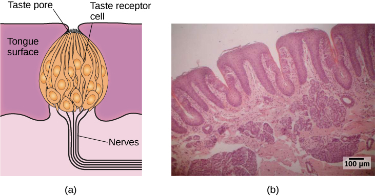
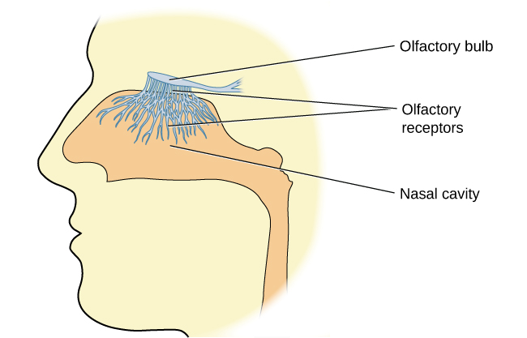
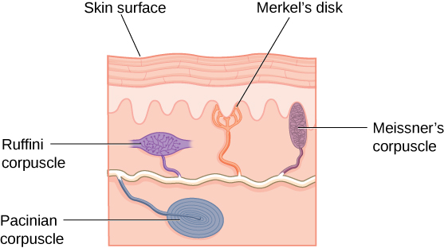
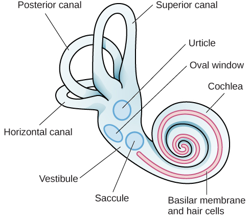

# 5.5 Các giác quan khác

> [!info]
>
> ### Mục tiêu học tập
>
> Kết thúc phần này, bạn sẽ có thể:
>
> - Mô tả các chức năng cơ bản của các giác quan hóa học
> - Giải thích các chức năng cơ bản của các hệ giác quan: cảm giác thân thể (somatosensory), cảm giác đau (nociceptive) và cảm giác nhiệt (thermoceptive)
> - Mô tả các chức năng cơ bản của các hệ giác quan: tiền đình (vestibular), cảm giác bản thể (proprioceptive) và cảm giác vận động (kinesthetic)

Thị giác và thính giác đã nhận được sự quan tâm vô cùng lớn từ các nhà nghiên cứu qua nhiều năm.
Mặc dù vẫn còn nhiều điều cần tìm hiểu về cách thức hoạt động của các hệ giác quan này, nhưng chúng ta hiểu biết về chúng sâu sắc hơn nhiều so với các phương thức giác quan khác.
Trong phần này, chúng ta sẽ khám phá các giác quan hóa học (vị giác và khứu giác) cùng các giác quan cơ thể (xúc giác, nhiệt độ, cơn đau, sự thăng bằng và vị trí cơ thể).

## Các giác quan hóa học

Vị giác (gustation) và **khứu giác (smell)** (olfaction) được gọi là các giác quan hóa học bởi vì cả hai đều có các tế bào thụ thể cảm giác phản ứng với các phân tử trong thức ăn chúng ta ăn hoặc trong không khí chúng ta hít thở.
Có sự tương tác rõ rệt giữa các giác quan hóa học của chúng ta.
Ví dụ, khi chúng ta mô tả hương vị của một món ăn nhất định, chúng ta thực sự đang đề cập đến cả các đặc tính vị giác và khứu giác của món ăn đó khi cùng phối hợp hoạt động.

### Vị giác (Gustation)

Bạn đã học từ thời tiểu học rằng có bốn nhóm vị cơ bản: ngọt, mặn, chua và đắng.
Tuy nhiên, nghiên cứu chứng minh rằng chúng ta có ít nhất sáu nhóm **vị giác (taste)**.
Umami là vị thứ năm của chúng ta.
**Umami** thực chất là một từ tiếng Nhật có thể dịch đại khái là ngon miệng, và nó gắn liền với vị của bột ngọt (monosodium glutamate) (Kinnamon & Vandenbeuch, 2009).
Ngoài ra cũng có một lượng bằng chứng thực nghiệm ngày càng tăng cho thấy rằng chúng ta sở hữu một vị giác để cảm nhận hàm lượng chất béo của một loại thực phẩm nhất định (Mizushige, Inoue, & Fushiki, 2007).

Các phân tử từ thức ăn và đồ uống chúng ta tiêu thụ hòa tan trong nước bọt và tương tác với các thụ thể vị giác trên lưỡi, trong khoang miệng và cổ họng.
**Nụ vị giác (taste buds)** được hình thành bởi các nhóm tế bào thụ thể vị giác với các phần mở rộng giống như sợi lông nhô vào lỗ trung tâm của nụ vị giác ([Hình 5.21](#Figure_05_05_TasteBud)).
Nụ vị giác có vòng đời từ mười ngày đến hai tuần, vì vậy ngay cả khi phá hủy một số nụ vị giác do làm bỏng lưỡi thì cũng không để lại bất kỳ hậu quả lâu dài nào; chúng sẽ mọc lại ngay sau đó.
Các phân tử vị giác liên kết với các thụ thể trên phần mở rộng này và gây ra những thay đổi hóa học bên trong tế bào cảm giác, dẫn đến việc truyền các xung thần kinh lên não qua các dây thần kinh khác nhau, tùy thuộc vào vị trí của thụ thể.
Thông tin vị giác được truyền đến hành tủy, đồi thị, hệ viền (limbic system) và vỏ não vị giác, vốn nằm ẩn bên dưới phần tiếp giáp giữa thùy trán và thùy thái dương (Maffei, Haley, & Fontanini, 2012; Roper, 2013).

**Hình 5.21** (a) Nụ vị giác được cấu thành từ một số tế bào thụ thể vị giác riêng lẻ có nhiệm vụ truyền thông tin đến các dây thần kinh. (b) Ảnh chụp hiển vi này cho thấy góc nhìn cận cảnh bề mặt của lưỡi. (ghi công a: sửa đổi công trình của Jonas Töle; ghi công b: dữ liệu thanh tỷ lệ từ Matt Russell)

### Khứu giác (Olfaction)

Các tế bào **thụ thể khứu giác (olfactory receptor)** nằm trong lớp màng nhầy ở phần trên cùng của mũi.
Các phần mở rộng nhỏ giống như sợi lông từ các thụ thể này đóng vai trò là nơi để các phân tử mùi hòa tan trong chất nhầy tương tác với các thụ thể hóa học nằm trên các phần mở rộng đó ([Hình 5.22](#Figure_05_05_OlfacRecep)).
Khi một phân tử mùi liên kết với một thụ thể nhất định, những thay đổi hóa học bên trong tế bào sẽ tạo ra các tín hiệu truyền đến **hành khứu giác (olfactory bulb)**: một cấu trúc hình củ nằm ở đầu thùy trán, nơi các dây thần kinh khứu giác bắt đầu.
Từ hành khứu giác, thông tin được gửi đến các vùng của hệ viền và vỏ não khứu giác sơ cấp, nằm rất gần vỏ não vị giác (Lodovichi & Belluscio, 2012; Spors et al., 2013).

**Hình 5.22** Các thụ thể khứu giác là những phần giống như sợi lông kéo dài từ hành khứu giác vào lớp màng nhầy của khoang mũi.

Có sự biến thiên to lớn về độ nhạy cảm của hệ khứu giác giữa các loài khác nhau.
Chúng ta thường nghĩ loài chó có hệ khứu giác vượt trội hơn chúng ta rất nhiều, và quả thực, loài chó có thể làm được một số điều phi thường bằng chiếc mũi của mình.
Có một số bằng chứng cho thấy chó có thể “ngửi” thấy sự sụt giảm nguy hiểm của lượng đường trong máu cũng như các khối u ung thư (Wells, 2010).
Khả năng khứu giác phi thường của chó có thể là do số lượng gen chức năng mã hóa cho các thụ thể khứu giác tăng cao (từ 800 đến 1200 gen), so với chưa đầy 400 gen được quan sát thấy ở người và các loài linh trưởng khác (Niimura & Nei, 2007).

Nhiều loài phản ứng với các thông điệp hóa học, được gọi là **pheromone**, do một cá thể khác phát ra (Wysocki & Preti, 2004).
Sự giao tiếp bằng pheromone thường liên quan đến việc cung cấp thông tin về tình trạng sinh sản của bạn tình tiềm năng.
Ví dụ, khi một con chuột cống cái sẵn sàng giao phối, nó sẽ tiết ra các tín hiệu pheromone thu hút sự chú ý của những con chuột đực gần đó.
Sự kích hoạt pheromone thực sự là một thành phần quan trọng trong việc khơi gợi hành vi tình dục ở chuột đực (Furlow, 1996, 2012; Purvis & Haynes, 1972; Sachs, 1997).
Cũng đã có rất nhiều nghiên cứu (và tranh cãi) về pheromone ở con người (Comfort, 1971; Russell, 1976; Wolfgang-Kimball, 1992; Weller, 1998).

## Xúc giác, Cảm giác nhiệt và Cảm giác đau

Một số thụ thể được phân bố trên khắp bề mặt da để phản hồi với các kích thích liên quan đến xúc giác khác nhau ([Hình 5.23](#Figure_05_05_Touch)).
Những thụ thể này bao gồm tiểu thể Meissner, tiểu thể Pacini, đĩa Merkel và tiểu thể Ruffini.
**Tiểu thể Meissner** phản ứng với áp lực và các rung động tần số thấp, trong khi **tiểu thể Pacini** phát hiện áp lực thoáng qua và các rung động tần số cao hơn.
**Đĩa Merkel** phản ứng với áp lực nhẹ, trong khi **tiểu thể Ruffini** phát hiện sự kéo căng (Abraira & Ginty, 2013).

**Hình 5.23** Có nhiều loại thụ thể cảm giác nằm trong da, mỗi loại được điều chỉnh để tiếp nhận các kích thích liên quan đến xúc giác cụ thể.

Ngoài các thụ thể nằm trong da, còn có một số đầu mút thần kinh tự do thực hiện các chức năng cảm giác.
Những đầu mút thần kinh này phản ứng với nhiều loại kích thích xúc giác khác nhau và đóng vai trò là các thụ thể cảm giác cho cả **cảm giác nhiệt (thermoception)** (tri giác nhiệt độ) lẫn **cảm giác đau (nociception)** (tín hiệu chỉ ra tổn hại tiềm tàng và có thể là cơn đau) (Garland, 2012; Petho & Reeh, 2012; Spray, 1986).
Thông tin cảm giác được thu thập từ các thụ thể và các đầu mút thần kinh tự do truyền lên tủy sống và được chuyển tiếp đến các vùng của hành tủy, đồi thị, và cuối cùng đến vỏ não cảm giác thân thể, nằm ở hồi sau trung tâm của thùy đỉnh.

### Tri giác cơn đau

Cơn đau là một trải nghiệm khó chịu bao gồm cả các thành phần thể chất và tâm lý.
Cảm nhận được cơn đau mang tính thích nghi cao độ vì nó giúp chúng ta nhận thức được một tổn thương, và thôi thúc chúng ta rời xa nguyên nhân gây ra tổn thương đó.
Ngoài ra, cơn đau cũng khiến chúng ta ít có khả năng phải chịu thêm các tổn thương thứ phát vì chúng ta sẽ nhẹ nhàng, cẩn trọng hơn với các bộ phận cơ thể đang bị thương của mình.

Nói một cách khái quát, cơn đau có thể được coi là mang bản chất thần kinh hoặc bản chất viêm.
Cơn đau báo hiệu một loại tổn thương mô nào đó được gọi là **cơn đau do viêm (inflammatory pain)**.
Trong một số tình huống, cơn đau xuất phát từ sự tổn thương các nơ-ron của hệ thần kinh ngoại biên hoặc hệ thần kinh trung ương.
Kết quả là, các tín hiệu đau truyền lên não bộ bị phóng đại quá mức.
Loại đau này được gọi là **cơn đau thần kinh (neuropathic pain)**.
Nhiều lựa chọn điều trị để giảm đau dao động từ liệu pháp thư giãn, sử dụng thuốc giảm đau, cho đến kích thích não sâu.
Phương án điều trị hiệu quả nhất cho một cá nhân cụ thể sẽ phụ thuộc vào một số cân nhắc, bao gồm mức độ nghiêm trọng và sự dai dẳng của cơn đau cùng các tình trạng y tế/tâm lý kèm theo.

Một số cá nhân sinh ra đã không có khả năng cảm nhận cơn đau.
Rối loạn di truyền rất hiếm gặp này được gọi là **chứng mất cảm giác đau bẩm sinh** (hay **chứng vô cảm đau bẩm sinh - congenital analgesia**).
Mặc dù những người mắc chứng vô cảm đau bẩm sinh có thể phát hiện sự khác biệt về nhiệt độ và áp lực, họ lại không thể cảm nhận được cơn đau.
Kết quả là, họ thường phải gánh chịu những chấn thương nặng nề.
Trẻ nhỏ thường bị thương tích nghiêm trọng ở miệng và lưỡi do tự cắn vào mình nhiều lần.
Không có gì đáng ngạc nhiên khi những cá nhân mắc chứng rối loạn này có tuổi thọ ngắn hơn nhiều do các chấn thương và các đợt nhiễm trùng thứ phát tại các vị trí bị tổn thương (U.S. National Library of Medicine, 2013).

> [!tip]
>
> ### Liên kết học tập
>
> Xem [video về chứng mất cảm giác đau bẩm sinh](https://openstax.org/l/congenital) để tìm hiểu thêm.

## Cảm giác tiền đình, Cảm giác bản thể và Cảm giác vận động

**Cảm giác tiền đình (vestibular sense)** đóng góp vào khả năng duy trì sự thăng bằng và tư thế cơ thể của chúng ta.
Như [Hình 5.24](#Figure_05_05_Vestibular) minh họa, các cơ quan cảm giác chính (xoan nang, cầu nang và ba ống bán khuyên) của hệ thống này nằm cạnh ốc tai ở tai trong.
Các cơ quan tiền đình chứa đầy dịch và có các tế bào lông, tương tự như các tế bào lông được tìm thấy trong hệ thính giác, phản ứng với chuyển động của đầu và các lực hấp dẫn.
Khi các tế bào lông này được kích thích, chúng sẽ gửi tín hiệu lên não thông qua dây thần kinh tiền đình.
Mặc dù chúng ta có thể không nhận thức có ý thức về thông tin cảm giác của hệ tiền đình trong điều kiện bình thường, tầm quan trọng của nó trở nên rất rõ ràng khi chúng ta bị say tàu xe và/hoặc chóng mặt liên quan đến các bệnh nhiễm trùng tai trong (Khan & Chang, 2013).

**Hình 5.24** Các cơ quan cảm giác chính của hệ tiền đình nằm cạnh ốc tai ở tai trong. Chúng bao gồm xoan nang (utricle), cầu nang (saccule) và ba ống bán khuyên (sau, trên và ngang).

Ngoài việc duy trì sự thăng bằng, hệ tiền đình còn thu thập các thông tin quan trọng để kiểm soát chuyển động và các phản xạ điều khiển các bộ phận khác nhau của cơ thể nhằm bù trừ cho những thay đổi về tư thế thân thể.
Do đó, cả **cảm giác bản thể (proprioception)** (tri giác về vị trí cơ thể) và **cảm giác vận động (kinesthesia)** (tri giác về chuyển động của cơ thể qua không gian) đều tương tác mật thiết với thông tin do hệ tiền đình cung cấp.

Các hệ thống cảm giác này cũng thu thập thông tin từ các thụ thể phản ứng với sự kéo căng và sức căng ở cơ bắp, khớp, da và gân (Lackner & DiZio, 2005; Proske, 2006; Proske & Gandevia, 2012).
Thông tin bản thể và vận động truyền lên não thông qua cột tủy sống.
Một số vùng vỏ não bên cạnh tiểu não tiếp nhận thông tin từ các cơ quan cảm giác của hệ bản thể và vận động, đồng thời gửi thông tin phản hồi trở lại.
