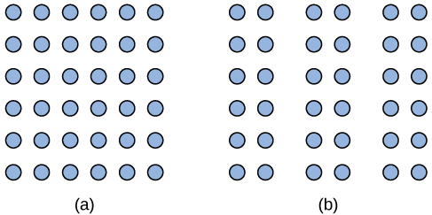
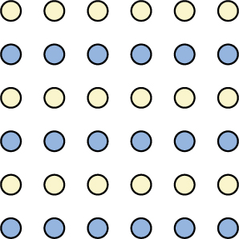
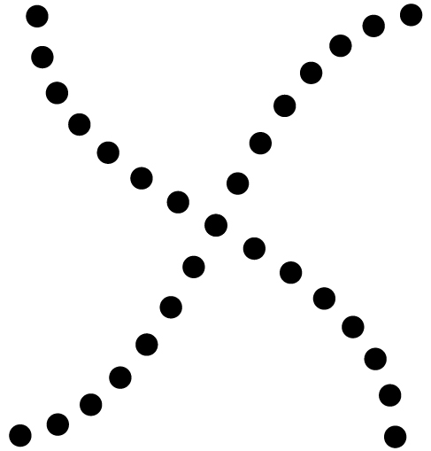
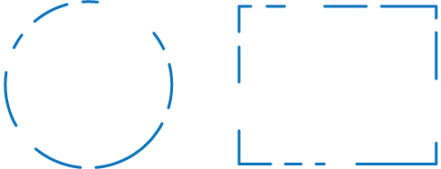

# 5.6 Các nguyên lý tri giác Gestalt

> [!info]
>
> ### Mục tiêu học tập
>
> Kết thúc phần này, bạn sẽ có thể:
>
> - Giải thích mối quan hệ hình - nền (figure-ground)
> - Định nghĩa các nguyên lý nhóm Gestalt
> - Mô tả cách định hướng tri giác chịu ảnh hưởng bởi các đặc điểm và trạng thái tinh thần của một cá nhân

Vào đầu thế kỷ 20, Max Wertheimer đã công bố một bài báo chứng minh rằng các cá nhân có thể tri giác chuyển động trong các hình ảnh tĩnh nhấp nháy nhanh chóng—một sự thấu hiểu sâu sắc nảy sinh khi ông sử dụng chiếc kính hoạt nghiệm đồ chơi (tachistoscope) của trẻ em.
Wertheimer cùng các trợ lý của mình là Wolfgang Köhler và Kurt Koffka, những người sau này trở thành cộng sự của ông, tin rằng tri giác liên quan đến nhiều điều hơn là chỉ đơn thuần kết hợp các kích thích cảm giác lại với nhau.
Niềm tin này đã dẫn đến một phong trào mới trong lĩnh vực tâm lý học được gọi là **tâm lý học Gestalt**.
Từ *gestalt* theo nghĩa đen có nghĩa là hình dạng hoặc hình mẫu, nhưng cách sử dụng nó phản ánh ý tưởng rằng cái toàn thể khác biệt với tổng các bộ phận cấu thành nên nó.
Nói cách khác, não bộ tạo ra một tri giác vượt xa tổng các tín hiệu cảm giác đầu vào sẵn có, và nó thực hiện điều đó theo những cách thức có thể dự đoán được.
Các nhà tâm lý học Gestalt đã chuyển hóa những cách thức dự đoán được này thành các nguyên lý mà qua đó chúng ta tổ chức thông tin cảm giác.
Do đó, tâm lý học Gestalt đã có sức ảnh hưởng vô cùng sâu rộng trong lĩnh vực cảm giác và tri giác (Rock & Palmer, 1990).

Một nguyên lý Gestalt nổi bật là **mối quan hệ hình - nền (figure-ground relationship)**.
Theo nguyên lý này, chúng ta có xu hướng phân chia thế giới thị giác của mình thành "hình" (figure) và "nền" (ground).
"Hình" là vật thể hoặc con người đóng vai trò là tâm điểm của thị trường, trong khi "nền" là bối cảnh phía sau.
Như [Hình 5.25](#Figure_05_06_FacesVase) minh họa, tri giác của chúng ta có thể biến đổi rất lớn, tùy thuộc vào cái gì được tri giác là "hình" và cái gì được tri giác là "nền".
Có thể phỏng đoán rằng, khả năng chúng ta diễn giải thông tin cảm giác phụ thuộc vào những gì chúng ta gán nhãn là hình và những gì chúng ta gán nhãn là nền trong bất kỳ trường hợp cụ thể nào, mặc dù giả định này cũng từng bị đặt dấu hỏi (Peterson & Gibson, 1994; Vecera & O’Reilly, 1998).

**Hình 5.25** Khái niệm về mối quan hệ hình - nền giải thích tại sao hình ảnh này có thể được tri giác là một chiếc bình hoa hoặc một đôi khuôn mặt đối diện nhau.

Một nguyên lý Gestalt khác để tổ chức các kích thích cảm giác thành tri giác có ý nghĩa là **quy luật lân cận (proximity)**.
Nguyên lý này khẳng định rằng những thứ ở gần nhau có xu hướng được nhóm lại với nhau, như minh họa trong [Hình 5.26](#Figure_05_06_Proximity).

**Hình 5.26** Nguyên lý lân cận Gestalt gợi ý rằng bạn nhìn thấy (a) một khối các chấm ở phía bên trái và (b) ba cột ở phía bên phải.

Cách chúng ta đọc chữ cung cấp một minh họa khác cho khái niệm lân cận.
Ví dụ, chúng ta đọc câu này như thế này, chứkhôngphả inh ưthếnà yh aynhưk ia.
Chúng ta nhóm các chữ cái của một từ nhất định lại với nhau vì không có khoảng cách giữa các chữ cái, và chúng ta tri giác các từ bởi vì có khoảng trắng ngăn cách giữa mỗi từ.
Dưới đây là một vài ví dụ khác: Bạ nc óthể đọ cđượ ccâ unà ykh ông?
Nhữn gtừ nà yc óýn ghĩ agì?

Chúng ta cũng có thể sử dụng nguyên lý **tương đồng (similarity)** để nhóm các sự vật trong thị trường của mình.
Theo nguyên lý này, những thứ giống nhau có xu hướng được nhóm lại với nhau ([Hình 5.27](#Figure_05_06_Similarity)).
Ví dụ, khi xem một trận bóng đá, chúng ta có xu hướng nhóm các cầu thủ lại dựa trên màu sắc đồng phục của họ.
Khi xem một đợt tấn công, chúng ta có thể nhận biết rõ ràng hai đội bóng chỉ đơn giản bằng cách nhóm theo chiều kích màu sắc này.

**Hình 5.27** Khi nhìn vào mảng chấm này, chúng ta có xu hướng tri giác các hàng màu sắc xen kẽ nhau. Chúng ta đang nhóm các chấm này lại theo nguyên lý tương đồng.

Hai nguyên lý Gestalt bổ sung khác là quy luật **liên tục** (hay **sự liên tục tốt - good continuation**) và **khép kín**.
Quy luật liên tục gợi ý rằng chúng ta có nhiều khả năng tri giác các đường liên tục, mượt mà uyển chuyển hơn là các đường gãy khúc, đứt đoạn ([Hình 5.28](#Figure_05_06_Continuity)).
**Nguyên lý khép kín (closure)** tuyên bố rằng chúng ta tổ chức các tri giác của mình thành các vật thể trọn vẹn, hoàn chỉnh thay vì như một chuỗi các bộ phận rời rạc ([Hình 5.29](#Figure_05_06_Closure)).

**Hình 5.28** Sự liên tục tốt gợi ý rằng chúng ta có nhiều khả năng tri giác hình này như hai đường thẳng giao nhau bắt chéo, thay vì bốn đường thẳng gặp nhau tại tâm điểm.

**Hình 5.29** Quy luật khép kín gợi ý rằng chúng ta sẽ tri giác một hình tròn và một hình chữ nhật hoàn chỉnh thay vì một chuỗi các đoạn thẳng ngắt quãng.

> [!tip]
>
> ### Liên kết học tập
>
> Xem [video minh họa các ví dụ thực tế về các nguyên lý Gestalt](https://openstax.org/l/gestalt) để tìm hiểu thêm.

Theo các nhà lý thuyết Gestalt, **tri giác hình mẫu (pattern perception)**, tức khả năng phân biệt giữa các hình thù và hình dạng khác nhau của chúng ta, diễn ra bằng cách tuân theo các nguyên lý được mô tả ở trên.
Bạn có thể cảm thấy khá chắc chắn rằng tri giác của mình khớp hoàn toàn chính xác với thế giới thực, nhưng điều này không phải lúc nào cũng đúng.
Tri giác của chúng ta dựa trên các **giả thuyết tri giác (perceptual hypotheses)**: những phán đoán có cơ sở mà chúng ta đưa ra trong khi diễn giải thông tin cảm giác.
Những giả thuyết này chịu sự định hướng bởi một số yếu tố, bao gồm tính cách, kinh nghiệm và kỳ vọng của chúng ta.
Chúng ta sử dụng những giả thuyết này để tạo ra định hướng tri giác (perceptual set) của mình.
Ví dụ, nghiên cứu đã chứng minh rằng những người được mồi từ ngữ (verbal priming) sẽ đưa ra cách diễn giải thiên lệch về các hình ảnh mơ hồ phức tạp (Goolkasian & Woodberry, 2010).

> [!note]
>
> ### Đào sâu tìm hiểu
>
> #### Chiều sâu của tri giác: Thiên kiến, Định kiến và Các yếu tố văn hóa
>
> Trong chương này, bạn đã học được rằng tri giác là một quá trình phức tạp.
> Được xây dựng từ cảm giác, nhưng chịu ảnh hưởng bởi chính những kinh nghiệm, thiên kiến, định kiến và nền **văn hóa (cultures)** của chúng ta, các tri giác có thể rất khác nhau giữa người này với người khác.
> Nghiên cứu gợi ý rằng **định kiến (prejudice)** chủng tộc tiềm ẩn và các **khuôn mẫu (stereotypes)** ảnh hưởng đến tri giác.
> Ví dụ, một số nghiên cứu đã chứng minh rằng những người tham gia không phải người da đen nhận diện vũ khí nhanh hơn và có nhiều khả năng nhận diện các vật dụng không phải vũ khí thành vũ khí khi hình ảnh của vũ khí được ghép đôi với hình ảnh của một người da đen (Payne, 2001; Payne, Shimizu, & Jacoby, 2005).
> Hơn nữa, quyết định bắn một mục tiêu có vũ khí trong trò chơi điện tử của những cá nhân da trắng được đưa ra nhanh hơn khi mục tiêu đó là người da đen (Correll, Park, Judd, & Wittenbrink, 2002; Correll, Urland, & Ito, 2006).
> Nghiên cứu này có ý nghĩa quan trọng khi xét đến số lượng các vụ án rất nổi cộm trong vài thập kỷ qua, trong đó những người da đen bị giết hại bởi những người tuyên bố họ tin rằng các nạn nhân không có vũ khí đó đang mang theo vũ khí và/hoặc đại diện cho mối đe dọa đối với sự an toàn cá nhân của họ.
