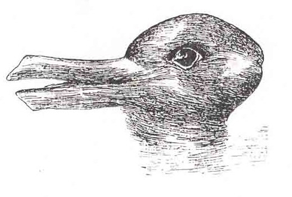

# Câu hỏi tư duy phản biện

**26.** Không phải mọi thứ được cảm nhận đều được tri giác.
Theo bạn, liệu có bao giờ xảy ra trường hợp một điều gì đó được tri giác mà không hề được cảm nhận trước đó không?

**27.** Hãy đưa ra một ví dụ mới mẻ về cách mà sự khác biệt vừa đủ nhận thấy (jnd) có thể thay đổi tùy theo cường độ ban đầu của kích thích.

**28.** Theo bạn, tại sao các loài sinh vật khác lại có phạm vi độ nhạy cảm đối với các kích thích thị giác và thính giác khác biệt lớn đến vậy so với con người?

**29.** Theo bạn, tại sao con người lại đặc biệt nhạy cảm với những âm thanh có tần số rơi vào khoảng giữa của dải nghe được?

**30.** Hãy so sánh hai lý thuyết về tri giác màu sắc.
Liệu chúng có hoàn toàn khác biệt và mâu thuẫn với nhau không?

**31.** Màu sắc không phải là một đặc tính vật lý khách quan của môi trường chúng ta.
Theo bạn, thị giác màu sắc phục vụ chức năng gì (nếu có)?

**32.** Dựa trên những gì bạn đã đọc về định vị âm thanh, từ góc nhìn tiến hóa, việc định vị âm thanh tạo điều kiện thuận lợi cho sự sinh tồn như thế nào?

**33.** Thuyết thời gian và thuyết vị trí có thể cùng được sử dụng như thế nào để giải thích khả năng tri giác cao độ của sóng âm có tần số lên đến 4000 Hz của chúng ta?

**34.** Nhiều người bị buồn nôn khi đi ô tô, máy bay hoặc tàu thuyền.
Bạn có thể giải thích hiện tượng này như một hệ quả của sự tương tác cảm giác như thế nào?

**35.** Nếu bạn nghe ai đó nói rằng họ sẵn sàng làm bất cứ điều gì để không phải cảm thấy nỗi đau đớn gắn liền với một chấn thương nghiêm trọng, bạn sẽ phản hồi như thế nào dựa trên những gì bạn vừa đọc?

**36.** Bạn có nghĩ rằng giới tính sinh học của một người ảnh hưởng đến cách họ trải nghiệm cơn đau không?
Tại sao bạn lại nghĩ như vậy?

**37.** Tôn chỉ trung tâm của tâm lý học Gestalt là cái toàn thể khác biệt với tổng các bộ phận của nó.
Điều này có ý nghĩa gì trong bối cảnh của tri giác?

**38.** Hãy quan sát hình ảnh dưới đây.
Bạn có thể tác động bằng cách nào để khiến mọi người nhìn thấy một con vịt hay một con thỏ?

**Hình 5.30**
