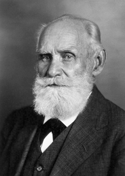
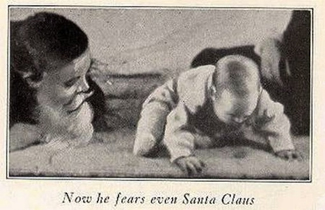

# 6.2 Điều kiện hóa cổ điển

> [!info]
>
> ### Mục tiêu học tập
>
> Kết thúc phần này, bạn sẽ có thể:
>
> - Giải thích cách thức điều kiện hóa cổ điển diễn ra
> - Tóm tắt các quá trình tiếp thu, dập tắt, phục hồi tự phát, khái quát hóa và phân biệt kích thích

Cái tên Ivan **Pavlov** có gợi lên cho bạn điều gì quen thuộc không?
Ngay cả khi bạn mới bắt đầu tìm hiểu về tâm lý học, rất có thể bạn đã từng nghe nói về Pavlov và những chú chó nổi tiếng của ông.

Pavlov (1849–1936), một nhà khoa học người Nga, đã thực hiện những nghiên cứu sâu rộng trên loài chó và được biết đến nhiều nhất nhờ các thí nghiệm về **điều kiện hóa (conditioning)** cổ điển ([Hình 6.3](#Figure06_02_Pavlov)).
Như chúng ta đã thảo luận ngắn gọn trong phần trước, **điều kiện hóa cổ điển (classical conditioning)** là một quá trình mà qua đó chúng ta học cách liên kết các kích thích và nhờ đó, biết dự đoán trước các sự kiện.

**Hình 6.3** Nghiên cứu của Ivan Pavlov về hệ tiêu hóa của loài chó đã bất ngờ dẫn đến việc ông phát hiện ra quá trình học tập mà ngày nay được gọi là điều kiện hóa cổ điển.

Pavlov đi đến những kết luận của mình về cách thức quá trình học tập diễn ra hoàn toàn là do tình cờ.
Pavlov vốn là một nhà sinh lý học, không phải một nhà tâm lý học.
Các nhà sinh lý học nghiên cứu các quá trình sống của sinh vật, từ cấp độ phân tử đến cấp độ tế bào, hệ cơ quan và toàn bộ cơ thể sinh vật.
Lĩnh vực mà Pavlov quan tâm là hệ tiêu hóa (Hunt, 2007).
Trong các nghiên cứu của mình với loài chó, Pavlov đo lượng nước bọt tiết ra để phản ứng với các loại thức ăn khác nhau.
Theo thời gian, Pavlov (1927) quan sát thấy những chú chó bắt đầu tiết nước bọt không chỉ khi nếm thức ăn, mà còn khi nhìn thấy thức ăn, khi nhìn thấy chiếc bát đựng thức ăn trống rỗng, và thậm chí ngay khi vừa nghe thấy tiếng bước chân của những người trợ tá phòng thí nghiệm.
Tiết nước bọt khi thức ăn chạm vào miệng là một phản xạ tự nhiên, không cần qua học tập.
Tuy nhiên, loài chó không tự nhiên tiết nước bọt khi nhìn thấy một chiếc bát rỗng hoặc khi nghe thấy tiếng bước chân.

Những phản ứng bất thường này đã gợi sự tò mò mạnh mẽ ở Pavlov, và ông tự hỏi điều gì đã tạo nên cái mà ông gọi là “sự tiết dịch do tâm lý” (psychic secretions) của những chú chó (Pavlov, 1927).
Để khám phá hiện tượng này một cách khách quan, Pavlov đã thiết kế một loạt thí nghiệm được kiểm soát cẩn thận nhằm xem xét những kích thích nào sẽ khiến loài chó tiết nước bọt.
Ông đã huấn luyện thành công những chú chó tiết nước bọt để đáp ứng với các kích thích rõ ràng không hề liên quan gì đến thức ăn, chẳng hạn như tiếng chuông reo, ánh đèn lóe lên và một cái chạm nhẹ vào chân.
Thông qua các thí nghiệm của mình, Pavlov nhận ra rằng một sinh vật có hai loại phản ứng trước môi trường sống của nó: (1) các phản ứng không điều kiện (không qua học tập), tức các phản xạ tự nhiên, và (2) các phản ứng có điều kiện (học được).

Trong các thí nghiệm của Pavlov, những chú chó tiết nước bọt mỗi khi bột thịt được đưa ra trước mặt chúng.
Bột thịt trong tình huống này là một **kích thích không điều kiện (unconditioned stimulus - UCS)**: một kích thích khơi gợi một phản xạ tự nhiên ở một sinh vật.
Sự tiết nước bọt của những chú chó là một **phản ứng không điều kiện (unconditioned response - UCR)**: một phản ứng tự nhiên (không qua học tập) trước một kích thích nhất định.
Trước khi điều kiện hóa, hãy hình dung về kích thích và phản ứng của những chú chó như sau:

$$\text{Bột thịt (UCS)} \rightarrow \text{Tiết nước bọt (UCR)}$$

Trong điều kiện hóa cổ điển, một kích thích trung tính được trình diện ngay trước một kích thích không điều kiện.
Pavlov sẽ phát ra một âm thanh (chẳng hạn như rung chuông) và sau đó đưa bột thịt cho những chú chó ([Hình 6.4](#Figure06_02_Classical)).
Âm thanh đó là **kích thích trung tính (neutral stimulus - NS)**: một kích thích vốn không tự nhiên khơi gợi một phản ứng.
Trước khi điều kiện hóa, những chú chó không hề tiết nước bọt khi chỉ nghe thấy tiếng chuông bởi vì âm thanh này hoàn toàn chưa có bất kỳ sự liên hệ nào đối với chúng.

$$\text{Tiếng chuông (NS)} + \text{Bột thịt (UCS)} \rightarrow \text{Tiết nước bọt (UCR)}$$

Khi Pavlov ghép đôi tiếng chuông với bột thịt lặp đi lặp lại nhiều lần, kích thích trung tính trước đó (tiếng chuông) cũng bắt đầu gợi ra phản xạ tiết nước bọt từ những chú chó.
Do đó, kích thích trung tính đã biến thành **kích thích có điều kiện (conditioned stimulus - CS)**: một kích thích gợi ra một phản ứng sau khi đã được ghép đôi liên tục với một kích thích không điều kiện.
Cuối cùng, những chú chó bắt đầu tiết nước bọt khi chỉ nghe tiếng chuông đơn thuần, giống như cách chúng từng tiết nước bọt trước tiếng bước chân của các trợ tá trước đây.
Hành vi do kích thích có điều kiện gây ra được gọi là **phản ứng có điều kiện (conditioned response - CR)**.
Trong trường hợp những chú chó của Pavlov, chúng đã học cách liên kết tiếng chuông (CS) với việc được cho ăn, và chúng bắt đầu tiết nước bọt (CR) để đón đợi thức ăn.

$$\text{Tiếng chuông (CS)} \rightarrow \text{Tiết nước bọt (CR)}$$

**Hình 6.4** Trước khi điều kiện hóa, kích thích không điều kiện (thức ăn) tạo ra phản ứng không điều kiện (tiết nước bọt), và kích thích trung tính (tiếng chuông) không tạo ra phản ứng. Trong quá trình điều kiện hóa, kích thích không điều kiện (thức ăn) được đưa ra lặp đi lặp lại ngay sau khi xuất hiện kích thích trung tính (tiếng chuông). Sau khi điều kiện hóa, kích thích trung tính đơn thuần đã tạo ra phản ứng có điều kiện (tiết nước bọt), qua đó trở thành một kích thích có điều kiện.

> [!tip]
>
> ### Liên kết học tập
>
> Xem [video về Pavlov và những chú chó của ông](https://openstax.org/l/pavlov2) để tìm hiểu thêm.

## Ứng dụng thực tế của Điều kiện hóa cổ điển

Điều kiện hóa cổ điển hoạt động như thế nào trong thế giới thực?
Hãy xem xét trường hợp của Moisha, một bệnh nhân được chẩn đoán mắc bệnh ung thư.
Khi trải qua đợt hóa trị đầu tiên, cô đã bị nôn mửa ngay sau khi các hóa chất được tiêm vào người.
Trên thực tế, mỗi lần đến gặp bác sĩ để hóa trị, cô đều nôn mửa ngay sau khi tiêm thuốc.
Quá trình điều trị của Moisha đã thành công và căn bệnh ung thư của cô đã thuyên giảm hoàn toàn.
Giờ đây, mỗi khi đến phòng khám của bác sĩ chuyên khoa ung thư định kỳ 6 tháng một lần để kiểm tra lại, cô lại cảm thấy buồn nôn dữ dội.
Trong trường hợp này, các loại thuốc hóa trị là kích thích không điều kiện (UCS), nôn mửa là phản ứng không điều kiện (UCR), phòng khám của bác sĩ trở thành kích thích có điều kiện (CS) sau khi được ghép đôi với UCS, và cảm giác buồn nôn là phản ứng có điều kiện (CR).
Hãy giả định rằng các loại thuốc hóa trị mà Moisha sử dụng được đưa vào qua ống tiêm.
Sau khi bước vào phòng khám của bác sĩ, Moisha nhìn thấy một ống tiêm, và sau đó được tiêm thuốc.
Bên cạnh phòng khám của bác sĩ, Moisha cũng sẽ học cách liên kết chiếc ống tiêm với thuốc và sẽ phản ứng với các ống tiêm bằng cảm giác buồn nôn.
Đây là một ví dụ về điều kiện hóa bậc cao (hoặc bậc hai), khi kích thích có điều kiện (phòng khám của bác sĩ) đóng vai trò điều kiện hóa cho một kích thích khác (ống tiêm).
Rất khó để đạt được bất kỳ sự điều kiện hóa nào vượt quá bậc hai.
Ví dụ, nếu ai đó rung chuông mỗi khi Moisha được tiêm thuốc hóa trị tại phòng khám của bác sĩ, Moisha nhiều khả năng sẽ không bao giờ cảm thấy buồn nôn khi chỉ nghe tiếng chuông đơn thuần.

Hãy xem xét một ví dụ khác về điều kiện hóa cổ điển.
Giả sử bạn nuôi một cô mèo tên là Tiger, rất được nuông chiều.
Bạn cất thức ăn của nó trong một chiếc tủ riêng biệt, và bạn cũng có một chiếc máy mở đồ hộp chạy điện đặc biệt chỉ dùng để mở các lon thức ăn cho mèo.
Cứ đến bữa ăn, Tiger lại nghe thấy âm thanh đặc trưng của chiếc máy mở hộp (“zzhzhz”) và sau đó được cho ăn.
Tiger nhanh chóng học được rằng khi nghe thấy tiếng “zzhzhz”, nó sắp được cho ăn.
Bạn nghĩ Tiger sẽ làm gì khi nghe thấy tiếng máy mở hộp chạy điện?
Rất có thể nó sẽ phấn khích và chạy ngay đến nơi bạn đang chuẩn bị thức ăn.
Đây là một ví dụ về điều kiện hóa cổ điển.
Trong trường hợp này, đâu là UCS, CS, UCR và CR?

Sẽ ra sao nếu chiếc tủ đựng thức ăn của Tiger bị kêu cọt kẹt?
Trong trường hợp đó, Tiger nghe thấy tiếng “két” (tủ mở), tiếng “zzhzhz” (máy mở hộp điện), và sau đó được cho ăn.
Tiger sẽ học cách trở nên phấn khích ngay khi vừa nghe thấy tiếng “két” mở cửa tủ.
Việc ghép đôi một kích thích trung tính mới (tiếng “két”) với kích thích có điều kiện đã được xác lập (tiếng “zzhzhz”) được gọi là **điều kiện hóa bậc cao**, hay **điều kiện hóa bậc hai (second-order conditioning)**.
Điều này có nghĩa là bạn đang sử dụng kích thích có điều kiện của chiếc máy mở hộp để điều kiện hóa cho một kích thích khác: chiếc tủ kêu cọt kẹt ([Hình 6.5](#Figure06_02_SecondOrdr)).
Rất khó để đạt được bất kỳ điều gì vượt quá điều kiện hóa bậc hai.
Chẳng hạn, nếu bạn rung chuông, mở tủ (“két”), dùng máy mở hộp (“zzhzhz”) rồi mới cho Tiger ăn, Tiger nhiều khả năng sẽ không bao giờ phấn khích khi chỉ nghe thấy tiếng chuông đơn độc.

![Một sơ đồ có nhãn “Điều kiện hóa bậc cao / Bậc hai” gồm ba hàng. Hàng thứ nhất cho thấy chiếc máy mở hộp điện có nhãn “kích thích có điều kiện” tiếp theo là dấu cộng rồi đến một đĩa thức ăn có nhãn “kích thích không điều kiện”, theo sau là dấu bằng và hình ảnh chú mèo đang tiết nước bọt có nhãn “phản ứng không điều kiện”. Hàng thứ hai cho thấy cánh cửa tủ cọt kẹt có nhãn “kích thích bậc hai” tiếp theo là dấu cộng rồi đến máy mở hộp điện có nhãn “kích thích có điều kiện”, theo sau là dấu bằng và hình ảnh chú mèo tiết nước bọt có nhãn “phản ứng có điều kiện”. Hàng thứ ba cho thấy cánh cửa tủ cọt kẹt có nhãn “kích thích bậc hai” theo sau là dấu bằng và hình ảnh chú mèo tiết nước bọt có nhãn “phản ứng có điều kiện”.](../../images/img_a10baae011be.jpg)

**Hình 6.5** Trong điều kiện hóa bậc cao, một kích thích có điều kiện đã được thiết lập vững chắc được ghép đôi với một kích thích trung tính mới (kích thích bậc hai), sao cho cuối cùng kích thích mới đó cũng khơi gợi phản ứng có điều kiện mà không cần kích thích có điều kiện ban đầu xuất hiện.

> [!abstract]
>
> ### Kết nối thực tiễn
>
> #### Điều kiện hóa cổ điển tại Thành phố Cá đuối (Stingray City)
>
> Gần đây, Kate và bạn đời của cô đã đi nghỉ dưỡng tại Quần đảo Cayman và đặt một chuyến tham quan bằng thuyền đến Stingray City, nơi họ có thể bơi lội và cho loài cá đuối phương nam ăn.
> Thuyền trưởng đã giải thích cách mà loài cá đuối vốn dĩ có tập tính đơn độc này đã trở nên quen thuộc với việc tương tác với con người như thế nào.
> Cách đây khoảng 40 năm, ngư dân bắt đầu làm sạch cá và ốc xà cừ (kích thích không điều kiện) tại một cồn cát cụ thể gần rạn san hô chắn sóng, và một số lượng lớn cá đuối đã bơi vào để ăn (phản ứng không điều kiện) những gì con người ném xuống nước; điều này tiếp diễn suốt nhiều năm.
> Đến cuối những năm 1980, tiếng lành đồn xa về đàn cá đuối đông đúc này đã lan truyền trong giới thợ lặn, những người sau đó bắt đầu cho chúng ăn bằng tay.
> Theo thời gian, những chú cá đuối phương nam trong khu vực đã bị điều kiện hóa cổ điển giống hệt như những chú chó của Pavlov.
> Khi nghe thấy tiếng động cơ thuyền (kích thích trung tính đã trở thành kích thích có điều kiện), chúng biết rằng mình sẽ được ăn (phản ứng có điều kiện).
>
> Ngay khi thuyền đến Stingray City, hơn hai chục con cá đuối đã bơi vòng quanh vây kín chiếc thuyền du lịch.
> Cặp đôi nhảy xuống nước với những túi đựng mực, món ăn khoái khẩu của loài cá đuối.
> Đàn cá đuối va chạm và cọ xát vào chân họ như những chú mèo đói ([Hình 6.6](#Figure06_02_Stingray)).
> Kate đã có thể cho ăn, vuốt ve và thậm chí hôn (để cầu may) những sinh vật kỳ thú này.
> Rồi khi tất cả số mực đã hết, đàn cá đuối cũng lặn mất tăm.
>
> 
>
> 
>
> **Hình 6.6** Kate ôm một con cá đuối phương nam tại Stingray City ở Quần đảo Cayman. Những con cá đuối này đã được điều kiện hóa cổ điển để liên kết tiếng động cơ thuyền với thức ăn do khách du lịch cung cấp. (ghi công: Kathryn Dumper)

Điều kiện hóa cổ điển cũng áp dụng cho con người, thậm chí cả trẻ sơ sinh.
Ví dụ, Elan mua sữa bột công thức trong những hộp thiếc màu xanh lam cho cô con gái sáu tháng tuổi Angelina.
Bất cứ khi nào Elan lấy hộp sữa ra, Angelina đều trở nên phấn khích, cố với tay về phía thức ăn và rất có thể là tiết nước bọt.
Tại sao Angelina lại phấn khích khi nhìn thấy hộp sữa bột?
Đâu là UCS, CS, UCR và CR ở đây?

Cho đến nay, tất cả các ví dụ đều liên quan đến thức ăn, nhưng điều kiện hóa cổ điển còn mở rộng vượt xa nhu cầu ăn uống cơ bản.
Hãy nhớ lại ví dụ trước đây của chúng ta về một chú chó mà chủ của nó đã lắp đặt một hàng rào điện vô hình.
Một luồng xung điện nhỏ (kích thích không điều kiện) gây ra cảm giác khó chịu (phản ứng không điều kiện).
Khi kích thích không điều kiện (sốc điện) được ghép đôi với một kích thích trung tính (mép sân), chú chó sẽ liên kết sự khó chịu (phản ứng không điều kiện) với mép sân (kích thích có điều kiện) và giữ mình ở yên bên trong ranh giới đã định.
Trong ví dụ này, mép sân gợi lên sự sợ hãi và lo âu ở chú chó.
Sự sợ hãi và lo âu chính là phản ứng có điều kiện.

> [!tip]
>
> ### Liên kết học tập
>
> Xem [đoạn video từ chương trình truyền hình *The Office* để có một góc nhìn hài hước về điều kiện hóa](https://openstax.org/l/theoffice), trong đó Jim đã điều kiện hóa Dwight để cậu này luôn mong đợi một viên kẹo ngậm thơm miệng mỗi khi máy tính của Jim phát ra một âm thanh cụ thể.

## Các quá trình tổng quát trong Điều kiện hóa cổ điển

Bây giờ bạn đã biết cách thức điều kiện hóa cổ điển hoạt động và đã thấy một số ví dụ, hãy cùng xem xét một số quá trình tổng quát liên quan.
Trong điều kiện hóa cổ điển, giai đoạn học tập ban đầu được gọi là **sự tiếp thu (acquisition)**, khi một sinh vật học cách kết nối một kích thích trung tính và một kích thích không điều kiện.
Trong quá trình tiếp thu, kích thích trung tính bắt đầu khơi gợi phản ứng có điều kiện, và cuối cùng kích thích trung tính trở thành một kích thích có điều kiện có khả năng tự mình khơi gợi phản ứng có điều kiện.
Thời điểm là yếu tố rất quan trọng để điều kiện hóa diễn ra.
Thông thường, chỉ nên có một khoảng thời gian ngắn giữa sự xuất hiện của kích thích có điều kiện và kích thích không điều kiện.
Tùy thuộc vào đối tượng được điều kiện hóa, đôi khi khoảng thời gian này chỉ ngắn khoảng năm giây (Chance, 2009).
Tuy nhiên, với các loại điều kiện hóa khác, khoảng thời gian này có thể kéo dài tới vài giờ.

**Sự ghê sợ vị giác (taste aversion)** là một dạng điều kiện hóa trong đó một khoảng thời gian vài giờ có thể trôi qua giữa kích thích có điều kiện (thứ gì đó được ăn vào) và kích thích không điều kiện (hương vị gắn liền với cảm giác buồn nôn hoặc đau bụng bệnh tật).
Dưới đây là một ví dụ: Harry đi hội chợ.
Cậu ăn rất nhiều kẹo bông gòn và tối hôm đó bị ốm nặng rồi nôn mửa.
Ngày hôm sau, một người bạn mời cậu một chiếc kẹo.
Cậu vừa cho kẹo vào miệng thì cảm thấy buồn nôn dữ dội và buộc phải nhổ ra ngay.
Kích thích không điều kiện là việc ăn quá nhiều kẹo bông gòn.
Phản ứng không điều kiện là bị ốm và nôn mửa.
Kích thích có điều kiện là vị ngọt của đường và phản ứng có điều kiện là việc Harry cảm thấy buồn nôn trước vị ngọt của đường.

Làm thế nào điều này có thể xảy ra—sự điều kiện hóa chỉ dựa trên một lần trải nghiệm duy nhất và liên quan đến một khoảng thời gian dài trôi qua giữa sự kiện và kích thích tiêu cực?
Nghiên cứu về sự ghê sợ vị giác gợi ý rằng phản ứng này có thể là một sự thích nghi tiến hóa được thiết kế để giúp các sinh vật nhanh chóng học cách tránh các loại thức ăn độc hại (Garcia & Rusiniak, 1980; Garcia & Koelling, 1966).
Điều này không chỉ đóng góp vào sự sống còn của loài thông qua chọn lọc tự nhiên, mà còn có thể giúp chúng ta phát triển các chiến lược đối phó với những thách thức như giúp bệnh nhân ung thư vượt qua cảm giác buồn nôn do một số phương pháp điều trị gây ra (Holmes, 1993; Jacobsen et al., 1993; Hutton, Baracos, & Wismer, 2007; Skolin et al., 2006).
Garcia và Koelling (1966) không chỉ chứng minh rằng sự ghê sợ vị giác có thể được điều kiện hóa, mà còn chỉ ra rằng có những ràng buộc sinh học đối với quá trình học tập.
Trong nghiên cứu của họ, các nhóm chuột riêng biệt được điều kiện hóa để liên kết vị giác với bệnh tật, hoặc liên kết ánh sáng và âm thanh với bệnh tật.
Kết quả cho thấy tất cả các con chuột tiếp xúc với cặp đôi vị giác - bệnh tật đều học được cách tránh vị đó, nhưng không có con chuột nào tiếp xúc với cặp đôi ánh sáng/âm thanh - bệnh tật học được cách tránh ánh sáng hoặc âm thanh.
Điều này củng cố thêm cho ý tưởng rằng điều kiện hóa cổ điển có thể đóng góp vào sự sinh tồn của loài bằng cách giúp các sinh vật học cách tránh những kích thích gây nguy hiểm thực sự cho sức khỏe và sự an nguy của chúng.

Robert Rescorla đã chứng minh sinh vật có thể học cách dự đoán UCS từ CS mạnh mẽ đến mức nào.
Hãy lấy hai tình huống sau làm ví dụ: Bố của Ari luôn dọn bữa tối lên bàn đều đặn vào lúc 6:00 mỗi ngày.
Mẹ của Soraya thì thay đổi liên tục, có ngày ăn tối lúc 6:00, có ngày ăn lúc 5:00, và những ngày khác lại ăn lúc 7:00.
Đối với Ari, mốc 6:00 dự đoán bữa tối một cách đáng tin cậy và nhất quán, vì vậy Ari nhiều khả năng sẽ bắt đầu cảm thấy đói bụng mỗi ngày ngay trước 6:00, ngay cả khi cậu vừa ăn nhẹ muộn trước đó.
Ngược lại, Soraya sẽ ít có khả năng liên kết 6:00 với bữa tối hơn, vì 6:00 không phải lúc nào cũng báo hiệu rằng bữa tối đang đến.
Rescorla, cùng với đồng nghiệp của ông tại Đại học Yale là Allan Wagner, đã phát triển một công thức toán học có thể được sử dụng để tính toán xác suất một mối liên tưởng sẽ được học dựa trên khả năng của một kích thích có điều kiện trong việc dự đoán sự xuất hiện của một kích thích không điều kiện cùng các yếu tố khác; ngày nay mô hình này được gọi là mô hình Rescorla-Wagner (Rescorla & Wagner, 1972).

Một khi chúng ta đã thiết lập mối liên kết giữa kích thích không điều kiện và kích thích có điều kiện, làm thế nào để chúng ta phá vỡ mối liên kết đó và khiến chú chó, chú mèo hoặc đứa trẻ ngừng phản hồi?
Trong trường hợp của Tiger, hãy tưởng tượng điều gì sẽ xảy ra nếu bạn ngừng sử dụng chiếc máy mở hộp điện cho thức ăn của nó và bắt đầu chỉ dùng nó cho thức ăn của con người.
Giờ đây, Tiger sẽ nghe thấy tiếng máy mở hộp, nhưng nó không nhận được thức ăn.
Theo thuật ngữ điều kiện hóa cổ điển, bạn đang đưa ra kích thích có điều kiện, nhưng không đưa ra kích thích không điều kiện.
Pavlov đã khám phá kịch bản này trong các thí nghiệm với những chú chó của mình: phát ra âm thanh mà không đưa bột thịt cho chúng.
Chẳng mấy chốc, những chú chó đã ngừng phản ứng với âm thanh đó.
**Sự dập tắt (extinction)** là sự suy giảm phản ứng có điều kiện khi kích thích không điều kiện không còn được đưa ra cùng với kích thích có điều kiện nữa.
Khi chỉ xuất hiện kích thích có điều kiện đơn thuần, chú chó, chú mèo hoặc sinh vật khác sẽ bộc lộ phản ứng ngày càng yếu dần, và cuối cùng không còn phản ứng nào nữa.
Theo thuật ngữ điều kiện hóa cổ điển, có sự suy yếu dần và biến mất hoàn toàn của phản ứng có điều kiện.

Điều gì xảy ra khi việc học không được sử dụng trong một thời gian—khi những gì đã học nằm im lìm?
Như chúng ta vừa thảo luận, Pavlov nhận thấy rằng khi ông liên tục rung chuông (kích thích có điều kiện) mà không cho bột thịt (kích thích không điều kiện), sự dập tắt đã diễn ra; những chú chó ngừng tiết nước bọt trước tiếng chuông.
Tuy nhiên, sau một vài giờ nghỉ ngơi khỏi quá trình huấn luyện dập tắt này, những chú chó lại bắt đầu tiết nước bọt khi Pavlov rung chuông.
Bạn nghĩ điều gì sẽ xảy ra với hành vi của Tiger nếu chiếc máy mở hộp điện của bạn bị hỏng và bạn không sử dụng nó trong vài tháng?
Khi bạn sửa xong và bắt đầu dùng lại nó để mở thức ăn cho Tiger, Tiger sẽ nhớ lại mối liên tưởng giữa máy mở hộp và thức ăn của nó—nó sẽ phấn khích và chạy ngay vào bếp khi nghe thấy âm thanh quen thuộc.
Hành vi của những chú chó của Pavlov và mèo Tiger minh họa cho một khái niệm mà Pavlov gọi là **sự phục hồi tự phát (spontaneous recovery)**: sự quay trở lại của một phản ứng có điều kiện đã bị dập tắt trước đó sau một khoảng thời gian nghỉ ngơi ([Hình 6.7](#Figure06_02_Recovery)).

![Một biểu đồ có trục hoành dán nhãn “thời gian” và trục tung dán nhãn “cường độ của CR”; có bốn cột dữ liệu đồ thị. Cột thứ nhất dán nhãn “tiếp thu (CS + UCS)” và đường biểu diễn tăng dốc đứng từ đáy lên đỉnh. Cột thứ hai dán nhãn “Dập tắt (chỉ có CS)” và đường biểu diễn giảm nhanh chóng từ đỉnh xuống đáy. Cột thứ ba dán nhãn “Tạm nghỉ” và không có đường vẽ. Cột thứ tư có đường vẽ bắt đầu từ lưng chừng và giảm mạnh xuống đáy. Tại điểm đường vẽ bắt đầu, nó được dán nhãn “Phục hồi tự phát của CR”; điểm giữa chừng trên đường vẽ dán nhãn “Dập tắt (chỉ có CS)”.](../../images/img_fd8aca6ebcb9.jpg)

**Hình 6.7** Đây là đường cong của sự tiếp thu, sự dập tắt và sự phục hồi tự phát. Đường cong dốc lên cho thấy phản ứng có điều kiện nhanh chóng trở nên mạnh mẽ hơn thông qua việc ghép đôi lặp đi lặp lại kích thích có điều kiện và kích thích không điều kiện (sự tiếp thu). Sau đó, đường cong giảm xuống, cho thấy phản ứng có điều kiện suy yếu như thế nào khi chỉ có kích thích có điều kiện xuất hiện (sự dập tắt). Sau một khoảng thời gian tạm nghỉ hoặc ngừng điều kiện hóa, phản ứng có điều kiện lại tái xuất hiện (sự phục hồi tự phát).

Tất nhiên, những quá trình này cũng hoàn toàn áp dụng được ở con người.
Ví dụ, giả sử mỗi ngày khi bạn đi bộ đến trường đại học, một chiếc xe bán kem đi ngang qua tuyến đường của bạn.
Ngày này qua ngày khác, bạn nghe thấy điệu nhạc của chiếc xe kem (kích thích trung tính), vì vậy cuối cùng bạn dừng lại và mua một que kem sô-cô-la.
Bạn cắn một miếng (kích thích không điều kiện) và miệng bạn ứa nước bọt (phản ứng không điều kiện).
Giai đoạn học tập ban đầu này được gọi là sự tiếp thu, khi bạn bắt đầu kết nối kích thích trung tính (tiếng nhạc xe kem) và kích thích không điều kiện (vị kem sô-cô-la thơm ngon trong miệng).
Trong quá trình tiếp thu, phản ứng có điều kiện ngày càng trở nên mạnh mẽ hơn thông qua việc ghép đôi lặp đi lặp lại giữa kích thích có điều kiện và kích thích không điều kiện.
Vài ngày (và vài que kem) sau đó, bạn nhận thấy miệng mình bắt đầu ứa nước bọt (phản ứng có điều kiện) ngay khi vừa nghe thấy điệu nhạc leng keng của chiếc xe kem—thậm chí trước khi bạn cắn vào que kem.
Rồi một ngày nọ, bạn bước xuống phố.
Bạn nghe thấy tiếng nhạc của chiếc xe kem (kích thích có điều kiện), và miệng bạn ứa nước bọt (phản ứng có điều kiện).
Tuy nhiên, khi bạn đến gần chiếc xe, bạn phát hiện ra họ đã bán hết sạch kem.
Bạn thất vọng rời đi.
Những ngày tiếp theo, bạn đi ngang qua chiếc xe và nghe thấy tiếng nhạc, nhưng không dừng lại mua que kem nào vì bạn đang vội đến lớp.
Bạn bắt đầu tiết nước bọt ít dần đi khi nghe thấy tiếng nhạc, cho đến cuối tuần, miệng bạn không còn ứa nước bọt khi nghe giai điệu đó nữa.
Điều này minh họa cho sự dập tắt.
Phản ứng có điều kiện suy yếu khi chỉ có kích thích có điều kiện (tiếng nhạc xe kem) xuất hiện mà không kèm theo kích thích không điều kiện (kem sô-cô-la trong miệng).
Rồi cuối tuần đến.
Bạn không phải đến lớp, vì vậy bạn không đi ngang qua chiếc xe kem.
Sáng thứ Hai đến và bạn lại đi theo con đường quen thuộc đến trường.
Bạn rẽ qua góc phố và lại nghe thấy tiếng xe kem.
Bạn nghĩ điều gì sẽ xảy ra?
Miệng bạn lại bắt đầu ứa nước bọt.
Tại sao?
Sau một khoảng thời gian tạm nghỉ điều kiện hóa, phản ứng có điều kiện tái xuất hiện, điều này biểu thị sự phục hồi tự phát.

Sự tiếp thu và dập tắt lần lượt liên quan đến việc củng cố tăng cường và làm suy yếu một mối liên tưởng đã học.
Hai quá trình học tập khác—phân biệt kích thích và khái quát hóa kích thích—tham gia vào việc xác định những kích thích nào sẽ kích hoạt các phản ứng học được.
Động vật (bao gồm cả con người) cần phân biệt giữa các kích thích—ví dụ, giữa những âm thanh báo trước một sự kiện nguy hiểm đe dọa và những âm thanh không gây nguy hiểm—để chúng có thể phản ứng một cách phù hợp (chẳng hạn như bỏ chạy nếu âm thanh đó có tính đe dọa).
Khi một sinh vật học cách phản ứng khác nhau đối với các kích thích khác nhau vốn có nét tương đồng, điều đó được gọi là **sự phân biệt kích thích (stimulus discrimination)**.
Theo thuật ngữ điều kiện hóa cổ điển, sinh vật chỉ biểu hiện phản ứng có điều kiện đối với đúng kích thích có điều kiện.
Những chú chó của Pavlov đã phân biệt được giữa âm thanh cơ bản vang lên trước khi chúng được cho ăn với các âm thanh khác (ví dụ: chuông cửa), bởi vì các âm thanh khác không báo trước sự xuất hiện của thức ăn.
Tương tự, chú mèo Tiger phân biệt được giữa tiếng máy mở hộp và tiếng máy trộn bột chạy điện.
Khi máy trộn bột hoạt động, Tiger không sắp được cho ăn, vì vậy nó không chạy vào bếp để tìm thức ăn.
Trong ví dụ khác của chúng ta, Moisha, bệnh nhân ung thư, đã phân biệt được giữa các bác sĩ chuyên khoa ung thư và các loại bác sĩ khác.
Cô đã học được cách không cảm thấy buồn nôn khi đi khám các cuộc hẹn y tế khác, chẳng hạn như đợt khám sức khỏe định kỳ hàng năm.

Mặt khác, khi một sinh vật biểu hiện phản ứng có điều kiện trước các kích thích tương tự như kích thích có điều kiện ban đầu, điều đó được gọi là **sự khái quát hóa kích thích (stimulus generalization)**, quá trình đối lập với phân biệt kích thích.
Một kích thích càng giống với kích thích có điều kiện bao nhiêu, sinh vật càng có nhiều khả năng đưa ra phản ứng có điều kiện bấy nhiêu.
Chẳng hạn, nếu chiếc máy trộn bột điện phát ra âm thanh rất giống với chiếc máy mở hộp điện, Tiger có thể chạy lại sau khi nghe thấy âm thanh đó.
Nhưng nếu bạn không cho nó ăn sau tiếng máy trộn bột, và bạn tiếp tục cho nó ăn đều đặn sau tiếng máy mở hộp, nó sẽ nhanh chóng học cách phân biệt giữa hai âm thanh này (miễn là chúng đủ khác biệt để nó có thể nhận ra).
Trong ví dụ khác của chúng ta, Moisha tiếp tục cảm thấy buồn nôn bất cứ khi nào đến thăm các bác sĩ ung thư khác hoặc các bác sĩ khác làm việc trong cùng tòa nhà với bác sĩ ung thư của cô.

## Thuyết hành vi

John B.
**Watson**, được thể hiện trong [Hình 6.8](#Figure06_02_Watson), được coi là người sáng lập ra thuyết hành vi (behaviorism).
Thuyết hành vi là một trường phái tư tưởng trỗi dậy trong nửa đầu thế kỷ 20, kết hợp các yếu tố của điều kiện hóa cổ điển kiểu Pavlov (Hunt, 2007).
Trái ngược hoàn toàn với Freud, người coi lý do của hành vi ẩn giấu sâu kín trong cõi vô thức, Watson ủng hộ quan điểm cho rằng mọi hành vi đều có thể được nghiên cứu như một phản ứng kích thích - phản ứng (S-R) đơn giản, mà không cần quan tâm đến các quá trình nội tâm bên trong.
Watson lập luận rằng để tâm lý học trở thành một môn khoa học hợp pháp, nó phải chuyển mối quan tâm ra khỏi các quá trình tinh thần bên trong bởi vì các quá trình tinh thần không thể nhìn thấy hoặc đo lường được.
Thay vào đó, ông khẳng định rằng tâm lý học phải tập trung vào hành vi có thể quan sát được từ bên ngoài và có thể đo lường một cách khách quan.

**Hình 6.8** John B. Watson đã sử dụng các nguyên lý của điều kiện hóa cổ điển trong nghiên cứu về cảm xúc của con người.

Các ý tưởng của Watson chịu ảnh hưởng sâu sắc từ công trình của Pavlov.
Theo Watson, hành vi của con người, tương tự như hành vi của động vật, chủ yếu là kết quả của các phản ứng có điều kiện.
Trong khi công trình của Pavlov với loài chó liên quan đến việc điều kiện hóa các phản xạ, Watson tin rằng các nguyên lý tương tự hoàn toàn có thể được mở rộng sang việc điều kiện hóa các cảm xúc của con người (Watson, 1919).

Năm 1920, khi đang là chủ nhiệm khoa tâm lý học tại Đại học Johns Hopkins, Watson cùng nghiên cứu sinh của mình là Rosalie Rayner đã tiến hành nghiên cứu trên một đứa trẻ có biệt danh là Bé Albert (Little Albert).
Các thí nghiệm của Rayner và Watson với Bé Albert đã chứng minh cách thức nỗi sợ hãi có thể được điều kiện hóa bằng cách sử dụng điều kiện hóa cổ điển.
Thông qua các thí nghiệm này, Bé Albert đã được tiếp xúc và bị điều kiện hóa để sợ những thứ nhất định.
Ban đầu, cậu bé được cho tiếp xúc với nhiều kích thích trung tính khác nhau, bao gồm một con thỏ, một con chó, một con khỉ, các mặt nạ, bông gòn và một con chuột bạch.
Cậu bé không hề sợ hãi bất kỳ thứ nào trong số này.
Sau đó, Watson cùng sự trợ giúp của Rayner đã điều kiện hóa Bé Albert để liên kết những kích thích này với một cảm xúc—nỗi sợ hãi.
Ví dụ, Watson đưa cho Bé Albert con chuột bạch, và Bé Albert rất thích thú chơi đùa với nó.
Sau đó, Watson tạo ra một âm thanh chát chúa lớn, bằng cách dùng búa đập vào một thanh kim loại treo phía sau đầu Bé Albert, mỗi khi cậu bé chạm vào con chuột.
Bé Albert vô cùng hoảng sợ trước âm thanh đó—thể hiện nỗi sợ hãi mang tính phản xạ trước những tiếng động lớn đột ngột—và bắt đầu òa khóc.
Watson đã ghép đôi lặp đi lặp lại âm thanh lớn đó với con chuột bạch.
Chẳng mấy chốc, Bé Albert bắt đầu sợ hãi khi chỉ nhìn thấy con chuột bạch đơn thuần.
Trong trường hợp này, đâu là UCS, CS, UCR và CR?
Nhiều ngày sau, Bé Albert đã thể hiện sự khái quát hóa kích thích—cậu bé trở nên sợ hãi cả những vật thể có lông lá khác: một con thỏ, một chiếc áo khoác lông, và thậm chí cả mặt nạ Ông già Noel ([Hình 6.9](#Figure06_02_Santaclaus)).
Watson đã thành công trong việc điều kiện hóa một phản ứng sợ hãi ở Bé Albert, qua đó chứng minh rằng cảm xúc hoàn toàn có thể trở thành những phản ứng có điều kiện.
Ý định ban đầu của Watson là tạo ra một chứng ám ảnh sợ hãi (phobia)—nỗi sợ hãi dai dẳng, quá mức đối với một vật thể hoặc tình huống cụ thể—chỉ thông qua điều kiện hóa đơn thuần, từ đó phản bác lại quan điểm của Freud cho rằng các chứng ám ảnh sợ hãi là do những xung đột sâu sắc, tiềm ẩn trong tâm trí gây ra.
Tuy nhiên, không có bằng chứng nào cho thấy Bé Albert phải trải qua các chứng ám ảnh sợ hãi trong những năm tháng sau này.
Mặc dù nghiên cứu của Watson đã mang lại cái nhìn sâu sắc mới về điều kiện hóa, nhưng nó sẽ bị coi là phi đạo đức theo các tiêu chuẩn ngày nay.

**Hình 6.9** Thông qua sự khái quát hóa kích thích, Bé Albert đã trở nên sợ hãi những vật có lông lá, bao gồm cả Watson khi đeo mặt nạ Ông già Noel.

> [!tip]
>
> ### Liên kết học tập
>
> Xem các cảnh từ [video về thí nghiệm của John Watson trong đó Bé Albert bị điều kiện hóa để phản ứng sợ hãi trước các vật thể có lông](https://openstax.org/l/Watson1) để tìm hiểu thêm.
>
> Khi xem video, hãy quan sát kỹ phản ứng của Bé Albert và cách thức Watson cùng Rayner trình diện các kích thích trước và sau khi điều kiện hóa.
> Dựa trên những gì bạn thấy, liệu bạn có đi đến kết luận tương tự như các nhà nghiên cứu hay không?

> [!abstract]
>
> ### Kết nối thực tiễn
>
> #### Quảng cáo và Học tập liên tưởng
>
> Các giám đốc quảng cáo là những chuyên gia bậc thầy trong việc áp dụng các nguyên lý của học tập liên tưởng.
> Hãy nghĩ về những đoạn quảng cáo xe hơi mà bạn từng xem trên truyền hình.
> Rất nhiều quảng cáo trong số đó có sự xuất hiện của một người mẫu quyến rũ.
> Bằng cách liên kết người mẫu với chiếc xe đang được quảng cáo, bạn bắt đầu nhìn nhận chiếc xe đó là một thứ đáng mơ ước (Cialdini, 2008).
> Bạn có thể tự hỏi: liệu kỹ thuật quảng cáo này có thực sự hiệu quả không?
> Theo Cialdini (2008), những người đàn ông xem quảng cáo xe hơi có người mẫu quyến rũ sau đó đã đánh giá chiếc xe là chạy nhanh hơn, hấp dẫn hơn và được thiết kế đẹp hơn so với những người đàn ông xem quảng cáo về cùng chiếc xe đó nhưng không có người mẫu.
>
> Đã bao giờ bạn nhận thấy các nhà quảng cáo hủy hợp đồng nhanh chóng đến mức nào với một vận động viên nổi tiếng sau một vụ bê bối chưa?
> Theo góc nhìn của nhà quảng cáo, vận động viên đó không còn gắn liền với những cảm xúc tích cực nữa; do đó, vận động viên không thể được sử dụng như một kích thích không điều kiện để điều kiện hóa công chúng liên kết những cảm xúc tích cực (phản ứng không điều kiện) với sản phẩm của họ (kích thích có điều kiện).
>
> Giờ đây khi đã nhận thức được cách thức học tập liên tưởng hoạt động, hãy thử xem bạn có thể tìm thấy các ví dụ về những loại hình quảng cáo này trên truyền hình, tạp chí hoặc trên Internet hay không.
