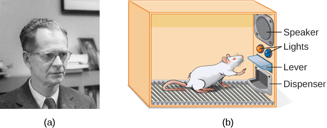
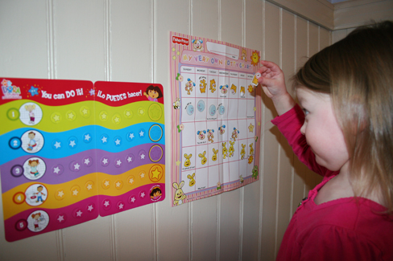
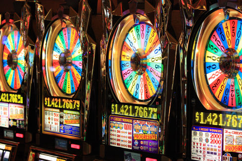
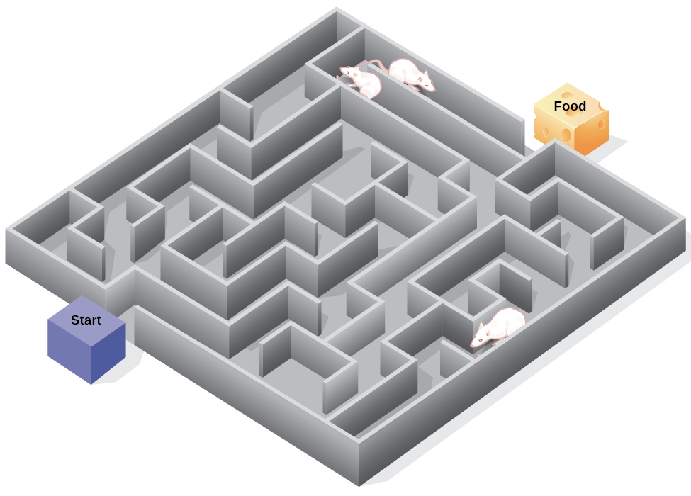

# 6.3 Điều kiện hóa tạo tác

> [!info]
>
> ### Mục tiêu học tập
>
> Kết thúc phần này, bạn sẽ có thể:
>
> - Định nghĩa điều kiện hóa tạo tác
> - Giải thích sự khác biệt giữa củng cố và trừng phạt
> - Phân biệt giữa các lịch củng cố khác nhau

Phần trước của chương này đã tập trung vào loại hình học tập liên tưởng được gọi là điều kiện hóa cổ điển.
Hãy nhớ rằng trong điều kiện hóa cổ điển, một kích thích trong môi trường kích hoạt một phản xạ tự nhiên một cách tự động, và các nhà nghiên cứu huấn luyện sinh vật để phản ứng lại một kích thích khác.
Bây giờ chúng ta chuyển sang loại hình học tập liên tưởng thứ hai: **điều kiện hóa tạo tác (operant conditioning)**.
Trong điều kiện hóa tạo tác, các sinh vật học cách liên kết một hành vi và hệ quả của hành vi đó ([Bảng 6.1](#fs-idp18763408)).
Một hệ quả dễ chịu làm cho hành vi đó có nhiều khả năng được lặp lại hơn trong tương lai.
Ví dụ, Spirit, một chú cá heo tại Thủy cung Quốc gia ở Baltimore, thực hiện một cú lộn nhào trên không trung khi người huấn luyện thổi còi.
Hệ quả là chú nhận được một con cá.

**So sánh Điều kiện hóa cổ điển và Điều kiện hóa tạo tác**

|  | Điều kiện hóa cổ điển | Điều kiện hóa tạo tác |
| --- | --- | --- |
| Phương pháp tiếp cận | Một kích thích không điều kiện (như thức ăn) được ghép đôi với một kích thích trung tính (như tiếng chuông). Kích thích trung tính cuối cùng trở thành kích thích có điều kiện, khơi gợi phản ứng có điều kiện (tiết nước bọt). | Hành vi mục tiêu được theo sau bởi sự củng cố hoặc trừng phạt để làm tăng cường hoặc làm suy yếu hành vi đó, giúp người học có nhiều khả năng biểu hiện hành vi mong muốn hơn trong tương lai. |
| Thời điểm xuất hiện kích thích | Kích thích xuất hiện ngay trước khi phản ứng diễn ra. | Kích thích (sự củng cố hoặc hình phạt) xuất hiện ngay sau khi phản ứng diễn ra. |

**Bảng 6.1**

Nhà tâm lý học B. F.
**Skinner** nhận thấy rằng điều kiện hóa cổ điển chỉ giới hạn ở những hành vi sẵn có vốn được gợi ra một cách phản xạ, và nó không thể giải thích cho các hành vi mới xuất hiện chẳng hạn như việc tập đi xe đạp.
Ông đã đề xuất một lý thuyết về cách thức những hành vi như vậy xuất hiện.
Skinner tin rằng hành vi được thúc đẩy bởi những hệ quả mà chúng ta nhận được từ hành vi đó: sự củng cố và hình phạt.
Ý tưởng của ông cho rằng học tập là kết quả của các hệ quả dựa trên quy luật hiệu quả, vốn lần đầu tiên được đề xuất bởi nhà tâm lý học Edward **Thorndike**.
Theo **quy luật hiệu quả (law of effect)**, những hành vi được theo sau bởi các hệ quả mang lại sự thỏa mãn cho sinh vật sẽ có nhiều khả năng được lặp lại hơn, và những hành vi được theo sau bởi các hệ quả khó chịu sẽ ít có khả năng được lặp lại hơn (Thorndike, 1911).
Về cơ bản, nếu một sinh vật làm điều gì đó mang lại kết quả mong muốn, sinh vật đó có nhiều khả năng sẽ làm lại điều đó.
Nếu một sinh vật làm điều gì đó không mang lại kết quả mong muốn, sinh vật đó sẽ ít có khả năng lặp lại.
Một ví dụ về quy luật hiệu quả là trong công việc làm công ăn lương.
Một trong những lý do (và thường là lý do chính) chúng ta đi làm là vì chúng ta được trả lương để làm việc đó.
Nếu chúng ta bị ngừng trả lương, chúng ta nhiều khả năng sẽ ngừng đi làm—ngay cả khi chúng ta rất yêu thích công việc của mình.

Lấy quy luật hiệu quả của Thorndike làm nền tảng, Skinner bắt đầu tiến hành các thí nghiệm khoa học trên động vật (chủ yếu là chuột và bồ câu) để xác định cách các sinh vật học hỏi thông qua điều kiện hóa tạo tác (Skinner, 1938).
Ông đặt những con vật này vào bên trong một buồng điều kiện hóa tạo tác, nơi sau này được biết đến với tên gọi “hộp Skinner” ([Hình 6.10](#Figure06_03_Skinnerbox)).
Một chiếc hộp Skinner chứa một cần gạt (cho chuột) hoặc một chiếc đĩa (cho bồ câu) mà con vật có thể ấn hoặc mổ để nhận phần thưởng thức ăn thông qua một khay cấp thức ăn.
Loa và đèn có thể được liên kết với những hành vi nhất định.
Một máy ghi sẽ đếm số lượng phản ứng do con vật thực hiện.

**Hình 6.10** (a) B. F. Skinner đã phát triển điều kiện hóa tạo tác để nghiên cứu một cách có hệ thống về cách các hành vi được củng cố hoặc làm suy yếu theo các hệ quả của chúng. (b) Trong một hộp Skinner, một con chuột ấn cần gạt trong buồng điều kiện hóa tạo tác để nhận phần thưởng thức ăn. (ghi công a: sửa đổi công trình của "Silly rabbit"/Wikimedia Commons)

> [!tip]
>
> ### Liên kết học tập
>
> Xem [video ngắn về cuộc phỏng vấn của Skinner và phần minh họa điều kiện hóa tạo tác ở loài bồ câu](https://openstax.org/l/skinner1) để tìm hiểu thêm.

Khi thảo luận về điều kiện hóa tạo tác, chúng ta sử dụng một số từ ngữ thông dụng hàng ngày—tích cực (dương tính), tiêu cực (âm tính), củng cố và trừng phạt—theo một ý nghĩa chuyên biệt.
Trong điều kiện hóa tạo tác, tích cực và tiêu cực không có nghĩa là tốt và xấu.
Thay vào đó, *tích cực (positive)* có nghĩa là bạn đang cộng thêm một thứ gì đó vào, và *tiêu cực (negative)* có nghĩa là bạn đang lấy đi hoặc loại bỏ một thứ gì đó. *Củng cố (reinforcement)* có nghĩa là bạn đang làm gia tăng một hành vi, và *trừng phạt (punishment)* có nghĩa là bạn đang làm suy giảm một hành vi.
Củng cố có thể là tích cực hoặc tiêu cực, và trừng phạt cũng có thể là tích cực hoặc tiêu cực.
Mọi chất củng cố (tích cực hay tiêu cực) đều *làm tăng* khả năng xuất hiện của một phản ứng hành vi.
Mọi hình phạt (tích cực hay tiêu cực) đều *làm giảm* khả năng xuất hiện của một phản ứng hành vi.
Bây giờ chúng ta hãy kết hợp bốn thuật ngữ này: củng cố tích cực, củng cố tiêu cực, trừng phạt tích cực và trừng phạt tiêu cực ([Bảng 6.2](#fs-idm23618624)).

**Củng cố và Trừng phạt Tích cực và Tiêu cực**

|  | Củng cố (Reinforcement) | Trừng phạt (Punishment) |
| --- | --- | --- |
| Tích cực (Positive) | Một thứ gì đó được *thêm vào* để *làm tăng* khả năng xuất hiện của một hành vi. | Một thứ gì đó được *thêm vào* để *làm giảm* khả năng xuất hiện của một hành vi. |
| Tiêu cực (Negative) | Một thứ gì đó được *loại bỏ* để *làm tăng* khả năng xuất hiện của một hành vi. | Một thứ gì đó được *loại bỏ* để *làm giảm* khả năng xuất hiện của một hành vi. |

**Bảng 6.2**

## Sự củng cố

Cách hiệu quả nhất để dạy một người hoặc một con vật một hành vi mới là sử dụng củng cố tích cực.
Trong **củng cố tích cực (positive reinforcement)**, một kích thích mong muốn được thêm vào để làm gia tăng một hành vi.

Ví dụ, bạn nói với cậu con trai năm tuổi Jerome của mình rằng nếu cậu bé dọn dẹp phòng, cậu sẽ nhận được một món đồ chơi.
Jerome nhanh chóng dọn dẹp phòng của mình vì cậu bé muốn có một bộ dụng cụ vẽ tranh mới.
Hãy dừng lại một chút.
Một số người có thể nói: “Tại sao tôi phải thưởng cho con mình vì đã làm một việc đúng như bổn phận phải làm?”
Nhưng trên thực tế, chúng ta liên tục và thường xuyên được tưởng thưởng trong cuộc sống của mình.
Tiền lương của chúng ta là những phần thưởng, điểm số cao và việc được nhận vào ngôi trường mong muốn cũng vậy.
Việc được khen ngợi vì đã hoàn thành tốt công việc và vì đã thi đỗ bằng lái xe cũng là một phần thưởng.
Củng cố tích cực như một công cụ học tập là cực kỳ hiệu quả.
Người ta phát hiện ra rằng một trong những cách hiệu quả nhất để nâng cao thành tích học tập tại các học khu có điểm đọc dưới mức trung bình là trả tiền cho trẻ em để chúng đọc sách.
Cụ thể, học sinh lớp hai ở Dallas được trả 2 đô la mỗi lần các em đọc xong một cuốn sách và vượt qua một bài kiểm tra ngắn về cuốn sách đó.
Kết quả là khả năng đọc hiểu của các em đã tăng lên đáng kể (Fryer, 2010).
Bạn nghĩ gì về chương trình này?
Nếu Skinner còn sống đến ngày nay, ông có lẽ sẽ nghĩ đây là một ý tưởng tuyệt vời.
Ông là một người ủng hộ mạnh mẽ việc sử dụng các nguyên lý điều kiện hóa tạo tác để tác động đến hành vi của học sinh tại trường học.
Trên thực tế, bên cạnh chiếc hộp Skinner, ông cũng đã phát minh ra cái mà ông gọi là “máy dạy học” (teaching machine) được thiết kế để tưởng thưởng cho những bước tiến nhỏ trong học tập (Skinner, 1961)—một tiền thân ban đầu của việc học tập có sự hỗ trợ của máy tính.
Chiếc máy dạy học của ông đã kiểm tra kiến thức của học sinh khi các em học qua các môn học khác nhau.
Nếu học sinh trả lời đúng các câu hỏi, các em nhận được sự củng cố tích cực ngay lập tức và có thể tiếp tục; nếu trả lời sai, các em không nhận được bất kỳ sự củng cố nào.
Ý tưởng là học sinh sẽ dành thêm thời gian học lại tài liệu để tăng cơ hội được củng cố vào lần tiếp theo (Skinner, 1961).

Trong **củng cố tiêu cực (negative reinforcement)**, một kích thích không mong muốn được loại bỏ để làm gia tăng một hành vi.
Ví dụ, các nhà sản xuất ô tô sử dụng các nguyên lý của củng cố tiêu cực trong hệ thống dây an toàn của họ, hệ thống này sẽ phát ra tiếng kêu “bíp, bíp, bíp” khó chịu cho đến khi bạn thắt dây an toàn.
Âm thanh phiền toái sẽ dừng lại ngay khi bạn thực hiện hành vi mong muốn, làm tăng khả năng bạn sẽ thắt dây an toàn trong tương lai.
Củng cố tiêu cực cũng thường xuyên được sử dụng trong việc huấn luyện ngựa.
Người cưỡi ngựa tạo áp lực—bằng cách kéo dây cương hoặc siết chặt chân—và sau đó thả lỏng áp lực khi con ngựa thực hiện hành vi mong muốn, chẳng hạn như rẽ hướng hoặc tăng tốc.
Áp lực chính là kích thích tiêu cực khó chịu mà con ngựa muốn loại bỏ.

## Sự trừng phạt

Nhiều người nhầm lẫn giữa củng cố tiêu cực và trừng phạt trong điều kiện hóa tạo tác, nhưng chúng là hai cơ chế hoàn toàn khác biệt.
Hãy nhớ rằng củng cố, ngay cả khi là tiêu cực, luôn luôn làm gia tăng một hành vi.
Ngược lại, **trừng phạt (punishment)** luôn luôn làm suy giảm một hành vi.
Trong **trừng phạt tích cực (positive punishment)**, bạn cộng thêm một kích thích không mong muốn để làm giảm một hành vi.
Một ví dụ về trừng phạt tích cực là việc trách mắng một học sinh để khiến học sinh đó ngừng nhắn tin trong giờ học.
Trong trường hợp này, một kích thích (lời khiển trách) được thêm vào nhằm làm giảm hành vi (nhắn tin trong lớp).
Trong **trừng phạt tiêu cực (negative punishment)**, bạn loại bỏ một kích thích dễ chịu để làm giảm hành vi.
Ví dụ, khi một đứa trẻ cư xử không đúng mực, cha mẹ có thể tịch thu món đồ chơi yêu thích của bé.
Trong trường hợp này, một kích thích (món đồ chơi) bị lấy đi nhằm làm giảm hành vi xấu.

Trừng phạt, đặc biệt là khi được thực hiện ngay lập tức, là một cách để giảm bớt hành vi không mong muốn.
Ví dụ, hãy tưởng tượng cậu con trai năm tuổi Brandon của bạn chạy vụt ra đường để đuổi theo một quả bóng.
Bạn bắt Brandon chép phạt 100 lần câu “Con sẽ không chạy ra đường nữa” (trừng phạt tích cực).
Nhiều khả năng cậu bé sẽ không lặp lại hành vi nguy hiểm này.
Mặc dù các chiến lược như thế này rất phổ biến ngày nay, nhưng trong quá khứ trẻ em thường phải chịu các hình phạt thể xác, chẳng hạn như đánh đòn.
Điều quan trọng là phải nhận thức được một số hạn chế của việc sử dụng hình phạt thể xác đối với trẻ em.
Thứ nhất, hình phạt có thể dạy cho trẻ sự sợ hãi.
Brandon có thể trở nên sợ hãi đường phố, nhưng cậu bé cũng có thể trở nên sợ hãi chính người đã đưa ra hình phạt—chính là bạn, cha mẹ của cậu.
Tương tự, những đứa trẻ bị giáo viên phạt đòn có thể trở nên sợ giáo viên và tìm cách trốn tránh trường học (Gershoff et al., 2010).
Do đó, hầu hết các trường học ở Hoa Kỳ đã cấm các hình phạt thể xác.
Thứ hai, hình phạt thể xác có thể khiến trẻ trở nên hung hăng hơn và dễ có hành vi chống đối xã hội cũng như phạm pháp (Gershoff, 2002).
Chúng nhìn thấy cha mẹ tìm đến đòn roi khi họ tức giận và thất vọng, vì vậy đến lượt mình, chúng có thể hành động y hệt như vậy khi cảm thấy tức giận và thất vọng.
Chẳng hạn, nếu bạn đánh con khi tức giận vì hành vi sai trái của bé, bé có thể bắt đầu đánh bạn bè khi các bạn không chịu chia sẻ đồ chơi.

Mặc dù trừng phạt tích cực có thể có hiệu quả trong một số trường hợp, nhưng Skinner cho rằng việc sử dụng hình phạt luôn cần được cân nhắc kỹ lưỡng trước những tác động tiêu cực tiềm tàng.
Các nhà tâm lý học và các chuyên gia nuôi dạy con cái ngày nay ủng hộ việc củng cố hơn là trừng phạt—họ khuyên bạn nên nắm bắt những lúc con mình làm được điều tốt và khen thưởng cho hành động đó của con.

### Tạo hình hành vi (Shaping)

Trong các thí nghiệm điều kiện hóa tạo tác của mình, Skinner thường sử dụng một phương pháp tiếp cận gọi là tạo hình hành vi.
Thay vì chỉ khen thưởng hành vi mục tiêu cuối cùng, trong **tạo hình hành vi (shaping)**, chúng ta khen thưởng cho những hành vi tiệm cận liên tiếp của một hành vi mục tiêu.
Tại sao việc tạo hình lại cần thiết?
Hãy nhớ rằng để sự củng cố có tác dụng, sinh vật trước tiên phải thể hiện hành vi đó.
Tạo hình hành vi là cần thiết bởi vì cực kỳ khó có khả năng một sinh vật sẽ tự phát thể hiện bất kỳ hành vi phức tạp nào ngoài những hành vi đơn giản nhất.
Trong tạo hình hành vi, các hành vi được chia nhỏ thành nhiều bước nhỏ, có thể đạt được.
Các bước cụ thể được sử dụng trong quá trình này như sau:

1. Củng cố bất kỳ phản ứng nào có nét tương đồng với hành vi mong muốn.
2. Sau đó, củng cố phản ứng giống với hành vi mong muốn hơn. Bạn sẽ không còn củng cố phản ứng đã được củng cố trước đó nữa.
3. Tiếp theo, bắt đầu củng cố phản ứng thậm chí còn giống với hành vi mong muốn hơn nữa.
4. Tiếp tục củng cố các hành vi ngày càng tiệm cận gần hơn với hành vi mong muốn.
5. Cuối cùng, chỉ củng cố đúng hành vi mong muốn.

Tạo hình hành vi thường được sử dụng trong việc dạy một hành vi phức tạp hoặc một chuỗi các hành vi.
Skinner đã sử dụng kỹ thuật tạo hình hành vi để dạy những chú chim bồ câu không chỉ những hành vi tương đối đơn giản như mổ vào một chiếc đĩa trong hộp Skinner, mà còn cả nhiều hành vi bất thường và mang tính giải trí cao, chẳng hạn như xoay vòng tròn, đi bộ theo hình số tám và thậm chí chơi bóng bàn; kỹ thuật này ngày nay vẫn được các nhà huấn luyện động vật sử dụng phổ biến.
Một phần quan trọng của tạo hình hành vi là sự phân biệt kích thích.
Hãy nhớ lại những chú chó của Pavlov—ông đã huấn luyện chúng phản ứng với âm thanh của một chiếc chuông, chứ không phải với các âm thanh tương tự.
Sự phân biệt này cũng rất quan trọng trong điều kiện hóa tạo tác và trong việc tạo hình hành vi.

> [!tip]
>
> ### Liên kết học tập
>
> Xem [video ngắn về những chú chim bồ câu của Skinner chơi bóng bàn](https://openstax.org/l/pingpong) để tìm hiểu thêm.

Thật dễ dàng để thấy kỹ thuật tạo hình hành vi mang lại hiệu quả như thế nào trong việc dạy các hành vi cho động vật, nhưng tạo hình hành vi hoạt động ra sao ở con người?
Hãy xem xét các bậc cha mẹ có mục tiêu là giúp con mình học cách tự dọn dẹp phòng của mình.
Họ sử dụng kỹ thuật tạo hình hành vi để giúp cậu bé làm chủ các bước hướng tới mục tiêu.
Thay vì bắt làm toàn bộ nhiệm vụ ngay lập tức, họ thiết lập các bước này và củng cố từng bước.
Đầu tiên, cậu bé dọn dẹp một món đồ chơi.
Thứ hai, cậu bé dọn dẹp năm món đồ chơi.
Thứ ba, cậu bé chọn dọn mười món đồ chơi hoặc cất sách vở và quần áo đi.
Thứ tư, cậu bé dọn dẹp mọi thứ trừ hai món đồ chơi.
Cuối cùng, cậu bé tự mình dọn dẹp toàn bộ căn phòng.

## Chất củng cố sơ cấp và thứ cấp

Các phần thưởng như nhãn dán, lời khen ngợi, tiền bạc, đồ chơi và nhiều thứ khác có thể được sử dụng để củng cố việc học.
Hãy quay lại với những con chuột của Skinner một lần nữa.
Những con chuột đã học cách ấn cần gạt trong hộp Skinner như thế nào?
Chúng được thưởng một viên thức ăn mỗi khi ấn cần gạt.
Đối với động vật, thức ăn là một chất củng cố rõ ràng và tự nhiên.

Đâu sẽ là một chất củng cố tốt cho con người?
Đối với đứa trẻ dọn dẹp phòng, đó là lời hứa về một món đồ chơi.
Còn đối với Sydney, một cầu thủ bóng đá thì sao?
Nếu bạn cho Sydney một chiếc kẹo mỗi khi Sydney ghi bàn, bạn đang sử dụng một **chất củng cố sơ cấp (primary reinforcer)**.
Các chất củng cố sơ cấp là những chất củng cố có đặc tính củng cố bẩm sinh.
Những loại chất củng cố này không cần qua học tập.
Nước, thức ăn, giấc ngủ, nơi trú ẩn, tình dục và sự đụng chạm âu yếm, cùng nhiều thứ khác, đều là những chất củng cố sơ cấp.
Sự khoái cảm cũng là một chất củng cố sơ cấp.
Các sinh vật không bao giờ mất đi động lực đối với những thứ này.
Đối với hầu hết mọi người, việc nhảy xuống một hồ nước mát lạnh vào một ngày hè oi ả sẽ mang tính củng cố cao và làn nước mát sẽ mang tính củng cố bẩm sinh—nước giúp hạ nhiệt cơ thể (một nhu cầu thể chất) cũng như đem lại sự sảng khoái.

Một **chất củng cố thứ cấp (secondary reinforcer)** không có giá trị nội tại tự thân và chỉ có các đặc tính củng cố khi được liên kết với một chất củng cố sơ cấp.
Lời khen ngợi, gắn liền với tình cảm yêu thương, là một ví dụ về chất củng cố thứ cấp, chẳng hạn như khi bạn hô lớn “Cú sút tuyệt vời!” mỗi khi Sydney ghi bàn.
Một ví dụ khác, tiền bạc, chỉ có giá trị khi bạn có thể sử dụng nó để mua những thứ khác—những thứ thỏa mãn các nhu cầu cơ bản (thức ăn, nước uống, nơi ở—tất cả đều là chất củng cố sơ cấp) hoặc các chất củng cố thứ cấp khác.
Nếu bạn ở trên một hòn đảo hẻo lánh giữa Thái Bình Dương và có hàng cọc tiền, số tiền đó sẽ hoàn toàn vô dụng nếu bạn không thể tiêu được nó.
Còn những nhãn dán trên bảng theo dõi hành vi thì sao?
Chúng cũng là những chất củng cố thứ cấp.

Đôi khi, thay vì dán nhãn dán lên bảng nhãn dán, người ta sử dụng các thẻ tích điểm (tokens).
Các thẻ tích điểm, vốn cũng là chất củng cố thứ cấp, sau đó có thể được đổi lấy phần thưởng và giải thưởng.
Toàn bộ các hệ thống quản lý hành vi, được gọi là nền kinh tế thẻ tích điểm (token economies), được xây dựng xung quanh việc sử dụng các loại chất củng cố thẻ này.
Nền kinh tế thẻ tích điểm đã được chứng minh là rất hiệu quả trong việc điều chỉnh hành vi trong nhiều môi trường khác nhau như trường học, nhà tù và bệnh viện tâm thần.
Ví dụ, một nghiên cứu của Adibsereshki và Abkenar (2014) cho thấy việc sử dụng nền kinh tế thẻ tích điểm đã làm tăng các hành vi xã hội phù hợp và giảm các hành vi không phù hợp ở một nhóm học sinh lớp tám.
Các nghiên cứu tương tự cho thấy sự cải thiện rõ rệt về hành vi và thành tích học tập cho các nhóm từ lớp một đến trung học phổ thông, đại diện cho nhiều mức độ năng lực và khuyết tật khác nhau.
Ví dụ, trong các nghiên cứu liên quan đến học sinh nhỏ tuổi hơn, khi trẻ em trong nghiên cứu biểu hiện hành vi phù hợp (không đánh hoặc véo bạn), các em sẽ nhận được một thẻ tích điểm “bàn tay ngoan”.
Khi các em đánh hoặc véo bạn, các em sẽ bị mất một thẻ.
Sau đó, trẻ có thể đổi một số lượng thẻ nhất định lấy số phút chơi trò chơi.

> [!abstract]
>
> ### Kết nối thực tiễn
>
> #### Điều chỉnh hành vi ở trẻ em
>
> Cha mẹ và giáo viên thường sử dụng liệu pháp điều chỉnh hành vi để thay đổi hành vi của trẻ.
> Điều chỉnh hành vi sử dụng các nguyên lý của điều kiện hóa tạo tác để hoàn thành việc thay đổi hành vi, sao cho những hành vi không mong muốn được thay thế bằng những hành vi được xã hội chấp nhận hơn.
> Một số giáo viên và cha mẹ lập một bảng nhãn dán, trong đó liệt kê một số hành vi nhất định ([Hình 6.11](#Figure06_03_Stickers)).
> Bảng nhãn dán là một hình thức của nền kinh tế thẻ tích điểm, như đã mô tả trong bài.
> Mỗi lần trẻ thực hiện hành vi tốt, trẻ sẽ nhận được một nhãn dán, và sau một số lượng nhãn dán nhất định, trẻ sẽ nhận được phần thưởng hoặc chất củng cố.
> Mục tiêu là làm tăng các hành vi được chấp nhận và giảm các hành vi sai trái.
> Hãy nhớ rằng, tốt nhất là nên củng cố các hành vi mong muốn thay vì sử dụng hình phạt.
> Trong lớp học, giáo viên có thể củng cố một loạt các hành vi, từ việc học sinh giơ tay phát biểu, đi lại trật tự ngoài hành lang, cho đến việc nộp bài tập về nhà đúng hạn.
> Ở nhà, cha mẹ có thể lập một bảng hành vi để thưởng cho trẻ những việc như dọn dẹp đồ chơi, đánh răng và phụ giúp nấu bữa tối.
> Để việc điều chỉnh hành vi đạt hiệu quả, sự củng cố cần phải được kết nối chặt chẽ với hành vi; phần thưởng củng cố phải thực sự có ý nghĩa đối với đứa trẻ và được thực hiện một cách nhất quán.
>
> 
>
> 
>
> **Hình 6.11** Bảng nhãn dán là một hình thức củng cố tích cực và là công cụ để điều chỉnh hành vi. Khi đứa trẻ này tích lũy đủ một số lượng nhãn dán nhất định nhờ thể hiện hành vi mong muốn, cô bé sẽ được thưởng một chuyến đi đến tiệm kem. (ghi công: Abigail Batchelder)
>
> Thời gian cách ly (time-out) là một kỹ thuật phổ biến khác được sử dụng trong điều chỉnh hành vi ở trẻ em.
> Kỹ thuật này hoạt động dựa trên nguyên lý trừng phạt tiêu cực.
> Khi một đứa trẻ biểu hiện một hành vi không mong muốn, bé sẽ bị tách rời khỏi hoạt động thú vị mà bé đang tham gia ([Hình 6.12](#Figure06_03_Timeout)).
> Ví dụ, giả sử Sophia và em trai Mario đang chơi xếp hình với các khối gỗ.
> Sophia ném một số khối gỗ vào em trai, vì vậy bạn cảnh báo rằng bé sẽ phải ngồi vào góc tĩnh tâm (time-out) nếu lặp lại điều đó.
> Vài phút sau, cô bé ném thêm nhiều khối gỗ vào Mario.
> Bạn đưa Sophia ra khỏi phòng trong vài phút.
> Khi quay trở lại, cô bé không còn ném các khối gỗ nữa.
>
> Có một số điểm quan trọng bạn nên biết nếu dự định áp dụng thời gian cách ly (time-out) như một kỹ thuật điều chỉnh hành vi.
> Thứ nhất, hãy chắc chắn rằng đứa trẻ đang bị tách khỏi một hoạt động thú vị và được đưa đến một nơi ít hấp dẫn hơn.
> Nếu hoạt động đó vốn dĩ là điều đứa trẻ không thích, kỹ thuật này sẽ phản tác dụng vì việc được rời khỏi hoạt động đó lại làm đứa trẻ thích thú hơn.
> Thứ hai, độ dài của thời gian cách ly là rất quan trọng.
> Quy tắc chung ngón tay cái là một phút cho mỗi năm tuổi của đứa trẻ.
> Sophia năm tuổi; do đó, cô bé sẽ ngồi phạt tĩnh tâm trong năm phút.
> Việc đặt đồng hồ hẹn giờ giúp trẻ biết mình phải ngồi trong bao lâu.
> Cuối cùng, với tư cách là người chăm sóc, hãy ghi nhớ một số nguyên tắc trong suốt thời gian cách ly: giữ bình tĩnh khi hướng dẫn con ngồi tĩnh tâm; phớt lờ con trong suốt thời gian cách ly (bởi vì sự chú ý của người chăm sóc có thể vô tình củng cố hành vi sai trái); và trao cho con một cái ôm hoặc một lời nói dịu dàng khi thời gian cách ly kết thúc.
>
> 
>
> 
>
> **Hình 6.12** Phạt ngồi tĩnh tâm (time-out) là một hình thức trừng phạt tiêu cực phổ biến được người chăm sóc sử dụng. Khi một đứa trẻ cư xử sai, bé sẽ bị tách khỏi một hoạt động thú vị trong nỗ lực làm giảm hành vi không mong muốn. Ví dụ, (a) một đứa trẻ có thể đang chơi trên sân chơi với bạn bè và xô đẩy một đứa trẻ khác; (b) đứa trẻ có hành vi sai trái sau đó sẽ bị đưa ra khỏi hoạt động trong một khoảng thời gian ngắn. (ghi công a: sửa đổi công trình của Simone Ramella; ghi công b: sửa đổi công trình của “Spring Dew”/Flickr)

## Các lịch củng cố

Hãy nhớ rằng, cách tốt nhất để dạy một người hoặc một con vật một hành vi là sử dụng củng cố tích cực.
Ví dụ, Skinner đã sử dụng củng cố tích cực để dạy chuột ấn cần gạt trong hộp Skinner.
Lúc đầu, con chuột có thể ngẫu nhiên chạm vào cần gạt trong khi khám phá chiếc hộp, và một viên thức ăn sẽ rơi ra.
Sau khi ăn viên thức ăn, bạn nghĩ con chuột đang đói sẽ làm gì tiếp theo?
Nó lại ấn cần gạt và nhận thêm một viên thức ăn khác.
Mỗi lần con chuột ấn cần gạt, một viên thức ăn lại rơi ra.
Khi một sinh vật nhận được chất củng cố mỗi khi nó thể hiện một hành vi, điều đó được gọi là **củng cố liên tục (continuous reinforcement)**.
Lịch củng cố này là cách nhanh nhất để dạy ai đó một hành vi, và nó đặc biệt hiệu quả trong việc huấn luyện một hành vi mới.
Hãy nhìn lại chú chó đang học ngồi ở phần đầu chương.
Giờ đây, mỗi lần chú ngồi xuống, bạn lại thưởng cho chú một miếng đồ ăn ngon.
Thời điểm là rất quan trọng ở đây: bạn sẽ thành công nhất nếu bạn đưa ra phần thưởng củng cố ngay lập tức sau khi chú ngồi xuống, để chú có thể tạo ra mối liên tưởng giữa hành vi mục tiêu (ngồi xuống) và hệ quả (nhận được phần thưởng).

> [!tip]
>
> ### Liên kết học tập
>
> Xem [đoạn video clip về bác sĩ thú y, Tiến sĩ Sophia Yin, đang tạo hình hành vi của một chú chó bằng các bước được phác thảo ở trên](https://openstax.org/l/sueyin) để tìm hiểu thêm.

Một khi hành vi đã được huấn luyện thành thục, các nhà nghiên cứu và người huấn luyện thường chuyển sang một loại lịch củng cố khác—củng cố từng phần.
Trong **củng cố từng phần (partial reinforcement)**, còn được gọi là củng cố ngắt quãng (intermittent reinforcement), người hoặc động vật không được củng cố mỗi lần họ thực hiện hành vi mong muốn.
Có một số loại lịch củng cố từng phần khác nhau ([Bảng 6.3](#fs-idp66772976)).
Những lịch trình này được mô tả là cố định hoặc biến đổi, và theo khoảng thời gian hoặc theo tỷ lệ. *Cố định (fixed)* đề cập đến số lượng phản ứng giữa các lần củng cố, hoặc lượng thời gian giữa các lần củng cố, vốn được thiết lập sẵn và không thay đổi. *Biến đổi (variable)* đề cập đến số lượng phản ứng hoặc lượng thời gian giữa các lần củng cố, vốn có sự biến thiên hoặc thay đổi. *Khoảng thời gian (interval)* có nghĩa là lịch trình dựa trên thời gian trôi qua giữa các lần củng cố, và *tỷ lệ (ratio)* có nghĩa là lịch trình dựa trên số lượng phản ứng được thực hiện giữa các lần củng cố.

**Các lịch củng cố**

| Lịch củng cố | Mô tả | Kết quả | Ví dụ |
| --- | --- | --- | --- |
| Khoảng thời gian cố định (Fixed interval - FI) | Sự củng cố được đưa ra sau những khoảng thời gian có thể dự đoán trước (ví dụ: sau 5, 10, 15 và 20 phút). | Tốc độ phản ứng vừa phải với những khoảng tạm dừng đáng kể sau khi nhận củng cố | Bệnh nhân tại bệnh viện sử dụng thiết bị giảm đau do bệnh nhân tự kiểm soát theo khung giờ của bác sĩ |
| Khoảng thời gian biến đổi (Variable interval - VI) | Sự củng cố được đưa ra sau những khoảng thời gian không thể dự đoán trước (ví dụ: sau 5, 7, 10 và 20 phút). | Tốc độ phản ứng vừa phải nhưng đều đặn, liên tục | Kiểm tra mạng xã hội |
| Tỷ lệ cố định (Fixed ratio - FR) | Sự củng cố được đưa ra sau một số lượng phản ứng có thể dự đoán trước (ví dụ: sau 2, 4, 6 và 8 lần phản ứng). | Tốc độ phản ứng cao với những khoảng tạm dừng ngắn sau khi nhận củng cố | Trả lương theo sản phẩm—công nhân nhà máy được trả tiền cho mỗi x số lượng sản phẩm sản xuất ra |
| Tỷ lệ biến đổi (Variable ratio - VR) | Sự củng cố được đưa ra sau một số lượng phản ứng không thể dự đoán trước (ví dụ: sau 1, 4, 5 và 9 lần phản ứng). | Tốc độ phản ứng cao và đều đặn, bền bỉ | Đánh bạc / chơi máy đánh bạc slot |

**Bảng 6.3**

Bây giờ hãy kết hợp bốn thuật ngữ này: Một **lịch củng cố khoảng thời gian cố định (fixed interval)** là khi hành vi được khen thưởng sau một khoảng thời gian định trước.
Ví dụ, June trải qua một ca phẫu thuật lớn trong bệnh viện.
Trong quá trình hồi phục, họ được dự đoán sẽ cảm thấy đau đớn và cần dùng thuốc kê đơn để giảm đau.
June được truyền một ống nhỏ giọt tĩnh mạch với thuốc giảm đau do bệnh nhân tự kiểm soát.
Bác sĩ đặt ra một giới hạn: một liều mỗi giờ.
June nhấn nút khi cơn đau trở nên khó chịu, và họ nhận được một liều thuốc.
Do phần thưởng (giảm đau) chỉ xuất hiện theo một khoảng thời gian cố định, nên chẳng có ích gì khi nhấn nút vào những lúc hành vi đó sẽ không được khen thưởng.

Với một **lịch củng cố khoảng thời gian biến đổi (variable interval)**, người hoặc động vật nhận được sự củng cố dựa trên những khoảng thời gian biến thiên, không thể đoán trước.
Giả sử Manuel là quản lý tại một nhà hàng thức ăn nhanh.
Thỉnh thoảng, một người từ bộ phận kiểm soát chất lượng sẽ đến nhà hàng của Manuel.
Nếu nhà hàng sạch sẽ và dịch vụ nhanh chóng, tất cả mọi người trong ca làm việc đó sẽ được thưởng 20 đô la.
Manuel không bao giờ biết khi nào người kiểm soát chất lượng sẽ xuất hiện, vì vậy anh luôn cố gắng giữ cho nhà hàng sạch sẽ và đảm bảo các nhân viên của mình cung cấp dịch vụ nhanh chóng, lịch sự.
Năng suất của anh về dịch vụ nhanh chóng và giữ gìn nhà hàng sạch sẽ luôn ổn định vì anh muốn cả đội ngũ của mình kiếm được tiền thưởng.

Với một **lịch củng cố tỷ lệ cố định (fixed ratio)**, có một số lượng phản ứng nhất định phải diễn ra trước khi hành vi được khen thưởng.
Carla bán kính tại một cửa hàng mắt kính, và cô kiếm được tiền hoa hồng mỗi khi bán được một chiếc kính.
Cô luôn cố gắng bán cho khách hàng nhiều cặp kính hơn, bao gồm kính râm có độ hoặc một cặp kính dự phòng, để cô có thể tăng tiền hoa hồng của mình.
Cô không quan tâm liệu khách hàng có thực sự cần chiếc kính râm có độ hay không, Carla chỉ muốn có tiền thưởng.
Chất lượng của những gì Carla bán không thành vấn đề vì tiền hoa hồng của cô không dựa trên chất lượng; nó chỉ dựa trên số lượng cặp kính bán được.
Sự phân biệt này về chất lượng hiệu suất có thể giúp xác định phương pháp củng cố nào phù hợp nhất cho một tình huống cụ thể.
Tỷ lệ cố định phù hợp hơn để tối ưu hóa số lượng đầu ra, trong khi khoảng thời gian cố định, nơi phần thưởng không dựa trên số lượng, có thể dẫn đến chất lượng đầu ra cao hơn.

Trong một **lịch củng cố tỷ lệ biến đổi (variable ratio)**, số lượng phản ứng cần thiết để nhận phần thưởng có sự biến thiên liên tục.
Đây là lịch củng cố từng phần mạnh mẽ nhất.
Một ví dụ về lịch củng cố tỷ lệ biến đổi là trò cờ bạc.
Hãy tưởng tượng Sarah—một phụ nữ nhìn chung rất thông minh và tiết kiệm—lần đầu tiên đến thăm Las Vegas.
Cô không phải là một con bạc, nhưng vì tò mò, cô đã nhét một đồng 25 xu vào máy đánh bạc, rồi một đồng khác, và một đồng khác nữa.
Chẳng có gì xảy ra cả.
Sau khi mất hai đô la tiền xu, sự tò mò của cô phai nhạt dần và cô chuẩn bị bỏ đi.
Nhưng rồi, chiếc máy sáng rực đèn, chuông reo inh ỏi, và Sarah nhận lại 50 đồng 25 xu.
Thật tuyệt vời!
Sarah quay lại nhét những đồng xu vào máy với sự hào hứng mới mẻ, và chỉ vài phút sau cô đã tiêu hết số tiền thắng được và bị lỗ mất 10 đô la.
Giờ đây có lẽ là thời điểm khôn ngoan để dừng lại.
Thế nhưng, cô vẫn tiếp tục nhét tiền vào máy đánh bạc vì cô không bao giờ biết khi nào đợt củng cố tiếp theo sẽ xuất hiện.
Cô luôn nghĩ rằng với đồng xu tiếp theo, mình có thể thắng được 50 đô la, 100 đô la hoặc thậm chí nhiều hơn thế.
Bởi vì lịch củng cố trong hầu hết các hình thức cờ bạc là lịch tỷ lệ biến đổi, mọi người cứ tiếp tục thử vận may và hy vọng rằng lần tới họ sẽ thắng lớn.
Đây là một trong những lý do khiến cờ bạc có tính gây nghiện cao đến vậy—và có khả năng chống lại sự dập tắt mãnh liệt đến thế.

Trong điều kiện hóa tạo tác, sự dập tắt của một hành vi được củng cố xảy ra tại một thời điểm nào đó sau khi việc củng cố chấm dứt, và tốc độ diễn ra điều này phụ thuộc vào lịch củng cố.
Trong lịch tỷ lệ biến đổi, điểm dập tắt đến rất chậm, như đã mô tả ở trên.
Nhưng trong các lịch củng cố khác, sự dập tắt có thể diễn ra rất nhanh chóng.
Ví dụ, nếu June nhấn nút để lấy thuốc giảm đau trước khoảng thời gian được bác sĩ phê duyệt, sẽ không có thuốc nào được đưa vào cơ thể.
Họ đang theo một lịch củng cố khoảng thời gian cố định (dùng thuốc hàng giờ), vì vậy sự dập tắt diễn ra nhanh chóng khi sự củng cố không đến vào thời điểm dự kiến.
Trong số các lịch củng cố, tỷ lệ biến đổi là lịch trình mang lại năng suất cao nhất và có khả năng chống lại sự dập tắt tốt nhất.
Khoảng thời gian cố định là lịch trình có năng suất thấp nhất và dễ bị dập tắt nhất ([Hình 6.13](#Figure06_03_Response)).

![Một biểu đồ có trục hoành dán nhãn “Thời gian” và trục tung dán nhãn “Số lượng phản ứng tích lũy”. Hai đường dán nhãn “Tỷ lệ biến đổi” và “Tỷ lệ cố định” có độ dốc đứng tương tự nhau. Đường tỷ lệ biến đổi duy trì đường thẳng và được đánh dấu tại các điểm ngẫu nhiên nơi sự củng cố diễn ra. Đường tỷ lệ cố định có các dấu cách đều đặn biểu thị nơi diễn ra sự củng cố, nhưng sau mỗi lần củng cố lại có một đoạn hơi chùng xuống trước khi tiếp tục độ dốc chung. Hai đường dán nhãn “Khoảng thời gian biến đổi” và “Khoảng thời gian cố định” có độ dốc tương tự nhau ở góc khoảng 45 độ. Đường khoảng thời gian biến đổi duy trì đường thẳng và được đánh dấu tại các điểm ngẫu nhiên. Đường khoảng thời gian cố định có các dấu cách đều đặn, nhưng sau mỗi lần củng cố, đường vẽ lại có hình vỏ sò võng xuống.](../../images/img_5f50843bc820.jpg)

**Hình 6.13** Bốn lịch củng cố tạo ra các mô hình phản ứng khác nhau. Lịch tỷ lệ biến đổi là không thể dự đoán và mang lại tốc độ phản ứng cao và đều đặn, hầu như không có khoảng tạm dừng sau khi củng cố (ví dụ: người đánh bạc). Lịch tỷ lệ cố định có thể dự đoán được và tạo ra tốc độ phản ứng cao, với một khoảng tạm dừng ngắn sau khi củng cố (ví dụ: người bán kính mắt). Lịch khoảng thời gian biến đổi là không thể dự đoán và tạo ra tốc độ phản ứng vừa phải, đều đặn (ví dụ: quản lý nhà hàng). Lịch khoảng thời gian cố định tạo ra mô hình phản ứng hình vỏ sò (scallop-shaped), phản ánh khoảng tạm dừng đáng kể sau khi nhận củng cố (ví dụ: bệnh nhân phẫu thuật).

> [!example]
>
> ### Kết nối các khái niệm
>
> #### Cờ bạc và Não bộ
>
> Skinner (1953) từng phát biểu: “Nếu sòng bạc không thể thuyết phục một khách quen nộp tiền mà không nhận lại được gì, sòng bạc có thể đạt được hiệu quả tương tự bằng cách hoàn lại một phần tiền của khách theo lịch tỷ lệ biến đổi” (tr.
> 397).
>
> Skinner sử dụng cờ bạc như một ví dụ điển hình về sức mạnh của lịch củng cố tỷ lệ biến đổi trong việc duy trì hành vi ngay cả trong những khoảng thời gian dài không có bất kỳ sự củng cố nào.
> Trên thực tế, Skinner tự tin vào hiểu biết của mình về chứng nghiện cờ bạc đến mức ông thậm chí còn tuyên bố mình có thể biến một con chim bồ câu thành một con bạc bệnh lý (“Skinner’s Utopia”, 1971).
> Quả thực đúng là lịch trình tỷ lệ biến đổi giữ cho hành vi vô cùng dai dẳng—hãy tưởng tượng tần suất các cơn ăn vạ của một đứa trẻ nếu cha mẹ nhượng bộ dù chỉ một lần trước hành vi đó.
> Phần thưởng thi thoảng xuất hiện khiến cho việc ngăn chặn hành vi đó trở nên gần như bất khả thi.
>
> Nghiên cứu gần đây trên loài chuột đã không ủng hộ ý tưởng của Skinner cho rằng chỉ riêng việc huấn luyện trên các lịch trình tỷ lệ biến đổi là nguyên nhân gây ra cờ bạc bệnh lý (Laskowski et al., 2019).
> Tuy nhiên, các nghiên cứu khác lại gợi ý rằng cờ bạc dường như tác động lên não bộ theo cách tương tự như hầu hết các loại thuốc gây nghiện, và do đó có thể có sự kết hợp nào đó giữa hóa học não bộ và lịch củng cố dẫn đến vấn đề cờ bạc ([Hình 6.14](#Figure06_03_Gambling)).
> Cụ thể, nghiên cứu hiện đại cho thấy mối liên hệ giữa cờ bạc và sự kích hoạt các trung tâm tưởng thưởng của não bộ sử dụng chất dẫn truyền thần kinh dopamine (Murch & Clark, 2016).
> Điều thú vị là các con bạc thậm chí không cần phải thắng để trải nghiệm cảm giác bùng nổ dopamine trong não.
> “Những lần suýt thắng” (near misses), tức gần như thắng nhưng trên thực tế lại không thắng, cũng đã được chứng minh là làm tăng hoạt động ở thể vân bụng (ventral striatum) và các trung tâm tưởng thưởng não bộ khác sử dụng dopamine (Chase & Clark, 2010).
> Những tác động não bộ này gần như giống hệt với những tác động do các loại ma túy gây nghiện như cocaine và heroin tạo ra (Murch & Clark, 2016).
> Dựa trên các bằng chứng khoa học thần kinh chỉ ra những điểm tương đồng này, DSM-5 hiện coi cờ bạc là một chứng nghiện (addiction), trong khi các phiên bản trước của DSM phân loại cờ bạc là một rối loạn kiểm soát xung động.
>
> 
>
> 
>
> **Hình 6.14** Một số nghiên cứu cho rằng những người nghiện cờ bạc bệnh lý sử dụng cờ bạc để bù đắp cho nồng độ hormone norepinephrine thấp bất thường, vốn gắn liền với căng thẳng và được tiết ra trong những khoảnh khắc kích thích và hồi hộp. (ghi công: Ted Murphy)
>
> Bên cạnh dopamine, cờ bạc dường như cũng liên quan đến các chất dẫn truyền thần kinh khác, bao gồm norepinephrine và serotonin (Potenza, 2013).
> Norepinephrine được tiết ra khi một người cảm thấy căng thẳng, kích thích hoặc hồi hộp.
> Có thể những người nghiện cờ bạc bệnh lý sử dụng cờ bạc để làm tăng nồng độ chất dẫn truyền thần kinh này.
> Sự thiếu hụt serotonin cũng có thể góp phần vào hành vi cưỡng chế, bao gồm cả chứng nghiện cờ bạc (Potenza, 2013).
>
> Có thể não bộ của những người nghiện cờ bạc bệnh lý khác biệt so với những người khác, và có lẽ sự khác biệt này bằng cách nào đó đã dẫn đến chứng nghiện cờ bạc của họ, như những nghiên cứu này dường như gợi ý.
> Tuy nhiên, rất khó để xác định nguyên nhân vì không thể tiến hành một thí nghiệm thực sự (sẽ là phi đạo đức nếu cố gắng biến những người tham gia được chỉ định ngẫu nhiên thành những con bạc có vấn đề).
> Do đó, có thể quan hệ nhân quả thực sự diễn ra theo chiều ngược lại—có lẽ chính hành vi cờ bạc bằng cách nào đó đã làm thay đổi nồng độ các chất dẫn truyền thần kinh trong não của một số con bạc.
> Cũng hoàn toàn có khả năng một yếu tố bị bỏ qua nào đó, hay biến số gây nhiễu, đã đóng một vai trò trong cả chứng nghiện cờ bạc lẫn những khác biệt về hóa học não bộ.

## Nhận thức và Học tập tiềm ẩn

Các nhà hành vi học nghiêm ngặt như Watson và Skinner chỉ tập trung độc quyền vào việc nghiên cứu hành vi hơn là nhận thức (chẳng hạn như suy nghĩ và kỳ vọng).
Trên thực tế, Skinner là một người tin tưởng trung kiên đến mức cho rằng nhận thức không hề quan trọng, khiến các ý tưởng của ông được coi là **thuyết hành vi cấp tiến (radical behaviorism)**.
Skinner coi tâm trí như một "chiếc hộp đen"—một thứ hoàn toàn không thể biết được—và do đó, là thứ không nên nghiên cứu.
Tuy nhiên, một nhà hành vi học khác là Edward C. Tolman lại có quan điểm khác.
Các thí nghiệm của Tolman với loài chuột đã chứng minh rằng các sinh vật có thể học hỏi ngay cả khi chúng không nhận được sự củng cố ngay lập tức (Tolman & Honzik, 1930; Tolman, Ritchie, & Kalish, 1946).
Phát hiện này mâu thuẫn với ý tưởng thịnh hành vào thời điểm đó cho rằng sự củng cố phải diễn ra ngay lập tức để việc học có thể diễn ra, do đó gợi ý về một khía cạnh nhận thức trong quá trình học tập.

Trong các thí nghiệm, Tolman đặt những con chuột đói vào một mê cung mà không có phần thưởng nào cho việc tìm đường qua đó.
Ông cũng nghiên cứu một nhóm so sánh được thưởng thức ăn ở cuối mê cung.
Khi những con chuột không được củng cố khám phá mê cung, chúng đã phát triển một **bản đồ nhận thức (cognitive map)**: một hình ảnh tinh thần về sơ đồ bố cục của mê cung ([Hình 6.15](#Figure06_03_Ratmaze)).
Sau 10 buổi trong mê cung mà không có củng cố, thức ăn được đặt trong một hộp mục tiêu ở cuối mê cung.
Ngay khi những con chuột nhận biết được sự hiện diện của thức ăn, chúng đã có thể tìm đường qua mê cung một cách nhanh chóng, nhanh tương đương nhóm so sánh vốn đã được thưởng thức ăn trong suốt thời gian qua.
Điều này được gọi là **học tập tiềm ẩn (latent learning)**: quá trình học tập diễn ra nhưng không thể quan sát được trong hành vi cho đến khi có một động lực hoặc lý do để thể hiện nó.

**Hình 6.15** Nhà tâm lý học Edward Tolman phát hiện ra rằng loài chuột sử dụng bản đồ nhận thức để định hướng qua một mê cung. Đã bao giờ bạn tự mình vượt qua các cấp độ khác nhau trong một trò chơi điện tử chưa? Bạn đã học được khi nào nên rẽ trái hoặc rẽ phải, di chuyển lên hoặc xuống. Trong trường hợp đó, bạn đang dựa vào một bản đồ nhận thức, giống hệt như những con chuột trong mê cung. (ghi công: sửa đổi công trình của "FutUndBeidl"/Flickr)

Học tập tiềm ẩn cũng diễn ra ở con người.
Trẻ em có thể học bằng cách quan sát hành động của cha mẹ nhưng chỉ thể hiện điều đó vào một thời điểm sau này, khi tài liệu đã học thực sự cần thiết.
Ví dụ, giả sử bố của Ravi chở cậu đến trường mỗi ngày.
Bằng cách này, Ravi học được lộ trình từ nhà đến trường, nhưng cậu chưa bao giờ tự mình lái xe đến đó, vì vậy cậu chưa có cơ hội chứng minh rằng mình đã thuộc đường.
Một buổi sáng, bố của Ravi phải đi sớm để dự một cuộc họp, vì vậy ông không thể chở Ravi đến trường.
Thay vào đó, Ravi tự đạp xe đi theo đúng lộ trình mà bố cậu thường đi bằng ô tô.
Điều này thể hiện sự học tập tiềm ẩn.
Ravi đã học được đường đến trường, nhưng trước đó không có nhu cầu thể hiện sự hiểu biết này ra bên ngoài.

> [!abstract]
>
> ### Kết nối thực tiễn
>
> #### Nơi này giống như một mê cung
>
> Đã bao giờ bạn bị lạc trong một tòa nhà và không thể tìm thấy đường ra chưa?
> Dù điều đó có thể gây khó chịu bực bội, nhưng bạn không hề đơn độc.
> Vào lúc này hay lúc khác, tất cả chúng ta đều từng bị lạc ở những nơi như viện bảo tàng, bệnh viện hoặc thư viện trường đại học.
> Bất cứ khi nào đến một nơi mới, chúng ta đều xây dựng một biểu tượng tinh thần—hay bản đồ nhận thức—về địa điểm đó, giống như những con chuột của Tolman đã xây dựng bản đồ nhận thức về mê cung của chúng.
> Tuy nhiên, một số tòa nhà rất dễ gây nhầm lẫn vì chúng bao gồm nhiều khu vực trông giống hệt nhau hoặc có tầm nhìn ngắn.
> Do đó, thường rất khó để đoán trước những gì ở góc rẽ tiếp theo hoặc quyết định nên rẽ trái hay rẽ phải để ra khỏi tòa nhà.
> Nhà tâm lý học Laura Carlson (2010) cho rằng những gì chúng ta đưa vào bản đồ nhận thức của mình có thể tác động đến sự thành công của chúng ta trong việc định hướng qua môi trường.
> Bà gợi ý rằng việc chú ý đến các đặc điểm cụ thể khi bước vào một tòa nhà, chẳng hạn như một bức tranh trên tường, một đài phun nước, một bức tượng hoặc một thang cuốn, sẽ bổ sung thông tin vào bản đồ nhận thức của chúng ta, giúp ích cho việc tìm đường ra khỏi tòa nhà sau này.

> [!tip]
>
> ### Liên kết học tập
>
> Xem [video về các nghiên cứu của Carlson đối với bản đồ nhận thức và sự định hướng trong các tòa nhà](https://openstax.org/l/carlsonmaps) để tìm hiểu thêm.
