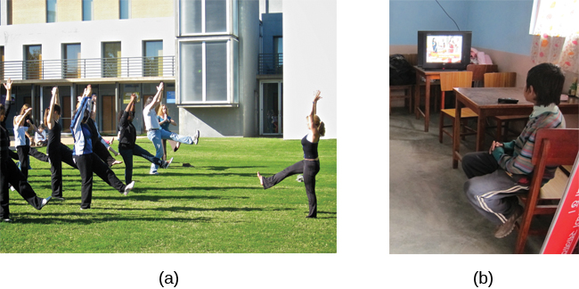

# 6.4 Học tập qua quan sát (Mô hình hóa)

> [!info]
>
> ### Mục tiêu học tập
>
> Sau khi học xong phần này, bạn sẽ có thể:
>
> - Định nghĩa học tập qua quan sát (*observational learning*)
> - Thảo luận về các bước trong quá trình mô hình hóa (*modeling*)
> - Giải thích các tác động vị xã hội (*prosocial*) và phản xã hội (*antisocial*) của học tập qua quan sát

Các phần trước của chương này tập trung vào điều kiện hóa cổ điển và điều kiện hóa tạo tác, vốn là những dạng học tập liên kết.
Trong **học tập qua quan sát** (*observational learning*), chúng ta học bằng cách quan sát người khác và sau đó bắt chước, hoặc mô hình hóa, những gì họ làm hoặc nói.
Ví dụ, bạn đã bao giờ lên YouTube để tìm một video hướng dẫn cách làm một điều gì đó chưa?
Những cá nhân thể hiện hành vi được bắt chước được gọi là **hình mẫu** (*models*).
Các nghiên cứu cho thấy rằng hình thức học tập thông qua bắt chước này có sự tham gia của một loại tế bào thần kinh chuyên biệt, gọi là nơ-ron gương (*mirror neuron*) (Hickock, 2010; Rizzolatti, Fadiga, Fogassi, & Gallese, 2002; Rizzolatti, Fogassi, & Gallese, 2006).

Con người và các loài động vật khác đều có khả năng học tập qua quan sát.
Chẳng hạn, trong một nghiên cứu về học tập xã hội ở loài tinh tinh, các nhà nghiên cứu đã đưa các hộp nước trái cây kèm ống hút cho hai nhóm tinh tinh nuôi nhốt.
Nhóm thứ nhất nhúng ống hút vào hộp nước, sau đó mút lượng nước nhỏ dính ở đầu ống hút.
Nhóm thứ hai hút trực tiếp qua ống hút và thu được nhiều nước hơn đáng kể.
Khi nhóm thứ nhất (nhóm "nhúng") quan sát thấy nhóm thứ hai (nhóm "hút"), bạn nghĩ điều gì đã xảy ra?
Toàn bộ tinh tinh ở nhóm "nhúng" đã chuyển sang hút trực tiếp qua ống hút.
Chỉ bằng cách quan sát những con tinh tinh khác và mô hình hóa hành vi của chúng, chúng đã học được rằng đây là phương pháp uống nước trái cây hiệu quả hơn (Yamamoto, Humle, & Tanaka, 2013).

**Hình 6.16** Chú khỉ nhện này đã học được cách uống nước từ chai nhựa bằng cách quan sát hành vi được thị phạm bởi một người. (nguồn: Không quân Hoa Kỳ, Binh nhì Kasey Close)

**Sự bắt chước** (*imitation*) đôi khi được xem là hình thức tâng bốc cao nhất.
Nhưng hãy xem xét trải nghiệm của Claire với học tập qua quan sát.
Con trai chín tuổi của Claire, Jay, thường xuyên gây rắc rối ở trường và hay chống đối ở nhà.
Claire lo sợ rằng Jay sẽ có kết cục giống như những người anh em của cô, hai trong số đó đang phải ngồi tù.
Một ngày nọ, sau một ngày tồi tệ khác ở trường và nhận thêm một lời phê bình tiêu cực từ giáo viên, Claire, trong cơn bực tức cùng cực, đã dùng thắt lưng đánh con trai để bắt cậu bé phải nghe lời.
Tối muộn hôm đó, khi dỗ các con ngủ, Claire chứng kiến cô con gái bốn tuổi của mình, Anna, lấy chiếc thắt lưng quất vào chú gấu bông của bé.
Claire bàng hoàng nhận ra Anna đang bắt chước chính mẹ mình.
Chính lúc đó Claire hiểu rằng cô cần phải giáo dục và kỷ luật các con theo một cách khác.

> [!tip]
>
> ### Liên kết học tập
>
> Liệu tinh tinh có thông minh hơn trẻ em không?
> Hãy xem [video về tinh tinh và trẻ em thực hiện các nhiệm vụ](https://openstax.org/l/chimpchildren) và suy ngẫm xem ai thực hiện nhiệm vụ tốt hơn?
> Ai làm nhanh hơn?

Tương tự Tolman – người có các thí nghiệm trên chuột gợi mở về thành tố nhận thức trong học tập – những ý tưởng về học tập của nhà tâm lý học Albert Bandura có sự khác biệt so với các nhà hành vi học nghiêm ngặt.
Bandura và các nhà nghiên cứu khác đã đề xuất một nhánh của thuyết hành vi gọi là thuyết học tập xã hội (*social learning theory*), có tính đến các quá trình nhận thức.
Theo **Bandura**, thuyết hành vi thuần túy không thể giải thích tại sao sự học tập có thể diễn ra ngay cả khi không có sự củng cố từ bên ngoài.
Ông cho rằng các trạng thái tinh thần bên trong cũng phải đóng một vai trò trong việc học, và học tập qua quan sát bao hàm nhiều điều hơn là chỉ bắt chước đơn thuần.
Trong sự bắt chước, một người chỉ đơn giản sao chép những gì hình mẫu làm.
Học tập qua quan sát thì phức tạp hơn nhiều.
Theo Lefrançois (2012), có một số cách mà học tập qua quan sát có thể xảy ra:

1. Bạn học được một phản ứng mới. Sau khi nhìn thấy đồng nghiệp bị sếp mắng tơi bời vì đi làm muộn, bạn bắt đầu rời nhà sớm hơn 10 phút để không bị trễ giờ.
2. Bạn lựa chọn có bắt chước hình mẫu hay không tùy thuộc vào những gì bạn thấy xảy ra với hình mẫu đó. Bạn còn nhớ Julian và cha cậu bé không? Khi học lướt sóng, Julian có thể quan sát cách cha cậu bật đứng dậy thành công trên ván lướt sóng và sau đó cố gắng làm điều tương tự. Mặt khác, Julian có thể học được việc không chạm vào bếp nóng sau khi chứng kiến cha mình bị bỏng do chạm vào bếp.
3. Bạn học được một quy tắc khái quát mà bạn có thể áp dụng cho các tình huống khác.

Bandura đã xác định ba loại hình mẫu: hình mẫu sống (*live*), hình mẫu hướng dẫn bằng lời (*verbal*), và hình mẫu biểu trưng (*symbolic*).
Một hình mẫu sống trực tiếp thị phạm hành vi trước mặt bạn, chẳng hạn như khi Ben đứng lên trên ván lướt sóng để Julian có thể thấy cách ông thực hiện.
Một hình mẫu hướng dẫn bằng lời không trực tiếp thực hiện hành vi, mà thay vào đó giải thích hoặc mô tả hành vi, chẳng hạn như khi huấn luyện viên bóng đá dặn các cầu thủ nhí sút bóng bằng lòng bàn chân chứ không phải bằng mũi giày.
Một hình mẫu biểu trưng có thể là các nhân vật hư cấu hoặc người thật thể hiện các hành vi trong sách, phim ảnh, chương trình truyền hình, trò chơi điện tử hoặc các nguồn trên Internet ([Hình 6.17](#Figure06_04_Yoga)).

**Hình 6.17** (a) Các học viên yoga học qua quan sát khi huấn luyện viên yoga của họ thị phạm tư thế và chuyển động chuẩn xác cho học viên làm theo (hình mẫu sống). (b) Các hình mẫu không nhất thiết phải có mặt trực tiếp để quá trình học tập diễn ra: thông qua mô hình hóa biểu trưng, đứa trẻ này có thể học một hành vi bằng cách xem ai đó thể hiện trên truyền hình. (nguồn a: chỉnh sửa tác phẩm của Tony Cecala; nguồn b: chỉnh sửa tác phẩm của Andrew Hyde)

> [!tip]
>
> ### Liên kết học tập
>
> Học tập tiềm ẩn và mô hình hóa hành vi luôn được ứng dụng thường xuyên trong giới tiếp thị và quảng cáo. [Đoạn quảng cáo xe Ford có sự tham gia của Derek Jeter](https://openstax.org/l/jeter) đã được phát sóng nhiều tháng khắp khu vực New York, New Jersey và Connecticut.
> Jeter là một cầu thủ bóng chày danh tiếng của đội New York Yankees.
> Đoạn quảng cáo được phát sóng tại một vùng của đất nước nơi Jeter là một vận động viên vô cùng nổi tiếng.
> Anh ấy giàu có, được xem là rất trung thành và có ngoại hình điển trai.
> Các nhà quảng cáo gửi gắm thông điệp gì khi đưa anh vào quảng cáo?
> Theo bạn mức độ hiệu quả của nó như thế nào?

## Các bước trong quá trình mô hình hóa

Dĩ nhiên, chúng ta không học được một hành vi chỉ đơn giản bằng việc quan sát một hình mẫu.
Bandura đã mô tả các bước cụ thể trong quá trình mô hình hóa cần phải tuân thủ nếu muốn việc học diễn ra thành công: chú ý (*attention*), ghi nhớ (*retention*), tái tạo (*reproduction*), và động lực (*motivation*).
Đầu tiên, bạn phải tập trung vào những gì hình mẫu đang làm — bạn phải chú ý.
Tiếp theo, bạn phải có khả năng lưu giữ, hay ghi nhớ, những gì bạn đã quan sát; đây chính là sự ghi nhớ.
Sau đó, bạn phải có khả năng thực hiện lại hành vi mà bạn đã quan sát và khắc ghi trong trí nhớ; đây là sự tái tạo.
Cuối cùng, bạn phải có động lực.
Bạn cần mong muốn sao chép hành vi đó, và việc bạn có động lực hay không phụ thuộc vào những gì xảy ra với hình mẫu.
Nếu bạn thấy hình mẫu được củng cố (thưởng) cho hành vi của họ, bạn sẽ có nhiều động lực hơn để sao chép họ.
Điều này được gọi là **củng cố gián tiếp** (*vicarious reinforcement*).
Mặt khác, nếu bạn thấy hình mẫu bị trừng phạt, bạn sẽ ít có động lực sao chép họ hơn.
Điều này được gọi là **trừng phạt gián tiếp** (*vicarious punishment*).
Chẳng hạn, hãy tưởng tượng cô bé bốn tuổi Allison thấy người chị gái Kaitlyn của mình nghịch đồ trang điểm của mẹ, và sau đó nhìn thấy Kaitlyn bị phạt úp mặt vào tường (*time out*) khi mẹ bước vào phòng.
Sau khi mẹ rời đi, Allison cũng rất muốn nghịch đồ trang điểm, nhưng cô bé không muốn bị mẹ phạt như chị mình.
Bạn nghĩ cô bé sẽ làm gì?
Một khi bạn thực sự thể hiện hành vi mới, sự củng cố mà bạn nhận được sẽ quyết định một phần việc bạn có lặp lại hành vi đó hay không.

Bandura đã nghiên cứu hành vi mô hình hóa, đặc biệt là việc trẻ em mô hình hóa các hành vi hung hăng và bạo lực của người lớn (Bandura, Ross, & Ross, 1961).
Ông đã tiến hành một thí nghiệm với một con búp bê bơm hơi cao 1,5 mét mà ông gọi là búp bê Bobo (*Bobo doll*).
Trong thí nghiệm, hành vi gây hấn của trẻ em bị ảnh hưởng bởi việc giáo viên có bị trừng phạt vì hành vi của mình hay không.
Trong một kịch bản, một giáo viên đã hành động hung bạo với con búp bê: đánh, ném và thậm chí đấm túi bụi vào con búp bê, trong khi một đứa trẻ ngồi quan sát.
Đã có hai kiểu phản ứng từ những đứa trẻ đối với hành vi của giáo viên.
Khi giáo viên bị phạt vì hành vi xấu của mình, xu hướng bắt chước làm theo của trẻ giảm đi.
Khi người giáo viên được khen ngợi hoặc hành vi đó bị phớt lờ (không bị trừng phạt), những đứa trẻ đã bắt chước những gì cô ấy làm, và thậm chí cả những gì cô ấy nói.
Chúng đấm, đá và la hét vào con búp bê.

> [!tip]
>
> ### Liên kết học tập
>
> Hãy xem [đoạn video về thí nghiệm búp bê Bobo nổi tiếng](https://openstax.org/l/bobodoll) để chứng kiến một phần của thí nghiệm và cuộc phỏng vấn với Albert Bandura.

Ý nghĩa thực tiễn của nghiên cứu này là gì?
Bandura kết luận rằng chúng ta quan sát và học hỏi, và việc học này có thể mang lại cả những tác động **vị xã hội** (*prosocial*) lẫn **phản xã hội** (*antisocial*).
Các hình mẫu vị xã hội (tích cực) có thể được sử dụng để khuyến khích các hành vi được xã hội chấp nhận.
Các bậc phụ huynh nói riêng cần lưu ý đến phát hiện này.
Nếu bạn muốn con mình đọc sách, hãy đọc sách cho chúng nghe.
Hãy để chúng thấy bạn đang đọc sách.
Hãy để sách trong nhà.
Hãy nói về những cuốn sách bạn yêu thích.
Nếu bạn muốn con mình khỏe mạnh, hãy để chúng thấy bạn ăn uống lành mạnh và tập thể dục, đồng thời dành thời gian cùng nhau tham gia các hoạt động thể chất rèn luyện sức khỏe.
Điều tương tự cũng đúng với những phẩm chất như lòng tốt, sự lịch thiệp và tính trung thực.
Ý tưởng cốt lõi là trẻ em quan sát và học hỏi từ cha mẹ, thậm chí cả chuẩn mực đạo đức của cha mẹ, vì vậy hãy nhất quán và gạt bỏ ngạn ngữ xưa "Hãy làm những gì ta nói, đừng làm những gì ta làm", bởi vì trẻ em có xu hướng sao chép những gì bạn làm thay vì những gì bạn nói.
Ngoài cha mẹ, nhiều nhân vật của công chúng, chẳng hạn như Martin Luther King, Jr. và Mahatma Gandhi, được xem là những hình mẫu vị xã hội có khả năng truyền cảm hứng cho sự thay đổi xã hội toàn cầu.
Bạn có thể nghĩ đến ai là hình mẫu vị xã hội trong cuộc sống của mình không?

Những tác động phản xã hội của học tập qua quan sát cũng rất đáng được lưu tâm.
Như bạn đã thấy từ ví dụ về Claire ở phần đầu của mục này, con gái cô đã chứng kiến hành vi hung hăng của mẹ và sao chép lại.
Nghiên cứu cho thấy điều này có thể giúp giải thích tại sao các nạn nhân bị lạm dụng khi lớn lên thường lại trở thành những kẻ ngược đãi người khác (Murrell, Christoff, & Henning, 2007).
Trên thực tế, có khoảng 30% nạn nhân bị lạm dụng khi còn nhỏ trở thành những bậc cha mẹ bạo hành (Bộ Y tế & Dịch vụ Nhân sinh Hoa Kỳ, 2013).
Chúng ta có xu hướng lặp lại những gì chúng ta từng biết.
Những đứa trẻ lớn lên khi chứng kiến cha mẹ giải quyết sự tức giận và thất vọng thông qua các hành vi bạo lực và gây hấn thường sẽ tự học cách hành xử theo cách thức đó.

Một số nghiên cứu chỉ ra rằng các chương trình truyền hình, phim ảnh và trò chơi điện tử bạo lực cũng có thể gây ra những tác động phản xã hội ([Hình 6.18](#Figure06_04_Videogames)), mặc dù vẫn cần nghiên cứu thêm để hiểu rõ các khía cạnh tương quan và nhân quả giữa bạo lực truyền thông và hành vi.
Một số nghiên cứu đã tìm thấy mối liên hệ giữa việc tiếp xúc với bạo lực và tính gây hấn quan sát thấy ở trẻ em (Anderson & Gentile, 2008; Kirsch, 2010; Miller, Grabell, Thomas, Bermann, & Graham-Bermann, 2012).
Những phát hiện này có thể không quá bất ngờ, khi biết rằng một đứa trẻ tốt nghiệp trung học phổ thông đã tiếp xúc với khoảng 200.000 hành vi bạo lực bao gồm giết người, cướp của, tra tấn, đánh bom, đánh đập và cưỡng bức thông qua các hình thức truyền thông khác nhau (Huston et al., 1992).
Việc tiếp xúc với bạo lực trên truyền thông không chỉ có thể ảnh hưởng đến hành vi gây hấn bằng cách dạy con người hành xử theo cách đó trong các tình huống thực tế, mà còn có quan điểm cho rằng việc tiếp xúc lặp đi lặp lại với các hành vi bạo lực sẽ làm cho con người trở nên chai sạn cảm xúc (*desensitization*) trước nó.
Các nhà tâm lý học vẫn đang tiếp tục nghiên cứu để làm sáng tỏ cơ chế này.

**Hình 6.18** Liệu việc xem truyền thông bạo lực có khiến chúng ta trở nên bạo lực không? Các nhà nghiên cứu tâm lý học vẫn đang nghiên cứu chủ đề này. (nguồn: "woodleywonderworks"/Flickr)

> [!tip]
>
> ### Liên kết học tập
>
> Hãy xem [video về mối liên hệ giữa trò chơi điện tử bạo lực và hành vi bạo lực](https://openstax.org/l/videogamevio) để tìm hiểu thêm.

> [!question]
>
> ### Bạn nghĩ sao?
>
> #### Truyền thông bạo lực và sự gây hấn
>
> Liệu việc xem các phương tiện truyền thông bạo lực hoặc chơi các trò chơi điện tử bạo lực có gây ra hành vi gây hấn không?
> Các nghiên cứu ban đầu của Albert Bandura cho thấy bạo lực trên truyền hình làm gia tăng tính gây hấn ở trẻ em, và các nghiên cứu gần đây hơn cũng ủng hộ những phát hiện này.
> Ví dụ, nghiên cứu của Craig Anderson và các đồng nghiệp (Anderson, Bushman, Donnerstein, Hummer, & Warburton, 2015; Anderson et al., 2010; Bushman et al., 2016) đã tìm thấy nhiều bằng chứng cho thấy có mối liên hệ nhân quả giữa số giờ tiếp xúc với truyền thông bạo lực và các suy nghĩ cũng như hành vi gây hấn.
> Tuy nhiên, các nghiên cứu của Christopher Ferguson và những người khác lại cho rằng mặc dù có thể có mối liên hệ giữa việc tiếp xúc với truyền thông bạo lực và sự gây hấn, nhưng các nghiên cứu từ trước đến nay chưa tính đến các yếu tố nguy cơ khác dẫn đến hành vi gây hấn, bao gồm sức khỏe tinh thần và đời sống gia đình (Ferguson, 2011; Gentile, 2016).
> Bạn nghĩ sao về vấn đề này?
