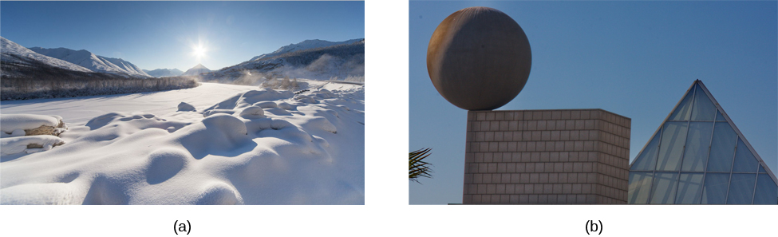

# 7.1 Nhận thức là gì?

> [!info]
>
> ### Mục tiêu học tập
>
> Sau khi học xong phần này, bạn sẽ có thể:
>
> - Mô tả bản chất của nhận thức (*cognition*)
> - Phân biệt khái niệm (*concepts*) và nguyên mẫu (*prototypes*)
> - Giải thích sự khác biệt giữa khái niệm tự nhiên và khái niệm nhân tạo
> - Mô tả cách thức các lược đồ (*schemata*) được tổ chức và kiến tạo

Hãy tưởng tượng mọi suy nghĩ của bạn như những thực thể vật chất đang xoay chuyển nhanh chóng bên trong tâm trí.
Bằng cách nào mà bộ não có thể chuyển từ ý nghĩ này sang ý nghĩ khác theo một cách có tổ chức và trật tự như vậy?
Bộ não không ngừng tri giác, xử lý, lập kế hoạch, sắp xếp và ghi nhớ — nó luôn luôn hoạt động.
Tuy nhiên, bạn hầu như không nhận ra phần lớn các hoạt động này của não bộ khi bạn thực hiện các công việc thường nhật.
Đây chỉ là một khía cạnh của các quá trình phức tạp cấu thành nên nhận thức.
Nói một cách đơn giản, **nhận thức** (*cognition*) là tư duy, và nó bao hàm các quá trình liên quan đến tri giác, tri thức, giải quyết vấn đề, phán đoán, ngôn ngữ và trí nhớ.
Các nhà khoa học nghiên cứu về nhận thức đang tìm kiếm phương thức để thấu hiểu cách chúng ta tích hợp, tổ chức và vận dụng các trải nghiệm nhận thức có ý thức mà không cần phải ý thức được toàn bộ những công việc vô thức mà não bộ đang tiến hành (chẳng hạn, Kahneman, 2011).

## Nhận thức

Mỗi sáng thức dậy, bạn bắt đầu suy nghĩ — cân nhắc về các nhiệm vụ mình phải hoàn thành trong ngày.
Bạn nên làm các việc vặt theo thứ tự nào?
Nên đến ngân hàng, tiệm giặt là hay cửa hàng tạp hóa trước?
Liệu bạn có thể giải quyết xong những việc này trước khi đến lớp hay phải đợi cho đến khi tan học?
Những suy nghĩ này là một ví dụ về nhận thức đang vận hành.
Vô cùng phức tạp, nhận thức là một đặc tính thiết yếu của ý thức con người, tuy nhiên không phải tất cả các khía cạnh của nhận thức đều được trải nghiệm một cách có ý thức.

**Tâm lý học nhận thức** (*cognitive psychology*) là lĩnh vực tâm lý học chuyên nghiên cứu về cách con người tư duy.
Ngành này cố gắng giải thích cách thức và lý do tại sao chúng ta suy nghĩ theo cách chúng ta đang làm bằng cách nghiên cứu các mối tương tác giữa tư duy, cảm xúc, tính sáng tạo, ngôn ngữ và giải quyết vấn đề của con người, bên cạnh các quá trình nhận thức khác.
Các nhà tâm lý học nhận thức nỗ lực xác định và đo lường các loại hình trí thông minh khác nhau, lý giải vì sao một số người giải quyết vấn đề giỏi hơn những người khác, và trí tuệ cảm xúc ảnh hưởng như thế nào đến sự thành công tại nơi làm việc, cùng vô số chủ đề khác.
Đôi khi họ cũng tập trung vào cách chúng ta tổ chức các suy nghĩ và thông tin thu thập được từ môi trường xung quanh thành các phân loại tư duy có ý nghĩa, điều này sẽ được thảo luận ở phần sau.

## Khái niệm và Nguyên mẫu

Hệ thần kinh của con người có khả năng xử lý những dòng thông tin bất tận.
Các giác quan đóng vai trò là giao diện trung gian kết nối giữa tâm trí và môi trường bên ngoài, tiếp nhận các kích thích và chuyển dịch chúng thành các xung thần kinh truyền về não bộ.
Sau đó, não bộ sẽ xử lý thông tin này và sử dụng các mảnh ghép liên quan để tạo ra những suy nghĩ, từ đó có thể được diễn đạt qua ngôn ngữ hoặc lưu trữ trong trí nhớ để sử dụng trong tương lai.
Làm cho quá trình này trở nên phức tạp hơn, bộ não không chỉ thu thập thông tin từ môi trường bên ngoài đơn thuần.
Khi các suy nghĩ được hình thành, tâm trí sẽ tổng hợp thông tin từ cả cảm xúc và ký ức ([Hình 7.2](#Figure_07_01_Brain)).
Cảm xúc và trí nhớ có sức ảnh hưởng mạnh mẽ đến cả suy nghĩ và hành vi của chúng ta.

**Hình 7.2** Cảm giác và thông tin được não bộ tiếp nhận, lọc qua lăng kính cảm xúc và ký ức, rồi được xử lý để trở thành các dòng suy nghĩ.

Để sắp xếp một lượng thông tin khổng lồ đáng kinh ngạc này, tâm trí đã phát triển một cấu trúc tương tự như "tủ hồ sơ".
Các tập tài liệu khác nhau được lưu trữ trong tủ hồ sơ này được gọi là các khái niệm.
**Khái niệm** (*concepts*) là các phân loại hoặc nhóm thông tin ngôn ngữ, hình ảnh, ý tưởng hoặc ký ức, chẳng hạn như những trải nghiệm trong đời sống.
Xét theo nhiều khía cạnh, khái niệm là những ý tưởng khái quát lớn được tạo ra bằng cách quan sát các chi tiết, sau đó phân loại và kết hợp các chi tiết này thành các cấu trúc nhận thức.
Bạn sử dụng các khái niệm để nhận biết mối quan hệ giữa các yếu tố khác nhau trong trải nghiệm của mình, đồng thời giữ cho thông tin trong tâm trí luôn được ngăn nắp và dễ dàng truy xuất.

Các khái niệm được cung cấp thông tin bởi trí nhớ ngữ nghĩa (*semantic memory*) của chúng ta (bạn sẽ tìm hiểu thêm về trí nhớ ngữ nghĩa trong một chương sau) và hiện diện trong mọi khía cạnh của cuộc sống; tuy nhiên, một trong những nơi dễ nhận thấy các khái niệm nhất là bên trong lớp học, nơi chúng được thảo luận một cách rõ ràng và tường minh.
Ví dụ, khi học lịch sử Hoa Kỳ, bạn không chỉ học về các sự kiện đơn lẻ diễn ra trong quá khứ của nước Mỹ.
Bạn tiếp thu một lượng lớn thông tin bằng cách lắng nghe và tham gia thảo luận, nghiên cứu bản đồ và đọc các lời kể trực tiếp từ cuộc sống của nhân chứng.
Não bộ của bạn phân tích các chi tiết này và phát triển một sự hiểu biết tổng thể về lịch sử nước Mỹ.
Trong quá trình đó, não bộ thu thập các chi tiết để cung cấp và trau chuốt sự hiểu biết của bạn về các khái niệm liên quan như chiến tranh, hệ thống tư pháp, cũng như luật pháp và quyền bầu cử.

Các khái niệm có thể mang tính phức tạp và trừu tượng, như công lý, hoặc cụ thể hơn, như các loài chim.
Ví dụ trong tâm lý học, các giai đoạn phát triển của Piaget là những khái niệm trừu tượng.
Một số khái niệm, chẳng hạn như sự khoan dung, được nhiều người đồng thuận vì chúng đã được sử dụng theo nhiều cách khác nhau qua nhiều năm tháng.
Các khái niệm khác, như phẩm chất của người bạn lý tưởng hay truyền thống sinh nhật của gia đình bạn, lại mang tính cá nhân và riêng biệt.
Bằng cách này, các khái niệm chạm đến mọi ngóc ngách trong đời sống của chúng ta, từ những thói quen thường nhật cho đến các nguyên tắc chỉ đạo đằng sau cách thức vận hành của các chính phủ.

Một kỹ thuật khác được não bộ sử dụng để tổ chức thông tin là xác định các nguyên mẫu cho những khái niệm mà bạn đã phát triển.
Một **nguyên mẫu** (*prototype*) là ví dụ hoặc hình ảnh đại diện tiêu biểu nhất, tốt nhất cho một khái niệm.
Chẳng hạn, điều gì nảy ra đầu tiên trong tâm trí bạn khi nghĩ về một "con chó"?
Rất có thể những trải nghiệm ban đầu của bạn với loài chó sẽ định hình những gì bạn tưởng tượng.
Nếu con thú cưng đầu tiên của bạn là một chú chó Golden Retriever, thì rất có khả năng đây chính là nguyên mẫu của bạn cho phân loại loài chó.

## Khái niệm tự nhiên và Khái niệm nhân tạo

Trong tâm lý học, các khái niệm có thể được chia thành hai loại: tự nhiên và nhân tạo.
**Khái niệm tự nhiên** (*natural concepts*) được hình thành một cách "tự nhiên" thông qua trải nghiệm của bạn và có thể phát triển từ trải nghiệm trực tiếp hoặc gián tiếp.
Ví dụ, nếu bạn sống ở Essex Junction, bang Vermont, bạn có thể đã có rất nhiều trải nghiệm trực tiếp với tuyết.
Bạn đã ngắm tuyết rơi từ bầu trời, nhìn thấy những hạt tuyết bay lất phất vừa đủ phủ kín kính chắn gió ô tô, và xúc dọn lớp tuyết trắng xốp dày tới gần nửa mét trong khi nghĩ: "Thời tiết này thật hoàn hảo để đi trượt tuyết."
Bạn từng ném bóng tuyết vào bạn thân và chơi xe trượt tuyết lao xuống ngọn đồi dốc nhất thị trấn.
Nói ngắn gọn, bạn hiểu rất rõ về tuyết.
Bạn biết tuyết trông như thế nào, có mùi gì, vị ra sao và cảm giác khi chạm vào thế nào.
Tuy nhiên, nếu bạn sống cả đời trên hòn đảo Saint Vincent ở vùng Caribe, có thể bạn chưa từng thực sự nhìn thấy tuyết ngoài đời thực, chứ chưa nói đến việc nếm, ngửi hay chạm vào nó.
Bạn biết về tuyết thông qua trải nghiệm gián tiếp từ việc xem tranh ảnh tuyết rơi — hoặc từ các bộ phim có cảnh quay về tuyết.
Dù bằng cách nào, tuyết vẫn là một khái niệm tự nhiên vì bạn có thể kiến tạo sự hiểu biết về nó thông qua các quan sát trực tiếp, trải nghiệm với tuyết, hoặc kiến thức gián tiếp (chẳng hạn qua phim ảnh hoặc sách báo) ([Hình 7.3](#Figure_07_01_SnowShapes)).

**Hình 7.3** (a) Khái niệm của chúng ta về tuyết là một ví dụ về khái niệm tự nhiên — một khái niệm mà chúng ta thấu hiểu thông qua quan sát và trải nghiệm trực tiếp. (b) Ngược lại, các khái niệm nhân tạo là những khái niệm mà chúng ta biết đến qua một tập hợp các đặc điểm cụ thể mà chúng luôn thể hiện, chẳng hạn như những quy chuẩn định hình các hình khối cơ bản khác nhau. (nguồn a: chỉnh sửa tác phẩm của Maarten Takens; nguồn b: chỉnh sửa tác phẩm của “Shayan (USA)”/Flickr)

Mặt khác, một **khái niệm nhân tạo** (*artificial concept*) là khái niệm được xác định bởi một tập hợp các đặc tính cụ thể rõ ràng.
Các thuộc tính khác nhau của các hình học, chẳng hạn như hình vuông và hình tam giác, đóng vai trò là những ví dụ hữu ích về khái niệm nhân tạo.
Một hình tam giác luôn có ba góc và ba cạnh.
Một hình vuông luôn có bốn cạnh bằng nhau và bốn góc vuông.
Các công thức toán học, chẳng hạn như phương trình tính diện tích (chiều dài × chiều rộng), là những khái niệm nhân tạo được định nghĩa bởi các tập hợp đặc tính cụ thể luôn luôn bất biến.
Các khái niệm nhân tạo có thể tăng cường sự hiểu biết về một chủ đề bằng cách xây dựng dựa trên nhau.
Ví dụ, trước khi học khái niệm "diện tích hình vuông" (và công thức tính diện tích), bạn phải hiểu hình vuông là gì.
Một khi khái niệm "diện tích hình vuông" đã được thấu hiểu, sự hiểu biết về diện tích của các hình học khác có thể được xây dựng tiếp dựa trên sự hiểu biết ban đầu về diện tích.
Việc sử dụng các khái niệm nhân tạo để định nghĩa một ý tưởng là cực kỳ quan trọng để giao tiếp với người khác và tham gia vào tư duy phức tạp.
Theo Goldstone và Kersten (2003), các khái niệm đóng vai trò như những viên gạch nền tảng và có thể được liên kết trong vô số tổ hợp khác nhau để tạo nên những tư duy phức hợp.

## Lược đồ

Một **lược đồ** (*schema*) là một cấu trúc tinh thần bao gồm một cụm hoặc tập hợp các khái niệm có liên quan với nhau (Bartlett, 1932).
Có nhiều loại lược đồ khác nhau, và tất cả chúng đều có một điểm chung: lược đồ là phương pháp tổ chức thông tin cho phép não bộ hoạt động hiệu quả hơn.
Khi một lược đồ được kích hoạt, não bộ sẽ đưa ra những giả định tức thì về con người hoặc sự vật đang được quan sát.

Có một số dạng lược đồ.
Một **lược đồ vai trò** (*role schema*) đưa ra các giả định về cách thức những cá nhân trong một vai trò nhất định sẽ hành xử (Callero, 1994).
Chẳng hạn, hãy tưởng tượng bạn gặp một người tự giới thiệu mình là lính cứu hỏa.
Khi điều này xảy ra, não bộ của bạn sẽ tự động kích hoạt "lược đồ lính cứu hỏa" và bắt đầu đưa ra các giả định rằng người này dũng cảm, vị tha và luôn hướng về cộng đồng.
Dù chưa hề quen biết người này, bạn đã vô thức đưa ra những phán đoán về họ.
Các lược đồ cũng giúp bạn lấp đầy những khoảng trống trong thông tin bạn tiếp nhận từ thế giới xung quanh.
Mặc dù các lược đồ cho phép xử lý thông tin hiệu quả hơn, nhưng vẫn có thể nảy sinh những vấn đề với lược đồ, bất kể chúng có chính xác hay không: Có lẽ người lính cứu hỏa cụ thể này không hề dũng cảm, anh ta chỉ làm công việc chữa cháy để trang trải viện phí sinh hoạt trong khi đang học để trở thành một thủ thư thư viện thiếu nhi.

Một **lược đồ sự kiện** (*event schema*), còn được gọi là một **kịch bản nhận thức** (*cognitive script*), là một tập hợp các hành vi quen thuộc lặp đi lặp lại như một thông lệ.
Hãy nghĩ về những gì bạn làm khi bước vào thang máy ([Hình 7.4](#Figure_07_01_Elevator)).
Đầu tiên, cửa mở và bạn đứng chờ để hành khách bên trong bước ra ngoài thang máy.
Sau đó, bạn bước vào thang máy và quay người đối diện với cửa, tìm nút tầng cần nhấn.
Bạn không bao giờ đứng quay mặt vào vách sau của thang máy, đúng không?
Và khi bạn đi trong một thang máy đông đúc mà không thể quay mặt về phía cửa trước, bạn sẽ cảm thấy vô cùng khó chịu, phải không nào?
Điều thú vị là các lược đồ sự kiện có thể rất khác nhau giữa các nền văn hóa và quốc gia.
Ví dụ, trong khi việc bắt tay khi chào nhau là rất phổ biến ở Hoa Kỳ, thì ở Tây Tạng, người ta chào nhau bằng cách thè lưỡi ra, và ở Belize, người ta chạm nắm đấm vào nhau (Cairns Regional Council, n.d.).

**Hình 7.4** Bạn thực hiện lược đồ sự kiện nào khi đi thang máy? (nguồn: “Gideon”/Flickr)

Bởi vì các lược đồ sự kiện mang tính tự động, chúng có thể rất khó thay đổi.
Hãy tưởng tượng bạn đang lái xe từ nơi làm việc hoặc trường học về nhà.
Lược đồ sự kiện này bao gồm việc bước vào xe, đóng cửa, thắt dây an toàn trước khi tra chìa khóa vào ổ khởi động.
Bạn có thể thực hiện kịch bản này hai hoặc ba lần mỗi ngày.
Khi đang lái xe về nhà, bạn nghe thấy tiếng chuông điện thoại reo.
Thông thường, lược đồ sự kiện xuất hiện khi bạn nghe thấy tiếng chuông điện thoại reo bao gồm việc định vị chiếc điện thoại và nhấc máy trả lời hoặc phản hồi tin nhắn mới nhất.
Vì vậy, chẳng cần suy nghĩ, bạn liền đưa tay với lấy điện thoại — chiếc điện thoại có thể đang nằm trong túi quần, trong túi xách hoặc trên ghế phụ bên cạnh.
Lược đồ sự kiện mạnh mẽ này được định hình bởi khuôn mẫu hành vi của bạn và sự kích thích dễ chịu mà một cuộc gọi hoặc tin nhắn mang lại cho não bộ.
Bởi vì nó là một lược đồ, nên vô cùng khó khăn để chúng ta dừng việc với tay lấy điện thoại, mặc dù chúng ta biết rõ rằng mình đang gây nguy hiểm cho tính mạng của chính mình và của những người khác khi làm điều đó (Neyfakh, 2013) ([Hình 7.5](#Figure_07_01_Texting)).

**Hình 7.5** Nhắn tin khi lái xe là hành vi nguy hiểm, nhưng đó lại là một lược đồ sự kiện rất khó cưỡng lại đối với một số người.

Bạn còn nhớ ví dụ về chiếc thang máy không?
Gần như là điều không tưởng nếu bước vào thang máy mà *không* quay mặt về phía cửa.
Lược đồ sự kiện mạnh mẽ điều khiển hành vi của chúng ta trong thang máy, và điều đó cũng tương tự đối với chiếc điện thoại của chúng ta.
Các nghiên cứu hiện tại cho thấy chính thói quen, hay lược đồ sự kiện, kiểm tra điện thoại trong nhiều tình huống khác nhau đã khiến việc kìm chế không kiểm tra điện thoại khi lái xe trở nên đặc biệt khó khăn (Bayer & Campbell, 2012).
Vì việc nhắn tin khi lái xe đã trở thành một vấn nạn nguy hiểm mang tính dịch bệnh trong những năm gần đây, các nhà tâm lý học đang tìm kiếm những cách giúp mọi người làm gián đoạn "lược đồ điện thoại" trong khi lái xe.
Các lược đồ sự kiện như thế này chính là lý do tại sao nhiều thói quen lại rất khó từ bỏ một khi chúng đã được hình thành.
Khi chúng ta tiếp tục tìm hiểu về tư duy, hãy ghi nhớ sức mạnh to lớn của các khái niệm và lược đồ đối với sự hiểu biết của chúng ta về thế giới.
