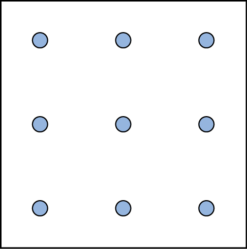
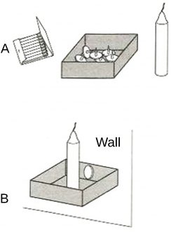

# 7.3 Giải quyết vấn đề

> [!info]
>
> ### Mục tiêu học tập
>
> Sau khi học xong phần này, bạn sẽ có thể:
>
> - Mô tả các chiến lược giải quyết vấn đề
> - Định nghĩa thuật toán (*algorithm*) và phương pháp phỏng đoán (*heuristic*)
> - Giải thích một số trở ngại phổ biến đối với việc giải quyết vấn đề và đưa ra quyết định hiệu quả

Con người đối mặt với các vấn đề mỗi ngày — thường là rất nhiều vấn đề xuyên suốt cả ngày.
Đôi khi những vấn đề này rất đơn giản và trực tiếp: Chẳng hạn, để làm lượng bột bánh pizza gấp đôi công thức, tất cả những gì cần làm chỉ là nhân đôi khối lượng của từng nguyên liệu trong công thức.
Tuy nhiên, đôi khi những vấn đề chúng ta gặp phải lại phức tạp hơn nhiều.
Ví dụ, giả sử bạn có một hạn chót công việc và bạn phải gửi bản in của một bản báo cáo cho cấp trên trước khi hết giờ làm việc.
Bản báo cáo có tính cấp bách về thời gian và phải được gửi chuyển phát qua đêm.
Bạn đã hoàn thành báo cáo từ đêm qua, nhưng máy in của bạn hôm nay lại không hoạt động.
Bạn nên làm gì?
Đầu tiên, bạn cần xác định vấn đề và sau đó áp dụng một chiến lược để giải quyết vấn đề đó.

## Các chiến lược giải quyết vấn đề

Khi bạn đứng trước một vấn đề — dù đó là một bài toán phức tạp hay một chiếc máy in bị hỏng, bạn sẽ giải quyết nó như thế nào?
Trước khi tìm ra giải pháp, vấn đề trước hết phải được xác định một cách rõ ràng.
Sau đó, một trong nhiều chiến lược giải quyết vấn đề có thể được áp dụng, với hy vọng mang lại giải pháp mong muốn.

Một **chiến lược giải quyết vấn đề** (*problem-solving strategy*) là một kế hoạch hành động được sử dụng để tìm ra giải pháp.
Các chiến lược khác nhau sẽ gắn liền với những kế hoạch hành động khác nhau ([Bảng 7.2](#Table_07_03_01)).
Chẳng hạn, một chiến lược rất quen thuộc là **thử và sai** (*trial and error*).
Câu ngạn ngữ xưa "Thất bại là mẹ thành công" hay "Nếu lần đầu chưa được thì hãy tiếp tục thử lại" mô tả phương pháp thử và sai.
Đối với chiếc máy in bị hỏng của bạn, bạn có thể thử kiểm tra mức mực, và nếu không được, bạn có thể kiểm tra xem khay nạp giấy có bị kẹt không.
Hoặc có thể máy in thực ra chưa được kết nối với máy tính xách tay của bạn.
Khi sử dụng phương pháp thử và sai, bạn sẽ tiếp tục thử các giải pháp khác nhau cho đến khi vấn đề được giải quyết.
Mặc dù thử và sai thường không phải là chiến lược tiết kiệm thời gian nhất, nhưng nó lại là một phương pháp rất hay được sử dụng.

**Các chiến lược giải quyết vấn đề**

| Phương pháp | Mô tả | Ví dụ |
| --- | --- | --- |
| Thử và sai (*Trial and error*) | Tiếp tục thử các giải pháp khác nhau cho đến khi vấn đề được giải quyết | Khởi động lại điện thoại, tắt Wi-Fi, tắt Bluetooth để xác định nguyên nhân điện thoại gặp trục trặc |
| Thuật toán (*Algorithm*) | Công thức giải quyết vấn đề theo từng bước cụ thể | Video hướng dẫn cài đặt phần mềm mới trên máy tính |
| Phương pháp phỏng đoán (*Heuristic*) | Khung giải quyết vấn đề mang tính tổng quát | Tư duy ngược từ kết quả; chia nhỏ một nhiệm vụ thành các bước |

**Bảng 7.2**

Một loại chiến lược khác là thuật toán.
Một **thuật toán** (*algorithm*) là một công thức giải quyết vấn đề cung cấp cho bạn những chỉ dẫn cụ thể từng bước nhằm đạt được kết quả mong muốn (Kahneman, 2011).
Bạn có thể xem thuật toán như một công thức nấu ăn với các hướng dẫn chi tiết đến mức luôn tạo ra cùng một kết quả chính xác mỗi khi chúng được thực hiện.
Thuật toán được sử dụng thường xuyên trong đời sống hàng ngày của chúng ta, đặc biệt là trong khoa học máy tính.
Khi bạn tìm kiếm thông tin trên Internet, các công cụ tìm kiếm như Google sử dụng các thuật toán để quyết định mục nào sẽ xuất hiện đầu tiên trong danh sách kết quả.
Facebook cũng sử dụng thuật toán để quyết định bài đăng nào sẽ hiển thị trên bảng tin của bạn.
Bạn có thể nhận diện các tình huống khác mà thuật toán được ứng dụng hay không?

Phương pháp phỏng đoán (*heuristic*) là một dạng chiến lược giải quyết vấn đề khác.
Trong khi một thuật toán phải được tuân thủ chính xác từng bước để tạo ra kết quả chuẩn xác, thì một **phương pháp phỏng đoán** (*heuristic*) là một khuôn khổ giải quyết vấn đề mang tính tổng quát (Tversky & Kahneman, 1974).
Bạn có thể xem chúng như những lối tắt tư duy trong tâm trí (*mental shortcuts*) được sử dụng để giải quyết vấn đề.
Một "quy tắc ngón tay cái" (*rule of thumb - kinh nghiệm thực tế phỏng đoán*) là một ví dụ về heuristic.
Quy tắc như vậy giúp con người tiết kiệm thời gian và năng lượng khi đưa ra quyết định, nhưng bất chấp đặc tính tiết kiệm thời gian, nó không phải lúc nào cũng là phương pháp tốt nhất để đưa ra một quyết định hợp lý.
Các dạng heuristic khác nhau được sử dụng trong các tình huống khác nhau, nhưng sự thôi thúc sử dụng một heuristic thường xảy ra khi một trong năm điều kiện sau được đáp ứng (Pratkanis, 1989):

- Khi một người phải đối mặt với quá nhiều thông tin
- Khi thời gian đưa ra quyết định bị hạn chế
- Khi quyết định cần đưa ra không quá quan trọng
- Khi có rất ít thông tin để dựa vào đó đưa ra quyết định
- Khi một heuristic thích hợp tình cờ nảy ra trong tâm trí cùng thời điểm đó

**Tư duy ngược** (*working backwards*) là một heuristic hữu ích, trong đó bạn bắt đầu giải quyết vấn đề bằng cách tập trung vào kết quả cuối cùng.
Hãy xem xét ví dụ này: Bạn sống ở Washington, D.C. và được mời dự một đám cưới vào lúc 4 giờ chiều thứ Bảy tại Philadelphia.
Biết rằng tuyến đường cao tốc Liên bang 95 thường xuyên bị ùn tắc vào bất kỳ ngày nào trong tuần, bạn cần lập kế hoạch lộ trình và tính toán thời gian khởi hành phù hợp.
Nếu bạn muốn có mặt tại lễ cưới trước 3 giờ 30 chiều, và mất 2,5 giờ để đến Philadelphia trong điều kiện đường thông thoáng không tắc xe, bạn nên rời nhà vào lúc mấy giờ?
Bạn sử dụng lối tắt tư duy ngược này để lên kế hoạch cho các sự kiện trong ngày một cách thường xuyên, có lẽ mà không cần nghĩ ngợi nhiều.

Một heuristic hữu ích khác là phương pháp hoàn thành một mục tiêu hoặc nhiệm vụ lớn bằng cách chia nhỏ nó thành một chuỗi các bước nhỏ hơn.
Học sinh, sinh viên thường sử dụng phương pháp phổ biến này để hoàn thành một dự án nghiên cứu lớn hoặc một bài luận dài ở trường.
Ví dụ, sinh viên thường động não tìm ý tưởng (*brainstorm*), xây dựng luận điểm hoặc chủ đề chính, nghiên cứu tài liệu về chủ đề đã chọn, sắp xếp thông tin thành một đề cương, viết bản thảo sơ bộ, chỉnh sửa và hoàn thiện bản thảo, viết bản hoàn chỉnh cuối cùng, sắp xếp danh mục tài liệu tham khảo và đọc soát lỗi trước khi nộp bài.
Nhiệm vụ lớn lao trở nên đỡ choáng ngợp hơn nhiều khi nó được phân tách thành một chuỗi các bước nhỏ.

> [!abstract]
>
> ### Kết nối đời sống
>
> #### Giải đố
>
> Khả năng giải quyết vấn đề có thể được cải thiện thông qua rèn luyện.
> Nhiều người tự thử thách bản thân mỗi ngày với các câu đố và các bài tập rèn luyện trí não khác để mài giũa kỹ năng giải quyết vấn đề.
> Các câu đố Sudoku xuất hiện hàng ngày trên hầu hết các tờ báo.
> Thông thường, một câu đố Sudoku là một lưới 9×9 ô.
> Câu đố Sudoku đơn giản dưới đây ([Hình 7.7](#Figure_07_03_Sudoku)) là một lưới 4×4 ô.
> Để giải câu đố, hãy điền vào các ô trống một chữ số: 1, 2, 3 hoặc 4.
> Dưới đây là các quy tắc: Tổng các số phải bằng 10 trong mỗi khối 4 ô in đậm, mỗi hàng và mỗi cột; đồng thời, mỗi chữ số chỉ có thể xuất hiện một lần trong một khối ô in đậm, một hàng và một cột.
> Hãy tự bấm giờ khi bạn giải câu đố này và so sánh thời gian của bạn với một bạn cùng lớp.
>
> 
>
> 
>
> **Hình 7.7** Bạn mất bao lâu để giải câu đố Sudoku này? (Bạn có thể xem đáp án ở cuối phần này.)
>
> Dưới đây là một dạng câu đố phổ biến khác ([Hình 7.8](#Figure_07_03_DotsAndLines)) thử thách kỹ năng suy luận không gian của bạn.
> Hãy nối tất cả chín dấu chấm bằng bốn đường thẳng liền nét mà không nhấc bút khỏi mặt giấy:
>
> 
>
> 
>
> **Hình 7.8** Bạn đã tìm ra lời giải chưa? (Đáp án nằm ở cuối phần này.) Một khi bạn đã hiểu cách phá giải câu đố này, bạn sẽ không bao giờ quên được.
>
> Hãy xem câu đố logic "Những chiếc cân hóc búa" dưới đây ([Hình 7.9](#Figure_07_03_SamLoyd)).
> Sam Loyd, một bậc thầy giải đố nổi tiếng, đã tạo ra và hoàn thiện vô số câu đố trong suốt cuộc đời của mình (Cyclopedia of Puzzles, n.d.).
>
> 
>
> ![Một câu đố liên quan đến chiếc cân đòn.
> Ở đầu hình có dòng chữ: “Sam Loyds Puzzling Scales.”
> Hàng đầu tiên của câu đố cho thấy một chiếc cân thăng bằng với 3 khối vuông và một con quay ở đĩa cân bên trái và 12 viên bi ở đĩa cân bên phải.
> Bên dưới hàng này có dòng chữ: “Since the scales now balance.”
> Hàng tiếp theo cho thấy một chiếc cân thăng bằng chỉ với một con quay ở bên trái, và 1 khối vuông cùng 8 viên bi ở bên phải.
> Bên dưới có dòng chữ: “And balance when arranged this way.”
> Hàng thứ ba cho thấy một chiếc cân không thăng bằng với con quay ở đĩa bên trái, bị trĩu xuống thấp hơn nhiều so với bên phải.
> Đĩa cân bên phải trống rỗng.
> Dòng chữ bên dưới ghi: “Then how many marbles will it require to balance with that top?”](../../images/img_3a2cfd388a09.jpg)
>
> **Hình 7.9** Bạn đã thực hiện những bước nào để giải câu đố này? Bạn có thể đọc lời giải ở cuối phần này.

## Những cạm bẫy trong giải quyết vấn đề

Tuy nhiên, không phải mọi vấn đề đều được giải quyết thành công.
Những rào cản nào ngăn trở chúng ta giải quyết thành công một vấn đề?
Hãy tưởng tượng một người đang ở trong một căn phòng có bốn cánh cửa.
Một cánh cửa vốn luôn mở trong quá khứ nay đã bị khóa.
Người đó, vì thói quen ra khỏi phòng bằng chính cánh cửa đó, cứ liên tục cố gắng thoát ra bằng cánh cửa cũ mặc dù ba cánh cửa kia đều đang mở.
Người này đã bị mắc kẹt — trong khi họ chỉ cần đi sang một cánh cửa khác, thay vì cứ cố gắng chui qua cánh cửa đã khóa.
Một **nếp nghĩ định sẵn** (*mental set*) là tình huống mà bạn khăng khăng tiếp cận một vấn đề theo cách đã từng phát huy hiệu quả trong quá khứ nhưng rõ ràng là không còn hiệu quả ở hiện tại nữa.

**Sự cố định chức năng** (*functional fixedness*) là một dạng nếp nghĩ định sẵn trong đó bạn không thể nhận thức được một đồ vật có thể được sử dụng cho mục đích nào khác ngoài mục đích mà nó vốn được thiết kế ban đầu.
Duncker (1945) đã thực hiện nghiên cứu nền tảng về sự cố định chức năng.
Ông đã tạo ra một thí nghiệm trong đó những người tham gia được phát một cây nến, một bao diêm và một hộp đinh bấm.
Họ được hướng dẫn sử dụng những vật dụng đó để gắn cây nến lên tường sao cho sáp nến không nhỏ giọt xuống chiếc bàn bên dưới.
Những người tham gia phải vượt qua sự cố định chức năng để giải quyết vấn đề này ([Hình 7.10](#Figure_07_03_Duncker)).
Trong sứ mệnh *Apollo 13* lên mặt trăng, các kỹ sư của NASA tại Trung tâm Điều hành Sứ mệnh đã phải vượt qua sự cố định chức năng để cứu sống các phi hành gia trên tàu vũ trụ.
Một vụ nổ trong một khoang của tàu vũ trụ đã làm hỏng nhiều hệ thống.
Các phi hành gia đứng trước nguy cơ bị ngộ độc do nồng độ carbon dioxide tăng cao vì bộ lọc carbon dioxide gặp sự cố.
Các kỹ sư đã tìm ra cách để các phi hành gia tận dụng những túi nhựa dự phòng, băng dính và ống dẫn khí để chế tạo một bộ lọc không khí tạm thời, qua đó cứu sống toàn bộ phi hành đoàn.

**Hình 7.10** Trong nghiên cứu kinh điển của Duncker, những người tham gia được cung cấp ba đồ vật ở khung hình phía trên và được yêu cầu giải quyết vấn đề. Giải pháp được thể hiện ở phần bên dưới.

> [!tip]
>
> ### Liên kết học tập
>
> Hãy xem [phân cảnh Apollo 13 về việc các kỹ sư NASA vượt qua sự cố định chức năng](https://openstax.org/l/Apollo13) để tìm hiểu thêm.

Các nhà nghiên cứu đã tìm hiểu xem liệu sự cố định chức năng có bị ảnh hưởng bởi văn hóa hay không.
Trong một thí nghiệm, các cá nhân thuộc nhóm người Shuar ở Ecuador được yêu cầu sử dụng một đồ vật cho mục đích khác ngoài mục đích ban đầu của nó.
Ví dụ, những người tham gia được kể một câu chuyện về một chú gấu và một chú thỏ bị ngăn cách bởi một con sông và được yêu cầu chọn trong số nhiều đồ vật khác nhau, bao gồm thìa, cốc, tẩy, v.v. để giúp các con vật.
Chiếc thìa là vật thể duy nhất đủ dài để bắc qua con sông tưởng tượng, nhưng nếu chiếc thìa được bày ra theo cách phản ánh công dụng thông thường của nó, những người tham gia sẽ mất nhiều thời gian hơn để chọn chiếc thìa nhằm giải quyết vấn đề (German & Barrett, 2005).
Các nhà nghiên cứu muốn biết liệu việc tiếp xúc với các công cụ chuyên dụng cao độ, như diễn ra với các cá nhân ở các quốc gia công nghiệp hóa, có ảnh hưởng đến khả năng vượt qua sự cố định chức năng của họ hay không.
Kết quả xác định rằng sự cố định chức năng xuất hiện ở cả các nền văn hóa công nghiệp hóa lẫn phi công nghiệp hóa (German & Barrett, 2005).

Để đưa ra các quyết định sáng suốt, chúng ta sử dụng tri thức và lập luận của mình.
Thông thường, tri thức và lập luận này rất vững vàng và hợp lý.
Tuy nhiên, đôi khi chúng ta lại bị lung lay bởi các thiên kiến hoặc bởi người khác thao túng tình huống.
Ví dụ, giả sử bạn và ba người bạn muốn thuê một ngôi nhà và có tổng ngân sách mục tiêu chung là 1.600 đô la.
Người môi giới bất động sản chỉ dẫn bạn đi xem những ngôi nhà rất tồi tàn với giá 1.600 đô la, rồi sau đó dẫn bạn đến xem một ngôi nhà rất đẹp với giá 2.000 đô la.
Liệu bạn có đề nghị mỗi người đóng thêm tiền thuê nhà để thuê được căn nhà 2.000 đô la đó không?
Tại sao người môi giới lại dẫn bạn đi xem những căn nhà dột nát rồi mới đến căn nhà đẹp?
Người môi giới có thể đang tác động vào thiên kiến mỏ neo của bạn.
Một **thiên kiến mỏ neo** (*anchoring bias*) xảy ra khi bạn quá tập trung vào một mẩu thông tin duy nhất khi đưa ra quyết định hoặc giải quyết vấn đề.
Trong trường hợp này, bạn quá tập trung vào số tiền mình sẵn sàng chi trả đến mức có thể không nhận thức được những loại nhà nào thực sự có sẵn ở mức giá đó.

**Thiên kiến xác nhận** (*confirmation bias*) là xu hướng chỉ tập trung vào những thông tin xác nhận các niềm tin sẵn có của bạn.
Ví dụ, nếu bạn cho rằng vị giáo sư của mình không hề tốt bụng, bạn sẽ chú ý đến tất cả những hành vi thô lỗ mà giáo sư thể hiện, trong khi hoàn toàn phớt lờ vô số những tương tác dễ chịu mà ông tham gia hàng ngày.
**Thiên kiến nhận thức muộn** (*hindsight bias*) khiến bạn tin rằng sự kiện bạn vừa trải qua vốn dĩ là hoàn toàn có thể dự đoán trước được, mặc dù trên thực tế không phải như vậy.
Nói cách khác, bạn tự cho rằng mình đã biết tỏng từ đầu mọi chuyện sẽ diễn ra theo cách đó.
**Thiên kiến đại diện** (*representative bias*) mô tả một lối tư duy sai lầm, trong đó bạn đưa ra quyết định hoặc phán đoán dựa trên nhận thức của mình về mức độ tương đồng của người đó hoặc sự vật đó với những định kiến và niềm tin từ trước của bạn; chẳng hạn, bạn có thể mặc định rằng các giáo sư của bạn dành thời gian rảnh rỗi để đọc sách và tham gia vào các cuộc trò chuyện học thuật sâu sắc, bởi vì ý nghĩ họ dành thời gian chơi bóng chuyền hoặc đi công viên giải trí không khớp với khuôn mẫu định kiến của bạn về giới giáo sư.
Trong một ví dụ khác, một y tá cấp cứu có thể dễ dàng phát hiện cơn đau tim ở một bệnh nhân nam nhanh chóng hơn so với bệnh nhân nữ, do định kiến vô thức của y tá rằng các cơn đau tim xảy ra thường xuyên hơn ở nam giới.

Cuối cùng, **phương pháp phỏng đoán dựa trên tính sẵn có** (*availability heuristic*) là một lối tắt tư duy trong đó bạn đưa ra quyết định dựa trên một ví dụ, thông tin hoặc trải nghiệm gần đây sẵn có trong tâm trí bạn, mặc dù nó có thể không phải là ví dụ tốt nhất để cung cấp thông tin cho quyết định của bạn.
Các thiên kiến có xu hướng "bảo tồn những gì đã được thiết lập sẵn — duy trì kiến thức, niềm tin, thái độ và các giả thuyết sẵn có của chúng ta" (Aronson, 1995; Kahneman, 2011).
Các thiên kiến này được tóm tắt trong [Bảng 7.3](#Table_07_03_02).

**Tóm tắt các thiên kiến trong việc đưa ra quyết định**

| Thiên kiến | Mô tả |
| --- | --- |
| Mỏ neo (*Anchoring*) | Xu hướng chỉ tập trung vào một mẩu thông tin cụ thể khi đưa ra quyết định hoặc giải quyết vấn đề |
| Xác nhận (*Confirmation*) | Tập trung vào thông tin xác nhận các niềm tin sẵn có |
| Nhận thức muộn (*Hindsight*) | Niềm tin rằng sự kiện vừa trải qua là điều hoàn toàn có thể dự đoán được |
| Đại diện (*Representative*) | Đưa ra quyết định hoặc phán đoán dựa trên nhận thức về sự tương đồng với các định kiến hoặc niềm tin từ trước |
| Tính sẵn có (*Availability*) | Quyết định được dựa trên một tiền lệ hoặc ví dụ sẵn có dễ nhớ lại trong tâm trí nhưng có thể sai lệch |

**Bảng 7.3**

> [!tip]
>
> ### Liên kết học tập
>
> Hãy xem [video ca nhạc do giáo viên thực hiện về các thiên kiến nhận thức](https://openstax.org/l/CogBias) để tìm hiểu thêm.

Bạn có xác định được cần bao nhiêu viên bi để làm thăng bằng chiếc cân trong [Hình 7.9](#Figure_07_03_SamLoyd) không?
Bạn cần chín viên bi.
Bạn đã giải được các bài toán trong [Hình 7.7](#Figure_07_03_Sudoku) và [Hình 7.8](#Figure_07_03_DotsAndLines) chưa?
Dưới đây là đáp án ([Hình 7.11](#Figure_07_03_Solutions)).

![Câu đố đầu tiên là một lưới Sudoku gồm 16 ô vuông (4 hàng 4 ô). Một nửa các con số đã được cung cấp sẵn để bắt đầu câu đố và có màu xanh lam, một nửa đã được điền vào làm lời giải của câu đố và có màu đỏ. Các số trong mỗi hàng của lưới, từ trái sang phải, như sau. Hàng 1: 3 xanh, 1 đỏ, 4 đỏ, 2 xanh. Hàng 2: 2 đỏ, 4 xanh, 1 xanh, 3 đỏ. Hàng 3: 1 đỏ, 3 xanh, 2 xanh, 4 đỏ. Hàng 4: 4 xanh, 2 đỏ, 3 đỏ, 1 xanh. Câu đố thứ hai gồm 9 dấu chấm được sắp xếp thành 3 hàng 3 chấm bên trong một hình vuông. Lời giải gồm bốn đường thẳng vẽ liền nét mà không nhấc bút, được thể hiện bằng đường màu đỏ với các mũi tên chỉ hướng di chuyển. Để giải câu đố, các đường kẻ phải vươn ra ngoài ranh giới của chiếc hộp vuông. Bốn đường thẳng nối được vẽ như sau: Đường 1 bắt đầu từ chấm trên cùng bên trái, đi qua chấm giữa và chấm bên phải của hàng trên cùng, và kéo dài sang phải vượt ra ngoài ranh giới của hình vuông. Đường 2 kéo dài từ điểm kết thúc của đường 1, đi qua chấm bên phải của hàng giữa, qua chấm giữa của hàng dưới cùng, và vượt ra ngoài ranh giới hình vuông kết thúc ở khoảng trống bên dưới chấm bên trái của hàng dưới cùng. Đường 3 kéo dài từ điểm kết thúc của đường 2 hướng thẳng lên trên qua các chấm bên trái của hàng dưới cùng, hàng giữa và hàng trên cùng. Đường 4 kéo dài từ điểm kết thúc của đường 3 đi qua chấm giữa ở hàng giữa và kết thúc tại chấm bên phải của hàng dưới cùng.](../../images/img_3bba801c7de1.jpg)

**Hình 7.11**
