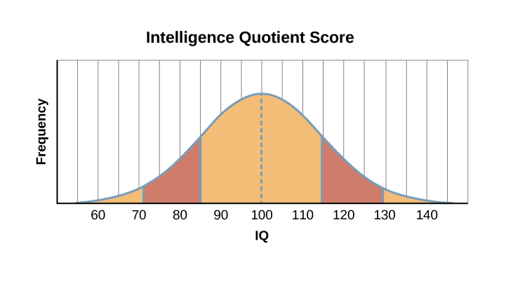

# 7.5 Đo lường Trí thông minh

> [!info]
>
> ### Mục tiêu học tập
>
> Sau khi học xong phần này, bạn sẽ có thể:
>
> - Giải thích cách thức các bài kiểm tra trí thông minh được phát triển
> - Mô tả lịch sử sử dụng các bài kiểm tra IQ
> - Mô tả mục đích và lợi ích của việc kiểm tra trí thông minh

Mặc dù có thể bạn đã quen thuộc với thuật ngữ “IQ” và gắn nó với khái niệm trí thông minh, nhưng IQ thực sự có ý nghĩa gì?
IQ là viết tắt của **chỉ số thông minh** (*intelligence quotient*) và mô tả điểm số đạt được trong một bài kiểm tra được thiết kế để đo lường trí thông minh.
Bạn đã biết rằng có nhiều cách để các nhà tâm lý học mô tả trí thông minh (hoặc chính xác hơn là các loại hình trí tuệ).
Tương tự như vậy, các bài kiểm tra IQ — công cụ được thiết kế để đo lường trí thông minh — luôn là chủ đề tranh luận trong suốt quá trình phát triển và sử dụng của chúng.

Khi nào một bài kiểm tra IQ có thể được sử dụng?
Chúng ta học được gì từ các kết quả, và người ta có thể sử dụng thông tin này như thế nào?
Mặc dù việc kiểm tra trí thông minh chắc chắn mang lại nhiều lợi ích, nhưng điều quan trọng là cũng phải nhận thấy những hạn chế và tranh cãi xoay quanh các bài kiểm tra này.
Chẳng hạn, các bài kiểm tra IQ đôi khi từng bị lợi dụng làm luận cứ ủng hộ cho những mục đích đen tối, chẳng hạn như phong trào ưu sinh (*eugenics movement*) (Severson, 2011).
Vụ án khét tiếng tại Tòa án Tối cao Hoa Kỳ, *Buck kiện Bell*, đã hợp pháp hóa việc cưỡng bức triệt sản đối với một số người bị coi là "thiểu năng trí tuệ" thông qua hình thức kiểm tra này, dẫn đến khoảng 65.000 trường hợp bị triệt sản (*Buck v.
Bell*, 274 U.S. 200; Ko, 2016).
Ngày nay, chỉ những chuyên gia được đào tạo bài bản về tâm lý học mới có thể tiến hành các bài kiểm tra IQ, và việc mua hầu hết các bộ trắc nghiệm đều đòi hỏi phải có bằng cấp cao về tâm lý học.
Các chuyên gia khác trong ngành, chẳng hạn như nhân viên xã hội và bác sĩ tâm thần, không được phép tự ý thực hiện các bài kiểm tra IQ.
Trong phần này, chúng ta sẽ tìm hiểu xem các bài kiểm tra trí thông minh đo lường điều gì, chúng được chấm điểm ra sao và chúng đã được phát triển như thế nào.

## Đo lường trí thông minh

Dường như sự hiểu biết của con người về trí thông minh có phần bị giới hạn khi chúng ta chỉ tập trung vào trí thông minh mang tính học thuật hoặc truyền thống.
Vậy thì, trí thông minh có thể được đo lường bằng cách nào?
Và khi đo lường trí thông minh, làm thế nào để đảm bảo rằng chúng ta nắm bắt được chính xác những gì mình thực sự muốn đo (nói cách khác, làm thế nào để các bài kiểm tra IQ vận hành như những thước đo có giá trị hiệu lực đối với trí thông minh)?
Trong các đoạn văn tiếp theo, chúng ta sẽ khám phá cách thức các bài kiểm tra trí thông minh được phát triển và lịch sử sử dụng của chúng.

Bài kiểm tra IQ đã đồng nghĩa với trí thông minh trong hơn một thế kỷ qua.
Vào cuối những năm 1800, Sir Francis Galton đã phát triển bài kiểm tra trí thông minh trên diện rộng đầu tiên (Flanagan & Kaufman, 2004).
Mặc dù ông không phải là một nhà tâm lý học, nhưng những đóng góp của ông đối với các khái niệm đo lường trí thông minh vẫn còn vang vọng cho đến ngày nay (Gordon, 1995).
Việc kiểm tra trí thông minh đáng tin cậy (bạn có thể nhớ lại từ các chương trước rằng độ tin cậy đề cập đến khả năng của một bài kiểm tra tạo ra các kết quả nhất quán) thực sự bắt đầu vào đầu những năm 1900 với nhà nghiên cứu người Pháp Alfred Binet ([Hình 7.13](#Figure_07_05_ChildIQ)).
Binet được chính phủ Pháp yêu cầu phát triển một bài kiểm tra trí thông minh để áp dụng cho trẻ em nhằm xác định những em có thể gặp khó khăn trong học tập ở trường; bài kiểm tra này bao gồm nhiều nhiệm vụ dựa trên ngôn ngữ.
Các nhà nghiên cứu Mỹ nhanh chóng nhận ra giá trị của việc trắc nghiệm như vậy.
Louis Terman, một giáo sư tại Đại học Stanford, đã chỉnh sửa công trình của Binet bằng cách chuẩn hóa quy trình thực hiện bài kiểm tra và thử nghiệm trên hàng nghìn trẻ em ở các độ tuổi khác nhau để thiết lập điểm số trung bình cho từng độ tuổi.
Kết quả là bài kiểm tra đã được định chuẩn và chuẩn hóa, nghĩa là bài kiểm tra được tiến hành một cách nhất quán trên một mẫu đại diện đủ lớn của dân số sao cho sự phân bố điểm số tạo thành một đường cong hình chuông (đường cong hình chuông sẽ được thảo luận ở phần sau).
**Sự chuẩn hóa** (*standardization*) có nghĩa là cách thức quản lý, chấm điểm và diễn giải kết quả luôn mang tính nhất quán.
**Việc định chuẩn** (*norming*) bao gồm việc cho một quần thể dân số lớn làm bài kiểm tra để có thể thu thập dữ liệu so sánh giữa các nhóm, chẳng hạn như các nhóm tuổi.
Dữ liệu thu được cung cấp các định chuẩn (*norms*), hoặc điểm số tham chiếu, để dựa vào đó diễn giải các điểm số trong tương lai.
Định chuẩn không phải là kỳ vọng về những gì một nhóm nhất định *nên* biết, mà là sự chứng minh cho những gì nhóm đó *thực sự* biết.
Việc định chuẩn và chuẩn hóa bài trắc nghiệm đảm bảo rằng các điểm số mới có độ tin cậy.
Phiên bản mới này của bài kiểm tra được gọi là Thang đo Trí tuệ Stanford-Binet (Terman, 1916).
Đáng chú ý là một phiên bản cập nhật của bài trắc nghiệm này vẫn đang được sử dụng rộng rãi cho đến ngày nay.

![Ảnh A chụp chân dung Alfred Binet. Ảnh B chụp sáu bức phác thảo khuôn mặt người. Phía trên các khuôn mặt này là nhãn "Hướng dẫn cho Thang đo Binet-Simon. 223". Các khuôn mặt được sắp xếp thành ba hàng, mỗi hàng hai mặt, và các hàng này được gắn nhãn "1, 2 và 3". Ở phía dưới có dòng chữ: "Phòng khám tâm lý xin chân thành cảm ơn Tiến sĩ Oliver P. Cornman, Phó Giám đốc các trường học tại Philadelphia kiêm Chủ tịch Ủy ban Điều tra Trẻ em Chậm phát triển, đã cho mượn các bản in này và các bản ở trang 225. Xem Báo cáo của Ủy ban, ngày 31 tháng 12 năm 1910, phụ lục."](../../images/img_b24ac72a28de.jpg)

**Hình 7.13** (a) Nhà tâm lý học người Pháp Alfred Binet đã góp phần phát triển việc kiểm tra trí thông minh. (b) Trang này trích từ phiên bản năm 1908 của Thang đo Trí tuệ Binet-Simon. Trẻ em tham gia kiểm tra được hỏi trong mỗi cặp khuôn mặt, khuôn mặt nào đẹp hơn.

Năm 1939, David Wechsler, một nhà tâm lý học từng có thời gian làm việc với các cựu chiến binh Chiến tranh Thế giới thứ nhất, đã phát triển một bài kiểm tra IQ mới tại Hoa Kỳ.
Wechsler đã kết hợp một số bài kiểm tra phụ từ các trắc nghiệm trí tuệ khác được sử dụng trong giai đoạn từ năm 1880 đến Chiến tranh Thế giới thứ nhất.
Các bài kiểm tra phụ này khai thác nhiều kỹ năng ngôn ngữ và phi ngôn ngữ khác nhau, bởi vì Wechsler tin rằng trí thông minh bao hàm “năng lực toàn diện của một người để hành động có mục đích, suy nghĩ hợp lý và đối phó hiệu quả với môi trường sống của mình” (Wechsler, 1958, tr.
7).
Ông đặt tên cho bài trắc nghiệm là Thang đo Trí tuệ Wechsler-Bellevue (Wechsler, 1981).
Sự kết hợp của các bài kiểm tra phụ này đã trở thành một trong những bài trắc nghiệm trí thông minh được sử dụng rộng rãi nhất trong lịch sử tâm lý học.
Mặc dù sau đó tên của nó được đổi thành Thang đo Trí tuệ Người lớn Wechsler (WAIS) và đã trải qua nhiều lần sửa đổi, các mục tiêu của bài trắc nghiệm về cơ bản vẫn không thay đổi kể từ khi ra đời (Boake, 2002).
Ngày nay, có ba bài trắc nghiệm trí thông minh mang tên Wechsler: Thang đo Trí tuệ Người lớn Wechsler – phiên bản thứ tư (WAIS-IV), Thang đo Trí tuệ Trẻ em Wechsler (WISC-V), và Thang đo Trí tuệ Mầm non và Tiểu học Wechsler – IV (WPPSI-IV) (Wechsler, 2012).
Các bài kiểm tra này được sử dụng rộng rãi trong các trường học và cộng đồng trên khắp Hoa Kỳ, đồng thời chúng được định chuẩn và chuẩn hóa định kỳ như một biện pháp tái hiệu chỉnh.
Như một phần của quy trình tái hiệu chỉnh, WISC-V đã được thực hiện trên hàng nghìn trẻ em trên toàn quốc, và trẻ em làm bài kiểm tra ngày nay được so sánh với các bạn cùng trang lứa ([Hình 7.13](#Figure_07_05_ChildIQ)).

WISC-V bao gồm 14 bài kiểm tra phụ cấu thành nên năm chỉ số, từ đó đưa ra điểm số IQ tổng thể.
Năm chỉ số này là: Hiểu ngôn ngữ (*Verbal Comprehension*), Thị giác không gian (*Visual Spatial*), Suy luận linh hoạt (*Fluid Reasoning*), Trí nhớ làm việc (*Working Memory*), và Tốc độ xử lý (*Processing Speed*).
Khi hoàn thành bài kiểm tra, các cá nhân sẽ nhận được điểm cho từng chỉ số trong năm chỉ số này và một điểm IQ toàn diện (*Full Scale IQ*).
Phương pháp tính điểm này phản ánh sự hiểu biết rằng trí thông minh bao gồm nhiều năng lực trong nhiều lĩnh vực nhận thức khác nhau và tập trung vào các quá trình tâm thần mà đứa trẻ đã vận dụng để đưa ra câu trả lời cho từng mục kiểm tra.

Điều thú vị là các đợt tái hiệu chỉnh định kỳ đã dẫn đến một quan sát được gọi là hiệu ứng Flynn.
Được đặt theo tên của James Flynn, một trong những người đầu tiên mô tả xu hướng này, **hiệu ứng Flynn** (*Flynn effect*) đề cập đến quan sát cho thấy mỗi thế hệ sau đều có chỉ số IQ cao hơn đáng kể so với thế hệ trước.
Tuy nhiên, chính Flynn cũng lập luận rằng việc điểm IQ tăng lên không nhất thiết đồng nghĩa với việc các thế hệ trẻ thực sự thông minh hơn về bản chất (Flynn, Shaughnessy, & Fulgham, 2012).

Cuối cùng, chúng ta vẫn còn lại câu hỏi về độ giá trị của các bài kiểm tra trí thông minh.
Chắc chắn rằng các phiên bản hiện đại nhất của những bài trắc nghiệm này khai thác nhiều hơn là các năng lực ngôn ngữ thuần túy, tuy nhiên các kỹ năng cụ thể cần được đánh giá trong trắc nghiệm IQ, mức độ mà bất kỳ bài trắc nghiệm nào có thể thực sự đo lường trí thông minh của một cá nhân, và việc sử dụng kết quả kiểm tra IQ vẫn là những vấn đề còn nhiều tranh cãi (Gresham & Witt, 1997; Flynn, Shaughnessy, & Fulgham, 2012; Richardson, 2002; Schlinger, 2003).

> [!question]
>
> ### Bạn nghĩ sao?
>
> #### Án tử hình và người khuyết tật trí tuệ
>
> Vụ án *Atkins kiện Virginia* là một bước ngoặt mang tính lịch sử tại Tòa án Tối cao Hoa Kỳ.
> Vào ngày 16 tháng 8 năm 1996, hai người đàn ông, Daryl Atkins và William Jones, đã cướp của, bắt cóc, rồi bắn chết Eric Nesbitt, một phi công Không quân Hoa Kỳ tại địa phương.
> Một nhà tâm lý học lâm sàng đã đánh giá Atkins và làm chứng tại phiên tòa rằng Atkins có chỉ số IQ là 59.
> Điểm IQ trung bình chuẩn là 100.
> Nhà tâm lý học kết luận rằng Atkins bị khuyết tật trí tuệ.
>
> Bồi thẩm đoàn tuyên bố Atkins có tội và anh ta bị kết án tử hình.
> Atkins và các luật sư của mình đã kháng cáo lên Tòa án Tối cao.
> Vào tháng 6 năm 2002, Tòa án Tối cao đã đảo ngược phán quyết trước đó và ra phán quyết rằng việc xử tử những người bị khuyết tật trí tuệ là "hình phạt tàn khốc và bất thường" bị cấm bởi Tu chính án thứ Tám.
> Sử dụng thuật ngữ được chấp nhận vào thời điểm đó, tòa án đã viết trong phán quyết của mình:
>
> Các định nghĩa lâm sàng về chậm phát triển tâm thần đòi hỏi không chỉ chức năng trí tuệ dưới mức trung bình, mà còn cả những hạn chế đáng kể trong các kỹ năng thích ứng.
> Những người chậm phát triển tâm thần thường biết phân biệt giữa đúng và sai và có đủ năng lực để hầu tòa.
> Tuy nhiên, do những suy giảm chức năng của họ, theo định nghĩa, họ có năng lực giảm sút trong việc thấu hiểu và xử lý thông tin, giao tiếp, rút ra bài học từ những sai lầm và học hỏi từ kinh nghiệm, tham gia vào lập luận logic, kiểm soát xung động và thấu hiểu phản ứng của người khác.
> Những khiếm khuyết của họ không biện minh cho việc miễn trừ các biện pháp trừng phạt hình sự, nhưng làm giảm mức độ trách nhiệm cá nhân của họ (*Atkins v.
> Virginia*, 2002, đoạn 5).
>
> Tòa án cũng nhận định rằng đã có sự đồng thuận giữa các cơ quan lập pháp tiểu bang về việc chống lại án tử hình đối với người khuyết tật trí tuệ và sự đồng thuận này nên áp dụng cho tất cả các bang.
> Phán quyết của Tòa án Tối cao để cho các bang tự xác định định nghĩa về khuyết tật trí tuệ của riêng mình.
> Các định nghĩa rất khác nhau giữa các bang về việc ai có thể bị xử tử.
> Trong trường hợp của Atkins, bồi thẩm đoàn quyết định rằng vì anh ta tiếp xúc nhiều với các luật sư của mình và do đó được kích thích trí tuệ, nên chỉ số IQ của anh ta được cho là đã tăng lên đến mức tiểu bang có thể xử tử anh ta.
> Anh ta đã bị ấn định ngày hành quyết và sau đó nhận được lệnh hoãn thi hành án sau khi có tiết lộ rằng các luật sư của đồng phạm William Jones đã mớm cung cho Jones để "đưa ra lời khai chống lại Atkins khớp với các bằng chứng" (Liptak, 2008).
> Sau khi hành vi sai trái này bị phanh phui, Atkins đã được tuyên án lại mức tù chung thân.
>
> Vụ án *Atkins kiện Virginia* (2002) làm nổi bật một số vấn đề liên quan đến niềm tin của xã hội về trí thông minh.
> Trong trường hợp của Atkins, Tòa án Tối cao đã quyết định rằng khuyết tật trí tuệ *thực sự* ảnh hưởng đến việc đưa ra quyết định và do đó cần ảnh hưởng đến bản chất của hình phạt mà những tên tội phạm này phải nhận.
> Tuy nhiên, ranh giới của khuyết tật trí tuệ nên được vạch ra ở đâu?
> Vào tháng 5 năm 2014, Tòa án Tối cao đã ra phán quyết trong một vụ án liên quan (*Hall kiện Florida*) rằng điểm số IQ không thể được sử dụng làm căn cứ quyết định cuối cùng về việc một tù nhân có đủ điều kiện nhận án tử hình hay không (Roberts, 2014).

## Đường cong hình chuông

Kết quả của các bài kiểm tra trí thông minh tuân theo đường cong hình chuông (*bell curve*), một đồ thị có hình dạng tổng thể giống như một chiếc chuông.
Khi đường cong hình chuông được sử dụng trong kiểm tra tâm lý, đồ thị thể hiện sự phân phối chuẩn (*normal distribution*) của một đặc điểm, trong trường hợp này là trí thông minh, trong quần thể người.
Nhiều đặc điểm của con người tự nhiên tuân theo đường cong hình chuông.
Ví dụ, nếu bạn xếp hàng tất cả các bạn nữ cùng trường theo chiều cao, rất có thể một cụm lớn trong số họ sẽ có chiều cao trung bình của phụ nữ Mỹ: từ 1m62 đến 1m68.
Cụm này sẽ rơi vào phần trung tâm của đường cong hình chuông, đại diện cho chiều cao trung bình của phụ nữ Mỹ ([Hình 7.14](#Figure_07_05_Bell)).
Sẽ có ít phụ nữ có chiều cao thấp hơn gần 1m50.
Điều tương tự cũng đúng với những phụ nữ có chiều cao trên mức trung bình: những người cao gần 1m80.
Bí quyết để tìm thấy đường cong hình chuông trong tự nhiên là sử dụng kích thước mẫu lớn.
Nếu không có cỡ mẫu lớn, đường cong hình chuông sẽ khó có thể đại diện cho toàn bộ quần thể dân số rộng lớn hơn.
Một **mẫu đại diện** (*representative sample*) là một tập hợp con của quần thể đại diện chính xác cho quần thể nói chung.
Ví dụ, nếu bạn chỉ đo chiều cao của các nữ sinh trong lớp học của mình, bạn có thể không thực sự có được một mẫu đại diện.
Biết đâu đội bóng rổ nữ lại muốn học chung khóa học này và tất cả họ đều đang ở trong lớp của bạn.
Bởi vì các vận động viên bóng rổ thường có xu hướng cao hơn mức trung bình, nên các bạn nữ trong lớp bạn có thể không phải là một mẫu đại diện tốt cho quần thể phụ nữ Mỹ.
Nhưng nếu mẫu của bạn bao gồm tất cả nữ sinh trong toàn trường, rất có khả năng chiều cao của họ sẽ tạo thành một đường cong hình chuông tự nhiên.

**Hình 7.14** Bạn có chiều cao dưới mức trung bình, trung bình hay trên mức trung bình?

Các nguyên tắc tương tự cũng được áp dụng cho điểm số của các bài kiểm tra trí thông minh.
Các cá nhân nhận được một điểm số gọi là chỉ số thông minh (IQ).
Qua nhiều năm tháng, các dạng bài kiểm tra IQ khác nhau đã phát triển, nhưng cách thức diễn giải điểm số vẫn giữ nguyên.
Trên hầu hết các bài kiểm tra IQ, điểm IQ trung bình (hoặc giá trị trung bình) là 100.
**Độ lệch chuẩn** (*standard deviations*) mô tả cách thức dữ liệu phân tán trong một quần thể và mang lại bối cảnh cho các tập dữ liệu lớn.
Đường cong hình chuông sử dụng độ lệch chuẩn để cho thấy tất cả các điểm số phân tán ra sao so với điểm số trung bình ([Hình 7.15](#Figure_07_05_Bell2)).
Trong các trắc nghiệm IQ hiện đại, một độ lệch chuẩn tương đương với 15 điểm.
Vì vậy, một điểm số 85 sẽ được mô tả là “dưới mức trung bình một độ lệch chuẩn”.
Bạn sẽ mô tả điểm số 115 và điểm số 70 như thế nào?
Bất kỳ điểm IQ nào nằm trong phạm vi một độ lệch chuẩn trên và dưới mức trung bình (từ 85 đến 115) đều được coi là mức trung bình, và có tới 68% dân số có điểm IQ nằm trong phạm vi này.
Điểm IQ từ 130 trở lên được coi là mức vượt trội (*superior level*).

**Hình 7.15** Đa số mọi người có điểm IQ nằm trong khoảng từ 85 đến 115.

Chỉ có 2,2% dân số có điểm IQ dưới 70 (Hiệp hội Tâm thần học Hoa Kỳ [APA], 2013).
Nếu một người đạt điểm kiểm tra trí tuệ thấp hơn khoảng hai độ lệch chuẩn so với mức trung bình (khoảng 70 điểm trên bài trắc nghiệm có điểm trung bình là 100), có những khiếm khuyết lớn về chức năng thích ứng, và các khiếm khuyết về nhận thức và thích ứng này xuất hiện trước 18 tuổi, họ có thể được chẩn đoán mắc chứng khuyết tật trí tuệ (*intellectual disability - ID*).
Từng được gọi là thiểu năng trí tuệ (*mental retardation*), thuật ngữ được chấp nhận hiện nay là khuyết tật trí tuệ, và nó có bốn phân nhóm: nhẹ, vừa, nặng và rất nặng/trầm trọng ([Bảng 7.4](#Table_07_05_01)). *Cẩm nang Chẩn đoán và Thống kê Rối loạn Tâm thần* liệt kê các tiêu chí cụ thể cho từng phân nhóm (APA, 2013).

**Đặc điểm của các phân nhóm khuyết tật trí tuệ**

| Phân nhóm khuyết tật trí tuệ | Tỷ lệ phần trăm trong quần thể người khuyết tật trí tuệ | Mô tả |
| --- | --- | --- |
| Nhẹ (*Mild*) | 85% | Đạt kỹ năng đọc, viết và toán học tương đương trình độ lớp 3 đến lớp 6; có thể có việc làm và sống độc lập |
| Vừa (*Moderate*) | 10% | Kỹ năng đọc và viết cơ bản; có kỹ năng tự chăm sóc bản thân; cần sự giám sát nhất định |
| Nặng (*Severe*) | 5% | Có kỹ năng tự chăm sóc cơ bản; cần sự giám sát thường xuyên về môi trường sống và sinh hoạt hàng ngày |
| Rất nặng (*Profound*) | <1% | Có thể giao tiếp bằng lời nói hoặc phi ngôn ngữ; đòi hỏi sự giám sát và chăm sóc y tế toàn diện, liên tục |

**Bảng 7.4**

Ở đầu kia của phổ trí tuệ là những cá nhân có chỉ số IQ rơi vào các phạm vi cao nhất.
Phù hợp với đường cong hình chuông, khoảng 2% dân số rơi vào nhóm này.
Mọi người được coi là có năng khiếu học tập vượt trội (và có thể được xếp loại là "học sinh năng khiếu" trong hệ thống giáo dục) nếu họ có chỉ số IQ từ 130 trở lên, hoặc có trí thông minh xuất chúng trong một lĩnh vực cụ thể.
Trước đây, niềm tin phổ biến cho rằng những người có trí thông minh cao thường khó thích nghi xã hội (*maladjusted*).
Ý kiến này đã bị bác bỏ thông qua một nghiên cứu đột phá về những đứa trẻ này.
Năm 1921, Lewis Terman đã bắt đầu một nghiên cứu dọc trên hơn 1.500 đứa trẻ có chỉ số IQ trên 135 (Terman, 1925).
Các phát hiện của ông cho thấy những đứa trẻ này lớn lên trở thành những người trưởng thành có học vấn cao, thành đạt và trên thực tế là thích nghi rất tốt với xã hội (Terman & Oden, 1947).
Ngoài ra, nghiên cứu của Terman còn chỉ ra rằng các đối tượng này có tầm vóc thể chất và mức độ hấp dẫn trên mức trung bình, xua tan quan niệm sai lầm trước đây rằng những người rất thông minh thường là những kẻ "yếu ớt".
Một số người có chỉ số IQ rất cao chọn tham gia Mensa, một tổ chức chuyên xác định, nghiên cứu và nuôi dưỡng trí thông minh.
Các thành viên phải có điểm IQ nằm trong top 2% dân số cao nhất và họ có thể được yêu cầu vượt qua các kỳ thi khác trong hồ sơ xin gia nhập tổ chức.

> [!note]
>
> ### Đào sâu nghiên cứu
>
> #### Tên gọi có ý nghĩa gì? Khuyết tật trí tuệ
>
> Trong quá khứ, những cá nhân có điểm IQ dưới 70 và bị chậm phát triển đáng kể về chức năng thích ứng và xã hội được chẩn đoán mắc chứng chậm phát triển tâm thần (*mental retardation*).
> Khi chẩn đoán này lần đầu tiên được đặt tên, nó nhằm thay thế cho những thuật ngữ tiêu cực và thiếu tế nhị hơn, và bản thân cái tên này không hề mang sự kỳ thị xã hội; một số tổ chức hỗ trợ và nghiên cứu uy tín thậm chí còn dùng từ này trong tên gọi và tôn chỉ hoạt động của mình.
> Tuy nhiên, các cá nhân trong cộng đồng đó cũng như gia đình của họ và các chuyên gia hỗ trợ nhận thấy rằng thuật ngữ này không chỉ thiếu chính xác mà còn mang tính hạ thấp và xúc phạm nhân phẩm.
> Do đó, DSM-5 hiện nay gắn nhãn cho chẩn đoán này là “khuyết tật trí tuệ” (*intellectual disability*).
> Nhiều bang trước đây từng có "Bộ Chậm phát triển Tâm thần" để phục vụ những người được chẩn đoán bị suy giảm nhận thức như vậy, nhưng hầu hết đã đổi tên thành "Bộ Khuyết tật Phát triển" hoặc ngôn từ tương tự.
> Nhờ việc thông qua "Đạo luật Rosa" vào năm 2010 và sự ủng hộ ngày càng tăng đối với việc thay đổi thuật ngữ, hầu hết các cơ quan liên bang của Hoa Kỳ đã chính thức áp dụng cụm từ "khuyết tật trí tuệ".
> Mặc dù sự thay đổi này được ủng hộ rộng rãi, bạn có thể thấy trong Công báo Liên bang một số quan điểm trái chiều từ các bậc cha mẹ có con bị khuyết tật trí tuệ, những người cảm thấy rằng thuật ngữ mới quá mơ hồ và ít áp dụng cụ thể cho con cái họ.
> Ở phần trước của chương, chúng ta đã thảo luận về cách ngôn ngữ tác động đến tư duy của chúng ta.
> Bạn có nghĩ việc đổi tên các cơ quan này có tác động nào đến cách mọi người nhìn nhận những người bị khuyết tật phát triển không?
> Liệu một cái tên khác có mang lại cho con người nhiều phẩm giá hơn không, và nếu có thì bằng cách nào?
> Bạn có nghĩ rằng thuật ngữ này có khả năng sẽ lại thay đổi trong tương lai không?
> Tại sao có hoặc tại sao không?

## Tại sao lại đo lường trí thông minh?

Giá trị của việc kiểm tra IQ được thể hiện rõ ràng nhất trong môi trường giáo dục hoặc lâm sàng.
Trẻ em dường như đang gặp khó khăn trong học tập hoặc có vấn đề nghiêm trọng về hành vi có thể được kiểm tra để xác định xem liệu những khó khăn của trẻ có thể một phần do điểm số IQ khác biệt đáng kể so với mức trung bình của nhóm tuổi hay không.
Nếu không có trắc nghiệm IQ — hoặc một thước đo trí thông minh nào khác — trẻ em và người lớn cần được hỗ trợ thêm có thể sẽ không được nhận diện kịp thời và hiệu quả.
Ngoài ra, việc kiểm tra IQ được sử dụng tại các phiên tòa để xác định xem bị cáo có những tình tiết đặc biệt hoặc giảm nhẹ khiến họ không thể tham gia vào phiên tòa theo một cách nào đó hay không.
Mọi người cũng sử dụng kết quả kiểm tra IQ để xin trợ cấp khuyết tật từ Cơ quan An sinh Xã hội.

Nghiên cứu trường hợp dưới đây chứng minh tính hữu ích và lợi ích của việc kiểm tra IQ.
Candace, một cô bé 14 tuổi gặp nhiều vấn đề ở trường học tại Connecticut, đã được giới thiệu đến buổi đánh giá tâm lý theo lệnh của tòa án.
Cô bé học các lớp giáo dục phổ thông ở lớp chín và đang bị trượt tất cả các môn.
Candace chưa bao giờ là một học sinh xuất sắc nhưng vẫn luôn được cho lên lớp đều đặn.
Cô bé thường xuyên chửi thề với bất kỳ giáo viên nào gọi mình phát biểu trong lớp.
Cô cũng hay đánh nhau với các học sinh khác và thỉnh thoảng trộm cắp vặt trong cửa hàng.
Khi đến buổi đánh giá, Candace lập tức nói rằng cô ghét mọi thứ về trường học, bao gồm giáo viên, các nhân viên khác, tòa nhà trường học và bài tập về nhà.
Cha mẹ cô bé cho rằng con gái mình bị trù dập vì cô bé thuộc một sắc tộc khác với giáo viên và hầu hết các học sinh khác.
Khi được hỏi tại sao lại chửi thề với giáo viên, Candace trả lời: “Họ chỉ gọi cháu khi cháu không biết câu trả lời.
Cháu không muốn lúc nào cũng phải nói 'Cháu không biết' và trông như một kẻ ngốc trước mặt bạn bè.
Các giáo viên làm cháu mất mặt.”
Cô bé được cho làm một bộ trắc nghiệm, bao gồm một bài kiểm tra IQ.
Điểm kiểm tra IQ của cô bé là 68.
Điểm số của Candace nói lên điều gì về khả năng vượt trội hoặc thậm chí khả năng thành công trong các lớp học phổ thông thông thường nếu không có sự trợ giúp đặc biệt?
Tại sao những khó khăn của cô bé chưa bao giờ được nhận thấy hoặc giải quyết từ trước đó?

Bất chấp các bằng chứng về giá trị của việc đánh giá trí thông minh và các năng lực liên quan, các phương pháp và cách diễn giải các bài trắc nghiệm này vẫn không ngừng phát triển.
Các nhà nghiên cứu như Jack A. Naglieri (2020) đã phát triển hoặc cải tiến các chương trình kiểm tra nhằm làm cho chúng trở nên chính xác hơn, công bằng hơn và hữu ích hơn.
Vượt ra ngoài các công cụ trắc nghiệm mới, một số nhà nghiên cứu chứng minh giá trị của việc phân biệt các bài kiểm tra cho các nhóm tuổi, năng lực và bối cảnh khác nhau.
