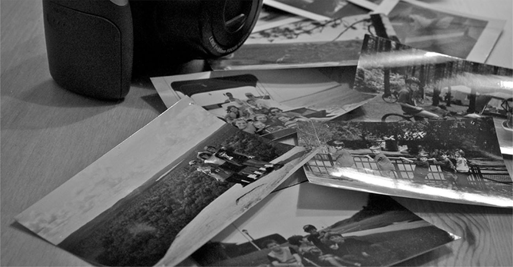

# Lời mở đầu

**Hình 8.1** Những bức ảnh có thể khơi gợi ký ức và làm sống dậy những trải nghiệm trong quá khứ của chúng ta. (nguồn: chỉnh sửa tác phẩm của Cory Zanker)

## Đề cương chương học

- [8.1 Trí nhớ hoạt động như thế nào](01-8-1-how-memory-functions.md)
- [8.2 Các vùng não liên quan đến trí nhớ](02-8-2-parts-of-the-brain-involved-with-memory.md)
- [8.3 Những vấn đề trục trặc của trí nhớ](03-8-3-problems-with-memory.md)
- [8.4 Các phương pháp tăng cường trí nhớ](04-8-4-ways-to-enhance-memory.md)

Chúng ta có thể là những người học tập xuất sắc hàng đầu, nhưng nếu chúng ta không có cách nào để lưu trữ những gì mình đã học, thì tri thức mà chúng ta thu nạp được có ích gì?

Hãy dành vài phút để tưởng tượng một ngày của bạn sẽ ra sao nếu bạn không thể nhớ bất cứ điều gì mình từng học.
Bạn sẽ phải tự mày mò tìm cách mặc quần áo.
Bạn nên mặc trang phục gì, và các cúc áo cùng khóa kéo hoạt động như thế nào?
Bạn sẽ cần ai đó dạy bạn cách đánh răng và buộc dây giày.
Bạn sẽ nhờ ai giúp đỡ những công việc này, khi mà bạn thậm chí không nhận ra khuôn mặt của những người đang ở trong nhà mình?
Khoan đã... đây có thực sự là nhà của bạn không?
Ôi không, bụng bạn bắt đầu cồn cào và bạn cảm thấy đói.
Bạn muốn ăn một thứ gì đó, nhưng bạn không biết thức ăn được cất ở đâu hay thậm chí làm thế nào để nấu nó.
Trời đất ơi, mọi chuyện bắt đầu trở nên rối rắm rồi.
Có lẽ tốt nhất là cứ quay lại giường ngủ.
Một cái giường... giường là cái gì cơ chứ?

Chúng ta sở hữu một khả năng ghi nhớ đáng kinh ngạc, nhưng chính xác thì chúng ta xử lý và lưu trữ thông tin như thế nào?
Liệu có các loại trí nhớ khác nhau không, và nếu có, điều gì tạo nên đặc trưng cho các loại hình đó?
Chính xác thì chúng ta truy xuất ký ức của mình ra sao?
Và tại sao chúng ta lại lãng quên?
Chương này sẽ khám phá những câu hỏi này khi chúng ta tìm hiểu về trí nhớ.
