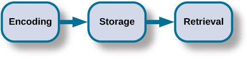

# 8.1 Trí nhớ Hoạt động như thế nào

> [!info]
>
> ### Mục tiêu học tập
>
> Sau khi học xong phần này, bạn sẽ có thể:
>
> - Thảo luận về ba chức năng cơ bản của trí nhớ
> - Mô tả ba giai đoạn lưu trữ trí nhớ
> - Mô tả và phân biệt giữa trí nhớ thủ tục và trí nhớ khai báo, giữa trí nhớ ngữ nghĩa và trí nhớ sự kiện

Trí nhớ là một hệ thống xử lý thông tin; do đó, chúng ta thường so sánh nó với một chiếc máy tính.
**Trí nhớ** (*memory*) là tập hợp các quá trình được sử dụng để mã hóa, lưu trữ và truy xuất thông tin qua các khoảng thời gian khác nhau ([Hình 8.2](#Figure_08_01_Memory)).

**Hình 8.2** Mã hóa bao gồm việc đưa thông tin đầu vào vào hệ thống trí nhớ. Lưu trữ là sự duy trì thông tin đã được mã hóa. Truy xuất, hay việc lấy thông tin ra khỏi trí nhớ và đưa trở lại nhận thức, là chức năng thứ ba.

> [!tip]
>
> ### Liên kết học tập
>
> Hãy xem [video về khoa học thần kinh của trí nhớ](https://openstax.org/l/unexpectfact) để tìm hiểu thêm.

## Mã hóa

Chúng ta tiếp nhận thông tin vào não bộ thông qua một quá trình gọi là **mã hóa** (*encoding*), đây chính là việc đưa thông tin đầu vào vào hệ thống trí nhớ.
Một khi chúng ta tiếp nhận thông tin cảm giác từ môi trường, não bộ của chúng ta sẽ dán nhãn hoặc mã hóa nó.
Chúng ta sắp xếp thông tin đó với những thông tin tương tự khác và kết nối các khái niệm mới với những khái niệm sẵn có.
Việc mã hóa thông tin diễn ra thông qua xử lý tự động và xử lý có nỗ lực.

Nếu ai đó hỏi bạn trưa nay bạn đã ăn gì, rất có thể bạn có thể nhớ lại thông tin này khá dễ dàng.
Điều này được gọi là **xử lý tự động** (*automatic processing*), hay việc mã hóa các chi tiết như thời gian, không gian, tần suất và ý nghĩa quen thuộc của từ ngữ.
Xử lý tự động thường được thực hiện mà không cần bất kỳ sự nhận thức có ý thức nào.
Nhớ lại lần cuối cùng bạn ôn thi cũng là một ví dụ về xử lý tự động.
Nhưng còn nội dung bài thi thực tế mà bạn đã học thì sao?
Việc đó có lẽ đã đòi hỏi rất nhiều công sức và sự chú ý từ phía bạn để mã hóa được lượng thông tin đó.
Điều này được gọi là **xử lý có nỗ lực** (*effortful processing*) ([Hình 8.3](#Figure_08_01_Driving)).

**Hình 8.3** Khi lần đầu tiên học một kỹ năng mới như lái xe ô tô, bạn phải nỗ lực và tập trung chú ý để mã hóa thông tin về cách khởi động xe, cách phanh, cách xử lý khúc cua, v.v. Một khi bạn đã biết lái xe, bạn có thể mã hóa các thông tin bổ sung về kỹ năng này một cách tự động. (nguồn: Robert Couse-Baker)

Những cách hiệu quả nhất để đảm bảo rằng những ký ức quan trọng được mã hóa tốt là gì?
Ngay cả một câu đơn giản cũng dễ nhớ lại hơn khi nó mang một ý nghĩa rõ ràng (Anderson, 1984).
Hãy đọc các câu sau đây (Bransford & McCarrell, 1974), sau đó nhìn ra chỗ khác và đếm lùi từ 30 về 0 theo bước 3 (30, 27, 24...), rồi thử viết lại các câu đó ra giấy (tuyệt đối không nhìn trộm lại trang này!).

1. Các nốt nhạc nghe rất chói tai vì đường may bị rách.
2. Chuyến hải trình không bị trì hoãn vì chiếc chai đã vỡ tan.
3. Đống cỏ khô rất quan trọng vì tấm vải đã bị rách toạc.

Bạn đã làm tốt đến mức nào?
Nếu đứng riêng rẽ, những câu bạn vừa viết ra rất có thể sẽ khó hiểu và khó nhớ lại đối với bạn.
Bây giờ, hãy thử viết lại chúng một lần nữa, sử dụng các từ gợi ý sau: kèn túi (*bagpipe*), lễ hạ thủy tàu thuyền (*ship christening*), và người nhảy dù (*parachutist*).
Tiếp theo, hãy đếm lùi từ 40 về 0 theo bước 4, rồi tự kiểm tra xem lần này bạn nhớ lại các câu đó tốt đến mức nào.
Bạn có thể thấy rằng bây giờ các câu đã trở nên dễ nhớ hơn nhiều vì mỗi câu đã được đặt trong một ngữ cảnh cụ thể.
Tài liệu được mã hóa tốt hơn nhiều khi bạn làm cho nó có ý nghĩa.

Có ba loại mã hóa.
Việc mã hóa từ ngữ và ý nghĩa của chúng được gọi là **mã hóa ngữ nghĩa** (*semantic encoding*).
Nó lần đầu tiên được chứng minh bởi William Bousfield (1935) trong một thí nghiệm yêu cầu mọi người ghi nhớ các từ.
60 từ thực chất được chia thành 4 nhóm ý nghĩa, mặc dù những người tham gia không hề biết điều này vì các từ được trình bày ngẫu nhiên.
Khi được yêu cầu nhớ lại các từ, họ có xu hướng nhớ lại chúng theo từng nhóm phân loại, cho thấy họ đã chú ý đến ý nghĩa của các từ khi học chúng.

**Mã hóa thị giác** (*visual encoding*) là việc mã hóa hình ảnh, và **mã hóa âm thanh** (*acoustic encoding*) là việc mã hóa âm thanh, đặc biệt là lời nói.
Để thấy mã hóa thị giác hoạt động như thế nào, hãy đọc lướt qua danh sách từ sau: *ô tô, cấp độ, con chó, sự thật, cuốn sách, giá trị*.
Nếu sau đó bạn được yêu cầu nhớ lại các từ trong danh sách này, bạn nghĩ mình có nhiều khả năng nhớ từ nào nhất?
Bạn có thể sẽ nhớ các từ *ô tô, con chó* và *cuốn sách* dễ dàng hơn, và gặp khó khăn hơn khi nhớ lại các từ *cấp độ, sự thật* và *giá trị*.
Tại sao lại như vậy?
Bởi vì bạn có thể nhớ lại các hình ảnh (hình ảnh trong tâm trí) dễ dàng hơn so với chỉ từ ngữ đơn thuần.
Khi đọc các từ *ô tô, con chó* và *cuốn sách*, bạn đã tạo ra hình ảnh của những thứ này trong tâm trí mình.
Đây là những từ cụ thể, có tính gợi hình cao (*high-imagery*).
Mặt khác, những từ trừu tượng như *cấp độ, sự thật* và *giá trị* là những từ có tính gợi hình thấp (*low-imagery*).
Những từ có tính gợi hình cao được mã hóa bằng cả thị giác lẫn ngữ nghĩa (Paivio, 1986), nhờ đó xây dựng nên một ký ức vững chắc hơn.

Bây giờ hãy chuyển sự chú ý sang mã hóa âm thanh.
Bạn đang lái xe ô tô và một bài hát vang lên trên radio mà bạn đã không nghe thấy trong ít nhất 10 năm qua, nhưng bạn vẫn hát theo và nhớ từng câu từ.
Ở Hoa Kỳ, trẻ em thường học bảng chữ cái qua bài hát, và chúng học số ngày trong mỗi tháng qua các vần điệu thơ ca: “Thirty days hath September, / April, June, and November...”.
Những bài học này rất dễ nhớ nhờ vào mã hóa âm thanh.
Chúng ta mã hóa âm thanh mà từ ngữ tạo ra.
Đây là một trong những lý do tại sao phần lớn những gì chúng ta dạy trẻ nhỏ đều được thực hiện thông qua bài hát, thơ vần và tiết tấu nhịp điệu.

Theo bạn, loại nào trong ba loại mã hóa sẽ mang lại cho bạn khả năng ghi nhớ thông tin bằng lời tốt nhất?
Nhiều năm trước, các nhà tâm lý học Fergus Craik và Endel Tulving (1975) đã tiến hành một loạt các thí nghiệm để tìm hiểu.
Những người tham gia được phát các từ kèm theo các câu hỏi về chúng.
Các câu hỏi yêu cầu người tham gia xử lý các từ ở một trong ba cấp độ.
Các câu hỏi xử lý thị giác bao gồm những việc như hỏi người tham gia về phông chữ của các chữ cái.
Các câu hỏi xử lý âm thanh hỏi người tham gia về âm thanh hoặc vần điệu của từ, và các câu hỏi xử lý ngữ nghĩa hỏi người tham gia về ý nghĩa của từ.
Sau khi người tham gia được xem các từ và câu hỏi, họ được giao một bài kiểm tra hồi tưởng hoặc nhận diện bất ngờ.

Những từ được mã hóa theo ngữ nghĩa được ghi nhớ tốt hơn nhiều so với những từ được mã hóa bằng thị giác hoặc âm thanh.
Mã hóa ngữ nghĩa liên quan đến một cấp độ xử lý sâu hơn so với mã hóa thị giác hoặc âm thanh vốn nông hơn.
Craik và Tulving kết luận rằng chúng ta xử lý thông tin bằng lời tốt nhất thông qua mã hóa ngữ nghĩa, đặc biệt nếu chúng ta áp dụng cái gọi là hiệu ứng tự quy chiếu.
**Hiệu ứng tự quy chiếu** (*self-reference effect*) là xu hướng một cá nhân ghi nhớ tốt hơn đối với những thông tin có liên hệ mật thiết với chính bản thân mình so với những tài liệu ít có tính liên quan cá nhân (Rogers, Kuiper, & Kirker, 1977).
Liệu mã hóa ngữ nghĩa có thể mang lại lợi ích cho bạn khi bạn cố gắng ghi nhớ các khái niệm trong chương này không?

## Lưu trữ

Một khi thông tin đã được mã hóa, chúng ta phải giữ lại nó bằng cách nào đó.
Não bộ của chúng ta lấy thông tin đã mã hóa và đưa vào kho lưu trữ.
**Lưu trữ** (*storage*) là việc tạo ra một bản ghi vĩnh viễn của thông tin.

Để một ký ức đi vào kho lưu trữ (tức là trí nhớ dài hạn), nó phải đi qua ba giai đoạn riêng biệt: **Trí nhớ cảm giác** (*Sensory Memory*), **Trí nhớ ngắn hạn** (*Short-Term Memory*), và cuối cùng là **Trí nhớ dài hạn** (*Long-Term Memory*).
Các giai đoạn này lần đầu tiên được đề xuất bởi Richard **Atkinson** và Richard **Shiffrin** (1968).
Mô hình trí nhớ con người của họ ([Hình 8.4](#Figure_08_01_Atkinson)), được gọi là mô hình Atkinson và Shiffrin, dựa trên niềm tin rằng chúng ta xử lý các ký ức theo cách tương tự như cách một chiếc máy tính xử lý thông tin.

![Sơ đồ dòng chảy gồm bốn chiếc hộp với các mũi tên kết nối. Hộp đầu tiên có nhãn "đầu vào cảm giác". Một mũi tên dẫn đến hộp thứ hai có nhãn "trí nhớ cảm giác". Một mũi tên dẫn đến hộp thứ ba có nhãn "trí nhớ ngắn hạn (STM)". Một mũi tên trỏ tới hộp thứ tư có nhãn "trí nhớ dài hạn (LTM)", và một mũi tên trỏ theo chiều ngược lại từ hộp thứ tư sang hộp thứ ba. Phía trên hộp trí nhớ ngắn hạn, một mũi tên xuất phát từ góc trên bên phải của hộp và uốn cong vòng lại trỏ vào góc trên bên trái của hộp; mũi tên này có nhãn "sự nhẩm lại". Cả hai hộp "trí nhớ cảm giác" và "trí nhớ ngắn hạn" đều có một mũi tên bên dưới trỏ tới dòng chữ "thông tin không được chuyển giao sẽ bị mất đi".](../../images/img_ea14b9b5c70a.jpg)

**Hình 8.4** Theo mô hình trí nhớ Atkinson-Shiffrin, thông tin phải trải qua ba giai đoạn riêng biệt để có thể được lưu trữ vào trí nhớ dài hạn.

Mô hình của Atkinson và Shiffrin không phải là mô hình trí nhớ duy nhất.
Baddeley và Hitch (1974) đã đề xuất một mô hình trí nhớ làm việc (*working memory model*) trong đó trí nhớ ngắn hạn có các dạng khác nhau.
Trong mô hình của họ, việc lưu trữ ký ức trong trí nhớ ngắn hạn giống như việc mở các tệp tin khác nhau trên máy tính và bổ sung thông tin vào đó.
Các tệp tin trí nhớ làm việc lưu giữ một lượng thông tin có hạn.
Loại trí nhớ ngắn hạn (hoặc tệp máy tính) phụ thuộc vào loại thông tin tiếp nhận.
Có những ký ức ở dạng thị giác - không gian, cũng như những ký ức về các tài liệu dạng nói hoặc viết, và chúng được lưu trữ trong ba hệ thống ngắn hạn: bản phác thảo thị giác - không gian (*visuospatial sketchpad*), bộ đệm sự kiện (*episodic buffer*) (Baddeley, 2000), và vòng lặp âm vị (*phonological loop*).
Theo Baddeley và Hitch, một thành phần điều hành trung tâm (*central executive*) của trí nhớ giám sát hoặc kiểm soát dòng thông tin đến và đi từ ba hệ thống ngắn hạn này, và bộ điều hành trung tâm chịu trách nhiệm chuyển thông tin vào trí nhớ dài hạn.

### Trí nhớ cảm giác

Trong mô hình Atkinson-Shiffrin, các kích thích từ môi trường trước tiên được xử lý trong **trí nhớ cảm giác** (*sensory memory*): nơi lưu trữ ngắn ngủi các sự kiện cảm giác, chẳng hạn như hình ảnh, âm thanh và mùi vị.
Đây là nơi lưu trữ rất ngắn — chỉ kéo dài tối đa một vài giây.
Chúng ta liên tục bị dội bom bởi các thông tin cảm giác.
Chúng ta không thể tiếp thu tất cả, hoặc thậm chí phần lớn những thông tin đó.
Và hầu hết chúng đều không có tác động gì đến cuộc sống của chúng ta.
Ví dụ, vị giáo sư của bạn đã mặc trang phục gì trong buổi học trước?
Miễn là giáo sư ăn mặc phù hợp, thì việc cô ấy mặc gì không thực sự quan trọng.
Thông tin cảm giác về hình ảnh, âm thanh, mùi hương và thậm chí cả bề mặt tiếp xúc mà chúng ta không coi là thông tin có giá trị sẽ bị chúng ta loại bỏ.
Nếu chúng ta xem điều gì đó là có giá trị, thông tin đó sẽ chuyển vào hệ thống trí nhớ ngắn hạn của chúng ta.

### Trí nhớ ngắn hạn

**Trí nhớ ngắn hạn** (*short-term memory - STM*) là một hệ thống lưu trữ tạm thời xử lý trí nhớ cảm giác truyền vào.
Các thuật ngữ trí nhớ ngắn hạn và trí nhớ làm việc đôi khi được sử dụng thay thế cho nhau, nhưng chúng không hoàn toàn giống nhau.
Trí nhớ ngắn hạn được mô tả chính xác hơn là một thành phần của trí nhớ làm việc.
Trí nhớ ngắn hạn tiếp nhận thông tin từ trí nhớ cảm giác và đôi khi kết nối ký ức đó với một điều gì đó đã có sẵn trong trí nhớ dài hạn.
Sự lưu trữ của trí nhớ ngắn hạn kéo dài từ 15 đến 30 giây.
Hãy nghĩ về nó như thông tin bạn đang hiển thị trên màn hình máy tính, chẳng hạn như một tài liệu, bảng tính hoặc trang web.
Sau đó, thông tin trong STM sẽ đi vào trí nhớ dài hạn (bạn lưu nó vào ổ cứng), hoặc bị loại bỏ (bạn xóa tài liệu hoặc đóng trình duyệt web).

**Sự nhẩm lại** (*rehearsal*) chuyển thông tin từ trí nhớ ngắn hạn sang trí nhớ dài hạn.
Nhẩm lại chủ động (*active rehearsal*) là một cách chú ý đến thông tin để chuyển nó từ trí nhớ ngắn hạn sang dài hạn.
Trong quá trình nhẩm lại chủ động, bạn lặp lại (luyện tập) thông tin cần ghi nhớ.
Nếu bạn lặp lại đủ nhiều, nó có thể được chuyển vào trí nhớ dài hạn.
Ví dụ, kiểu nhẩm lại chủ động này là cách nhiều đứa trẻ học bảng chữ cái bằng cách hát bài ca bảng chữ cái ABC.
Ngoài ra, nhẩm lại chi tiết hóa (*elaborative rehearsal*) là hành động liên kết thông tin mới bạn đang cố gắng học với thông tin sẵn có mà bạn đã biết.
Ví dụ, nếu bạn gặp một người tại một bữa tiệc và điện thoại của bạn hết pin nhưng bạn muốn nhớ số điện thoại của anh ấy bắt đầu bằng mã vùng 203, bạn có thể nhớ rằng người chú Abdul của bạn sống ở Connecticut và có mã vùng 203.
Bằng cách này, khi bạn cố gắng nhớ số điện thoại của người bạn mới quen, bạn sẽ dễ dàng nhớ được mã vùng.
Craik và Lockhart (1972) đã đề xuất giả thuyết về các cấp độ xử lý, trong đó phát biểu rằng bạn càng suy nghĩ sâu sắc về một điều gì đó, bạn sẽ càng ghi nhớ nó tốt hơn.

Bạn có thể tự hỏi: "Trí nhớ của chúng ta có thể xử lý bao nhiêu thông tin cùng một lúc?"
Để khám phá dung lượng và thời lượng của trí nhớ ngắn hạn của bạn, hãy nhờ một người bạn đọc to các chuỗi số ngẫu nhiên ([Hình 8.5](#Figure_08_011_Numbers)), bắt đầu mỗi chuỗi bằng cách nói "Sẵn sàng chưa?" và kết thúc mỗi chuỗi bằng cách nói "Nhớ lại đi", tại thời điểm đó bạn nên cố gắng viết chuỗi số đó ra giấy từ trí nhớ của mình.

**Hình 8.5** Hãy thực hiện bài tập này thông qua chuỗi các con số bằng cách sử dụng bài tập nhớ lại được giải thích ở trên để xác định chuỗi chữ số dài nhất mà bạn có thể lưu trữ.

Hãy ghi lại chuỗi dài nhất mà bạn trả lời hoàn toàn chính xác.
Đối với hầu hết mọi người, dung lượng có thể sẽ gần bằng 7 cộng hoặc trừ 2.
Năm 1956, George Miller đã xem xét hầu hết các nghiên cứu về dung lượng của trí nhớ ngắn hạn và nhận thấy rằng con người có thể giữ được từ 5 đến 9 mục, vì vậy ông đã báo cáo dung lượng của trí nhớ ngắn hạn là "con số kỳ diệu" 7 cộng hoặc trừ 2 ($7 \pm 2$).
Tuy nhiên, nghiên cứu đương đại hơn đã phát hiện ra dung lượng của trí nhớ làm việc là 4 cộng hoặc trừ 1 ($4 \pm 1$) (Cowan, 2010).
Nhìn chung, việc nhớ lại thường tốt hơn một chút đối với các con số ngẫu nhiên so với các chữ cái ngẫu nhiên (Jacobs, 1887) và cũng thường tốt hơn một chút đối với thông tin chúng ta nghe được (mã hóa âm thanh) so với thông tin chúng ta nhìn thấy (mã hóa thị giác) (Anderson, 1969).

Sự suy thoái dấu vết trí nhớ (*memory trace decay*) và sự can nhiễu (*interference*) là hai yếu tố ảnh hưởng đến việc duy trì trí nhớ ngắn hạn.
Peterson và Peterson (1959) đã nghiên cứu trí nhớ ngắn hạn bằng cách sử dụng các chuỗi ba chữ cái gọi là cụm tam tự (*trigrams*, ví dụ: CLS) cần phải nhớ lại sau các khoảng thời gian khác nhau từ 3 đến 18 giây.
Những người tham gia nhớ được khoảng 80% các cụm tam tự sau độ trễ 3 giây, nhưng chỉ nhớ được 10% sau độ trễ 18 giây, điều này khiến họ đi đến kết luận rằng trí nhớ ngắn hạn bị phân rã trong vòng 18 giây.
Trong quá trình suy thoái, dấu vết trí nhớ trở nên ít được kích hoạt hơn theo thời gian, và thông tin bị lãng quên.
Tuy nhiên, Keppel và Underwood (1962) chỉ kiểm tra những lượt thử đầu tiên của nhiệm vụ tam tự và phát hiện ra rằng sự can nhiễu đón trước (*proactive interference*) cũng ảnh hưởng đến việc duy trì trí nhớ ngắn hạn.
Trong sự can nhiễu đón trước, thông tin đã học trước đó gây trở ngại cho khả năng học thông tin mới.
Cả sự suy thoái dấu vết trí nhớ và sự can nhiễu đón trước đều tác động đến trí nhớ ngắn hạn.
Một khi thông tin đã đến được trí nhớ dài hạn, nó phải được củng cố ở cả cấp độ khớp thần kinh (*synapse*), mất vài giờ, và vào hệ thống trí nhớ nói chung, có thể mất hàng tuần hoặc lâu hơn.

### Trí nhớ dài hạn

**Trí nhớ dài hạn** (*long-term memory - LTM*) là sự lưu trữ thông tin liên tục và lâu dài.
Không giống như trí nhớ ngắn hạn, dung lượng lưu trữ của trí nhớ dài hạn được cho là không có giới hạn.
Nó bao hàm tất cả những điều bạn có thể nhớ đã xảy ra cách đây hơn một vài phút.
Người ta không thể thực sự xem xét trí nhớ dài hạn mà không nghĩ về cách thức nó được tổ chức.
Thật nhanh nhé, từ đầu tiên nảy ra trong tâm trí bạn khi bạn nghe thấy "bơ đậu phộng" là gì?
Bạn có nghĩ đến thạch/mứt không?
Nếu có, có lẽ bạn đã liên kết bơ đậu phộng và thạch trong tâm trí mình.
Người ta thừa nhận rộng rãi rằng các ký ức được sắp xếp trong các mạng ngữ nghĩa (hoặc liên kết) (Collins & Loftus, 1975).
Một mạng ngữ nghĩa bao gồm các khái niệm, và như bạn có thể nhớ lại từ những gì bạn đã học về trí nhớ, khái niệm là các phân loại hoặc nhóm thông tin ngôn ngữ, hình ảnh, ý tưởng hoặc ký ức, chẳng hạn như những trải nghiệm trong đời sống.
Mặc dù trải nghiệm và chuyên môn cá nhân có thể ảnh hưởng đến sự sắp xếp khái niệm, nhưng các khái niệm được cho là được sắp xếp theo thứ bậc trong tâm trí (Anderson & Reder, 1999; Johnson & Mervis, 1997, 1998; Palmer, Jones, Hennessy, Unze, & Pick, 1989; Rosch, Mervis, Gray, Johnson, & Boyes-Braem, 1976; Tanaka & Taylor, 1991).
Các khái niệm liên quan được liên kết với nhau, và độ mạnh của liên kết phụ thuộc vào tần suất hai khái niệm đó được liên kết cùng nhau.

Các mạng ngữ nghĩa khác nhau tùy thuộc vào trải nghiệm của từng cá nhân.
Điều quan trọng đối với trí nhớ là việc kích hoạt bất kỳ phần nào của mạng ngữ nghĩa cũng đồng thời kích hoạt các khái niệm được liên kết với phần đó ở mức độ thấp hơn.
Quá trình này được gọi là sự kích hoạt lan tỏa (*spreading activation*) (Collins & Loftus, 1975).
Nếu một phần của mạng lưới được kích hoạt, việc truy cập các khái niệm liên quan sẽ dễ dàng hơn vì chúng đã được kích hoạt một phần sẵn rồi.
Khi bạn nhớ hoặc hồi tưởng lại một điều gì đó, bạn kích hoạt một khái niệm, và các khái niệm liên quan sẽ dễ nhớ hơn vì chúng đã được kích hoạt một phần.
Tuy nhiên, sự kích hoạt không chỉ lan tỏa theo một hướng duy nhất.
Khi bạn nhớ một điều gì đó, bạn thường có một vài lộ trình để lấy thông tin bạn đang cố gắng truy cập, và bạn càng có nhiều liên kết tới một khái niệm, cơ hội bạn nhớ lại nó càng cao.

Có hai loại trí nhớ dài hạn: *tường minh* (*explicit*) và *ẩn tàng* (*implicit*) ([Hình 8.6](#Figure_08_01_Explicit)).
Hiểu được sự khác biệt giữa trí nhớ tường minh và trí nhớ ẩn tàng là rất quan trọng vì sự lão hóa, các dạng chấn thương não cụ thể và một số rối loạn nhất định có thể tác động đến trí nhớ tường minh và trí nhớ ẩn tàng theo những cách thức khác nhau.
**Trí nhớ tường minh** (*explicit memories*) là những ký ức mà chúng ta cố gắng ghi nhớ, hồi tưởng và thuật lại một cách có ý thức.
Ví dụ, nếu bạn đang ôn thi môn hóa học, tài liệu bạn đang học sẽ là một phần của trí nhớ tường minh của bạn.
Tương tự như phép so sánh với máy tính, một số thông tin trong trí nhớ dài hạn của bạn sẽ giống như thông tin bạn đã lưu trên ổ cứng.
Nó không nằm ngay trên màn hình nền (trí nhớ ngắn hạn của bạn), nhưng hầu như bạn luôn có thể mở thông tin này lên khi bạn muốn.
Không phải tất cả các ký ức dài hạn đều là những ký ức mạnh mẽ, và một số ký ức chỉ có thể được nhớ lại khi có các dấu hiệu gợi ý.
Ví dụ, bạn có thể dễ dàng nhớ lại một sự thật, chẳng hạn như thủ đô của Hoa Kỳ, nhưng bạn có thể phải chật vật nhớ lại tên của nhà hàng mà bạn đã ăn tối khi đến thăm một thành phố lân cận vào mùa hè năm ngoái.
Một lời gợi ý, chẳng hạn như nhà hàng đó được đặt theo tên chủ của nó, có thể giúp bạn nhớ lại tên nhà hàng.
Trí nhớ tường minh đôi khi được gọi là trí nhớ khai báo (*declarative memory*), bởi vì nó có thể được diễn đạt thành lời.
Trí nhớ tường minh được chia thành trí nhớ sự kiện và trí nhớ ngữ nghĩa.

> [!tip]
>
> ### Liên kết học tập
>
> Hãy xem [video giải thích về trí nhớ ngắn hạn và trí nhớ dài hạn](https://openstax.org/l/HMbrain) để tìm hiểu thêm về cách ký ức được lưu trữ và truy xuất.

**Trí nhớ sự kiện** (*episodic memory*) là thông tin về các sự kiện mà cá nhân chúng ta đã trực tiếp trải nghiệm (tức là một giai đoạn/hồi ức).
Chẳng hạn, ký ức về ngày sinh nhật gần đây nhất của bạn là một trí nhớ sự kiện.
Thông thường, trí nhớ sự kiện được kể lại như một câu chuyện.
Khái niệm về trí nhớ sự kiện lần đầu tiên được đề xuất vào những năm 1970 (Tulving, 1972).
Kể từ đó, Tulving và những người khác đã tái định hình lý thuyết, và hiện nay các nhà khoa học tin rằng trí nhớ sự kiện là ký ức về những điều xảy ra ở những địa điểm cụ thể vào những thời điểm cụ thể — cái gì, ở đâu và khi nào của một sự kiện (Tulving, 2002).
Nó liên quan đến việc hồi tưởng lại hình ảnh trực quan cũng như cảm giác quen thuộc (Hassabis & Maguire, 2007).
**Trí nhớ ngữ nghĩa** (*semantic memory*) là tri thức về từ ngữ, khái niệm và các sự kiện, tri thức dựa trên ngôn ngữ.
Trí nhớ ngữ nghĩa thường được thuật lại dưới dạng các dữ kiện khách quan.
Ngữ nghĩa có nghĩa là liên quan đến ngôn ngữ và tri thức về ngôn ngữ.
Ví dụ, câu trả lời cho các câu hỏi như "định nghĩa của tâm lý học là gì" và "ai là tổng thống Mỹ gốc Phi đầu tiên của Hoa Kỳ" được lưu trữ trong trí nhớ ngữ nghĩa của bạn.

**Trí nhớ ẩn tàng** (*implicit memories*) là những ký ức dài hạn không phải là một phần của nhận thức có ý thức của chúng ta.
Mặc dù các ký ức ẩn tàng được tiếp thu bên ngoài nhận thức của chúng ta và không thể được hồi tưởng một cách có ý thức, nhưng trí nhớ ẩn tàng được thể hiện qua việc thực hiện một nhiệm vụ nào đó (Roediger, 1990; Schacter, 1987).
Trí nhớ ẩn tàng đã được nghiên cứu với các nhiệm vụ đòi hỏi nhận thức, chẳng hạn như khả năng làm chủ ngữ pháp nhân tạo (Reber, 1976), trí nhớ từ ngữ (Jacoby, 1983; Jacoby & Witherspoon, 1982), và việc học các quy tắc cùng các mối liên hệ không được nói ra và không được viết ra (Greenspoon, 1955; Giddan & Eriksen, 1959; Krieckhaus & Eriksen, 1960).
Trở lại với phép ẩn dụ máy tính, các ký ức ẩn tàng giống như một chương trình chạy ngầm dưới nền, và bạn không nhận thức được ảnh hưởng của chúng.
Ký ức ẩn tàng có thể ảnh hưởng đến các hành vi quan sát được cũng như các nhiệm vụ nhận thức.
Trong cả hai trường hợp, bạn thường không thể diễn đạt ký ức đó thành lời để mô tả đầy đủ nhiệm vụ.
Có một số loại ký ức ẩn tàng, bao gồm trí nhớ thủ tục, mồi nhận thức, và điều kiện hóa cảm xúc.

![Một sơ đồ gồm ba hàng các chiếc hộp. Chiếc hộp ở hàng trên cùng có nhãn "trí nhớ dài hạn"; một đường kẻ từ chiếc hộp này tách thành hai đường dẫn đến hai chiếc hộp ở hàng thứ hai, có nhãn "trí nhớ tường minh" và "trí nhớ ẩn tàng". Từ mỗi hộp ở hàng thứ hai, các đường lại phân tách và dẫn đến các hộp bổ sung. Từ hộp "trí nhớ tường minh" là hai hộp có nhãn "sự kiện (các sự kiện và trải nghiệm)" và "ngữ nghĩa (các khái niệm và dữ kiện)". Từ hộp "trí nhớ ẩn tàng" là ba hộp có nhãn "thủ tục (Cách làm mọi việc)", "Mồi nhận thức (việc tiếp xúc với kích thích ảnh hưởng đến phản ứng với kích thích sau đó)", và "điều kiện hóa cảm xúc (Các phản ứng cảm xúc được điều kiện hóa cổ điển)".](../../images/img_c5492fe04f98.jpg)

**Hình 8.6** Có hai thành phần của trí nhớ dài hạn: tường minh và ẩn tàng. Trí nhớ tường minh bao gồm trí nhớ sự kiện và ngữ nghĩa. Trí nhớ ẩn tàng bao gồm trí nhớ thủ tục và những điều học được thông qua điều kiện hóa.

Trí nhớ ẩn tàng **thủ tục** (*procedural memory*) thường được nghiên cứu bằng cách sử dụng các hành vi có thể quan sát được (Adams, 1957; Lacey & Smith, 1954; Lazarus & McCleary, 1951).
Trí nhớ thủ tục ẩn tàng lưu trữ thông tin về cách thức làm một việc gì đó, và nó là trí nhớ dành cho các hành động đòi hỏi kỹ năng, chẳng hạn như đánh răng, đi xe đạp hoặc lái xe ô tô.
Có lẽ bạn không giỏi đi xe đạp hay lái ô tô trong lần đầu tiên thử sức, nhưng bạn đã giỏi hơn nhiều sau khi làm những việc đó trong một năm.
Khả năng đi xe đạp tiến bộ của bạn là nhờ học được các khả năng giữ thăng bằng.
Lúc đầu có thể bạn đã phải *suy nghĩ* về việc giữ thẳng người, nhưng bây giờ bạn chỉ việc *làm* điều đó.
Hơn nữa, bạn có lẽ giữ thăng bằng rất tốt, nhưng lại không thể giải thích cho ai đó cách chính xác bạn làm điều đó.
Tương tự, khi mới học lái xe, bạn có thể đã nghĩ về rất nhiều điều mà giờ đây bạn thực hiện mà không cần nghĩ ngợi nhiều.
Khi bạn lần đầu học những nhiệm vụ này, ai đó có thể đã chỉ cho bạn cách làm, nhưng tất cả những gì bạn học được kể từ những lời hướng dẫn đó mà bạn không thể dễ dàng giải thích thành lời cho người khác chính là trí nhớ ẩn tàng.

Mồi nhận thức ẩn tàng (*implicit priming*) là một dạng trí nhớ ẩn tàng khác (Schacter, 1992).
Trong quá trình mồi nhận thức, việc tiếp xúc với một kích thích sẽ ảnh hưởng đến phản ứng đối với một kích thích sau đó.
Các kích thích có thể rất đa dạng và có thể bao gồm từ ngữ, hình ảnh và các kích thích khác nhằm gợi ra phản ứng hoặc gia tăng khả năng nhận diện.
Chẳng hạn, một số người rất thích đi dã ngoại (*picnic*).
Họ thích hòa mình vào thiên nhiên, trải tấm thảm trên mặt đất và thưởng thức một bữa ăn ngon miệng.
Bây giờ, hãy sắp xếp lại các chữ cái sau đây để tạo thành một từ tiếng Anh có nghĩa:

$AETPL$

Từ bạn nghĩ ra là gì?
Rất có thể đó là từ "plate" (*chiếc đĩa*).

Nếu bạn vừa đọc: “Một số người thực sự thích trồng hoa.
Họ thích ra vườn chăm sóc cây cối, bón phân cho cây và tưới nước cho hoa của mình”, bạn có lẽ đã nghĩ ra từ "petal" (*cánh hoa*) thay vì plate.

Bạn có nhớ lại cuộc thảo luận trước đó về mạng ngữ nghĩa không?
Lý do mọi người có nhiều khả năng nghĩ ra từ “plate” sau khi đọc về chuyến dã ngoại là vì chiếc đĩa có liên kết với chuyến dã ngoại.
Chiếc đĩa đã được "mồi" bằng cách kích hoạt mạng ngữ nghĩa.
Tương tự, “cánh hoa” được liên kết với hoa và được mồi bởi hoa.
Mồi nhận thức cũng là lý do tại sao bạn có thể đã buột miệng nói từ thạch khi nghe thấy bơ đậu phộng.

Điều kiện hóa cảm xúc ẩn tàng là loại trí nhớ liên quan đến các phản ứng cảm xúc được điều kiện hóa cổ điển (Olson & Fazio, 2001).
Những mối quan hệ cảm xúc này không thể được kể lại hoặc hồi tưởng nhưng có thể được liên kết với các kích thích khác nhau.
Ví dụ, những mùi hương cụ thể có thể gây ra những phản ứng cảm xúc cụ thể đối với một số người.
Nếu có một mùi hương khiến bạn cảm thấy tích cực và hoài niệm, mà bạn không biết phản ứng đó bắt nguồn từ đâu, thì đó là một phản ứng cảm xúc ẩn tàng.
Tương tự, hầu hết mọi người đều có một bài hát gợi lên một phản ứng cảm xúc cụ thể.
Tác động của bài hát đó có thể là một ký ức cảm xúc ẩn tàng (Yang, Xu, Du, Shi, & Fang, 2011).

> [!abstract]
>
> ### Kết nối đời sống
>
> #### Bạn có thể nhớ mọi điều mình từng làm hoặc từng nói không?
>
> Ký ức sự kiện còn được gọi là ký ức tự thuật (*autobiographical memories*).
> Hãy cùng kiểm tra nhanh trí nhớ tự thuật của bạn nhé.
> Bạn đã mặc trang phục gì vào đúng ngày này cách đây năm năm?
> Bạn đã ăn gì vào bữa trưa ngày 10 tháng 4 năm 2009?
> Bạn có thể thấy rất khó, nếu không muốn nói là bất khả thi, để trả lời những câu hỏi này.
> Bạn có thể nhớ mọi sự kiện bạn từng trải qua trong suốt cuộc đời mình — các bữa ăn, cuộc trò chuyện, lựa chọn trang phục, điều kiện thời tiết, v.v. không?
> Rất có thể không ai trong chúng ta có thể trả lời được những câu hỏi này; tuy nhiên, nữ diễn viên người Mỹ Marilu **Henner**, nổi tiếng nhất qua chương trình truyền hình *Taxi*, lại có thể nhớ được.
> Cô có một trí nhớ tự thuật vô cùng kinh ngạc và vượt trội ([Hình 8.7](#Figure_08_01_Marilu)).
>
> 
>
> 
>
> **Hình 8.7** Trí nhớ tự thuật siêu phàm của Marilu Henner được gọi là hội chứng hyperthymesia. (nguồn: Mark Richardson)
>
> Rất ít người có thể nhớ lại các sự kiện theo cách này; hiện tại, có chưa đến 20 người được xác định là có khả năng này, và chỉ một số ít từng được nghiên cứu (Parker, Cahill, & McGaugh, 2006).
> Và mặc dù **hội chứng hyperthymesia** thường xuất hiện ở tuổi vị thành niên, hai đứa trẻ ở Hoa Kỳ dường như đã có những ký ức từ rất lâu trước sinh nhật lần thứ mười của mình.

> [!tip]
>
> ### Liên kết học tập
>
> Hãy xem [video về trí nhớ tự thuật vượt trội](https://openstax.org/l/endlessmem) từ chương trình tin tức truyền hình *60 Minutes* để tìm hiểu thêm.

## Truy xuất

Như vậy bạn đã làm việc chăm chỉ để mã hóa (thông qua xử lý có nỗ lực) và lưu trữ một số thông tin quan trọng cho kỳ thi cuối kỳ sắp tới.
Làm thế nào để bạn lấy thông tin đó ra khỏi kho lưu trữ khi bạn cần đến nó?
Hành động lấy thông tin ra khỏi kho lưu trữ trí nhớ và đưa trở lại nhận thức có ý thức được gọi là **truy xuất** (*retrieval*).
Quá trình này tương tự như việc tìm và mở một bài luận mà bạn đã lưu trước đó trên ổ cứng máy tính.
Bây giờ nó đã quay trở lại màn hình nền của bạn và bạn có thể làm việc với nó một lần nữa.
Khả năng truy xuất thông tin từ trí nhớ dài hạn là tối quan trọng đối với các hoạt động hàng ngày của chúng ta.
Bạn phải có khả năng truy xuất thông tin từ trí nhớ để làm mọi thứ, từ việc biết cách chải tóc và đánh răng, lái xe đi làm, cho đến việc biết cách thực hiện công việc của mình một khi bạn đã đến nơi làm việc.

Có ba cách bạn có thể truy xuất thông tin ra khỏi hệ thống lưu trữ trí nhớ dài hạn: nhớ lại, nhận diện, và tái học tập.
**Sự nhớ lại** (*recall*) là điều chúng ta thường nghĩ đến nhất khi nói về truy xuất trí nhớ: nó có nghĩa là bạn có thể tiếp cận thông tin mà không cần bất kỳ dấu hiệu gợi ý nào.
Ví dụ, bạn sẽ sử dụng sự nhớ lại cho một bài thi tự luận.
**Sự nhận diện** (*recognition*) xảy ra khi bạn xác định được thông tin mà bạn đã từng học trước đó sau khi bắt gặp lại nó.
Nó liên quan đến một quá trình so sánh.
Khi bạn làm bài kiểm tra trắc nghiệm, bạn đang dựa vào sự nhận diện để giúp mình chọn ra câu trả lời đúng.
Dưới đây là một ví dụ khác: Giả sử bạn tốt nghiệp trung học phổ thông cách đây 10 năm, và bạn trở về quê hương để tham dự buổi họp lớp kỷ niệm 10 năm ra trường.
Bạn có thể không nhớ lại được tên tất cả các bạn cùng lớp, nhưng bạn nhận diện được nhiều người trong số họ dựa trên những bức ảnh kỷ yếu.

Hình thức truy xuất thứ ba là **tái học tập** (*relearning*), và nó đúng như tên gọi của nó.
Nó bao gồm việc học lại những thông tin mà bạn đã từng học trước đây.
Whitney từng học tiếng Tây Ban Nha ở trường trung học, nhưng sau khi tốt nghiệp cô không có cơ hội sử dụng ngôn ngữ này.
Hiện tại Whitney 31 tuổi, và công ty trao cho cô cơ hội làm việc tại văn phòng của họ ở Thành phố Mexico.
Để chuẩn bị cho bản thân, cô đăng ký một khóa học tiếng Tây Ban Nha tại trung tâm cộng đồng địa phương.
Cô rất ngạc nhiên về việc mình có thể tiếp thu lại ngôn ngữ nhanh chóng như thế nào sau 13 năm không hề nói; đây là một ví dụ về sự tái học tập.
