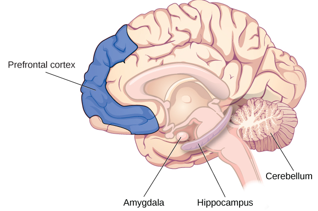
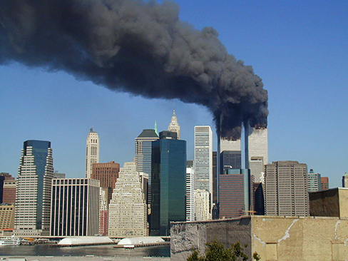

# 8.2 Các Vùng Não Liên quan đến Trí nhớ

> [!info]
>
> ### Mục tiêu học tập
>
> Sau khi học xong phần này, bạn sẽ có thể:
>
> - Giải thích các chức năng não bộ liên quan đến trí nhớ
> - Nhận diện vai trò của hồi hải mã (*hippocampus*), hạch hạnh nhân (*amygdala*) và tiểu não (*cerebellum*)

Liệu ký ức được lưu trữ chỉ trong một phần của não bộ hay chúng được lưu trữ ở nhiều vùng não khác nhau?
Karl Lashley đã bắt đầu khám phá vấn đề này khoảng 100 năm trước bằng cách tạo ra các tổn thương thực thể trên não của động vật như chuột và khỉ.
Ông đã tìm kiếm bằng chứng về **dấu vết ký ức** (*engram*): nhóm các nơ-ron đóng vai trò là "đại diện vật chất của trí nhớ" (Josselyn, 2010).
Đầu tiên, Lashley (1950) đã huấn luyện chuột tìm đường đi qua một mê cung.
Sau đó, ông sử dụng các công cụ có sẵn vào thời điểm đó — trong trường hợp này là một chiếc mỏ hàn nhiệt — để tạo ra các tổn thương trong não của chuột, cụ thể là ở vỏ đại não.
Ông làm điều này vì cố gắng xóa bỏ dấu vết ký ức, tức là dấu vết ban đầu mà những con chuột có được về mê cung.

Lashley đã không tìm thấy bằng chứng về engram, và những con chuột vẫn có thể tìm được đường qua mê cung, bất kể kích thước hay vị trí của vùng tổn thương.
Dựa trên việc tạo ra các tổn thương và phản ứng của động vật, ông đã đưa ra **giả thuyết về tính đồng thế năng** (*equipotentiality hypothesis*): nếu một phần của một vùng não liên quan đến trí nhớ bị tổn thương, thì một phần khác của chính vùng đó có thể tiếp quản chức năng ghi nhớ đó (Lashley, 1950).
Mặc dù công trình ban đầu của Lashley không xác nhận sự tồn tại của engram, nhưng các nhà tâm lý học hiện đại đang đạt được nhiều tiến bộ trong việc định vị nó.
Ví dụ, Eric Kandel đã dành nhiều thập kỷ để nghiên cứu về khớp thần kinh (*synapse*) và vai trò của nó trong việc kiểm soát dòng thông tin qua các mạch thần kinh cần thiết để lưu trữ ký ức (Mayford, Siegelbaum, & Kandel, 2012).

Nhiều nhà khoa học tin rằng toàn bộ bộ não đều tham gia vào trí nhớ.
Tuy nhiên, kể từ nghiên cứu của Lashley, các nhà khoa học khác đã có thể xem xét não bộ và trí nhớ một cách chặt chẽ hơn.
Họ lập luận rằng trí nhớ nằm ở những phần cụ thể của não bộ, và các nơ-ron cụ thể có thể được nhận diện về sự tham gia của chúng vào việc hình thành ký ức.
Các phần chính của não bộ liên quan đến trí nhớ là hạch hạnh nhân, hồi hải mã, tiểu não và vỏ não trước trán ([Hình 8.8](#Figure_08_02_Brain)).

**Hình 8.8** Hạch hạnh nhân liên quan đến nỗi sợ hãi và các ký ức sợ hãi. Hồi hải mã gắn liền với trí nhớ khai báo và trí nhớ sự kiện cũng như trí nhớ nhận diện. Tiểu não đóng vai trò xử lý các ký ức thủ tục, chẳng hạn như cách chơi đàn piano. Vỏ não trước trán dường như tham gia vào việc ghi nhớ các nhiệm vụ ngữ nghĩa.

## Hạch hạnh nhân

Đầu tiên, hãy xem xét vai trò của **hạch hạnh nhân** (*amygdala*) trong quá trình hình thành trí nhớ.
Nhiệm vụ chính của hạch hạnh nhân là điều hòa cảm xúc, chẳng hạn như nỗi sợ hãi và sự hung hăng ([Hình 8.8](#Figure_08_02_Brain)).
Hạch hạnh nhân đóng một vai trò trong cách thức ký ức được lưu trữ vì sự lưu trữ chịu ảnh hưởng của các hoóc-môn căng thẳng.
Ví dụ, một nhà nghiên cứu đã làm thí nghiệm với chuột về phản ứng sợ hãi (Josselyn, 2010).
Sử dụng điều kiện hóa Pavlov, một âm thanh trung tính được ghép đôi với một cú sốc điện vào chân của chuột.
Điều này tạo ra một ký ức sợ hãi ở chuột.
Sau khi được điều kiện hóa, mỗi lần nghe thấy âm thanh đó, chúng sẽ đứng bất động (*freeze* - một phản ứng phòng vệ ở chuột), biểu hiện ký ức về cú sốc sắp xảy ra.
Sau đó, các nhà nghiên cứu đã kích hoạt sự chết tế bào ở các nơ-ron trong phần bên của hạch hạnh nhân, vốn là vùng não chuyên biệt chịu trách nhiệm về các ký ức sợ hãi.
Họ nhận thấy ký ức sợ hãi đã mờ nhạt đi (bị dập tắt).
Nhờ vai trò xử lý thông tin cảm xúc, hạch hạnh nhân cũng tham gia vào quá trình củng cố trí nhớ (*memory consolidation*): quá trình chuyển giao kiến thức học được mới vào trí nhớ dài hạn.
Hạch hạnh nhân dường như tạo điều kiện thuận lợi cho việc mã hóa ký ức ở cấp độ sâu hơn khi sự kiện đó có tính kích hoạt cảm xúc mạnh mẽ.

> [!tip]
>
> ### Liên kết học tập
>
> Trong bài nói chuyện TED Talk có tựa đề [“A Mouse.
> A Laser Beam.
> A Manipulated Memory,”](https://openstax.org/l/mousebeam), Steve Ramirez và Xu Liu đến từ MIT nói về việc sử dụng các chùm tia laser để thao túng ký ức sợ hãi ở chuột.
> Hãy tìm hiểu lý do tại sao công trình của họ lại tạo nên một cơn sốt truyền thông ngay khi được công bố trên tạp chí *Science*.

## Hồi hải mã

Một nhóm các nhà nghiên cứu khác cũng đã tiến hành thí nghiệm trên chuột để tìm hiểu cách thức **hồi hải mã** (*hippocampus*) vận hành trong quá trình xử lý trí nhớ ([Hình 8.8](#Figure_08_02_Brain)).
Họ đã tạo ra các tổn thương ở hồi hải mã của chuột và phát hiện ra rằng lũ chuột biểu hiện sự suy giảm trí nhớ trong các nhiệm vụ khác nhau, chẳng hạn như nhận diện đồ vật và chạy mê cung.
Họ kết luận rằng hồi hải mã tham gia vào trí nhớ, cụ thể là trí nhớ nhận diện bình thường cũng như trí nhớ không gian (khi các nhiệm vụ trí nhớ tương tự như các bài kiểm tra nhớ lại) (Clark, Zola, & Squire, 2000).
Một nhiệm vụ khác của hồi hải mã là phóng chiếu thông tin đến các vùng vỏ não mang lại ý nghĩa cho ký ức và kết nối chúng với các ký ức khác.
Nó cũng đóng một phần trong quá trình củng cố trí nhớ: quá trình chuyển giao thông tin học tập mới vào trí nhớ dài hạn.

Tổn thương ở vùng này khiến chúng ta không thể xử lý các ký ức khai báo mới.
Một bệnh nhân nổi tiếng, trong nhiều năm chỉ được biết đến với tên gọi H. M., đã phải phẫu thuật cắt bỏ cả thùy thái dương trái và phải (bao gồm cả hồi hải mã) trong một nỗ lực nhằm kiểm soát các cơn động kinh mà ông đã phải chịu đựng suốt nhiều năm (Corkin, Amaral, González, Johnson, & Hyman, 1997).
Kết quả là, trí nhớ khai báo của ông bị ảnh hưởng nghiêm trọng và ông không thể hình thành các tri thức ngữ nghĩa mới.
Ông mất khả năng hình thành các ký ức mới, tuy nhiên ông vẫn có thể nhớ những thông tin và sự kiện đã diễn ra trước thời điểm phẫu thuật.

## Tiểu não và Vỏ não trước trán

Mặc dù hồi hải mã dường như là vùng xử lý chủ yếu cho các ký ức tường minh, bạn vẫn có thể mất nó mà vẫn có khả năng tạo ra các ký ức ẩn tàng (trí nhớ thủ tục, học tập vận động và điều kiện hóa cổ điển), nhờ vào **tiểu não** (*cerebellum*) của bạn ([Hình 8.8](#Figure_08_02_Brain)).
Ví dụ, một thí nghiệm điều kiện hóa cổ điển là tập cho đối tượng quen với việc chớp mắt khi có một luồng không khí thổi vào mắt.
Khi các nhà nghiên cứu làm tổn thương tiểu não của loài thỏ, họ phát hiện ra rằng thỏ không thể học được phản xạ chớp mắt có điều kiện (Steinmetz, 1999; Green & Woodruff-Pak, 2000).

Các nhà nghiên cứu khác đã sử dụng các kỹ thuật quét não, bao gồm quét cắt lớp phát xạ positron (PET), để tìm hiểu cách con người xử lý và lưu giữ thông tin.
Từ những nghiên cứu này, dường như vỏ não trước trán có tham gia vào quá trình này.
Trong một nghiên cứu, những người tham gia phải hoàn thành hai nhiệm vụ khác nhau: hoặc tìm chữ cái *a* trong các từ (được coi là nhiệm vụ tri giác) hoặc phân loại một danh từ là sinh vật sống hay vật vô tri (được coi là nhiệm vụ ngữ nghĩa) (Kapur et al., 1994).
Sau đó, những người tham gia được hỏi họ đã từng nhìn thấy những từ nào trước đây.
Khả năng nhớ lại ở nhiệm vụ ngữ nghĩa tốt hơn nhiều so với nhiệm vụ tri giác.
Theo kết quả quét PET, có sự kích hoạt nhiều hơn đáng kể ở vỏ não trước trán dưới bên trái trong nhiệm vụ ngữ nghĩa.
Trong một nghiên cứu khác, quá trình mã hóa gắn liền với hoạt động của vùng trán trái, trong khi việc truy xuất thông tin lại gắn liền với vùng trán phải (Craik et al., 1999).

## Các chất dẫn truyền thần kinh

Dường như cũng có các chất dẫn truyền thần kinh cụ thể tham gia vào quá trình trí nhớ, chẳng hạn như epinephrine, dopamine, serotonin, glutamate và acetylcholine (Myhrer, 2003).
Vẫn còn nhiều cuộc thảo luận và tranh luận giữa các nhà nghiên cứu về việc **chất dẫn truyền thần kinh** (*neurotransmitter*) nào đóng vai trò cụ thể nào (Blockland, 1996).
Mặc dù chúng ta chưa biết chính xác vai trò của từng chất dẫn truyền thần kinh trong trí nhớ, nhưng chúng ta biết rằng sự giao tiếp giữa các nơ-ron thông qua các chất dẫn truyền thần kinh là tối quan trọng để phát triển các ký ức mới.
Hoạt động lặp đi lặp lại của các nơ-ron dẫn đến sự gia tăng các chất dẫn truyền thần kinh tại các khớp thần kinh và tạo ra các kết nối khớp thần kinh hiệu quả hơn và phong phú hơn.
Đây chính là cách thức quá trình củng cố trí nhớ diễn ra.

Người ta cũng tin rằng những cảm xúc mạnh mẽ kích hoạt sự hình thành các ký ức sâu sắc, và những trải nghiệm cảm xúc yếu ớt tạo ra những ký ức mờ nhạt hơn; điều này được gọi là **thuyết kích hoạt cảm xúc** (*arousal theory*) (Christianson, 1992).
Chẳng hạn, những trải nghiệm cảm xúc mãnh liệt có thể kích hoạt sự giải phóng các chất dẫn truyền thần kinh cũng như các hoóc-môn giúp củng cố trí nhớ; do đó, ký ức của chúng ta về một sự kiện giàu cảm xúc thường tốt hơn nhiều so với ký ức về một sự kiện không có yếu tố cảm xúc.
Khi con người và động vật bị căng thẳng, não bộ tiết ra nhiều chất dẫn truyền thần kinh glutamate hơn, giúp họ ghi nhớ sự kiện căng thẳng đó (McGaugh, 2003).
Điều này được minh chứng rõ ràng qua hiện tượng ký ức đèn flash (*flashbulb memory*).

Một **ký ức đèn flash** (*flashbulb memory*) là một hồi ức đặc biệt rõ ràng về một sự kiện mang tính quan trọng ([Hình 8.9](#Figure_08_02_911)).
Nhiều người từng sống qua các sự kiện lịch sử trọng đại có thể nhớ chính xác họ đang ở đâu và họ nghe về sự kiện đó như thế nào.
Ví dụ, một cuộc khảo sát của Trung tâm Nghiên cứu Pew (2011) cho thấy đối với những người Mỹ từ 8 tuổi trở lên tại thời điểm diễn ra các cuộc tấn công khủng bố ngày 11 tháng 9, có tới 97% có thể nhớ lại khoảnh khắc họ biết về sự kiện này, ngay cả sau một thập kỷ kể từ khi nó xảy ra.
Nhiều ví dụ được thảo luận rộng rãi về ký ức đèn flash liên quan đến các sự kiện quốc gia hoặc toàn cầu, nhưng theo định nghĩa ban đầu của các nhà nghiên cứu Brown và Kulik (1977) cũng như công trình bổ sung của các nhà nghiên cứu gần đây hơn, một sự kiện được chia sẻ rộng rãi như vậy là không bắt buộc (Hirst & Phelps, 2016).
Các thành viên trong gia đình có thể luôn nhớ cách họ nghe về một sự kiện quan trọng trong đời mình, hoặc những người trong một trường học có thể nhớ gần như mọi thứ về cách họ trải nghiệm một sự kiện lớn trong môi trường đó.
Và mặc dù hầu hết các nghiên cứu (và nhiều cuộc trò chuyện) liên quan đến những ký ức tiêu cực, các sự kiện tích cực cũng có thể khơi gợi nên ký ức đèn flash.

**Hình 8.9** Hầu hết mọi người đều có thể nhớ họ đang ở đâu khi lần đầu tiên nghe tin về các cuộc tấn công khủng bố ngày 11/9. Đây là một ví dụ về ký ức đèn flash: bản ghi lại một sự kiện khác thường và bất thường có các mối liên hệ cảm xúc vô cùng mạnh mẽ. (nguồn: Michael Foran)

> [!note]
>
> ### Đào sâu nghiên cứu
>
> #### Ký ức thiếu chính xác và ký ức giả
>
> Ngay cả những ký ức đèn flash đối với các sự kiện quan trọng cũng có thể bị giảm độ chính xác theo dòng thời gian.
> Ví dụ, trong ít nhất ba lần, khi được hỏi làm thế nào ông biết về các cuộc tấn công khủng bố ngày 11/9, Tổng thống George W. Bush đã trả lời thiếu chính xác.
> Vào tháng 1 năm 2002, chưa đầy 4 tháng sau các cuộc tấn công, Tổng thống đương nhiệm Bush khi đó được hỏi ông đã nghe về các cuộc tấn công như thế nào.
> Ông trả lời:
>
> Lúc đó tôi đang ngồi đó, và Chánh văn phòng của tôi — à, trước hết, khi chúng tôi bước vào lớp học, tôi đã thấy chiếc máy bay này đâm vào tòa nhà đầu tiên.
> Có một chiếc tivi đang bật.
> Và bạn biết đấy, tôi nghĩ đó là lỗi của phi công và tôi đã rất kinh ngạc khi thấy ai đó có thể mắc một sai lầm khủng khiếp như vậy. (Greenberg, 2004, tr.
> 2)
>
> Trái ngược với những gì Tổng thống Bush đã tuyên bố, không ai nhìn thấy chiếc máy bay đầu tiên đâm vào, ngoại trừ những người dưới mặt đất gần tòa tháp đôi.
> Không ai xem truyền hình trực tiếp lại có thể nhìn thấy chiếc máy bay đầu tiên đâm vào tòa tháp đôi.
> Cho đến khi chiếc máy bay đầu tiên đâm vào, đó vẫn là một buổi sáng thứ Ba bình thường.
>
> Trí nhớ không giống như một cuộn băng ghi hình.
> Trí nhớ con người, ngay cả ký ức đèn flash, có thể rất mong manh.
> Các phần khác nhau của chúng, chẳng hạn như thời gian, yếu tố hình ảnh và mùi hương, được lưu trữ ở những nơi khác nhau.
> Khi một điều gì đó được nhớ lại, các thành phần này phải được ghép nối lại với nhau để tạo thành một ký ức hoàn chỉnh, điều này được gọi là sự tái cấu trúc ký ức (*memory reconstruction*).
> Mỗi thành phần đều tạo ra cơ hội cho một lỗi sai xuất hiện.
> Ký ức giả (*false memory*) là việc nhớ một điều gì đó thực tế chưa từng xảy ra.
> Những người tham gia nghiên cứu từng nhớ lại việc nghe thấy một từ, mặc dù họ chưa bao giờ thực sự nghe từ đó (Roediger & McDermott, 2000).
>
> Bạn có nhớ mình đang ở đâu khi nghe tin về một sự kiện lịch sử hoặc bi kịch nào đó không?
> Bạn đã ở cùng ai và đang làm gì?
> Các bạn đã nói về điều gì?
> Bạn có thể liên lạc với những người bạn đã ở cùng lúc đó không?
> Họ có những ký ức giống như bạn hay họ có những ký ức khác biệt?
