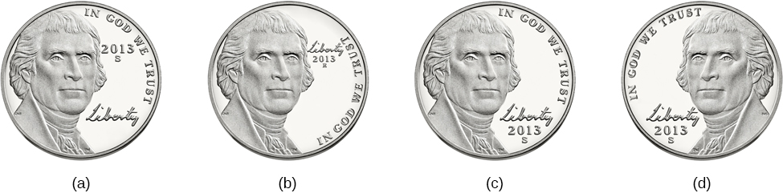
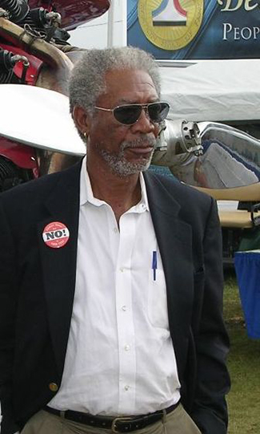

# 8.3 Những Vấn đề Trục trặc của Trí nhớ

> [!info]
>
> ### Mục tiêu học tập
>
> Sau khi học xong phần này, bạn sẽ có thể:
>
> - So sánh và đối chiếu hai dạng chứng mất trí nhớ (*amnesia*)
> - Thảo luận về tính không đáng tin cậy của lời khai nhân chứng
> - Thảo luận về sự thất bại trong mã hóa (*encoding failure*)
> - Thảo luận về các lỗi sai khác nhau của trí nhớ
> - So sánh và đối chiếu hai dạng can nhiễu (*interference*)

Bạn có thể tự hào về khả năng ghi nhớ ngày sinh và tuổi tác đáng kinh ngạc của tất cả bạn bè và thành viên gia đình, hoặc bạn có thể nhớ lại những chi tiết sống động về bữa tiệc sinh nhật lần thứ 5 của mình tại Chuck E. Cheese.
Tuy nhiên, tất cả chúng ta đôi khi đều cảm thấy bực bội, và thậm chí ngượng ngùng, khi trí nhớ phản bội chúng ta.
Có một số lý do giải thích tại sao điều này lại xảy ra.

## Chứng mất trí nhớ

**Chứng mất trí nhớ** (*amnesia*) là tình trạng mất trí nhớ dài hạn xảy ra do hậu quả của bệnh lý, chấn thương thực thể hoặc sang chấn tâm lý.
Endel Tulving (2002) và các đồng nghiệp của ông tại Đại học Toronto đã nghiên cứu trường hợp của bệnh nhân K. C. trong nhiều năm. K. C. bị chấn thương sọ não nghiêm trọng trong một vụ tai nạn xe máy và sau đó mắc chứng mất trí nhớ nặng nề.
Tulving viết:

> Sự thật nổi bật về tâm thần của K.C. là sự hoàn toàn bất lực trong việc nhớ lại bất kỳ sự kiện, hoàn cảnh hay tình huống nào trong chính cuộc đời mình.
> Chứng mất trí nhớ sự kiện bao trùm toàn bộ cuộc đời anh, từ lúc sinh ra cho đến hiện tại.
> Ngoại lệ duy nhất là những trải nghiệm mà anh vừa trải qua trong một hoặc hai phút gần nhất. (Tulving, 2002, tr.
> 14)

### Chứng quên thuận chiều

Có hai dạng mất trí nhớ phổ biến: chứng quên thuận chiều (*anterograde amnesia*) và chứng quên ngược chiều (*retrograde amnesia*) ([Hình 8.10](#Figure_08_03_AntRet)).
Chứng quên thuận chiều thường do chấn thương não bộ gây ra, chẳng hạn như một cú đánh mạnh vào đầu.
Với **chứng quên thuận chiều** (*anterograde amnesia*), bạn không thể nhớ các thông tin mới, mặc dù bạn có thể nhớ các thông tin và sự kiện đã xảy ra trước thời điểm bạn bị chấn thương.
Hồi hải mã thường là vùng não bị tổn thương (McLeod, 2011).
Điều này cho thấy tổn thương ở não đã dẫn đến việc mất khả năng chuyển giao thông tin từ trí nhớ ngắn hạn sang trí nhớ dài hạn; nghĩa là không thể củng cố các ký ức mới.

Nhiều người mắc dạng mất trí nhớ này không thể hình thành các ký ức sự kiện hoặc ký ức ngữ nghĩa mới, nhưng vẫn có khả năng hình thành các ký ức thủ tục mới (Bayley & Squire, 2002).
Điều này đúng với bệnh nhân H. M., người đã được thảo luận ở phần trước.
Tổn thương não do ca phẫu thuật đã dẫn đến chứng quên thuận chiều. H. M. có thể đọc đi đọc lại cùng một cuốn tạp chí mà không hề nhớ rằng mình đã từng đọc nó — cuốn tạp chí luôn luôn mới mẻ đối với ông.
Ông cũng không thể nhớ những người mình đã gặp sau ca phẫu thuật.
Nếu bạn được giới thiệu với H. M. và sau đó bạn rời khỏi phòng vài phút, ông sẽ không nhận ra bạn khi bạn quay lại và sẽ tự giới thiệu lại bản thân với bạn một lần nữa.
Tuy nhiên, khi được giao cùng một câu đố trong nhiều ngày liên tiếp, mặc dù ông không nhớ mình đã từng nhìn thấy câu đố đó trước đây, nhưng tốc độ giải đố của ông lại trở nên nhanh hơn qua từng ngày (nhờ vào sự tái học tập) (Corkin, 1965, 1968).

**Hình 8.10** Sơ đồ này minh họa dòng thời gian của chứng quên ngược chiều và chứng quên thuận chiều. Các vấn đề về trí nhớ kéo lùi về thời gian trước khi chấn thương xảy ra và ngăn cản việc truy xuất thông tin đã lưu trữ trước đó trong trí nhớ dài hạn được gọi là chứng quên ngược chiều. Ngược lại, các vấn đề về trí nhớ kéo dài về phía trước tính từ thời điểm chấn thương và ngăn cản sự hình thành các ký ức mới được gọi là chứng quên thuận chiều.

### Chứng quên ngược chiều

**Chứng quên ngược chiều** (*retrograde amnesia*) là sự mất trí nhớ đối với các sự kiện đã diễn ra trước thời điểm chấn thương.
Những người mắc chứng quên ngược chiều không thể nhớ một phần hoặc thậm chí toàn bộ quá khứ của họ.
Họ gặp khó khăn trong việc nhớ lại các ký ức sự kiện.
Điều gì sẽ xảy ra nếu một ngày nọ bạn thức dậy trong bệnh viện và xung quanh giường bệnh là những người tự nhận là vợ/chồng, con cái và cha mẹ của bạn?
Vấn đề rắc rối là bạn không nhận ra bất kỳ ai trong số họ.
Bạn bị tai nạn xe hơi, bị chấn thương đầu và hiện mắc chứng quên ngược chiều.
Bạn không nhớ bất cứ điều gì về cuộc sống của mình trước khi tỉnh dậy trong bệnh viện.
Điều này nghe có vẻ giống như tình tiết trong các bộ phim Hollywood, và Hollywood đã say mê cốt truyện mất trí nhớ này trong gần một thế kỷ, từ bộ phim *Garden of Lies* năm 1915 cho đến các bộ phim gần đây hơn như loạt phim điệp viên Jason Bourne.
Tuy nhiên, đối với những nạn nhân ngoài đời thực của chứng quên ngược chiều, như cựu cầu thủ bóng bầu dục NFL Scott Bolzan, câu chuyện không phải là một bộ phim giải trí.
Bolzan bị ngã, đập đầu và xóa sạch 46 năm cuộc đời trong chớp mắt.
Hiện ông đang sống với một trong những ca bệnh quên ngược chiều nghiêm trọng nhất từng được ghi nhận.

> [!tip]
>
> ### Liên kết học tập
>
> Hãy xem [câu chuyện qua video về chứng mất trí nhớ của Scott Bolzan và nỗ lực tìm lại cuộc sống của ông](https://openstax.org/l/bolzan) để tìm hiểu thêm.

## Kiến tạo và Tái cấu trúc Ký ức

Việc hình thành các ký ức mới đôi khi được gọi là **sự kiến tạo** (*construction*), và quá trình khơi gợi lại các ký ức cũ được gọi là **sự tái cấu trúc** (*reconstruction*).
Tuy nhiên, khi chúng ta truy xuất ký ức của mình, chúng ta cũng có xu hướng biến đổi và chỉnh sửa chúng.
Một ký ức được kéo từ kho lưu trữ dài hạn vào trí nhớ ngắn hạn có tính mềm dẻo và linh hoạt.
Những sự kiện mới có thể được thêm vào và chúng ta có thể thay đổi những gì chúng ta nghĩ rằng mình nhớ về các sự kiện trong quá khứ, dẫn đến những sự thiếu chính xác và bóp méo.
Mọi người có thể không hề có chủ ý bóp méo sự thật, nhưng điều đó hoàn toàn có thể xảy ra trong quá trình truy xuất các ký ức cũ và kết hợp chúng với các ký ức mới (Roediger & DeSoto, 2015).

### Tính dễ bị ám thị

Khi ai đó chứng kiến một vụ án, trí nhớ của người đó về các chi tiết của vụ án là rất quan trọng để bắt giữ nghi phạm.
Bởi vì trí nhớ rất mong manh, các nhân chứng có thể dễ dàng (và thường là vô tình) bị dẫn dắt sai lệch do vấn đề về tính dễ bị ám thị.
**Tính dễ bị ám thị** (*suggestibility*) mô tả tác động của thông tin sai lệch từ các nguồn bên ngoài dẫn đến việc tạo ra các ký ức giả.
Vào mùa thu năm 2002, một tay súng bắn tỉa ở khu vực Washington, D.C. đã bắn người tại một trạm xăng, khi họ rời khỏi Home Depot và khi đang đi bộ trên đường.
Các cuộc tấn công này diễn ra ở nhiều địa điểm khác nhau trong hơn ba tuần và khiến mười người thiệt mạng.
Trong khoảng thời gian đó, như bạn có thể tưởng tượng, mọi người đều khiếp sợ khi phải ra khỏi nhà, đi mua sắm hay thậm chí chỉ là đi dạo trong khu phố của mình.
Cảnh sát và FBI đã làm việc điên cuồng để phá án, và một đường dây nóng báo tin tội phạm đã được thiết lập.
Cơ quan thực thi pháp luật nhận được hơn 140.000 tin báo, dẫn đến khoảng 35.000 nghi phạm tiềm năng (Newseum, n.d.).

Hầu hết các tin báo đều đi vào ngõ cụt, cho đến khi một chiếc xe tải màu trắng bị phát hiện tại hiện trường của một trong những vụ nổ súng.
Cảnh sát trưởng đã xuất hiện trên truyền hình quốc gia cùng bức ảnh về chiếc xe tải màu trắng.
Sau buổi họp báo, một số nhân chứng khác đã gọi điện đến thông báo rằng họ cũng đã nhìn thấy một chiếc xe tải màu trắng tháo chạy khỏi hiện trường vụ nổ súng.
Vào thời điểm đó, có hơn 70.000 chiếc xe tải màu trắng trong khu vực.
Cảnh sát cũng như công chúng hầu như chỉ tập trung hoàn toàn vào những chiếc xe tải màu trắng vì họ tin vào lời các nhân chứng.
Những tin báo khác đã bị phớt lờ.
Khi các nghi phạm cuối cùng bị bắt giữ, chúng đang lái một chiếc xe sedan màu xanh lam.

Như minh họa của ví dụ này, chúng ta rất dễ bị tổn thương trước sức mạnh của sự gợi ý, chỉ đơn giản dựa trên một điều gì đó chúng ta thấy trên bản tin thời sự.
Hoặc chúng ta có thể khẳng định mình nhớ một điều gì đó mà trên thực tế đó chỉ là một lời gợi ý mà ai đó đã đưa ra.
Chính sự gợi ý đó là nguyên nhân dẫn đến ký ức giả.

### Sự nhận diện sai lệch của nhân chứng

Mặc dù trí nhớ và quá trình tái cấu trúc có thể rất mong manh, các sĩ quan cảnh sát, công tố viên và tòa án vẫn thường dựa vào sự nhận diện và lời khai của nhân chứng trong việc truy tố tội phạm.
Tuy nhiên, sự nhận diện và lời khai sai lệch của nhân chứng có thể dẫn đến những bản án oan sai nghiêm trọng ([Hình 8.11](#Figure_08_03_Eyewitness)).

![Biểu đồ thanh có tiêu đề "Nguyên nhân hàng đầu dẫn đến kết án oan sai trong các vụ án được minh oan bằng ADN (nguồn: Innocence Project)". Trục x có nhãn "Các nguyên nhân phổ biến", và trục y có nhãn "tỷ lệ phần trăm các vụ kết án oan (239 trường hợp minh oan bằng ADN đầu tiên)". Bốn thanh dữ liệu cho thấy: "nhận diện sai của nhân chứng" là nguyên nhân hàng đầu trong khoảng 75% trường hợp, "khoa học pháp y" trong khoảng 49% trường hợp, "lời thú tội giả" trong khoảng 23% trường hợp, và "người chỉ điểm" trong khoảng 18% trường hợp.](../../images/img_7b6a825e6135.jpg)

**Hình 8.11** Khi nghiên cứu các trường hợp bằng chứng ADN minh oan cho các phạm nhân, dự án **Innocence Project** phát hiện ra rằng sự nhận diện sai lệch của nhân chứng là nguyên nhân hàng đầu dẫn đến các vụ kết án oan sai (Trường Luật Benjamin N. Cardozo, Đại học Yeshiva, 2009). Lưu ý: Nhiều nguyên nhân có thể cùng đóng vai trò trong một vụ kết án oan.

Điều này diễn ra như thế nào?
Năm 1984, Jennifer Thompson, khi đó là một nữ sinh viên đại học 22 tuổi ở Bắc Carolina, đã bị cưỡng bức tàn bạo dưới sự đe dọa của dao.
Trong khi bị cưỡng bức, cô đã cố gắng ghi nhớ từng chi tiết về khuôn mặt và đặc điểm thể chất của kẻ hiếp dâm, thề rằng nếu sống sót, cô sẽ giúp đưa hắn ta vào tù.
Sau khi cảnh sát được liên hệ, một bức phác thảo chân dung nghi phạm đã được lập ra, và Jennifer được cho xem sáu bức ảnh.
Cô đã chọn hai bức, một trong số đó là của Ronald Cotton.
Sau khi nhìn vào các bức ảnh trong 4–5 phút, cô nói: "Đúng rồi.
Chính là người này," và sau đó cô nói thêm: "Tôi nghĩ đây chính là gã đó."
Khi được viên thám tử thẩm vấn gặng hỏi: "Cô có chắc không?
Tuyệt đối chắc chắn chứ?"
Cô khẳng định chính là anh ta.
Sau đó cô hỏi viên thám tử liệu mình làm vậy có ổn không, và ông đã củng cố lựa chọn của cô bằng cách nói rằng cô đã làm rất tuyệt vời.
Những dấu hiệu và sự gợi ý vô tình này của các sĩ quan cảnh sát có thể dẫn dắt các nhân chứng nhận diện sai nghi phạm.
Công tố viên quận lo ngại về sự thiếu chắc chắn của cô trong lần đầu tiên, vì vậy cô đã được xem một hàng nhận diện gồm bảy người đàn ông.
Cô cho biết mình đang phân vân giữa số 4 và số 5, cuối cùng quyết định rằng Cotton (số 5) "Trông giống hắn nhất."
Khi đó Cotton 22 tuổi.

Đến thời điểm phiên tòa bắt đầu, Jennifer Thompson hoàn toàn không còn chút nghi ngờ nào về việc mình đã bị Ronald Cotton cưỡng bức.
Cô ra làm chứng tại phiên tòa, và lời khai của cô đủ sức thuyết phục để giúp kết tội anh ta.
Làm thế nào cô đi từ chỗ "Tôi nghĩ đó là gã đó" và "Trông giống hắn nhất" đến một sự tin tưởng tuyệt đối như vậy?
Gary Wells và Deah Quinlivan (2009) khẳng định đó là do các thủ tục nhận diện mang tính gợi ý của cảnh sát, chẳng hạn như sắp xếp hàng nhận diện để làm nổi bật bị cáo, nói cho nhân chứng biết nên nhận diện người nào, và xác nhận các lựa chọn của nhân chứng bằng cách khen ngợi họ: "Lựa chọn tốt đấy" hoặc "Cô đã chọn đúng gã rồi."

Sau khi Cotton bị kết tội cưỡng bức, anh bị kết án tù chung thân cộng thêm 50 năm tù.
Sau 4 năm ngồi tù, anh được mở một phiên tái thẩm.
Jennifer Thompson một lần nữa ra làm chứng chống lại anh.
Lần này Ronald Cotton bị tuyên hai án tù chung thân.
Sau khi thụ án 11 năm tù, bằng chứng ADN cuối cùng đã chứng minh rằng Ronald Cotton không hề thực hiện vụ cưỡng bức đó, anh hoàn toàn vô tội, và đã phải ngồi tù hơn một thập kỷ vì một tội ác mà mình không hề gây ra.

> [!tip]
>
> ### Liên kết học tập
>
> Hãy xem [video đầu tiên về Ronald Cotton, người bị kết án oan](https://openstax.org/l/Cotton1) và sau đó xem [video thứ hai về trải nghiệm của người tố cáo anh](https://openstax.org/l/Cotton2) để hiểu thêm về sự dễ sai lầm của trí nhớ.

Câu chuyện của Ronald Cotton, đáng tiếc thay, không phải là cá biệt.
Đã có những người bị kết án và đưa vào diện chờ thi hành án tử hình, nhưng sau đó đã được minh oan.
Innocence Project là một tổ chức phi lợi nhuận hoạt động nhằm minh oan cho những người bị kết án oan sai, bao gồm cả những người bị kết tội oan bởi lời khai của nhân chứng.
Để tìm hiểu thêm, bạn có thể truy cập <http://www.innocenceproject.org>.

> [!note]
>
> ### Đào sâu nghiên cứu
>
> #### Bảo tồn trí nhớ nhân chứng: Vụ án Elizabeth Smart
>
> Hãy đối chiếu vụ án Cotton với những gì đã xảy ra trong vụ án Elizabeth **Smart**.
> Khi Elizabeth 14 tuổi và đang ngủ say trên giường ở nhà, cô bé đã bị bắt cóc dưới sự đe dọa của dao găm.
> Em gái chín tuổi của cô, Mary Katherine, đang ngủ cùng giường và kinh hãi chứng kiến người chị gái thân yêu của mình bị bắt cóc.
> Mary Katherine là nhân chứng duy nhất của tội ác này và vô cùng sợ hãi.
> Trong những tuần tiếp theo, cảnh sát Salt Lake City và FBI đã hành động hết sức thận trọng với Mary Katherine.
> Họ không muốn cấy ghép bất kỳ ký ức giả nào hoặc dẫn dắt cô bé sai lệch theo bất kỳ cách nào.
> Họ không cho cô bé xem các hàng nhận diện của cảnh sát hay thúc ép cô bé vẽ chân dung phác thảo của kẻ bắt cóc.
> Họ hiểu rằng nếu làm vấy bẩn trí nhớ của cô bé, Elizabeth có thể sẽ không bao giờ được tìm thấy.
> Trong vài tháng, hầu như không có tiến triển nào trong vụ án.
> Sau đó, khoảng 4 tháng sau vụ bắt cóc, Mary Katherine lần đầu tiên nhớ lại rằng mình đã từng nghe thấy giọng nói của kẻ bắt cóc trước đêm hôm đó (hắn từng làm thợ sửa chữa đúng một ngày tại nhà gia đình) và sau đó cô bé đã có thể nêu tên người sở hữu giọng nói đó.
> Gia đình đã liên hệ với báo chí và những người khác đã nhận ra hắn — sau tổng cộng chín tháng, nghi phạm đã bị bắt và Elizabeth Smart đã được đoàn tụ với gia đình.

### Hiệu ứng thông tin sai lệch

Nhà tâm lý học nhận thức Elizabeth Loftus đã tiến hành nhiều nghiên cứu sâu rộng về trí nhớ.
Bà đã nghiên cứu các ký ức giả cũng như các ký ức được phục hồi về lạm dụng tình dục thời thơ ấu.
Loftus cũng đã phát triển **mô hình hiệu ứng thông tin sai lệch** (*misinformation effect paradigm*), cho rằng sau khi tiếp xúc với các thông tin bổ sung và có thể thiếu chính xác, một người có thể nhớ sai lệch về sự kiện ban đầu.

Theo Loftus, trí nhớ của nhân chứng về một sự kiện rất mềm dẻo do hiệu ứng thông tin sai lệch.
Để kiểm tra giả thuyết này, Loftus và John Palmer (1974) đã yêu cầu 45 sinh viên đại học Hoa Kỳ ước tính tốc độ của các xe ô tô bằng các dạng câu hỏi khác nhau ([Hình 8.12](#Figure_08_03_CarCrash)).
Những người tham gia được xem các đoạn phim về các vụ tai nạn ô tô và được yêu cầu đóng vai trò là nhân chứng mô tả những gì đã xảy ra.
Họ được hỏi: "Hai chiếc xe chạy với tốc độ khoảng bao nhiêu khi chúng (đâm nát vụn - *smashed*, va chạm dữ dội - *collided*, va quệt mạnh - *bumped*, đâm vào - *hit*, va chạm nhẹ - *contacted*) nhau?"
Những người tham gia đã ước tính tốc độ của những chiếc xe dựa trên động từ được sử dụng trong câu hỏi.

Những người tham gia nghe thấy từ "đâm nát vụn" (*smashed*) đã ước tính rằng các xe di chuyển với tốc độ cao hơn nhiều so với những người tham gia nghe thấy từ "va chạm nhẹ" (*contacted*).
Thông tin ngầm ẩn về tốc độ, dựa trên động từ mà họ nghe được, đã tác động đến trí nhớ của người tham gia về vụ tai nạn.
Trong một đợt theo dõi một tuần sau đó, những người tham gia được hỏi liệu họ có nhìn thấy bất kỳ mảnh kính vỡ nào không (không hề có kính vỡ nào trong các hình ảnh tai nạn).
Những người tham gia trong nhóm từ "đâm nát vụn" có khả năng khẳng định rằng họ thực sự nhớ mình đã nhìn thấy kính vỡ cao hơn gấp đôi.
Loftus và Palmer đã chứng minh rằng một câu hỏi mớm cung/dẫn dắt (*leading question*) không chỉ khuyến khích họ nhớ rằng các xe chạy nhanh hơn, mà còn khiến họ nhớ sai rằng họ đã nhìn thấy kính vỡ.

**Hình 8.12** Khi mọi người được hỏi những câu hỏi dẫn dắt về một sự kiện, ký ức của họ về sự kiện đó có thể bị thay đổi. (nguồn a: chỉnh sửa tác phẩm của Rob Young)

### Những tranh cãi về ký ức bị dồn nén và được phục hồi

Các nhà nghiên cứu khác đã mô tả cách thức toàn bộ các sự kiện, chứ không chỉ là các từ ngữ đơn lẻ, có thể bị nhớ sai một cách hoàn toàn, ngay cả khi chúng chưa từng xảy ra.
Ý tưởng cho rằng ký ức về các sự kiện đau buồn chấn thương tâm lý có thể bị dồn nén (*repressed*) đã là một chủ đề nổi bật trong tâm lý học, bắt đầu từ Sigmund Freud, và cuộc tranh cãi xung quanh ý tưởng này vẫn tiếp diễn cho đến ngày nay.

Việc nhớ lại các ký ức tự thuật sai lệch được gọi là **hội chứng ký ức giả** (*false memory syndrome*).
Hội chứng này đã nhận được rất nhiều sự quan tâm của công chúng, đặc biệt là khi nó liên quan đến những ký ức về các sự kiện không có nhân chứng độc lập — thông thường những nhân chứng duy nhất của vụ lạm dụng chỉ là thủ phạm và nạn nhân (chẳng hạn như lạm dụng tình dục).

Một bên của cuộc tranh luận là những người đã phục hồi được ký ức về việc bị lạm dụng thời thơ ấu sau nhiều năm kể từ khi nó xảy ra.
Các nhà nghiên cứu này lập luận rằng trải nghiệm của một số đứa trẻ đã quá đau buồn và khủng khiếp đến mức chúng phải khóa chặt những ký ức đó lại để có thể duy trì cuộc sống bình thường.
Họ tin rằng những ký ức bị dồn nén có thể bị khóa kín suốt nhiều thập kỷ và sau đó được hồi tưởng lại nguyên vẹn thông qua các kỹ thuật thôi miên và tưởng tượng có hướng dẫn (Devilly, 2007).

Nghiên cứu cho thấy việc không có ký ức về lạm dụng tình dục thời thơ ấu là khá phổ biến ở người trưởng thành.
Chẳng hạn, một nghiên cứu quy mô lớn do John Briere và Jon Conte (1993) thực hiện đã tiết lộ rằng 59% trong số 450 nam giới và phụ nữ đang được điều trị vì bị lạm dụng tình dục xảy ra trước 18 tuổi đã quên đi những trải nghiệm của họ.
Ross Cheit (2007) cho rằng việc dồn nén những ký ức này tạo ra những đau khổ tâm lý khi trưởng thành.
Dự án Phục hồi Ký ức (*Recovered Memory Project*) được thành lập để các nạn nhân của nạn lạm dụng tình dục thời thơ ấu có thể nhớ lại những ký ức này và cho phép quá trình chữa lành bắt đầu (Cheit, 2007; Devilly, 2007).

Ở phía đối lập, Loftus đã thách thức quan điểm cho rằng các cá nhân có thể dồn nén ký ức về các sự kiện đau thương từ thời thơ ấu, bao gồm cả lạm dụng tình dục, rồi sau đó phục hồi những ký ức đó nhiều năm sau thông qua các kỹ thuật trị liệu như thôi miên, quán tưởng có hướng dẫn và hồi quy độ tuổi.

Loftus không hề nói rằng lạm dụng tình dục trẻ em không xảy ra, nhưng bà đặt câu hỏi liệu những ký ức đó có chính xác hay không, và bà hoài nghi về quy trình thẩm vấn được sử dụng để tiếp cận những ký ức này, vì ngay cả một sự gợi ý nhỏ nhất từ nhà trị liệu cũng có thể dẫn đến các hiệu ứng thông tin sai lệch.
Ví dụ, các nhà nghiên cứu Stephen Ceci và Maggie Brucks (1993, 1995) đã yêu cầu những đứa trẻ ba tuổi sử dụng một con búp bê có cấu tạo giải phẫu chính xác để chỉ ra vị trí bác sĩ nhi khoa đã chạm vào chúng trong một lần khám bệnh.
Năm mươi lăm phần trăm trẻ em đã chỉ vào vùng sinh dục/hậu môn trên búp bê, ngay cả khi chúng chưa từng trải qua bất kỳ hình thức khám bộ phận sinh dục nào.

Kể từ khi Loftus công bố những nghiên cứu đầu tiên về tính dễ bị ám thị của lời khai nhân chứng vào những năm 1970, các nhà khoa học xã hội, sĩ quan cảnh sát, nhà trị liệu và những người hành nghề luật đã nhận thức rõ về những sai sót trong thực tiễn phỏng vấn.
Do đó, các biện pháp đã được thực hiện để giảm tính dễ bị ám thị của các nhân chứng.
Một cách là điều chỉnh cách thức thẩm vấn nhân chứng.
Khi những người phỏng vấn sử dụng ngôn ngữ trung lập và ít tính dẫn dắt hơn, trẻ em nhớ lại chính xác hơn những gì đã xảy ra và ai là người liên quan (Goodman, 2006; Pipe, 1996; Pipe, Lamb, Orbach, & Esplin, 2004).
Một sự thay đổi khác là trong cách thức tổ chức các hàng nhận diện của cảnh sát.
Người ta khuyến nghị nên sử dụng hàng nhận diện ảnh mù (*blind photo lineup*).
Bằng cách này, người tiến hành thủ tục nhận diện không biết bức ảnh nào thuộc về nghi phạm, giúp giảm thiểu tối đa khả năng đưa ra các tín hiệu dẫn dắt.
Ngoài ra, các thẩm phán ở một số bang hiện nay thông báo cho bồi thẩm đoàn về khả năng nhận diện sai lầm.
Thẩm phán cũng có thể bác bỏ lời khai của nhân chứng nếu họ cho rằng lời khai đó không đáng tin cậy.

## Sự lãng quên

"Tôi có một trí nhớ tuyệt vời để lãng quên," Robert Louis Stevenson từng hóm hỉnh nói.
**Sự lãng quên** (*forgetting*) đề cập đến sự mất mát thông tin từ trí nhớ dài hạn.
Tất cả chúng ta đều quên nhiều thứ, như ngày sinh nhật của một người thân yêu, tên của một ai đó, hay nơi chúng ta để chìa khóa xe.
Như bạn đã thấy, trí nhớ rất mong manh, và việc quên có thể gây khó chịu và thậm chí ngượng ngùng.
Nhưng tại sao chúng ta lại quên?
Để trả lời câu hỏi này, chúng ta sẽ xem xét một số góc nhìn về sự lãng quên.

### Thất bại trong mã hóa

Đôi khi sự mất trí nhớ xảy ra ngay cả trước khi quá trình ghi nhớ thực sự bắt đầu, đó chính là sự thất bại trong mã hóa (*encoding failure*).
Chúng ta không thể nhớ một điều gì đó nếu ngay từ đầu chúng ta chưa từng lưu nó vào trí nhớ của mình.
Điều này tương tự như việc cố gắng tìm một cuốn sách trên thiết bị đọc sách điện tử của bạn mà bạn chưa từng thực sự mua và tải về.
Thông thường, để ghi nhớ một điều gì đó, chúng ta phải chú ý đến các chi tiết và chủ động làm việc để xử lý thông tin (mã hóa có nỗ lực).
Rất nhiều lần chúng ta không làm điều này.
Chẳng hạn, hãy nghĩ xem bạn đã nhìn thấy đồng một xu (penny) bao nhiêu lần trong đời.
Bạn có thể nhớ lại một cách chính xác mặt trước của đồng một xu Hoa Kỳ trông như thế nào không?
Khi các nhà nghiên cứu Raymond Nickerson và Marilyn Adams (1979) đặt câu hỏi này, họ nhận thấy rằng hầu hết người Mỹ đều không biết đâu là hình ảnh chuẩn xác.
Lý do rất có thể là do sự thất bại trong mã hóa.
Hầu hết chúng ta chưa bao giờ mã hóa chi tiết của đồng xu.
Chúng ta chỉ mã hóa vừa đủ thông tin để có thể phân biệt nó với các đồng xu khác.
Nếu chúng ta không mã hóa thông tin, thì thông tin đó không nằm trong trí nhớ dài hạn của chúng ta, và do đó chúng ta sẽ không thể nhớ lại nó.

**Hình 8.13** Bạn có thể phân biệt đồng xu nào trong số (a), (b), (c) hay (d) là mô tả chính xác về đồng năm xu của Hoa Kỳ không? Đáp án đúng là (c).

### Các lỗi sai của trí nhớ

Nhà tâm lý học Daniel Schacter (2001), một nhà nghiên cứu trí nhớ nổi tiếng, đưa ra bảy cách mà trí nhớ phản bội chúng ta.
Ông gọi chúng là "bảy tội lỗi của trí nhớ" và phân loại chúng thành ba nhóm: lãng quên, bóp méo, và xâm nhập ([Bảng 8.1](#Table_08_03_01)).

**Bảy tội lỗi của trí nhớ theo Schacter**

| Tội lỗi | Nhóm | Mô tả | Ví dụ |
| --- | --- | --- | --- |
| Thoái biến (*Transience*) | Lãng quên | Khả năng tiếp cận ký ức giảm dần theo thời gian | Quên các sự kiện đã diễn ra từ rất lâu trước đây |
| Đãng trí (*Absentmindedness*) | Lãng quên | Sự quên bắt nguồn từ sự đứt quãng của chú ý | Quên nơi để điện thoại |
| Nghẽn (*Blocking*) | Lãng quên | Khả năng tiếp cận thông tin bị phong tỏa tạm thời | Hiện tượng "ở đầu lưỡi" (*tip of the tongue*) |
| Quy nhầm nguồn (*Misattribution*) | Bóp méo | Nguồn gốc của ký ức bị nhầm lẫn | Nhớ lại một giấc mơ như một ký ức khi tỉnh táo |
| Dễ bị ám thị (*Suggestibility*) | Bóp méo | Ký ức giả | Xuất phát từ các câu hỏi dẫn dắt |
| Thiên kiến (*Bias*) | Bóp méo | Ký ức bị bóp méo bởi hệ thống niềm tin hiện tại | Căn chỉnh các ký ức theo niềm tin hiện tại |
| Dai dẳng (*Persistence*) | Xâm nhập | Không thể quên được những ký ức không mong muốn | Các sự kiện đau thương, sang chấn |

**Bảng 8.1**

Hãy cùng xem xét tội lỗi đầu tiên trong các lỗi lãng quên: **sự thoái biến** (*transience*), có nghĩa là các ký ức có thể mờ nhạt dần theo thời gian.
Dưới đây là một ví dụ về cách điều này diễn ra: Giáo viên dạy văn của Nathan đã giao cho học sinh đọc cuốn tiểu thuyết *Giết con chim nhại*.
Nathan đi học về và nói với mẹ rằng cậu phải đọc cuốn sách này cho lớp học.
"Ồ, mẹ từng rất thích cuốn sách đó!" cô nói.
Nathan hỏi mẹ cuốn sách nói về điều gì, và sau một hồi ngập ngừng, cô nói: "À... mẹ biết mẹ đã đọc cuốn sách này hồi trung học, và mẹ nhớ một trong những nhân vật chính tên là Scout, và bố cô bé là một luật sư, nhưng thành thật mà nói mẹ chẳng nhớ gì khác nữa."
Nathan tự hỏi liệu mẹ mình có thực sự từng đọc cuốn sách hay không, và mẹ cậu cũng rất ngạc nhiên vì mình không thể nhớ lại cốt truyện.
Những gì đang diễn ra ở đây là sự suy thoái lưu trữ (*storage decay*): thông tin không được sử dụng có xu hướng mờ nhạt dần theo dòng thời gian.

Năm 1885, nhà tâm lý học người Đức Hermann **Ebbinghaus** đã phân tích quá trình ghi nhớ.
Đầu tiên, ông ghi nhớ các danh sách gồm các âm tiết vô nghĩa.
Sau đó, ông đo lường mức độ mình học được (giữ lại được) khi cố gắng học lại từng danh sách.
Ông đã tự kiểm tra bản thân qua các khoảng thời gian khác nhau từ 20 phút sau cho đến 30 ngày sau.
Kết quả là đường cong lãng quên nổi tiếng của ông ([Hình 8.14](#Figure_08_03_Ebbinghaus)).
Do sự suy thoái lưu trữ, một người bình thường sẽ mất 50% thông tin đã ghi nhớ sau 20 phút và 70% thông tin sau 24 giờ (Ebbinghaus, 1885/1964).
Trí nhớ của bạn đối với thông tin mới suy giảm rất nhanh lúc đầu và sau đó dần ổn định lại.

**Hình 8.14** Đường cong lãng quên của Ebbinghaus cho thấy trí nhớ đối với thông tin mới suy giảm nhanh như thế nào.

Bạn có liên tục làm mất điện thoại di động không?
Bạn đã bao giờ phải lái xe quay về nhà chỉ để kiểm tra xem mình đã tắt bếp chưa?
Bạn đã bao giờ bước vào một căn phòng để lấy một thứ gì đó, nhưng lại quên mất mình định lấy gì?
Bạn có thể đã trả lời "có" cho ít nhất một, nếu không muốn nói là tất cả, những ví dụ này — nhưng đừng lo lắng, bạn không hề đơn độc.
Tất cả chúng ta đều dễ mắc phải lỗi trí nhớ được gọi là **sự đãng trí / lơ đãng** (*absentmindedness*), mô tả sự gián đoạn trong trí nhớ do mất tập trung chú ý hoặc do tâm trí đang hướng về một nơi khác.

Cynthia, một nhà tâm lý học, nhớ lại một lần gần đây cô đã mắc phải lỗi đãng trí của trí nhớ:

> Khi tôi hoàn thành các bài đánh giá tâm lý theo lệnh của tòa án, mỗi lần đến tòa, tôi đều được cấp một thẻ nhận dạng tạm thời có dải từ để mở các cánh cửa vốn bị khóa.
> Như bạn có thể tưởng tượng, trong phòng xử án, thẻ nhận dạng này rất có giá trị và quan trọng, không ai muốn nó bị mất hoặc bị tội phạm nhặt được.
> Vào cuối ngày, tôi sẽ nộp lại thẻ nhận dạng tạm thời này.
> Một ngày nọ, khi tôi gần hoàn thành bài đánh giá, nhà trẻ của con gái tôi gọi điện thông báo bé bị ốm và cần được đón về.
> Đó là mùa cúm, tôi không biết con bé ốm nặng đến mức nào và tôi rất lo lắng.
> Tôi hoàn thành bài đánh giá trong mười phút tiếp theo, thu dọn cặp tài liệu và vội vã lái xe đến nhà trẻ của con.
> Sau khi đón con gái, tôi không thể nhớ nổi mình đã nộp lại thẻ nhận dạng hay đã để quên nó trên bàn.
> Tôi lập tức gọi điện cho tòa án để kiểm tra.
> Hóa ra tôi đã nộp lại thẻ.
> Tại sao tôi lại không thể nhớ được điều đó? (giao tiếp cá nhân, ngày 5 tháng 9 năm 2013)

Bạn đã từng trải qua sự đãng trí khi nào?

"Tôi vừa xem trực tuyến bộ phim tên là *Oblivion*, và trong phim có nam diễn viên nổi tiếng đó.
Ôi, tên ông ấy là gì nhỉ?
Ông ấy từng đóng trong tất cả những bộ phim đình đám, như *The Shawshank Redemption* và bộ ba phim *The Dark Knight*.
Tôi nghĩ ông ấy thậm chí đã từng đoạt giải Oscar.
Ôi trời, tôi có thể hình dung ra khuôn mặt ông ấy trong đầu, và nghe thấy giọng nói đặc trưng của ông ấy, nhưng tôi không tài nào nhớ ra nổi tên ông ấy!
Điều này sẽ làm tôi bứt rứt mãi cho đến khi nhớ ra!"
Lỗi cụ thể này có thể gây ức chế vô cùng bởi vì bạn cảm thấy thông tin đang nằm ngay trên đầu lưỡi của mình.
Bạn đã bao giờ trải qua điều này chưa?
Nếu có, bạn đã mắc phải lỗi được gọi là **nghẽn ký ức** (*blocking*): bạn không thể tiếp cận thông tin đã được lưu trữ ([Hình 8.15](#Figure_08_03_Freeman)).

**Hình 8.15** Hiện tượng nghẽn ký ức còn được gọi là hiện tượng đầu lưỡi (TOT - *tip-of-the-tongue*). Ký ức nằm ngay ở đó, nhưng bạn dường như không thể nhớ lại được, giống như việc không thể nhớ ra tên của nam diễn viên vô cùng nổi tiếng này, Morgan Freeman. (nguồn: chỉnh sửa tác phẩm của D. Miller)

Bây giờ hãy cùng xem xét ba lỗi bóp méo: quy nhầm nguồn, tính dễ bị ám thị, và thiên kiến.
**Sự quy nhầm nguồn gốc** (*misattribution*) xảy ra khi bạn nhầm lẫn nguồn gốc của thông tin.
Giả sử Alejandra đang hẹn hò với Lucia và họ đã cùng nhau xem phần đầu tiên của bộ phim Hobbit.
Sau đó họ chia tay và Alejandra đi xem phần thứ hai của phim Hobbit với một người khác.
Cuối năm đó, Alejandra và Lucia quay lại với nhau.
Một ngày nọ, họ đang thảo luận về sự khác biệt giữa sách và phim Hobbit, và Alejandra nói với Lucia: "Em rất thích xem phần thứ hai với chị và nhìn chị giật bắn mình khỏi ghế trong đoạn siêu đáng sợ đó."
Khi Lucia đáp lại bằng một cái nhìn bối rối rồi giận dữ, Alejandra mới nhận ra mình đã mắc phải lỗi quy nhầm nguồn gốc.

Điều gì sẽ xảy ra nếu một người là nạn nhân của một vụ cưỡng bức ngay sau khi xem một chương trình truyền hình?
Liệu có khả năng nạn nhân lại đổ tội hiếp dâm cho chính người mà cô ấy nhìn thấy trên tivi vì sự quy nhầm nguồn gốc hay không?
Đây chính xác là những gì đã xảy ra với Donald Thomson:

> Chuyên gia nhân chứng người Úc Donald Thomson đã xuất hiện trên một chương trình thảo luận truyền hình trực tiếp về tính không đáng tin cậy của trí nhớ nhân chứng.
> Sau đó, ông bị bắt giữ, đưa vào hàng nhận diện và bị một nạn nhân xác định là người đàn ông đã cưỡng bức cô.
> Cảnh sát đã buộc tội Thomson mặc dù vụ cưỡng bức xảy ra đúng vào thời điểm ông đang lên sóng truyền hình.
> Họ bác bỏ bằng chứng ngoại phạm của ông rằng ông đang ở trước mắt hàng triệu khán giả truyền hình và cùng với những người tham gia thảo luận khác, bao gồm cả một trợ lý ủy viên cảnh sát...
> Cuối cùng, các điều tra viên phát hiện ra rằng kẻ hiếp dâm đã tấn công người phụ nữ đúng lúc cô đang xem tivi — chính là chương trình mà Thomson đã xuất hiện.
> Các nhà chức trách cuối cùng đã xóa sạch tội danh cho Thomson.
> Người phụ nữ đã nhầm lẫn khuôn mặt của kẻ hiếp dâm với khuôn mặt mà cô vừa nhìn thấy trên tivi. (Baddeley, 2004, tr.
> 133)

Lỗi bóp méo thứ hai là tính dễ bị ám thị.
Tính dễ bị ám thị tương tự như quy nhầm nguồn gốc vì nó cũng liên quan đến các ký ức giả, nhưng nó có điểm khác biệt.
Với quy nhầm nguồn gốc, bạn tự mình tạo ra ký ức giả hoàn toàn, đó là những gì nạn nhân đã làm trong trường hợp của Donald Thomson ở trên.
Còn với tính dễ bị ám thị, nó xuất phát từ một người khác, chẳng hạn như một nhà trị liệu hoặc người thẩm vấn của cảnh sát đặt những câu hỏi dẫn dắt nhân chứng trong một cuộc phỏng vấn.

Ký ức cũng có thể bị ảnh hưởng bởi **thiên kiến** (*bias*), đây là lỗi bóp méo cuối cùng.
Schacter (2001) cho biết cảm xúc và thế giới quan của bạn thực sự có thể bóp méo ký ức của bạn về các sự kiện trong quá khứ.
Có một số loại thiên kiến:

- Thiên kiến định kiến (*stereotypical bias*) liên quan đến các định kiến về chủng tộc và giới tính. Ví dụ, khi các đối tượng nghiên cứu người Mỹ gốc Á và người Mỹ gốc Âu được xem một danh sách tên, họ thường nhớ nhầm các tên điển hình của người Mỹ gốc Phi như Jamal và Tyrone gắn liền với nghề vận động viên bóng rổ, và thường nhớ nhầm các tên điển hình của người da trắng như Greg và Howard gắn liền với nghề chính trị gia (Payne, Jacoby, & Lambert, 2004).
- Thiên kiến vị kỷ (*egocentric bias*) liên quan đến việc tôn vinh, làm đẹp thêm các ký ức của chúng ta về quá khứ (Payne et al., 2004). Liệu bạn có thực sự ghi bàn thắng quyết định trong trận đấu bóng đá quan trọng đó, hay bạn chỉ là người kiến tạo đường chuyền?
- Thiên kiến nhận thức muộn (*hindsight bias*) xảy ra khi chúng ta nghĩ rằng một kết quả là điều tất yếu không thể tránh khỏi sau khi sự việc đã rồi. Đây là hiện tượng "tôi đã biết ngay từ đầu mà". Bản chất tái cấu trúc của trí nhớ góp phần tạo nên thiên kiến nhận thức muộn (Carli, 1999). Chúng ta nhớ những sự kiện không có thật dường như để xác nhận rằng chúng ta đã nắm rõ kết quả ngay từ đầu.

Bạn đã bao giờ có một bài hát cứ lặp đi lặp lại trong đầu mình chưa?
Còn ký ức về một sự kiện đau buồn, một điều mà bạn thực sự không muốn nghĩ tới thì sao?
Khi bạn cứ liên tục nhớ về một điều gì đó, đến mức bạn không thể "tống nó ra khỏi đầu" và nó can thiệp vào khả năng tập trung của bạn vào những việc khác, điều đó được gọi là **sự dai dẳng** (*persistence*).
Đây là lỗi trí nhớ thứ bảy và là lỗi cuối cùng của Schacter.
Nó thực chất là một sự thất bại của hệ thống trí nhớ vì chúng ta nhớ lại những ký ức không mong muốn một cách không tự chủ, đặc biệt là những ký ức khó chịu ([Hình 8.16](#Figure_08_03_Soldiers)).
Chẳng hạn, bạn chứng kiến một vụ tai nạn xe hơi kinh hoàng trên đường đi làm vào một buổi sáng, và bạn không thể tập trung vào công việc vì bạn cứ liên tục nhớ lại cảnh tượng đó.

**Hình 8.16** Nhiều cựu chiến binh từng tham gia các cuộc xung đột quân sự nhớ lại những ký ức khó chịu, không mong muốn một cách không tự chủ. (nguồn: Ảnh Bộ Quốc phòng của Thượng sĩ Không quân Hoa Kỳ Michael R. Holzworth)

### Sự can nhiễu

Đôi khi thông tin được lưu trữ trong trí nhớ của chúng ta, nhưng vì một lý do nào đó nó lại không thể tiếp cận được.
Điều này được gọi là sự can nhiễu (*interference*), và có hai loại: can nhiễu đón trước (*proactive interference*) và can nhiễu tác động ngược (*retroactive interference*) ([Hình 8.17](#Figure_08_03_Interfere)).
Bạn đã bao giờ có số điện thoại mới hoặc chuyển đến địa chỉ mới, nhưng ngay sau đó bạn lại buột miệng nói cho mọi người số điện thoại hoặc địa chỉ cũ (và sai) chưa?
Khi năm mới bắt đầu, bạn có thấy mình vô tình viết năm trước đó không?
Đây là những ví dụ về **can nhiễu đón trước** (*proactive interference*): khi thông tin cũ cản trở việc nhớ lại thông tin mới học.
**Can nhiễu tác động ngược** (*retroactive interference*) xảy ra khi thông tin được học gần đây hơn cản trở việc nhớ lại thông tin cũ hơn.
Ví dụ, tuần này bạn đang học về trí nhớ và tìm hiểu về đường cong lãng quên của Ebbinghaus.
Tuần tới bạn học về sự phát triển trong suốt đời người và tìm hiểu về lý thuyết phát triển tâm lý xã hội của Erikson, nhưng sau đó bạn lại gặp khó khăn khi nhớ lại công trình của Ebbinghaus vì bạn chỉ còn nhớ lý thuyết của Erikson.

![Sơ đồ thể hiện hai dạng can nhiễu. Hộp có nội dung "học mã số tủ đồ trường trung học, 17–04–32" theo sau bởi một mũi tên trỏ sang phải về phía hộp có nhãn "ký ức về mã tủ đồ cũ cản trở việc nhớ lại mã tủ đồ phòng tập thể dục mới, ??–??–??"; mũi tên nối hai hộp chứa dòng chữ "can nhiễu đón trước (thông tin cũ cản trở việc nhớ lại thông tin mới)". Bên dưới là phần thứ hai của sơ đồ. Hộp có nội dung "kiến thức về địa chỉ email mới cản trở việc nhớ lại địa chỉ email cũ, nvayala@???" theo sau bởi mũi tên trỏ sang trái về phía hộp "sự kiện trước đó" và cách xa một hộp khác có nhãn "học địa chỉ email đại học mới của anh chị em, npatel@siblingcollege.edu"; mũi tên nối hai hộp chứa dòng chữ "can nhiễu tác động ngược (thông tin mới cản trở việc nhớ lại thông tin cũ)".](../../images/img_e263c26f32bb.jpg)

**Hình 8.17** Đôi khi sự lãng quên là do việc thất bại trong việc truy xuất thông tin. Điều này có thể xuất phát từ sự can nhiễu, hoặc là tác động ngược hoặc là đón trước.
