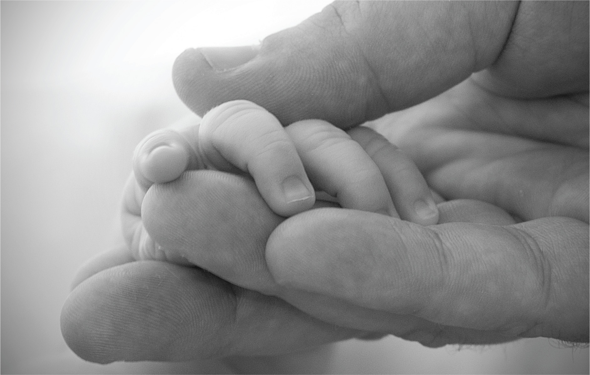

# Lời mở đầu

**Hình 9.1** Bạn đã thay đổi như thế nào kể từ thời thơ ấu? Bạn vẫn giữ nguyên những nét tính cách nào? Cuộc sống của bạn sẽ ra sao trong 25 năm nữa? Còn 50 năm nữa thì sao? Tâm lý học phát triển trong suốt đời người nghiên cứu cách bạn biến đổi cũng như cách bạn duy trì sự ổn định trong suốt cuộc đời mình. (nguồn: chỉnh sửa tác phẩm của Giles Cook)

## Đề cương chương học

- [9.1 Sự phát triển trong suốt đời người là gì?](01-9-1-what-is-lifespan-development.md)
- [9.2 Các lý thuyết phát triển trong suốt đời người](02-9-2-lifespan-theories.md)
- [9.3 Các giai đoạn phát triển](03-9-3-stages-of-development.md)
- [9.4 Sự chết và Quá trình cận tử](04-9-4-death-and-dying.md)

Chào mừng bạn đến với câu chuyện về chính cuộc đời mình.
Trong chương này, chúng ta sẽ khám phá câu chuyện hấp dẫn về cách bạn đã lớn lên và phát triển thành con người bạn ngày hôm nay.
Chúng ta cũng xem xét một số góc nhìn về con người bạn sẽ trở thành vào ngày mai.
Câu chuyện của bạn là một câu chuyện về sự phát triển trong suốt đời người ([Hình 9.1](#Figure_09_00_Hands)), từ khoảnh khắc khởi đầu của sự sống cho đến lúc kết thúc.

Quá trình trưởng thành và phát triển của con người thể hiện rõ ràng nhất trong thời kỳ sơ sinh và thời thơ ấu, tuy nhiên sự phát triển của bạn vẫn đang diễn ra ngay tại thời điểm này và sẽ tiếp diễn, từng phút từng giây, trong suốt phần còn lại của cuộc đời bạn.
Con người bạn ngày hôm nay và con người bạn trong tương lai phụ thuộc vào sự hòa quyện giữa yếu tố di truyền, môi trường, văn hóa, các mối quan hệ xã hội và nhiều yếu tố khác, khi bạn tiếp tục bước qua từng giai đoạn của cuộc đời.
Bạn đã tự mình trải nghiệm rất nhiều điều được thảo luận trong chương này.
Giờ đây, hãy cùng xem khoa học tâm lý nói gì về sự phát triển thể chất, nhận thức và tâm lý xã hội của bạn, từ trong bụng mẹ cho đến khi nhắm mắt xuôi tay.
