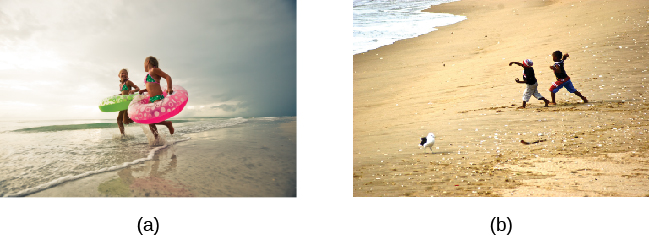

# 9.1 Sự Phát triển trong Suốt Đời người là gì?

> [!info]
>
> ### Mục tiêu học tập
>
> Sau khi học xong phần này, bạn sẽ có thể:
>
> - Định nghĩa và phân biệt giữa ba lĩnh vực phát triển: thể chất, nhận thức và tâm lý xã hội
> - Thảo luận về phương pháp tiếp cận định chuẩn đối với sự phát triển
> - Thấu hiểu ba vấn đề lớn trong tâm lý học phát triển: tính liên tục và gián đoạn, một tiến trình phát triển chung duy nhất hay nhiều tiến trình riêng biệt, và bẩm sinh so với nuôi dưỡng

Trái tim tôi nhảy múa hân hoan
Khi ngắm nhìn dải cầu vồng trên bầu trời cao rộng:
Khi đời tôi bắt đầu, mọi sự đã là như thế;
Bây giờ khi tôi đã là một người đàn ông trưởng thành, mọi sự vẫn vẹn nguyên;
Và khi tôi già đi, ước mong mọi sự vẫn sẽ như vậy,
Hoặc hãy để tôi chết đi!
Đứa trẻ chính là người cha của Người lớn;
Tôi ước sao những ngày tháng đời mình được đong đầy
Gắn kết bền chặt bên nhau bằng lòng mộ đạo tự nhiên. (Wordsworth, 1802)

Trong bài thơ này, William Wordsworth đã viết: “đứa trẻ chính là người cha của người lớn” (*the child is father of the man*).
Phát biểu thoạt nhìn có vẻ mâu thuẫn này có ý nghĩa gì, và nó có liên quan gì đến sự phát triển trong suốt đời người?
Wordsworth có thể đang gợi ý rằng con người của ông khi trưởng thành phụ thuộc phần lớn vào những trải nghiệm mà ông từng có thời thơ ấu.
Hãy suy ngẫm về những câu hỏi sau: Con người trưởng thành của bạn ngày hôm nay chịu ảnh hưởng ở mức độ nào từ đứa trẻ mà bạn từng là trong quá khứ?
Đứa trẻ về mặt bản chất khác biệt ở mức độ nào so với người lớn mà nó sẽ lớn lên trở thành?

Đây chính là những kiểu câu hỏi mà các nhà tâm lý học phát triển cố gắng trả lời, bằng cách nghiên cứu cách con người biến đổi và lớn lên từ lúc thụ thai qua thời thơ ấu, vị thành niên, trưởng thành và qua đời.
Họ nhìn nhận sự phát triển như một quá trình kéo dài suốt đời có thể được nghiên cứu một cách khoa học trên ba lĩnh vực phát triển — thể chất, nhận thức và tâm lý xã hội.
**Sự phát triển thể chất** (*physical development*) liên quan đến sự tăng trưởng và thay đổi của cơ thể và não bộ, các giác quan, kỹ năng vận động, sức khỏe và sự lành mạnh.
**Sự phát triển nhận thức** (*cognitive development*) liên quan đến học tập, sự chú ý, trí nhớ, ngôn ngữ, tư duy, lập luận và tính sáng tạo.
**Sự phát triển tâm lý xã hội** (*psychosocial development*) liên quan đến cảm xúc, nhân cách và các mối quan hệ xã hội.
Chúng ta sẽ liên tục đề cập đến ba lĩnh vực này xuyên suốt toàn bộ chương học.

> [!example]
>
> ### Kết nối các khái niệm
>
> #### Phương pháp nghiên cứu trong tâm lý học phát triển
>
> Bạn đã tìm hiểu về nhiều phương pháp nghiên cứu khác nhau được các nhà tâm lý học sử dụng.
> Các nhà tâm lý học phát triển sử dụng nhiều phương pháp tiếp cận này để hiểu rõ hơn về cách các cá nhân thay đổi về mặt tinh thần và thể chất theo thời gian.
> Những phương pháp này bao gồm quan sát tự nhiên, nghiên cứu trường hợp, khảo sát và thực nghiệm, cùng nhiều phương pháp khác.
>
> Quan sát tự nhiên liên quan đến việc quan sát hành vi trong bối cảnh tự nhiên của nó.
> Một nhà tâm lý học phát triển có thể quan sát cách trẻ em cư xử trên sân chơi, tại trung tâm giữ trẻ hoặc trong chính ngôi nhà của trẻ.
> Mặc dù phương pháp nghiên cứu này cung cấp một cái nhìn thoáng qua về cách trẻ em hành xử trong môi trường tự nhiên của chúng, nhưng các nhà nghiên cứu có rất ít quyền kiểm soát đối với các loại hình và/hoặc tần suất hành vi được thể hiện.
>
> Trong một nghiên cứu trường hợp, các nhà tâm lý học phát triển thu thập rất nhiều thông tin từ một cá nhân duy nhất để hiểu rõ hơn về những thay đổi thể chất và tâm lý trong suốt cuộc đời.
> Cách tiếp cận cụ thể này là một phương pháp tuyệt vời để thấu hiểu sâu sắc hơn về những cá nhân đặc biệt theo một cách nào đó, nhưng nó đặc biệt dễ bị thiên kiến của nhà nghiên cứu trong việc diễn giải dữ liệu, và rất khó để khái quát hóa các kết luận cho quần thể dân số rộng lớn hơn.
>
> Trong một ví dụ kinh điển về phương pháp nghiên cứu này được áp dụng cho nghiên cứu phát triển suốt đời, Sigmund Freud đã phân tích sự phát triển của một đứa trẻ được gọi là “Cậu bé Hans” (Freud, 1909/1949).
> Các phát hiện của Freud đã giúp cung cấp dữ liệu cho các lý thuyết của ông về sự phát triển tâm lý tính dục ở trẻ em, điều mà bạn sẽ tìm hiểu ở phần sau của chương này.
> Bé Genie, đối tượng của một nghiên cứu trường hợp được thảo luận trong chương về tư duy và trí thông minh, cung cấp một ví dụ khác về cách các nhà tâm lý học kiểm tra các mốc phát triển thông qua nghiên cứu chi tiết trên một cá nhân đơn lẻ.
> Trong trường hợp của Genie, sự nuôi dạy bỏ bê và ngược đãi đã khiến cô bé không thể nói được cho đến năm 13 tuổi, khi cô được giải thoát khỏi môi trường độc hại đó.
> Khi cô học cách sử dụng ngôn ngữ, các nhà tâm lý học đã có thể so sánh khả năng tiếp thu ngôn ngữ của cô khi diễn ra ở giai đoạn phát triển muộn khác biệt như thế nào so với việc tiếp thu thông thường các kỹ năng đó trong lứa tuổi từ sơ sinh đến đầu thời thơ ấu (Fromkin, Krashen, Curtiss, Rigler, & Rigler, 1974; Curtiss, 1981).
>
> Phương pháp khảo sát yêu cầu các cá nhân tự báo cáo những thông tin quan trọng về suy nghĩ, trải nghiệm và niềm tin của họ.
> Phương pháp cụ thể này có thể cung cấp một lượng lớn thông tin trong một khoảng thời gian tương đối ngắn; tuy nhiên, độ giá trị của dữ liệu thu thập theo cách này phụ thuộc vào sự tự báo cáo trung thực, và dữ liệu thu được thường nông hơn so với chiều sâu thông tin thu thập được trong một nghiên cứu trường hợp.
> Một ví dụ về cuộc khảo sát toàn diện là nghiên cứu được thực hiện bởi Ruth W. Howard.
> Năm 1934, bà lấy bằng tiến sĩ bằng cách khảo sát 229 cặp sinh ba, nghiên cứu toàn diện nhất về sinh ba được hoàn thành vào thời điểm đó.
> Người phụ nữ tiên phong này cũng là người phụ nữ Mỹ gốc Phi đầu tiên giành được học vị Tiến sĩ Tâm lý học (Hiệp hội Tâm lý học Hoa Kỳ, 2019).
>
> Các thực nghiệm đòi hỏi sự kiểm soát chặt chẽ đối với các biến ngoại lai và thao túng biến độc lập.
> Do đó, nghiên cứu thực nghiệm cho phép các nhà tâm lý học phát triển đưa ra các nhận định nhân quả về một số biến số quan trọng đối với quá trình phát triển.
> Vì nghiên cứu thực nghiệm phải diễn ra trong một môi trường được kiểm soát, các nhà nghiên cứu phải thận trọng về việc liệu các hành vi quan sát được trong phòng thí nghiệm có phản ánh đúng môi trường tự nhiên của cá nhân hay không.
>
> Ở phần sau của chương này, bạn sẽ tìm hiểu về một số thí nghiệm trong đó trẻ mới biết đi và trẻ nhỏ quan sát các bối cảnh hoặc hành động để các nhà nghiên cứu có thể xác định ở độ tuổi nào các khả năng nhận thức cụ thể sẽ phát triển.
> Ví dụ, trẻ em có thể quan sát một lượng chất lỏng được đổ từ một chiếc cốc lùn, rộng sang một chiếc cốc cao, hẹp.
> Khi các nhà thực nghiệm đặt câu hỏi cho trẻ em về những gì đã xảy ra, câu trả lời của các đối tượng tham gia giúp các nhà tâm lý học hiểu được ở độ tuổi nào một đứa trẻ bắt đầu hiểu rằng thể tích chất lỏng vẫn giữ nguyên mặc dù hình dạng của vật chứa là khác nhau.

Xuyên suốt ba lĩnh vực này — thể chất, nhận thức và tâm lý xã hội — **phương pháp tiếp cận định chuẩn** (*normative approach*) đối với sự phát triển cũng được đưa ra thảo luận.
Cách tiếp cận này đặt câu hỏi: "Thế nào là sự phát triển bình thường?"
Trong những thập niên đầu của thế kỷ 20, các nhà tâm lý học theo trường phái định chuẩn đã nghiên cứu một lượng lớn trẻ em ở các độ tuổi khác nhau để xác định các định chuẩn (tức là độ tuổi trung bình) khi mà hầu hết trẻ em đạt được các mốc phát triển cụ thể trong từng lĩnh vực trong ba lĩnh vực trên (Gesell, 1933, 1939, 1940; Gesell & Ilg, 1946; Hall, 1904).
Lưu ý rằng mặc dù vẫn đang được sử dụng, các thuật ngữ "bình thường" (*normal*) và "định chuẩn" (*normative*) thường đòi hỏi sự cân nhắc sâu sắc hơn, và một số nhà nghiên cứu cùng chuyên gia thực hành đang hướng tới việc tránh sử dụng chúng.
Các nhà tâm lý học thường xem xét các dấu hiệu điển hình hoặc "bình thường" để chẩn đoán khi nào một đứa trẻ có thể cần được thăm khám hoặc hỗ trợ chuyên biệt.
Mặc dù trẻ em phát triển với tốc độ hơi khác nhau, chúng ta có thể sử dụng các mức trung bình theo độ tuổi này như những hướng dẫn chung để so sánh trẻ em với các bạn cùng trang lứa nhằm xác định độ tuổi gần đúng mà trẻ nên đạt tới những sự kiện định chuẩn cụ thể được gọi là **các mốc phát triển** (*developmental milestones*) (ví dụ: biết bò, biết đi, viết chữ, tự mặc quần áo, gọi tên màu sắc, nói thành câu hoàn chỉnh và bắt đầu bước vào tuổi dậy thì).

Không phải tất cả các sự kiện định chuẩn đều mang tính phổ quát, nghĩa là chúng không được trải nghiệm bởi tất cả các cá nhân trên mọi nền văn hóa.
Các mốc sinh học, chẳng hạn như tuổi dậy thì, thường có xu hướng phổ quát, nhưng các mốc xã hội, chẳng hạn như độ tuổi trẻ bắt đầu đi học chính quy, không nhất thiết mang tính phổ quát; thay vào đó, chúng chỉ ảnh hưởng đến hầu hết các cá nhân trong một nền **văn hóa** cụ thể (Gesell & Ilg, 1946).
Ví dụ, ở một số quốc gia, trẻ em bắt đầu đi học khi được 5 hoặc 6 tuổi, nhưng ở các quốc gia khác, trẻ em thường đến trường ở độ tuổi muộn hơn, hoặc việc học hành bị hạn chế hay gián đoạn.
Chẳng hạn, UNESCO ước tính rằng gần 244 triệu trẻ em trong độ tuổi đi học trên thế giới hiện vẫn chưa được tiếp cận với trường học (Antoninis, 2022).

Để hiểu rõ hơn về phương pháp tiếp cận định chuẩn, hãy tưởng tượng hai người mẹ mới sinh con, Louisa và Kimberly, vốn là bạn thân và có con ở độ tuổi gần bằng nhau.
Con gái của Louisa được 14 tháng tuổi, và con trai của Kimberly được 12 tháng tuổi.
Theo phương pháp tiếp cận định chuẩn, độ tuổi trung bình một đứa trẻ bắt đầu biết đi là 12 tháng.
Tuy nhiên, lúc 14 tháng tuổi con gái của Louisa vẫn chưa biết đi.
Cô nói với Kimberly rằng cô lo lắng có điều gì đó không ổn với con mình.
Kimberly tỏ ra ngạc nhiên vì con trai cô đã bắt đầu biết đi khi mới 10 tháng tuổi.
Liệu Louisa có nên lo lắng không?
Cô ấy có nên lo ngại nếu con gái mình vẫn chưa biết đi khi được 15 tháng hoặc 18 tháng không?

> [!tip]
>
> ### Liên kết học tập
>
> Trung tâm Kiểm soát và Phòng ngừa Dịch bệnh Hoa Kỳ (CDC) mô tả các mốc phát triển cho trẻ em từ 2 tháng đến 5 tuổi.
> Sau khi xem xét thông tin, hãy làm [Bài trắc nghiệm các mốc phát triển](https://openstax.org/l/milestones) để xem bạn nhớ những gì đã học tốt đến mức nào.
> Nếu bạn là phụ huynh có lo ngại về sự phát triển của con mình, hãy liên hệ với bác sĩ nhi khoa.

## Các vấn đề lớn trong Tâm lý học Phát triển

Có nhiều cách tiếp cận lý thuyết khác nhau liên quan đến sự phát triển của con người.
Khi chúng ta đánh giá chúng trong chương này, hãy nhớ rằng tâm lý học phát triển tập trung vào cách con người thay đổi, và hãy ghi nhớ rằng tất cả các cách tiếp cận mà chúng tôi trình bày trong chương này đều giải quyết các câu hỏi về sự biến đổi: Sự thay đổi diễn ra êm ả hay gập ghềnh (liên tục so với gián đoạn)?
Khuôn mẫu thay đổi này có giống nhau cho tất cả mọi người, hay có nhiều khuôn mẫu thay đổi khác nhau (một tiến trình phát triển chung hay nhiều tiến trình riêng biệt)?
Yếu tố di truyền và môi trường tương tác với nhau như thế nào để ảnh hưởng đến sự phát triển (bẩm sinh so với nuôi dưỡng)?

### Sự phát triển diễn ra liên tục hay gián đoạn?

**Sự phát triển liên tục** (*continuous development*) xem sự phát triển như một quá trình tích lũy dần dần, từng bước cải thiện và hoàn thiện các kỹ năng sẵn có ([Hình 9.2](#Figure_09_01_Develop)).
Với kiểu phát triển này, có sự thay đổi từ từ và tiệm tiến.
Hãy xem xét ví dụ về sự phát triển thể chất của một đứa trẻ: chiều cao tăng thêm từng centimet qua từng năm tháng.
Ngược lại, các nhà lý thuyết coi sự phát triển là **gián đoạn** (*discontinuous*) tin rằng sự phát triển diễn ra theo các giai đoạn riêng biệt: nó xảy ra vào những thời điểm hoặc độ tuổi cụ thể.
Với dạng phát triển này, sự thay đổi mang tính đột ngột hơn, chẳng hạn như khả năng nhận thức về tính vĩnh cửu của vật thể (*object permanence*) ở trẻ sơ sinh.

**Hình 9.2** Khái niệm phát triển liên tục có thể được hình dung như một con dốc tiến triển mượt mà, trong khi sự phát triển gián đoạn nhìn nhận sự tăng trưởng qua các giai đoạn rời rạc hơn.

### Có một tiến trình phát triển duy nhất hay nhiều tiến trình?

Liệu sự phát triển về cơ bản là giống nhau, hay mang tính phổ quát, đối với tất cả trẻ em (nghĩa là chỉ có một tiến trình phát triển duy nhất) hay sự phát triển tuân theo một tiến trình khác nhau cho từng đứa trẻ, tùy thuộc vào yếu tố di truyền và môi trường cụ thể của đứa trẻ đó (nghĩa là có nhiều tiến trình phát triển khác nhau)?
Con người trên khắp thế giới chia sẻ nhiều điểm tương đồng hay nhiều điểm khác biệt hơn trong sự phát triển của họ?
Văn hóa và di truyền ảnh hưởng nhiều như thế nào đến hành vi của một đứa trẻ?

Các lý thuyết giai đoạn cho rằng trình tự phát triển mang tính phổ quát.
Ví dụ, trong các nghiên cứu xuyên văn hóa về sự phát triển ngôn ngữ, trẻ em trên toàn thế giới đạt được các mốc ngôn ngữ theo một trình tự rất giống nhau (Gleitman & Newport, 1995).
Trẻ sơ sinh ở mọi nền văn hóa đều phát ra những âm gừ gừ (*coo*) trước khi bập bẹ (*babble*).
Chúng bắt đầu bập bẹ ở độ tuổi tương đương nhau và thốt ra từ đầu tiên khi được khoảng 12 tháng tuổi.
Tuy nhiên, chúng ta sống trong những bối cảnh đa dạng có tác động độc đáo đến mỗi người trong chúng ta.
Chẳng hạn, các nhà nghiên cứu từng tin rằng sự phát triển vận động tuân theo một tiến trình duy nhất cho tất cả trẻ em bất kể văn hóa.
Tuy nhiên, các tập quán chăm sóc trẻ khác nhau tùy theo từng nền văn hóa, và các tập quán khác nhau đã được phát hiện là làm đẩy nhanh hoặc ức chế việc đạt được các mốc phát triển vận động như ngồi, bò và đi (Karasik, Adolph, Tamis-LeMonda, & Bornstein, 2010).

Ví dụ, hãy xem xét xã hội người Aché ở Paraguay.
Họ dành một lượng thời gian đáng kể để tìm kiếm thức ăn trong rừng rậm.
Khi đi tìm thức ăn, những người mẹ Aché luôn cõng những đứa con nhỏ của mình, hiếm khi đặt chúng xuống đất để bảo vệ chúng khỏi bị thương tích trong rừng.
Do đó, con cái của họ biết đi muộn hơn nhiều: Chúng biết đi khi được khoảng 23–25 tháng tuổi, so với trẻ sơ sinh trong các nền văn hóa phương Tây bắt đầu biết đi khi được khoảng 12 tháng tuổi.
Tuy nhiên, khi trẻ em Aché lớn hơn, chúng được phép tự do vận động nhiều hơn, và vào khoảng 9 tuổi, kỹ năng vận động của chúng đã vượt xa trẻ em cùng tuổi ở Hoa Kỳ: Trẻ em Aché có thể trèo lên những cái cây cao tới hơn 7 mét và sử dụng thành thạo dao rựa cùng các công cụ khác (Kaplan & Dove, 1987).
Như bạn có thể thấy, sự phát triển của chúng ta chịu ảnh hưởng của nhiều bối cảnh khác nhau, vì vậy thời điểm của các chức năng vận động cơ bản có thể khác nhau giữa các nền văn hóa.
Tuy nhiên, bản thân các chức năng đó đều hiện diện ở tất cả các xã hội loài người ([Hình 9.3](#Figure_09_01_Play)).

**Hình 9.3** Mọi trẻ em trên khắp thế giới đều thích vui chơi. Dù ở (a) Florida hay (b) Nam Phi, trẻ em đều thích thú khám phá cát, ánh nắng mặt trời và biển cả. (nguồn a: chỉnh sửa tác phẩm của “Visit St. Pete/Clearwater”/Flickr; nguồn b: chỉnh sửa tác phẩm của "stringer_bel"/Flickr)

### Bẩm sinh và Nuôi dưỡng ảnh hưởng đến sự phát triển như thế nào?

Liệu chúng ta là con người như ngày nay là do **bẩm sinh** (*nature* - sinh học và di truyền), hay chúng ta là ai là do **nuôi dưỡng** (*nurture* - môi trường và văn hóa)?
Câu hỏi lâu đời này được biết đến trong tâm lý học là cuộc tranh luận giữa bẩm sinh và nuôi dưỡng (*nature versus nurture*).
Nó tìm cách thấu hiểu xem nhân cách và các đặc điểm của chúng ta là sản phẩm của cấu trúc gen và các yếu tố sinh học như thế nào, và chúng được định hình bởi môi trường xung quanh chúng ta ra sao, bao gồm người giám hộ, bạn bè đồng trang lứa và văn hóa.
Chẳng hạn, tại sao con đẻ đôi khi lại hành động rất giống cha mẹ của chúng — điều đó là do di truyền hay do môi trường thời thơ ấu và những gì đứa trẻ học được từ cha mẹ?
Còn những đứa trẻ được nhận làm con nuôi thì sao — chúng giống gia đình sinh học của mình hơn hay giống gia đình nhận nuôi hơn?
Và làm thế nào mà những đứa con ruột trong cùng một gia đình lại có thể quá khác biệt nhau như vậy?

Tất cả chúng ta đều sinh ra với những đặc điểm di truyền cụ thể được thừa hưởng từ cha mẹ ruột của mình, chẳng hạn như màu mắt, chiều cao và một số đặc điểm tính cách nhất định.
Tuy nhiên, vượt ra ngoài kiểu gen cơ bản, có một sự tương tác sâu sắc giữa gen và môi trường của chúng ta: Những trải nghiệm độc nhất vô nhị của chúng ta trong môi trường sống ảnh hưởng đến việc liệu các đặc điểm cụ thể có được biểu hiện hay không và biểu hiện như thế nào, đồng thời, gen của chúng ta cũng ảnh hưởng đến cách chúng ta tương tác với môi trường của mình (Diamond, 2009; Lobo, 2008).
Chương này sẽ chỉ ra rằng có một sự tương tác qua lại mật thiết giữa bẩm sinh và nuôi dưỡng khi cả hai cùng định hình con người mà chúng ta trở thành, nhưng cuộc tranh luận vẫn tiếp diễn liên quan đến những đóng góp tương đối của từng yếu tố.

> [!note]
>
> ### Đào sâu nghiên cứu
>
> #### Khoảng cách thành tích: Tình trạng kinh tế - xã hội ảnh hưởng đến sự phát triển như thế nào?
>
> Khoảng cách thành tích (*achievement gap*) đề cập đến sự khác biệt dai dẳng về điểm số, kết quả kiểm tra và tỷ lệ tốt nghiệp tồn tại giữa các học sinh thuộc các sắc tộc, chủng tộc khác nhau và — trong một số môn học nhất định — giới tính (Winerman, 2011).
> Nghiên cứu cho thấy rằng những khoảng cách thành tích này chịu ảnh hưởng mạnh mẽ bởi sự khác biệt về các yếu tố kinh tế - xã hội tồn tại giữa các gia đình của những đứa trẻ này.
> Mặc dù các nhà nghiên cứu thừa nhận rằng các chương trình nhằm giảm bớt sự chênh lệch kinh tế - xã hội như vậy có thể sẽ hỗ trợ việc cân bằng năng khiếu và thành tích của trẻ em từ các hoàn cảnh khác nhau, nhưng họ cũng nhận thấy rằng những biện pháp can thiệp quy mô lớn như vậy là rất khó thực hiện.
> Do đó, người ta khuyến nghị rằng các chương trình nhằm bồi dưỡng năng khiếu và thành tích cho trẻ em có địa vị kinh tế - xã hội thấp hơn có thể là lựa chọn tốt nhất để giải quyết các vấn đề liên quan đến khoảng cách thành tích học tập (Duncan & Magnuson, 2005).
>
> Trẻ em từ các hộ gia đình có thu nhập thấp có kết quả kém hơn đáng kể so với các bạn cùng trang lứa thuộc tầng lớp thu nhập trung bình và cao trên một loạt các biến số giáo dục: Chúng có điểm thi chuẩn hóa, tỷ lệ tốt nghiệp và tỷ lệ vào đại học thấp hơn đáng kể, và có tỷ lệ bỏ học cao hơn nhiều.
> Đã có những nỗ lực nhằm khắc phục khoảng cách thành tích thông qua luật pháp của tiểu bang và liên bang, nhưng điều gì sẽ xảy ra nếu các vấn đề bắt đầu ngay từ trước khi những đứa trẻ bước chân vào trường học?
>
> Các nhà tâm lý học Betty Hart và Todd Risley (2006) đã dành cả sự nghiệp của mình để nghiên cứu khả năng ngôn ngữ ban đầu và sự tiến bộ của trẻ em ở các mức thu nhập khác nhau.
> Trong một nghiên cứu dọc, họ nhận thấy rằng mặc dù tất cả các bậc cha mẹ trong nghiên cứu đều gắn kết và tương tác với con cái của họ, nhưng các bậc cha mẹ có thu nhập trung bình và cao tương tác với con của họ khác biệt so với các bậc cha mẹ có thu nhập thấp hơn.
> Sau khi phân tích 1.300 giờ tương tác giữa cha mẹ và con cái, các nhà nghiên cứu nhận thấy rằng các bậc cha mẹ có thu nhập trung bình và cao trò chuyện với con cái của họ nhiều hơn đáng kể, bắt đầu từ khi những đứa trẻ còn là trẻ sơ sinh.
> Đến khi 3 tuổi, trẻ em từ các hộ gia đình có thu nhập cao hơn biết số lượng từ vựng gần gấp đôi so với các bạn cùng trang lứa từ các hộ gia đình có thu nhập thấp hơn, và chúng đã được nghe ước tính tổng cộng nhiều hơn 30 triệu từ so với những đứa trẻ từ các hộ gia đình có thu nhập thấp (Hart & Risley, 2003).
> Và khoảng cách này càng ngày càng trở nên rõ rệt hơn.
> Trước khi bước vào trường mẫu giáo, trẻ em có gia đình thu nhập cao hơn đạt điểm cao hơn 60% trong các bài kiểm tra thành tích so với các bạn cùng trang lứa có hoàn cảnh thu nhập thấp hơn (Lee & Burkam, 2002).
>
> Có những giải pháp cho vấn đề này.
> Tại Đại học Chicago, các chuyên gia đang làm việc với các gia đình có thu nhập thấp, đến thăm họ tại nhà và khuyến khích họ trò chuyện nhiều hơn với con cái hàng ngày và hàng giờ.
> Các chuyên gia khác đang thiết kế các trường mầm non nơi học sinh từ các hoàn cảnh kinh tế đa dạng được học chung trong một lớp.
> Trong nghiên cứu này, trẻ em có địa vị kinh tế - xã hội thấp hơn đã đạt được những tiến bộ đáng kể trong sự phát triển ngôn ngữ của chúng, nhiều khả năng là kết quả của việc theo học tại trường mầm non chuyên biệt này (Schechter & Byeb, 2007).
> Những phương pháp hoặc biện pháp can thiệp nào khác có thể được sử dụng để giảm khoảng cách thành tích?
> Những loại hoạt động nào có thể được thực hiện để giúp đỡ trẻ em trong cộng đồng của bạn hoặc một cộng đồng lân cận?
