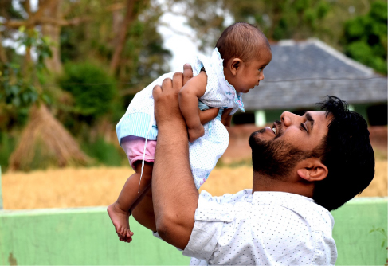
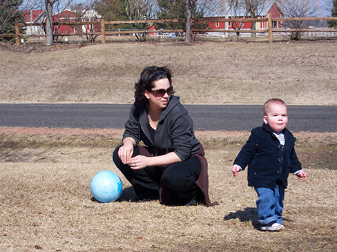
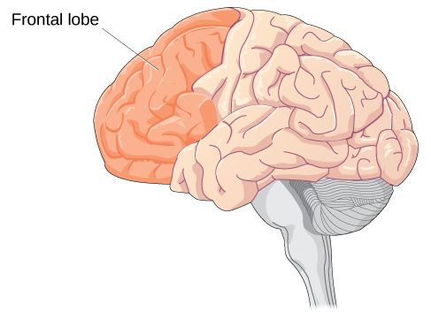
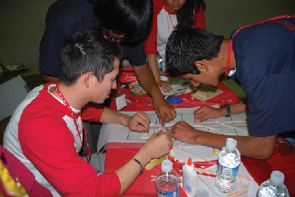
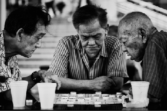

# 9.3 Các Giai Đoạn Phát Triển

> [!info]
>
> ### Mục Tiêu Học Tập
>
> Sau khi học xong mục này, bạn sẽ có thể:
>
> - Mô tả các giai đoạn phát triển trước sinh và nhận thức tầm quan trọng của việc chăm sóc tiền sản
> - Đánh giá sự phát triển thể chất, nhận thức và cảm xúc diễn ra từ thời thơ ấu đến tuổi thiếu nhi
> - So sánh và đối chiếu sự phát triển thể chất, nhận thức và cảm xúc diễn ra trong thời kỳ vị thành niên
> - Khảo sát sự phát triển thể chất, nhận thức và cảm xúc diễn ra trong tuổi trưởng thành

Từ khoảnh khắc chào đời cho đến giây phút qua đời, chúng ta không ngừng phát triển.

Như đã thảo luận ở phần đầu chương này, các nhà tâm lý học phát triển thường chia sự phát triển của con người thành ba lĩnh vực: phát triển thể chất, phát triển nhận thức và phát triển tâm lý xã hội.
Tương tự như các giai đoạn của Erikson, sự phát triển suốt đời được chia thành các giai đoạn khác nhau dựa trên độ tuổi.
Chúng ta sẽ thảo luận về sự phát triển trước sinh, thời kỳ sơ sinh, ấu nhi, vị thành niên và người trưởng thành.

## Phát Triển Trước Sinh (Prenatal Development)

Làm thế nào bạn trở thành con người như ngày hôm nay?
Bắt đầu từ một cấu trúc đơn bào cho đến khi chào đời, quá trình **phát triển trước sinh** (prenatal development) của bạn đã diễn ra theo một trình tự tinh tế và trật tự.

Có ba giai đoạn phát triển trước sinh: giai đoạn mầm (germinal stage), giai đoạn phôi (embryonic stage) và giai đoạn thai nhi (fetal stage).
Hãy cùng xem điều gì xảy ra với em bé đang phát triển trong từng giai đoạn này.

### Giai Đoạn Mầm (Tuần 1–2)

Trong phần thảo luận về tâm lý học sinh học ở phần trước của cuốn sách, bạn đã tìm hiểu về di truyền học và DNA.
DNA được truyền sang đứa trẻ vào thời điểm thụ thai.
**Sự thụ thai** (conception) xảy ra khi tinh trùng thụ tinh cho một tế bào trứng và tạo thành hợp tử ([Hình 9.7](#Figure_09_02_Conception)).
Một **hợp tử** (zygote) khởi đầu là một cấu trúc đơn bào được tạo ra khi tinh trùng và trứng kết hợp với nhau.
Cấu trúc di truyền và giới tính sinh học của hợp tử được xác lập ngay tại thời điểm này.
Trong tuần đầu tiên sau khi thụ thai, hợp tử liên tục phân chia và nhân đôi, từ cấu trúc một tế bào thành hai tế bào, sau đó là bốn tế bào, tám tế bào, và cứ tiếp tục như vậy.
Quá trình phân chia tế bào này được gọi là **quá trình nguyên phân** (mitosis).
Nguyên phân là một tiến trình mong manh, và chưa đến một nửa số hợp tử có thể sống sót qua hai tuần đầu tiên (Hall, 2004).
Sau 5 ngày nguyên phân đã có khoảng 100 tế bào, và sau 9 tháng sẽ có hàng tỷ tế bào.
Khi các tế bào phân chia, chúng trở nên chuyên biệt hóa hơn, hình thành các cơ quan và bộ phận cơ thể khác nhau.
Trong giai đoạn mầm, khối tế bào này vẫn chưa bám vào niêm mạc tử cung.
Một khi nó bám vào niêm mạc thành công, giai đoạn tiếp theo sẽ bắt đầu.

**Hình 9.7** Tinh trùng và noãn kết hợp tại thời điểm thụ thai.

### Giai Đoạn Phôi (Tuần 3–8)

Sau khi hợp tử phân chia trong khoảng 7–10 ngày và có khoảng 150 tế bào, nó di chuyển xuống ống dẫn trứng và làm tổ trong niêm mạc tử cung.
Sau khi làm tổ, sinh vật đa bào này được gọi là **phôi thai** (embryo).
Lúc này các mạch máu phát triển, hình thành nên nhau thai.
**Nhau thai** (placenta) là một cấu trúc kết nối với tử cung, cung cấp dinh dưỡng và oxy cho phôi đang phát triển thông qua dây rốn.
Các cấu trúc cơ bản của phôi bắt đầu phát triển thành các vùng sẽ trở thành đầu, ngực và bụng.
Trong giai đoạn phôi thai, tim bắt đầu đập, các cơ quan hình thành và bắt đầu hoạt động.
Ống thần kinh hình thành dọc theo lưng phôi, phát triển thành tủy sống và não bộ.

### Giai Đoạn Thai Nhi (Tuần 9–40)

Khi sinh vật đạt khoảng chín tuần tuổi, phôi thai được gọi là thai nhi (fetus).
Ở giai đoạn này, thai nhi có kích thước xấp xỉ một hạt đậu tây và bắt đầu mang hình hài nhận diện được của một con người khi phần "đuôi" dần biến mất.

Từ tuần thứ 9 đến tuần thứ 12, các cơ quan sinh dục bắt đầu phân hóa.
Đến khoảng 16 tuần, thai nhi dài khoảng 4,5 inch (khoảng 11,4 cm).
Các ngón tay và ngón chân đã phát triển hoàn chỉnh, và dấu vân tay đã có thể nhìn thấy.
Khi thai nhi bước sang tháng thứ sáu của quá trình phát triển (24 tuần), nó nặng tới 1,4 pound (khoảng 635 gam).
Thính giác đã phát triển nên thai nhi có thể phản ứng với âm thanh.
Các cơ quan nội tạng, chẳng hạn như phổi, tim, dạ dày và ruột, đã hình thành đủ để một thai nhi sinh non tại thời điểm này có cơ hội sống sót bên ngoài tử cung.
Trong suốt giai đoạn thai nhi, não bộ tiếp tục tăng trưởng và phát triển, kích thước tăng gần gấp đôi từ tuần 16 đến tuần 28.
Khoảng tuần thứ 36, thai nhi gần như đã sẵn sàng chào đời.
Thai nặng khoảng 6 pound (khoảng 2,7 kg) và dài khoảng 18,5 inch (khoảng 47 cm), và đến tuần thứ 37, tất cả các hệ cơ quan của thai nhi đã phát triển đủ để có thể sống sót bên ngoài tử cung mà không gặp phải nhiều nguy cơ liên quan đến sinh non.
Thai nhi tiếp tục tăng cân và phát triển chiều dài cho đến khoảng tuần thứ 40.
Đến lúc này, thai nhi có rất ít không gian để cử động và sự chào đời đã cận kề.
Tiến trình qua các giai đoạn được thể hiện trong [Hình 9.8](#Figure_09_02_Stages).

![Sự phát triển của thai nhi được thể hiện qua chín hình ảnh ở các giai đoạn phát triển khác nhau. Đối với mỗi giai đoạn, có hình ảnh thai nhi ngày càng lớn hơn và trưởng thành hơn. Giai đoạn đầu tiên được gắn nhãn “9 tuần; giai đoạn thai nhi bắt đầu”. Giai đoạn thứ hai: “12 tuần; các cơ quan sinh dục phân hóa”. Giai đoạn thứ ba: “16 tuần; các ngón tay và ngón chân phát triển”. Giai đoạn thứ tư: “20 tuần; thính giác bắt đầu hoạt động”. Giai đoạn thứ năm: “24 tuần; phổi bắt đầu phát triển”. Giai đoạn thứ sáu: “28 tuần; não phát triển nhanh chóng”. Giai đoạn thứ bảy: “32 tuần; xương phát triển hoàn thiện”. Giai đoạn thứ tám: “36 tuần; cơ bắp phát triển hoàn thiện”. Giai đoạn thứ chín: “40 tuần; phát triển đủ tháng”.](../../images/img_dbfdcaef0419.jpg)

**Hình 9.8** Trong giai đoạn thai nhi, não bộ của em bé phát triển và cơ thể gia tăng kích thước cũng như trọng lượng, cho đến khi thai nhi đạt đến mức phát triển đủ tháng.

> [!tip]
>
> ### Kết Nối Với Học Tập
>
> Để có cái nhìn kỳ thú về sự phát triển trước sinh và quá trình sinh nở, hãy xem video [*Điều Kỳ Diệu Lớn Nhất Của Cuộc Sống (Life’s Greatest Miracle)*](https://openstax.org/l/miracle) từ Nova và PBS.

### Các Ảnh Hưởng Trước Sinh (Prenatal Influences)

Trong mỗi giai đoạn trước sinh, các yếu tố di truyền và môi trường đều có thể tác động đến sự phát triển.
Thai nhi đang phát triển hoàn toàn phụ thuộc vào người mang thai.
Việc **chăm sóc tiền sản** (prenatal care) định kỳ—tức việc chăm sóc y tế trong suốt thai kỳ nhằm theo dõi sức khỏe của cả người mang thai và thai nhi ([Hình 9.9](#Figure_09_02_Prenatal))—rất quan trọng vì nó có thể làm giảm nguy cơ biến chứng trong thai kỳ (NIH, 2013).
Trên thực tế, những người đang cố gắng mang thai hoặc có thể mang thai nên thảo luận về kế hoạch mang thai với bác sĩ của họ.
Chẳng hạn, họ có thể được khuyên nên bổ sung vitamin có chứa axit folic, giúp ngăn ngừa một số dị tật bẩm sinh nhất định, hoặc theo dõi các khía cạnh trong chế độ ăn uống hoặc thói quen tập thể dục của mình.
Con người có thể phải đối mặt với các nguy cơ sức khỏe nếu không được chăm sóc tiền sản, một dịch vụ vốn chưa được cung cấp bình đẳng giữa các nhóm dân cư hoặc khu vực địa lý (Backes & Scrimshaw, 2020).

**Hình 9.9** Một người mang thai được siêu âm như một phần của quá trình chăm sóc tiền sản. (nguồn: "MIKI Yoshihito_Flickr"/Flickr)

Hãy nhớ lại rằng khi hợp tử bám vào thành tử cung, nhau thai sẽ được hình thành.
Nhau thai cung cấp chất dinh dưỡng và oxy cho thai nhi.
Hầu hết mọi thứ mà người mang thai dung nạp vào cơ thể, bao gồm thức ăn, chất lỏng và thậm chí cả thuốc men, đều đi qua nhau thai đến thai nhi, do đó mới có câu nói phổ biến là “ăn cho hai người”.
Mọi thứ trong môi trường đều ảnh hưởng đến thai nhi; nếu người mang thai tiếp xúc với thứ gì đó có hại, đứa trẻ có thể phải chịu những hậu quả kéo dài suốt đời.

Một **tác nhân gây dị tật thai nhi** (teratogen) là bất kỳ tác nhân môi trường nào—thuộc về sinh học, hóa học hoặc vật lý—gây ra tổn hại cho phôi thai hoặc thai nhi đang phát triển.
Có nhiều loại tác nhân gây quái thai khác nhau.
Rượu và hầu hết các loại thuốc đều đi qua nhau thai và tác động trực tiếp đến thai nhi.
Rượu không an toàn để uống với bất kỳ lượng nào trong thai kỳ.
Việc sử dụng rượu trong thai kỳ đã được xác định là nguyên nhân hàng đầu có thể phòng ngừa được gây ra tình trạng khuyết tật trí tuệ ở trẻ em tại Hoa Kỳ (Maier & West, 2001).
Uống nhiều rượu khi mang thai có thể gây ra các rối loạn phổ rượu ở thai nhi (FASD) với những hậu quả suốt đời đối với đứa trẻ, mức độ nghiêm trọng từ nhẹ đến nặng ([Bảng 9.3](#Table_09_03_01)).
Các rối loạn phổ rượu ở thai nhi (FASD) là tập hợp các dị tật bẩm sinh liên quan đến việc tiêu thụ nhiều rượu trong thai kỳ.
Về mặt thể chất, trẻ mắc FASD có thể có kích thước đầu nhỏ và các đặc điểm bất thường trên khuôn mặt.
Về mặt nhận thức, những đứa trẻ này có thể có khả năng phán đoán kém, kiểm soát xung động kém, tỷ lệ mắc ADHD cao hơn, gặp các vấn đề về học tập và chỉ số IQ thấp hơn.
Những vấn đề và sự chậm trễ phát triển này vẫn tiếp tục kéo dài đến tuổi trưởng thành (Streissguth et al., 2004).
Dựa trên các nghiên cứu tiến hành trên động vật, người ta cũng gợi ý rằng việc tiêu thụ rượu trong thai kỳ có thể khiến đời sau có xu hướng ưa thích rượu (Youngentob et al., 2007).

**Các Đặc Điểm Khuôn Mặt Ở Hội Chứng Rượu Thai Nhi**

| Đặc Điểm Khuôn Mặt | Tác Động Tiềm Ẩn Của Hội Chứng Rượu Thai Nhi |
| --- | --- |
| Kích thước đầu | Chu vi đầu nhỏ hơn mức trung bình |
| Mắt | Khe mở mắt nhỏ hơn mức trung bình, có nếp gấp da ở khóe mắt |
| Mũi | Sống mũi thấp, mũi ngắn |
| Vùng giữa mặt | Kích thước vùng giữa mặt nhỏ hơn trung bình |
| Môi và nhân trung | Môi trên mỏng, nhân trung mờ hoặc phẳng |

**Bảng 9.3**

Hút thuốc lá cũng được coi là một tác nhân gây quái thai vì nicotine đi qua nhau thai đến thai nhi.
Khi người mang thai hút thuốc lá, em bé đang phát triển sẽ bị giảm nồng độ oxy trong máu.
Theo Trung tâm Kiểm soát và Phòng ngừa Dịch bệnh Hoa Kỳ (CDC, 2013), hút thuốc khi mang thai có thể dẫn đến sinh non, trẻ sơ sinh nhẹ cân, thai chết lưu và hội chứng đột tử ở trẻ sơ sinh (SIDS).

Heroin, cocaine, methamphetamine, hầu hết các loại thuốc theo toa và phần lớn các loại thuốc không kê đơn cũng được coi là các tác nhân gây dị tật.
Trẻ sinh ra bị nghiện heroin cũng cần heroin giống như một người trưởng thành nghiện heroin.
Đứa trẻ sẽ cần được cai heroin dần dần dưới sự giám sát y tế; nếu không, trẻ có thể bị co giật và tử vong.
Các tác nhân gây dị tật khác bao gồm bức xạ, các loại virus như HIV và herpes, cùng với bệnh rubella (sởi Đức).
Những người lớn lên ở Hoa Kỳ ít có khả năng mắc bệnh rubella hơn nhiều vì phần lớn đều đã được tiêm chủng hoặc chủng ngừa khi còn nhỏ để bảo vệ cơ thể khỏi bệnh tật.

Mỗi cơ quan của thai nhi phát triển trong một giai đoạn cụ thể của thai kỳ, được gọi là **giai đoạn then chốt hoặc nhạy cảm** (critical or sensitive period) ([Hình 9.8](#Figure_09_02_Stages)).
Ví dụ, nghiên cứu với các mô hình linh trưởng về FASD đã chứng minh rằng thời điểm thai nhi đang phát triển tiếp xúc với rượu có thể ảnh hưởng sâu sắc đến sự xuất hiện của các đặc điểm khuôn mặt liên quan đến hội chứng rượu thai nhi.
Cụ thể, nghiên cứu này chỉ ra rằng việc tiếp xúc với rượu chỉ giới hạn ở ngày thứ 19 hoặc 20 của thai kỳ có thể dẫn đến những bất thường đáng kể trên khuôn mặt của đứa con sinh ra (Ashley, Magnuson, Omnell, & Clarren, 1999).
Các vùng não nhất định cũng có những giai đoạn nhạy cảm mà trong đó chúng dễ bị tổn thương nhất trước các tác động gây quái thai của rượu (Tran & Kelly, 2003).

> [!question]
>
> ### Bạn Nghĩ Gì?
>
> #### Những Người Sử Dụng Ma Túy Trong Thai Kỳ Có Nên Bị Bắt Giữ Và Bỏ Tù?
>
> Như bạn đã biết, những người sử dụng ma túy hoặc rượu trong thai kỳ có thể gây ra những tổn hại nghiêm trọng suốt đời cho con của họ.
> Một số người đã ủng hộ việc kiểm tra bắt buộc đối với những người mang thai có tiền sử sử dụng chất gây nghiện có vấn đề, và nếu họ tiếp tục sử dụng, sẽ bắt giữ, truy tố và tống giam họ (Murphy, 2014).
> Ví dụ, vào những năm 1990, bang South Carolina đã thực hiện một "luật bảo vệ thai nhi" như vậy có tên là Chính Sách Liên Cơ Quan Về Quản Lý Việc Lạm Dụng Chất Kích Thích Trong Thai Kỳ, dẫn đến những kết quả thảm hại.
>
> Chính Sách Liên Cơ Quan áp dụng cho các bệnh nhân đến khám tại phòng khám sản khoa tại MUSC, nơi chủ yếu phục vụ các bệnh nhân nghèo hoặc hưởng trợ cấp Medicaid.
> Chính sách này không áp dụng cho các bệnh nhân sản khoa tư nhân.
> Chính sách yêu cầu giáo dục bệnh nhân về tác hại của việc lạm dụng chất trong thai kỳ.... [Một] tuyên bố cũng cảnh báo bệnh nhân rằng việc bảo vệ thai nhi và trẻ sơ sinh khỏi tác hại của việc lạm dụng ma túy bất hợp pháp có thể có sự can thiệp của cảnh sát Charleston, Công tố viên Tòa Phúc thẩm Tư pháp Thứ chín, và Ban Dịch vụ Bảo vệ thuộc Bộ Dịch vụ Xã hội (DSS). (Jos, Marshall, & Perlmutter, 1995, tr.
> 120–121)
>
> Tương tự như các đạo luật khác, chính sách này dường như đã ngăn cản những người mang thai tìm kiếm sự chăm sóc tiền sản, ngăn cản họ tìm kiếm các dịch vụ xã hội khác, và chỉ được áp dụng duy nhất đối với những người có thu nhập thấp, dẫn đến các vụ kiện tụng.
> Chương trình đã bị hủy bỏ sau 5 năm, trong thời gian đó có 42 phụ nữ bị bắt giữ.
> Một cơ quan liên bang sau đó đã xác định rằng chương trình này liên quan đến việc thử nghiệm trên con người mà không có sự chấp thuận và giám sát của hội đồng đánh giá đạo đức nghiên cứu (IRB).
> Nhiều bang, bao gồm Massachusetts, Florida, California, Illinois và Utah có luật "báo cáo bắt buộc" yêu cầu các nhân viên y tế phải thông báo cho các dịch vụ bảo vệ trẻ em khi họ nghi ngờ thai nhi hoặc trẻ sơ sinh tiếp xúc với các chất kích thích bị lạm dụng.
> Mặc dù các vụ truy tố hiếm khi được tiến hành tại các bang này, những người mang thai vẫn báo cáo về sự ngần ngại trong việc tìm kiếm sự chăm sóc y tế cho thai kỳ hoặc việc lạm dụng chất của họ, và nỗ lực che giấu cả hai điều này khỏi các nhân viên y tế (Work, 2023).
> Đâu là những lỗ hổng trong các chương trình này, và làm thế nào các bang cùng các cơ sở y tế có thể cải thiện chúng?
> Ý nghĩa đạo đức của việc buộc tội những người mang thai về hành vi ngược đãi trẻ em là gì?

## Từ Thời Sơ Sinh Đến Thời Ấu Nhi (Infancy Through Childhood)

Một trẻ sơ sinh trung bình nặng khoảng 7,5 pound (khoảng 3,4 kg).
Mặc dù nhỏ bé, trẻ sơ sinh không hoàn toàn bất lực vì các phản xạ và năng lực giác quan giúp trẻ tương tác với môi trường ngay từ khoảnh khắc chào đời.
Tất cả các em bé khỏe mạnh đều sinh ra với **các phản xạ sơ sinh** (newborn reflexes): những phản ứng tự động bẩm sinh đối với các dạng kích thích cụ thể.
Các phản xạ giúp trẻ sơ sinh sinh tồn cho đến khi trẻ có khả năng thực hiện các hành vi phức tạp hơn—những phản xạ này rất quan trọng đối với sự sống sót.
Chúng xuất hiện ở những đứa trẻ có não bộ đang phát triển bình thường và thường biến mất vào khoảng 4–5 tháng tuổi.
Hãy cùng xem xét một số phản xạ sơ sinh này.
Phản xạ tìm vú / xoay đầu (rooting reflex) là phản ứng của trẻ sơ sinh đối với bất kỳ thứ gì chạm vào má của trẻ: Khi bạn vuốt ve má em bé, em bé sẽ quay đầu về hướng đó một cách tự nhiên và bắt đầu mút.
Phản xạ mút (sucking reflex) là các chuyển động mút tự động, không cần học mà trẻ sơ sinh thực hiện bằng miệng.
Một số phản xạ sơ sinh thú vị khác cũng có thể được quan sát thấy.
Chẳng hạn, nếu bạn đặt ngón tay vào bàn tay của trẻ sơ sinh, bạn sẽ chứng kiến phản xạ nắm bắt (grasping reflex), trong đó đứa trẻ tự động nắm lấy bất cứ thứ gì chạm vào lòng bàn tay.
Phản xạ Moro (Moro reflex) là phản ứng của trẻ sơ sinh đối với cảm giác bị rơi.
Đứa trẻ dang rộng hai tay, thu tay lại rồi (thường) khóc thét lên.
Theo bạn, những phản xạ này thúc đẩy sự sống còn trong những tháng đầu đời như thế nào?

> [!tip]
>
> ### Kết Nối Với Học Tập
>
> Hãy dành vài phút để xem [video ngắn về các phản xạ của trẻ sơ sinh](https://openstax.org/l/newflexes) này để tìm hiểu thêm.

Trẻ nhỏ có thể nhìn, nghe và ngửi thấy những gì?
Năng lực giác quan của trẻ sơ sinh rất đáng kể, nhưng các giác quan của trẻ vẫn chưa phát triển hoàn thiện.
Nhiều sở thích bẩm sinh của trẻ sơ sinh tạo điều kiện thuận lợi cho việc tương tác với người chăm sóc và những người xung quanh.
Mặc dù thị giác là giác quan kém phát triển nhất của trẻ, trẻ sơ sinh đã thể hiện sự yêu thích đối với các khuôn mặt.
Những đứa trẻ mới chỉ vài ngày tuổi cũng thích giọng nói của con người hơn, chúng sẽ lắng nghe giọng nói lâu hơn những âm thanh không liên quan đến lời nói (Vouloumanos & Werker, 2004), và dường như chúng thích giọng nói của mẹ hơn giọng nói của người lạ (Mills & Melhuish, 1974).
Trong một thí nghiệm thú vị, những đứa trẻ 3 tuần tuổi được ngậm núm vú giả phát đoạn ghi âm giọng nói của mẹ đứa trẻ và giọng nói của một người lạ.
Khi nghe thấy giọng của mẹ mình, những đứa trẻ mút mạnh hơn vào núm vú giả (Mills & Melhuish, 1974).
Trẻ sơ sinh cũng có khứu giác rất nhạy bén.
Chẳng hạn, trẻ sơ sinh có thể phân biệt mùi của mẹ mình với mùi của những người khác.
Trong một nghiên cứu của MacFarlane (1978), những đứa trẻ 1 tuần tuổi đang bú mẹ được đặt giữa hai miếng gạc.
Một miếng gạc lấy từ áo ngực của một bà mẹ đang cho con bú xa lạ, và miếng gạc kia lấy từ áo ngực của chính mẹ đứa trẻ.
Hơn hai phần ba số trẻ một tuần tuổi đã quay đầu về phía miếng gạc mang mùi hương của mẹ mình.

### Sự Phát Triển Thể Chất (Physical Development)

Trong giai đoạn sơ sinh, mới biết đi và đầu thời thơ ấu, sự phát triển thể chất của cơ thể diễn ra nhanh chóng ([Hình 9.10](#Figure_09_04_Growth)).
Trung bình, trẻ sơ sinh nặng từ 5 đến 10 pound (khoảng 2,3 đến 4,5 kg), và cân nặng của trẻ sơ sinh thường tăng gấp đôi sau sáu tháng và tăng gấp ba sau một năm.
Đến 2 tuổi, cân nặng sẽ tăng gấp bốn lần, vì vậy chúng ta có thể dự đoán rằng một đứa trẻ 2 tuổi sẽ nặng từ 20 đến 40 pound (khoảng 9 đến 18 kg).
Chiều dài trung bình của trẻ sơ sinh là 19,5 inch (khoảng 49,5 cm), tăng lên 29,5 inch (khoảng 75 cm) sau 12 tháng và 34,4 inch (khoảng 87,4 cm) khi được 2 tuổi (WHO Multicentre Growth Reference Study Group, 2006).

**Hình 9.10** Trẻ em trải qua những thay đổi thể chất nhanh chóng qua thời kỳ sơ sinh và đầu thời thơ ấu. (nguồn "trái": chỉnh sửa tác phẩm của Kerry Ceszyk; nguồn "giữa-trái": chỉnh sửa tác phẩm của Kristi Fausel; nguồn "giữa-phải": chỉnh sửa tác phẩm của "devinf"/Flickr; nguồn "phải": chỉnh sửa tác phẩm của Rose Spielman)

Trong suốt thời kỳ sơ sinh và thời thơ ấu, sự tăng trưởng không diễn ra với tốc độ đều đặn (Carel, Lahlou, Roger, & Chaussain, 2004).
Tốc độ tăng trưởng chậm lại trong khoảng từ 4 đến 6 tuổi: Trong thời gian này, trẻ tăng 5–7 pound (khoảng 2,3–3,2 kg) và cao thêm khoảng 2–3 inch (khoảng 5–7,5 cm) mỗi năm.
Khi các bé gái đạt 8–9 tuổi, tốc độ tăng trưởng của chúng vượt qua các bé trai do sự bứt phá tăng trưởng ở tuổi dậy thì.
Đợt bứt phá tăng trưởng này tiếp tục cho đến khoảng 12 tuổi, trùng với thời điểm bắt đầu chu kỳ kinh nguyệt.
Đến 10 tuổi, một bé gái trung bình nặng 88 pound (khoảng 40 kg), và một bé trai trung bình nặng 85 pound (khoảng 38,5 kg).

Trước đây, người ta tin rằng chúng ta sinh ra với tất cả các tế bào não mà chúng ta sẽ có.
Nghiên cứu gần đây hơn cho thấy rằng sự sinh thần kinh (neurogenesis - sự hình thành các tế bào thần kinh mới) có thể tiếp tục diễn ra trong suốt tuổi trưởng thành.
Tuy nhiên, phần lớn các kết nối và con đường dẫn truyền thần kinh được tạo ra trong vài năm đầu đời của trẻ (National Institute of Neurological Disorders and Stroke, 2019).
Giai đoạn phát triển thần kinh nhanh chóng này được gọi là sự nở rộ (blooming).
Các con đường thần kinh tiếp tục phát triển qua tuổi dậy thì.
Giai đoạn nở rộ của sự phát triển thần kinh sau đó được tiếp nối bởi một giai đoạn cắt tỉa (pruning), nơi các kết nối thần kinh bị giảm bớt.
Người ta cho rằng việc cắt tỉa giúp não bộ hoạt động hiệu quả hơn, cho phép làm chủ các kỹ năng phức tạp hơn (Hutchinson, 2011).
Sự nở rộ diễn ra trong vài năm đầu đời, và quá trình cắt tỉa tiếp tục diễn ra trong suốt thời thơ ấu và bước vào thời kỳ vị thành niên ở các vùng khác nhau của não bộ.

Kích thước não bộ của chúng ta tăng lên nhanh chóng.
Ví dụ, não của một đứa trẻ 2 tuổi bằng 55% kích thước não người trưởng thành, và đến 6 tuổi, não đạt khoảng 90% kích thước người lớn (Tanner, 1978).
Trong thời thơ ấu sớm (3–6 tuổi), thùy trán phát triển nhanh chóng.
Nhớ lại phần thảo luận về 4 thùy của não ở phần trước cuốn sách, thùy trán gắn liền với việc lập kế hoạch, suy luận, trí nhớ và kiểm soát xung động.
Do đó, vào thời điểm trẻ đến tuổi đi học, chúng đã có khả năng phát triển về mặt kiểm soát sự chú ý và hành vi của mình.
Qua các năm học tiểu học, thùy trán, thùy thái dương, thùy chẩm và thùy đỉnh đều tăng kích thước.
Những đợt tăng trưởng đột biến của não bộ diễn ra trong thời thơ ấu có xu hướng tuân theo trình tự phát triển nhận thức của Piaget, do đó những thay đổi đáng kể trong chức năng thần kinh giải thích cho những tiến bộ về mặt nhận thức (Kolb & Whishaw, 2009; Overman, Bachevalier, Turner, & Peuster, 1992).

Sự phát triển vận động diễn ra theo một trình tự có trật tự khi trẻ sơ sinh chuyển từ các phản ứng phản xạ (ví dụ: mút và tìm vú) sang hoạt động vận động nâng cao hơn.
Chẳng hạn, em bé trước tiên học cách ngẩng đầu lên, sau đó ngồi khi có người đỡ, rồi tự ngồi không cần trợ giúp, tiếp theo là bò và sau đó là biết đi.

**Các kỹ năng vận động** (motor skills) đề cập đến khả năng di chuyển cơ thể và điều khiển các đồ vật xung quanh.
**Kỹ năng vận động tinh** (fine motor skills) tập trung vào các cơ ở ngón tay, ngón chân và mắt, cho phép điều phối các hành động nhỏ (ví dụ: cầm nắm đồ chơi, viết bằng bút chì và sử dụng thìa).
**Kỹ năng vận động thô** (gross motor skills) tập trung vào các nhóm cơ lớn kiểm soát cánh tay và chân, liên quan đến các chuyển động lớn hơn (ví dụ: giữ thăng bằng, chạy và nhảy).

Khi các kỹ năng vận động phát triển, có một số mốc phát triển nhất định mà trẻ nhỏ cần đạt được ([Bảng 9.4](#Table_09_03_02)).
Đối với mỗi cột mốc, có một độ tuổi trung bình cũng như một khoảng độ tuổi mà cột mốc đó cần đạt được.
Một ví dụ về cột mốc phát triển là việc ngồi.
Trung bình, hầu hết các em bé tự ngồi được khi được 7 tháng tuổi.
Ngồi đòi hỏi cả sự phối hợp và sức mạnh cơ bắp, và 90% trẻ đạt được cột mốc này trong độ tuổi từ 5 đến 9 tháng.
Trong một ví dụ khác, trung bình các em bé có thể tự ngẩng đầu lên khi được 6 tuần tuổi, và 90% trẻ đạt được điều này trong khoảng từ 3 tuần đến 4 tháng tuổi.
Nếu một em bé không tự ngẩng đầu lên được khi đã 4 tháng tuổi, đứa trẻ đó đang có dấu hiệu chậm phát triển.
Nếu trẻ biểu hiện chậm trễ ở nhiều cột mốc phát triển, đó là lý do đáng lo ngại, và cha mẹ hoặc người chăm sóc nên thảo luận điều này với bác sĩ nhi khoa.
Một số chậm trễ phát triển có thể được xác định và can thiệp sớm.

**Các Mốc Phát Triển, Độ Tuổi 2–5 Tuổi**

| Độ Tuổi (năm) | Thể Chất | Cá Nhân/Xã Hội | Ngôn Ngữ | Nhận Thức |
| --- | --- | --- | --- | --- |
| 2 | Đá bóng; đi lên và xuống cầu thang | Chơi bên cạnh những đứa trẻ khác; bắt chước người lớn | Chỉ vào đồ vật khi được gọi tên; ghép 2–4 từ thành một câu | Phân loại hình dạng và màu sắc; làm theo chỉ dẫn gồm 2 bước |
| 3 | Leo trèo và chạy; đạp xe ba bánh | Biết chia sẻ lượt chơi; thể hiện nhiều cảm xúc; tự mặc quần áo | Gọi tên những đồ vật quen thuộc; sử dụng đại từ | Chơi trò giả vờ; chơi đồ chơi có các bộ phận cơ học (đòn bẩy, tay cầm) |
| 4 | Bắt bóng; dùng kéo | Thích chơi cùng bạn hơn chơi một mình; biết rõ sở thích của mình | Thuộc lòng các bài hát và vần điệu | Gọi tên màu sắc và con số; bắt đầu viết chữ cái |
| 5 | Nhảy lò cò và đu đưa; dùng nĩa và thìa | Phân biệt được điều có thật và điều giả vờ; thích làm vui lòng bạn bè | Nói rõ ràng; sử dụng câu đầy đủ | Đếm đến 10 hoặc cao hơn; viết một số chữ cái và sao chép các hình dạng cơ bản |

**Bảng 9.4**

### Sự Phát Triển Nhận Thức (Cognitive Development)

Ngoài sự tăng trưởng nhanh chóng về thể chất, trẻ nhỏ còn thể hiện sự phát triển đáng kể về năng lực nhận thức.
Piaget từng nghĩ rằng khả năng hiểu biết của trẻ em về các đồ vật—chẳng hạn như việc nhận ra rằng một chiếc lúc lắc sẽ phát ra tiếng động khi lắc—là một kỹ năng nhận thức phát triển chậm rãi khi đứa trẻ trưởng thành và tương tác với môi trường.
Ngày nay, các nhà tâm lý học phát triển cho rằng Piaget đã nhầm lẫn.
Các nhà nghiên cứu phát hiện ra rằng ngay cả những đứa trẻ còn rất nhỏ cũng hiểu về các đồ vật và cách chúng vận hành từ rất lâu trước khi chúng có kinh nghiệm trực tiếp với các đồ vật đó (Baillargeon, 1987; Baillargeon, Li, Gertner, & Wu, 2011).
Ví dụ, trẻ sơ sinh mới 3 tháng tuổi đã thể hiện sự hiểu biết về các đặc tính của đồ vật mà chúng chỉ mới nhìn thấy và chưa từng có kinh nghiệm trước đó.
Trong một nghiên cứu, những đứa trẻ 3 tháng tuổi được cho xem một chiếc xe tải đồ chơi lăn xuống một đường ray và đi ra phía sau một tấm màn chắn.
Một chiếc hộp, trông có vẻ đặc nhưng thực chất là rỗng, được đặt cạnh đường ray.
Chiếc xe tải lăn qua chiếc hộp đúng như dự đoán.
Sau đó, chiếc hộp được đặt ngay trên đường ray để chặn đường đi của xe tải.
Khi chiếc xe tải được thả lăn xuống đường ray lần này, nó tiếp tục đi qua mà không bị cản trở (nhờ thủ thuật).
Những đứa trẻ sơ sinh đã dành nhiều thời gian hơn đáng kể để nhìn vào sự kiện bất khả thi này ([Hình 9.11](#Figure_09_04_TruckBox)).
Baillargeon (1987) kết luận rằng trẻ nhận biết được các vật thể rắn không thể đi xuyên qua nhau.
Những phát hiện của Baillargeon gợi ý rằng trẻ rất nhỏ đã có sự hiểu biết về các đồ vật và cách thức vận hành của chúng, điều mà Piaget (1954) từng cho rằng vượt quá khả năng nhận thức của trẻ do kinh nghiệm hạn chế của chúng trong thế giới.

**Hình 9.11** Trong nghiên cứu của Baillargeon, trẻ sơ sinh đã quan sát một chiếc xe tải (a) lăn xuống đường ray không có vật cản, (b) lăn xuống đường ray không có vật cản với một chướng ngại vật (hộp) bên cạnh, và (c) lăn xuống và đi xuyên qua thứ dường như là một chướng ngại vật.

Giống như việc có các cột mốc thể chất mà chúng ta mong đợi trẻ đạt được, cũng có các cột mốc nhận thức.
Việc nhận biết những cột mốc này rất hữu ích khi trẻ đạt được những năng lực mới trong suy nghĩ, giải quyết vấn đề và giao tiếp.
Ví dụ, trẻ sơ sinh lắc đầu biểu thị "không" vào khoảng 6–9 tháng tuổi, và trẻ phản ứng với các yêu cầu bằng lời nói như "vẫy tay chào tạm biệt" hoặc "thổi một nụ hôn" vào khoảng 9–12 tháng tuổi.
Bạn còn nhớ ý tưởng của Piaget về tính hằng định của đối tượng không?
Chúng ta có thể kỳ vọng trẻ nắm bắt được khái niệm rằng đồ vật vẫn tiếp tục tồn tại ngay cả khi chúng khuất khỏi tầm nhìn vào khoảng 8 tháng tuổi.
Vì trẻ mới biết đi (tức 12–24 tháng tuổi) đã làm chủ được tính hằng định của đối tượng, chúng thích thú với các trò chơi như trốn tìm, và chúng nhận ra rằng khi ai đó rời khỏi phòng, người đó sẽ quay trở lại (Loop, 2013).
Trẻ mới biết đi cũng biết chỉ vào các bức tranh trong sách và tìm kiếm ở những nơi thích hợp khi bạn yêu cầu chúng tìm đồ vật.

Trẻ em ở độ tuổi mầm non (tức 3–5 tuổi) cũng đạt được những tiến bộ đều đặn trong phát triển nhận thức.
Trẻ không chỉ có thể đếm, gọi tên màu sắc và nói tên cũng như tuổi của mình, mà còn có thể tự đưa ra một số quyết định, chẳng hạn như chọn trang phục để mặc.
Trẻ mầm non hiểu các khái niệm thời gian cơ bản và trình tự (ví dụ: trước và sau), và chúng có thể dự đoán điều gì sẽ xảy ra tiếp theo trong một câu chuyện.
Trẻ cũng bắt đầu thích thú với việc sử dụng sự hài hước trong các câu chuyện.
Do có thể tư duy bằng biểu tượng, trẻ thích chơi trò đóng vai giả vờ và sáng tạo ra những nhân vật cũng như bối cảnh phức tạp.
Một trong những ví dụ phổ biến nhất về sự phát triển nhận thức của trẻ là tính tò mò nở rộ.
Trẻ ở độ tuổi mầm non rất thích hỏi "Tại sao?"

Một sự thay đổi nhận thức quan trọng diễn ra ở trẻ em trong độ tuổi này.
Hãy nhớ lại rằng Piaget đã mô tả trẻ 2–3 tuổi là có tính tự trung tâm (egocentric), nghĩa là chúng không nhận thức được quan điểm của người khác.
Trong độ tuổi từ 3 đến 5 tuổi, trẻ dần hiểu rằng mọi người có những suy nghĩ, cảm xúc và niềm tin khác với suy nghĩ của chính mình.
Điều này được gọi là thuyết tâm trí (theory-of-mind - TOM).
Trẻ có thể sử dụng kỹ năng này để trêu chọc người khác, thuyết phục cha mẹ mua một thanh kẹo, hoặc hiểu lý do tại sao anh chị em của mình có thể đang tức giận.
Khi trẻ phát triển TOM, trẻ có thể nhận ra rằng người khác có những niềm tin sai lầm (false beliefs) (Dennett, 1987; Callaghan et al., 2005).

> [!tip]
>
> ### Kết Nối Với Học Tập
>
> Các nhiệm vụ niềm tin sai lệch rất hữu ích trong việc xác định sự hình thành thuyết tâm trí (TOM) của trẻ.
> Hãy xem [video clip này cho thấy một nhiệm vụ niềm tin sai lệch liên quan đến một hộp bút màu sáp](https://openstax.org/l/crayons) để tìm hiểu thêm.

Các kỹ năng nhận thức tiếp tục mở rộng ở giai đoạn giữa và cuối thời thơ ấu (6–11 tuổi).
Các quá trình tư duy trở nên logic và có tổ chức hơn khi xử lý các thông tin cụ thể ([Hình 9.12](#Figure_09_04_Game)).
Trẻ em ở độ tuổi này hiểu các khái niệm như quá khứ, hiện tại và tương lai, mang lại cho chúng khả năng lập kế hoạch và nỗ lực hướng tới các mục tiêu.
Ngoài ra, trẻ có thể xử lý các ý tưởng phức tạp như phép cộng, phép trừ và các mối quan hệ nguyên nhân - kết quả.
Tuy nhiên, khoảng thời gian chú ý của trẻ có xu hướng rất hạn chế cho đến khi khoảng 11 tuổi.
Sau thời điểm đó, sự chú ý bắt đầu cải thiện dần cho đến tuổi trưởng thành.

**Hình 9.12** Nhờ hiểu được sự may mắn và tính công bằng, trẻ em ở giai đoạn giữa và cuối thời thơ ấu (6–11 tuổi) có khả năng tuân theo các quy tắc của trò chơi. (nguồn: Edwin Martinez)

Một khía cạnh được nghiên cứu kỹ lưỡng của sự phát triển nhận thức là sự thụ đắc ngôn ngữ.
Như đã đề cập trước đó, trình tự mà trẻ em học các cấu trúc ngôn ngữ là nhất quán giữa các đứa trẻ và các nền văn hóa khác nhau (Hatch, 1983).
Bạn cũng đã biết rằng một số nhà nghiên cứu tâm lý học đã đề xuất rằng trẻ em sở hữu một thiên hướng sinh học đối với việc thụ đắc ngôn ngữ.

Bắt đầu từ trước khi sinh ra, các em bé đã bắt đầu phát triển các kỹ năng ngôn ngữ và giao tiếp.
Khi mới sinh, các em bé rõ ràng đã nhận ra giọng nói của mẹ mình và có thể phân biệt giữa ngôn ngữ mà mẹ chúng nói với các ngoại ngữ xa lạ, đồng thời chúng biểu lộ sự yêu thích đối với những khuôn mặt cử động đồng bộ với ngôn ngữ nghe được (Blossom & Morgan, 2006; Pickens, 1994; Spelke & Cortelyou, 1981).

Trẻ em truyền đạt thông tin thông qua các cử chỉ từ rất lâu trước khi biết nói, và có một số bằng chứng cho thấy việc sử dụng cử chỉ có thể dự đoán sự phát triển ngôn ngữ tiếp theo (Iverson & Goldin-Meadow, 2005).
Về mặt phát ra ngôn ngữ nói, các em bé bắt đầu phát ra những âm gừ gừ (cooing) gần như ngay lập tức.
Âm gừ gừ là sự kết hợp một âm tiết giữa phụ âm và nguyên âm (ví dụ: coo hoặc ba).
Điều thú vị là các em bé tái tạo lại âm thanh từ chính ngôn ngữ mẹ đẻ của chúng.
Một em bé có cha mẹ nói tiếng Pháp sẽ phát ra âm gừ gừ với ngữ điệu khác với một em bé có cha mẹ nói tiếng Tây Ban Nha hoặc tiếng Urdu.
Sau giai đoạn gừ gừ, em bé bắt đầu bập bẹ (babbling).
Giai đoạn bập bẹ bắt đầu bằng việc lặp lại một âm tiết, chẳng hạn như ma-ma, da-da, hoặc ba-ba.
Khi trẻ được khoảng 12 tháng tuổi, chúng ta mong đợi trẻ nói được từ đầu tiên có ý nghĩa, và bắt đầu kết hợp các từ có nghĩa vào khoảng 18 tháng tuổi.

Vào khoảng 2 tuổi, một đứa trẻ mới biết đi sử dụng từ 50 đến 200 từ; đến 3 tuổi, vốn từ vựng của trẻ lên tới 1.000 từ và có thể nói thành câu.
Trong những năm đầu thời thơ ấu, vốn từ vựng của trẻ tăng lên với tốc độ nhanh chóng.
Điều này đôi khi được gọi là "sự bùng nổ từ vựng" (vocabulary spurt) và được cho là liên quan đến sự mở rộng vốn từ vựng với tốc độ 10–20 từ mới mỗi tuần.
Nghiên cứu gần đây có thể chỉ ra rằng mặc dù một số trẻ trải qua những đợt bùng nổ này, nhưng điều đó hoàn toàn không phải là phổ quát ở mọi đứa trẻ (như đã thảo luận trong Ganger & Brent, 2004).
Người ta ước tính rằng trẻ 5 tuổi hiểu được khoảng 6.000 từ, nói được 2.000 từ, có thể định nghĩa các từ và đặt câu hỏi về ý nghĩa của chúng.
Trẻ có thể gieo vần và gọi tên các ngày trong tuần.
Trẻ bảy tuổi nói năng lưu loát và biết sử dụng tiếng lóng cũng như các sáo ngữ (Stork & Widdowson, 1974).

Điều gì giải thích cho khả năng học ngôn ngữ kỳ diệu như vậy ở trẻ em?
Nhà hành vi học B. F. Skinner cho rằng chúng ta học ngôn ngữ để đáp ứng với sự củng cố hoặc phản hồi, chẳng hạn như thông qua sự tán thành của cha mẹ hoặc qua việc được thấu hiểu.
Ví dụ, khi một đứa trẻ hai tuổi đòi uống nước trái cây, đứa trẻ có thể nói: "con nước," và mẹ đứa trẻ có thể đáp lại bằng cách đưa cho bé một cốc nước táo.
Noam Chomsky (1957) đã chỉ trích lý thuyết của Skinner và đề xuất rằng tất cả chúng ta sinh ra đều có một năng lực bẩm sinh để học ngôn ngữ.
Chomsky gọi cơ chế này là cơ chế tiếp nhận ngôn ngữ (language acquisition device - LAD).
Ai là người đúng?
Cả Chomsky và Skinner đều đúng.
Hãy nhớ rằng chúng ta là sản phẩm của cả yếu tố bẩm sinh (nature) lẫn yếu tố nuôi dưỡng (nurture).
Các nhà nghiên cứu ngày nay tin rằng sự thụ đắc ngôn ngữ một phần là do bẩm sinh và một phần được học hỏi thông qua các tương tác của chúng ta với môi trường ngôn ngữ (Gleitman & Newport, 1995; Stork & Widdowson, 1974).

### Sự Gắn Bó Tình Cảm (Attachment)

Sự phát triển tâm lý xã hội diễn ra khi trẻ hình thành các mối quan hệ, tương tác với người khác, đồng thời thấu hiểu và quản lý cảm xúc của chính mình.
Trong sự phát triển xã hội và cảm xúc, việc hình thành các mối gắn bó lành mạnh là vô cùng quan trọng và là cột mốc xã hội trọng đại nhất của thời kỳ sơ sinh.
**Sự gắn bó tình cảm** (attachment) là một mối liên kết hoặc sợi dây tình cảm lâu dài gắn kết với người khác.
Các nhà tâm lý học phát triển rất quan tâm đến cách thức trẻ sơ sinh đạt được cột mốc này.
Họ đặt ra những câu hỏi như: Mối liên kết gắn bó giữa cha mẹ và trẻ sơ sinh hình thành như thế nào?
Sự bỏ bê ảnh hưởng như thế nào đến những mối liên kết này?
Điều gì giải thích cho những khác biệt về sự gắn bó ở trẻ em?

Các nhà nghiên cứu Harry Harlow, John Bowlby và Mary Ainsworth đã tiến hành các nghiên cứu nhằm trả lời những câu hỏi này.
Vào những năm 1950, Harlow đã tiến hành một loạt các thí nghiệm trên loài khỉ.
Ông tách những chú khỉ sơ sinh khỏi mẹ của chúng.
Mỗi chú khỉ được tiếp xúc với hai người mẹ thay thế.
Một khỉ mẹ nhân tạo được làm bằng lưới dây thép và có thể tiết sữa.
Khỉ mẹ kia mềm mại hơn và được làm bằng vải: người mẹ này không tiết sữa.
Nghiên cứu cho thấy những chú khỉ con ưa thích khỉ mẹ bằng vải mềm mại và êm ái hơn, mặc dù người mẹ này không hề cung cấp chút thức ăn nào.
Những chú khỉ con dành phần lớn thời gian ôm chặt lấy mẹ vải và chỉ tìm đến mẹ dây thép khi chúng cần ăn.
Trước nghiên cứu này, cộng đồng y tế và khoa học nói chung cho rằng các em bé gắn bó với những người cung cấp dinh dưỡng cho chúng.
Tuy nhiên, Harlow (1958) đã kết luận rằng mối liên kết giữa mẹ và con còn nhiều điều hơn là chuyện ăn uống dinh dưỡng.
Cảm giác thoải mái và an toàn là những thành phần cốt yếu đối với sự gắn kết giữa mẹ và con sơ sinh, dẫn đến sự phát triển tâm lý xã hội lành mạnh.

> [!tip]
>
> ### Kết Nối Với Học Tập
>
> Các nghiên cứu của Harlow trên loài khỉ được thực hiện trước khi có các hướng dẫn đạo đức hiện đại, và ngày nay các thí nghiệm của ông bị coi là phi đạo đức và thậm chí tàn nhẫn.
> Hãy xem [video cảnh quay thực tế về các nghiên cứu khỉ của Harlow](https://openstax.org/l/monkeystudy) này để tìm hiểu thêm.

Dựa trên công trình của Harlow và những người khác, John Bowlby đã phát triển khái niệm thuyết gắn bó (attachment theory).
Ông định nghĩa sự gắn bó là mối liên kết hoặc sợi dây tình cảm mà một đứa trẻ sơ sinh hình thành với người mẹ (Bowlby, 1969).
Đứa trẻ sơ sinh phải hình thành mối liên kết này với người chăm sóc chính để có được sự phát triển xã hội và cảm xúc bình thường.
Ngoài ra, Bowlby đề xuất rằng mối liên kết gắn bó này rất mạnh mẽ và tiếp tục duy trì trong suốt cuộc đời.
Ông đã sử dụng khái niệm điểm tựa an toàn để định nghĩa một mối gắn bó lành mạnh giữa cha mẹ và con cái (1988).
Một **điểm tựa an toàn** (secure base) là sự hiện diện của cha mẹ mang lại cho đứa trẻ cảm giác an toàn khi khám phá môi trường xung quanh mình.
Bowlby cho biết cần có hai điều cho một mối gắn bó lành mạnh: Người chăm sóc phải đáp ứng các nhu cầu về thể chất, xã hội và cảm xúc của trẻ; đồng thời người chăm sóc và đứa trẻ phải tham gia vào các tương tác mang lại niềm vui cho cả hai phía (Bowlby, 1969) ([Hình 9.13](#Figure_09_04_BabySmile)).

**Hình 9.13** Các tương tác mang lại niềm vui cho cả hai phía thúc đẩy mối liên kết giữa cha mẹ và trẻ sơ sinh. (nguồn: "balouriarajesh_Pixabay"/Pixabay)

Trong khi Bowlby cho rằng sự gắn bó là một quá trình "được tất cả hoặc không có gì", nghiên cứu của Mary Ainsworth (1970) lại cho thấy điều ngược lại.
Ainsworth muốn biết liệu trẻ em có khác nhau về cách gắn bó hay không, và nếu có thì tại sao.
Để tìm câu trả lời, bà đã sử dụng quy trình Tình Huống Lạ (Strange Situation) để nghiên cứu sự gắn bó giữa các bà mẹ và con sơ sinh của họ (1970).
Trong quy trình Tình Huống Lạ, người mẹ (hoặc người chăm sóc chính) và đứa trẻ sơ sinh (khoảng 12–18 tháng tuổi) được đưa vào một căn phòng cùng nhau.
Trong phòng có đồ chơi, và người chăm sóc cùng đứa trẻ dành một khoảng thời gian ở một mình trong phòng.
Sau khi đứa trẻ đã có thời gian khám phá môi trường xung quanh, một người lạ bước vào phòng.
Sau đó, người mẹ rời khỏi phòng để em bé ở lại với người lạ.
Sau vài phút, người mẹ quay lại để an ủi con mình.

Dựa trên cách các em bé / trẻ mới biết đi phản ứng với sự chia ly và đoàn tụ, Ainsworth đã xác định được ba kiểu gắn bó giữa cha mẹ và con cái: an toàn, né tránh và kháng cự (Ainsworth & Bell, 1970).
Kiểu thứ tư, được gọi là gắn bó mất tổ chức, đã được mô tả sau đó (Main & Solomon, 1990).
Kiểu gắn bó phổ biến nhất—và cũng được coi là lành mạnh nhất—được gọi là **gắn bó an toàn** (secure attachment) ([Hình 9.14](#Figure_09_04_Secure)).
Trong kiểu gắn bó này, đứa trẻ thích cha mẹ của mình hơn người lạ.
Người gắn bó được sử dụng như một điểm tựa an toàn để khám phá môi trường và được tìm đến trong những lúc căng thẳng.
Những đứa trẻ gắn bó an toàn đã cảm thấy đau khổ khi người chăm sóc rời khỏi phòng trong thí nghiệm Tình Huống Lạ, nhưng khi người chăm sóc quay lại, những đứa trẻ gắn bó an toàn rất vui mừng khi gặp lại họ.
Trẻ gắn bó an toàn có những người chăm sóc rất nhạy cảm và đáp ứng kịp thời các nhu cầu của trẻ.

**Hình 9.14** Trong kiểu gắn bó an toàn, cha mẹ cung cấp một điểm tựa an toàn cho trẻ mới biết đi, cho phép trẻ tự tin khám phá môi trường xung quanh một cách an toàn. (nguồn: Kerry Ceszyk)

Với **kiểu gắn bó né tránh** (avoidant attachment), đứa trẻ không phản ứng với cha mẹ, không sử dụng cha mẹ làm điểm tựa an toàn và không quan tâm nếu cha mẹ rời đi.
Đứa trẻ phản ứng với cha mẹ theo cùng một cách mà nó phản ứng với một người xa lạ.
Khi cha mẹ quay lại, đứa trẻ chậm chạp trong việc biểu lộ phản ứng tích cực.
Ainsworth đưa ra giả thuyết rằng những đứa trẻ này rất có thể có một người chăm sóc thiếu nhạy cảm và không chú ý đến các nhu cầu của chúng (Ainsworth, Blehar, Waters, & Wall, 1978).

Trong các trường hợp **gắn bó kháng cự** (resistant attachment), trẻ em có xu hướng thể hiện hành vi bám víu, nhưng sau đó chúng lại từ chối những nỗ lực tương tác của người gắn bó với mình (Ainsworth & Bell, 1970).
Những đứa trẻ này không dám khám phá các đồ chơi trong phòng vì chúng quá sợ hãi.
Trong lúc chia ly ở Tình Huống Lạ, chúng trở nên vô cùng đau khổ và tức giận với cha mẹ.
Khi cha mẹ quay lại, những đứa trẻ rất khó để được dỗ dành an ủi.
Gắn bó kháng cự là kết quả của việc người chăm sóc có mức độ đáp ứng không nhất quán đối với đứa con của họ.

Cuối cùng, những đứa trẻ có **kiểu gắn bó mất tổ chức** (disorganized attachment) cư xử rất kỳ lạ trong Tình Huống Lạ.
Chúng bị đờ đẫn đóng băng, chạy vòng quanh phòng một cách bất thường, hoặc cố gắng bỏ chạy khi người chăm sóc quay lại (Main & Solomon, 1990).
Kiểu gắn bó này thường thấy nhất ở những đứa trẻ từng bị bạo hành hoặc ngược đãi.
Nghiên cứu đã chỉ ra rằng sự ngược đãi phá vỡ khả năng điều hòa cảm xúc của một đứa trẻ.

Mặc dù nghiên cứu của Ainsworth đã nhận được sự ủng hộ trong các nghiên cứu tiếp theo, nó cũng vấp phải những lời chỉ trích.
Một số nhà nghiên cứu đã chỉ ra rằng khí chất của đứa trẻ có thể có ảnh hưởng mạnh mẽ đến sự gắn bó (Gervai, 2009; Harris, 2009), và những người khác lưu ý rằng sự gắn bó thay đổi tùy theo từng nền văn hóa, một yếu tố không được tính đến trong nghiên cứu của Ainsworth (Rothbaum, Weisz, Pott, Miyake, & Morelli, 2000; van Ijzendoorn & Sagi-Schwartz, 2008).

> [!tip]
>
> ### Kết Nối Với Học Tập
>
> Xem [video clip này về Tình Huống Lạ](https://openstax.org/l/strangesitu) và cố gắng xác định xem em bé Lisa thể hiện kiểu gắn bó nào.

### Khái Niệm Bản Thân (Self-Concept)

Cũng giống như sự gắn bó là cột mốc tâm lý xã hội chính của thời kỳ sơ sinh, cột mốc tâm lý xã hội cơ bản của thời thơ ấu là sự phát triển một ý thức tích cực về bản thân.
Ý thức về bản thân phát triển như thế nào?
Trẻ sơ sinh không có khái niệm bản thân (self-concept), tức là sự hiểu biết về việc mình là ai.
Nếu bạn đặt một em bé trước gương, em bé sẽ vươn tay ra chạm vào hình ảnh của mình, nghĩ rằng đó là một em bé khác.
Tuy nhiên, đến khoảng 18 tháng tuổi, một đứa trẻ mới biết đi sẽ nhận ra rằng người trong gương chính là bản thân mình.
Làm sao chúng ta biết được điều này?
Trong một thí nghiệm nổi tiếng, một nhà nghiên cứu đã chấm một chấm sơn đỏ lên mũi của những đứa trẻ trước khi đặt chúng trước gương (Amsterdam, 1972).
Thường được gọi là phép thử gương (mirror test), hành vi này được thể hiện ở con người và một vài loài động vật khác và được coi là bằng chứng của sự tự nhận thức bản thân (Archer, 1992).
Ở độ tuổi 18 tháng, chúng sẽ chạm vào mũi của chính mình khi nhìn thấy vết sơn, ngạc nhiên khi thấy một đốm màu trên khuôn mặt mình.
Đến 24–36 tháng tuổi, trẻ có thể gọi tên và/hoặc chỉ vào chính mình trong các bức ảnh, cho thấy rõ ràng khả năng tự nhận biết bản thân.

Trẻ em từ 2–4 tuổi thể hiện sự gia tăng vượt bậc trong hành vi xã hội sau khi đã thiết lập được khái niệm bản thân.
Trẻ thích chơi với những đứa trẻ khác, nhưng chúng gặp khó khăn trong việc chia sẻ đồ đạc của mình.
Ngoài ra, thông qua trò chơi, trẻ khám phá và dần hiểu về các vai trò giới tính của mình và có thể tự dán nhãn bản thân là bé gái hay bé trai (Chick, Heilman-Houser, & Hunter, 2002).
Đến 4 tuổi, trẻ có thể hợp tác với những đứa trẻ khác, chia sẻ khi được yêu cầu và tách khỏi cha mẹ mà ít lo âu.
Trẻ em ở độ tuổi này cũng thể hiện tính tự chủ, chủ động nhận nhiệm vụ và thực hiện các kế hoạch.
Thành công trong các lĩnh vực này đóng góp vào một ý thức tích cực về bản thân.
Khi trẻ lên 6 tuổi, chúng có thể xác định bản thân dựa trên các tư cách thành viên nhóm: "Cháu là học sinh lớp một!"
Trẻ em ở độ tuổi đi học so sánh bản thân với các bạn đồng trang lứa và nhận ra rằng mình có năng lực trong một số lĩnh vực và kém hơn ở những lĩnh vực khác (nhớ lại nhiệm vụ siêng năng đối lập với tự ti của Erikson).
Ở độ tuổi này, trẻ nhận ra các đặc điểm tính cách của chính mình cũng như một số đặc điểm khác mà chúng mong muốn có được.
Ví dụ, cô bé Layla 10 tuổi nói: "Cháu hơi nhút nhát.
Cháu ước mình có thể nói nhiều hơn giống như bạn Alexa của cháu."

Sự phát triển của một khái niệm bản thân tích cực rất quan trọng đối với sự phát triển lành mạnh.
Trẻ em có khái niệm bản thân tích cực có xu hướng tự tin hơn, học tập tốt hơn ở trường, hành động độc lập hơn và sẵn sàng thử sức với các hoạt động mới hơn (Maccoby, 1980; Ferrer & Fugate, 2003).
Sự hình thành khái niệm bản thân tích cực bắt đầu từ giai đoạn trẻ mới biết đi của Erikson, khi trẻ thiết lập sự tự chủ và trở nên tự tin vào khả năng của mình.
Sự phát triển khái niệm bản thân tiếp tục ở trường tiểu học, khi trẻ so sánh mình với những người khác.
Khi sự so sánh là thuận lợi, trẻ cảm thấy có cảm giác về năng lực và được thúc đẩy để làm việc chăm chỉ hơn và đạt được nhiều thành tựu hơn.
Khái niệm bản thân được đánh giá lại trong giai đoạn vị thành niên của Erikson, khi thanh thiếu niên hình thành bản sắc (identity).
Chúng tiếp nhận các thông điệp nhận được liên quan đến điểm mạnh và điểm yếu của mình, giữ lại một số thông điệp và bác bỏ những thông điệp khác.
Những thanh thiếu niên đã đạt được sự hình thành bản sắc có khả năng đóng góp tích cực cho xã hội (Erikson, 1968).

> [!note]
>
> ### Đi Sâu Nghiên Cứu
>
> #### Biến Thể Hiện Tượng Học Của Thuyết Hệ Thống Sinh Thái (PVEST)
>
> Kenneth và Mamie Clark là những nhà tâm lý học tiên phong chịu trách nhiệm cho nghiên cứu tâm lý học đầu tiên được sử dụng trong một vụ kiện của Tòa án Tối cao Hoa Kỳ.
> Nghiên cứu của họ với trẻ em người Mỹ gốc Phi và sự lựa chọn búp bê đã được sử dụng để làm nổi bật những tác động có hại của nạn phân biệt chủng tộc và cung cấp sự ủng hộ cho gia đình Brown cùng NAACP trong vụ kiện chống lại Hội đồng Giáo dục (Board of Education).
> Phát hiện cho thấy trẻ em người Mỹ gốc Phi có nhiều khả năng chọn búp bê Da trắng hơn búp bê Da đen, ở cả các bang miền bắc và miền nam, đã dẫn họ đến giả thuyết rằng những đứa trẻ này không có một khái niệm lành mạnh về bản thân mình (Clark & Clark, 1950).
>
> Nghiên cứu của hai vợ chồng Clark khác với nghiên cứu của Inez Beverly Prosser, người cũng đã nghiên cứu trẻ em người Mỹ gốc Phi tại các trường học phân biệt và hòa nhập chủng tộc ở Cincinnati.
> Cha mẹ có thể chọn một trong hai môi trường cho con cái họ vào những năm 1930.
> Bà phát hiện ra rằng, cùng với các yếu tố khác, khái niệm bản thân của trẻ em tại các trường phân biệt chủng tộc tích cực hơn so với trẻ em tại các trường hòa nhập, một phần là do sự kỳ vọng thấp của các giáo viên.
> Prosser cũng lưu ý rằng tính cách của đứa trẻ nên được xem xét khi chọn một trường học phân biệt hay một trường học hòa nhập (Benjamin, Henry, & McMahon, 2005).
>
> Các nhà nghiên cứu sau này cho rằng việc trẻ em người Mỹ gốc Phi chọn một con búp bê trông không giống mình không phải là một dấu hiệu cho thấy lòng tự trọng hay hình ảnh bản thân của chúng.
> Chẳng hạn, Rogers và Meltzoff (2017) nhận thấy rằng bản sắc giới tính quan trọng hơn chủng tộc trong nghiên cứu của họ về những đứa trẻ thuộc các nhóm đa dạng có độ tuổi trung bình khoảng 10 tuổi.
> Do đó, đối với những đứa trẻ nhỏ tuổi như vậy, ý nghĩa của chủng tộc là một quá trình đang tiến triển, trái ngược với việc tìm kiếm bản sắc ở tuổi vị thành niên.
> Trẻ em thuộc các nhóm thiểu số sắc tộc trong nghiên cứu quả thực coi bản sắc chủng tộc là quan trọng, so với các bạn đồng trang lứa Da trắng của chúng.
>
> Đối với những thanh thiếu niên là thành viên của các nhóm thiểu số sắc tộc, bản sắc chủng tộc/sắc tộc/văn hóa có thể là tối quan trọng, tùy thuộc vào tiến trình của gia đình.
> Xã hội hóa chủng tộc liên quan đến việc dạy cho các em những khía cạnh tích cực của nhóm trong (in-group) của mình, thường là bởi những người chăm sóc.
> Hầu hết các học sinh trong một nghiên cứu của Neblett, Smalls, Ford, Nguyen và Sellers (2009) cho biết đã nhận được những thông điệp như vậy nhưng một số ít không nhận được bất kỳ thông điệp xã hội hóa chủng tộc nào.
> Họ phát hiện ra rằng những thông điệp này đóng một vai trò quan trọng trong cảm nhận của các em về nhóm trong của mình.
>
> Một số lý thuyết đã được phát triển để giải thích các hành vi của thanh thiếu niên thuộc các nhóm thiểu số sắc tộc.
> Một lý thuyết như vậy là Biến Thể Hiện Tượng Học Của Thuyết Hệ Thống Sinh Thái (Phenomenological Variant of Ecological Systems Theory - PVEST), do Margaret Beale Spencer đưa ra.
> Đây là sự kết hợp giữa hiện tượng học và thuyết hệ thống sinh thái của Bronfenbrenner.
> Phương pháp tiếp cận hiện tượng học dựa trên cách một người gán ý nghĩa cho các trải nghiệm của chính họ.
> Ví dụ, các bé trai người Mỹ gốc Phi có những trải nghiệm khác nhau trong môi trường giáo dục so với các bé gái người Mỹ gốc Phi.
> Do đó, ý nghĩa mà các em gán cho những trải nghiệm đó là khác nhau.
> Thuyết hệ thống sinh thái của Bronfenbrenner gợi ý rằng sự phát triển diễn ra dựa trên các tương tác giữa các môi trường như trường học, gia đình và cộng đồng (Bronfenbrenner, 1977).
>
> Nghiên cứu mà Spencer, Dupree và Hartmann (1997) thực hiện với các nam nữ thanh thiếu niên người Mỹ gốc Phi đã được giải thích bởi PVEST.
> Họ phát hiện ra rằng thái độ học tập tiêu cực được dự đoán bởi việc không được các bạn đồng trang lứa yêu thích ở cả nữ và nam.
> Ngoài ra, đối với nam giới, căng thẳng nhiều hơn lại dự đoán thái độ học tập ít tiêu cực hơn, có thể là do việc tập trung vào môi trường học đường thay vì vào các vấn đề cá nhân.
> Điều này diễn ra cùng với việc cảm nhận rằng các giáo viên có kỳ vọng tích cực đối với các nam sinh người Mỹ gốc Phi.
> Các nhà nghiên cứu phỏng đoán rằng PVEST giải thích cho việc nhận thức của người khác và thái độ tiếp theo của đối tượng có mối liên hệ mật thiết và tác động qua lại lẫn nhau.

Cha mẹ có thể làm gì để nuôi dưỡng một khái niệm bản thân lành mạnh?
Diana Baumrind (1971, 1991) đề xuất rằng phong cách nuôi dạy con cái có thể là một yếu tố.
Cách thức chúng ta làm cha mẹ là một yếu tố quan trọng trong sự phát triển cảm xúc - xã hội của trẻ.
Baumrind đã phát triển và hoàn thiện một lý thuyết mô tả bốn phong cách nuôi dạy con: uy quyền hợp lý (dân chủ), độc đoán, buông thả (nuông chiều) và thờ ơ (bỏ mặc).
Với **phong cách uy quyền hợp lý** (authoritative style), cha mẹ đưa ra các yêu cầu hợp lý và các giới hạn nhất quán, thể hiện sự ấm áp và tình cảm, đồng thời lắng nghe quan điểm của trẻ.
Cha mẹ đặt ra các quy tắc và giải thích các lý do đằng sau chúng.
Họ cũng linh hoạt và sẵn sàng tạo ngoại lệ cho các quy tắc trong một số trường hợp nhất định—ví dụ: tạm thời nới lỏng các quy tắc về giờ đi ngủ để cho phép bơi vào ban đêm trong một kỳ nghỉ gia đình.
Trong bốn phong cách làm cha mẹ, phong cách uy quyền hợp lý là phong cách được khuyến khích nhiều nhất trong xã hội Mỹ hiện đại.
Trẻ em Mỹ được nuôi dạy bởi cha mẹ uy quyền hợp lý có xu hướng có lòng tự trọng cao và các kỹ năng xã hội tốt.
Tuy nhiên, các phong cách nuôi dạy con hiệu quả thay đổi theo chức năng của văn hóa và, như Small (1999) đã chỉ ra, phong cách uy quyền hợp lý không nhất thiết được ưa chuộng hoặc phù hợp trong mọi nền văn hóa.

Trong **phong cách độc đoán** (authoritarian style), cha mẹ đặt giá trị cao vào sự phục tùng và vâng lời.
Cha mẹ thường nghiêm khắc, giám sát chặt chẽ con cái và ít biểu lộ sự ấm áp.
Trái ngược với phong cách uy quyền hợp lý, các bậc cha mẹ độc đoán có lẽ sẽ không nới lỏng các quy tắc về giờ đi ngủ trong một kỳ nghỉ vì họ coi các quy tắc là cố định và họ kỳ vọng sự vâng lời tuyệt đối.
Phong cách này có thể tạo ra những đứa trẻ lo âu, thu mình và bất hạnh.
Tuy nhiên, điều quan trọng cần chỉ ra là việc nuôi dạy con độc đoán cũng có lợi như phong cách uy quyền hợp lý ở một số nhóm sắc tộc (Russell, Crockett, & Chao, 2010).
Chẳng hạn, những đứa trẻ người Mỹ gốc Hoa thế hệ thứ nhất được nuôi dạy bởi các bậc cha mẹ độc đoán vẫn học giỏi ở trường không kém gì các bạn đồng trang lứa được nuôi dạy bởi cha mẹ có phong cách uy quyền hợp lý (Russell et al., 2010).

Đối với các bậc cha mẹ áp dụng **phong cách nuông chiều / buông thả** (permissive style), con cái là người làm chủ cuộc chơi và muốn làm gì thì làm.
Cha mẹ nuông chiều đưa ra rất ít yêu cầu và hiếm khi sử dụng hình phạt.
Họ có xu hướng rất chăm sóc và yêu thương, đồng thời có thể đóng vai trò là một người bạn hơn là một người cha người mẹ.
Xét theo ví dụ của chúng ta về giờ đi ngủ trong kỳ nghỉ, cha mẹ nuông chiều có thể hoàn toàn không có quy tắc nào về giờ đi ngủ—thay vào đó, họ cho phép đứa trẻ tự chọn giờ đi ngủ cho dù đang trong kỳ nghỉ hay không.
Không có gì đáng ngạc nhiên khi những đứa trẻ được nuôi dưỡng bởi cha mẹ nuông chiều có xu hướng thiếu tính tự kỷ luật, và phong cách nuôi dạy con nuông chiều có mối liên hệ tiêu cực với điểm số ở trường (Dornbusch, Ritter, Leiderman, Roberts, & Fraleigh, 1987).
Phong cách nuông chiều cũng có thể góp phần vào các hành vi nguy cơ khác như lạm dụng rượu (Bahr & Hoffman, 2010), hành vi tình dục nguy cơ đặc biệt là ở các bé gái (Donenberg, Wilson, Emerson, & Bryant, 2002), và sự gia tăng các hành vi gây rối ở các bé trai (Parent et al., 2011).
Tuy nhiên, có một số kết quả tích cực liên quan đến những đứa trẻ được nuôi dưỡng bởi các bậc cha mẹ buông thả: chúng có xu hướng có lòng tự trọng cao hơn, kỹ năng xã hội tốt hơn và báo cáo mức độ trầm cảm thấp hơn (Darling, 1999).

Với **phong cách thờ ơ / bỏ mặc** (uninvolved style), cha mẹ lãnh đạm, không can dự và đôi khi được gọi là bỏ bê con cái.
Họ không đáp ứng các nhu cầu của trẻ và đưa ra tương đối ít yêu cầu.
Điều này có thể là do chứng trầm cảm nặng hoặc lạm dụng chất kích thích, hoặc các yếu tố khác như cha mẹ quá tập trung vào công việc.
Những bậc cha mẹ này có thể chu cấp cho các nhu cầu cơ bản của đứa trẻ, nhưng rất ít quan tâm tới điều gì khác.
Những đứa trẻ lớn lên trong phong cách nuôi dạy này thường thu mình về mặt cảm xúc, sợ hãi, lo âu, học kém ở trường và có nguy cơ lạm dụng chất gây nghiện cao hơn (Darling, 1999).

Như bạn có thể thấy, các phong cách nuôi dạy con ảnh hưởng đến sự thích ứng thời thơ ấu, nhưng liệu khí chất của một đứa trẻ có thể ảnh hưởng tương tự đến cách nuôi dạy của cha mẹ hay không?
**Khí chất** (temperament) đề cập đến những nét tính cách bẩm sinh ảnh hưởng đến cách một người suy nghĩ, cư xử và phản ứng với môi trường.
Trẻ có khí chất dễ chịu thể hiện những cảm xúc tích cực, thích nghi tốt với sự thay đổi và có khả năng điều hòa cảm xúc của mình.
Ngược lại, trẻ có khí chất khó chịu thể hiện những cảm xúc tiêu cực và gặp khó khăn trong việc thích nghi với sự thay đổi cũng như điều hòa cảm xúc.
Những đứa trẻ khó chịu có nhiều khả năng thách thức cha mẹ, giáo viên và những người chăm sóc khác hơn (Thomas, 1984).
Do đó, có khả năng những đứa trẻ dễ chịu (tức hòa đồng, dễ thích nghi và dễ dỗ dành) có xu hướng khơi gợi cách nuôi dạy con ấm áp và nhanh nhạy, trong khi những đứa trẻ đòi hỏi, cáu kỉnh, thu mình lại khơi gợi sự bực bội ở cha mẹ hoặc khiến cha mẹ trở nên xa cách (Sanson & Rothbart, 1995).

> [!abstract]
>
> ### Kết Nối Đời Thường
>
> #### Tầm Quan Trọng Của Trò Chơi Và Giờ Ra Chơi
>
> Theo Viện Hàn Lâm Nhi Khoa Hoa Kỳ (AAP, 2007), việc chơi tự do không có cấu trúc là một phần không thể thiếu trong sự phát triển của trẻ em.
> Nó xây dựng sự sáng tạo, kỹ năng giải quyết vấn đề và các mối quan hệ xã hội.
> Chơi đùa cũng cho phép trẻ em phát triển thuyết tâm trí khi chúng tưởng tượng và đặt mình vào góc nhìn của người khác.
>
> Chơi ngoài trời cho phép trẻ em có cơ hội trực tiếp trải nghiệm và cảm nhận thế giới xung quanh mình.
> Khi làm như vậy, các em có thể thu thập những đồ vật tình cờ bắt gặp và phát triển các sở thích cũng như niềm đam mê suốt đời.
> Trẻ cũng nhận được lợi ích từ việc tăng cường vận động thể chất, và việc tham gia chơi ngoài trời thực sự có thể làm tăng mức độ thích thú của trẻ đối với hoạt động thể chất.
> Điều này giúp hỗ trợ sự phát triển của một trái tim và bộ não khỏe mạnh.
> Thật không may, nghiên cứu cho thấy rằng trẻ em ngày nay ngày càng ít tham gia chơi ngoài trời (Clements, 2004).
> Có lẽ không có gì đáng ngạc nhiên khi biết rằng mức độ hoạt động thể chất bị giảm sút kết hợp với việc dễ dàng tiếp cận các loại thực phẩm giàu calo với ít giá trị dinh dưỡng đang góp phần gây ra mức độ béo phì đáng báo động ở trẻ em (Karnik & Kanekar, 2012).
>
> Bất chấp những hậu quả bất lợi liên quan đến việc giảm bớt vui chơi, một số trẻ em có lịch trình quá dày đặc và có rất ít thời gian rảnh để tham gia vào các trò chơi tự do.
> Ngoài ra, một số trường học đã cắt giảm giờ ra chơi của trẻ em nhằm thúc đẩy học sinh đạt kết quả tốt hơn trong các bài kiểm tra tiêu chuẩn hóa, và nhiều trường học thường sử dụng việc cắt giờ ra chơi như một hình thức kỷ luật trừng phạt.
> Bạn có đồng ý với những thực hành này không?
> Tại sao có hoặc tại sao không?

## Thời Kỳ Vị Thành Niên (Adolescence)

Thời kỳ vị thành niên là một khái niệm được kiến tạo xã hội.
Trong xã hội tiền công nghiệp, trẻ em được coi là người lớn khi chúng đạt đến sự trưởng thành về thể chất, nhưng ngày nay chúng ta có một khoảng thời gian kéo dài giữa thời thơ ấu và tuổi trưởng thành được gọi là thời kỳ vị thành niên.
**Thời kỳ vị thành niên** (adolescence) là giai đoạn phát triển bắt đầu từ khi dậy thì và kết thúc khi bước vào giai đoạn mới chớm trưởng thành (emerging adulthood), sẽ được thảo luận ở phần sau.
Tại Hoa Kỳ, tuổi vị thành niên được xem là thời gian để phát triển tính độc lập khỏi cha mẹ trong khi vẫn duy trì sự kết nối với họ ([Hình 9.15](#Figure_09_04_Adolescent)).
Độ tuổi điển hình của thời kỳ vị thành niên là từ 12 đến 18 tuổi, và giai đoạn phát triển này cũng có một số cột mốc thể chất, nhận thức và tâm lý xã hội có thể dự đoán được.

**Hình 9.15** Bạn bè đồng trang lứa là ảnh hưởng chính đối với sự phát triển của chúng ta trong thời kỳ vị thành niên. (nguồn: "manseok_Pixabay"/ Pixabay)

### Sự Phát Triển Thể Chất (Physical Development)

Như đã lưu ý ở trên, thời kỳ vị thành niên bắt đầu bằng tuổi dậy thì.
Mặc dù trình tự của các thay đổi thể chất trong tuổi dậy thì là có thể dự đoán được, nhưng thời điểm khởi phát và tốc độ dậy thì lại có sự khác biệt rất lớn.
Một số thay đổi thể chất diễn ra trong tuổi dậy thì, chẳng hạn như **sự phát triển tuyến thượng thận** (adrenarche) và **sự phát triển tuyến sinh dục** (gonadarche), tức là sự chín muồi của tuyến thượng thận và tuyến sinh dục tương ứng.
Cũng trong thời gian này, các đặc điểm sinh dục sơ cấp và thứ cấp phát triển và hoàn thiện.
**Các đặc điểm sinh dục sơ cấp** (primary sexual characteristics) là các cơ quan đặc biệt cần thiết cho chức năng sinh sản, như tử cung, buồng trứng và tinh hoàn.
**Các đặc điểm sinh dục thứ cấp** (secondary sexual characteristics) là các dấu hiệu thể chất của sự trưởng thành về tình dục không liên quan trực tiếp đến các cơ quan sinh dục, chẳng hạn như sự phát triển của ngực và hông, cùng với sự phát triển của lông mặt và giọng nói trầm hơn.
**Kỳ kinh nguyệt đầu tiên** (menarche), sự khởi đầu của chu kỳ kinh nguyệt, thường diễn ra vào khoảng 12–13 tuổi, và **lần xuất tinh đầu tiên** (spermarche) diễn ra vào khoảng 13–14 tuổi.

Trong tuổi dậy thì, con người trải qua sự gia tăng nhanh chóng về chiều cao (tức đợt bứt phá tăng trưởng).
Đối với nữ giới, đợt bứt phá này bắt đầu từ 8 đến 13 tuổi, và đạt chiều cao của người trưởng thành trong khoảng từ 10 đến 16 tuổi.
Nam giới bắt đầu đợt bứt phá tăng trưởng muộn hơn một chút, thường là từ 10 đến 16 tuổi, và đạt chiều cao của người lớn trong khoảng từ 13 đến 17 tuổi.
Cả yếu tố bẩm sinh (tức gen) và yếu tố nuôi dưỡng (ví dụ: dinh dưỡng, thuốc men và các tình trạng sức khỏe) đều có thể ảnh hưởng đến chiều cao.

Bởi vì tốc độ phát triển thể chất giữa các thanh thiếu niên có sự khác biệt rất lớn, tuổi dậy thì có thể là nguồn tự hào hoặc sự ngượng ngùng bối rối.
Những bé trai dậy thì sớm có xu hướng khỏe mạnh hơn, cao hơn và có năng khiếu thể thao hơn các bạn cùng trang lứa dậy thì muộn.
Chúng thường nổi tiếng hơn, tự tin hơn và độc lập hơn, nhưng cũng có nguy cơ cao hơn về lạm dụng chất kích thích và hoạt động tình dục sớm (Flannery, Rowe, & Gulley, 1993; Kaltiala-Heino, Rimpela, Rissanen, & Rantanen, 2001).
Những bé gái dậy thì sớm có thể bị trêu chọc hoặc được ngưỡng mộ một cách quá mức, điều này có thể khiến các em cảm thấy tự ti về cơ thể đang phát triển của mình.
Những bé gái này có nguy cơ cao hơn đối với chứng trầm cảm, lạm dụng chất và các rối loạn ăn uống (Ge, Conger, & Elder, 2001; Graber, Lewinsohn, Seeley, & Brooks-Gunn, 1997; Striegel-Moore & Cachelin, 1999).
Những bé trai và bé gái phát triển muộn (tức phát triển chậm hơn các bạn cùng trang lứa) có thể cảm thấy tự ti về sự thiếu hụt phát triển thể chất của mình.
Những cảm xúc tiêu cực đặc biệt là vấn đề đối với các bé trai dậy thì muộn, những người có nguy cơ cao hơn bị trầm cảm và xung đột với cha mẹ (Graber et al., 1997) cũng như dễ bị bắt nạt hơn (Pollack & Shuster, 2000).

Các nhà tâm lý học và bác sĩ lâm sàng cũng nghiên cứu tác động của bản sắc giới và tác động của tuổi dậy thì đối với thanh thiếu niên chuyển giới và không theo chuẩn giới tính (gender-nonconforming).
Đây là một lĩnh vực nghiên cứu tương đối mới và các tác động không nên bị khái quát hóa quá mức.
Tuy nhiên, nghiên cứu dường như chỉ ra rằng thanh thiếu niên chuyển giới và không theo chuẩn giới tính được hỗ trợ về bản sắc của mình không có tỷ lệ mắc các triệu chứng trầm cảm hoặc lo âu cao hơn đáng kể khi so sánh với các nhóm đối chứng, trong khi những em không được hỗ trợ lại biểu hiện nhiều triệu chứng và yếu tố nguy cơ hơn (Olson, Durwood, & McLaughlin, 2016).
Sự thể hiện và khám phá bản sắc giới có thể diễn ra dưới nhiều hình thức và biểu hiện vào những thời điểm khác nhau tùy thuộc vào một loạt các yếu tố.

Não bộ của thanh thiếu niên cũng tiếp tục trong quá trình phát triển.
Cho đến khi dậy thì, các tế bào não tiếp tục nở rộ ở vùng thùy trán.
Thanh thiếu niên tham gia nhiều hơn vào các hành vi chấp nhận rủi ro và các đợt bùng nổ cảm xúc, có thể là do các thùy trán trong não bộ của các em vẫn đang phát triển ([Hình 9.16](#Figure_09_04_TeenBrain)).
Nhớ lại rằng khu vực này chịu trách nhiệm về khả năng phán đoán, kiểm soát xung động và lập kế hoạch, và nó vẫn tiếp tục hoàn thiện cho đến đầu tuổi trưởng thành (Casey, Tottenham, Liston, & Durston, 2005).

**Hình 9.16** Sự phát triển của não bộ tiếp tục diễn ra cho đến đầu những năm 20 tuổi. Đặc biệt, sự phát triển của thùy trán rất quan trọng trong giai đoạn này.

> [!tip]
>
> ### Kết Nối Với Học Tập
>
> Theo nhà khoa học thần kinh Jay Giedd trong video Frontline “Bên Trong Bộ Não Tuổi Teen” (2013), “Thật không công bằng khi mong đợi [thanh thiếu niên] có các kỹ năng tổ chức hoặc khả năng đưa ra quyết định ở mức độ của người lớn trước khi bộ não của các em được xây dựng hoàn thiện.”
> Hãy xem đoạn phim này về [“Mạng Lưới Dẫn Truyền Của Bộ Não Tuổi Vị Thành Niên”](https://openstax.org/l/wiringbrain) để tìm hiểu thêm về bộ não đang phát triển trong thời kỳ vị thành niên.

### Sự Phát Triển Nhận Thức (Cognitive Development)

Những khả năng tư duy phức tạp hơn xuất hiện trong thời kỳ vị thành niên.
Một số nhà nghiên cứu gợi ý rằng điều này là do sự gia tăng tốc độ và hiệu quả xử lý thông tin hơn là do sự gia tăng dung lượng trí tuệ—nói cách khác, là do sự cải thiện các kỹ năng sẵn có hơn là việc phát triển các kỹ năng mới (Bjorkland, 1987; Case, 1985).
Trong thời kỳ vị thành niên, thanh thiếu niên vượt ra ngoài tư duy cụ thể và trở nên có khả năng tư duy trừu tượng.
Nhớ lại rằng Piaget gọi giai đoạn này là tư duy thao tác hình thức.
Tư duy của thanh thiếu niên cũng được đặc trưng bởi khả năng xem xét nhiều góc nhìn, tưởng tượng các tình huống giả định, tranh luận về các ý tưởng và quan điểm (ví dụ: chính trị, tôn giáo và công lý), đồng thời hình thành các ý tưởng mới ([Hình 9.17](#Figure_09_04_Reasoning)).
Ngoài ra, việc thanh thiếu niên đặt câu hỏi về quyền lực hoặc thách thức các chuẩn mực xã hội đã được thiết lập là điều không hiếm gặp.

**Sự thấu cảm nhận thức** (cognitive empathy), còn được gọi là thuyết tâm trí (mà chúng ta đã thảo luận trước đó liên quan đến tính tự trung tâm), liên quan đến khả năng nhìn nhận từ góc nhìn của người khác và cảm thấy quan tâm đến người khác (Shamay-Tsoory, Tomer, & Aharon-Peretz, 2005).
Sự thấu cảm nhận thức bắt đầu tăng lên trong thời kỳ vị thành niên và là một thành phần quan trọng trong việc giải quyết vấn đề xã hội và tránh xung đột.
Theo một nghiên cứu theo chiều dọc, mức độ thấu cảm nhận thức bắt đầu tăng lên ở các bé gái vào khoảng 13 tuổi và khoảng 15 tuổi ở các bé trai (Van der Graaff et al., 2013).
Những thanh thiếu niên báo cáo có những người cha luôn ủng hộ và có thể cùng thảo luận về những lo lắng của các em được nhận thấy là có khả năng nhìn nhận từ góc nhìn của người khác tốt hơn (Miklikowska, Duriez, & Soenens, 2011).

**Hình 9.17** Tư duy của tuổi vị thành niên được đặc trưng bởi khả năng suy luận logic và giải quyết các vấn đề giả định, chẳng hạn như cách thiết kế, lập kế hoạch và xây dựng một công trình. (nguồn: U.S. Army RDECOM)

### Sự Phát Triển Tâm Lý Xã Hội (Psychosocial Development)

Thanh thiếu niên tiếp tục hoàn thiện ý thức về bản thân khi tương tác với người khác.
Erikson gọi nhiệm vụ của tuổi vị thành niên là sự hình thành bản sắc đối lập với sự mơ hồ về vai trò (identity versus role confusion).
Do đó, theo quan điểm của Erikson, các câu hỏi chính của một thanh thiếu niên là "Tôi là ai?" và "Tôi muốn trở thành người như thế nào?"
Một số thanh thiếu niên tiếp nhận các giá trị và vai trò mà cha mẹ kỳ vọng ở các em.
Những thanh thiếu niên khác lại phát triển các bản sắc đối lập với cha mẹ nhưng phù hợp với một nhóm bạn bè đồng trang lứa.
Điều này rất phổ biến khi các mối quan hệ bạn bè trở thành trọng tâm trong cuộc sống của thanh thiếu niên.

Khi thanh thiếu niên nỗ lực hình thành bản sắc của mình, các em dần tách rời khỏi cha mẹ, và nhóm bạn đồng trang lứa trở nên rất quan trọng (Shanahan, McHale, Osgood, & Crouter, 2007).
Mặc dù dành ít thời gian hơn cho cha mẹ, hầu hết thanh thiếu niên đều báo cáo có cảm xúc tích cực đối với họ (Moore, Guzman, Hair, Lippman, & Garrett, 2004).
Mối quan hệ ấm áp và lành mạnh giữa cha mẹ và con cái có liên quan đến các kết quả tích cực ở đứa trẻ, chẳng hạn như điểm số tốt hơn và ít vấn đề về hành vi ở trường hơn, ở Hoa Kỳ cũng như ở các quốc gia khác (Hair et al., 2005).

Có vẻ như hầu hết thanh thiếu niên không trải qua sự "bão tố và căng thẳng" (storm and stress) ở mức độ nghiêm trọng như G. Stanley Hall, một người tiên phong trong nghiên cứu về sự phát triển của tuổi vị thành niên, từng gợi ý.
Chỉ một số lượng nhỏ thanh thiếu niên có xung đột lớn với cha mẹ của mình (Steinberg & Morris, 2001), và hầu hết các bất đồng chỉ là nhỏ nhặt.
Ví dụ, trong một nghiên cứu trên 1.800 phụ huynh có con ở độ tuổi vị thành niên thuộc các nhóm văn hóa và sắc tộc khác nhau, Barber (1994) nhận thấy rằng các xung đột xảy ra xung quanh các vấn đề hàng ngày như bài tập về nhà, tiền bạc, giờ giới nghiêm, quần áo, việc nhà và bạn bè.
Những loại tranh cãi này có xu hướng giảm dần khi thanh thiếu niên lớn lên (Galambos & Almeida, 1992).
Có những nghiên cứu mới về bộ não của thanh thiếu niên.
Galvan, Hare, Voss, Glover và Casey (2007) đã xem xét vai trò của nó trong hành vi chấp nhận rủi ro.
Họ sử dụng fMRI để đánh giá mối quan hệ giữa kết quả chụp chiếu với việc chấp nhận rủi ro, nhận thức rủi ro và tính bốc đồng.
Các nhà nghiên cứu phát hiện ra rằng không có mối tương quan giữa hoạt động não bộ ở trung tâm phần thưởng thần kinh với tính bốc đồng và nhận thức rủi ro.
Tuy nhiên, hoạt động ở phần đó của não bộ lại có mối tương quan với việc chấp nhận rủi ro.
Nói cách khác, những thanh thiếu niên chấp nhận rủi ro đã trải qua hoạt động não bộ mạnh mẽ hơn ở trung tâm phần thưởng.
Tuy nhiên, quan niệm cho rằng thanh thiếu niên bốc đồng hơn các nhóm dân số khác đã bị thách thức trong nghiên cứu của họ, vốn bao gồm cả trẻ em và người lớn.

### Giai Đoạn Mới Chớm Trưởng Thành (Emerging Adulthood)

Giai đoạn phát triển tiếp theo là **giai đoạn mới chớm trưởng thành** (emerging adulthood).
Đây là một giai đoạn phát triển suốt đời tương đối mới được định nghĩa, kéo dài từ 18 tuổi đến giữa những năm 20 tuổi, được đặc trưng như một khoảng thời gian chuyển tiếp mà trong đó việc khám phá bản sắc tập trung vào công việc và tình yêu.

Khi nào một người trở thành người lớn?
Có nhiều cách để trả lời câu hỏi này.
Tại Hoa Kỳ, bạn được coi là người lớn về mặt pháp lý ở tuổi 18.
Nhưng các định nghĩa khác về tuổi trưởng thành lại có sự khác biệt rất lớn; ví dụ trong xã hội học, một người có thể được coi là người lớn khi họ có khả năng tự nuôi sống bản thân, chọn một nghề nghiệp, kết hôn hoặc bắt đầu lập gia đình.
Độ tuổi mà chúng ta đạt được các cột mốc này khác nhau giữa người này với người khác cũng như từ nền văn hóa này sang nền văn hóa khác.
Ví dụ, ở quốc gia châu Phi Malawi, cô bé Njemile 15 tuổi đã kết hôn khi 14 tuổi và sinh đứa con đầu lòng vào năm 15 tuổi.
Trong nền văn hóa của cô, cô được coi là một người lớn.
Trẻ em ở Malawi đảm nhận các trách nhiệm của người lớn như kết hôn và lao động (ví dụ: gánh nước, trông em và làm đồng) ngay từ khi mới 10 tuổi.
Trái ngược hoàn toàn, sự độc lập trong các nền văn hóa phương Tây ngày càng mất nhiều thời gian hơn, làm trì hoãn một cách hiệu quả sự khởi đầu của đời sống trưởng thành.

Những yếu tố nào dẫn đến những thay đổi này liên quan đến sự độc lập về tài chính và gia đình?
Dường như giai đoạn mới chớm trưởng thành là một sản phẩm của cả văn hóa phương Tây lẫn thời đại hiện nay của chúng ta (Arnett, 2000).
Những người ở các quốc gia có thu nhập cao hơn và công nghiệp hóa hơn đang sống thọ hơn, mang lại sự tự do để dành thêm một thập kỷ nhằm bắt đầu sự nghiệp và gia đình.
Những thay đổi trong lực lượng lao động cũng đóng một vai trò.
Ví dụ, cách đây 50 năm, một thanh niên có bằng tốt nghiệp trung học có thể ngay lập tức gia nhập lực lượng lao động và leo lên các nấc thang kinh tế.
Điều đó giờ đây không còn đúng nữa.
Bằng cử nhân và thậm chí bằng sau đại học ngày càng được yêu cầu nhiều hơn—ngay cả đối với các công việc đầu vào (Arnett, 2000).
Ngoài ra, nhiều sinh viên mất nhiều thời gian hơn (năm hoặc sáu năm) để hoàn thành bằng đại học do vừa đi làm vừa đi học cùng một lúc.
Sau khi tốt nghiệp, nhiều thanh niên quay trở về nhà của cha mẹ vì họ gặp khó khăn trong việc tìm việc làm.
Thuật ngữ Thế Hệ Boomerang (Boomerang Generation) mô tả những sinh viên mới tốt nghiệp đại học mà việc thiếu việc làm phù hợp sau khi ra trường thường dẫn đến việc quay trở về sống tại nhà của cha mẹ (Davidson, 2014).
Sự thay đổi kỳ vọng văn hóa có thể là lý do quan trọng nhất cho sự chậm trễ trong việc bước vào các vai trò của người lớn.
Những người trẻ tuổi đang dành nhiều thời gian hơn để khám phá các lựa chọn của mình, vì vậy họ trì hoãn việc kết hôn và đi làm khi họ thay đổi chuyên ngành và công việc nhiều lần, đặt họ vào một lịch trình muộn hơn nhiều so với cha mẹ của họ (Arnett, 2000).

## Tuổi Trưởng Thành (Adulthood)

Tuổi trưởng thành bắt đầu vào khoảng 20 tuổi và có ba giai đoạn riêng biệt: đầu tuổi trưởng thành (early adulthood), trung niên (middle adulthood) và tuổi già (late adulthood).
Mỗi giai đoạn mang lại một tập hợp những phần thưởng và thách thức riêng.

### Sự Phát Triển Thể Chất (Physical Development)

Vào thời điểm chúng ta bước vào giai đoạn đầu tuổi trưởng thành (từ 20 đến đầu những năm 40 tuổi), sự trưởng thành về thể chất của chúng ta đã hoàn tất, mặc dù chiều cao và cân nặng có thể tăng nhẹ.
Ở tuổi thanh niên, các khả năng thể chất của chúng ta đạt đến đỉnh cao, bao gồm sức mạnh cơ bắp, thời gian phản ứng, năng lực giác quan và chức năng tim mạch.
Hầu hết các vận động viên chuyên nghiệp đều ở đỉnh cao phong độ trong giai đoạn này.
Mọi người thường mang thai và sinh con trong những năm đầu tuổi trưởng thành, vì vậy họ có thể thấy cân nặng tăng thêm và những thay đổi ở ngực.

Thời kỳ trung niên kéo dài từ những năm 40 đến những năm 60 tuổi ([Hình 9.18](#Figure_09_04_Exercise)).
Sự suy giảm thể chất diễn ra từ từ.
Da mất đi một phần độ đàn hồi, và các nếp nhăn là một trong những dấu hiệu lão hóa đầu tiên.
Thị lực suy giảm trong thời gian này.
Khả năng sinh sản giảm dần khi tiến tới thời kỳ mãn kinh, thời điểm kết thúc chu kỳ kinh nguyệt, vào khoảng 50 tuổi.
Thời kỳ trung niên có xu hướng tăng cân: ở vùng bụng đối với nam giới và ở hông và đùi đối với phụ nữ.
Tóc bắt đầu mỏng đi và chuyển sang màu bạc.

**Hình 9.18** Sự suy giảm thể chất ở tuổi trung niên và tuổi già có thể được giảm thiểu nhờ tập thể dục hợp lý, dinh dưỡng đầy đủ và lối sống năng động. (nguồn: chỉnh sửa tác phẩm của Peter Stevens)

Giai đoạn tuổi già được coi là kéo dài từ những năm 60 tuổi trở đi.
Đây là giai đoạn cuối cùng của sự biến đổi thể chất.
Da tiếp tục mất đi độ đàn hồi, thời gian phản ứng chậm lại hơn nữa, và sức mạnh cơ bắp suy giảm.
Khứu giác, vị giác, thính giác và thị giác, vốn rất nhạy bén ở độ tuổi hai mươi, suy giảm rõ rệt.
Não bộ cũng có thể không còn hoạt động ở mức tối ưu, dẫn đến các vấn đề như suy giảm trí nhớ, sa sút trí tuệ và bệnh Alzheimer trong những năm tháng sau này.

> [!tip]
>
> ### Kết Nối Với Học Tập
>
> Lão hóa không có nghĩa là một người không thể khám phá những niềm đam mê mới, học các kỹ năng mới và tiếp tục phát triển.
> Hãy xem [câu chuyện đầy cảm hứng này về Neil Unger, người mới làm quen với thế giới ván trượt ở tuổi 60](https://openstax.org/l/Unger) để tìm hiểu thêm.

### Sự Phát Triển Nhận Thức (Cognitive Development)

Bởi vì chúng ta trải qua rất nhiều năm trong tuổi trưởng thành (nhiều hơn bất kỳ giai đoạn nào khác), những thay đổi về nhận thức là vô cùng phong phú.
Trên thực tế, nghiên cứu gợi ý rằng sự phát triển nhận thức của người trưởng thành là một quá trình phức tạp, không ngừng biến đổi và thậm chí có thể còn tích cực hơn sự phát triển nhận thức trong thời kỳ sơ sinh và đầu thời thơ ấu (Fischer, Yan, & Stewart, 2003).

> [!tip]
>
> ### Kết Nối Với Học Tập
>
> Có một tin vui cho bộ não tuổi trung niên.
> Hãy xem [video ngắn về bộ não tuổi trung niên](https://openstax.org/l/oldbrain) này để tìm hiểu xem đó là gì.

Không giống như các khả năng thể chất đạt đỉnh ở giữa những năm 20 tuổi rồi bắt đầu suy giảm chậm rãi, các khả năng nhận thức của chúng ta duy trì ổn định trong suốt giai đoạn đầu và giữa tuổi trưởng thành.
Trí tuệ kết tinh (crystallized intelligence - thông tin, kỹ năng và chiến lược mà chúng ta đã tích lũy qua cả cuộc đời kinh nghiệm) có xu hướng giữ vững khi chúng ta già đi—thậm chí nó có thể được cải thiện.
Ví dụ, người trưởng thành thể hiện điểm số tương đối ổn định đến tăng lên trong các bài kiểm tra trí thông minh cho đến giữa những năm 30 tuổi đến giữa những năm 50 tuổi (Bayley & Oden, 1955).
Tuy nhiên, vào giai đoạn tuổi già, chúng ta bắt đầu trải qua sự suy giảm ở một lĩnh vực khác trong năng lực nhận thức của mình—trí tuệ linh hoạt (fluid intelligence - khả năng xử lý thông tin, lập luận và trí nhớ).
Các quá trình này trở nên chậm chạp hơn.
Làm thế nào chúng ta có thể trì hoãn sự khởi phát của suy giảm nhận thức?
Hoạt động tinh thần và thể chất dường như đóng một vai trò quan trọng ([Hình 9.19](#Figure_09_04_Cognitive)).
Nghiên cứu đã phát hiện ra rằng những người trưởng thành tham gia vào các hoạt động kích thích tinh thần và thể chất sẽ ít bị suy giảm nhận thức hơn và giảm tỷ lệ suy giảm nhận thức nhẹ cũng như sa sút trí tuệ (Hertzog, Kramer, Wilson, & Lindenberger, 2009; Larson et al., 2006; Podewils et al., 2005).

**Hình 9.19** Các hoạt động nhận thức như chơi mạt chược, cờ vua hoặc các trò chơi khác có thể giúp bạn duy trì sự minh mẫn về tinh thần. Điều này cũng đúng với các thú tiêu khiển cá nhân như đọc sách và giải ô chữ. (nguồn: Philippe Put)

Các nhà nghiên cứu đã kiểm tra bộ não lão hóa bằng cách so sánh nó với chức năng não bộ ở những người trẻ tuổi hơn.
Forstmann và các đồng nghiệp (2011) đã so sánh những người tham gia lớn tuổi với những người tham gia trẻ tuổi, những người trong nghiên cứu được yêu cầu báo cáo hướng di chuyển của một tập hợp các dấu chấm.
Họ được cung cấp phản hồi liên quan đến tốc độ và độ chính xác.
Các nhà nghiên cứu nhận thấy rằng những người tham gia lớn tuổi mắc nhiều lỗi hơn và chậm hơn do sự thoái hóa của các kết nối vỏ não - thể vân (corticostriatal connections).
Nói cách khác, khả năng suy giảm thường thấy ở người cao tuổi có thể là do các hoàn cảnh trong não bộ vượt quá tầm kiểm soát của họ.
Điều thú vị là các nhà nghiên cứu khác đã phát hiện ra những điểm tương đồng trong biểu diễn không gian khi so sánh trẻ em 6–7 tuổi với những người trên 80 tuổi.
Ruggiero, D’Errico và Iachini (2016) báo cáo rằng điều này là do sự thoái hóa thần kinh ở người lớn tuổi và hệ thần kinh chưa trưởng thành ở trẻ nhỏ.

Nhiều người già trải qua chứng sa sút trí tuệ (dementia), những thay đổi trong não bộ ảnh hưởng tiêu cực đến nhận thức.
Bệnh Alzheimer là một dạng sa sút trí tuệ, ban đầu được nghiên cứu bởi nhà nghiên cứu y khoa Solomon Carter Fuller.
Bệnh Alzheimer có cơ sở di truyền.
Các mảng bám trong não là do tế bào chết đi, sau đó gây ra chứng hay quên nghiêm trọng cho những người mắc bệnh.
Một người có thể quên cách đi lại, nói chuyện và cuối cùng là cách ăn uống.
Căn bệnh này có thể được giảm thiểu bằng cách đánh giá các yếu tố môi trường (tiếp xúc với chì, sắt và kẽm làm tăng nguy cơ) và các yếu tố dinh dưỡng (chế độ ăn Địa Trung Hải làm giảm nguy cơ) (Arora, Mittal, & Kakkar, 2015).
Mặc dù không có cách chữa khỏi, nhưng vẫn có hy vọng.
Phục hồi nhận thức có thể bù đắp tình trạng suy giảm nhận thức nhẹ, vì tình trạng này có thể tiến triển thành sa sút trí tuệ.
Garcia-Betances, Jimenez-Mixco, Arredondo và Cabrera-Umpierrez (2015) đã xem xét việc sử dụng thực tế ảo như một phương pháp phục hồi chức năng nhận thức tiềm năng.
Họ đề xuất rằng công nghệ thực tế ảo nên liên quan đến các hoạt động sinh hoạt hàng ngày, trí nhớ và ngôn ngữ, cùng với các cân nhắc khác.

### Sự Phát Triển Tâm Lý Xã Hội (Psychosocial Development)

Có nhiều lý thuyết về các khía cạnh xã hội và cảm xúc của sự lão hóa.
Một số khía cạnh của quá trình già hóa lành mạnh bao gồm các hoạt động, sự kết nối xã hội và vai trò của nền văn hóa của một người.
Theo nhiều nhà lý thuyết, bao gồm George Vaillant (2002), người đã nghiên cứu và phân tích hơn 50 năm dữ liệu, chúng ta cần có và tiếp tục tìm kiếm ý nghĩa trong suốt cuộc đời mình.
Đối với những người ở giai đoạn đầu và giữa tuổi trưởng thành, ý nghĩa được tìm thấy thông qua công việc (Sterns & Huyck, 2001) và đời sống gia đình (Markus, Ryff, Curan, & Palmersheim, 2004).
Những lĩnh vực này liên quan đến các nhiệm vụ mà Erikson gọi là sự cống hiến (generativity) và sự thân mật (intimacy).
Như đã đề cập trước đó, người lớn có xu hướng định nghĩa bản thân bằng những gì họ làm—nghề nghiệp của họ.
Thu nhập đạt đỉnh trong khoảng thời gian này, tuy nhiên sự hài lòng trong công việc gắn liền chặt chẽ hơn với công việc có sự tiếp xúc với người khác, thú vị, mang lại cơ hội thăng tiến và cho phép một mức độ độc lập nhất định (Mohr & Zoghi, 2006) hơn là tiền lương (Iyengar, Wells, & Schwartz, 2006).
Việc thất nghiệp hoặc làm một công việc bế tắc không có tương lai có thể thách thức hạnh phúc của người trưởng thành như thế nào?

Các mối quan hệ tích cực với những người có ý nghĩa quan trọng trong những năm tháng trưởng thành của chúng ta đã được phát hiện là đóng góp vào trạng thái hạnh phúc toàn diện (Ryff & Singer, 2009).
Hầu hết người trưởng thành ở Hoa Kỳ tự xác định bản thân thông qua các mối quan hệ của họ với gia đình—đặc biệt là với vợ/chồng, con cái và cha mẹ (Markus et al., 2004).
Mặc dù việc nuôi dạy con cái có thể gây căng thẳng, đặc biệt là khi con còn nhỏ, nghiên cứu cho thấy rằng các bậc cha mẹ sẽ gặt hái được những phần thưởng về sau, vì những đứa con khi trưởng thành có xu hướng có tác động tích cực đến hạnh phúc của cha mẹ (Umberson, Pudrovska, & Reczek, 2010).
Việc có một cuộc hôn nhân ổn định cũng được phát hiện là đóng góp vào hạnh phúc trong suốt tuổi trưởng thành (Vaillant, 2002).

Một khía cạnh khác của sự già hóa tích cực được cho là sự kết nối xã hội và sự hỗ trợ từ xã hội.
Khi chúng ta già đi, **thuyết chọn lọc cảm xúc xã hội** (socioemotional selectivity theory) cho thấy rằng các mối quan hệ hỗ trợ xã hội và tình bạn của chúng ta giảm dần về số lượng, nhưng vẫn duy trì sự thân thiết, nếu không muốn nói là thân thiết hơn so với những năm tháng trước đây của chúng ta (Carstensen, 1992) ([Hình 9.20](#Figure_09_04_Support)).

**Hình 9.20** Sự hỗ trợ xã hội rất quan trọng khi chúng ta già đi. (nguồn: Gabriel Rocha)

> [!tip]
>
> ### Kết Nối Với Học Tập
>
> Đọc [bài thơ “Khi Tôi Về Già” của Jenny Joseph](https://openstax.org/l/wheniamold) để thấy một cách tiếp cận hài hước và chân thành đối với sự già đi.

> [!tip]
>
> ### Kết Nối Với Học Tập
>
> Xem [video về sự già hóa ở Mỹ](https://openstax.org/l/aginginusa) này để tìm hiểu thêm.
