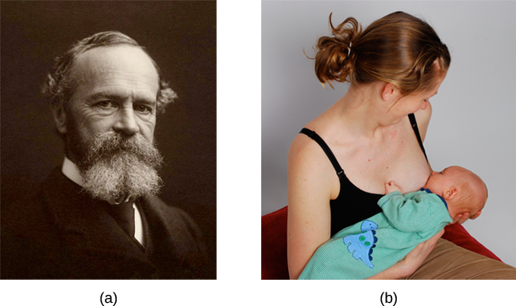

# 10.1 Động Lực

> [!info]
>
> ### Mục Tiêu Học Tập
>
> Sau khi học xong mục này, bạn sẽ có thể:
>
> - Định nghĩa động lực nội tại và động lực ngoại tại
> - Hiểu rằng bản năng, sự giảm xung năng, niềm tin vào năng lực bản thân và các động cơ xã hội đều đã được đề xuất như các lý thuyết về động lực
> - Giải thích các khái niệm cơ bản gắn liền với thang bậc nhu cầu của Maslow

Tại sao chúng ta làm những việc chúng ta làm?
Những động lực nào làm nền tảng cho các hành vi của chúng ta?
**Động lực** (motivation) mô tả những mong muốn hoặc nhu cầu thôi thúc và định hướng hành vi hướng tới một mục tiêu.
Bên cạnh các động cơ sinh học, động lực có thể mang tính **nội tại** (intrinsic - bắt nguồn từ các yếu tố bên trong) hoặc **ngoại tại** (extrinsic - bắt nguồn từ các yếu tố bên ngoài) ([Hình 10.2](#Figure_10_01_Motivation)).
Các hành vi có động lực nội tại được thực hiện vì cảm giác thỏa mãn cá nhân mà chúng mang lại, trong khi các hành vi có động lực ngoại tại được thực hiện nhằm nhận được điều gì đó từ người khác.

**Hình 10.2** Động lực nội tại xuất phát từ bên trong cá nhân, trong khi động lực ngoại tại đến từ bên ngoài cá nhân.

Hãy nghĩ về lý do tại sao bạn đang theo đuổi con đường học vấn.
Có phải bạn ở đây vì bạn yêu thích việc học và muốn theo đuổi giáo dục để biến mình thành một cá nhân toàn diện hơn không?
Nếu vậy, bạn đang có động lực nội tại.
Tuy nhiên, nếu bạn ở đây vì muốn có được một tấm bằng đại học để dễ dàng tìm kiếm một công việc được trả lương cao hoặc để đáp ứng kỳ vọng của cha mẹ, thì động lực của bạn mang tính ngoại tại nhiều hơn.

Trong thực tế, động lực của chúng ta thường là sự kết hợp của cả các yếu tố nội tại và ngoại tại, nhưng bản chất của sự kết hợp này có thể thay đổi theo thời gian (thường theo những cách có vẻ trái ngược với trực giác).
Có một câu ngạn ngữ cổ: "Hãy chọn công việc bạn yêu thích, và bạn sẽ không phải làm việc một ngày nào trong đời," nghĩa là nếu bạn yêu thích nghề nghiệp của mình, công việc dường như không còn là... công việc nữa.
Một số nghiên cứu gợi ý rằng điều này không nhất thiết đúng trong mọi trường hợp (Daniel & Esser, 1980; Deci, 1972; Deci, Koestner, & Ryan, 1999).
Theo nghiên cứu này, việc nhận được một số hình thức củng cố ngoại tại (tức là được trả tiền) cho việc tham gia vào các hành vi mà chúng ta yêu thích dẫn đến việc các hành vi đó bị coi là công việc và không còn mang lại sự thích thú như trước nữa.
Kết quả là, chúng ta có thể dành ít thời gian hơn để tham gia vào các hành vi đã bị tái phân loại này khi không còn bất kỳ sự củng cố ngoại tại nào.
Ví dụ, Odessa rất thích làm bánh, vì vậy trong thời gian rảnh rỗi, cô nướng bánh để giải trí.
Thông thường, sau khi xếp hàng lên kệ tại công việc ở cửa hàng tạp hóa, cô lại chuẩn bị bánh ngọt vào các buổi tối vì cô thích làm bánh.
Khi một đồng nghiệp ở bộ phận làm bánh của cửa hàng nghỉ việc, Odessa nộp đơn xin ứng tuyển vào vị trí đó và được chuyển sang bộ phận làm bánh.
Mặc dù cô thích những gì mình làm trong công việc mới, nhưng sau vài tháng, cô không còn nhiều mong muốn làm những món bánh ngon trong thời gian rảnh rỗi nữa.
Làm bánh đã trở thành công việc theo cách làm thay đổi động lực làm bánh của cô ([Hình 10.3](#Figure_10_01_Bakery)).
Những gì Odessa đã trải qua được gọi là hiệu ứng biện minh quá mức (overjustification effect)—động lực nội tại bị suy giảm khi có động lực ngoại tại can thiệp vào.
Điều này có thể dẫn đến việc dập tắt động lực nội tại và tạo ra sự phụ thuộc vào các phần thưởng ngoại tại để duy trì hiệu suất liên tục (Deci et al., 1999).

**Hình 10.3** Nghiên cứu gợi ý rằng khi một việc chúng ta yêu thích làm, chẳng hạn như phủ kem lên bánh, trở thành công việc của chúng ta, thì động lực nội tại và ngoại tại để làm việc đó có thể thay đổi. (nguồn: Agustín Ruiz)

Các nghiên cứu khác lại gợi ý rằng động lực nội tại có thể không dễ bị tổn thương trước tác động của các yếu tố củng cố ngoại tại như vậy, và trên thực tế, những yếu tố củng cố như lời khen ngợi bằng lời nói thực sự có thể làm tăng động lực nội tại (Arnold, 1976; Cameron & Pierce, 1994).
Trong trường hợp đó, động lực nướng bánh của Odessa trong thời gian rảnh rỗi có thể vẫn duy trì ở mức cao nếu, chẳng hạn, khách hàng thường xuyên khen ngợi kỹ năng làm bánh hoặc trang trí bánh của cô.

Những mâu thuẫn rõ ràng này trong các phát hiện của các nhà nghiên cứu có thể được hiểu bằng cách xem xét một số yếu tố.
Thứ nhất, sự củng cố vật chất (chẳng hạn như tiền bạc) và sự củng cố bằng lời nói (chẳng hạn như lời khen ngợi) có thể tác động đến một cá nhân theo những cách rất khác nhau.
Trên thực tế, các phần thưởng hữu hình (tức tiền bạc) có xu hướng gây ra nhiều tác động tiêu cực đến động lực nội tại hơn là các phần thưởng vô hình (tức lời khen ngợi).
Hơn nữa, sự kỳ vọng của cá nhân về tác nhân thúc đẩy ngoại tại là rất quan trọng: Nếu người đó kỳ vọng nhận được phần thưởng ngoại tại, thì động lực nội tại đối với nhiệm vụ có xu hướng bị giảm sút.
Tuy nhiên, nếu không có sự kỳ vọng nào như vậy và động lực ngoại tại xuất hiện như một điều bất ngờ, thì động lực nội tại đối với nhiệm vụ có xu hướng tiếp tục được duy trì (Deci et al., 1999).

Ngoài ra, văn hóa cũng có thể ảnh hưởng đến động lực.
Ví dụ, trong các nền văn hóa tập thể, việc làm những điều vì các thành viên trong gia đình là điều phổ biến vì sự nhấn mạnh được đặt vào nhóm và những gì tốt nhất cho toàn thể nhóm, thay vì những gì tốt nhất cho bất kỳ cá nhân đơn lẻ nào (Nisbett, Peng, Choi, & Norenzayan, 2001).
Sự tập trung vào người khác này cung cấp một góc nhìn rộng lớn hơn, tính đến cả những ảnh hưởng của tình huống và văn hóa đối với hành vi; do đó, một lời giải thích tinh tế hơn về nguyên nhân dẫn đến hành vi của người khác trở nên khả thi hơn. (Bạn sẽ tìm hiểu thêm về các nền văn hóa tập thể và chủ nghĩa cá nhân khi học về tâm lý học xã hội.)

Trong môi trường giáo dục, học sinh có nhiều khả năng trải nghiệm động lực nội tại để học tập hơn khi các em cảm nhận được cảm giác thuộc về và được tôn trọng trong lớp học.
Sự nội tâm hóa này có thể được tăng cường nếu các khía cạnh đánh giá điểm số của lớp học được giảm bớt sự căng thẳng và nếu học sinh cảm thấy mình thực thi được một mức độ kiểm soát nhất định đối với môi trường học tập.
Hơn nữa, việc cung cấp cho học sinh những hoạt động mang tính thử thách nhưng vẫn khả thi, cùng với lý do thuyết phục cho việc tham gia vào các hoạt động học tập khác nhau có thể nâng cao động lực nội tại đối với những nhiệm vụ đó (Niemiec & Ryan, 2009).
Hãy xem xét trường hợp của Hakim, một sinh viên luật năm nhất với hai khóa học trong học kỳ này: Luật Gia Đình và Luật Hình Sự.
Giáo sư Luật Gia Đình có một lớp học khá đáng sợ: Ông thích dồn học sinh vào thế khó bằng những câu hỏi hóc búa, điều này thường khiến sinh viên cảm thấy bị coi thường hoặc xấu hổ.
Điểm số hoàn toàn dựa trên các bài kiểm tra ngắn và bài thi, và giảng viên dán kết quả của mỗi bài kiểm tra lên cửa lớp học.
Ngược lại, giáo sư Luật Hình Sự tạo điều kiện cho các cuộc thảo luận trên lớp và tranh luận tôn trọng trong các nhóm nhỏ.
Phần lớn điểm số của khóa học không dựa trên bài thi mà tập trung vào một dự án nghiên cứu do sinh viên thiết kế về một vấn đề tội phạm do sinh viên tự chọn.
Nghiên cứu gợi ý rằng Hakim sẽ ít có động lực nội tại hơn trong khóa học Luật Gia Đình của mình, nơi sinh viên bị đe dọa trong môi trường lớp học và có sự nhấn mạnh vào các đánh giá do giáo viên thúc đẩy.
Hakim có khả năng trải nghiệm mức độ động lực nội tại cao hơn trong khóa học Luật Hình Sự của mình, nơi bối cảnh lớp học khuyến khích sự hợp tác hòa nhập và sự tôn trọng đối với các ý tưởng, đồng thời nơi sinh viên có nhiều ảnh hưởng hơn đối với các hoạt động học tập của chính họ.

## Các Lý Thuyết Về Động Lực

William **James** (1842–1910) là một người có đóng góp quan trọng cho các nghiên cứu ban đầu về động lực, và ông thường được coi là cha đẻ của ngành tâm lý học tại Hoa Kỳ.
James đưa ra lý thuyết rằng hành vi được thúc đẩy bởi một số bản năng nhất định, giúp hỗ trợ sự sinh tồn ([Hình 10.4](#Figure_10_01_WilliamJ)).
Từ góc độ sinh học, một **bản năng** (instinct) là một khuôn mẫu hành vi đặc trưng cho từng loài mà không cần phải trải qua học tập.
Tuy nhiên, đã có sự tranh cãi đáng kể giữa James và những người cùng thời về định nghĩa chính xác của bản năng.
James đề xuất hàng chục bản năng đặc biệt của con người, nhưng nhiều người cùng thời lại có danh sách riêng với những khác biệt nhất định.
Sự bảo vệ của người mẹ đối với con mình, sự thôi thúc liếm đường và việc săn đuổi con mồi là một trong những hành vi của con người được đề xuất như những bản năng thực sự trong thời đại của James.
Quan điểm này—cho rằng hành vi của con người được thúc đẩy bởi các bản năng—đã nhận phải khá nhiều lời chỉ trích vì vai trò không thể phủ nhận của việc học tập trong việc định hình tất cả các loại hành vi của con người.
Trên thực tế, ngay từ những năm 1900, một số hành vi mang tính bản năng đã được chứng minh bằng thực nghiệm là kết quả của việc học tập liên kết (nhớ lại khi bạn tìm hiểu về điều kiện hóa phản ứng sợ hãi của Watson ở "Cậu Bé Albert") (Faris, 1921).

**Hình 10.4** (a) William James đã đề xuất lý thuyết bản năng về động lực, khẳng định rằng hành vi được thúc đẩy bởi các bản năng. (b) Ở con người, bản năng có thể bao gồm các hành vi như việc trẻ sơ sinh tìm núm vú và mút. (nguồn b: chỉnh sửa tác phẩm của "Mothering Touch"/Flickr)

Một lý thuyết ban đầu khác về động lực đề xuất rằng việc duy trì trạng thái cân bằng nội môi (homeostasis) có tầm quan trọng đặc biệt trong việc định hướng hành vi.
Bạn có thể nhớ lại từ các bài đọc trước rằng cân bằng nội môi là xu hướng duy trì trạng thái cân bằng, hoặc mức tối ưu, bên trong một hệ thống sinh học.
Trong một hệ cơ quan của cơ thể, một trung tâm kiểm soát (thường là một phần của não bộ) nhận tín hiệu đầu vào từ các thụ thể (thường là các phức hợp tế bào thần kinh).
Trung tâm kiểm soát chỉ đạo các cơ quan thực hiện (có thể là các tế bào thần kinh khác) để khắc phục bất kỳ sự mất cân bằng nào được phát hiện bởi trung tâm kiểm soát.

Theo **thuyết xung năng** (drive theory) về động lực, những sự lệch pha khỏi trạng thái cân bằng nội môi sẽ tạo ra các nhu cầu sinh lý.
Những nhu cầu này dẫn đến các trạng thái xung năng tâm lý định hướng hành vi để đáp ứng nhu cầu và cuối cùng đưa hệ thống trở lại trạng thái cân bằng nội môi.
Ví dụ, nếu đã lâu bạn chưa ăn, lượng đường trong máu của bạn sẽ giảm xuống dưới mức bình thường.
Lượng đường trong máu thấp này sẽ tạo ra một nhu cầu sinh lý và một trạng thái xung năng tương ứng (tức cơn đói) sẽ định hướng bạn tìm kiếm và tiêu thụ thức ăn ([Hình 10.5](#Figure_10_01_Eating)).
Việc ăn uống sẽ loại bỏ cơn đói, và cuối cùng, lượng đường trong máu của bạn sẽ trở lại bình thường.
Điều thú vị là thuyết xung năng cũng nhấn mạnh vai trò của thói quen trong kiểu phản ứng hành vi mà chúng ta thực hiện.
Một **thói quen** (habit) là một khuôn mẫu hành vi mà chúng ta thường xuyên thực hiện.
Một khi chúng ta đã tham gia vào một hành vi làm giảm xung năng thành công, chúng ta có nhiều khả năng tham gia vào hành vi đó bất cứ khi nào đối mặt với xung năng đó trong tương lai (Graham & Weiner, 1996).

**Hình 10.5** Cơn đói và việc ăn uống sau đó là kết quả của các quá trình sinh lý phức tạp nhằm duy trì trạng thái cân bằng nội môi. (nguồn "trái": chỉnh sửa tác phẩm của "Gracie and Viv"/Flickr; nguồn "giữa": chỉnh sửa tác phẩm của Steven Depolo; nguồn "phải": chỉnh sửa tác phẩm của Monica Renata)

Những mở rộng của thuyết xung năng đã tính đến các mức độ kích hoạt (arousal) như những tác nhân thúc đẩy tiềm năng.
Như bạn nhớ lại từ phần học tập trước đây, các lý thuyết này khẳng định rằng có một mức độ kích hoạt tối ưu mà tất cả chúng ta đều cố gắng duy trì ([Hình 10.6](#Figure_10_01_Arousal)).
Nếu chúng ta bị kích hoạt dưới mức tối ưu, chúng ta sẽ trở nên buồn chán và sẽ tìm kiếm một số dạng kích thích.
Mặt khác, nếu chúng ta bị kích hoạt quá mức, chúng ta sẽ thực hiện các hành vi để giảm mức kích hoạt của mình (Berlyne, 1960).
Hầu hết sinh viên đều đã trải qua nhu cầu duy trì mức kích hoạt tối ưu này trong suốt quá trình học tập của mình.
Hãy nghĩ về mức độ căng thẳng mà sinh viên phải trải qua vào cuối học kỳ mùa xuân.
Họ cảm thấy bị choáng ngợp bởi vô số bài kiểm tra, bài luận và các bài tập lớn dường như bất tận phải hoàn thành đúng hạn.
Họ có lẽ khao khát sự nghỉ ngơi và thư giãn đang chờ đợi họ trong kỳ nghỉ hè kéo dài.
Tuy nhiên, một khi học kỳ kết thúc, không mất quá nhiều thời gian trước khi họ bắt đầu cảm thấy buồn chán.
Nhìn chung, vào thời điểm học kỳ tiếp theo bắt đầu vào mùa thu, nhiều sinh viên khá vui vẻ khi được trở lại trường học.
Đây là một ví dụ về cách thức hoạt động của thuyết kích hoạt.

![Một biểu đồ đường có trục x được gắn nhãn “mức độ kích hoạt” với một mũi tên chỉ từ “thấp” đến “cao” và trục y được gắn nhãn “chất lượng hiệu suất” với một mũi tên chỉ từ “thấp” đến “cao.” Một đường cong biểu diễn mức kích hoạt tối ưu. Nơi mức độ kích hoạt và chất lượng hiệu suất đều “thấp,” đường cong nằm ở mức thấp và được gắn nhãn “buồn chán hoặc thờ ơ.” Nơi mức độ kích hoạt ở mức “trung bình” và “chất lượng hiệu suất ở mức “trung bình,” đường cong đạt đỉnh và được gắn nhãn “mức tối ưu.” Nơi mức độ kích hoạt “cao” và chất lượng hiệu suất “thấp,” đường cong nằm ở mức thấp và được gắn nhãn “lo âu cao.”](../../images/img_542861fd8d24.jpg)

**Hình 10.6** Khái niệm về mức kích hoạt tối ưu liên quan đến hiệu suất thực hiện nhiệm vụ được mô tả ở đây. Hiệu suất được tối đa hóa ở mức kích hoạt tối ưu, và nó giảm dần khi bị kích hoạt dưới mức hoặc quá mức.

Vậy mức kích hoạt tối ưu là gì?
Mức độ nào dẫn đến hiệu suất tốt nhất?
Nghiên cứu cho thấy rằng mức kích hoạt vừa phải nhìn chung là tốt nhất; khi mức kích hoạt quá cao hoặc quá thấp, hiệu suất có xu hướng bị ảnh hưởng tiêu cực (Yerkes & Dodson, 1908).
Hãy nghĩ về mức độ kích hoạt của bạn liên quan đến việc làm bài kiểm tra cho lớp học này.
Nếu mức độ của bạn rất thấp, chẳng hạn như buồn chán và thờ ơ, hiệu suất của bạn có thể sẽ kém.
Tương tự như vậy, một mức độ rất cao, chẳng hạn như sự lo lắng tột độ, có thể làm tê liệt và cản trở hiệu suất.
Hãy xem xét ví dụ về một đội bóng mềm chuẩn bị bước vào một giải đấu.
Họ được đánh giá cao sẽ thắng trận đầu tiên với cách biệt lớn, vì vậy họ bước vào trận đấu với mức kích hoạt thấp hơn và bị đánh bại bởi một đội có kỹ năng kém hơn.

Nhưng mức kích hoạt tối ưu phức tạp hơn một câu trả lời đơn giản rằng mức trung bình luôn là tốt nhất.
Các nhà nghiên cứu Robert Yerkes và John Dodson đã phát hiện ra rằng mức kích hoạt tối ưu phụ thuộc vào độ phức tạp và độ khó của nhiệm vụ cần thực hiện ([Hình 10.7](#Figure_10_01_YerkesDod)).
Mối quan hệ này được gọi là **quy luật Yerkes-Dodson**, quy luật này cho rằng một nhiệm vụ đơn giản được thực hiện tốt nhất khi mức kích hoạt tương đối cao và các nhiệm vụ phức tạp được thực hiện tốt nhất khi mức kích hoạt thấp hơn.

**Hình 10.7** Hiệu suất thực hiện nhiệm vụ là tốt nhất khi mức kích hoạt nằm trong phạm vi trung bình, với các nhiệm vụ khó được thực hiện tốt nhất dưới mức kích hoạt thấp hơn và các nhiệm vụ đơn giản được thực hiện tốt nhất dưới mức kích hoạt cao hơn.

### Niềm Tin Vào Năng Lực Bản Thân Và Các Động Cơ Xã Hội

**Niềm tin vào năng lực bản thân** (self-efficacy) là niềm tin của một cá nhân vào khả năng của chính mình để hoàn thành một nhiệm vụ, điều này có thể bao gồm việc hoàn thành thành công nhiệm vụ chính xác đó hoặc một nhiệm vụ tương tự trước đây.
Albert **Bandura** (1994) đã đưa ra lý thuyết rằng ý thức về năng lực bản thân của một cá nhân đóng một vai trò then chốt trong việc thúc đẩy hành vi.
Bandura lập luận rằng động lực bắt nguồn từ những kỳ vọng mà chúng ta có về hậu quả từ các hành vi của mình, và cuối cùng, chính sự đánh giá cao về năng lực tham gia vào một hành vi nhất định sẽ quyết định những gì chúng ta làm và các mục tiêu tương lai mà chúng ta đặt ra cho bản thân.
Ví dụ, nếu bạn có một niềm tin chân thành vào khả năng đạt được thành tích ở mức cao nhất của mình, bạn có nhiều khả năng đảm nhận các nhiệm vụ đầy thử thách hơn và không để những thất bại ngăn cản bạn kiên trì theo đuổi nhiệm vụ cho đến cùng.

Một số nhà lý thuyết đã tập trung nghiên cứu vào việc tìm hiểu các động cơ xã hội (McAdams & Constantian, 1983; McClelland & Liberman, 1949; Murray et al., 1938).
Trong số các động cơ mà họ mô tả có nhu cầu về thành tựu, sự hòa nhập và sự thân mật.
Chính nhu cầu về thành tựu (need for achievement) thúc đẩy sự hoàn thành và hiệu suất.
Nhu cầu hòa nhập (need for affiliation) khuyến khích các tương tác tích cực với những người khác, và nhu cầu về sự thân mật (need for intimacy) khiến chúng ta tìm kiếm các mối quan hệ sâu sắc, có ý nghĩa.
Henry Murray và cộng sự (1938) đã phân loại những nhu cầu này thành các lĩnh vực.
Ví dụ, nhu cầu về thành tựu và sự công nhận thuộc về lĩnh vực tham vọng.
Sự thống trị và tính gây hấn được công nhận là các nhu cầu thuộc lĩnh vực quyền lực con người, và vui chơi là một nhu cầu được công nhận trong lĩnh vực tình cảm giữa các cá nhân.

### Thang Bậc Nhu Cầu Của Maslow

Trong khi các lý thuyết về động lực được mô tả trước đó liên quan đến các xung năng sinh học cơ bản, các đặc điểm cá nhân hoặc bối cảnh xã hội, Abraham **Maslow** (1943) đã đề xuất một **thang bậc nhu cầu** (hierarchy of needs) bao trùm toàn bộ phổ các động cơ từ sinh học đến cá nhân và xã hội.
Những nhu cầu này thường được mô tả dưới dạng một kim tự tháp ([Hình 10.8](#Figure_10_01_Maslow)).

![Một hình tam giác được chia theo chiều dọc thành năm phần với các nhãn tương ứng bên trong và bên ngoài tam giác cho từng phần. Từ trên xuống dưới, các phần của tam giác được dán nhãn: “tự hiện thực hóa bản thân” tương ứng với “Sự trọn vẹn nội tâm”; “được tôn trọng” tương ứng với “Giá trị bản thân, thành tựu, sự tự tin”; “xã hội” tương ứng với “Gia đình, tình bạn, sự thân mật, cảm giác thuộc về”; “an toàn” tương ứng với “An toàn, việc làm, tài sản”; “sinh lý” tương ứng với “Thức ăn, nước uống, nơi trú ẩn, sự ấm áp.”](../../images/img_edff88e1b9f8.jpg)

**Hình 10.8** Thang bậc nhu cầu của Maslow được minh họa ở đây. Trong một số phiên bản của kim tự tháp, các nhu cầu nhận thức và thẩm mỹ cũng được đưa vào giữa nhu cầu được tôn trọng và tự hiện thực hóa bản thân. Những phiên bản khác bao gồm một tầng khác ở đỉnh kim tự tháp cho sự tự siêu việt (self-transcendence).

Ở chân kim tự tháp là tất cả các nhu cầu sinh lý cần thiết cho sự sinh tồn.
Tiếp theo là các nhu cầu cơ bản về an ninh và an toàn, nhu cầu được yêu thương và có cảm giác thuộc về, cùng với nhu cầu có giá trị bản thân và sự tự tin.
Tầng trên cùng của kim tự tháp là sự tự hiện thực hóa bản thân (self-actualization), một nhu cầu về cơ bản tương đương với việc đạt được toàn bộ tiềm năng của một người, và nó chỉ có thể đạt được khi các nhu cầu ở tầng thấp hơn trên kim tự tháp đã được đáp ứng.
Đối với Maslow và các nhà lý thuyết nhân văn, sự tự hiện thực hóa bản thân phản ánh sự nhấn mạnh của trường phái nhân văn vào các khía cạnh tích cực của bản chất con người.
Maslow cho rằng đây là một quá trình liên tục, kéo dài suốt đời và chỉ có một tỷ lệ nhỏ con người thực sự đạt được trạng thái tự hiện thực hóa bản thân (Francis & Kritsonis, 2006; Maslow, 1943).

Theo Maslow (1943), một người phải thỏa mãn các nhu cầu ở cấp độ thấp hơn trước khi giải quyết những nhu cầu xuất hiện ở vị trí cao hơn trong kim tự tháp.
Vì vậy, ví dụ, nếu ai đó đang phải vật lộn để tìm đủ thức ăn nhằm đáp ứng các yêu cầu dinh dưỡng của mình, rất khó có khả năng họ sẽ dành nhiều thời gian để suy nghĩ về việc liệu người khác có coi mình là một người tốt hay không.
Thay vào đó, tất cả năng lượng của họ sẽ hướng vào việc tìm kiếm thứ gì đó để ăn.
Tuy nhiên, cần chỉ ra rằng lý thuyết của Maslow đã bị chỉ trích vì tính chủ quan và không có khả năng giải thích cho các hiện tượng diễn ra trong thế giới thực (Leonard, 1982).
Các nghiên cứu khác gần đây hơn đã đề cập rằng vào cuối đời, Maslow đã đề xuất một cấp độ tự siêu việt (self-transcendence) xếp trên sự tự hiện thực hóa bản thân—để đại diện cho sự nỗ lực hướng tới ý nghĩa và mục đích vượt ra ngoài các mối quan tâm của chính bản thân mình (Koltko-Rivera, 2006).
Chẳng hạn, đôi khi mọi người thực hiện sự hy sinh bản thân để đưa ra một tuyên bố chính trị hoặc trong một nỗ lực nhằm cải thiện điều kiện của những người khác.
Mohandas K. Gandhi, một người ủng hộ nền độc lập nổi tiếng thế giới thông qua các cuộc biểu tình bất bạo động, đã nhiều lần tuyệt thực để phản đối một tình huống cụ thể.
Con người có thể nhịn đói hoặc tự đặt mình vào vòng nguy hiểm để thể hiện những động cơ ở cấp độ cao hơn vượt ra ngoài các nhu cầu của chính bản thân họ.

> [!tip]
>
> ### Kết Nối Với Học Tập
>
> Hãy xem [bài tập tương tác về thang bậc nhu cầu của Maslow](https://openstax.org/l/hierneeds) này để tìm hiểu thêm.
