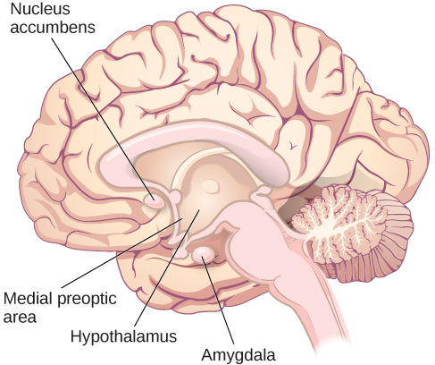

# 10.3 Hành Vi Tình Dục, Tính Dục Và Bản Dạng Giới

> [!info]
>
> ### Mục Tiêu Học Tập
>
> Sau khi học xong mục này, bạn sẽ có thể:
>
> - Hiểu các cơ chế sinh học cơ bản điều hòa hành vi và động lực tình dục
> - Đánh giá tầm quan trọng của nghiên cứu của Alfred Kinsey về tính dục con người
> - Nhận biết những đóng góp từ nghiên cứu của William Masters và Virginia Johnson đối với sự hiểu biết của chúng ta về chu kỳ đáp ứng tình dục
> - Định nghĩa xu hướng tính dục và bản dạng giới

Giống như thức ăn, tình dục là một phần quan trọng trong cuộc sống của nhiều người.
Từ góc độ tiến hóa, lý do là rất rõ ràng—sự duy trì nòi giống của loài.
Tuy nhiên, hành vi tình dục ở con người liên quan đến nhiều điều hơn là sinh sản.
Mục này cung cấp một cái nhìn tổng quan về các nghiên cứu đã được tiến hành trên hành vi và động lực tình dục của con người.
Mục này sẽ khép lại với phần thảo luận về các vấn đề liên quan đến bản dạng giới, sự thể hiện giới và xu hướng tính dục.

## Các Cơ Chế Sinh Lý Của Hành Vi Và Động Lực Tình Dục

Phần lớn những gì chúng ta biết về các cơ chế sinh lý làm nền tảng cho hành vi và động lực tình dục đều bắt nguồn từ nghiên cứu trên động vật.
Như bạn đã biết, vùng dưới đồi (hypothalamus) đóng một vai trò quan trọng trong các hành vi có động lực thúc đẩy, và tình dục cũng không phải là ngoại lệ.
Trên thực tế, các tổn thương đối với một khu vực của vùng dưới đồi được gọi là vùng trước thị giữa (medial preoptic area) sẽ phá vỡ hoàn toàn khả năng tham gia vào hành vi tình dục của chuột đực.
Đáng ngạc nhiên là những tổn thương vùng trước thị giữa không làm thay đổi mức độ nỗ lực mà chuột đực sẵn sàng bỏ ra để tiếp cận một con chuột cái sẵn sàng tiếp nhận giao phối ([Hình 10.14](#Figure_10_03_Rats)).
Điều này gợi ý rằng khả năng tham gia vào hành vi tình dục và động lực để làm điều đó có thể được điều hòa bởi các hệ thống thần kinh riêng biệt với nhau.

**Hình 10.14** Một con chuột đực không thể tham gia vào hành vi tình dục vẫn tìm kiếm những con cái sẵn sàng giao phối, gợi ý rằng khả năng tham gia vào hành vi tình dục và động lực để làm việc đó được điều hòa bởi các hệ thống khác nhau trong não bộ. (nguồn: Jason Snyder)

Nghiên cứu trên động vật cho thấy các cấu trúc của hệ viền (limbic system) chẳng hạn như hạch hạnh nhân (amygdala) và nhân vách (nucleus accumbens) đặc biệt quan trọng đối với động lực tình dục.
Tổn thương những khu vực này dẫn đến việc giảm động lực tham gia vào hành vi tình dục, trong khi vẫn để lại khả năng thực hiện hành vi nguyên vẹn ([Hình 10.15](#Figure_10_03_SexBrain)) (Everett, 1990).
Sự phân ly tương tự giữa động lực tình dục và khả năng tình dục cũng đã được quan sát thấy ở chuột cái (Becker, Rudick, & Jenkins, 2001; Jenkins & Becker, 2001).

**Hình 10.15** Vùng trước thị giữa, một khu vực của vùng dưới đồi, tham gia vào khả năng tham gia hành vi tình dục, nhưng nó không ảnh hưởng đến động lực tình dục. Ngược lại, hạch hạnh nhân và nhân vách tham gia vào động lực cho hành vi tình dục, nhưng chúng không ảnh hưởng đến khả năng thực hiện hành vi đó.

Mặc dù hành vi tình dục của con người phức tạp hơn nhiều so với chuột, một số nét tương đồng giữa động vật và con người có thể được rút ra từ nghiên cứu này.
Sự phổ biến trên toàn thế giới của các loại thuốc được sử dụng để điều trị chứng rối loạn cương dương (Conrad, 2005) nói lên một thực tế rằng động lực tình dục và khả năng tham gia vào hành vi tình dục cũng có thể bị tách rời ở con người.
Hơn nữa, các rối loạn liên quan đến chức năng bất thường của vùng dưới đồi thường gắn liền với chứng suy sinh dục (giảm chức năng của tuyến sinh dục) và giảm chức năng tình dục (ví dụ: hội chứng Prader-Willi).
Xét đến vai trò của vùng dưới đồi trong chức năng nội tiết, không có gì ngạc nhiên khi các hoóc-môn do hệ nội tiết tiết ra cũng đóng vai trò quan trọng trong động lực và hành vi tình dục.
Chẳng hạn, nhiều loài động vật không có dấu hiệu động lực tình dục nào nếu không có sự kết hợp thích hợp của các hoóc-môn sinh dục từ tuyến sinh dục của chúng.
Mặc dù điều này không hoàn toàn tuyệt đối đối với con người, nhưng có bằng chứng đáng kể cho thấy động lực tình dục đối với tất cả các giới thay đổi như một hàm số của nồng độ testosterone lưu hành trong máu (Bhasin, Enzlin, Coviello, & Basson, 2007; Carter, 1992; Sherwin, 1988).

## Nghiên Cứu Của Kinsey

Trước cuối những năm 1940, việc tiếp cận thông tin đáng tin cậy dựa trên thực nghiệm về tình dục còn rất hạn chế.
Các bác sĩ được coi là những chuyên gia về tất cả các vấn đề liên quan đến tình dục, mặc dù thực tế là họ có rất ít hoặc không được đào tạo về những vấn đề này, và có khả năng phần lớn những gì mọi người biết về tình dục đều được học qua trải nghiệm của chính họ hoặc qua trò chuyện với bạn bè đồng trang lứa.
Tin tưởng rằng mọi người sẽ được hưởng lợi từ một cuộc đối thoại cởi mở hơn về các vấn đề liên quan đến tính dục con người, Tiến sĩ Alfred **Kinsey** thuộc Đại học Indiana đã khởi xướng nghiên cứu khảo sát quy mô lớn về chủ đề này ([Hình 10.16](#Figure_10_03_Kinsey)).
Kết quả của một số nỗ lực này đã được xuất bản trong hai cuốn sách—*Hành Vi Tình Dục Ở Nam Giới (Sexual Behavior in the Human Male)* và *Hành Vi Tình Dục Ở Nữ Giới (Sexual Behavior in the Human Female)*—được xuất bản lần lượt vào năm 1948 và 1953 (Bullough, 1998).

**Hình 10.16** Năm 1947, Alfred Kinsey đã thành lập Viện Nghiên Cứu Tình Dục, Giới Tính và Sinh Sản Kinsey tại Đại học Indiana, được chụp tại đây vào năm 2011. Viện Kinsey tiếp tục là địa điểm nghiên cứu của các nghiên cứu tâm lý học quan trọng trong nhiều thập kỷ qua.

Vào thời điểm đó, các báo cáo của Kinsey đã gây chấn động lớn.
Chưa bao giờ công chúng Mỹ thấy hành vi tình dục riêng tư của mình trở thành tâm điểm của sự xem xét kỹ lưỡng mang tính khoa học trên quy mô lớn như vậy.
Các cuốn sách ngập tràn số liệu thống kê và thuật ngữ khoa học đã bán rất chạy cho công chúng, và mọi người bắt đầu tham gia vào các cuộc trò chuyện cởi mở về tính dục con người.
Như bạn có thể tưởng tượng, không phải ai cũng hài lòng khi thông tin này được công bố.
Trên thực tế, những cuốn sách này đã bị cấm ở một số quốc gia.
Cuối cùng, cuộc tranh cãi đã khiến Kinsey mất đi nguồn tài trợ mà ông đã đảm bảo từ Quỹ Rockefeller để tiếp tục các nỗ lực nghiên cứu của mình (Bancroft, 2004).

Mặc dù nghiên cứu của Kinsey đã bị chỉ trích rộng rãi vì có nhiều sai sót về mặt chọn mẫu và thống kê (Jenkins, 2010), hầu như không có nghi ngờ gì về việc nghiên cứu này có ảnh hưởng rất lớn trong việc định hình các nghiên cứu tương lai về hành vi và động lực tình dục của con người.
Kinsey đã mô tả một phạm vi hành vi và trải nghiệm tình dục đa dạng đáng kể do các tình nguyện viên tham gia nghiên cứu báo cáo.
Những hành vi từng được coi là cực kỳ hiếm gặp hoặc có vấn đề đã được chứng minh là phổ biến hơn nhiều và vô hại hơn so với suy nghĩ trước đây (Bancroft, 2004; Bullough, 1998).

> [!tip]
>
> ### Kết Nối Với Học Tập
>
> Xem [đoạn giới thiệu phim điện ảnh *Kinsey* năm 2004 khắc họa cuộc đời và nghiên cứu của Alfred Kinsey](https://openstax.org/l/Kinsey) này để tìm hiểu thêm.

Trong số các kết quả từ nghiên cứu của Kinsey có những phát hiện cho thấy phụ nữ cũng quan tâm và có kinh nghiệm trong tình dục ngang ngửa nam giới, cả nam và nữ đều thủ dâm mà không có hậu quả bất lợi nào cho sức khỏe, và các mối quan hệ cũng như hành vi tình dục giữa những người cùng giới tính và/hoặc cùng bản dạng giới là khá phổ biến (Bancroft, 2004).
Kinsey cũng đã phát triển một thang đo liên tục được gọi là thang Kinsey, thang này ngày nay vẫn thường được sử dụng để phân loại **xu hướng tính dục** (sexual orientation) của một cá nhân, tức là sự hấp dẫn về mặt cảm xúc, lãng mạn và tình dục của một cá nhân đối với người khác hoặc không với ai (Jenkins, 2010).

## Nghiên Cứu Của Masters Và Johnson

Năm 1966, William **Masters** và Virginia **Johnson** đã xuất bản một cuốn sách trình bày chi tiết kết quả quan sát của họ trên gần 700 người đồng ý tham gia vào nghiên cứu về các phản ứng sinh lý trong hành vi tình dục.
Không giống như Kinsey, người sử dụng các cuộc phỏng vấn cá nhân và khảo sát để thu thập dữ liệu, Masters và Johnson quan sát những người thực hiện giao hợp ở nhiều tư thế khác nhau, và họ quan sát những người thủ dâm, bằng tay hoặc với sự trợ giúp của thiết bị.
Trong khi điều này diễn ra, các nhà nghiên cứu đã ghi lại các phép đo về các biến số sinh lý, chẳng hạn như huyết áp và nhịp thở, cũng như các phép đo về sự kích thích tình dục, chẳng hạn như sự bôi trơn âm đạo và sự cương cứng của dương vật (sự sưng phồng gắn liền với sự cương cứng).
Tổng cộng, Masters và Johnson đã quan sát gần 10.000 hành vi tình dục như một phần trong nghiên cứu của họ (Hock, 2008).

Dựa trên những quan sát này, Masters và Johnson đã chia **chu kỳ đáp ứng tình dục** (sexual response cycle) thành bốn giai đoạn khá giống nhau ở hầu hết mọi người: hưng phấn, bình ổn, cực khoái và thoái trào ([Hình 10.17](#Figure_10_03_SexReponse)).
Giai đoạn **hưng phấn** (excitement) là giai đoạn kích thích của chu kỳ đáp ứng tình dục, và nó được đánh dấu bằng sự cương cứng của dương vật hoặc âm vật cùng với sự bôi trơn và mở rộng của ống âm đạo.
Trong giai đoạn **bình ổn** (plateau), âm đạo phồng lên hơn nữa và lưu lượng máu đến môi bé tăng lên, dương vật trở nên cương cứng hoàn toàn và có thể xuất hiện dịch trước xuất tinh.
Con người trải qua sự gia tăng trương lực cơ trong thời gian này.
**Giai đoạn cực khoái** (orgasm) được đánh dấu ở nữ giới bởi các cơn co bóp nhịp nhàng của vùng chậu và tử cung cùng với sự căng cơ gia tăng.
Ở nam giới, sự co bóp vùng chậu đi kèm với sự tích tụ của tinh dịch gần niệu đạo, chất lỏng này cuối cùng bị tống ra ngoài bởi sự co bóp của các cơ sinh dục (tức là sự xuất tinh).
**Giai đoạn thoái trào** (resolution) là sự trở lại tương đối nhanh chóng về trạng thái chưa bị kích thích đi kèm với sự giảm huyết áp và sự thư giãn cơ bắp.
**Thời kỳ trơ** (refractory period) là khoảng thời gian diễn ra sau khi đạt cực khoái mà trong đó một cá nhân không thể tiếp tục trải nghiệm một cơn cực khoái khác.
Thời gian của thời kỳ trơ có thể khác nhau đáng kể giữa các cá nhân, với một số thời kỳ trơ chỉ ngắn vài phút và những thời kỳ trơ khác kéo dài đến một ngày.
Khi con người già đi, thời kỳ trơ của họ có xu hướng kéo dài hơn.

![Một biểu đồ có tiêu đề “Chu kỳ đáp ứng tình dục” có trục x được gắn nhãn “thời gian” và trục y được gắn nhãn “sự kích thích.” Bốn giai đoạn được mô tả. Trong giai đoạn “hưng phấn,” mức độ kích thích tăng từ đáy lên đến khoảng giữa biểu đồ. Trong giai đoạn “bình ổn,” mức độ kích thích hầu như giữ ổn định ở điểm giữa của biểu đồ và sau đó bắt đầu tăng ở cuối giai đoạn bình ổn. Ở giai đoạn “cực khoái,” mức độ kích thích tăng mạnh, đạt đỉnh ở đỉnh biểu đồ, sau đó giảm xuống điểm giữa. Trong giai đoạn “thoái trào,” biểu đồ giảm từ điểm giữa xuống đáy.](../../images/img_52baeb329957.jpg)

**Hình 10.17** Biểu đồ này minh họa các giai đoạn khác nhau của chu kỳ đáp ứng tình dục như được mô tả bởi Masters và Johnson.

Ngoài những hiểu biết sâu sắc mà nghiên cứu của họ cung cấp liên quan đến chu kỳ đáp ứng tình dục và tiềm năng đa cực khoái của nữ giới, Masters và Johnson cũng thu thập thông tin quan trọng về giải phẫu sinh sản.
Nghiên cứu của họ đã chứng minh số liệu thống kê thường được trích dẫn về kích thước trung bình của dương vật khi mềm và khi cương cứng (lần lượt là 3 và 6 inch, tức khoảng 7,6 cm và 15,2 cm) cũng như xóa tan những niềm tin lâu đời về mối quan hệ giữa kích thước của dương vật cương cứng với khả năng mang lại khoái cảm tình dục cho bạn tình.
Hơn nữa, họ xác định rằng âm đạo là một cấu trúc rất đàn hồi có thể thích ứng với các kích cỡ dương vật khác nhau (Hock, 2008).
Tương tự như công trình của Kinsey và các nghiên cứu khác, nghiên cứu của Masters và Johnson đã bị chỉ trích, được xây dựng tiếp nối và trong một số trường hợp đã được chứng minh là chưa chính xác.
Nghiên cứu này đại diện cho một yếu tố quan trọng trong lịch sử nghiên cứu tình dục, và ngày nay không được coi là hoàn toàn chuẩn xác.

## Xu Hướng Tính Dục

Như đã đề cập trước đó, xu hướng tính dục của một người là sự hấp dẫn về mặt cảm xúc, lãng mạn và/hoặc tình dục của họ đối với người khác hoặc không với ai.
Mọi người có thể nhận dạng bản thân là đồng tính nữ (lesbian), đồng tính nam (gay), song tính (bisexual), toàn tính (pansexual), vô tính (asexual), dị tính (heterosexual/straight), hoặc các tính dục khác.
Người đồng tính nữ và đồng tính nam bị thu hút bởi những người cùng giới hoặc cùng bản dạng giới; người song tính bị thu hút bởi những người thuộc giới tính của chính họ và một giới tính khác; người toàn tính trải nghiệm sự thu hút mà không phân biệt giới tính sinh học, bản dạng giới hoặc sự thể hiện giới; người vô tính không trải nghiệm sự hấp dẫn tình dục hoặc có rất ít/không có hứng thú với hoạt động tình dục; người dị tính trải nghiệm sự thu hút đối với những người khác giới hoặc khác bản dạng giới.
Các thuật ngữ mô tả khác có thể không đề cập đến sự hấp dẫn tình dục mà là sự hấp dẫn lãng mạn.
Ví dụ, một người vô ái (aromantic) không trải nghiệm sự hấp dẫn lãng mạn; điều này khác với tính vô tính (asexuality), vốn đề cập đến sự thiếu vắng hấp dẫn tình dục.
Và một số xu hướng tính dục không đề cập đến giới tính trong mô tả của chúng (PFLAG, 2021).
Điều quan trọng là phải thừa nhận và hiểu rằng nhiều xu hướng này tồn tại trên một phổ liên tục, và có thể không có thuật ngữ cụ thể nào mô tả trọn vẹn cảm nhận của một cá nhân.

Một số thuật ngữ này đã được liên kết trong các từ viết tắt như LGBTQ (đồng tính nữ, đồng tính nam, song tính, chuyển giới, và queer hoặc đang đặt câu hỏi). (Queer là một thuật ngữ bao trùm mà một số người LGBTQ sử dụng để mô tả bản thân; questioning - đang đặt câu hỏi - đề cập đến những người đang trong quá trình khám phá bản dạng giới hoặc xu hướng tính dục của họ.)
Trong một số trường hợp, mọi người và các tổ chức có thể thêm chữ "I" để đại diện cho người liên giới tính (intersex - được mô tả bên dưới), và chữ "A" cho người vô tính hoặc vô ái (hoặc đôi khi cho "người đồng minh" - allies), cũng như một chữ "P" để mô tả người toàn tính và đôi khi một chữ "P" khác để mô tả người đa tính (polysexual).
Cuối cùng, một số người và tổ chức thêm dấu cộng (+) để đại diện cho các bản dạng hoặc xu hướng khả dĩ khác.
Thuật ngữ về tính dục và giới luôn thay đổi và có thể mang những ý nghĩa khác nhau đối với những người khác nhau; chúng không mang tính phổ quát và mỗi cá nhân tự định nghĩa chúng cho chính mình (UC Davis LGBTQIA Resource Center, 2020).

**Hình 10.18** Khoảng từ 3% đến 10% dân số trưởng thành tự nhận dạng mình là người đồng tính nam hoặc đồng tính nữ. (nguồn: Till Krech)

Trong nhiều năm, mọi người—bao gồm cả các nhà khoa học—tin rằng xu hướng tính dục phần lớn được quyết định bởi quá trình xã hội hóa và những trải nghiệm gia đình.
Tuy nhiên, nghiên cứu đã liên tục chứng minh rằng nền tảng gia đình và trải nghiệm sống là rất tương đồng giữa những người dị tính và những người thuộc cộng đồng LGBTQ (Bell, Weinberg, & Hammersmith, 1981; Ross & Arrindell, 1988).

Các cơ chế di truyền và sinh học cũng đã được đề xuất, và sự cân bằng của các bằng chứng nghiên cứu gợi ý rằng xu hướng tính dục có một thành phần sinh học nền tảng.
Chẳng hạn, trong suốt 25 năm qua, nghiên cứu đã chứng minh sự đóng góp ở cấp độ gen đối với xu hướng tính dục (Bailey & Pillard, 1991; Hamer, Hu, Magnuson, Hu, & Pattatucci, 1993; Rodriguez-Larralde & Paradisi, 2009), với một số nhà nghiên cứu ước tính rằng các gen giải thích ít nhất một nửa sự biến thiên quan sát được trong xu hướng tính dục của con người (Pillard & Bailey, 1998).
Các nghiên cứu khác báo cáo những khác biệt trong cấu trúc và chức năng não bộ giữa những người có xu hướng tính dục khác nhau (Allen & Gorski, 1992; Byne et al., 2001; Hu et al., 2008; LeVay, 1991; Ponseti et al., 2006; Rahman & Wilson, 2003a; Swaab & Hofman, 1990), và thậm chí sự khác biệt về cấu trúc và chức năng cơ thể cơ bản cũng đã được quan sát thấy (Hall & Kimura, 1994; Lippa, 2003; Loehlin & McFadden, 2003; McFadden & Champlin, 2000; McFadden & Pasanen, 1998; Rahman & Wilson, 2003b).
Nhìn chung, các dữ liệu gợi ý rằng ở một mức độ đáng kể, xu hướng tính dục là điều mà chúng ta sinh ra đã có sẵn.

### Những Hiểu Lầm Về Xu Hướng Tính Dục

Bất kể xu hướng tính dục được xác định như thế nào, nghiên cứu đã làm rõ rằng xu hướng tính dục không phải là một sự lựa chọn, mà đúng hơn nó là một đặc điểm tương đối ổn định của một người không thể thay đổi được.
Những tuyên bố về hiệu quả của liệu pháp chuyển đổi (conversion therapy) đã nhận phải sự chỉ trích rộng rãi từ cộng đồng nghiên cứu do những lo ngại đáng kể về thiết kế nghiên cứu, việc tuyển chọn người tham gia thử nghiệm và cách diễn giải dữ liệu.
Do đó, không có bằng chứng khoa học đáng tin cậy nào cho thấy các cá nhân có thể thay đổi xu hướng tính dục của họ (Jenkins, 2010).

Tiến sĩ Robert Spitzer, tác giả của một trong những nghiên cứu được trích dẫn rộng rãi nhất về liệu pháp chuyển đổi, đã xin lỗi cả cộng đồng khoa học lẫn cộng đồng LGBTQ vì những sai lầm của mình, và ông đã công khai rút lại bài báo của chính mình trong một bức thư ngỏ gửi tới tổng biên tập của tạp chí *Archives of Sexual Behavior* vào mùa xuân năm 2012 (Carey, 2012).
Trong bức thư này, Spitzer đã viết:

> Tôi đã cân nhắc việc viết điều gì đó để thừa nhận rằng hiện tại tôi đánh giá những lời phê bình lớn đối với nghiên cứu này phần lớn là đúng đắn....
> Tôi tin rằng mình nợ cộng đồng người đồng tính một lời xin lỗi vì nghiên cứu của tôi đã đưa ra những tuyên bố chưa được chứng minh về hiệu quả của liệu pháp chuyển đổi.
> Tôi cũng xin lỗi bất kỳ người đồng tính nào đã lãng phí thời gian hoặc năng lượng để trải qua một số hình thức của liệu pháp chuyển đổi vì họ tin rằng tôi đã chứng minh được liệu pháp chuyển đổi có tác dụng đối với một số cá nhân “có động lực cao”. (Becker, 2012, đoạn 2, 5)

Trích dẫn các nghiên cứu gợi ý rằng liệu pháp chuyển đổi không chỉ không hiệu quả mà còn có khả năng gây hại, các nỗ lực lập pháp nhằm coi liệu pháp này là bất hợp pháp đã được ban hành hoặc đang được tiến hành trên khắp Hoa Kỳ, và nhiều tổ chức chuyên môn đã đưa ra các tuyên bố phản đối thực hành này (Human Rights Campaign, n.d.).

> [!tip]
>
> ### Kết Nối Với Học Tập
>
> Đọc [bài viết về lời xin lỗi của Tiến sĩ Spitzer](https://openstax.org/l/spitzer) này để tìm hiểu thêm.

## Bản Dạng Giới

Nhiều người đánh đồng xu hướng tính dục với bản dạng giới do những quan niệm sai lầm và định kiến tồn tại về tính dục.
Trong thực tế, đây là hai khía cạnh có liên quan nhưng khác biệt về con người chúng ta.
**Bản dạng giới** (gender identity) đề cập đến cảm nhận sâu sắc của một người về việc mình là nam, nữ, không thuộc cả hai, là cả hai, hoặc thuộc một giới tính khác.
Nhìn chung, bản dạng giới của chúng ta tương ứng với giới tính nhiễm sắc thể và kiểu hình, nhưng không phải lúc nào cũng như vậy.
Bản dạng giới của người chuyển giới khác với giới tính được chỉ định cho họ khi sinh ra.
Người chuyển giới có thể sử dụng một loạt các thuật ngữ để mô tả bản thân, bao gồm các từ viết tắt (ví dụ: trans) hoặc các thuật ngữ như phi nhị nguyên giới (non-binary).

Khi các cá nhân không cảm thấy thoải mái khi nhận dạng với giới tính gắn liền với giới tính sinh học của họ, họ có thể trải qua chứng bất an giới tính.
**Chứng bất an giới tính** (gender dysphoria) là một hạng mục chẩn đoán trong ấn bản thứ năm của *Cẩm Nang Chẩn Đoán Và Thống Kê Các Rối Loạn Tâm Thần* (DSM-5) mô tả những cá nhân không nhận dạng là giới tính mà hầu hết mọi người cho rằng họ là như vậy.
Sự bất an này phải kéo dài trong ít nhất sáu tháng và dẫn đến sự đau khổ hoặc suy giảm chức năng đáng kể để đáp ứng các tiêu chí chẩn đoán của DSM-5.
Để trẻ em được xếp vào hạng mục chẩn đoán này, trẻ phải nói lên bằng lời mong muốn trở thành một giới tính khác.
Điều quan trọng cần lưu ý là không phải tất cả người chuyển giới đều trải qua chứng bất an giới tính, và việc phân loại chẩn đoán này không được chấp nhận rộng rãi trên toàn cầu.
Ví dụ, vào năm 2019, Tổ chức Y tế Thế giới (WHO) đã phân loại lại "rối loạn nhận dạng giới tính" thành "sự không tương thích giới tính" (gender incongruence), và xếp nó vào mục sức khỏe tình dục thay vì rối loạn tâm thần.
Tuy nhiên, các chuyên gia y tế và sức khỏe tâm thần chỉ ra rằng sự hiện diện của hạng mục chẩn đoán này hỗ trợ trong việc giúp đỡ những người cần điều trị hoặc trợ giúp y tế.

Một số cá nhân chuyển giới có thể trải qua một quá trình chuyển đổi (transition), trong đó họ chuyển từ việc sống theo cách gắn liền hơn với giới tính được chỉ định khi sinh sang sống theo cách phù hợp với bản dạng giới của họ.
Quá trình chuyển đổi có thể diễn ra dưới các khía cạnh xã hội, pháp lý hoặc y tế trong cuộc sống của một người, nhưng không phải ai cũng thực hiện bất kỳ hoặc tất cả các hình thức chuyển đổi này.
Chuyển đổi xã hội có thể liên quan đến cách thể hiện diện mạo, tên gọi, đại từ xưng hô và các mối quan hệ của một người.
Chuyển đổi pháp lý có thể bao gồm việc thay đổi giới tính của họ trên giấy tờ của chính phủ hoặc các tài liệu chính thức khác, thay đổi tên hợp pháp của họ, v.v. Một số người có thể trải qua quá trình chuyển đổi thể chất hoặc y tế, trong đó họ thay đổi các đặc điểm bên ngoài, thể chất hoặc giới tính để cơ thể vật lý của họ phù hợp hơn với bản dạng giới của mình (UCSF Transgender Care, 2019).
Không phải tất cả những người chuyển giới đều chọn thay đổi cơ thể của họ: nhiều người sẽ giữ nguyên giải phẫu ban đầu nhưng có thể thể hiện bản thân trước xã hội như một giới tính khác.
Điều này thường được thực hiện bằng cách áp dụng trang phục, kiểu tóc, cử chỉ hoặc các đặc điểm khác thường gắn với một giới tính khác.
Điều quan trọng cần lưu ý là những người cải trang giới tính (cross-dress), tức mặc quần áo theo truyền thống dành cho một giới tính khác với giới tính sinh học của họ, không nhất thiết là người chuyển giới.
Việc cải trang thường là một hình thức tự thể hiện hoặc phong cách cá nhân, và nó không chỉ ra bản dạng giới của một người hoặc việc họ là người chuyển giới (TSER, 2021).

Liên giới tính (intersex) là một thuật ngữ chung được sử dụng để mô tả những người có các đặc điểm giới tính, giải phẫu sinh sản, hoóc-môn hoặc nhiễm sắc thể khác với hai cách thức phát triển thông thường của cơ thể người.
Một số đặc điểm liên giới tính được nhận biết khi sinh ra, trong khi những đặc điểm khác không thể nhận biết được cho đến tuổi dậy thì hoặc muộn hơn trong cuộc sống (interACT, 2021).
Liên giới tính và chuyển giới không phải là các thuật ngữ có thể hoán đổi cho nhau; nhiều người chuyển giới không có đặc điểm liên giới tính nào, và nhiều người liên giới tính không coi mình là người chuyển giới.

Những người nhận dạng với giới tính mà họ được chỉ định khi sinh ra thường được gọi là *người hợp giới* (cisgender), sử dụng tiền tố tiếng Latinh "cis", có nghĩa là "ở cùng một phía". (Tiền tố "trans" có nghĩa là "băng qua" hoặc "ở phía bên kia".)
Nhiều người hợp giới không tự nhận diện mình bằng thuật ngữ này.
Giống như với người chuyển giới, thuật ngữ hoặc việc sử dụng từ hợp giới không chỉ ra xu hướng tính dục, giới tính hay sự thể hiện giới của một người (TSER, 2021).

Kiến thức khoa học và sự hiểu biết chung của chúng ta về bản dạng giới tiếp tục tiến hóa, và con người ngày nay có nhiều cơ hội hơn để khám phá và cởi mở thể hiện những ý tưởng khác nhau về ý nghĩa của giới tính so với các thế hệ trước.
Các nghiên cứu gần đây chỉ ra rằng phần lớn thế hệ thiên niên kỷ (millennials - những người từ 18–34 tuổi) coi giới tính là một phổ liên tục thay vì một sự phân định nhị nguyên nam/nữ nghiêm ngặt, và 12% tự nhận diện mình là người chuyển giới hoặc không theo chuẩn giới tính.
Ngoài ra, nhiều người biết những người khác sử dụng các đại từ trung tính về giới (chẳng hạn như they/them trong tiếng Anh) (Kennedy, 2017).
Sự thay đổi này trong ngôn ngữ có thể chỉ ra rằng thế hệ thiên niên kỷ và Thế hệ Z hiểu về trải nghiệm giới một cách khác biệt.
Khi những người trẻ tuổi dẫn đầu sự thay đổi này, những thay đổi khác cũng đang xuất hiện trong nhiều lĩnh vực, từ chính sách nhà vệ sinh công cộng đến các tổ chức bán lẻ.
Chẳng hạn, một số nhà bán lẻ đang bắt đầu thay đổi hoạt động tiếp thị sản phẩm dựa trên giới tính truyền thống, chẳng hạn như dỡ bỏ các lối đi bán quần áo và đồ chơi phân chia theo "màu hồng và màu xanh".
Ngay cả với những thay đổi này, những người tồn tại bên ngoài các chuẩn mực giới tính truyền thống vẫn phải đối mặt với những thách thức khó khăn.
Ngay cả những người chỉ khác biệt đôi chút so với các chuẩn mực truyền thống cũng thường là mục tiêu của sự phân biệt đối xử và bạo lực.

**Hình 10.19** Nữ diễn viên Laverne Cox, một người công khai chuyển giới, là nữ diễn viên chuyển giới đầu tiên đóng vai một nhân vật chuyển giới trong một bộ phim truyền hình dài tập phát sóng định kỳ. Cô cũng là một người ủng hộ các vấn đề LGBTQ+ bên ngoài sự nghiệp của mình, chẳng hạn như trong chuyến lưu diễn diễn thuyết "Tôi không phải là một phụ nữ sao?" này. (nguồn: chỉnh sửa tác phẩm của "KOMUnews_Flickr"/Flickr)

> [!tip]
>
> ### Kết Nối Với Học Tập
>
> Lắng nghe trực tiếp về trải nghiệm của người chuyển giới và việc vượt qua các thách thức khi đối diện với sự phân biệt đối xử và bạo lực.
> Xem [cuộc phỏng vấn ngắn này với Carmen Carrera và Laverne Cox trong chương trình trò chuyện của Katie Couric](https://openstax.org/l/lcox) để tìm hiểu thêm. [Video về trải nghiệm của những người nhập cư chuyển giới](https://openstax.org/l/transimm) này giải thích thêm những khó khăn mà cộng đồng người chuyển giới phải đối mặt trên toàn cầu.

## Các Yếu Tố Văn Hóa Trong Xu Hướng Tính Dục Và Bản Dạng Giới

Các vấn đề liên quan đến xu hướng tính dục và bản dạng giới chịu ảnh hưởng rất lớn từ các yếu tố văn hóa xã hội.
Ngay cả cách chúng ta định nghĩa xu hướng tính dục và giới cũng khác nhau giữa các nền văn hóa.
Trong khi tại Hoa Kỳ, dị tính trong lịch sử đã được xem là chuẩn mực (khiến nó trở thành một xã hội theo chuẩn dị tính - heteronormative), có những xã hội có thái độ khác đối với những người thuộc cộng đồng LGBTQ.
Trên thực tế, trong một số trường hợp, các giai đoạn hành vi tình dục hoàn toàn đồng giới được quy định về mặt xã hội như một phần của sự phát triển và trưởng thành bình thường.
Ví dụ, ở các vùng thuộc New Guinea, các bé trai được kỳ vọng sẽ tham gia vào hành vi tình dục với các bé trai khác trong một khoảng thời gian nhất định vì người ta tin rằng làm như vậy là cần thiết để các cậu bé này trở thành đàn ông (Baldwin & Baldwin, 1989).

Trong lịch sử, tại Hoa Kỳ đã tồn tại một nền văn hóa hai giới (nhị nguyên giới).
Chúng ta thường có xu hướng phân loại một cá nhân là nam hoặc nữ tùy theo giới tính được chỉ định khi sinh ra, dẫn đến việc Hoa Kỳ được coi là một xã hội theo chuẩn hợp giới (cisnormative).
Tuy nhiên, trong một số nền văn hóa có thêm các giới tính khác, dẫn đến có nhiều hơn hai hạng mục giới tính.
Một số bản dạng này đã là những phần cốt lõi của xã hội trong hàng trăm hoặc hàng nghìn năm, và chúng mang một mối liên hệ sâu sắc đối với nền văn hóa.
Ví dụ, người Bugis ở Indonesia trong nhiều thế kỷ đã công nhận một phổ giới tính bao gồm ít nhất năm bản dạng giới.
Một trong số đó, những người bissu, là những nhân vật tâm linh quan trọng trong xã hội và đóng các vai trò trong các nghi lễ như đám cưới và lễ đăng quang (Davies, 2018).
Mặc dù vậy, các nhóm này vẫn có thể bị đàn áp hoặc chịu đựng sự kỳ thị, đặc biệt là khi hoàn cảnh văn hóa, tôn giáo hoặc chính phủ thay đổi trong khu vực của họ (Ibrahim, 2019).
Điều quan trọng cần xem xét là nhiều bản dạng phi nhị nguyên nổi bật từ các nền văn hóa trên khắp thế giới đã có từ rất lâu trước các định nghĩa đương đại về giới tính và vai trò giới.

> [!note]
>
> ### Đi Sâu Nghiên Cứu
>
> #### Trường Hợp Của David Reimer
>
> Vào tháng 8 năm 1965, Janet và Ronald Reimer ở Winnipeg, Canada, đã chào đón sự ra đời của hai cậu con trai sinh đôi là Bruce và Brian.
> Trong vòng vài tháng, hai đứa trẻ sinh đôi gặp các vấn đề về đường tiết niệu; các bác sĩ khuyến nghị vấn đề này có thể được thuyên giảm bằng cách cắt bao quy đầu cho các bé trai.
> Sự cố trục trặc của thiết bị y tế được sử dụng để thực hiện thủ thuật cắt bao quy đầu đã khiến dương vật của Bruce bị tổn hại không thể phục hồi.
> Quá đau khổ, Janet và Ronald tìm kiếm lời khuyên từ chuyên gia về những việc cần làm với đứa con trai bé bỏng của họ.
> Tình cờ, cặp đôi biết đến Tiến sĩ John Money tại Đại học Johns Hopkins và lý thuyết về tính trung lập tâm lý tính dục của ông (Colapinto, 2000).
>
> Tiến sĩ Money đã dành một lượng thời gian đáng kể để nghiên cứu các cá nhân chuyển giới và những cá nhân sinh ra với cơ quan sinh dục mơ hồ không rõ ràng.
> Kết quả của công trình này là ông đã phát triển lý thuyết về tính trung lập tâm lý tính dục (psychosexual neutrality).
> Lý thuyết của ông khẳng định rằng về cơ bản chúng ta là trung lập khi sinh ra đối với bản dạng giới của mình và chúng ta không tiếp nhận một bản dạng giới cụ thể cho đến khi bắt đầu làm chủ được ngôn ngữ.
> Hơn nữa, Tiến sĩ Money tin rằng cách chúng ta được xã hội hóa trong những năm đầu đời cuối cùng quan trọng hơn nhiều so với yếu tố sinh học trong việc quyết định bản dạng giới của chúng ta (Money, 1962).
>
> Tiến sĩ Money khuyến khích Janet và Ronald đưa cặp song sinh đến Đại học Johns Hopkins, và ông đã thuyết phục họ rằng nên nuôi dạy Bruce như một bé gái.
> Với rất ít lựa chọn khác vào thời điểm đó, Janet và Ronald đồng ý cắt bỏ tinh hoàn của Bruce và nuôi dạy đứa trẻ như một bé gái.
> Khi trở về nhà ở Canada, họ mang theo Brian và "em gái" của cậu là Brenda, cùng với những hướng dẫn cụ thể không bao giờ được tiết lộ cho Brenda biết rằng cô bé vốn được sinh ra là một bé trai (Colapinto, 2000).
>
> Trong giai đoạn đầu, Tiến sĩ Money đã chia sẻ với cộng đồng khoa học về thành công rực rỡ của thí nghiệm tự nhiên này, điều dường như ủng hộ hoàn toàn lý thuyết về tính trung lập tâm lý tính dục của ông (Money, 1975).
> Quả thực, trong các cuộc phỏng vấn ban đầu với các đứa trẻ, có vẻ như Brenda là một cô bé điển hình thích chơi các đồ chơi "nữ tính" và làm những việc "nữ tính".
>
> Tuy nhiên, Tiến sĩ Money đã không thành thật với những thông tin dường như đi ngược lại sự thành công của trường hợp này.
> Trong thực tế, cha mẹ của Brenda thường xuyên lo lắng rằng con gái nhỏ của họ không thực sự hành xử như hầu hết các bé gái khác, và vào thời điểm Brenda bước vào tuổi vị thành niên, gia đình nhận thấy rất rõ ràng rằng cô bé thực sự gặp khó khăn trong việc nhận diện mình là một phụ nữ.
> Ngoài ra, Brenda ngày càng ngần ngại tiếp tục các cuộc gặp gỡ với Tiến sĩ Money đến mức cô bé đe dọa sẽ tự tử nếu cha mẹ bắt cô bé quay lại gặp ông một lần nữa.
>
> Tại thời điểm đó, Janet và Ronald đã tiết lộ bản chất thực sự của thời thơ ấu của Brenda cho con gái của họ.
> Mặc dù ban đầu bị sốc, Brenda báo cáo rằng mọi thứ giờ đây đã có ý nghĩa đối với cô, và cuối cùng, vào thời điểm cô là một thanh thiếu niên, Brenda quyết định nhận diện mình là nam giới.
> Do đó, cô trở thành David Reimer.
>
> David cảm thấy khá thoải mái trong vai trò nam tính của mình.
> Anh kết bạn mới và bắt đầu nghĩ về tương lai của mình.
> Mặc dù việc bị thiến trước đây khiến anh vô sinh, anh vẫn muốn trở thành một người cha.
> Năm 1990, David kết hôn với một người mẹ đơn thân và rất yêu thích vai trò mới là một người chồng và người cha.
> Năm 1997, David biết được rằng Tiến sĩ Money vẫn tiếp tục công khai ca bệnh của anh như một thành công ủng hộ lý thuyết về tính trung lập tâm lý tính dục của ông.
> Điều này đã thôi thúc David và anh trai công khai trải nghiệm của họ trong một nỗ lực nhằm làm mất uy tín các ấn phẩm của vị bác sĩ này.
> Mặc dù sự tiết lộ này đã tạo ra một làn sóng phản đối dữ dội trong cộng đồng khoa học đối với Tiến sĩ Money, nó cũng kích hoạt một loạt các sự kiện đáng tiếc mà cuối cùng dẫn đến việc David qua đời do tự tử vào năm 2004 (O’Connell, 2004).
>
> Câu chuyện buồn này nói lên sự phức tạp liên quan đến bản dạng giới.
> Trong khi trường hợp Reimer trước đây từng được phô trương như một minh chứng tiêu biểu cho thấy sự xã hội hóa lấn át yếu tố sinh học về mặt bản dạng giới, thì sự thật của câu chuyện đã khiến cộng đồng khoa học và y tế trở nên thận trọng hơn khi xử lý các trường hợp liên quan đến trẻ em liên giới tính và cách đối phó với những hoàn cảnh đặc biệt của các em.
> Trên thực tế, những câu chuyện như câu chuyện này đã thúc đẩy các biện pháp nhằm ngăn ngừa những tổn hại và đau khổ không cần thiết cho những đứa trẻ có thể gặp các vấn đề về bản dạng giới.
> Ví dụ, vào năm 2013, một đạo luật đã có hiệu lực tại Đức cho phép cha mẹ của những đứa trẻ liên giới tính phân loại con cái họ là giới tính không xác định để những đứa trẻ có thể tự chỉ định giới tính phù hợp khi chúng đã phát triển đầy đủ bản dạng giới của chính mình (Paramaguru, 2013).

> [!tip]
>
> ### Kết Nối Với Học Tập
>
> Xem [bản tin về những trải nghiệm của David Reimer và gia đình anh](https://openstax.org/l/reimer) này để tìm hiểu thêm.
