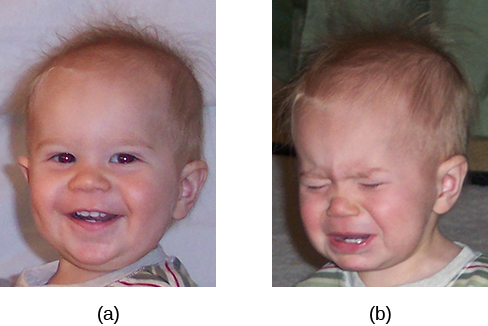
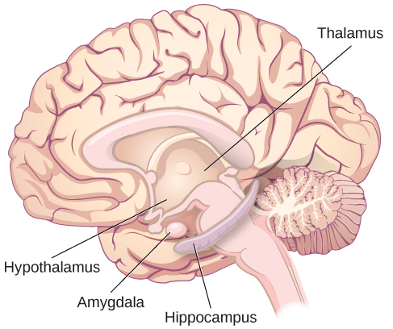
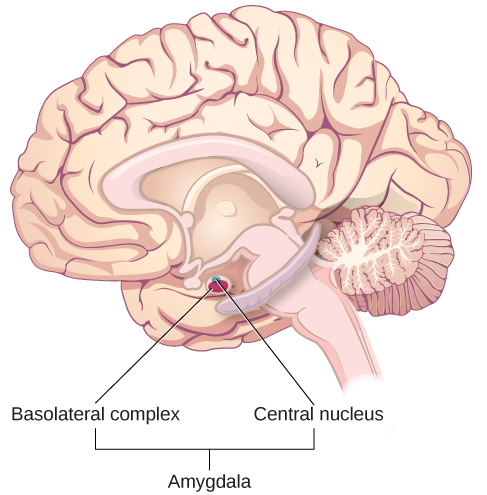
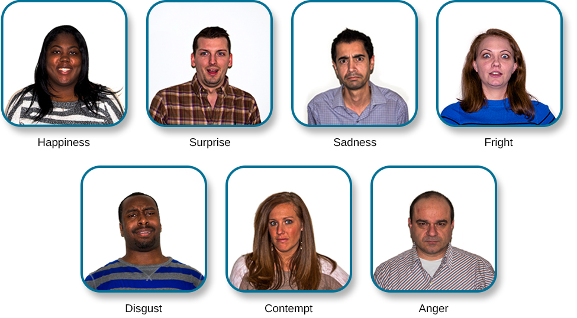

# 10.4 Cảm Xúc

> [!info]
>
> ### Mục Tiêu Học Tập
>
> Sau khi học xong mục này, bạn sẽ có thể:
>
> - Giải thích các lý thuyết chính về cảm xúc
> - Mô tả vai trò của các cấu trúc thuộc hệ viền (limbic) trong quá trình xử lý cảm xúc
> - Hiểu bản chất phổ quát của việc tạo ra và nhận biết biểu cảm cảm xúc

Khi chúng ta trải qua cuộc sống hàng ngày, chúng ta trải nghiệm nhiều loại cảm xúc khác nhau.
Một **cảm xúc** (emotion) là một trạng thái tồn tại chủ quan mà chúng ta thường mô tả là các cảm giác của mình.
Cảm xúc là kết quả của sự kết hợp giữa trải nghiệm chủ quan, sự biểu lộ, sự đánh giá nhận thức và các phản ứng sinh lý (Levenson, Carstensen, Friesen, & Ekman, 1991).
Tuy nhiên, như sẽ được thảo luận ở phần sau của chương, trình tự chính xác mà các thành phần này diễn ra vẫn chưa hoàn toàn rõ ràng, và một số phần có thể xảy ra cùng một lúc.
Một cảm xúc thường bắt đầu bằng một trải nghiệm chủ quan (cá nhân), đóng vai trò là một kích thích.
Thông thường kích thích này đến từ bên ngoài, nhưng nó không nhất thiết phải từ thế giới bên ngoài.
Chẳng hạn, ai đó có thể nghĩ về chiến tranh và trở nên đau buồn, ngay cả khi họ chưa từng trải qua chiến tranh.
Sự biểu lộ cảm xúc đề cập đến cách một người thể hiện cảm xúc ra bên ngoài và bao gồm các hành vi phi ngôn ngữ và ngôn ngữ (Gross, 1999).
Một người cũng thực hiện một sự đánh giá nhận thức, trong đó cá nhân cố gắng xác định cách thức mà một tình huống sẽ tác động đến bản thân mình (Roseman & Smith, 2001).
Ngoài ra, cảm xúc bao gồm các phản ứng sinh lý, chẳng hạn như những thay đổi có thể có về nhịp tim, đổ mồ hôi, v.v. (Soussignan, 2002).

Các từ ngữ cảm xúc (emotion) và khí sắc / tâm trạng (mood) đôi khi được sử dụng thay thế cho nhau, nhưng các nhà tâm lý học sử dụng những từ này để chỉ hai điều khác nhau.
Thông thường, từ cảm xúc chỉ một trạng thái cảm giác chủ quan, tương đối dữ dội và xảy ra để phản ứng lại một điều gì đó mà chúng ta trải nghiệm ([Hình 10.20](#Figure_10_04_HappySad)).
Cảm xúc thường được cho là được trải nghiệm một cách có ý thức và có chủ ý.
Mặt khác, **khí sắc / tâm trạng** (mood) đề cập đến một trạng thái cảm xúc kéo dài hơn, ít dữ dội hơn và không xảy ra để phản ứng lại một sự việc cụ thể mà chúng ta trải nghiệm.
Các trạng thái khí sắc có thể không được nhận biết một cách có ý thức và không mang tính chủ ý như gắn liền với cảm xúc (Beedie, Terry, Lane, & Devonport, 2011).
Ở đây chúng ta sẽ tập trung vào cảm xúc, và bạn sẽ tìm hiểu thêm về khí sắc trong chương nói về các rối loạn tâm lý.

**Hình 10.20** Trẻ mới biết đi có thể chuyển đổi qua các cảm xúc một cách nhanh chóng, (a) cực kỳ vui vẻ vào khoảnh khắc này và (b) cực kỳ buồn bã vào khoảnh khắc tiếp theo. (nguồn a: chỉnh sửa tác phẩm của Kerry Ceszyk; nguồn b: chỉnh sửa tác phẩm của Kerry Ceszyk)

Chúng ta có thể ở trên đỉnh cao của niềm vui hoặc dưới đáy sâu của sự tuyệt vọng.
Chúng ta có thể cảm thấy tức giận khi bị phản bội, sợ hãi khi bị đe dọa, và ngạc nhiên khi một điều bất ngờ xảy ra.
Mục này sẽ phác thảo một số lý thuyết nổi tiếng nhất giải thích trải nghiệm cảm xúc của chúng ta và cung cấp cái nhìn sâu sắc về các cơ sở sinh học của cảm xúc.
Mục này khép lại với phần thảo luận về bản chất phổ quát của các biểu cảm nét mặt của cảm xúc và khả năng nhận biết những biểu cảm đó ở người khác của chúng ta.

## Các Lý Thuyết Về Cảm Xúc

Các trạng thái cảm xúc của chúng ta là sự kết hợp của sự kích hoạt sinh lý, sự đánh giá tâm lý và những trải nghiệm chủ quan.
Cùng với nhau, đây là **các thành phần của cảm xúc** (components of emotion), và những trải nghiệm, nền tảng cũng như văn hóa của chúng ta bồi đắp cho cảm xúc của chúng ta.
Do đó, những người khác nhau có thể có những trải nghiệm cảm xúc khác nhau ngay cả khi đối mặt với những hoàn cảnh tương tự.
Theo thời gian, một số lý thuyết khác nhau về cảm xúc, được thể hiện trong [Hình 10.21](#Figure_10_04_Theories), đã được đề xuất để giải thích cách các thành phần khác nhau của cảm xúc tương tác với nhau.

![Một sơ đồ hiển thị bức ảnh một con rắn ở bên trái và bức ảnh một người đang sợ hãi ở bên phải, với một mũi tên có nhãn “thời gian.” Bên dưới các bức ảnh là sơ đồ dòng chảy của bốn lý thuyết về cảm xúc. Trong “Thuyết James-Lange,” ô có nhãn “kích hoạt (con rắn)” dẫn đến ô “tim đập mạnh, đổ mồ hôi,” rồi dẫn đến ô “sợ hãi (cảm xúc).” Trong “Thuyết Cannon-Bard,” ô “kích hoạt (con rắn)” tách thành hai ô “tim đập mạnh, đổ mồ hôi” và “sợ hãi (cảm xúc).” Trong “Thuyết hai yếu tố Schachter-Singer,” ô “kích hoạt (con rắn)” dẫn đến hai ô “tim đập mạnh, đổ mồ hôi” và nhãn nhận thức (“Tôi đang sợ hãi)”, sau đó dẫn đến một ô duy nhất “sợ hãi (cảm xúc).” Trong “Thuyết trung gian nhận thức của Lazarus,” ô “kích hoạt (con rắn)” dẫn đến ô “đánh giá,” rồi dẫn đến ô “sợ hãi/tim đập mạnh, đổ mồ hôi.”](../../images/img_a5c14c95ffae.jpg)

**Hình 10.21** Hình này minh họa những khẳng định chính của thuyết James-Lange, thuyết Cannon-Bard và thuyết cảm xúc hai yếu tố Schachter-Singer. (nguồn "rắn": chỉnh sửa tác phẩm của "tableatny"/Flickr; nguồn "khuôn mặt": chỉnh sửa tác phẩm của Cory Zanker)

**Thuyết cảm xúc James-Lange** (James-Lange theory) khẳng định rằng cảm xúc nảy sinh từ sự kích hoạt sinh lý.
Hãy nhớ lại những gì bạn đã tìm hiểu về hệ thần kinh giao cảm và phản ứng chiến-hay-biến (fight-or-flight) của chúng ta khi bị đe dọa.
Nếu bạn bắt gặp một mối đe dọa nào đó trong môi trường của mình, chẳng hạn như một con rắn độc ở sân sau nhà bạn, hệ thần kinh giao cảm của bạn sẽ khởi phát sự kích hoạt sinh lý đáng kể, làm tim bạn đập thình thịch và tăng nhịp thở.
Theo thuyết cảm xúc James-Lange, bạn sẽ chỉ trải nghiệm cảm giác sợ hãi *sau khi* sự kích hoạt sinh lý này đã diễn ra.
Hơn nữa, các khuôn mẫu kích hoạt khác nhau sẽ gắn liền với những cảm xúc khác nhau.

Tuy nhiên, các nhà lý thuyết khác nghi ngờ rằng sự kích hoạt sinh lý xảy ra với các loại cảm xúc khác nhau là đủ khác biệt để tạo ra sự đa dạng phong phú của các cảm xúc mà chúng ta trải nghiệm.
Do đó, **thuyết cảm xúc Cannon-Bard** (Cannon-Bard theory) đã được phát triển.
Theo quan điểm này, sự kích hoạt sinh lý và trải nghiệm cảm xúc xảy ra đồng thời nhưng độc lập với nhau (Lang, 1994).
Vì vậy, khi bạn nhìn thấy con rắn độc, bạn cảm thấy sợ hãi vào chính xác cùng một thời điểm mà cơ thể bạn bắt đầu phản ứng chiến-hay-biến.
Phản ứng cảm xúc này sẽ tách biệt và độc lập với sự kích hoạt sinh lý, mặc dù chúng cùng xuất hiện đồng thời.

Liệu việc mỉm cười có làm bạn hạnh phúc không?
Hoặc ngược lại, liệu hạnh phúc có làm bạn mỉm cười?
Giả thuyết phản hồi từ nét mặt (facial feedback hypothesis) đề xuất rằng biểu cảm nét mặt của bạn thực sự có thể ảnh hưởng đến trải nghiệm cảm xúc của bạn (Adelman & Zajonc, 1989; Boiger & Mesquita, 2012; Buck, 1980; Capella, 1993; Soussignan, 2001).
Nghiên cứu điều tra giả thuyết phản hồi từ nét mặt gợi ý rằng việc kìm nén biểu cảm cảm xúc trên nét mặt làm giảm cường độ của một số cảm xúc mà người tham gia trải qua (Davis, Senghas, & Ochsner, 2009).
Havas, Glenberg, Gutowski, Lucarelli và Davidson (2010) đã sử dụng phương pháp tiêm Botox để làm tê liệt các cơ mặt và hạn chế các biểu cảm nét mặt, bao gồm cả cau mày, và họ phát hiện ra rằng những người trầm cảm báo cáo ít trầm cảm hơn sau khi các cơ cau mày của họ bị làm tê liệt.
Nghiên cứu khác nhận thấy rằng cường độ của các biểu cảm nét mặt ảnh hưởng đến các phản ứng cảm xúc (Soussignan, 2002).
Nói cách khác, nếu một điều gì đó nhỏ nhặt xảy ra và bạn mỉm cười rạng rỡ như thể bạn vừa trúng số độc đắc, bạn thực sự sẽ cảm thấy hạnh phúc hơn về điều nhỏ bé đó so với việc bạn chỉ nở một nụ cười mỉm nhỏ.
Ngược lại, nếu bạn luôn đi lại với vẻ mặt cau có suốt cả ngày, điều đó có thể khiến bạn có ít cảm xúc tích cực hơn so với khi bạn mỉm cười.
Điều thú vị là Soussignan (2002) cũng báo cáo những khác biệt về sự kích hoạt sinh lý liên quan đến cường độ của một kiểu cười.

G. Marañon Posadillo là một bác sĩ người Tây Ban Nha, người đã nghiên cứu các tác động tâm lý của adrenaline để tạo ra một mô hình cho trải nghiệm cảm xúc.
Mô hình của Marañon đã xuất hiện trước lý thuyết cảm xúc hai yếu tố hay kích hoạt - nhận thức của Schachter (Cornelius, 1991).
**Thuyết hai yếu tố Schachter-Singer** (Schachter-Singer two-factor theory) về cảm xúc là một biến thể khác của các lý thuyết cảm xúc, tính đến cả sự kích hoạt sinh lý và trải nghiệm cảm xúc.
Theo lý thuyết này, cảm xúc bao gồm hai yếu tố: sinh lý và nhận thức.
Nói cách khác, sự kích hoạt sinh lý được diễn giải trong bối cảnh cụ thể để tạo ra trải nghiệm cảm xúc.
Trở lại ví dụ của chúng ta liên quan đến con rắn độc trong sân sau, thuyết hai yếu tố cho rằng con rắn gợi ra sự kích hoạt hệ thần kinh giao cảm vốn được gán nhãn nhận thức là sự sợ hãi dựa trên bối cảnh, và trải nghiệm của chúng ta là sự sợ hãi.
Nếu bạn gán nhãn sự kích hoạt hệ thần kinh giao cảm đó là niềm vui, bạn sẽ trải nghiệm niềm vui.
Thuyết hai yếu tố Schachter-Singer phụ thuộc vào việc dán nhãn cho trải nghiệm sinh lý, vốn là một dạng đánh giá nhận thức.

Magda Arnold là nhà lý thuyết đầu tiên đưa ra sự khám phá về ý nghĩa của việc đánh giá, và trình bày một bản phác thảo về quá trình đánh giá có thể diễn ra như thế nào cũng như mối liên hệ của nó với cảm xúc (Roseman & Smith, 2001).
Ý tưởng then chốt của thuyết đánh giá là bạn có các suy nghĩ (một sự đánh giá nhận thức) trước khi bạn trải nghiệm một cảm xúc, và cảm xúc bạn trải qua phụ thuộc vào những suy nghĩ bạn đã có (Frijda, 1988; Lazarus, 1991).
Nếu bạn nghĩ điều gì đó là tích cực, bạn sẽ có nhiều cảm xúc tích cực hơn về nó so với khi sự đánh giá của bạn là tiêu cực, và điều ngược lại cũng đúng.
Thuyết đánh giá giải thích cách hai người có thể có hai cảm xúc hoàn toàn khác nhau liên quan đến cùng một sự kiện.
Ví dụ, giả sử giảng viên tâm lý học chọn bạn để thuyết trình về chủ đề cảm xúc; bạn có thể xem đó là điều tích cực, vì nó đại diện cho một cơ hội để trở thành tâm điểm của sự chú ý, và bạn sẽ cảm thấy vui vẻ.
Tuy nhiên, nếu bạn không thích nói trước đám đông, bạn có thể có một sự đánh giá tiêu cực và trải qua sự khó chịu.

Schachter và Singer tin rằng sự kích hoạt sinh lý là rất giống nhau giữa các loại cảm xúc khác nhau mà chúng ta trải nghiệm, và do đó, sự đánh giá nhận thức về tình huống là rất quan trọng đối với cảm xúc thực tế được trải nghiệm.
Trên thực tế, có thể gán sai nguồn gốc kích hoạt cho một trải nghiệm cảm xúc nếu hoàn cảnh phù hợp (Schachter & Singer, 1962).
Họ đã thực hiện một thí nghiệm thông minh để kiểm tra ý tưởng của mình.
Một nhóm nam giới tham gia thí nghiệm được phân ngẫu nhiên vào một trong các nhóm.
Một số người tham gia được tiêm epinephrine gây ra những thay đổi cơ thể bắt chước phản ứng chiến-hay-biến của hệ thần kinh giao cảm; tuy nhiên, chỉ một số người trong số này được thông báo trước rằng hãy mong đợi những phản ứng này như những tác dụng phụ của mũi tiêm.
Những người đàn ông khác được tiêm epinephrine được thông báo rằng mũi tiêm sẽ không có tác dụng phụ hoặc nó sẽ dẫn đến một tác dụng phụ không liên quan đến phản ứng giao cảm, chẳng hạn như ngứa chân hoặc đau đầu.
Sau khi nhận các mũi tiêm này, những người tham gia đợi trong một căn phòng với một người khác mà họ nghĩ là một đối tượng nghiên cứu khác.
Trong thực tế, người kia là một cộng sự bí mật (confederate - người làm việc cho nhà nghiên cứu).
Người cộng sự này thực hiện các hành vi được dàn dựng sẵn biểu hiện sự hưng phấn hân hoan hoặc tức giận (Schachter & Singer, 1962).

Khi những người tham gia được thông báo trước rằng họ nên mong đợi cảm thấy các triệu chứng kích hoạt sinh lý được hỏi về bất kỳ thay đổi cảm xúc nào mà họ đã trải qua liên quan đến sự hưng phấn hoặc tức giận (tùy thuộc vào cách người cộng sự cư xử), họ báo cáo là không có thay đổi cảm xúc nào.
Tuy nhiên, những người đàn ông không mong đợi sự kích hoạt sinh lý như một hệ quả của mũi tiêm lại có nhiều khả năng báo cáo rằng họ đã trải qua sự hưng phấn hoặc tức giận tùy thuộc vào hành vi của người cộng sự được phân công cùng phòng với họ.
Mặc dù tất cả những người được tiêm epinephrine đều trải qua cùng một sự kích hoạt sinh lý, nhưng chỉ những người không mong đợi sự kích hoạt đó mới sử dụng bối cảnh xung quanh để diễn giải sự kích hoạt đó như một sự thay đổi trong trạng thái cảm xúc của họ (Schachter & Singer, 1962).

Các phản ứng cảm xúc mạnh mẽ gắn liền với sự kích hoạt sinh lý mạnh mẽ, điều này đã khiến một số nhà lý thuyết gợi ý rằng các dấu hiệu kích hoạt sinh lý, bao gồm nhịp tim tăng, nhịp thở tăng và đổ mồ hôi, có thể được sử dụng để xác định xem ai đó có đang nói sự thật hay không.
Giả định ở đây là hầu hết chúng ta sẽ có các dấu hiệu kích hoạt sinh lý nếu chúng ta đang không trung thực với ai đó.
Một chiếc **máy phát hiện nói dối** (polygraph) đo lường sự kích hoạt sinh lý của một cá nhân khi trả lời một loạt câu hỏi.
Một người được đào tạo về việc đọc các bài kiểm tra này sẽ tìm kiếm các câu trả lời gắn liền với mức độ kích hoạt gia tăng như những dấu hiệu tiềm ẩn cho thấy người trả lời có thể đã không trung thực trong những câu trả lời đó.
Mặc dù máy phát hiện nói dối vẫn được sử dụng phổ biến, tính hiệu lực và độ chính xác của chúng là rất đáng nghi ngờ vì không có bằng chứng nào cho thấy việc nói dối gắn liền với bất kỳ khuôn mẫu kích hoạt sinh lý cụ thể nào (Saxe & Ben-Shakhar, 1999).

Mối quan hệ giữa trải nghiệm cảm xúc của chúng ta và quá trình xử lý nhận thức của chúng ta đối với chúng, cũng như trình tự mà những điều này diễn ra, vẫn là một chủ đề nghiên cứu và tranh luận.
Lazarus (1991) đã phát triển **thuyết trung gian nhận thức về cảm xúc** (cognitive-mediational theory), khẳng định rằng cảm xúc của chúng ta được quyết định bởi sự đánh giá của chúng ta về tác nhân kích thích.
Sự đánh giá này đóng vai trò trung gian giữa tác nhân kích thích và phản ứng cảm xúc, và nó diễn ra tức thì và thường là vô thức.
Ngược lại với mô hình Schachter-Singer, sự đánh giá diễn ra trước một nhãn nhận thức.
Bạn sẽ tìm hiểu thêm về khái niệm đánh giá của Lazarus khi học về căng thẳng, sức khỏe và lối sống.
Tuy nhiên, có những quan điểm khác về cảm xúc cũng nhấn mạnh các quá trình nhận thức.

Hãy quay lại ví dụ về việc được giáo sư yêu cầu thuyết trình.
Ngay cả khi bạn không thích nói trước đám đông, bạn có lẽ vẫn có thể xoay xở để làm được điều đó.
Bạn sẽ có chủ đích kiểm soát cảm xúc của mình để cho phép bản thân phát biểu, nhưng chúng ta liên tục điều hòa cảm xúc của mình, và phần lớn sự điều hòa cảm xúc của chúng ta diễn ra mà chúng ta không chủ động suy nghĩ về nó.
Mauss và các đồng nghiệp đã nghiên cứu sự điều hòa cảm xúc tự động (automatic emotion regulation - AER), đề cập đến sự kiểm soát cảm xúc không chủ ý.
Đó chỉ đơn giản là việc không phản ứng bằng cảm xúc của bạn, và AER có thể ảnh hưởng đến tất cả các khía cạnh của quá trình cảm xúc.
AER có thể ảnh hưởng đến những thứ bạn chú ý, sự đánh giá của bạn, sự lựa chọn tham gia vào một trải nghiệm cảm xúc của bạn, và các hành vi của bạn sau khi một cảm xúc được trải nghiệm (Mauss, Bunge, & Gross, 2007; Mauss, Levenson, McCarter, Wilhelm, & Gross, 2005).
AER tương tự như các quá trình nhận thức tự động khác mà trong đó các cảm giác kích hoạt các cấu trúc tri thức ảnh hưởng đến chức năng hoạt động.
Các cấu trúc tri thức này có thể bao gồm các khái niệm, lược đồ hoặc kịch bản.

Ý tưởng về AER là con người phát triển một quá trình tự động hoạt động giống như một kịch bản hoặc lược đồ, và quá trình này không đòi hỏi suy nghĩ có chủ ý để điều hòa cảm xúc.
AER hoạt động giống như việc đi xe đạp.
Một khi bạn đã phát triển quá trình này, bạn chỉ việc thực hiện nó mà không cần suy nghĩ về nó.
AER có thể mang tính thích ứng hoặc kém thích ứng và có những tác động quan trọng đối với sức khỏe (Hopp, Troy, & Mauss, 2011).
AER thích ứng dẫn đến các kết quả sức khỏe tốt hơn so với AER kém thích ứng, chủ yếu là do việc trải nghiệm hoặc giảm thiểu các tác nhân gây căng thẳng tốt hơn so với những người có AER kém thích ứng (Hopp, Troy, & Mauss, 2011).
Mặt khác, AER kém thích ứng có thể là yếu tố then chốt duy trì một số rối loạn tâm lý (Hopp, Troy, & Mauss, 2011).
Mauss và các đồng nghiệp nhận thấy rằng các chiến lược có thể làm giảm cảm xúc tiêu cực, do đó sẽ làm tăng sức khỏe tâm lý (Mauss, Cook, Cheng, & Gross, 2007; Mauss, Cook, & Gross, 2007; Shallcross, Troy, Boland, & Mauss, 2010; Troy, Shallcross, & Mauss, 2013; Troy, Wilhelm, Shallcross, & Mauss, 2010).
Mauss cũng gợi ý rằng có những vấn đề với cách đo lường cảm xúc, nhưng bà tin rằng hầu hết các khía cạnh của cảm xúc thường được đo lường đều hữu ích (Mauss et al., 2005; Mauss & Robinson, 2009).
Tuy nhiên, một cách nhìn nhận khác về cảm xúc lại thách thức toàn bộ sự hiểu biết của chúng ta về cảm xúc.

Sau khoảng ba thập kỷ nghiên cứu liên ngành, Barrett đã lập luận rằng chúng ta chưa thực sự hiểu về cảm xúc.
Bà đề xuất rằng cảm xúc không được cài đặt sẵn vào não bộ của bạn khi sinh ra, mà đúng hơn chúng được kiến tạo dựa trên những trải nghiệm của bạn.
Cảm xúc trong thuyết kiến tạo là những dự đoán kiến tạo nên trải nghiệm của bạn về thế giới.
Trong chương về [Tư Duy Và Trí Tuệ](../07-thinking-and-intelligence/00-7-introduction.md), bạn đã biết rằng các khái niệm là các danh mục hoặc nhóm thông tin ngôn ngữ, hình ảnh, ý tưởng hoặc ký ức, chẳng hạn như trải nghiệm cuộc sống.
Barrett đã mở rộng điều đó để bao hàm các cảm xúc như những khái niệm mang tính dự đoán (Barrett, 2017).
Hai trạng thái sinh lý giống hệt nhau có thể dẫn đến các trạng thái cảm xúc khác nhau tùy thuộc vào các dự đoán của bạn.
Ví dụ, bộ não của bạn dự đoán một cái dạ dày đang cồn cào trong một tiệm bánh có thể dẫn bạn đến việc kiến tạo nên cơn đói.
Tuy nhiên, bộ não của bạn dự đoán một cái dạ dày đang cồn cào trong khi bạn đang chờ đợi kết quả xét nghiệm y tế có thể khiến não bạn kiến tạo nên sự lo lắng.
Do đó, bạn có thể kiến tạo hai cảm xúc khác nhau từ cùng một cảm giác sinh lý.
Thay vì cảm xúc là thứ mà bạn không thể kiểm soát, bạn hoàn toàn có thể kiểm soát và gây ảnh hưởng lên cảm xúc của mình.

> [!tip]
>
> ### Kết Nối Với Học Tập
>
> Xem [video trong đó Tiến sĩ Barrett giải thích về các cảm xúc được kiến tạo](https://openstax.org/l/barrett) này để tìm hiểu thêm.

Hai quan điểm nổi bật khác xuất phát từ công trình của Robert Zajonc và Joseph LeDoux.
Zajonc khẳng định rằng một số cảm xúc xảy ra tách biệt hoặc trước sự diễn giải nhận thức của chúng ta về chúng, chẳng hạn như cảm giác sợ hãi để phản ứng lại một âm thanh lớn bất ngờ (Zajonc, 1998).
Ông cũng tin vào điều mà chúng ta có thể gọi một cách thông thường là cảm giác trực giác (gut feeling)—rằng chúng ta có thể trải nghiệm sự thích hoặc không thích tức thì và không thể giải thích được đối với ai đó hoặc điều gì đó (Zajonc, 1980).
LeDoux cũng xem một số cảm xúc là không đòi hỏi nhận thức: một số cảm xúc hoàn toàn bỏ qua sự diễn giải bối cảnh.
Nghiên cứu của ông về khoa học thần kinh của cảm xúc đã chứng minh vai trò chính của hạch hạnh nhân (amygdala) trong nỗi sợ hãi (Cunha, Monfils, & LeDoux, 2010; LeDoux, 1996, 2002).
Một kích thích sợ hãi được não bộ xử lý qua một trong hai con đường: từ đồi thị (thalamus - nơi nó được tiếp nhận) trực tiếp đến hạch hạnh nhân hoặc từ đồi thị qua vỏ não rồi mới đến hạch hạnh nhân.
Con đường đầu tiên diễn ra rất nhanh chóng, trong khi con đường thứ hai cho phép xử lý nhiều hơn về các chi tiết của kích thích.
Trong phần sau, chúng ta sẽ xem xét kỹ hơn về khoa học thần kinh của phản ứng cảm xúc.

## Sinh Học Của Cảm Xúc

Ở phần trước, bạn đã tìm hiểu về **hệ viền** (limbic system), là khu vực của não bộ tham gia vào cảm xúc và trí nhớ ([Hình 10.22](#Figure_10_04_Limbic)).
Hệ viền bao gồm vùng dưới đồi, đồi thị, hạch hạnh nhân và hồi hải mã.
Vùng dưới đồi đóng vai trò trong việc kích hoạt hệ thần kinh giao cảm vốn là một phần của bất kỳ phản ứng cảm xúc nhất định nào.
Đồi thị đóng vai trò như một trung tâm chuyển tiếp cảm giác mà các tế bào thần kinh của nó phóng chiếu tới cả hạch hạnh nhân và các vùng vỏ não cao hơn để xử lý thêm.
Hạch hạnh nhân đóng vai trò xử lý thông tin cảm xúc và truyền gửi thông tin đó đi tiếp (Fossati, 2012).
Hồi hải mã tích hợp trải nghiệm cảm xúc với nhận thức (Femenía, Gómez-Galán, Lindskog, & Magara, 2012).

**Hình 10.22** Hệ viền, bao gồm vùng dưới đồi, đồi thị, hạch hạnh nhân và hồi hải mã, tham gia vào việc điều hòa phản ứng cảm xúc và trí nhớ.

> [!tip]
>
> ### Kết Nối Với Học Tập
>
> Hãy trải nghiệm [trình mô phỏng não bộ 3D tương tác](https://openstax.org/l/bparts1) của Open Colleges này để ôn lại các bộ phận của não và chức năng của chúng.
> Để bắt đầu, nhấp vào nút “Bắt đầu khám phá” (Start Exploring).
> Để truy cập hệ viền, nhấp vào dấu cộng trong menu bên phải (bộ ba tab).

### Hạch Hạnh Nhân

**Hạch hạnh nhân** (amygdala) đã nhận được rất nhiều sự chú ý từ các nhà nghiên cứu quan tâm đến việc tìm hiểu cơ sở sinh học của cảm xúc, đặc biệt là nỗi sợ hãi và lo âu (Blackford & Pine, 2012; Goosens & Maren, 2002; Maren, Phan, & Liberzon, 2013).
Hạch hạnh nhân bao gồm các phân nhân khác nhau, bao gồm phức hợp nền bên và nhân trung tâm ([Hình 10.23](#Figure_10_04_Amygdala)).
**Phức hợp nền bên** (basolateral complex) có các kết nối dày đặc với nhiều vùng cảm giác khác nhau của não bộ.
Nó có vai trò then chốt đối với điều kiện hóa cổ điển và việc gắn kết giá trị cảm xúc vào các quá trình học tập và trí nhớ.
**Nhân trung tâm** (central nucleus) đóng vai trò trong sự chú ý, và nó có các kết nối với vùng dưới đồi và các vùng thân não khác nhau để điều hòa hoạt động của hệ thần kinh tự chủ và hệ nội tiết (Pessoa, 2010).

**Hình 10.23** Giải phẫu của phức hợp nền bên và nhân trung tâm của hạch hạnh nhân được minh họa trong sơ đồ này.

Nghiên cứu trên động vật đã chứng minh rằng có sự gia tăng kích hoạt hạch hạnh nhân ở những chuột con có các dấu hiệu mùi hương được ghép đôi với sốc điện khi chuột mẹ vắng mặt.
Điều này dẫn đến sự ác cảm với dấu hiệu mùi hương, gợi ý rằng chuột đã học được cách sợ hãi dấu hiệu mùi hương đó.
Điều thú vị là khi chuột mẹ có mặt, những con chuột con thực sự lại biểu hiện sự ưa thích đối với dấu hiệu mùi hương bất chấp mối liên hệ của nó với cú sốc điện.
Sự ưa thích này gắn liền với việc không có sự gia tăng kích hoạt hạch hạnh nhân.
Điều này gợi ý rằng tác động khác biệt lên hạch hạnh nhân bởi *bối cảnh* (sự hiện diện hay vắng mặt của chuột mẹ) đã quyết định việc chuột con học cách sợ hãi mùi hương hay bị thu hút bởi nó (Moriceau & Sullivan, 2006).

Raineki, Cortés, Belnoue và Sullivan (2012) đã chứng minh rằng, ở chuột, những trải nghiệm tiêu cực đầu đời có thể làm thay đổi chức năng của hạch hạnh nhân và dẫn đến các khuôn mẫu hành vi ở tuổi vị thành niên bắt chước các rối loạn khí sắc ở người.
Trong nghiên cứu này, các chú chuột con phải chịu sự đối xử ngược đãi hoặc bình thường trong các ngày thứ 8–12 sau sinh.
Có hai hình thức đối xử ngược đãi.
Hình thức đối xử ngược đãi thứ nhất có điều kiện lót ổ không đầy đủ.
Chuột mẹ không có đủ vật liệu lót ổ trong lồng để xây một chiếc tổ tử tế, dẫn đến việc chuột mẹ dành nhiều thời gian hơn ở xa đàn con để cố gắng xây tổ và ít thời gian cho con bú hơn.
Hình thức đối xử ngược đãi thứ hai có một nhiệm vụ học tập liên kết liên quan đến việc ghép đôi mùi hương và kích thích điện khi chuột mẹ vắng mặt, như đã mô tả ở trên.
Nhóm đối chứng ở trong lồng có đủ vật liệu lót ổ và được để yên bình cùng mẹ trong cùng khoảng thời gian.
Những chú chuột con trải qua sự ngược đãi có nhiều khả năng biểu hiện các triệu chứng giống như trầm cảm trong thời kỳ vị thành niên hơn so với nhóm đối chứng.
Những hành vi giống trầm cảm này gắn liền với sự gia tăng kích hoạt của hạch hạnh nhân.

Nghiên cứu trên người cũng gợi ý mối quan hệ giữa hạch hạnh nhân và các rối loạn tâm lý về khí sắc hoặc lo âu.
Những thay đổi về cấu trúc và chức năng của hạch hạnh nhân đã được chứng minh ở những thanh thiếu niên có nguy cơ hoặc đã được chẩn đoán mắc các rối loạn khí sắc và/hoặc lo âu khác nhau (Miguel-Hidalgo, 2013; Qin et al., 2013).
Người ta cũng gợi ý rằng những khác biệt về chức năng trong hạch hạnh nhân có thể đóng vai trò là một dấu ấn sinh học để phân biệt những cá nhân mắc chứng rối loạn lưỡng cực với những người mắc chứng trầm cảm chủ yếu (Fournier, Keener, Almeida, Kronhaus, & Phillips, 2013).

### Hồi Hải Mã

Như đã đề cập trước đó, **hồi hải mã** (hippocampus) cũng tham gia vào quá trình xử lý cảm xúc.
Giống như hạch hạnh nhân, nghiên cứu đã chứng minh rằng cấu trúc và chức năng của hồi hải mã có mối liên hệ với nhiều rối loạn khí sắc và lo âu.
Những cá nhân mắc chứng rối loạn căng thẳng sau sang chấn (PTSD) biểu hiện sự sụt giảm rõ rệt về thể tích của một số phần của hồi hải mã, điều này có thể xuất phát từ việc giảm mức độ sinh thần kinh và phân nhánh sợi nhánh (lần lượt là sự tạo ra các tế bào thần kinh mới và sự tạo ra các sợi nhánh mới trong các tế bào thần kinh hiện có) (Wang et al., 2010).
Mặc dù không thể đưa ra tuyên bố quan hệ nhân quả với các nghiên cứu tương quan như thế này, các nghiên cứu đã chứng minh sự cải thiện hành vi và sự gia tăng thể tích hồi hải mã sau khi điều trị bằng dược lý hoặc liệu pháp nhận thức - hành vi ở những cá nhân mắc PTSD (Bremner & Vermetten, 2004; Levy-Gigi, Szabó, Kelemen, & Kéri, 2013).

## Biểu Cảm Nét Mặt Và Sự Nhận Biết Cảm Xúc

Văn hóa có thể tác động đến cách con người thể hiện cảm xúc.
Một **quy tắc biểu lộ cảm xúc theo văn hóa** (cultural display rule) là một trong tập hợp các tiêu chuẩn đặc thù theo văn hóa chi phối những loại cảm xúc và tần suất biểu lộ cảm xúc nào là được xã hội chấp nhận (Malatesta & Haviland, 1982).
Do đó, những người từ các nền tảng văn hóa khác nhau có thể có những quy tắc biểu lộ cảm xúc theo văn hóa rất khác nhau.
Chẳng hạn, nghiên cứu đã chỉ ra rằng các cá nhân đến từ Hoa Kỳ bộc lộ những cảm xúc tiêu cực như sợ hãi, tức giận và ghê tởm cả khi ở một mình lẫn khi có mặt người khác, trong khi các cá nhân người Nhật chỉ làm như vậy khi ở một mình (Matsumoto, 1990).
Hơn nữa, các cá nhân đến từ những nền văn hóa có xu hướng nhấn mạnh sự gắn kết xã hội có nhiều khả năng kìm nén phản ứng cảm xúc hơn để họ có thể đánh giá xem phản ứng nào là phù hợp nhất trong một bối cảnh nhất định (Matsumoto, Yoo, & Nakagawa, 2008).

Các đặc điểm văn hóa riêng biệt khác cũng có thể tham gia vào tính cảm xúc.
Chẳng hạn, có thể có sự khác biệt giới tính liên quan đến quá trình xử lý cảm xúc.
Mặc dù nghiên cứu về sự khác biệt giới tính trong việc thể hiện cảm xúc vẫn còn có những ý kiến trái chiều, có một số bằng chứng cho thấy những người thuộc các giới tính khác nhau có thể khác nhau về việc điều hòa cảm xúc (McRae, Ochsner, Mauss, Gabrieli, & Gross, 2008).

Paul Ekman (1972) đã nghiên cứu một người đàn ông New Guinea sống trong một nền văn hóa tiền chữ viết sử dụng các công cụ bằng đá, vốn hoàn toàn bị cô lập và chưa từng gặp bất kỳ người ngoài nào trước đây.
Ekman đã yêu cầu người đàn ông này thể hiện nét mặt của mình sẽ như thế nào nếu: (1) bạn bè đến thăm, (2) con của ông vừa qua đời, (3) ông sắp sửa đánh nhau, (4) ông giẫm phải một con lợn chết bốc mùi.
Sau khi Ekman trở về từ New Guinea, ông đã nghiên cứu các biểu cảm nét mặt trong hơn bốn thập kỷ.
Bất chấp các quy tắc biểu lộ cảm xúc khác nhau, khả năng nhận biết và tạo ra các biểu cảm nét mặt của cảm xúc dường như mang tính phổ quát.
Trên thực tế, ngay cả những cá nhân bị mù bẩm sinh cũng tạo ra cùng những biểu cảm nét mặt của cảm xúc, mặc dù họ chưa bao giờ có cơ hội quan sát những biểu hiện nét mặt này ở người khác.
Điều này dường như gợi ý rằng khuôn mẫu hoạt động của các cơ mặt tham gia vào việc tạo ra các biểu cảm cảm xúc là mang tính phổ quát, và quả thực, ý tưởng này đã được đề xuất vào cuối thế kỷ 19 trong cuốn sách *Sự Biểu Lộ Cảm Xúc Ở Con Người Và Loài Vật (The Expression of Emotions in Man and Animals)* (1872) của Charles Darwin.
Trên thực tế, có bằng chứng đáng kể cho bảy **cảm xúc phổ quát** (universal emotions) mà mỗi cảm xúc đều gắn liền với các biểu cảm nét mặt riêng biệt.
Chúng bao gồm: hạnh phúc, ngạc nhiên, buồn bã, sợ hãi, ghê tởm, khinh miệt và tức giận ([Hình 10.24](#Figure_10_04_Expressions)) (Ekman & Keltner, 1997).

**Hình 10.24** Bảy biểu cảm nét mặt phổ quát của cảm xúc được thể hiện ở đây. (nguồn: chỉnh sửa tác phẩm của Cory Zanker)

Tất nhiên, cảm xúc không chỉ được biểu lộ qua nét mặt.
Chúng ta cũng sử dụng giọng điệu, các hành vi khác nhau và ngôn ngữ cơ thể để truyền đạt thông tin về các trạng thái cảm xúc của mình.
**Ngôn ngữ cơ thể** (body language) là sự biểu đạt cảm xúc thông qua tư thế hoặc chuyển động của cơ thể.
Nghiên cứu gợi ý rằng chúng ta khá nhạy bén với thông tin cảm xúc được truyền đạt qua ngôn ngữ cơ thể, ngay cả khi chúng ta không nhận thức được điều đó một cách có ý thức (de Gelder, 2006; Tamietto et al., 2009).

> [!tip]
>
> ### Kết Nối Với Học Tập
>
> Xem [video ngắn của CNN về ngôn ngữ cơ thể trong tình huống căng thẳng của một cuộc tranh luận chính trị](https://openstax.org/l/blanguage1) này để tìm hiểu thêm.
> Xem [video này](https://openstax.org/l/blanguage2) để tìm hiểu cách áp dụng các khái niệm tương tự vào các tình huống hàng ngày.

> [!example]
>
> ### Kết Nối Các Khái Niệm
>
> #### Sự Biểu Lộ Cảm Xúc Và Điều Hòa Cảm Xúc
>
> Rối loạn phổ tự kỷ (ASD) là một tập hợp các rối loạn phát triển thần kinh đặc trưng bởi các hành vi lặp đi lặp lại cùng các vấn đề về giao tiếp và xã hội.
> Trẻ em mắc chứng rối loạn phổ tự kỷ gặp khó khăn trong việc nhận biết các trạng thái cảm xúc của người khác, và nghiên cứu đã chỉ ra rằng điều này có thể bắt nguồn từ việc không có khả năng phân biệt các biểu cảm cảm xúc phi ngôn ngữ khác nhau (tức các biểu cảm nét mặt) với nhau (Hobson, 1986).
> Ngoài ra, có bằng chứng cho thấy các cá nhân tự kỷ cũng gặp khó khăn trong việc bộc lộ cảm xúc thông qua giọng điệu và bằng cách tạo ra các biểu cảm nét mặt (Macdonald et al., 1989).
> Những khó khăn trong việc nhận biết và thể hiện cảm xúc có thể góp phần vào các hành vi đặc trưng cho chứng tự kỷ; do đó, các phương pháp tiếp cận trị liệu khác nhau đã được khám phá để giải quyết những khó khăn này.
> Nhiều chương trình giáo dục, liệu pháp nhận thức - hành vi và liệu pháp dược lý đã cho thấy một số triển vọng trong việc giúp các cá nhân tự kỷ xử lý thông tin liên quan đến cảm xúc (Bauminger, 2002; Golan & Baron-Cohen, 2006; Guastella et al., 2010).
>
> Điều hòa cảm xúc mô tả cách con người phản ứng với các tình huống và trải nghiệm bằng cách điều chỉnh các trải nghiệm và biểu cảm cảm xúc của họ.
> Các chiến lược điều hòa cảm xúc ngầm (covert) là những chiến lược diễn ra bên trong cá nhân, trong khi các chiến lược công khai (overt) liên quan đến người khác hoặc hành động (chẳng hạn như tìm kiếm lời khuyên hoặc uống rượu).
> Aldao và Dixon (2014) đã nghiên cứu mối quan hệ giữa các chiến lược điều hòa cảm xúc công khai và bệnh lý tâm thần.
> Họ đã nghiên cứu cách 218 sinh viên đại học báo cáo việc sử dụng các chiến lược ngầm và công khai cùng các triệu chứng được báo cáo gắn liền với các rối loạn tâm thần được lựa chọn, và nhận thấy rằng các chiến lược điều hòa cảm xúc công khai là những yếu tố dự đoán bệnh lý tâm thần tốt hơn so với các chiến lược ngầm.
> Một nghiên cứu khác đã xem xét mối quan hệ giữa hành vi "uống trước trận" (pregaming - hành động uống nhiều rượu trước một sự kiện xã hội) và hai chiến lược điều hòa cảm xúc để hiểu cách những điều này có thể góp phần gây ra các vấn đề liên quan đến rượu; kết quả gợi ý một mối quan hệ nhưng là một mối quan hệ phức tạp (Pederson, 2016).
> Cần có những nghiên cứu sâu hơn trong các lĩnh vực này để hiểu rõ hơn về các khuôn mẫu điều hòa cảm xúc thích ứng và kém thích ứng (Aldao & Dixon-Gordon, 2014).
