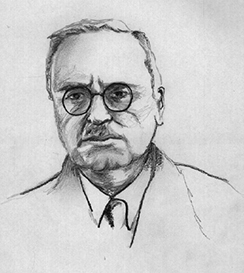
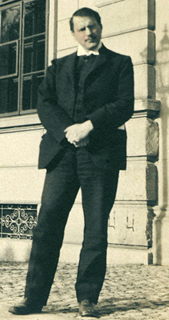

# 11.3 Các Nhà Tân Freud: Adler, Erikson, Jung Và Horney

> [!info]
>
> ### Mục Tiêu Học Tập
>
> Sau khi học xong mục này, bạn sẽ có thể:
>
> - Thảo luận về khái niệm mặc cảm tự ti (inferiority complex)
> - Thảo luận về những khác biệt cốt lõi giữa quan điểm của Erikson và Freud về nhân cách
> - Thảo luận về các ý tưởng của Jung về vô thức tập thể và các cổ mẫu (archetypes)
> - Thảo luận về công trình của Karen Horney, bao gồm cả việc bà sửa đổi quan niệm "ghen tị dương vật" của Freud

Freud đã thu hút nhiều môn đệ, những người đã điều chỉnh các ý tưởng của ông để tạo ra các lý thuyết mới về nhân cách.
Những nhà lý thuyết này, được gọi là các nhà tân Freud (neo-Freudians), nhìn chung đồng ý với Freud rằng những trải nghiệm thời thơ ấu có ý nghĩa quan trọng, nhưng giảm bớt sự nhấn mạnh vào tình dục, tập trung nhiều hơn vào môi trường xã hội và những tác động của văn hóa đối với nhân cách.
Bốn nhà tân Freud nổi bật bao gồm Alfred Adler, Erik Erikson, Carl Jung và Karen Horney.

## Alfred Adler

Alfred **Adler**, một đồng nghiệp của Freud và là chủ tịch đầu tiên của Hội Phân Tâm Học Vienna (vòng tròn đồng nghiệp thân cận của Freud), là nhà lý thuyết lớn đầu tiên tách khỏi Freud ([Hình 11.8](#CNX_Psych_11_03_Adler)).
Sau đó, ông đã thành lập một trường phái tâm lý học gọi là **tâm lý học cá nhân** (individual psychology), tập trung vào xung năng của chúng ta nhằm bù đắp cho cảm giác tự ti.
Adler (1937, 1956) đã đề xuất khái niệm **mặc cảm tự ti** (inferiority complex).
Mặc cảm tự ti đề cập đến cảm giác của một người rằng họ thiếu giá trị và không đạt được các tiêu chuẩn của người khác hoặc của xã hội.
Những ý tưởng của Adler về sự tự ti thể hiện một sự khác biệt lớn giữa tư duy của ông và Freud.
Freud tin rằng chúng ta được thúc đẩy bởi những thôi thúc tình dục và hung tính, nhưng Adler (1930, 1961) tin rằng cảm giác tự ti trong thời thơ ấu là điều thúc đẩy con người nỗ lực đạt được sự vượt trội và rằng sự phấn đấu này là lực lượng đằng sau tất cả các suy nghĩ, cảm xúc và hành vi của chúng ta.

**Hình 11.8** Alfred Adler đã đề xuất khái niệm về mặc cảm tự ti.

Adler cũng tin vào tầm quan trọng của các kết nối xã hội, nhìn nhận sự phát triển thời thơ ấu nổi lên thông qua sự phát triển xã hội thay vì các giai đoạn tình dục mà Freud đã phác thảo.
Adler lưu ý đến tính liên kết lẫn nhau của nhân loại và nhu cầu làm việc cùng nhau vì sự tốt đẹp hơn của tất cả mọi người.
Ông nói: "Hạnh phúc của loài người nằm ở việc làm việc cùng nhau, ở việc sống như thể mỗi cá nhân đã tự đặt cho mình nhiệm vụ đóng góp vào phúc lợi chung" (Adler, 1964, tr.
255) với mục tiêu chính của tâm lý học là "công nhận các quyền bình đẳng và sự bình đẳng của những người khác" (Adler, 1961, tr.
691).

Với những ý tưởng này, Adler đã xác định ba nhiệm vụ xã hội cơ bản mà tất cả chúng ta đều phải trải qua: nhiệm vụ nghề nghiệp (sự nghiệp), nhiệm vụ xã hội (tình bạn), và nhiệm vụ tình yêu (tìm kiếm một người bạn đời thân mật cho một mối quan hệ lâu dài).
Thay vì tập trung vào các động cơ tình dục hoặc hung tính cho hành vi như Freud đã làm, Adler tập trung vào các động cơ xã hội.
Ông cũng nhấn mạnh động lực có ý thức hơn là vô thức, vì ông tin rằng ba nhiệm vụ xã hội cơ bản được nhận biết và theo đuổi một cách rõ ràng.
Điều đó không có nghĩa là Adler không tin vào các quá trình vô thức—ông có tin—nhưng ông cảm thấy rằng các quá trình có ý thức là quan trọng hơn.

Một trong những đóng góp lớn của Adler cho tâm lý học nhân cách là ý tưởng rằng thứ tự sinh của chúng ta định hình nhân cách của chúng ta.
Ông đề xuất rằng những người con cả, những đứa trẻ khởi đầu là tâm điểm chú ý của cha mẹ nhưng phải chia sẻ sự chú ý đó khi một đứa trẻ mới gia nhập gia đình, sẽ bù đắp bằng cách trở thành những người có thành tích vượt trội.
Những đứa con út, theo Adler, có thể bị chiều chuộng, để lại cho đứa con thứ cơ hội giảm thiểu những tác động tiêu cực của con út và con cả.
Bất chấp sự chú ý phổ biến của công chúng, nghiên cứu vẫn chưa xác nhận một cách thuyết phục các giả thuyết của Adler về thứ tự sinh.

> [!tip]
>
> ### Kết Nối Với Học Tập
>
> Một trong những đóng góp lớn của Adler cho tâm lý học nhân cách là ý tưởng rằng thứ tự sinh của chúng ta định hình nhân cách.
> Xem [bản tóm tắt về lý thuyết thứ tự sinh](https://openstax.org/l/best) này để tìm hiểu thêm.

## Erik Erikson

Là một người bỏ học trường nghệ thuật với một tương lai bấp bênh, chàng thanh niên Erik **Erikson** đã gặp con gái của Freud là Anna Freud, khi ông đang dạy kèm cho những đứa con của một cặp vợ chồng người Mỹ đang trải qua quá trình phân tâm học ở Vienna.
Chính Anna Freud là người đã khuyến khích Erikson theo học phân tâm học.
Erikson nhận bằng tốt nghiệp từ Viện Phân Tâm Học Vienna vào năm 1933, và khi chủ nghĩa Đức Quốc xã lan rộng khắp châu Âu, ông đã rời khỏi đất nước và di cư sang Hoa Kỳ cùng năm đó.
Như bạn đã biết khi tìm hiểu về sự phát triển suốt đời, Erikson sau đó đã đề xuất một lý thuyết phát triển tâm lý xã hội, gợi ý rằng nhân cách của một cá nhân phát triển trong suốt vòng đời—một sự khác biệt so với quan điểm của Freud cho rằng nhân cách được cố định trong những năm đầu đời.
Trong lý thuyết của mình, Erikson nhấn mạnh các mối quan hệ xã hội vốn quan trọng ở từng giai đoạn phát triển nhân cách, trái ngược với sự nhấn mạnh của Freud vào tình dục.
Erikson đã xác định tám giai đoạn, mỗi giai đoạn đại diện cho một cuộc xung đột hoặc một nhiệm vụ phát triển ([Bảng 11.2](#Table_11_03_01)).
Sự phát triển của một nhân cách lành mạnh và cảm giác về năng lực phụ thuộc vào việc hoàn thành thành công từng nhiệm vụ.

**Các Giai Đoạn Phát Triển Tâm Lý Xã Hội Của Erikson**

| Giai Đoạn | Độ Tuổi (năm) | Nhiệm Vụ Phát Triển | Mô Tả |
| --- | --- | --- | --- |
| 1 | 0–1 | Tin tưởng đối lập với không tin tưởng (Trust vs. mistrust) | Tin tưởng (hoặc không tin tưởng) rằng các nhu cầu cơ bản, như dinh dưỡng và tình cảm, sẽ được đáp ứng |
| 2 | 1–3 | Tự chủ đối lập với xấu hổ/nghi ngờ (Autonomy vs. shame/doubt) | Ý thức độc lập trong nhiều nhiệm vụ phát triển |
| 3 | 3–6 | Chủ động đối lập với tội lỗi (Initiative vs. guilt) | Chủ động trong một số hoạt động, có thể nảy sinh cảm giác tội lỗi khi không thành công hoặc vượt quá ranh giới |
| 4 | 7–11 | Siêng năng đối lập với tự ti (Industry vs. inferiority) | Phát triển sự tự tin vào năng lực khi có năng lực hoặc cảm giác tự ti khi không có |
| 5 | 12–18 | Bản sắc đối lập với mơ hồ vai trò (Identity vs. confusion) | Thử nghiệm và phát triển bản sắc cùng các vai trò |
| 6 | 19–29 | Thân mật đối lập với cô lập (Intimacy vs. isolation) | Thiết lập sự thân mật và các mối quan hệ với những người khác |
| 7 | 30–64 | Cống hiến đối lập với trì trệ (Generativity vs. stagnation) | Đóng góp cho xã hội và là một phần của gia đình |
| 8 | 65– | Toàn vẹn đối lập với tuyệt vọng (Integrity vs. despair) | Đánh giá và thấu hiểu cuộc đời cùng ý nghĩa của những đóng góp |

**Bảng 11.2**

## Carl Jung

Carl **Jung** ([Hình 11.9](#CNX_Psych_11_03_Jung)) là một bác sĩ tâm thần người Thụy Sĩ và là môn đệ của Freud, người sau này đã tách khỏi Freud và phát triển lý thuyết của riêng mình, mà ông gọi là **tâm lý học phân tích** (analytical psychology).
Trọng tâm của tâm lý học phân tích là làm việc để cân bằng các lực lượng đối lập của suy nghĩ và trải nghiệm ý thức và vô thức bên trong nhân cách của một người.
Theo Jung, công việc này là một quá trình học hỏi liên tục—chủ yếu diễn ra trong nửa sau của cuộc đời—về việc nhận thức các yếu tố vô thức và tích hợp chúng vào ý thức.

**Hình 11.9** Carl Jung quan tâm đến việc khám phá vô thức tập thể.

Sự chia rẽ của Jung khỏi Freud dựa trên hai bất đồng lớn.
Thứ nhất, Jung, giống như Adler và Erikson, không chấp nhận rằng xung năng tình dục là động lực chính trong đời sống tâm thần của một người.
Thứ hai, mặc dù Jung đồng ý với khái niệm của Freud về vô thức cá nhân (personal unconscious), ông cho rằng nó chưa hoàn chỉnh.
Ngoài vô thức cá nhân, Jung tập trung vào vô thức tập thể.

**Vô thức tập thể** (collective unconscious) là một phiên bản phổ quát của vô thức cá nhân, lưu giữ các khuôn mẫu tâm thần, hoặc dấu vết ký ức, vốn là chung cho tất cả chúng ta (Jung, 1928).
Những ký ức tổ tiên này, mà Jung gọi là **các cổ mẫu / nguyên mẫu** (archetypes), được đại diện bởi các chủ đề phổ quát trong nhiều nền văn hóa khác nhau, được thể hiện qua văn học, nghệ thuật và những giấc mơ (Jung).
Jung cho biết những chủ đề này phản ánh những trải nghiệm chung của con người trên khắp thế giới, chẳng hạn như đối diện với cái chết, trở nên độc lập và nỗ lực làm chủ.
Jung (1964) tin rằng thông qua sinh học, mỗi người đều được truyền lại cùng những chủ đề đó và cùng những loại biểu tượng—chẳng hạn như người anh hùng, thiếu nữ, nhà hiền triết và kẻ lừa đảo—hiện diện trong văn học dân gian và truyện cổ tích của mọi nền văn hóa.
Theo quan điểm của Jung, nhiệm vụ tích hợp các khía cạnh cổ mẫu vô thức này của cái tôi là một phần của quá trình tự hiện thực hóa bản thân trong nửa sau của cuộc đời.
Với định hướng hướng tới sự tự hiện thực hóa này, Jung đã đi ngược lại niềm tin của Freud rằng nhân cách chỉ được quyết định bởi các sự kiện trong quá khứ và đi trước phong trào nhân văn với sự nhấn mạnh vào sự tự hiện thực hóa và định hướng tới tương lai.

Jung cũng đề xuất hai thái độ hoặc phương pháp tiếp cận đối với cuộc sống: hướng ngoại (extroversion) và hướng nội (introversion) (Jung, 1923) ([Bảng 11.3](#Table_11_03_02)).
Những ý tưởng này được coi là đóng góp quan trọng nhất của Jung cho lĩnh vực tâm lý học nhân cách, vì hầu hết tất cả các mô hình nhân cách hiện nay đều bao gồm những khái niệm này.
Nếu bạn là một người hướng ngoại, thì bạn là người được tiếp thêm năng lượng bằng cách cởi mở và hướng tới xã hội: Bạn lấy năng lượng từ việc ở bên cạnh người khác.
Nếu bạn là một người hướng nội, thì bạn là một người có thể trầm lặng và dè dặt, hoặc bạn có thể hòa đồng, nhưng năng lượng của bạn bắt nguồn từ hoạt động tâm lý bên trong của chính mình.
Jung tin rằng sự cân bằng giữa hướng ngoại và hướng nội phục vụ tốt nhất cho mục tiêu tự hiện thực hóa.

**Người Hướng Nội Và Người Hướng Ngoại**

| Người Hướng Nội | Người Hướng Ngoại |
| --- | --- |
| Được tiếp năng lượng khi ở một mình | Được tiếp năng lượng khi ở cùng người khác |
| Tránh sự chú ý | Tìm kiếm sự chú ý |
| Nói chậm và nhẹ nhàng | Nói nhanh và to |
| Suy nghĩ trước khi nói | Vừa nghĩ vừa nói ra miệng |
| Tập trung vào một chủ đề | Nhảy từ chủ đề này sang chủ đề khác |
| Ưa thích giao tiếp bằng văn bản | Ưa thích giao tiếp bằng lời nói |
| Dễ dàng chú ý tập trung | Dễ bị phân tâm |
| Thận trọng | Hành động trước, suy nghĩ sau |

**Bảng 11.3**

Một khái niệm khác do Jung đề xuất là persona (mặt nạ), mà ông gọi là chiếc mặt nạ mà chúng ta tiếp nhận.
Theo Jung, chúng ta tạo ra chiếc mặt nạ persona này một cách có ý thức; tuy nhiên, nó bắt nguồn từ cả những trải nghiệm có ý thức của chúng ta lẫn vô thức tập thể của chúng ta.
Mục đích của persona là gì?
Jung tin rằng đó là sự thỏa hiệp giữa con người thật của chúng ta (cái tôi đích thực của chúng ta) và những gì xã hội mong đợi ở chúng ta.
Chúng ta che giấu những phần của bản thân không phù hợp với kỳ vọng của xã hội.

> [!tip]
>
> ### Kết Nối Với Học Tập
>
> Quan điểm của Jung về các kiểu hướng ngoại và hướng nội đóng vai trò là cơ sở của Chỉ số Phân loại Tính cách Myers-Briggs (MBTI).
> Bảng câu hỏi này mô tả mức độ hướng nội so với hướng ngoại, tư duy so với cảm xúc, trực giác so với cảm giác, và phán đoán so với nhận thức của một người.
> Hãy thực hiện [bảng câu hỏi sửa đổi dựa trên MBTI](https://openstax.org/l/myersbriggs) này để tìm hiểu thêm.

> [!example]
>
> ### Kết Nối Các Khái Niệm
>
> #### Các Cổ Mẫu Có Cơ Sở Di Truyền Không?
>
> Jung đề xuất rằng các phản ứng của con người đối với các cổ mẫu tương tự như các phản ứng bản năng ở động vật.
> Một lời chỉ trích đối với Jung là không có bằng chứng nào cho thấy các cổ mẫu có cơ sở sinh học hoặc tương tự như các bản năng của động vật (Roesler, 2012).
> Jung đã xây dựng các ý tưởng của mình khoảng 100 năm trước, và những tiến bộ lớn đã đạt được trong lĩnh vực di truyền học kể từ thời điểm đó.
> Chúng ta phát hiện ra rằng các em bé sinh ra đã có những năng lực nhất định, bao gồm khả năng thụ đắc ngôn ngữ.
> Tuy nhiên, chúng ta cũng nhận thấy rằng thông tin mang tính biểu tượng (chẳng hạn như các cổ mẫu) không được mã hóa trên bộ gen và các em bé không thể giải mã tính biểu tượng, bác bỏ ý tưởng về cơ sở sinh học đối với các cổ mẫu.
> Thay vì được coi là hoàn toàn mang tính sinh học, nghiên cứu gần đây hơn gợi ý rằng các cổ mẫu xuất hiện trực tiếp từ những trải nghiệm của chúng ta và là sự phản ánh của các đặc điểm ngôn ngữ hoặc văn hóa (Young-Eisendrath, 1995).
> Ngày nay, hầu hết các học giả theo trường phái Jung đều tin rằng vô thức tập thể và các cổ mẫu dựa trên cả ảnh hưởng bẩm sinh lẫn môi trường, với sự khác biệt nằm ở vai trò và mức độ của mỗi yếu tố (Sotirova-Kohli et al., 2013).

## Karen Horney

Karen **Horney** là một trong những người phụ nữ đầu tiên được đào tạo như một nhà phân tâm học theo trường phái Freud.
Trong thời kỳ Đại suy thoái, Horney chuyển từ Đức sang Hoa Kỳ, và sau đó đã dần rời xa những lời dạy của Freud.
Giống như Jung, Horney tin rằng mỗi cá nhân đều có tiềm năng tự hiện thực hóa và mục tiêu của phân tâm học nên là hướng tới một cái tôi lành mạnh thay vì khám phá các khuôn mẫu rối loạn chức năng thời thơ ấu sớm.
Horney cũng không đồng ý với ý tưởng của Freud cho rằng các bé gái có sự ghen tị dương vật và ghen tị với các đặc điểm sinh học của nam giới.
Theo Horney, bất kỳ sự ghen tị nào rất có thể đều dựa trên văn hóa, do những đặc quyền lớn hơn mà nam giới thường có, có nghĩa là sự khác biệt giữa nhân cách của nam giới và nữ giới là dựa trên văn hóa chứ không phải dựa trên sinh học.
Bà còn gợi ý thêm rằng nam giới có sự ghen tị tử cung (womb envy), bởi vì họ không thể sinh con.

Các lý thuyết của Horney tập trung vào vai trò của sự lo âu vô thức.
Bà gợi ý rằng sự phát triển bình thường có thể bị chặn lại bởi sự lo âu cơ bản (basic anxiety) bắt nguồn từ các nhu cầu không được đáp ứng, chẳng hạn như những trải nghiệm thời thơ ấu về sự cô đơn và/hoặc cô lập.
Trẻ em học cách đối phó với sự lo âu này như thế nào?
Horney gợi ý ba phong cách đối phó ([Bảng 11.4](#Table_11_03_03)).
Phong cách đối phó đầu tiên, *tiến về phía con người* (moving toward people), dựa vào sự liên kết và phụ thuộc.
Những đứa trẻ này trở nên phụ thuộc vào cha mẹ và những người chăm sóc khác trong một nỗ lực để nhận được sự chú ý và tình cảm, điều này giúp xoa dịu nỗi lo âu (Burger, 2008).
Khi những đứa trẻ này lớn lên, chúng có xu hướng sử dụng cùng chiến lược đối phó này để xử lý các mối quan hệ, thể hiện một nhu cầu mãnh liệt về tình yêu và sự chấp nhận (Burger, 2008).
Phong cách đối phó thứ hai, *chống lại con người* (moving against people), dựa vào sự hung tính và tính quyết đoán lấn át.
Trẻ em có phong cách đối phó này nhận thấy rằng chiến đấu là cách tốt nhất để đối phó với hoàn cảnh gia đình không hạnh phúc, và chúng đối phó với cảm giác bất an của mình bằng cách bắt nạt những đứa trẻ khác (Burger, 2008).
Khi trưởng thành, những người có phong cách đối phó này có xu hướng công kích bằng những lời nhận xét gây tổn thương và bóc lột người khác (Burger, 2008).
Phong cách đối phó thứ ba, *rời xa con người* (moving away from people), tập trung vào sự xa lánh và cô lập.
Những đứa trẻ này đối phó với sự lo âu của mình bằng cách rút lui khỏi thế giới.
Chúng cần sự riêng tư và có xu hướng tự cung tự cấp.
Khi những đứa trẻ này trưởng thành, chúng tiếp tục tránh né những điều như tình yêu và tình bạn, đồng thời chúng cũng có xu hướng hướng tới những nghề nghiệp đòi hỏi ít sự tương tác với người khác (Burger, 2008).

**Các Phong Cách Đối Phó Của Horney**

| Phong Cách Đối Phó | Mô Tả | Ví Dụ |
| --- | --- | --- |
| Tiến về phía con người | Sự liên kết và phụ thuộc | Đứa trẻ tìm kiếm sự chú ý tích cực và tình cảm từ cha mẹ; người lớn có nhu cầu mãnh liệt về tình yêu |
| Chống lại con người | Sự hung tính và thao túng | Đứa trẻ đánh nhau hoặc bắt nạt những đứa trẻ khác; người lớn thô bạo và gây tổn thương bằng lời nói, hoặc bóc lột người khác |
| Rời xa con người | Sự xa lánh và cô lập | Đứa trẻ rút lui khỏi thế giới và cô lập; người lớn sống đơn độc, xa lánh xã hội |

**Bảng 11.4**

Horney tin rằng ba phong cách này là những cách mà con người thường đương đầu với các vấn đề hàng ngày; tuy nhiên, ba phong cách đối phó này có thể trở thành những chiến lược nhiễu tâm nếu chúng được sử dụng một cách cứng nhắc và cưỡng chế, khiến một người trở nên xa lánh những người khác.
